[bqplot](https://bqplot.github.io/bqplot/) is a 2D plotting library built by Bloomberg on the Grammar of Graphics,
the same idea behind ggplot2 and Vega-Lite: a plot is scales (data-to-pixel mappings), marks (what gets drawn), and
axes (the scales rendered as guides). Unlike most Python plotting libraries, bqplot's plots are interactive
widgets from the ground up -- every mark, scale, and axis is a stateful object with traits, and bqplot ships a set
of "interaction" widgets (brush, lasso, index selectors, pan/zoom) that write back to those traits as the user
drags. That makes bqplot one of the few libraries where turning a chart into an input is the normal way to use it,
not a bolt-on feature.

`@render_bqplot` renders a `bqplot.Figure` (including one built with the `bqplot.pyplot` shortcut interface) as a
Shiny output, with no coercion step -- you build the figure exactly as you would in a notebook, and the renderer
handles sizing (filling its card by default), theme variables so plots and tooltips follow Shiny's light/dark
mode, and the bookkeeping needed for bqplot's built-in toolbar (pan/zoom, reset, save-as-PNG) to work without a
Jupyter kernel. Three accessors -- `selected()`, `selected_rows()` (the selected rows of a data frame), and
`brush()` -- expose what the user has selected or brushed as plain Python values you read reactively, and
because mutating a mark's data in place tweens it smoothly (set
`Figure.animation_duration` once), bqplot is also the strongest "update a plot without re-rendering it" story in
the shinywidgets roster.

Reach for bqplot when you want a plot that doubles as a multi-point input (brush-to-filter, lasso-to-select,
click-and-drag) or when you want data updates to animate smoothly in place, as in a scrubber or a live feed. For
one-shot statistical charts with a high-level API, [plotly](../plotly/index.md) or [altair](../altair/index.md)
usually get you there faster; for exploring a single large table, pair bqplot with
[itables](../itables/index.md) or [reactable](../reactable/index.md) rather than building the table in bqplot.

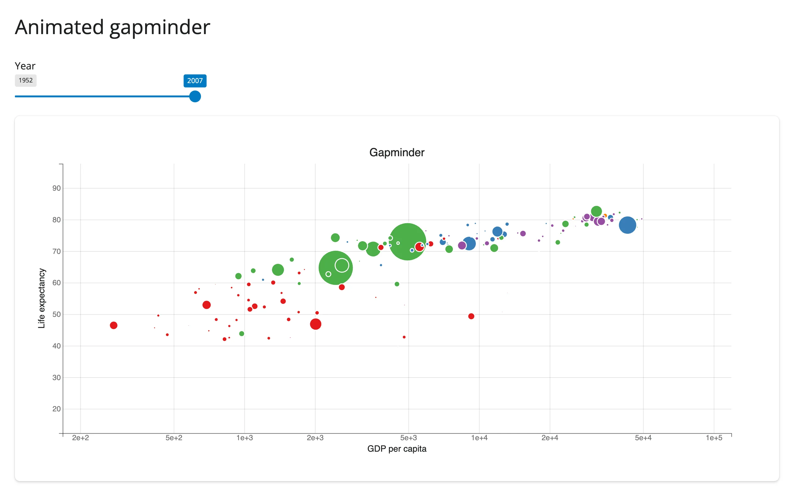

## Installation

```
pip install 'shinywidgets[bqplot]'
```

## Quick start

A figure is scales, a mark built on those scales, and axes that render the scales. Nothing here is bqplot
specific to Shiny -- `@render_bqplot` just displays the `Figure` you return and keeps it sized to its card.

```{.python file="examples/01_quickstart.py"}
# bqplot quick start: a scatter plot colored by species
import bqplot
import plotly.express as px
from shiny.express import ui
from shinywidgets import render_bqplot

ui.page_opts(title="bqplot quick start", fillable=True)

iris = px.data.iris()

with ui.card(full_screen=True):

    @render_bqplot
    def plot():
        x_sc, y_sc = bqplot.LinearScale(), bqplot.LinearScale()
        c_sc = bqplot.OrdinalColorScale(scheme="Set1")
        scatter = bqplot.Scatter(
            x=iris["sepal_length"],
            y=iris["petal_length"],
            color=iris["species"],
            scales={"x": x_sc, "y": y_sc, "color": c_sc},
            default_size=28,
            stroke="white",
        )
        return bqplot.Figure(
            marks=[scatter],
            axes=[
                bqplot.Axis(scale=x_sc, label="Sepal length (cm)"),
                bqplot.Axis(
                    scale=y_sc, orientation="vertical", label="Petal length (cm)"
                ),
            ],
            title="Iris",
        )
```

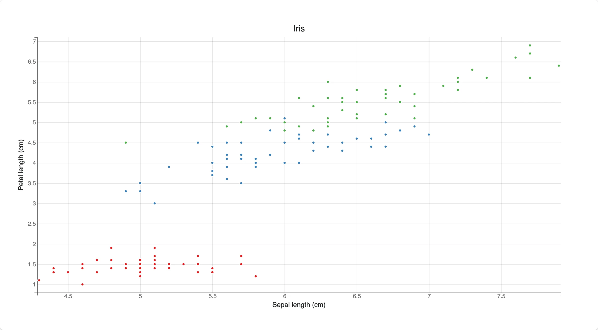

## What you can build

### The grammar: scales, marks, axes

Scales are shared, not owned by a mark, so two marks on the same `x_sc`/`y_sc` always line up -- here a `Scatter`
and a fitted `Lines` mark share one coordinate system.

```{.python file="examples/02_grammar.py"}
# The grammar: scales map data to pixels, marks draw on top of scales, axes
# render the scales. Two marks sharing one pair of scales stay aligned.
import bqplot
import numpy as np
import plotly.express as px
from shiny.express import ui
from shinywidgets import render_bqplot

ui.page_opts(title="bqplot grammar", fillable=True)

tips = px.data.tips()

with ui.card(full_screen=True):

    @render_bqplot
    def plot():
        x_sc, y_sc = bqplot.LinearScale(), bqplot.LinearScale()

        points = bqplot.Scatter(
            x=tips["total_bill"],
            y=tips["tip"],
            scales={"x": x_sc, "y": y_sc},
            colors=["#4c78a8"],
            default_opacities=[0.6],
        )

        # A second mark on the *same* scales: a least-squares fit line
        slope, intercept = np.polyfit(tips["total_bill"], tips["tip"], 1)
        xs = np.array([tips["total_bill"].min(), tips["total_bill"].max()])
        fit = bqplot.Lines(
            x=xs,
            y=slope * xs + intercept,
            scales={"x": x_sc, "y": y_sc},
            colors=["#e45756"],
            stroke_width=3,
        )

        return bqplot.Figure(
            marks=[points, fit],
            axes=[
                bqplot.Axis(scale=x_sc, label="Total bill ($)"),
                bqplot.Axis(scale=y_sc, orientation="vertical", label="Tip ($)"),
            ],
            title="Two marks, one pair of scales",
        )
```

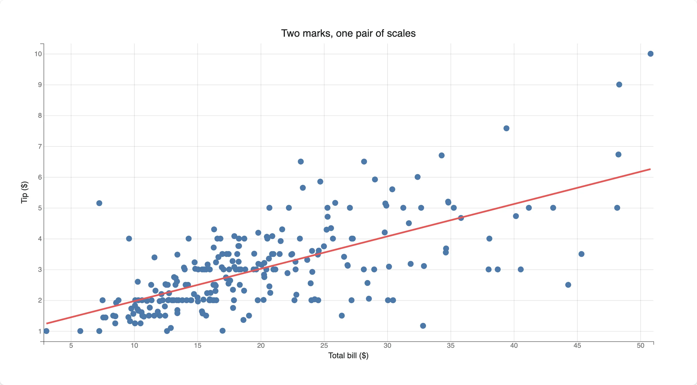

### `bqplot.pyplot`: a matplotlib-like shortcut

`bqplot.pyplot` (usually imported as `bplt`) builds the same object model without naming scales explicitly --
`bplt.scatter()`, `bplt.plot()`, `bplt.hist()` and friends plot onto an implicit "current figure." It's faster to
write but has one sharp edge in Shiny: see [Gotchas](#gotchas-and-limitations).

```{.python file="examples/03_pyplot.py"}
# The same plot through bqplot.pyplot's matplotlib-like shortcuts. Always
# call bplt.figure() first and return its result -- see "Gotchas" for why.
import bqplot.pyplot as bplt
import numpy as np
import plotly.express as px
from shiny.express import ui
from shinywidgets import render_bqplot

ui.page_opts(title="bqplot.pyplot", fillable=True)

tips = px.data.tips()

with ui.card(full_screen=True):

    @render_bqplot
    def plot():
        fig = bplt.figure(title="Two marks, one pair of scales")
        bplt.scatter(
            tips["total_bill"],
            tips["tip"],
            colors=["#4c78a8"],
            default_opacities=[0.6],
        )
        slope, intercept = np.polyfit(tips["total_bill"], tips["tip"], 1)
        xs = np.array([tips["total_bill"].min(), tips["total_bill"].max()])
        bplt.plot(xs, slope * xs + intercept, colors=["#e45756"], stroke_width=3)
        bplt.xlabel("Total bill ($)")
        bplt.ylabel("Tip ($)")
        return fig
```

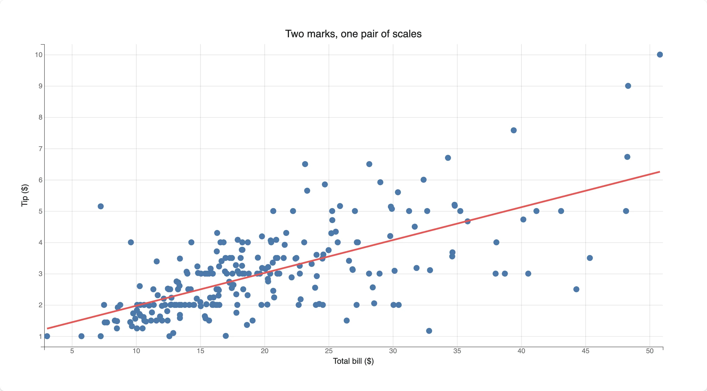

Pixel-for-pixel identical to the object-model version above -- `bqplot.pyplot` is sugar over the same `Figure`.

### Drag the data

Set `enable_move=True` on a `Scatter` and users can pull points around with the mouse; the new `x`/`y` land back
in Python once the drag ends (`update_on_move=True` streams them continuously instead). Combined with
`reactive_read`, a dragged point can refit a regression line live.

```{.python file="examples/04_draggable.py"}
# Draggable marks: enable_move lets users pull points around. x/y land back
# in Python once the drag ends (set update_on_move=True to stream mid-drag).
import bqplot
import numpy as np
from shiny.express import render, ui
from shinywidgets import reactive_read, render_bqplot

ui.page_opts(title="Draggable points", fillable=True)

rng = np.random.default_rng(2)
x0 = np.linspace(1, 10, 12)
y0 = 2 * x0 + rng.normal(0, 2, 12)

with ui.layout_columns(col_widths=[8, 4]):
    with ui.card(full_screen=True):

        @render_bqplot
        def plot():
            x_sc = bqplot.LinearScale(min=0, max=11)
            y_sc = bqplot.LinearScale(min=-5, max=30)
            points = bqplot.Scatter(
                x=x0.copy(),
                y=y0.copy(),
                scales={"x": x_sc, "y": y_sc},
                colors=["#4c78a8"],
                default_size=80,
                enable_move=True,
            )
            fit = bqplot.Lines(
                x=[0, 11],
                y=[0, 22],
                scales={"x": x_sc, "y": y_sc},
                colors=["#e45756"],
                stroke_width=2,
                line_style="dashed",
            )
            return bqplot.Figure(marks=[points, fit], title="Drag a point")

    with ui.card():
        ui.card_header("Fit after dragging")

        @render.code
        def fit_summary():
            points = plot.widget.marks[0]
            x = reactive_read(points, "x")
            y = reactive_read(points, "y")
            slope, intercept = np.polyfit(x, y, 1)

            # In-place update: mutate the existing Lines mark rather than
            # re-rendering the figure, so the drag the user just made stays put
            fit = plot.widget.marks[1]
            xs = np.array([0.0, 11.0])
            fit.x, fit.y = xs, slope * xs + intercept

            return f"y = {slope:.2f}x + {intercept:.2f}"
```

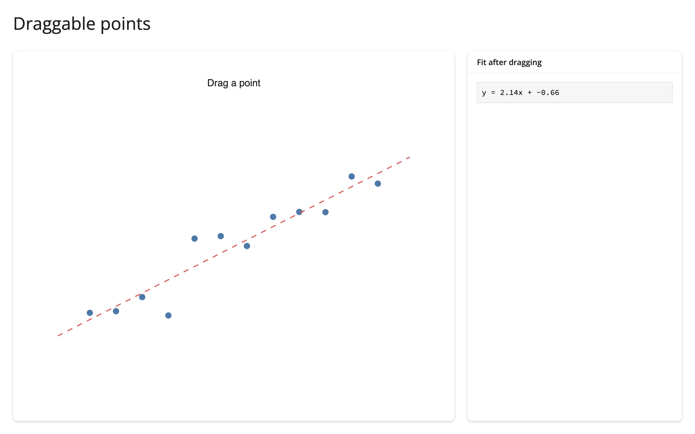 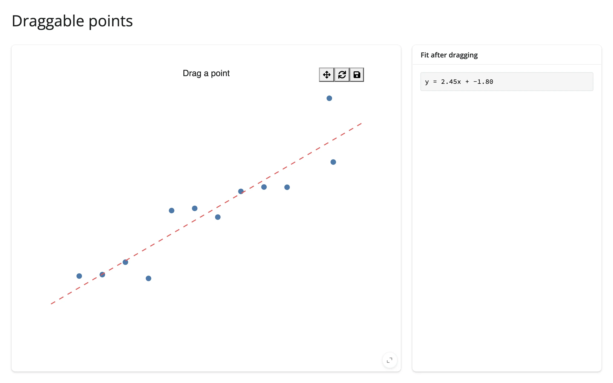

### Smooth, animated updates -- bqplot's signature move

Set `Figure.animation_duration` once; after that, any trait change to a mark's data tweens to its new value
instead of snapping. This is the classic Hans Rosling "bubble chart over time" demo, and it is genuinely
different from re-rendering: the dots glide between years rather than disappearing and reappearing.

```{.python file="examples/05_animated_gapminder.py"}
# bqplot's signature move: set Figure.animation_duration once, then mutate a
# mark's data in an effect. bqplot tweens the points to their new positions
# instead of redrawing, so the slider feels like it's scrubbing through time.
import bqplot
import plotly.express as px
from shiny import reactive
from shiny.express import input, render, ui
from shinywidgets import render_bqplot

ui.page_opts(title="Animated gapminder", fillable=True)

gap = px.data.gapminder()
years = sorted(int(y) for y in gap["year"].unique())
continents = sorted(gap["continent"].unique())

ui.input_slider("year", "Year", min(years), max(years), min(years), step=5, sep="")

with ui.card(full_screen=True):

    @render_bqplot
    def bubbles():
        x_sc = bqplot.LogScale(min=200, max=1e5)
        y_sc = bqplot.LinearScale(min=20, max=90)
        c_sc = bqplot.OrdinalColorScale(domain=continents, scheme="Set1")
        size_sc = bqplot.LinearScale(min=0.0, max=float(gap["pop"].max()))

        points = bqplot.Scatter(
            scales={"x": x_sc, "y": y_sc, "color": c_sc, "size": size_sc},
            default_size=3000,
            default_opacities=[0.7],
            stroke="white",
        )
        fig = bqplot.Figure(
            marks=[points],
            axes=[
                bqplot.Axis(scale=x_sc, label="GDP per capita"),
                bqplot.Axis(scale=y_sc, orientation="vertical", label="Life expectancy"),
            ],
            title="Gapminder",
            animation_duration=750,
        )
        return fig

    @reactive.effect
    def _update_year():
        year_data = gap[gap["year"] == input.year()]
        points = bubbles.widget.marks[0]
        # Setting several traits inside one hold_sync() batches them into a
        # single update message, so the browser doesn't tween x, then y, then
        # size as three separate steps
        with points.hold_sync():
            points.x = year_data["gdpPercap"].to_numpy()
            points.y = year_data["lifeExp"].to_numpy()
            points.color = year_data["continent"].to_numpy()
            points.size = year_data["pop"].to_numpy()
```

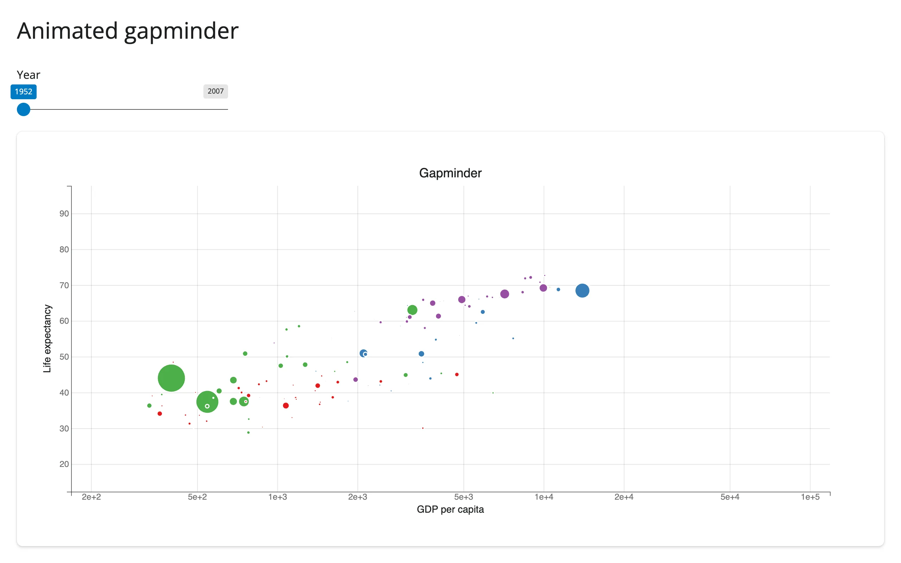 

Note `default_size`: when a mark has a `size` scale, `default_size` is the *maximum* marker area in pixels, not a
per-point constant -- set it too low (the bqplot default is 64) and bubbles with meaningful population values can
render invisibly small.

### The built-in toolbar works

bqplot figures can carry a toolbar (`display_toolbar=True`, the default in some constructors) with pan/zoom,
reset, and save-as-PNG. The pan/zoom button creates a `bqplot.interacts.PanZoom` widget *from the browser*, which
historically needed a Jupyter kernel to open its comm; shinywidgets now opens that comm on demand, so the toolbar
works out of the box, including reset (which closes the PanZoom model cleanly) and PNG export.

```{.python file="examples/06_toolbar.py"}
# The figure's built-in toolbar (pan/zoom, reset, save as PNG) needs its own
# widgets in the browser. shinywidgets opens their Python counterparts on
# demand, so the buttons work without any extra code.
import bqplot
import plotly.express as px
from shiny.express import ui
from shinywidgets import render_bqplot

ui.page_opts(title="Toolbar", fillable=True)

iris = px.data.iris()

with ui.card(full_screen=True):
    ui.card_header("Hover the plot to reveal the toolbar")

    @render_bqplot
    def plot():
        x_sc, y_sc = bqplot.LinearScale(), bqplot.LinearScale()
        scatter = bqplot.Scatter(
            x=iris["sepal_length"],
            y=iris["petal_length"],
            scales={"x": x_sc, "y": y_sc},
            colors=["#4c78a8"],
        )
        return bqplot.Figure(
            marks=[scatter],
            axes=[bqplot.Axis(scale=x_sc), bqplot.Axis(scale=y_sc, orientation="vertical")],
            display_toolbar=True,
        )
```

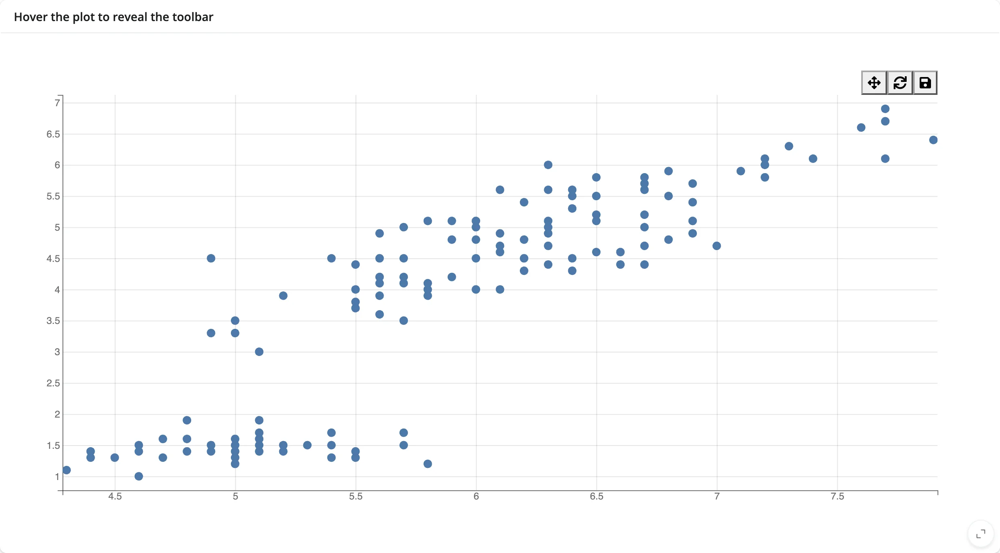 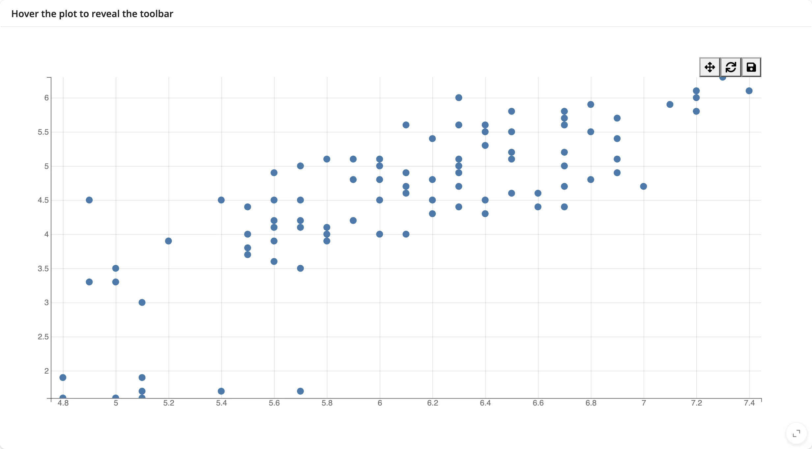

Read the zoomed domain back with `reactive_read(scale, ["min", "max"])` -- see
[Beyond the accessors](#beyond-the-accessors-reactive_read).

### Seven selectors, one trait

bqplot ships `BrushSelector`, `BrushIntervalSelector`, `FastIntervalSelector`, `IndexSelector`, `LassoSelector`,
`MultiSelector`, and `PanZoom` -- all of them just values of a figure's `interaction` trait. Swapping tools is one
assignment, no re-render, and `selected()`/`brush()` pick up whichever selector is active.

```{.python file="examples/07_selectors.py"}
# Seven interaction selectors share the same trait, fig.interaction, so
# swapping tools is one assignment -- no re-render, selected() picks up the
# new selector automatically.
import bqplot
import bqplot.interacts as interacts
import plotly.express as px
from shiny import reactive
from shiny.express import input, render, ui
from shinywidgets import render_bqplot

ui.page_opts(title="Selectors", fillable=True)

iris = px.data.iris()
x_sc, y_sc = bqplot.LinearScale(), bqplot.LinearScale()
scatter = bqplot.Scatter(
    x=iris["sepal_length"],
    y=iris["petal_length"],
    scales={"x": x_sc, "y": y_sc},
    colors=["#4c78a8"],
    selected_style={"fill": "#e45756", "stroke": "black"},
)

ui.input_radio_buttons(
    "tool", "Selector", ["Brush", "Lasso", "Index"], inline=True
)

with ui.layout_columns(col_widths=[8, 4]):
    with ui.card(full_screen=True):

        @render_bqplot
        def plot():
            return bqplot.Figure(
                marks=[scatter],
                axes=[bqplot.Axis(scale=x_sc), bqplot.Axis(scale=y_sc, orientation="vertical")],
                interaction=interacts.BrushSelector(
                    x_scale=x_sc, y_scale=y_sc, marks=[scatter]
                ),
            )

    with ui.card():
        ui.card_header("Selected rows")

        @render.code
        def n_selected():
            sel = plot.selected()[0]
            return "none" if sel is None else f"{len(sel)} point(s)"


@reactive.effect
def _swap_selector():
    tool = input.tool()
    if tool == "Brush":
        new = interacts.BrushSelector(x_scale=x_sc, y_scale=y_sc, marks=[scatter])
    elif tool == "Lasso":
        new = interacts.LassoSelector(x_scale=x_sc, y_scale=y_sc, marks=[scatter])
    else:
        new = interacts.IndexSelector(scale=x_sc, marks=[scatter])
    plot.widget.interaction = new
```

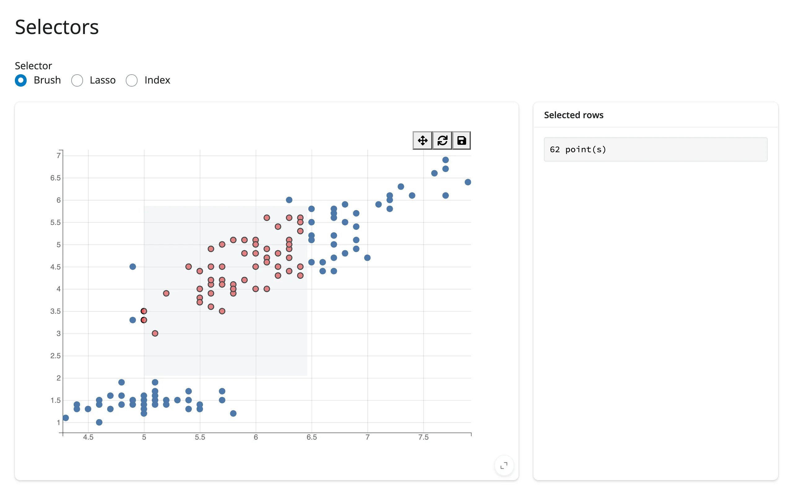 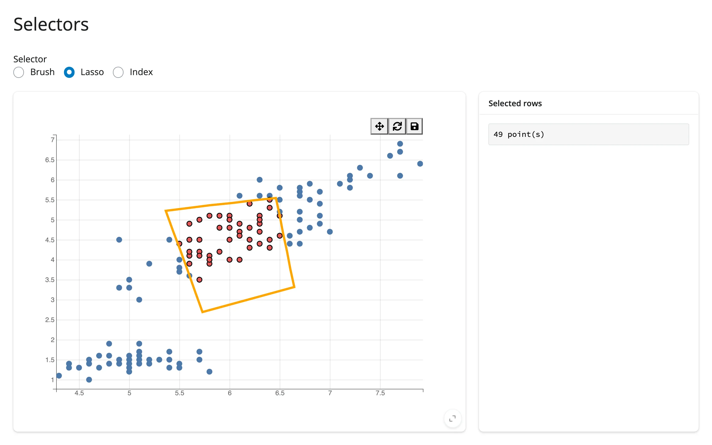

`FastIntervalSelector` and `IndexSelector` need one click to activate before they track the mouse -- that's
upstream bqplot behavior, not a bug. `PanZoom` and `LassoSelector` have no `selected` region to report, which is
why `brush()` returns `None` while either is active (see the accessor reference below).

## Reacting to user interaction

### Accessor reference

| accessor | returns | before any interaction | across re-render | default rate policy |
|---|---|---|---|---|
| `selected()` | `list[numpy.ndarray \| None]`, one entry per mark in `fig.marks` | seeded from each mark's current `selected` (`None` per mark with no selection) | re-seeded: a new figure's marks start unselected | debounced, 250 ms |
| `selected_rows(df, *, mark=None)` | the rows of `df` (pandas, polars, ...; same type out) at one mark's selected positions; `mark` is an index into `fig.marks` or the `Mark` itself, omittable for single-mark figures | empty frame (cancels when `selected()` does) | derived from `selected()` | debounced, 250 ms (follows `selected()`) |
| `brush()` | the active selector's own `selected` region: a 2x2 array (`BrushSelector`), a length-2 array (`BrushIntervalSelector`), a dict of named intervals (`MultiSelector`), or `None` | seeded from the figure's current `interaction` (`None` if nothing is brushed, or `interaction` isn't a brush-family selector) | re-seeded from the new figure's `interaction` | debounced, 250 ms |

Both accessors attach the moment the figure renders -- no warm-up read needed -- and both **re-seed** on every
re-render, when `fig.marks` is replaced, or when `fig.interaction` is swapped (as the toolbar does, or as the
selector example above does): a figure's selection and brush are its own current state, not a record of what the
user did, so you never read a stale value left over from a previous figure. There is deliberately no `clicked()`
accessor: a selector's drag overlay intercepts real clicks on the marks underneath it, so a click accessor would
be silently dead whenever a selector is active; `mark.on_element_click()` remains available for selector-free
figures.

### `selected()`: brush, lasso, or click-select

`selected()` is a list aligned with `fig.marks`; a single-mark figure reads `fig.selected()[0]`. It works
identically whether the figure's `interaction` is a brush, a lasso, or plain click-select
(`interactions={"click": "select"}`, which replaces the mark's default hover tooltip -- add `"hover": "tooltip"`
back if you want both).

```{.python file="examples/08_selection.py"}
# selected() tracks each mark's selected elements. Click-select needs
# interactions={"click": "select"} -- and that replaces the default hover
# tooltip, so add "hover": "tooltip" back if you still want it.
import bqplot
import plotly.express as px
from shiny.express import render, ui
from shinywidgets import render_bqplot

ui.page_opts(title="selected()", fillable=True)

tips = px.data.tips()

with ui.layout_columns(col_widths=[8, 4]):
    with ui.card(full_screen=True):

        @render_bqplot
        def plot():
            x_sc, y_sc = bqplot.LinearScale(), bqplot.LinearScale()
            scatter = bqplot.Scatter(
                x=tips["total_bill"],
                y=tips["tip"],
                scales={"x": x_sc, "y": y_sc},
                colors=["#4c78a8"],
                selected_style={"fill": "#e45756", "stroke": "black"},
                interactions={"click": "select", "hover": "tooltip"},
                tooltip=bqplot.Tooltip(fields=["x", "y"], labels=["bill", "tip"]),
            )
            return bqplot.Figure(
                marks=[scatter],
                axes=[
                    bqplot.Axis(scale=x_sc, label="Total bill ($)"),
                    bqplot.Axis(scale=y_sc, orientation="vertical", label="Tip ($)"),
                ],
            )

    with ui.card():
        ui.card_header("Selected row")

        @render.data_frame
        def detail():
            # empty while nothing is selected; the figure has one mark, so
            # mark= can be omitted
            return plot.selected_rows(tips)
```

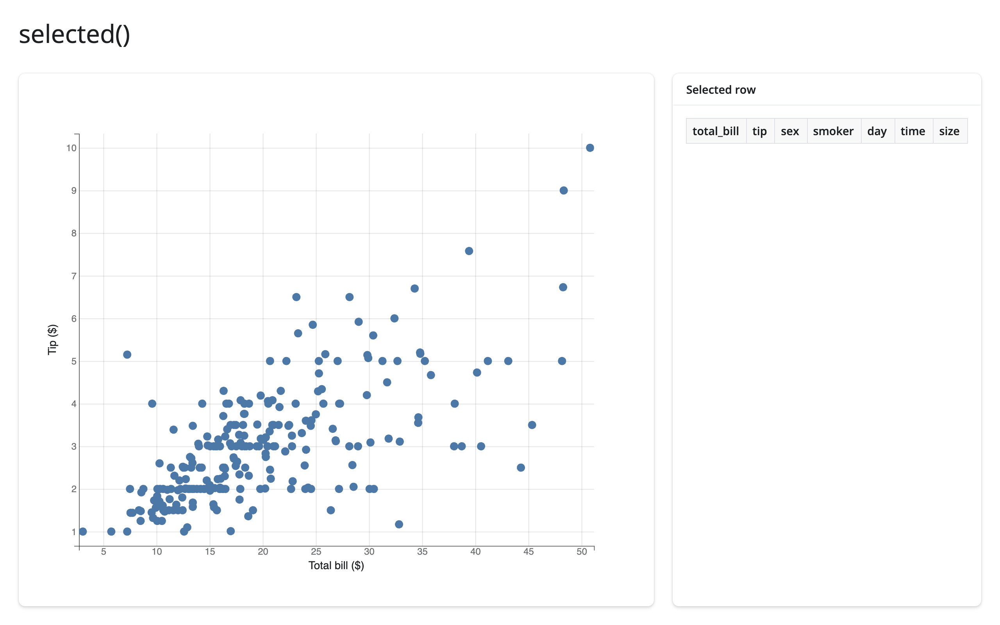 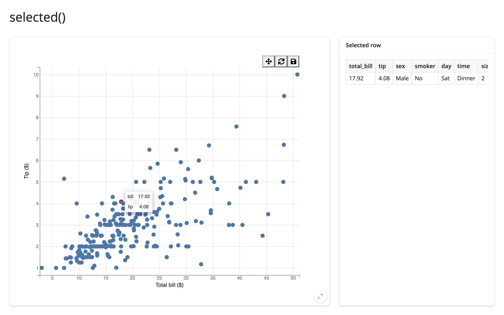

### `selected_rows()`: the selection, as rows of your data frame

When what you want is the selected *rows* -- for a table, a download, or a detail card -- `selected_rows(df)`
is the accessor: it maps one mark's selection back into `df` and returns those rows, in `df`'s own type
(pandas in, pandas out; polars in, polars out). `df` is required -- a bqplot figure retains no data frame --
and it's an empty frame while the mark has nothing selected, so it can be passed straight to
`@render.data_frame` (the table in the example above).

`mark` says which mark's selection maps to `df`'s rows: its index in `fig.marks` (`mark=1`) or the `Mark`
object itself (`mark=scatter`). Omit it when the figure has exactly one mark; with several marks, omitting it
is an error that tells you to pass `mark=`. The match is positional, like `df.iloc[fig.selected()[i]]` --
after a re-render or in-place data replacement (`mark.x = ...`) with different rows, a retained position can
point at a different row, so carry an ID column and look rows up by it when the data can change.

### `brush()`: the selector's own region

`brush()` is not row indices -- it's the brush/interval's own numeric bounds, in data coordinates. Use it when you
want the range itself (to filter a different data frame, label an axis, or query a database), rather than which
points fall inside it.

```{.python file="examples/09_brush.py"}
# brush() reports the active brush selector's own region, in data
# coordinates -- not row indices. Use it to filter a data frame yourself.
import bqplot
from bqplot.interacts import BrushIntervalSelector
import plotly.express as px
from shiny.express import render, ui
from shinywidgets import render_bqplot

ui.page_opts(title="brush()", fillable=True)

tips = px.data.tips()

with ui.layout_columns(col_widths=[8, 4]):
    with ui.card(full_screen=True):

        @render_bqplot
        def plot():
            x_sc, y_sc = bqplot.LinearScale(), bqplot.LinearScale()
            hist = bqplot.Bins(
                sample=tips["total_bill"],
                scales={"x": x_sc, "y": y_sc},
                colors=["#4c78a8"],
                bins=20,
            )
            return bqplot.Figure(
                marks=[hist],
                axes=[
                    bqplot.Axis(scale=x_sc, label="Total bill ($)"),
                    bqplot.Axis(scale=y_sc, orientation="vertical", label="Count"),
                ],
                interaction=BrushIntervalSelector(scale=x_sc, marks=[hist]),
            )

    with ui.card():
        ui.card_header("Bills in the brushed range")

        @render.code
        def summary():
            region = plot.brush()
            if region is None:
                return "Drag across the histogram to brush a range."
            lo, hi = sorted(region.tolist())
            in_range = tips[tips["total_bill"].between(lo, hi)]
            return (
                f"${lo:.2f}-${hi:.2f}: {len(in_range)} bills, "
                f"average tip ${in_range['tip'].mean():.2f}"
            )
```

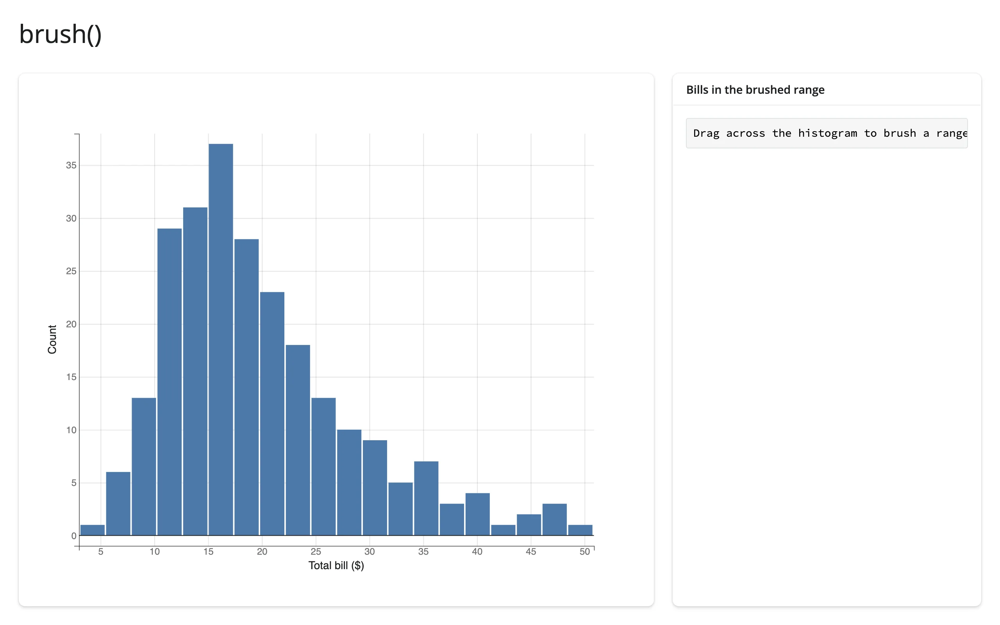 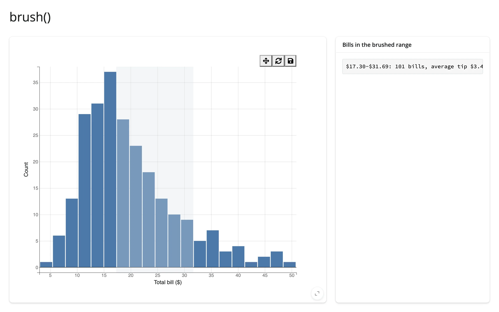

### Beyond the accessors: `reactive_read`

`selected()` and `brush()` cover the two traits most apps need, but any trait on the figure, a mark, a scale, or
the active interaction is readable with `reactive_read()`. A mark, a scale, and a selector are all objects nested
*inside* the figure, not the figure widget itself (`fig.widget`), so `fig.read(...)` -- which only looks at
`fig.widget`'s own traits -- can't reach them; `reactive_read()` on the specific sub-object is the right tool.
Two traits worth knowing:

- **`brushing`** on brush-family selectors is `True` only while the mouse button is down. Gate expensive
  downstream work on it going back to `False` rather than recomputing on every intermediate drag position.
- **A `PanZoom`'s scales** report the zoomed-in domain as the user pans: `reactive_read(scale, "min")` and
  `"max"` give the currently visible range, `None` until the user has zoomed at least once.

```{.python file="examples/10_reactive_read.py"}
# Beyond the accessors: reactive_read() on any trait. "brushing" is True only
# while the mouse button is down, so gate expensive work on it going False.
# A PanZoom's scales report the zoomed-in domain as the user pans.
import bqplot
from bqplot.interacts import BrushIntervalSelector, PanZoom
import numpy as np
from shiny import req
from shiny.express import render, ui
from shinywidgets import reactive_read, render_bqplot

ui.page_opts(title="reactive_read()", fillable=True)

rng = np.random.default_rng(0)
x = np.sort(rng.uniform(0, 100, 500))
y = rng.normal(0, 1, 500).cumsum()

with ui.layout_columns():
    with ui.card():
        ui.card_header('Gate on "brushing" to skip mid-drag work')

        @render_bqplot
        def brushed():
            x_sc, y_sc = bqplot.LinearScale(), bqplot.LinearScale()
            line = bqplot.Lines(x=x, y=y, scales={"x": x_sc, "y": y_sc})
            return bqplot.Figure(
                marks=[line],
                interaction=BrushIntervalSelector(scale=x_sc, marks=[line]),
            )

        @render.code
        def gated_mean():
            brush = brushed.widget.interaction
            selected = reactive_read(brush, "selected")
            req(selected is not None)
            req(not reactive_read(brush, "brushing"))  # wait for mouseup
            lo, hi = sorted(selected.tolist())
            mask = (x >= lo) & (x <= hi)
            return f"mean y in [{lo:.1f}, {hi:.1f}]: {y[mask].mean():.2f}"

    with ui.card():
        ui.card_header("Read the zoomed domain from PanZoom")

        @render_bqplot
        def zoomable():
            x_sc, y_sc = bqplot.LinearScale(), bqplot.LinearScale()
            line = bqplot.Lines(x=x, y=y, scales={"x": x_sc, "y": y_sc})
            return bqplot.Figure(
                marks=[line],
                interaction=PanZoom(scales={"x": [x_sc], "y": [y_sc]}),
            )

        @render.code
        def visible_domain():
            x_sc = zoomable.widget.marks[0].scales["x"]
            lo = reactive_read(x_sc, "min")
            hi = reactive_read(x_sc, "max")
            return f"visible x range: {lo}-{hi}" if lo is not None else "unzoomed"
```

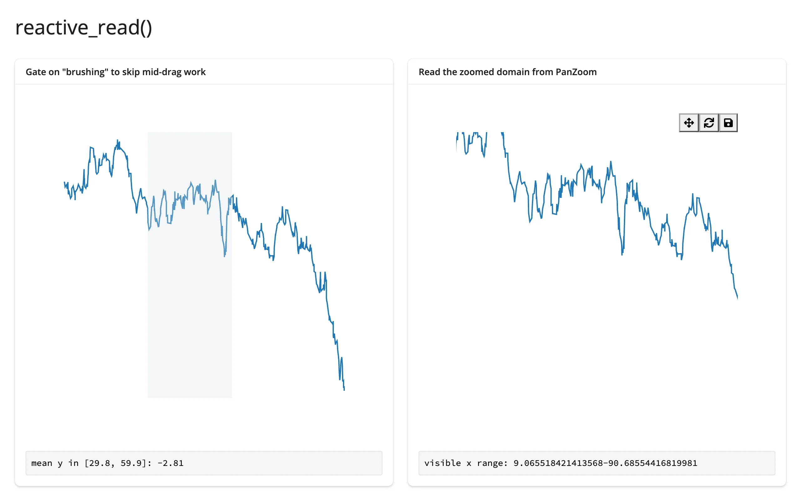

### Rate limiting

Both accessors debounce at 250 ms by default, because brush and lasso selectors stream updates throughout the
drag, not just at release. Pass `rate_policy="throttle"` (evenly spaced updates during the gesture) or
`rate_delay=` (seconds; `0` disables rate limiting) to the decorator to change this per output. The same
`reactive_read()` calls are unaffected unless you pass `rate_delay` too.

```{.python file="examples/11_rate_limiting.py"}
# Accessors default to a 250ms debounce (brush selectors stream updates
# mid-drag). rate_policy/rate_delay on the decorator change that per output.
import bqplot
from bqplot.interacts import BrushIntervalSelector
import numpy as np
from shiny.express import render, ui
from shinywidgets import render_bqplot

ui.page_opts(title="Rate limiting", fillable=True)

x = np.linspace(0, 10, 200)
y = np.sin(x)


def make_fig():
    x_sc, y_sc = bqplot.LinearScale(), bqplot.LinearScale()
    line = bqplot.Lines(x=x, y=y, scales={"x": x_sc, "y": y_sc})
    return bqplot.Figure(
        marks=[line], interaction=BrushIntervalSelector(scale=x_sc, marks=[line])
    )


# Plain counters, not reactive.value: a render function may not write to a
# reactive value it also reads, or it retriggers itself in a tight loop
counts = {"debounced": 0, "throttled": 0}

with ui.layout_columns():
    with ui.card():
        ui.card_header("Default: debounce, 250ms")

        @render_bqplot
        def debounced():
            return make_fig()

        @render.code
        def debounced_label():
            debounced.brush()
            counts["debounced"] += 1
            return f"brush() re-fired {counts['debounced']} times"

    with ui.card():
        ui.card_header('rate_policy="throttle", rate_delay=0.05')

        @render_bqplot(rate_policy="throttle", rate_delay=0.05)
        def throttled():
            return make_fig()

        @render.code
        def throttled_label():
            throttled.brush()
            counts["throttled"] += 1
            return f"brush() re-fired {counts['throttled']} times"
```

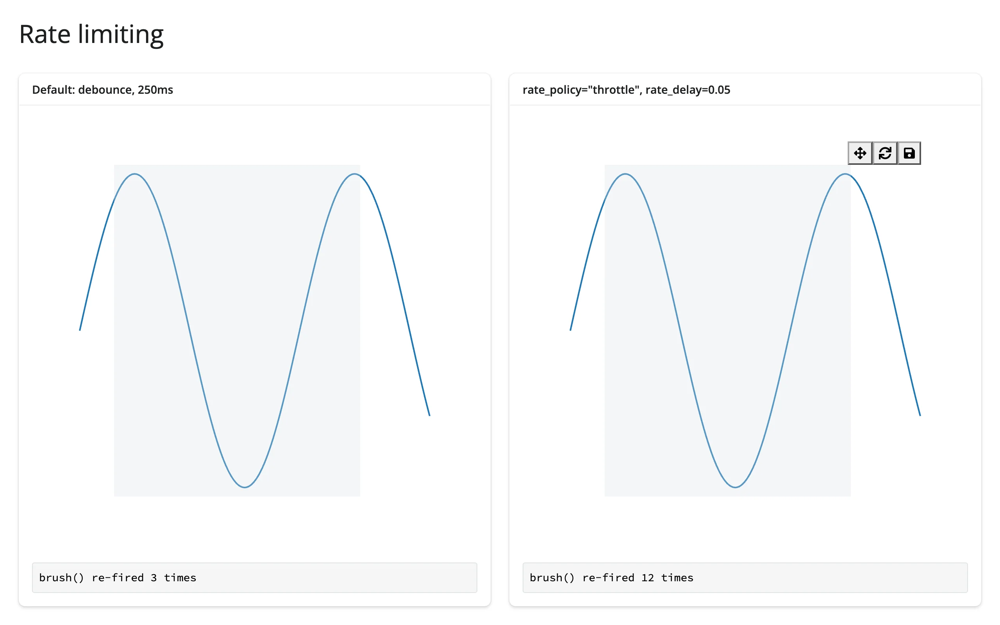

Driving the same drag gesture at both panels: the debounced panel settled after 4 updates, the 50 ms throttle
fired 14 times during the same drag.

### Reading an accessor on demand

`selected_rows()` is seeded the moment the figure renders (an empty frame while nothing is selected), so
it's safe to read somewhere that only runs occasionally -- a download handler, say -- with no prior read
needed first:

```{.python file="examples/17_download_selection.py"}
import bqplot
import numpy as np
import pandas as pd
from bqplot.interacts import BrushSelector
from shiny.express import render, ui
from shinywidgets import render_bqplot

ui.page_opts(title="Reading selected_rows() on demand", fillable=True)

rng = np.random.default_rng(0)
points = pd.DataFrame(
    {"x": rng.uniform(0, 10, 300), "y": rng.uniform(0, 10, 300)}
)
x, y = points["x"], points["y"]

with ui.layout_columns(col_widths=[8, 4]):
    with ui.card(full_screen=True):
        ui.card_header("Brush a region, then download -- no need to click anything first")

        @render_bqplot
        def plot():
            x_sc, y_sc = bqplot.LinearScale(), bqplot.LinearScale()
            scatter = bqplot.Scatter(x=x, y=y, scales={"x": x_sc, "y": y_sc})
            return bqplot.Figure(
                marks=[scatter],
                interaction=BrushSelector(x_scale=x_sc, y_scale=y_sc, marks=[scatter]),
            )

    with ui.card():

        @render.download_button(
            filename="brushed.csv", label="Download brushed points as CSV"
        )
        def download():
            # selected_rows() is live from the moment the figure renders, so
            # this reads whatever's currently brushed, even on its first run.
            yield plot.selected_rows(points).to_csv(index=False)
```

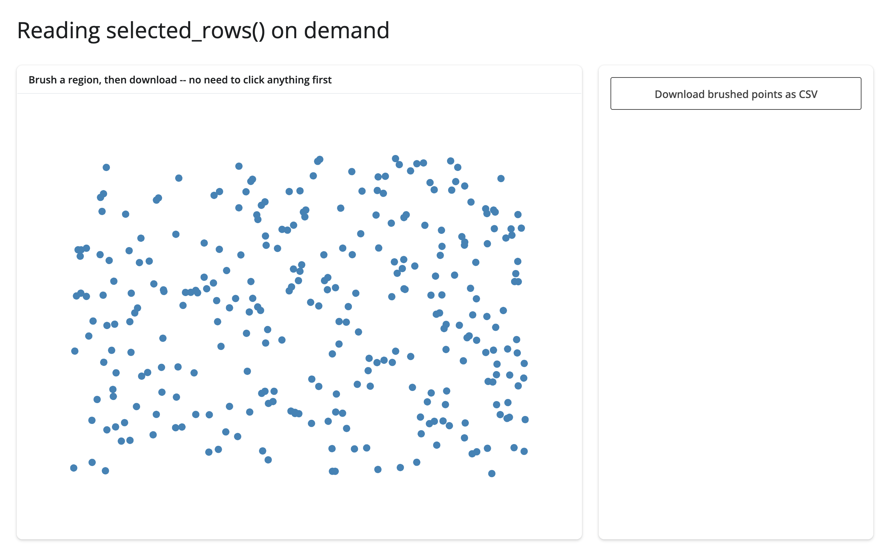
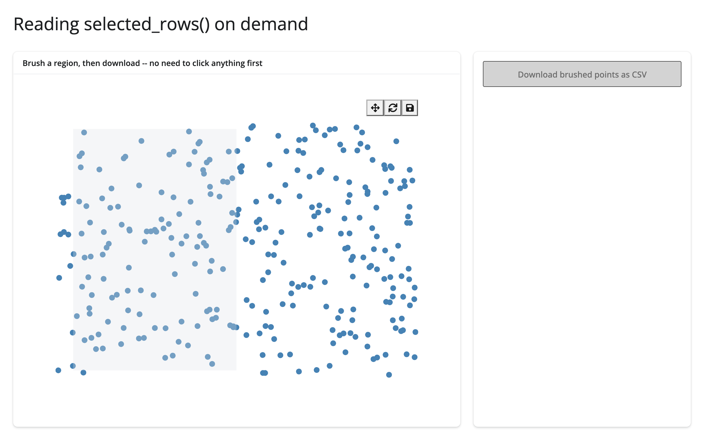

## Updating the widget from Python

Two ways to change what a `render_bqplot` output shows: return a new `Figure` from the render function (a
**re-render**), or mutate the existing `Figure`'s traits from an effect or another output (an **in-place
update**). Re-rendering is simpler but throws away everything the user did to the old figure -- any `PanZoom`
zoom/pan state, any selection -- because a fresh `Figure` means fresh scales and fresh marks. In-place updates
keep the user's view exactly where it was and, with `animation_duration` set, animate the change instead of
snapping to it.

```{.python file="examples/12_inplace_vs_rerender.py"}
# Re-rendering rebuilds the figure (and its scales), so any PanZoom state is
# lost. Mutating the existing mark's data preserves zoom/pan and animates.
# reactive.isolate() reads .widget without tying this effect to the render.
import bqplot
import numpy as np
from shiny import reactive
from shiny.express import input, ui
from shinywidgets import render_bqplot

ui.page_opts(title="In-place vs re-render", fillable=True)
ui.input_slider("phase", "Phase shift", 0, 10, 0, step=0.5)

x = np.linspace(0, 10, 200)


def panzoom_fig(y: np.ndarray) -> bqplot.Figure:
    x_sc, y_sc = bqplot.LinearScale(), bqplot.LinearScale()
    line = bqplot.Lines(x=x, y=y, scales={"x": x_sc, "y": y_sc})
    return bqplot.Figure(
        marks=[line], interaction=bqplot.interacts.PanZoom(scales={"x": [x_sc], "y": [y_sc]})
    )


with ui.layout_columns():
    with ui.card(full_screen=True):
        ui.card_header("Re-render: zoom resets on every change")

        @render_bqplot
        def rerendered():
            return panzoom_fig(np.sin(x + input.phase()))

    with ui.card(full_screen=True):
        ui.card_header("In-place: zoom survives, the line animates")

        @render_bqplot
        def inplace():
            # Doesn't depend on input.phase(): built once, edited afterward
            fig = panzoom_fig(np.sin(x))
            fig.animation_duration = 400
            return fig


@reactive.effect
def _update_inplace():
    phase = input.phase()
    with reactive.isolate():
        fig = inplace.widget
    fig.marks[0].y = np.sin(x + phase)
```

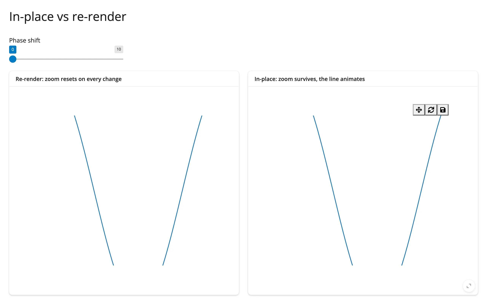 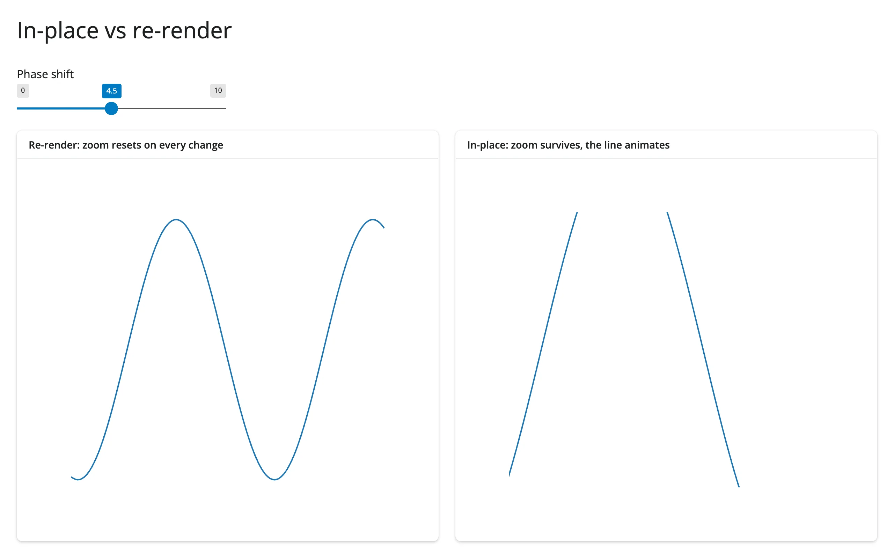

Both panels were zoomed in identically before the phase slider moved. After the change, the re-render panel
(left) has snapped back to its full, unzoomed domain; the in-place panel (right) kept the same zoomed-in view and
animated the line to its new phase. `reactive.isolate()` around `.widget` keeps this effect's only reactive
dependency on `input.phase()` -- reading `.widget` directly would also make the effect depend on `inplace`'s own
render, which it never needs to.

The gapminder example above uses the same pattern at a larger scale: the figure is built once, with
`animation_duration` set, and a `reactive.effect` reacting to `input.year()` is the only thing that ever touches
`points.x/y/color/size` again.

## Coordinating multiple views

### Brush select &rarr; filtered table

The most direct pattern: read `selected_rows(df)` and hand the selected rows to `render.data_frame`. No
effects needed, since `render.data_frame` already re-runs whenever the accessor's value changes.

```{.python file="examples/13_linked_lasso_table.py"}
# Pattern: lasso select -> filtered table. selected_rows() maps the lasso
# back to rows of the data frame, no manual event wiring.
import bqplot
import bqplot.interacts as interacts
import plotly.express as px
from shiny.express import render, ui
from shinywidgets import render_bqplot

ui.page_opts(title="Lasso to table", fillable=True)

gap2007 = px.data.gapminder().query("year == 2007").reset_index(drop=True)

with ui.layout_columns(col_widths=[7, 5]):
    with ui.card(full_screen=True):
        ui.card_header("Lasso countries")

        @render_bqplot
        def plot():
            x_sc = bqplot.LogScale()
            y_sc = bqplot.LinearScale()
            scatter = bqplot.Scatter(
                x=gap2007["gdpPercap"],
                y=gap2007["lifeExp"],
                scales={"x": x_sc, "y": y_sc},
                colors=["#4c78a8"],
                selected_style={"fill": "#e45756"},
                unselected_style={"opacity": 0.4},
            )
            return bqplot.Figure(
                marks=[scatter],
                axes=[
                    bqplot.Axis(scale=x_sc, label="GDP per capita"),
                    bqplot.Axis(scale=y_sc, orientation="vertical", label="Life expectancy"),
                ],
                interaction=interacts.LassoSelector(
                    x_scale=x_sc, y_scale=y_sc, marks=[scatter]
                ),
            )

    with ui.card():
        ui.card_header("Lassoed countries")

        @render.data_frame
        def table():
            # empty while nothing is lassoed, so it can be passed straight
            # to render.data_frame
            rows = plot.selected_rows(gap2007)
            return render.DataGrid(rows[["country", "lifeExp", "gdpPercap"]])
```

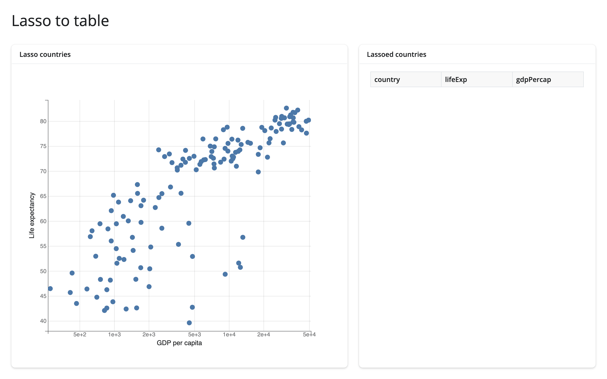 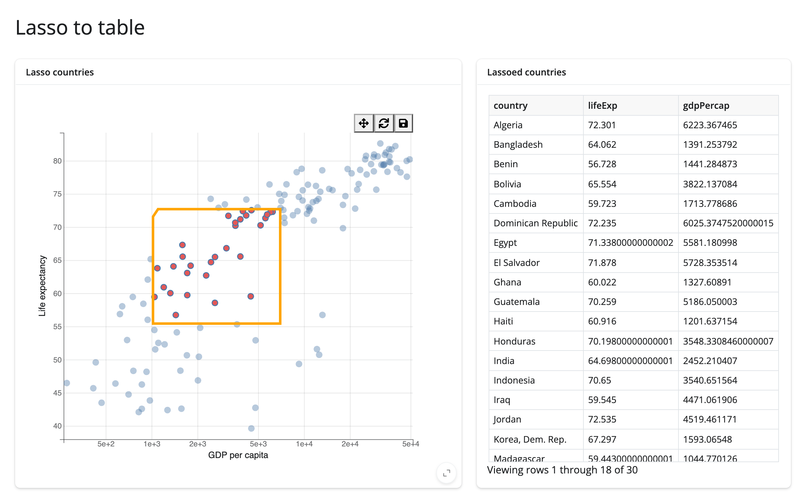

### Click &rarr; detail card

A click-selection is one row of `selected_rows()`; read it as a scalar row for a detail view.

```{.python file="examples/14_linked_click_detail.py"}
# Pattern: click a point -> detail card. A single-click selection is one row
# of selected_rows(), so the same accessor drives a 1-row detail view.
import bqplot
import plotly.express as px
from shiny.express import render, ui
from shinywidgets import render_bqplot

ui.page_opts(title="Click to detail", fillable=True)

tips = px.data.tips()

with ui.layout_columns(col_widths=[7, 5]):
    with ui.card(full_screen=True):
        ui.card_header("Click a table visit")

        @render_bqplot
        def plot():
            x_sc, y_sc = bqplot.LinearScale(), bqplot.LinearScale()
            scatter = bqplot.Scatter(
                x=tips["total_bill"],
                y=tips["tip"],
                scales={"x": x_sc, "y": y_sc},
                colors=["#4c78a8"],
                selected_style={"fill": "#e45756", "stroke": "black"},
                interactions={"click": "select", "hover": "tooltip"},
            )
            return bqplot.Figure(
                marks=[scatter],
                axes=[
                    bqplot.Axis(scale=x_sc, label="Total bill ($)"),
                    bqplot.Axis(scale=y_sc, orientation="vertical", label="Tip ($)"),
                ],
            )

    with ui.card():
        ui.card_header("Visit detail")

        @render.ui
        def detail():
            rows = plot.selected_rows(tips)
            if len(rows) == 0:
                return ui.p("Click a point to see its details.")
            row = rows.iloc[0]  # a click selects a single visit
            pct = 100 * row["tip"] / row["total_bill"]
            return ui.TagList(
                ui.h5(f"{row['day']} {row['time']}"),
                ui.p(f"Party of {row['size']}, bill ${row['total_bill']:.2f}"),
                ui.p(f"Tip ${row['tip']:.2f} ({pct:.0f}%)"),
            )
```

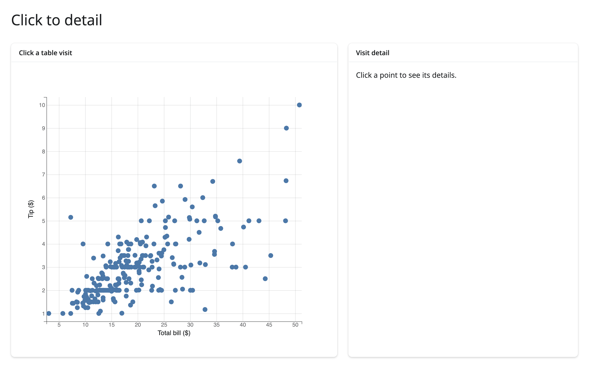 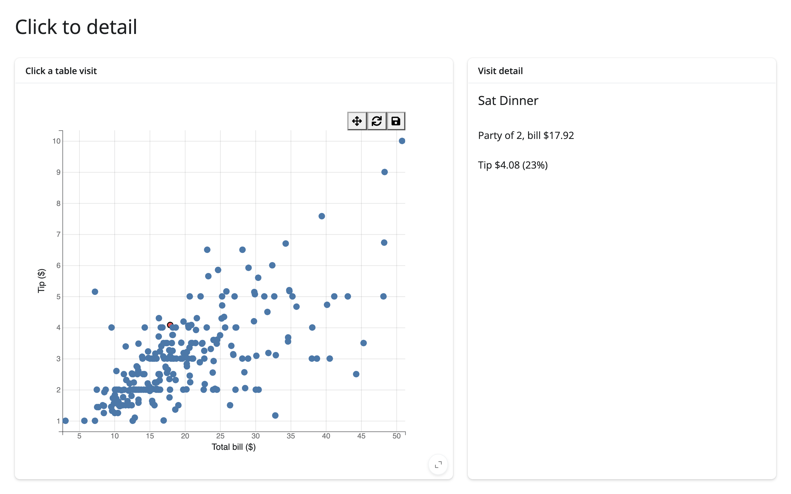

### Widget state &rarr; another widget updated in place

bqplot's own selectors can only highlight marks on the figure they're attached to (see
[Gotchas](#gotchas-and-limitations)). To link a *second*, separately rendered figure, go through Python: read
`selected()` on the first figure, and set `.selected` on the second figure's mark from an effect. Nothing
re-renders on either side.

```{.python file="examples/15_linked_brushing.py"}
# Pattern: widget state -> another widget updated in place. bqplot's own
# selectors can only highlight marks on the figure they're attached to, so
# linking a *second* figure goes through Python: read selected() here, set
# .selected on the other figure's mark in an effect. No re-render either side.
import bqplot
import bqplot.interacts as interacts
import plotly.express as px
from shiny import reactive
from shiny.express import render, ui
from shinywidgets import render_bqplot

ui.page_opts(title="Linked brushing", fillable=True)

gap2007 = px.data.gapminder().query("year == 2007").reset_index(drop=True)
gdp_sc, life_sc, pop_sc = bqplot.LogScale(), bqplot.LinearScale(), bqplot.LogScale()

with ui.layout_columns():
    with ui.card(full_screen=True):
        ui.card_header("GDP vs life expectancy (brush here)")

        @render_bqplot
        def left():
            wealth = bqplot.Scatter(
                x=gap2007["gdpPercap"],
                y=gap2007["lifeExp"],
                scales={"x": gdp_sc, "y": life_sc},
                colors=["#4c78a8"],
                selected_style={"fill": "#e45756"},
                unselected_style={"opacity": 0.3},
            )
            return bqplot.Figure(
                marks=[wealth],
                axes=[bqplot.Axis(scale=gdp_sc), bqplot.Axis(scale=life_sc, orientation="vertical")],
                interaction=interacts.BrushSelector(x_scale=gdp_sc, y_scale=life_sc, marks=[wealth]),
            )

    with ui.card(full_screen=True):
        ui.card_header("Population vs life expectancy (same countries highlight)")

        @render_bqplot
        def right():
            by_pop = bqplot.Scatter(
                x=gap2007["pop"],
                y=gap2007["lifeExp"],
                scales={"x": pop_sc, "y": life_sc},
                colors=["#4c78a8"],
                selected_style={"fill": "#e45756"},
                unselected_style={"opacity": 0.3},
            )
            return bqplot.Figure(
                marks=[by_pop],
                axes=[bqplot.Axis(scale=pop_sc), bqplot.Axis(scale=life_sc, orientation="vertical")],
            )


with ui.card():

    @render.code
    def count():
        sel = left.selected()[0]
        return "no countries brushed" if sel is None else f"{len(sel)} countries"


@reactive.effect
def _highlight_right():
    sel = left.selected()[0]
    with reactive.isolate():
        by_pop = right.widget.marks[0]
    by_pop.selected = sel
```

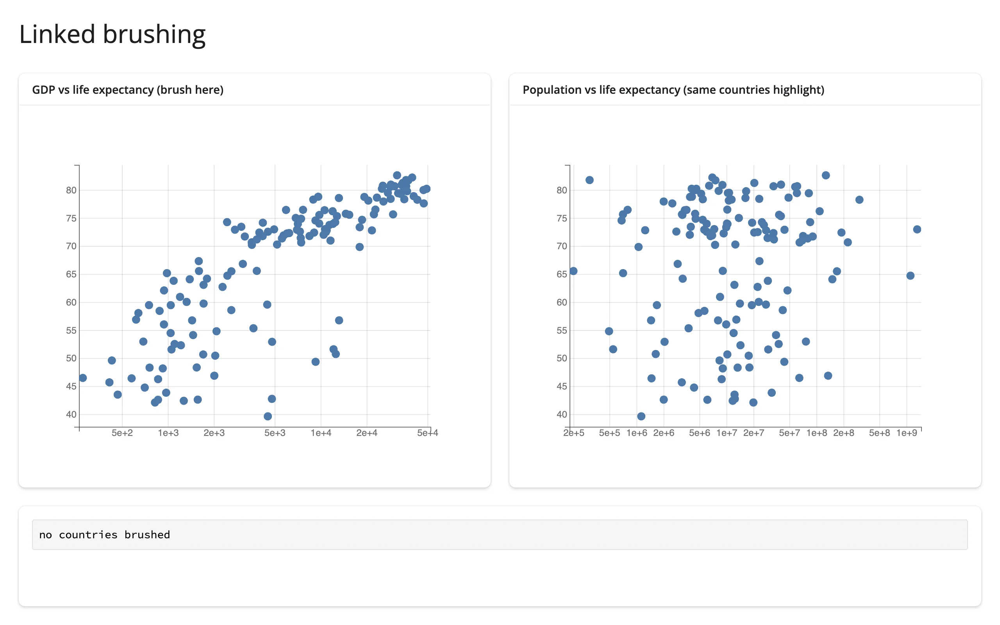 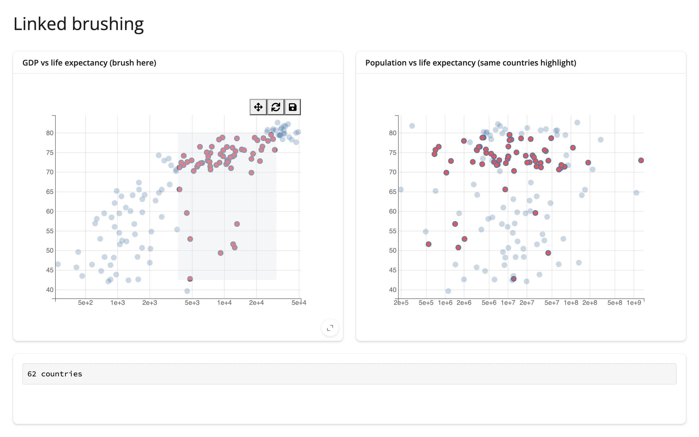

## Large data

bqplot has no large-data mode: marks are individual SVG/Canvas elements with no WebGL backend and no
server-side rasterization, so every mark the browser draws (and every selector hit-tests) is drawn directly.
Upstream bqplot documents no specific row/mark ceiling, and we didn't measure one this pass. For data that needs
to scale into the millions, pair bqplot's brush/selector interactions with a widget built for scale and drive it
from the Python round-trip pattern in [Coordinating multiple views](#coordinating-multiple-views) above instead
of plotting the raw data in bqplot itself -- see [holoviews+datashader](../holoviews/index.md#large-data) for a
density raster or [jscatter](../jscatter/index.md#large-data) for a GPU scatter. See
[Large data & performance](../../guide/performance/index.md#three-approaches-to-large-data) for how those
compare.

## Layout and sizing

A `render_bqplot` output fills its card by default, the same as every other shinywidgets renderer.
`render_bqplot(height=...)` sets an exact pixel height on the *output*; `Figure(layout={"height": ...})` sets it
one level down, on the figure itself, which also opts that figure out of filling its container.

```{.python file="examples/16_layout_sizing.py"}
# By default a figure fills its card. render_bqplot(height=...) sets an
# exact pixel height instead; Figure(layout={"height": ...}) does the same
# thing one level down, and also opts the output out of filling.
import bqplot
from shiny.express import ui
from shinywidgets import render_bqplot

ui.page_opts(title="Layout and sizing", fillable=True)


def line_fig(title: str, **kwargs: object) -> bqplot.Figure:
    x_sc, y_sc = bqplot.LinearScale(), bqplot.LinearScale()
    line = bqplot.Lines(x=[1, 2, 3], y=[1, 3, 2], scales={"x": x_sc, "y": y_sc})
    return bqplot.Figure(
        marks=[line],
        axes=[bqplot.Axis(scale=x_sc), bqplot.Axis(scale=y_sc, orientation="vertical")],
        title=title,
        **kwargs,
    )


with ui.layout_columns():
    with ui.card(full_screen=True):
        ui.card_header("Fills the card")

        @render_bqplot
        def fills():
            return line_fig("fill")

    with ui.card():
        ui.card_header("render_bqplot(height=...)")

        @render_bqplot(height="220px")
        def fixed():
            return line_fig("220px")

    with ui.card():
        ui.card_header("Figure(layout={'height': ...})")

        @render_bqplot
        def own_height():
            return line_fig("300px, own layout", layout={"height": "300px"})
```

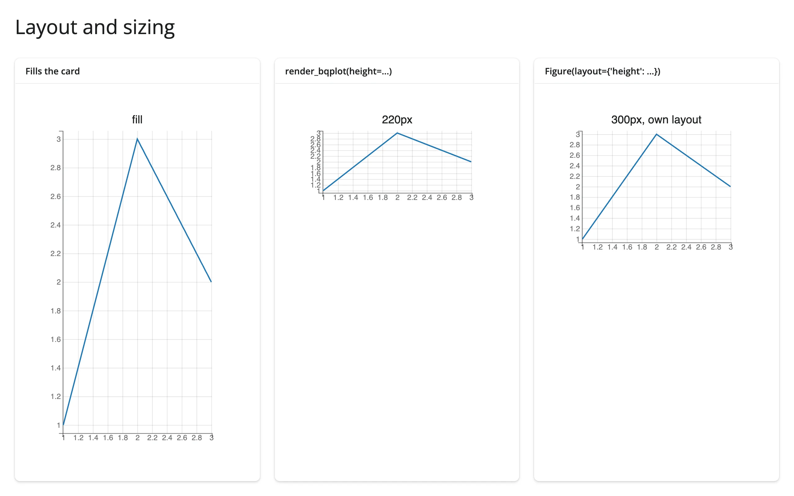

bqplot's default margins (60px on every side) and fixed axis tick counts don't adapt to a small card -- in a
narrow sidebar, pass `fig_margin=dict(top=20, bottom=50, left=55, right=15)` and reduce `Axis(num_ticks=...)`.
`Pie` and `Radar` similarly use pixel-based sizing (`radius=`, and `Radar` has a hard-coded 600px minimum) that
can clip in a small container.

## Gotchas and limitations

- **A shared selector can't highlight marks across two separately rendered figures.** Passing marks from two
  different `render_bqplot` outputs to one `BrushSelector(marks=[mark_a, mark_b])` -- the classic Jupyter "linked
  brushing" idiom -- fails to initialize in shinywidgets: the browser throws `Could not create a view for model
  id ...` and the selector's overlay never appears on *either* figure. Putting both figures in one `HBox` and
  rendering them through `render_widget` doesn't help; the error is the same. Use the Python round-trip pattern
  in [Coordinating multiple views](#widget-state--another-widget-updated-in-place) instead -- it's a few more
  lines but is just as responsive.
- **`bqplot.pyplot`'s "current figure" is a process-global.** Calling `bplt.scatter(...)` (or anything in the
  `bplt` namespace) without first calling `fig = bplt.figure()` reuses one `pyplot` figure across every render,
  output, and session, and fails outright after the first re-render ("widget has been closed"). `bplt.figure(key=
  ...)` doesn't fix this -- the keyed figure persists in pyplot's registry and the *second* render of that output
  fails. Always start a `bqplot.pyplot`-based render function with `fig = bplt.figure(...)` and return `fig`.
- **`BrushSelector.clear = True` and `selector.reset()` are no-ops upstream.** Clear a selection from Python with
  `selector.selected_x = selector.selected_y = None` (or `selected = None` for other selector types) and, if the
  mark should stop looking faded, also set `mark.selected = None`.
- **`FastIntervalSelector` and `IndexSelector` need a click before they track the mouse,** despite their
  docstrings describing mouse control as the default. This matches plain Jupyter/html-manager behavior, so it
  isn't a shinywidgets issue.
- **`default_size` is a maximum, not a per-point size,** once a mark has a `size` scale (see the gapminder
  example above). Setting it too low silently shrinks every bubble to invisible rather than erroring.
- **Small cards clip fixed-pixel elements.** bqplot's default 60px margins, its axis tick counts, and `Pie`'s /
  `Radar`'s pixel-based radii don't shrink with the container -- size cards generously or override `fig_margin`
  and `num_ticks` explicitly.
- **Returning a bare `bqplot.Scatter` (or other mark) instead of a `Figure`** type-checks against
  `render_bqplot`'s current signature but renders a silently blank output, with no error anywhere. Always return
  a `Figure`.

## Gallery candidates

### `template_brush_explorer.py`

A clean ~60-line starting point: brush a scatter plot of restaurant visits and read the selected rows into a
summary and a table, both driven by `selected_rows()`.

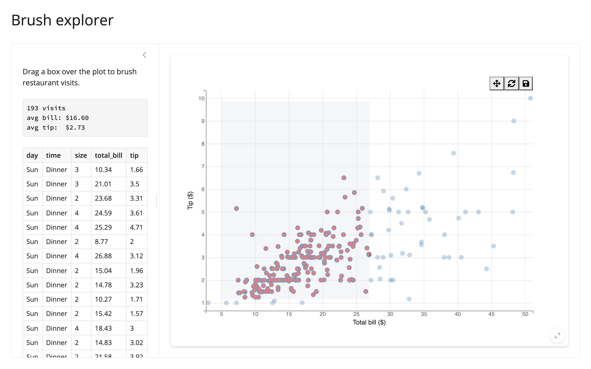

### `showcase_gapminder_explorer.py`

An animated Hans Rosling-style bubble chart with a play/pause autoplay loop, `LassoSelector` on the bubbles, and a
ranked bar chart of the lassoed countries' populations that updates in place (same `hold_sync()`/`animation_
duration` pattern as the quick-start animation). Exercises `selected_rows()` end to end: the lasso drives
both the summary text and the second figure's bars.

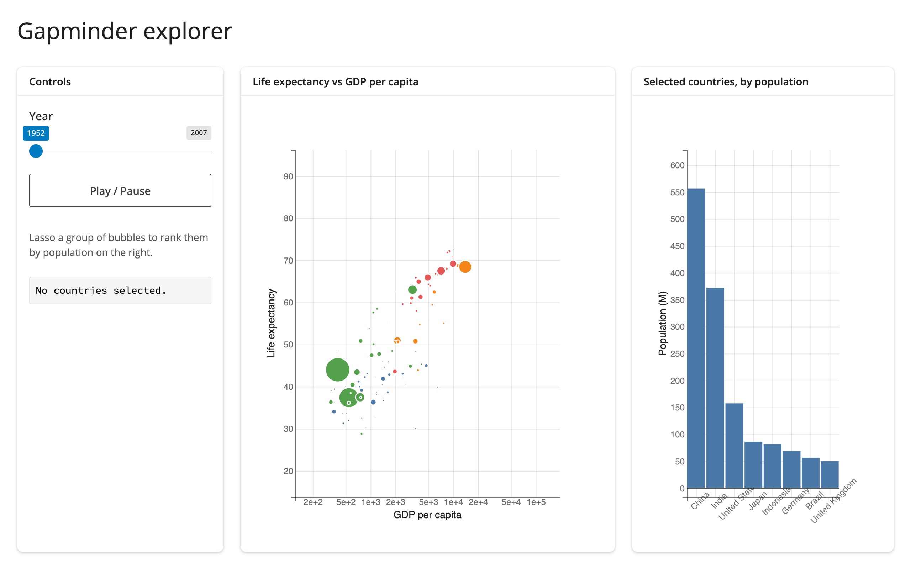 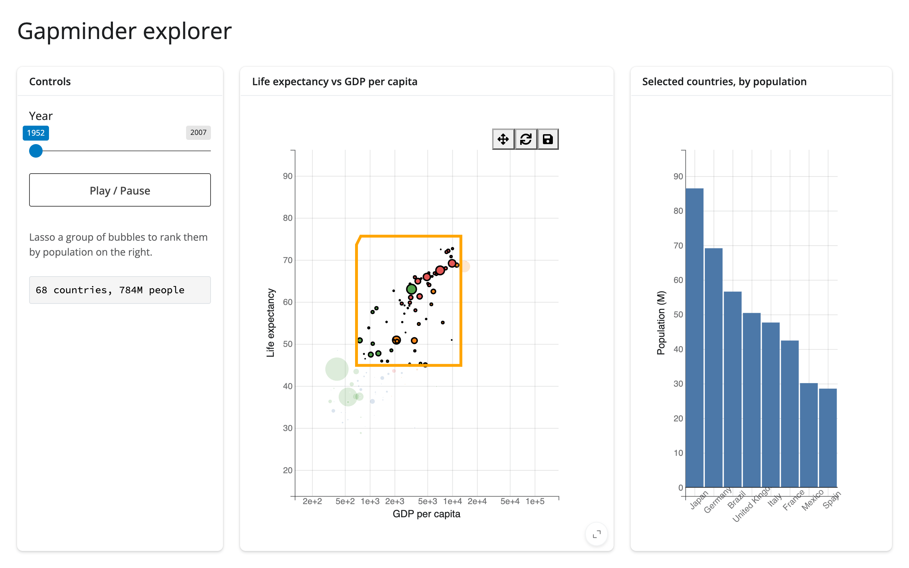

## Learn more

- [bqplot documentation](https://bqplot.github.io/bqplot/) and its
  [example notebooks](https://github.com/bqplot/bqplot/tree/master/examples) for the full mark/scale/axis API
- [bqplot API reference](https://bqplot.github.io/bqplot/api/) for every mark type, scale type, and interaction
- Related guides in this roster: [altair](../altair/index.md), [plotly](../plotly/index.md),
  [itables](../itables/index.md), [reactable](../reactable/index.md)
