[Datashader](https://datashader.org) is the [HoloViz](https://holoviz.org) project's rendering engine for
genuinely large data: instead of sending a browser one marker per row, it aggregates every row into a
screen-sized grid of pixels on the server, using [Numba](https://numba.pydata.org)-compiled kernels that stay
fast from thousands of rows to billions. You reach it through [HoloViews](../holoviews/index.md) or
[hvPlot](https://hvplot.holoviz.org), which wrap a `rasterize()` or `datashade()` operation around a plot and
return a `DynamicMap` that re-aggregates whenever the visible range changes.

There is no dedicated `render_datashader` -- Datashader plots render through the same
[`@render_holoviews`](../holoviews/index.md) decorator as any other HoloViews or hvPlot object. Everything that
guide says about sizing, layout, and the "no accessors, use streams" interaction model applies here unchanged;
this guide only covers what's specific to plotting at scale: the `rasterize`/`datashade`/`dynspread` operations,
aggregators, and -- the feature that matters most for big data -- verifying that re-aggregation on zoom actually
works inside Shiny, since it depends on a stream (`RangeXY`) that has a sharp edge elsewhere in this roster (see
[Gotchas](#gotchas-and-limitations)).

Reach for Datashader when your data is too big to send to the browser as individual marks -- roughly above
100,000-500,000 points, depending on your connection -- and you need the server to decide what's visible. For
smaller data where GPU-accelerated client-side rendering and per-point selection matter more than raw scale, see
[jupyter-scatter](../jscatter/index.md) or [lonboard](../lonboard/index.md) (both handle low millions of points
entirely in the browser, with real per-point lasso selection, something Datashader's aggregated image can't
offer). See [Learn more](#learn-more) for a fuller comparison.

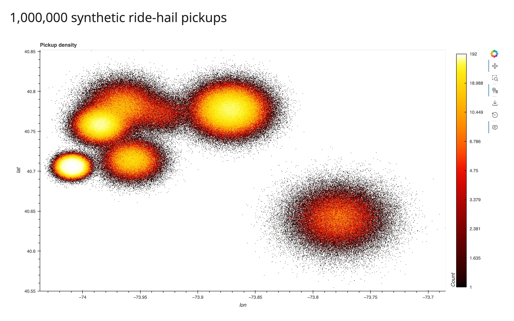

## Installation

```
pip install 'shinywidgets[holoviews]' datashader hvplot
```

`shinywidgets[holoviews]` brings in `holoviews`, `panel`, and `jupyter_bokeh>=4.1` (see the
[HoloViews guide's Installation section](../holoviews/index.md#installation) for why the version floor matters).
`datashader` and `hvplot` are not part of that extra -- add them yourself. Every example below uses hvPlot's
`rasterize=`/`datashade=` kwargs, the fastest way in; the lower-level `holoviews.operation.datashader` functions
(`rasterize()`, `datashade()`, `dynspread()`) are equivalent and used directly in a couple of examples.

## Quick start

[`examples/01_quickstart.py`](examples/01_quickstart.py) -- one million synthetic ride-hail pickups, clustered
around real NYC landmarks (Times Square, Wall Street, JFK, LaGuardia, Central Park) with a Gaussian spread around
each; clearly-labeled synthetic data, chosen so the point count and geography are both realistic:

```{.python file="examples/01_quickstart.py"}
# A million synthetic ride-hail pickups, clustered around real NYC landmarks
# (Times Square, Wall Street, JFK, LaGuardia, Central Park) with a Gaussian
# spread around each -- rasterize=True turns them into a single image-sized
# grid on the server, so the browser never sees more than one plot's worth
# of pixels no matter how many rows went in.
import numpy as np
import pandas as pd
import hvplot.pandas  # noqa: F401 -- registers the .hvplot accessor
from shiny.express import ui

from shinywidgets import render_holoviews

N = 1_000_000
LANDMARKS = {
    "Times Square": (40.758, -73.985, 0.010),
    "Wall Street": (40.706, -74.009, 0.006),
    "JFK Airport": (40.641, -73.778, 0.020),
    "LaGuardia": (40.777, -73.872, 0.015),
    "Central Park": (40.782, -73.965, 0.015),
    "Williamsburg": (40.714, -73.957, 0.012),
    "Astoria": (40.772, -73.930, 0.012),
}

rng = np.random.default_rng(0)
names = list(LANDMARKS)
weights = rng.dirichlet(np.ones(len(names)) * 3)
counts = rng.multinomial(N, weights)
lat, lon = [], []
for name, c in zip(names, counts):
    lat0, lon0, spread = LANDMARKS[name]
    lat.append(rng.normal(lat0, spread, c))
    lon.append(rng.normal(lon0, spread, c))
pickups = pd.DataFrame({"lat": np.concatenate(lat), "lon": np.concatenate(lon)})

ui.page_opts(title=f"{N:,} synthetic ride-hail pickups", fillable=True)


@render_holoviews
def plot():
    return pickups.hvplot.points(
        "lon", "lat", rasterize=True, cnorm="eq_hist", cmap="fire",
        responsive=True, colorbar=True, title="Pickup density",
    )
```


`rasterize=True` is the whole integration: hvPlot wraps the points in a `DynamicMap`, aggregates them into a grid
sized to the output's pixels, and colors that grid with `cmap`. `cnorm="eq_hist"` (histogram-equalized color
scaling) is almost always what you want for real data -- it keeps sparse outskirts visible next to dense cores,
which a linear scale would wash out to a single color. The million rows never leave the server; only a
~760x600-ish image does.

## What you can build

### `rasterize` vs `datashade`: which one and why

[`examples/02_rasterize_vs_datashade.py`](examples/02_rasterize_vs_datashade.py) -- same 500,000 points, two
operations:

```{.python file="examples/02_rasterize_vs_datashade.py"}
# rasterize=True sends a scalar field with a live colorbar and hover values;
# datashade=True bakes the colors into an RGBA image server-side instead --
# no colorbar or hover, but a smaller payload (see the guide's payload table).
import numpy as np
import pandas as pd
import hvplot.pandas  # noqa: F401
from shiny.express import ui

from shinywidgets import render_holoviews

N = 500_000
LANDMARKS = {
    "Times Square": (40.758, -73.985, 0.010),
    "Wall Street": (40.706, -74.009, 0.006),
    "JFK Airport": (40.641, -73.778, 0.020),
}
rng = np.random.default_rng(0)
names = list(LANDMARKS)
weights = rng.dirichlet(np.ones(len(names)) * 3)
counts = rng.multinomial(N, weights)
lat, lon = [], []
for name, c in zip(names, counts):
    lat0, lon0, spread = LANDMARKS[name]
    lat.append(rng.normal(lat0, spread, c))
    lon.append(rng.normal(lon0, spread, c))
pickups = pd.DataFrame({"lat": np.concatenate(lat), "lon": np.concatenate(lon)})

ui.page_opts(title="rasterize vs datashade", fillable=True)

with ui.layout_columns():
    with ui.card(full_screen=True):
        ui.card_header("rasterize=True -- colorbar + hover values")

        @render_holoviews
        def raster():
            return pickups.hvplot.points(
                "lon", "lat", rasterize=True, cnorm="eq_hist", cmap="fire",
                responsive=True, colorbar=True,
            )

    with ui.card(full_screen=True):
        ui.card_header("datashade=True -- no colorbar/hover, smaller payload")

        @render_holoviews
        def shade():
            return pickups.hvplot.points(
                "lon", "lat", datashade=True, cnorm="eq_hist", cmap="fire",
                responsive=True,
            )
```

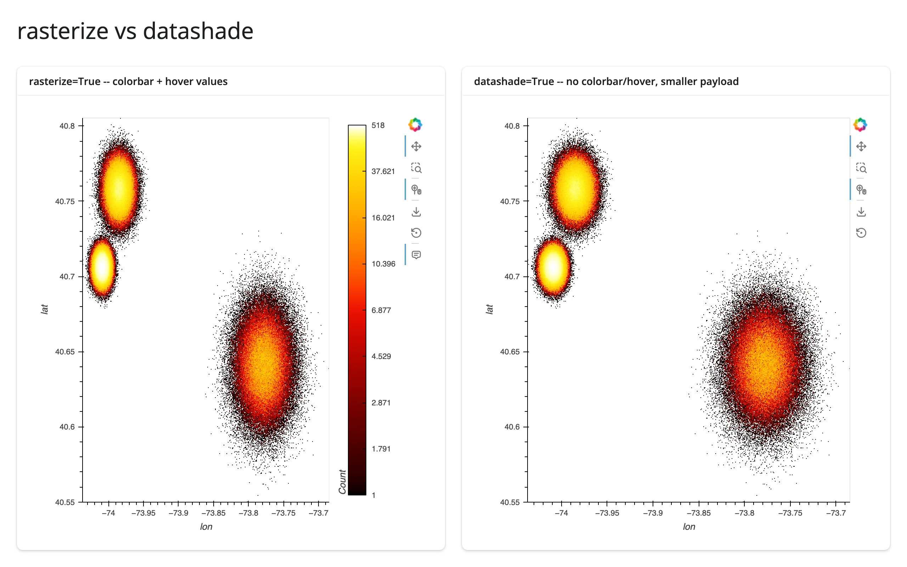

`rasterize=True` sends a scalar field (counts, or an aggregate) and lets HoloViews apply the colormap client-side
-- you get a live colorbar and hover tooltips with the underlying value. `datashade=True` bakes the colors into an
RGBA image on the server instead -- no colorbar, no hover, but a meaningfully smaller payload (confirmed in the
[payload table](#payload-and-latency-at-scale) below: roughly 2.7 MB vs 4.9 MB raw for the same 760x600 frame,
before websocket compression). Default to `rasterize` when you want hover/colorbar; reach for `datashade` when
payload size matters more, or when you need `count_cat` with a `color_key` (next section) -- categorical
coloring is datashade's native mode.

### Aggregators: count, mean of a column, count per category

[`examples/03_aggregators.py`](examples/03_aggregators.py) -- the same 500,000 rows, three ways:

```{.python file="examples/03_aggregators.py"}
# Three aggregators over the same 500,000 rows: count (density), mean of a
# numeric column (fare), and count_cat (density per category, with a color
# key and legend instead of a colorbar).
import datashader as ds
import holoviews as hv
import numpy as np
import pandas as pd
import hvplot.pandas  # noqa: F401
from shiny.express import ui

from shinywidgets import render_holoviews

hv.extension("bokeh")

N = 500_000
LANDMARKS = {
    "Times Square": (40.758, -73.985, 0.010),
    "Wall Street": (40.706, -74.009, 0.006),
    "JFK Airport": (40.641, -73.778, 0.020),
    "LaGuardia": (40.777, -73.872, 0.015),
}
rng = np.random.default_rng(0)
names = list(LANDMARKS)
weights = rng.dirichlet(np.ones(len(names)) * 3)
counts = rng.multinomial(N, weights)
lat, lon, place = [], [], []
for name, c in zip(names, counts):
    lat0, lon0, spread = LANDMARKS[name]
    lat.append(rng.normal(lat0, spread, c))
    lon.append(rng.normal(lon0, spread, c))
    place.extend([name] * c)
pickups = pd.DataFrame({"lat": np.concatenate(lat), "lon": np.concatenate(lon), "place": pd.Categorical(place)})
# JFK fares run higher, on top of the base gamma-distributed fare
pickups["fare"] = rng.gamma(2.0, 6.0, len(pickups)) + (pickups.place == "JFK Airport") * 40

ui.page_opts(title="Aggregators", fillable=True)

with ui.layout_columns():
    with ui.card(full_screen=True):
        ui.card_header("count (default)")

        @render_holoviews
        def by_count():
            return pickups.hvplot.points(
                "lon", "lat", rasterize=True, aggregator="count",
                cnorm="eq_hist", cmap="fire", responsive=True, colorbar=True,
            )

    with ui.card(full_screen=True):
        ui.card_header("mean(fare)")

        @render_holoviews
        def by_mean():
            return pickups.hvplot.points(
                "lon", "lat", rasterize=True, aggregator=ds.mean("fare"),
                cmap="viridis", responsive=True, colorbar=True,
                clabel="mean fare ($)",
            )

    with ui.card(full_screen=True):
        ui.card_header("count_cat(place)")

        @render_holoviews
        def by_cat():
            return pickups.hvplot.points(
                "lon", "lat", datashade=True, aggregator=ds.count_cat("place"),
                color_key="Category10", responsive=True, legend="top_right",
            )
```

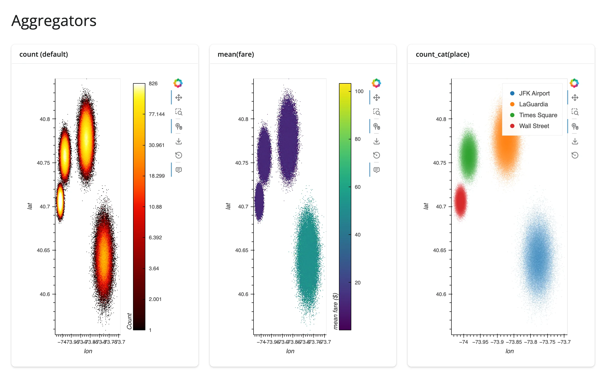

`aggregator="count"` (the default) shows density. `ds.mean("fare")` colors each pixel by the average of a numeric
column instead -- in this synthetic data, JFK pickups run a higher fare, and the `mean(fare)` panel picks that out
in a way the density panel can't. `ds.count_cat("place")` aggregates per category and renders each pixel as a
blend of per-category colors from `color_key`, with a legend -- this needs `datashade`, not `rasterize`, since
the category blending happens as part of the RGBA conversion. Any `datashader.reductions` aggregator works the
same way: `ds.sum()`, `ds.max()`, `ds.std()`, and more are documented in
[Datashader's aggregation guide](https://datashader.org/user_guide/Points.html#Aggregation).

### `dynspread`: making isolated points visible

A rasterized image only shows what lands in each pixel -- a single isolated point is one pixel, easy to miss next
to a dense cluster that fills hundreds. `dynspread()` grows isolated pixels until they're a few pixels wide,
*without* growing pixels in dense regions (it inspects local density and spreads adaptively).
[`examples/04_dynspread.py`](examples/04_dynspread.py), zoomed into a sparse corner so the effect is visible
without an interactive zoom:

```{.python file="examples/04_dynspread.py"}
# A sparse, uniformly-scattered layer (stranded dropoffs far from the main
# cluster) rasterizes to isolated single pixels that are easy to miss at a
# normal screen density. dynspread grows isolated pixels until they're a few
# pixels wide, without doing anything to dense regions where pixels already
# overlap. xlim/ylim below zoom into a sparse corner so the effect is visible
# without needing to zoom interactively.
import numpy as np
import pandas as pd
import hvplot.pandas  # noqa: F401
from shiny.express import ui

from shinywidgets import render_holoviews

rng = np.random.default_rng(1)
dense = pd.DataFrame({
    "lon": rng.normal(-73.985, 0.01, 400_000),
    "lat": rng.normal(40.758, 0.01, 400_000),
})
sparse = pd.DataFrame({
    "lon": rng.uniform(-74.05, -73.75, 4_000),
    "lat": rng.uniform(40.60, 40.85, 4_000),
})
pts = pd.concat([dense, sparse], ignore_index=True)

XLIM, YLIM = (-73.82, -73.76), (40.74, 40.80)

ui.page_opts(title="dynspread", fillable=True)

with ui.layout_columns():
    with ui.card(full_screen=True):
        ui.card_header("rasterize only -- isolated points are 1px, easy to miss")

        @render_holoviews
        def no_spread():
            return pts.hvplot.points(
                "lon", "lat", rasterize=True, cnorm="eq_hist", cmap="fire",
                responsive=True, xlim=XLIM, ylim=YLIM,
            )

    with ui.card(full_screen=True):
        ui.card_header("+ dynspread(max_px=6) -- isolated points become visible dots")

        @render_holoviews
        def with_spread():
            return pts.hvplot.points(
                "lon", "lat", rasterize=True, dynspread=True, max_px=6,
                cnorm="eq_hist", cmap="fire", responsive=True,
                xlim=XLIM, ylim=YLIM,
            )
```

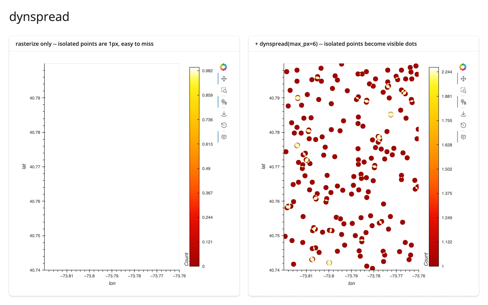

Without `dynspread`, this sparse layer (stranded points scattered far from the main cluster) is almost entirely
invisible -- each point is a single, barely-there pixel. `dynspread=True, max_px=6` (or the standalone
`holoviews.operation.datashader.dynspread()` function) turns every isolated point into a visible dot. Use it
whenever your data has both dense clusters and meaningful outliers you don't want to lose.

### Lines and time series at scale

Datashader rasterizes lines as well as points -- a long or busy time series rasterizes to a clean, antialiased
curve instead of an unreadable tangle of overlapping strokes.
[`examples/05_lines_at_scale.py`](examples/05_lines_at_scale.py) -- 5 synthetic sensor traces, 200,000 samples
each (1,000,000 points total), overlaid and datashaded with one color per category:

```{.python file="examples/05_lines_at_scale.py"}
# Datashader rasterizes lines too, not just points: 5 synthetic sensor
# traces (200,000 samples each, 1,000,000 points total) overlaid and
# datashaded with one color per category -- a continuous line, not discrete
# markers, so individual samples never show up as clutter.
import datashader as ds
import holoviews as hv
import numpy as np
import pandas as pd
from holoviews.operation.datashader import datashade
from shiny.express import ui

from shinywidgets import render_holoviews

hv.extension("bokeh")

N_PER_SENSOR = 200_000
K = 5
rng = np.random.default_rng(0)
frames = []
for i in range(K):
    v = np.cumsum(rng.normal(0, 1, N_PER_SENSOR)) * 0.03 + i * 3
    frames.append(pd.DataFrame({"t": np.arange(N_PER_SENSOR), "v": v, "sensor": f"sensor {i}"}))
readings = pd.concat(frames, ignore_index=True)
readings["sensor"] = readings["sensor"].astype("category")

ui.page_opts(title=f"{len(readings):,} samples across {K} sensors", fillable=True)


@render_holoviews
def traces():
    overlay = hv.NdOverlay(
        {s: hv.Curve(g, "t", "v") for s, g in readings.groupby("sensor", observed=True)},
        kdims="sensor",
    )
    return datashade(
        overlay,
        aggregator=ds.count_cat("sensor"),
        color_key=hv.Cycle("Category10").values[:K],
    ).opts(responsive=True, title=f"{K} sensors, {N_PER_SENSOR:,} samples each")
```

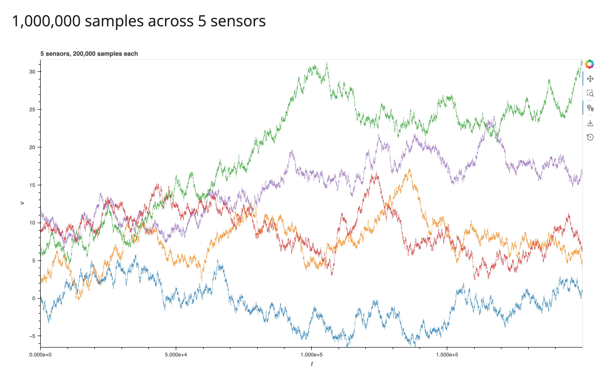

The same `count_cat` + `color_key` recipe from the aggregators section works for an `NdOverlay` of curves, not
just points: each category gets a distinct, antialiased color, and the 1,000,000 total samples never individually
hit the DOM. hvPlot's own `.line(datashade=True)` does the same thing for a single long curve.

## Reacting to user interaction

`render_holoviews` has no reactive accessors -- Datashader plots are driven by the same stream-based interaction
model as plain HoloViews, covered in full in
[the HoloViews guide's "Reacting to user interaction"](../holoviews/index.md#reacting-to-user-interaction). The
one new thing here is that `rasterize()`/`datashade()` *themselves* attach a stream for you: that's the mechanism
behind re-aggregation on zoom, and it needs its own verification.

### Re-aggregation on zoom (verified)

This is Datashader's headline feature in an interactive app: zoom in, and the server re-aggregates just the
visible region, so detail invisible at the full extent sharpens into view instead of staying a blur. It needs
checking carefully, because an older version of shinywidgets let a `hv.streams.RangeXY` subscriber cause an
infinite re-render loop (see [the HoloViews guide's Gotchas](../holoviews/index.md#gotchas-and-limitations) for
the mechanism and the fix). `rasterize()`'s re-aggregation is a **separate mechanism** regardless -- it drives the
existing Bokeh model's image glyph directly, through HoloViews' own plotting pipeline, not through a Shiny
`reactive.Value` write at all -- so it was verified independently, with real scroll-zoom gestures:

- The repo's own Playwright test
  (`tests/playwright/render_holoviews_datashader/test_render_holoviews_datashader.py`) drives a real mouse-wheel
  zoom and a real drag-pan against a 200,000-point rasterized scatter and asserts the displayed image's extent
  matches the server's latest aggregation. Both pass on current main (confirmed by running them directly).
- This guide re-verified it independently at 1,000,000 and 10,000,000 points with real `page.mouse.wheel()`
  gestures: the image re-aggregates to the new region, with **zero console or server errors**, and the displayed
  point count (read from the full dataframe, not just the image) drops from the full count to just what's in
  view. See [`examples/06_zoom_stats.py`](examples/06_zoom_stats.py) and the screenshots below.
- Measured latency (10,000,000 points, real wheel-zoom gesture, gesture-end to updated image):
  **0.24 s**. See [Payload and latency at scale](#payload-and-latency-at-scale) for the full table.

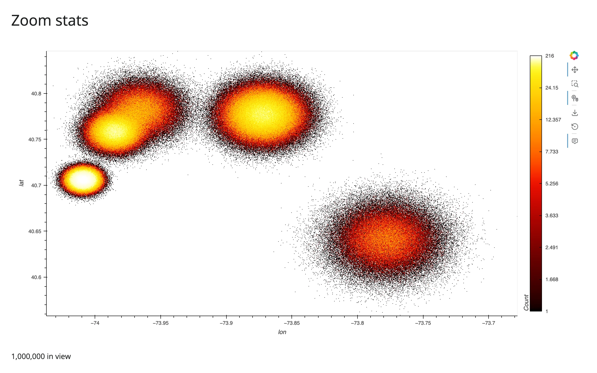
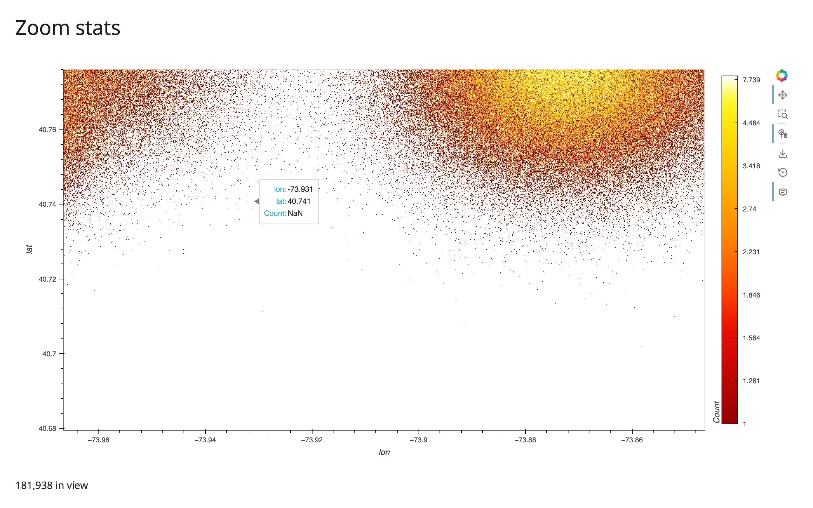

**Takeaway: zoom-driven re-aggregation works correctly and quickly inside `render_holoviews`, with no code beyond
`rasterize=True`/`datashade=True`.** `rasterize()`'s own internal stream wiring never went through the path that
caused the (now-fixed) loop, since it updates the existing Bokeh model directly rather than writing a Shiny
`reactive.Value`.

### Reading the current viewport into Shiny

The same `RangeXY` stream that drives re-aggregation can also be read into a `reactive.Value`, to compute exact
stats on the *full* dataframe for whatever's currently in view -- not just what datashader rasterized.
[`examples/06_zoom_stats.py`](examples/06_zoom_stats.py):

```{.python file="examples/06_zoom_stats.py"}
# Re-aggregation on zoom is automatic -- hvPlot's rasterize=True attaches its
# own internal hv.streams.RangeXY to the DynamicMap, so scrolling to zoom
# re-runs datashader for just the visible region with no code to write.
# This example also reads that same internal RangeXY stream into Shiny, to
# show a "points in view" stat computed on the full data (not just the
# rasterized pixels). The subscriber stores the range tuple itself (an
# idempotent `.set()`) rather than a counter -- see the guide's Gotchas
# section for why that distinction matters.
import holoviews as hv
import numpy as np
import pandas as pd
import hvplot.pandas  # noqa: F401
from holoviews.streams import RangeXY
from shiny import reactive
from shiny.express import render, ui

from shinywidgets import render_holoviews

hv.extension("bokeh")

N = 1_000_000
LANDMARKS = {
    "Times Square": (40.758, -73.985, 0.010),
    "Wall Street": (40.706, -74.009, 0.006),
    "JFK Airport": (40.641, -73.778, 0.020),
    "LaGuardia": (40.777, -73.872, 0.015),
    "Central Park": (40.782, -73.965, 0.015),
}
rng = np.random.default_rng(0)
names = list(LANDMARKS)
weights = rng.dirichlet(np.ones(len(names)) * 3)
counts = rng.multinomial(N, weights)
lat, lon = [], []
for name, c in zip(names, counts):
    lat0, lon0, spread = LANDMARKS[name]
    lat.append(rng.normal(lat0, spread, c))
    lon.append(rng.normal(lon0, spread, c))
pickups = pd.DataFrame({"lat": np.concatenate(lat), "lon": np.concatenate(lon)})

ui.page_opts(title="Zoom stats", fillable=True)

view_range = reactive.value(None)


@render_holoviews
def plot():
    img = pickups.hvplot.points(
        "lon", "lat", rasterize=True, cnorm="eq_hist", cmap="fire", responsive=True,
    )
    rng_stream = next(s for s in img.streams if isinstance(s, RangeXY))
    rng_stream.add_subscriber(lambda x_range, y_range: view_range.set((x_range, y_range)))
    return img


@render.text
def n_in_view():
    r = view_range()
    if r is None or r[0][0] is None:
        return f"{len(pickups):,} in view (full extent)"
    (x0, x1), (y0, y1) = r
    sel = pickups[pickups.lon.between(x0, x1) & pickups.lat.between(y0, y1)]
    return f"{len(sel):,} in view"
```

**Two things worth doing deliberately here.** Grab the `RangeXY` stream `rasterize()`/`datashade()` already
created (`next(s for s in img.streams if isinstance(s, RangeXY))`) and add a second subscriber to it, rather than
constructing a new, redundant `hv.streams.RangeXY(source=img)` of your own -- one stream reporting the viewport is
simpler than two. And store the range tuple itself with `.set()` (idempotent -- `reactive.Value` skips
invalidation when the new value equals the old one), not a counter or anything that changes on every call, so
repeated reports of the same range don't re-run readers for nothing. Verified: this combination re-renders exactly
once per gesture, with no re-render loop (shinywidgets isolates widget coercion from the render's reactive
context -- see [the HoloViews guide's Gotchas](../holoviews/index.md#gotchas-and-limitations)), at 1,000,000
points.

### Box-select: an explicit region, read against the full data

Zoom gives you "whatever's currently in view"; a box-select gives you a smaller, deliberate region, via
`hv.streams.BoundsXY` -- the same recipe the HoloViews guide uses, which works the same way on a rasterized
image. [`examples/07_boxselect_stats.py`](examples/07_boxselect_stats.py):

```{.python file="examples/07_boxselect_stats.py"}
# A box-select brush can be smaller and more deliberate than "whatever's
# currently zoomed in" -- hv.streams.BoundsXY fires once per drag, and the
# bounds become a pandas mask over the FULL 500,000-row dataframe (not just
# the pixels datashader drew), so stats like mean fare are exact.
import holoviews as hv
import numpy as np
import pandas as pd
import hvplot.pandas  # noqa: F401
from holoviews.streams import BoundsXY
from shiny import reactive
from shiny.express import render, ui

from shinywidgets import render_holoviews

hv.extension("bokeh")

N = 500_000
LANDMARKS = {
    "Times Square": (40.758, -73.985, 0.010),
    "Wall Street": (40.706, -74.009, 0.006),
    "JFK Airport": (40.641, -73.778, 0.020),
}
rng = np.random.default_rng(0)
names = list(LANDMARKS)
weights = rng.dirichlet(np.ones(len(names)) * 3)
counts = rng.multinomial(N, weights)
lat, lon = [], []
for name, c in zip(names, counts):
    lat0, lon0, spread = LANDMARKS[name]
    lat.append(rng.normal(lat0, spread, c))
    lon.append(rng.normal(lon0, spread, c))
pickups = pd.DataFrame({"lat": np.concatenate(lat), "lon": np.concatenate(lon)})
pickups["fare"] = rng.gamma(2.0, 6.0, len(pickups))

ui.page_opts(title="Box-select stats on the full data", fillable=True)

selected_bounds = reactive.value(None)

with ui.layout_columns():
    with ui.card(full_screen=True):
        ui.card_header("Drag a box (box-select tool is active by default)")

        @render_holoviews
        def plot():
            img = pickups.hvplot.points(
                "lon", "lat", rasterize=True, cnorm="eq_hist", cmap="fire",
                responsive=True, tools=["box_select"],
            ).opts(active_tools=["box_select"])
            # the subscriber's parameter must be named "bounds" -- BoundsXY
            # calls it with that keyword
            BoundsXY(source=img).add_subscriber(lambda bounds: selected_bounds.set(bounds))
            return img

    with ui.card():
        ui.card_header("Stats on the full 500,000-row data")

        @render.ui
        def stats():
            b = selected_bounds()
            if b is None:
                return ui.p("Drag a box to select a region.", class_="text-muted")
            x0, y0, x1, y1 = b
            sel = pickups[pickups.lon.between(x0, x1) & pickups.lat.between(y0, y1)]
            return ui.TagList(
                ui.h5(f"{len(sel):,} of {len(pickups):,} rows"),
                ui.p(f"mean fare: ${sel.fare.mean():.2f}" if len(sel) else "mean fare: -"),
            )
```

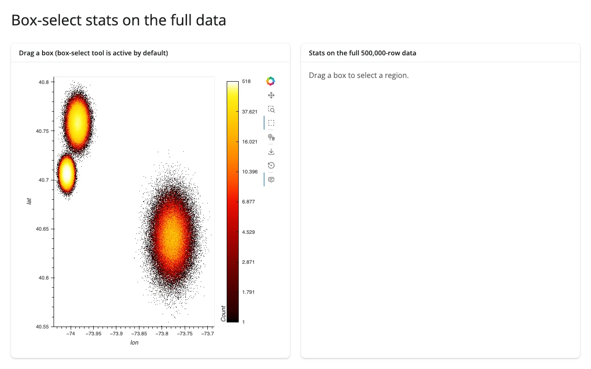
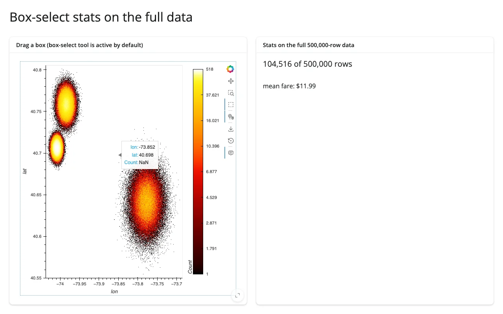

The subscriber's parameter must be named `bounds` -- `BoundsXY` calls it by keyword, and a differently-named
parameter raises a silent `TypeError` inside HoloViews' detached asyncio task (visible only in the server log,
not in the browser; see [Gotchas](#gotchas-and-limitations)). Once wired up, `bounds` unpacks to `(x0, y0, x1,
y1)` in data coordinates, and a pandas boolean mask over the *original* dataframe gives exact row counts and
aggregates (here, `len(sel)` and `sel.fare.mean()`) -- numbers datashader's own pixel grid can't give you, since
it only ever computed one aggregate per pixel.

## Updating the widget from Python

### Driving the aggregator and a category filter from Shiny inputs

Re-rendering on every input change is simple but resets the user's zoom -- annoying for a plot whose whole point
is "zoom in for detail." The fix is the same one the HoloViews guide uses for any `DynamicMap`: give the
operation a `param.Parameter` reference instead of a literal value, and update that parameter from a
`@reactive.effect`. `rasterize()`'s `aggregator=` argument accepts a `param.Parameter` directly; a category
filter needs one more step, since excluding rows changes the *input* element, not just how it's colored --
`hv.streams.Params` rebuilds a `DynamicMap`'s input when a param changes, and `rasterize()` wraps that
`DynamicMap`, inheriting its own `RangeXY`/`PlotSize` streams across the rebuild.
[`examples/08_filter_aggregator_inplace.py`](examples/08_filter_aggregator_inplace.py):

```{.python file="examples/08_filter_aggregator_inplace.py"}
# Shiny inputs (a landmark filter, an aggregator choice) drive the SAME
# rasterized plot in place instead of returning a new object from the render
# function: a per-session param.Parameterized holds the current choices,
# hv.streams.Params rebuilds the input points when the filter changes, and
# rasterize's aggregator accepts a param reference directly. Both update
# without resetting the user's zoom/pan (try zooming in first).
import datashader as ds
import holoviews as hv
import numpy as np
import pandas as pd
import param
from holoviews.operation.datashader import rasterize
from holoviews.streams import Params
from shiny import reactive
from shiny.express import input, ui

from shinywidgets import render_holoviews

hv.extension("bokeh")

N = 500_000
LANDMARKS = {
    "Times Square": (40.758, -73.985, 0.010),
    "Wall Street": (40.706, -74.009, 0.006),
    "JFK Airport": (40.641, -73.778, 0.020),
}
rng = np.random.default_rng(0)
names = list(LANDMARKS)
weights = rng.dirichlet(np.ones(len(names)) * 3)
counts = rng.multinomial(N, weights)
lat, lon, place = [], [], []
for name, c in zip(names, counts):
    lat0, lon0, spread = LANDMARKS[name]
    lat.append(rng.normal(lat0, spread, c))
    lon.append(rng.normal(lon0, spread, c))
    place.extend([name] * c)
pickups = pd.DataFrame({"lat": np.concatenate(lat), "lon": np.concatenate(lon), "place": pd.Categorical(place)})
pickups["fare"] = rng.gamma(2.0, 6.0, len(pickups))

ui.page_opts(title="Inputs update the plot in place", fillable=True)
ui.input_selectize("places", "Landmarks", choices=names, selected=names, multiple=True)
ui.input_radio_buttons("agg", "Aggregator", choices=["count", "mean fare"], selected="count")


class Style(param.Parameterized):
    categories = param.List(default=names)
    agg = param.Parameter(default=ds.count())


style = Style()  # one per session (Express re-runs this module per session)


def make_points(categories):
    sub = pickups[pickups.place.isin(categories)]
    return hv.Points(sub, ["lon", "lat"], ["fare"])


@reactive.effect
def _update_style():
    style.categories = list(input.places())
    style.agg = ds.count() if input.agg() == "count" else ds.mean("fare")


@render_holoviews
def plot():
    points_dmap = hv.DynamicMap(make_points, streams=[Params(style, ["categories"])])
    return rasterize(points_dmap, aggregator=style.param.agg).opts(
        responsive=True, cmap="fire", cnorm="eq_hist", colorbar=True,
    )
```

Zoomed into the JFK cluster, then switching the aggregator and removing JFK from the filter -- the zoom survives
both:

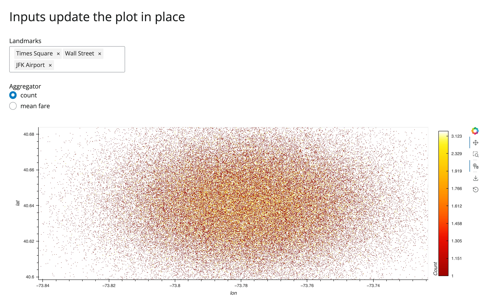
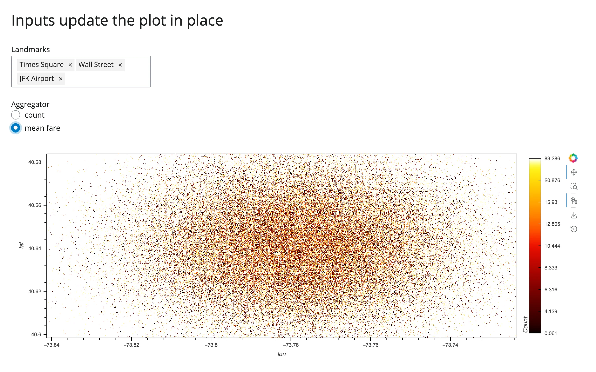
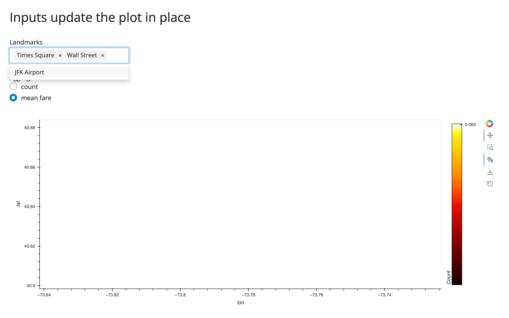

The last screenshot shows an empty view: zoomed into JFK, then JFK itself gets excluded by the filter. The plot
correctly shows nothing in that region (rather than, say, resetting the view) -- exactly the behavior you want
from an in-place update.

## Coordinating multiple views

Three complete patterns, each gesture-verified:

1. **Zoom → "points in view" stat** ([examples/06_zoom_stats.py](examples/06_zoom_stats.py), described above):
   the rasterize operation's own `RangeXY` stream feeds a `reactive.Value`, which a `@render.text` reads to show
   an exact count on the full dataframe.
2. **Box-select → stats panel** ([examples/07_boxselect_stats.py](examples/07_boxselect_stats.py), described
   above): `BoundsXY` feeds a `reactive.Value`, read by a `@render.ui` panel computing row count and mean fare on
   the full dataframe.
3. **Shiny inputs → in-place restyle, zoom preserved**
   ([examples/08_filter_aggregator_inplace.py](examples/08_filter_aggregator_inplace.py), described above): a
   landmark filter and an aggregator radio button both update the same `DynamicMap` via `param` references, with
   the user's pan/zoom intact across both kinds of change.

[`gallery/showcase_nyc_pickups_explorer.py`](gallery/showcase_nyc_pickups_explorer.py) combines all three into
one dashboard -- see [Gallery candidates](#gallery-candidates).

## Large data

Datashader's own API, `rasterize()` (used through `render_holoviews`, not a dedicated `render_datashader`), is
the point of this guide: every example above bins millions of rows into a fixed-size image server-side, so
message size and render cost are set by *screen resolution*, not row count. See
[Payload and latency at scale](#payload-and-latency-at-scale) below for the measured numbers at 1M/10M rows.
This is the "summarize on the server" approach from
[Large data & performance](../../guide/performance/index.md#three-approaches-to-large-data).

At real scale (millions of rows), push summaries instead of raw points when linking a
brush to another view -- see [Linking widgets, pattern 7: brushing large data](../../guide/linked-views/index.md#7-brushing-large-data-push-summaries-not-points),
which builds this exact raster + linked-histogram shape end to end with measured bytes.

## Layout and sizing

Covered in full in the [HoloViews guide's Layout and sizing section](../holoviews/index.md#layout-and-sizing):
pass `responsive=True` (every example in this guide does) so the plot -- and the aggregation region -- fills its
container, and give the output a fixed `height` plus `fillable=True` if you want a specific size rather than
fill-the-card. Nothing about Datashader specifically changes that story: the rasterized image resizes (and
re-aggregates at the new pixel dimensions) the same way a plain Bokeh plot does.

## Gotchas and limitations

Verified on current main (shiny 1.9.0, holoviews 1.23.2, hvplot 0.12.2, datashader 0.19.1, panel 1.10.0, bokeh
3.10.1, jupyter_bokeh 4.1.0).

- **Build the plot inside the render function, never at module level.** This is the HoloViews guide's
  cross-session leak finding, and it matters even more here: a module-level `DynamicMap` is shared by every
  session, so one visitor's zoom repaints *everyone's* plot with the wrong region. The data (the `DataFrame`) is
  fine to load once at module level or in a sibling module; only the `hvplot`/`rasterize()`/`datashade()` object
  itself must be built per session (every example in this guide already does this, inside `@render_holoviews`).
- **Reuse `rasterize()`'s own internal `RangeXY` stream rather than constructing a second one.** Covered in detail
  above under [Reading the current viewport into Shiny](#reading-the-current-viewport-into-shiny) -- grab it with
  `next(s for s in img.streams if isinstance(s, RangeXY))` and use an idempotent `.set()`. A second,
  independently-constructed `RangeXY(source=img)` no longer risks the re-render loop older shinywidgets versions
  had (see [the HoloViews guide's Gotchas](../holoviews/index.md#gotchas-and-limitations)), but it's still a
  redundant stream to maintain for no benefit.
- **A `BoundsXY` subscriber's parameter must be named `bounds`.** `BoundsXY` invokes subscribers by keyword
  (`bounds=...`); a subscriber with a differently-named parameter raises `TypeError: <lambda>() got an unexpected
  keyword argument 'bounds'` inside HoloViews' own asyncio task. This is swallowed -- it shows up only as "Task
  exception was never retrieved" in the **server log**, with no browser-visible error and no exception in your
  own code, so the box-select silently does nothing until you notice the log line. (This is an authoring hazard
  in user code, not a shinywidgets or holoviews bug -- flagging it because it cost real debugging time while
  verifying this guide, and the failure mode gives almost no signal.)
- **Aggregation runs on the server's event loop.** A very large aggregation briefly delays every other session
  that Shiny process is serving (same note as the HoloViews guide's general stream-callback behavior). In
  practice this is rarely the bottleneck: Datashader's Numba-compiled aggregation itself stayed well under 100 ms
  even at 10,000,000 points on this machine; see the latency numbers below, which are dominated by debounce and
  network transfer, not aggregation time.
- **`datashade` can't show a colorbar or hover values; only `rasterize` can.** This is by design (see
  [rasterize vs datashade](#rasterize-vs-datashade-which-one-and-why)), not a bug, but it's easy to reach for
  `datashade` for its smaller payload and then wonder why hover stopped working.
- Everything in the [HoloViews guide's Gotchas section](../holoviews/index.md#gotchas-and-limitations) applies
  here too (the `ui.sidebar()`/`link_selections` concern there was investigated and did **not** reproduce,
  so sidebars are fine to use, as the showcase gallery app does).

## Payload and latency at scale

Measured on this machine (Playwright Chromium, headless, websocket frames captured directly), plain hvPlot
scatter vs `rasterize=True`, both `responsive=True` at a similar viewport:

| Mode | N | Time to first pixels | Payload |
|---|---|---|---|
| plain scatter | 100,000 | 2.2 s | 2.1 MB |
| plain scatter | 1,000,000 | 3.8 s | 20.6 MB |
| plain scatter | 10,000,000 | **did not finish rendering in 90 s** | -- |
| rasterize | 100,000 | 3.1 s | 6.9 MB |
| rasterize | 1,000,000 | 3.3 s | 6.9 MB |
| rasterize | 10,000,000 | 3.3 s | 6.9 MB |

The plain-scatter payload grows linearly with the data (consistent with one JSON-encoded coordinate pair per
row); the rasterize payload is **flat regardless of N**, because it's always one image-sized frame. At 10,000,000
points, a plain scatter is not a viable option at all -- it didn't even finish transferring in 90 seconds, versus
3.3 s for the rasterized version.

Re-aggregation on zoom (gesture-end to updated image arriving, 10,000,000 points, real wheel-zoom gesture):
**0.24 s**, image payload **6.6 MB**. A continuous 5-tick wheel-zoom burst produced 2 re-aggregations (not one per
tick) totaling about 13.3 MB, regardless of whether the underlying data was 1,000,000 or 10,000,000 points --
consistent with "the payload is the image, not the data."

## Session and shared-data memory notes

The big dataframe and the rasterized plot have **different** sharing rules, and it's worth being precise about
which is which:

- **The dataframe is plain data, not an ipywidget -- load it once, normally.** A module-level
  `pickups = pd.read_parquet(...)` (or the equivalent generation code) is safe to share read-only across every
  session; nothing about it is session-scoped.
- **But a Shiny Express app's top-level code runs once per *session*, not once per process** (verified directly:
  a counter in a helper module, bumped from the Express file's top level, incremented on every new browser
  session, not just once at startup). If the big dataframe is loaded or generated inline at the top of your
  Express `app.py`, every visitor re-loads or re-generates it. For data big enough that this matters, put the
  loading code in a plain sibling module (e.g. `data.py`) and `import` it from the Express file -- Python's normal
  module-cache means `data.py`'s top level runs exactly once per process, no matter how many sessions connect.
  This generalizes beyond Datashader (it's how the roster's `shared_lifetime()`-in-Express-file gotcha, noted in
  the HoloViews/reacting-to-widgets guides, arises too), but it matters more here given the data sizes involved.
- **Do not use `shinywidgets.shared_lifetime()` for the rasterized plot itself.** `shared_lifetime()` is for
  sharing one *widget* across every session (so everyone sees the same thing, and one person's interaction
  changes it for everyone) -- exactly the cross-session leak this guide's first Gotcha warns against for a
  Datashader `DynamicMap`. Use a plain per-process cache for the dataframe; build the plot per session, as every
  example in this guide does.

## Gallery candidates

### `gallery/template_zoom_reaggregate.py` (template)

A minimal, adaptable starting point: a million-point rasterized scatter with a live "points in view" readout.
Swap in your own lat/lon or x/y columns and landmarks.

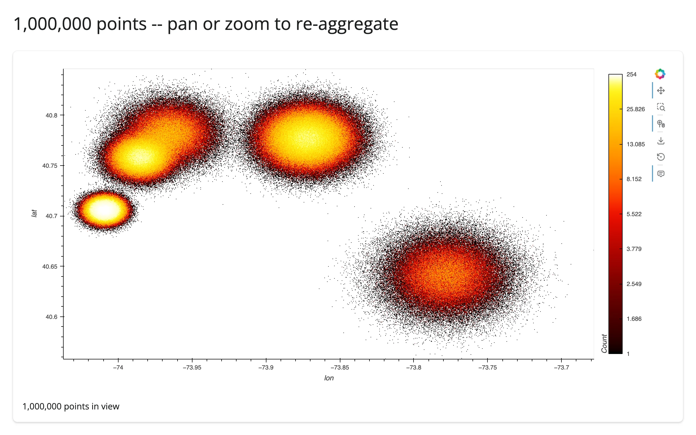
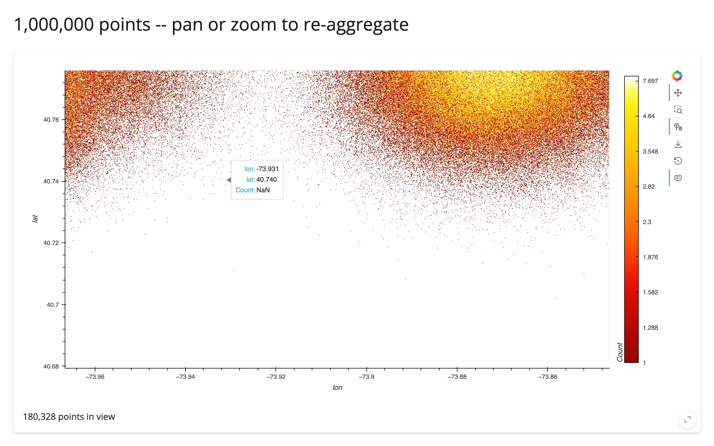

### `gallery/showcase_nyc_pickups_explorer.py` (showcase)

A fuller dashboard: a landmark filter and an aggregator picker that restyle the plot in place (zoom preserved),
plus a box-select panel computing exact stats on the full filtered data. Combines all three
[coordination patterns](#coordinating-multiple-views) above into one app. The aggregator picker toggles between
count and mean fare only -- both are `rasterize()` aggregators, swappable via a single `param.Parameter`. Adding
`count_cat` to the same picker would mean swapping the whole operation pipeline (`rasterize()` to `datashade()`)
reactively, not just the aggregator, so it's left as the static example in
[Aggregators](#aggregators-count-mean-of-a-column-count-per-category) above instead.

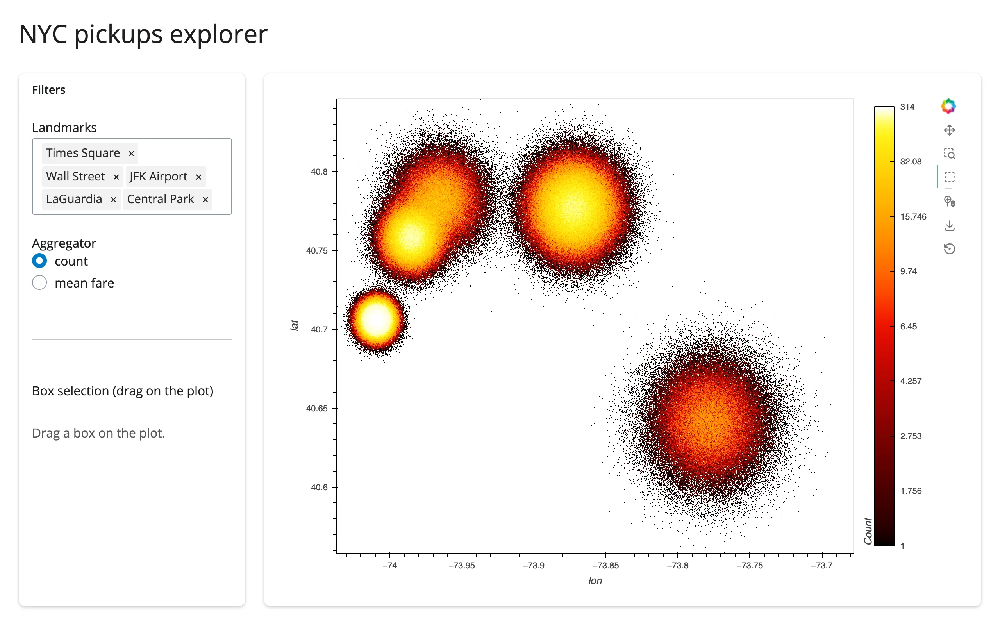

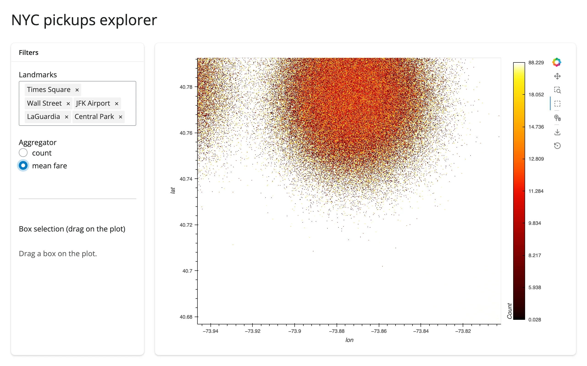

## Learn more

- [Datashader documentation](https://datashader.org) -- aggregation pipeline, all available reductions,
  `canvas.points`/`canvas.line`/`canvas.raster` for use outside HoloViews entirely
- [HoloViews + Datashader user guide](https://holoviews.org/user_guide/Large_Data.html)
- [hvPlot's `rasterize`/`datashade` reference](https://hvplot.holoviz.org/user_guide/Plotting_Extras.html)
- Related guides in this roster: [holoviews](../holoviews/index.md) (the rendering mechanism and the full
  stream/`link_selections` interaction model), [geoviews](../geoviews/index.md) (if your big data is geospatial
  and needs map tiles/projections -- GeoViews elements rasterize the same way)
- **Other big-data-scatter options, and when to choose them instead:**
  - [jupyter-scatter](../jscatter/index.md) -- GPU-accelerated, real per-point rendering (not aggregated) up to
    a few million points, with a `selection` accessor giving you actual row indices from a lasso. Choose this
    over Datashader when you need per-point selection/identity, not just a density image.
  - [lonboard](../lonboard/index.md) -- the geospatial equivalent: GPU-rendered points/polygons on a real map,
    with `view_state`/`selected_index`/`clicked` accessors. Choose this over Datashader for interactive
    geospatial point data where you need basemaps and per-feature interaction.
  - [embedding-atlas](../embedding-atlas/index.md) -- a full GPU-accelerated exploration UI (map + charts + table
    + SQL cross-filtering) for embedding-style scatter data, with exact-row or DuckDB-predicate selection. Choose
    this when you want a ready-made explorer UI rather than building one plot at a time.
  - [perspective](../perspective/index.md) -- not a scatter plot at all, but the roster's answer for "millions of
    *rows*" rather than "millions of *points*": a streaming pivot table over tabular data. Choose this when the
    big-data problem is tabular aggregation/pivoting, not 2D point density.
