[drawdata](https://koaning.github.io/drawdata/), by Vincent Warmerdam (`koaning`), is a tiny anywidget library
with one job: let you draw a dataset by hand instead of loading one. `ScatterWidget` gives you a canvas where
you drag a brush to lay down up to four classes of labeled 2D points; `BarWidget` gives you a histogram whose
bars you drag up and down to sculpt a distribution. Both widgets were built for teaching -- showing what a
classifier's decision boundary looks like, how an outlier drags a regression line, why k-means needs separated
blobs to work -- by letting the data itself be the thing you control.

`@render_drawdata` is a thin wrapper: it renders either widget with no coercion and no fixed accessors, and
fixes one real layout bug (see below). The whole point of this guide is what you build *around* it -- a second
output that re-reads the drawing and reacts, from a point counter up to a live scikit-learn model. drawdata has
no reactive accessor methods, so every example below reads the widget with `canvas.read("data")` -- the generic
way to reach a synced trait on any renderer output, documented in the
[render-widget guide](../../guide/any-widget/index.md).

Reach for drawdata when you want an interactive input that *is* a dataset -- a teaching app, a quick "does this
algorithm behave the way I expect" sandbox, or a way to generate a toy dataset without typing out coordinates.
For drawing on top of an image or building a free-form annotation tool, see [ipycanvas](../ipycanvas/index.md)
instead; drawdata's canvas only ever produces points or bar heights, not arbitrary paths.

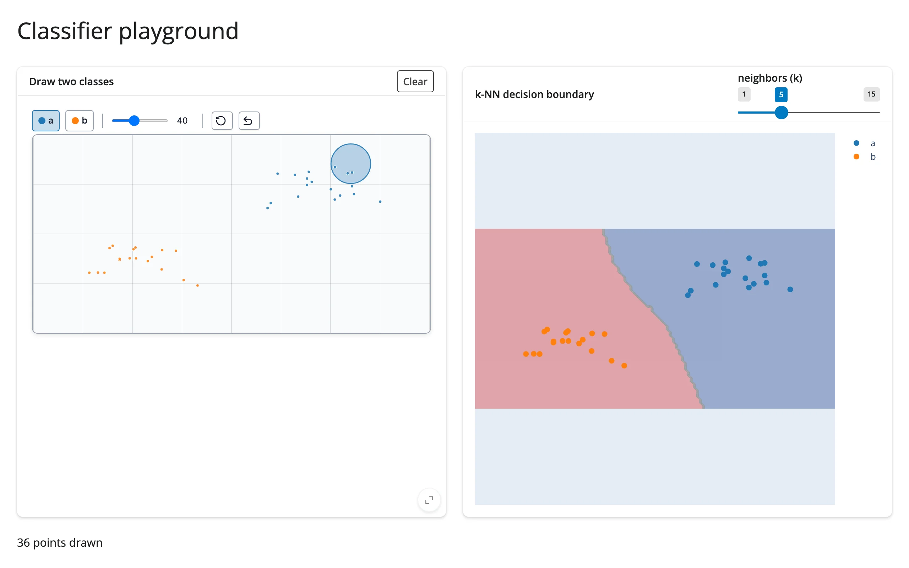

## Installation

```sh
pip install 'shinywidgets[drawdata]'
```

This installs `drawdata` (tested against 0.5.2). No other setup is required.

## Quick start

```{.python file="examples/01_quickstart.py"}
from __future__ import annotations

from drawdata import ScatterWidget
from shiny.express import render, ui
from shinywidgets import render_drawdata

ui.page_opts(fillable=True)

with ui.card(full_screen=True):
    ui.card_header("Draw a dataset (pick a class, then drag)")

    @render_drawdata
    def canvas():
        return ScatterWidget(width=800, height=400, n_classes=2)


@render.code
def summary():
    # .read("data") re-runs this whenever a new drawing batch syncs; a
    # plain `canvas.widget.data` read would only ever see the first value.
    df = canvas.read("data")
    return f"{len(df)} points drawn"
```

Pick a class (`a` or `b`), drag the brush across the canvas, and the point count below updates:

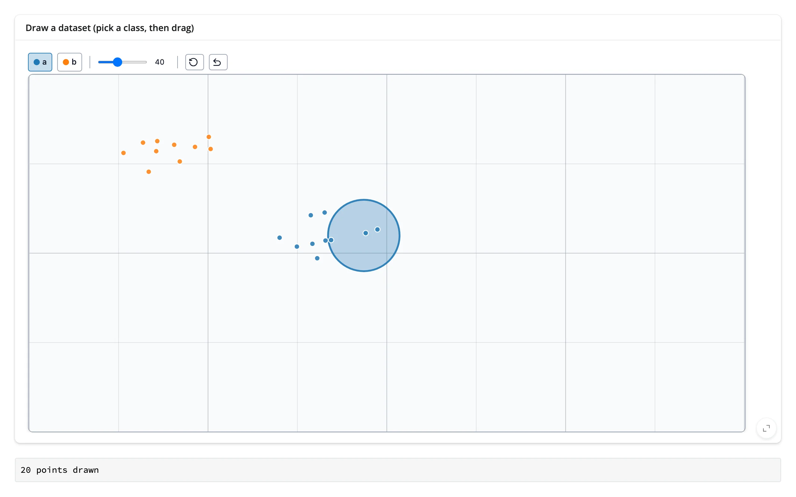

## What you can build

### A live DataFrame of everything drawn

Every stroke becomes rows in a plain Python list of dicts -- `{x, y, color, label, batch}` -- so a table of the
drawing is a one-liner away. `n_classes` (1-4) is fixed at construction; change it by returning a new
`ScatterWidget`.

```{.python file="examples/02_live_dataframe.py"}
        @render.data_frame
        def table():
            # canvas.widget.data_as_pandas is the same frame, but it's a plain
            # (non-reactive) property read -- it would compute once and never
            # update. Build the frame from .read("data") instead.
            data = canvas.read("data")
            return render.DataGrid(pd.DataFrame(data), height="100%")
```

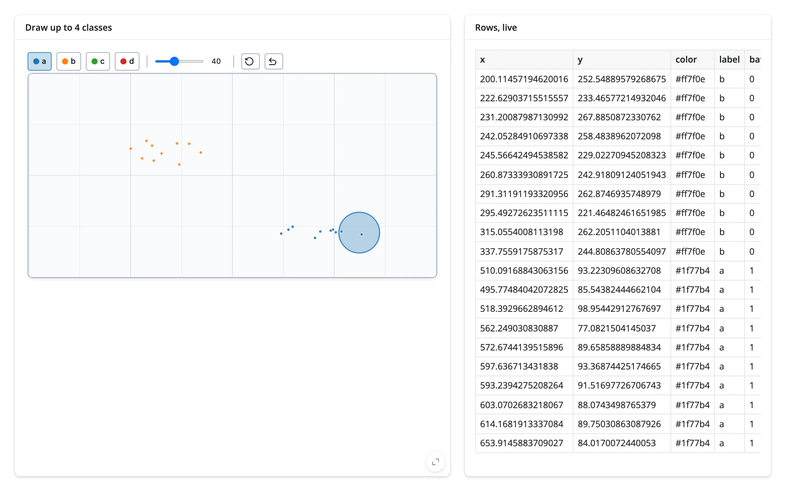

### Sculpt a distribution by hand

`BarWidget` is the other half of the library: drag bars up and down to build a histogram shape instead of
placing points. Pass a single-element `collection_names` to get one plain distribution (the default,
`["collection1", "collection2"]`, gives you two switchable ones -- see
["Comparing two sculpted distributions"](#comparing-two-sculpted-distributions-altair) below).

```{.python file="examples/03_bar_sculpting.py"}
        @render_drawdata
        def hist():
            # A single collection name hides the collection-switcher and
            # Clear buttons that show up with the default two names.
            return BarWidget(collection_names=["height_cm"], y_max=2.0, n_bins=20)
```

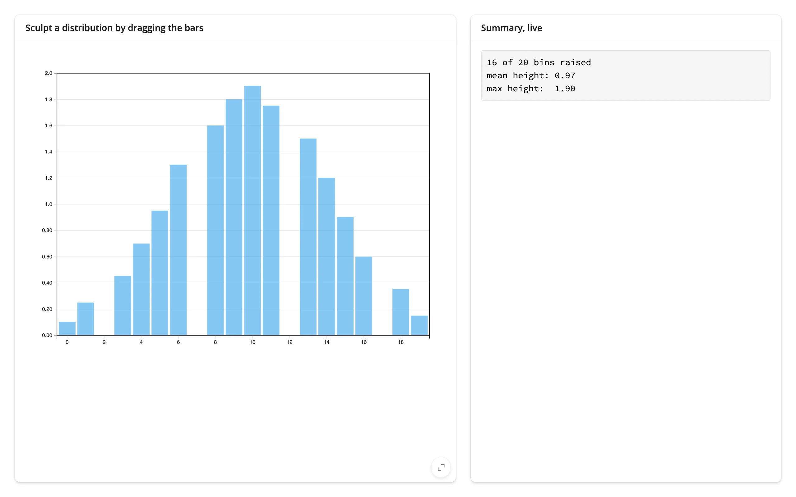

### A live classifier decision boundary

This is the headline pattern: draw two classes, and a k-NN classifier refit on every stroke paints its decision
boundary right next to the canvas. See ["Coordinating multiple views"](#coordinating-multiple-views) below for
the full code and more variations (regression, clustering, comparing distributions).

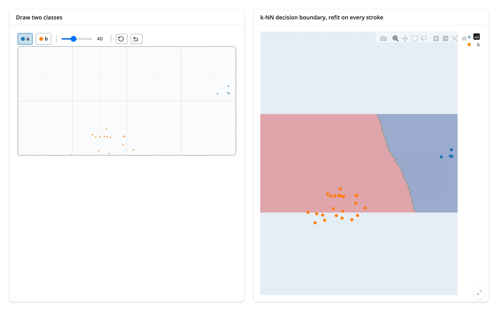

## Reacting to user interaction

`render_drawdata` declares no reactive accessor methods -- there's no `canvas.selected()`. Every interaction
instead goes through `canvas.read("<trait>")`, the general pattern documented in the
[render-widget guide](../../guide/any-widget/index.md).

### Traits worth reading

| trait | returns | fires when | default rate policy |
|---|---|---|---|
| `data` (`ScatterWidget`) | `list[dict]` with `x`, `y` (data-space, y-up), `color` (hex), `label` (`"a"`-`"d"`), `batch` (int) | a drawing batch (stroke) syncs -- see the lag caveat below -- or undo/reset is clicked | not rate-limited by default |
| `data` (`BarWidget`) | `list[dict]` with `collection`, `value`, `bin`, `color` -- one entry per bin per collection, always present (defaults to `0`) | on *every* pointer move while dragging a bar | not rate-limited by default |
| `brushsize` (`ScatterWidget`) | `int`, default `40` | dragging the brush-size slider | not rate-limited by default |

Both widgets also expose non-reactive convenience properties -- `.data_as_pandas`, `.data_as_polars`, and (scatter
only) `.data_as_X_y` -- that compute once from the current trait value. They're fine to call *after* you've
already taken a dependency with `.read("data")` elsewhere in the same function (as in the
regression example below); call one on its own and it never refires.

### The one-batch sync lag

**The single biggest gotcha in this guide**: `ScatterWidget` loses track of your *first* drawing batch. Draw one
stroke and `canvas.read("data")` still reports the old (possibly empty) value; draw a second
stroke and Python receives *all* points from both. Undo and reset sync immediately, so they're not affected.

This is an upstream drawdata bug: its frontend keeps a plain JavaScript array of points and reuses it across
strokes, mutating it in place; by the time it hands the array to the model, deep-equality logic upstream sees "no
change" against the model's current (identical, pre-mutation-detection) copy and skips the sync. The next stroke's
array differs by more than just the new points, so the whole thing finally goes through. There's no Python-side
workaround -- the browser genuinely hasn't told Python about the first batch yet.

```{.python file="examples/04_reading_drawn_data.py"}
@render.code
def state():
    # Each call to .read("data") re-runs this on every *synced* change to
    # "data" -- see "Gotchas" for why the very first stroke of a session
    # doesn't show up here until a second one starts.
    data = canvas.read("data")
    batches = sorted({d["batch"] for d in data})
    return f"{len(data)} points synced to Python, across batches {batches}"
```

10 points drawn, 0 synced; a second stroke (10 more points) flushes both batches at once:

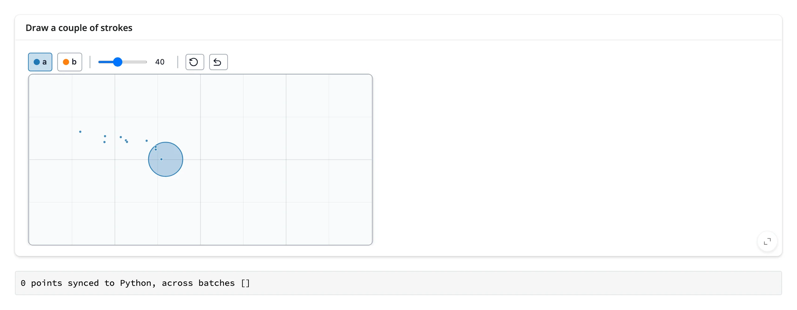
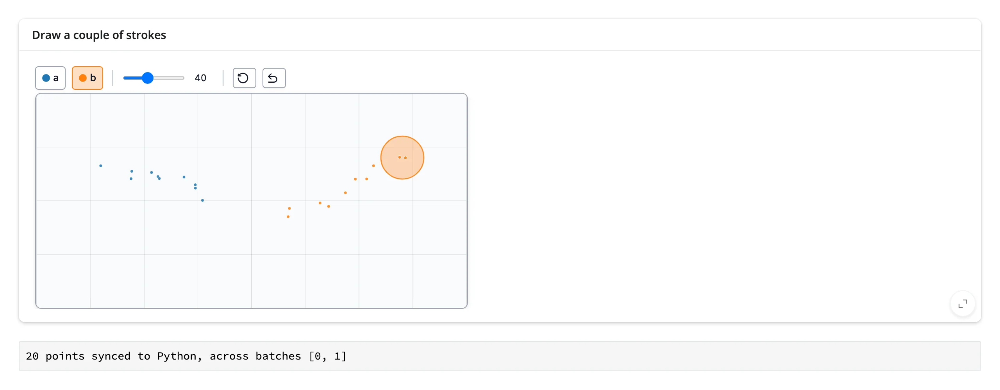

### Rate limiting

`rate_policy`/`rate_delay` on `@render_drawdata` rate-limit `.read()` for *every* trait on that widget,
same as every other renderer's `.read()` tier -- there's no default throttle unless you set one. It matters
most for `BarWidget`, whose `data` trait writes on every pointer move during a drag, not just on release.

```{.python file="examples/05_rate_limiting.py"}
with ui.layout_columns():
    with ui.card():
        ui.card_header("Unthrottled")

        @render_drawdata
        def unthrottled():
            return BarWidget(collection_names=["dist"])

        @render.code
        def n_unthrottled():
            unthrottled.read("data")
            counts["unthrottled"] += 1
            return f".read() ran {counts['unthrottled']} times"

    with ui.card():
        ui.card_header("Throttled: rate_policy='throttle', rate_delay=1")

        @render_drawdata(rate_policy="throttle", rate_delay=1)
        def throttled():
            return BarWidget(collection_names=["dist"])

        @render.code
        def n_throttled():
            throttled.read("data")
            counts["throttled"] += 1
            return f".read() ran {counts['throttled']} times"
```

One continuous drag: the unthrottled reader counts every intermediate value; the throttled one catches up only
after the drag pauses:

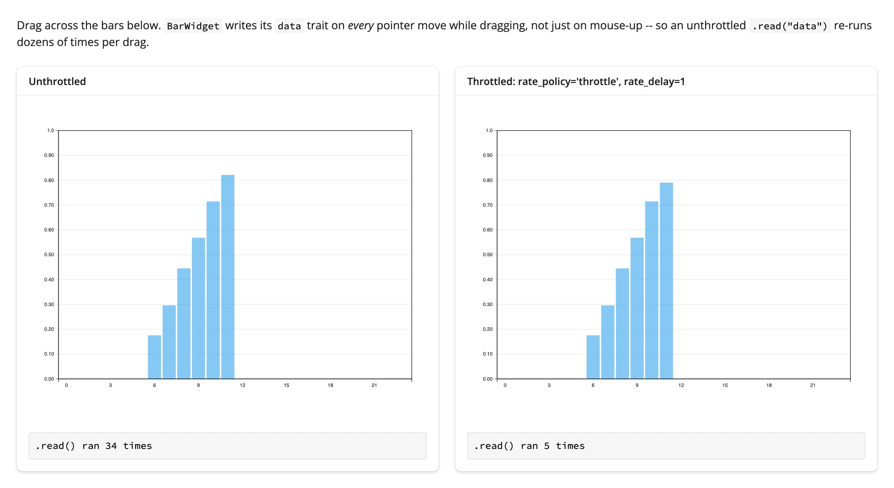
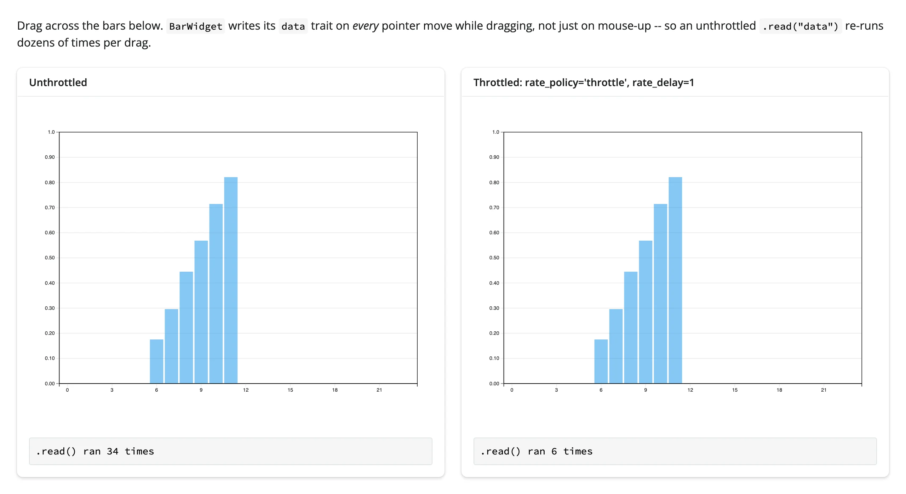

## Updating the widget from Python

The two widgets behave differently here, and the difference matters for how you reset them:

- **`ScatterWidget` accepts live Python-side writes.** Its frontend listens for `change:data`,
  `change:brushsize`, `change:width`, and `change:height`, so `canvas.widget.data = []` both updates the trait
  and clears the browser canvas immediately -- a true in-place update, no re-render.
- **`BarWidget` does not.** Its frontend registers no `change:` handlers at all, and its first render
  unconditionally overwrites whatever `data` you passed to the constructor with zeros. The only way to change
  anything about an existing `BarWidget` -- including resetting it -- is to re-render: return a new `BarWidget()`
  from the render function.

```{.python file="examples/06_clear_and_reset.py"}
from __future__ import annotations

from drawdata import BarWidget, ScatterWidget
from shiny import reactive
from shiny.express import input, render, ui
from shinywidgets import render_drawdata

ui.page_opts(fillable=True)

# BarWidget ignores Python-side trait writes after it first renders (its
# frontend registers no `change:` handlers), so the only way to reset one is
# to re-render it. Bumping this counter -- read, but otherwise unused, inside
# the render function -- forces exactly that.
bar_generation = reactive.Value(0)

with ui.layout_columns():
    with ui.card():
        ui.card_header("ScatterWidget: cleared in place")

        @render_drawdata
        def canvas():
            return ScatterWidget(width=800, height=400, n_classes=2)

        ui.input_action_button("clear_canvas", "Clear")

    with ui.card():
        ui.card_header("BarWidget: reset by re-rendering")

        @render_drawdata
        def hist():
            bar_generation()
            return BarWidget(collection_names=["dist"])

        ui.input_action_button("reset_hist", "Reset")


@render.code
def counts():
    s = canvas.read("data")
    b = [d for d in hist.read("data") if d["value"] != 0]
    return f"scatter: {len(s)} points  |  bar: {len(b)} raised bins"


@reactive.effect
@reactive.event(input.clear_canvas)
def _clear_canvas():
    # ScatterWidget *does* have a change:data handler, so this both updates
    # the Python-side trait and clears the browser canvas immediately.
    canvas.widget.data = []


@reactive.effect
@reactive.event(input.reset_hist)
def _reset_hist():
    bar_generation.set(bar_generation() + 1)
```

Both drawings cleared with one click each -- the scatter in place, the bar by re-render:

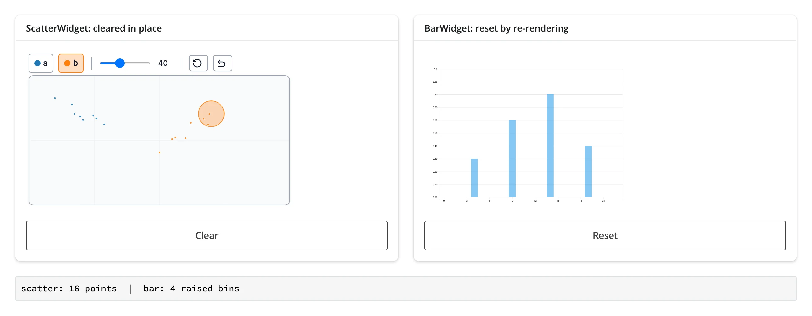
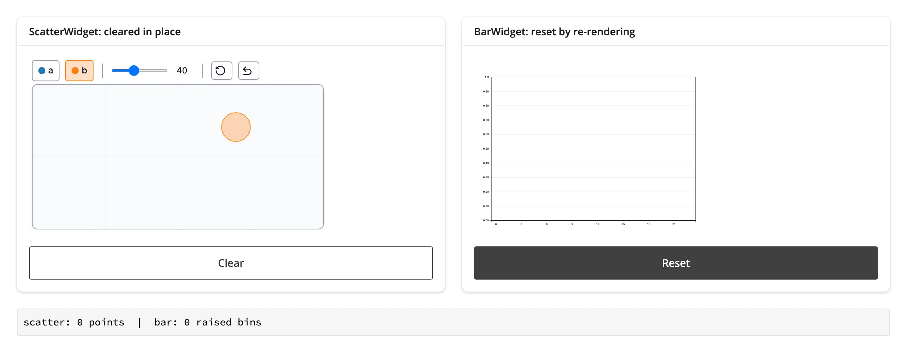

## Coordinating multiple views

These are the patterns worth stealing. Each draws into a `ScatterWidget` or `BarWidget` and feeds a second,
independent output that updates on every synced batch.

### A live classifier decision boundary (plotly)

Draw two classes; a k-NN classifier refits on every stroke and plotly draws its decision regions underneath the
points. `scaleanchor="x"` on the y-axis keeps the plot's aspect ratio matched to the canvas, so the boundary
lines up visually with where you drew.

```{.python file="examples/07_classifier_boundary.py"}
        @render_plotly
        def boundary():
            df = pd.DataFrame(canvas.read("data"))
            fig = go.Figure()
            fig.update_xaxes(range=[0, W], visible=False)
            fig.update_yaxes(range=[0, H], visible=False, scaleanchor="x")
            fig.update_layout(margin=dict(l=0, r=0, t=0, b=0))
            if df.empty or df["label"].nunique() < 2:
                fig.add_annotation(
                    text="draw points of both classes",
                    x=W / 2,
                    y=H / 2,
                    showarrow=False,
                )
                return fig

            X = df[["x", "y"]].to_numpy()
            y = df["label"].to_numpy()
            clf = KNeighborsClassifier(n_neighbors=min(5, len(X))).fit(X, y)

            gx, gy = np.meshgrid(np.linspace(0, W, 120), np.linspace(0, H, 60))
            grid = np.c_[gx.ravel(), gy.ravel()]
            _, pred_idx = np.unique(clf.predict(grid), return_inverse=True)
            fig.add_contour(
                x=gx[0],
                y=gy[:, 0],
                z=pred_idx.reshape(gx.shape),
                showscale=False,
                opacity=0.35,
                colorscale="Portland",
            )
            for label, group in df.groupby("label"):
                fig.add_scatter(
                    x=group["x"],
                    y=group["y"],
                    mode="markers",
                    marker=dict(color=group["color"].iloc[0], size=8),
                    name=label,
                )
            return fig
```

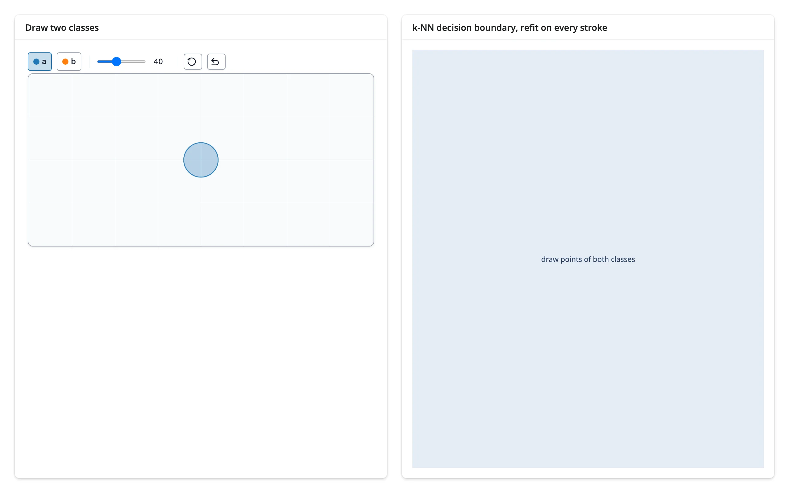


The [gallery template](#gallery-candidates) below wraps this pattern with a neighbor-count slider and a clear
button -- start there if you want a polished version to adapt.

### Fit on demand, not on every stroke

The classifier above refits on *every* synced batch -- fine for k-NN, but a heavier model (a grid search, a
GPU model, a slow custom fit) would make every stroke pause the UI. Gate the read behind a button instead with
`@reactive.event(input.fit)`: nothing reads `canvas.read("data")` until the user clicks "Fit model", but because
a synced trait holds whatever the browser last reported the moment the widget renders -- not just from the
output's first read -- every point drawn *before* that click is still there when it finally runs.

```{.python file="examples/11_fit_on_demand.py"}
        @render_plotly
        @reactive.event(input.fit)
        def boundary():
            # Nothing reads "data" until this click -- not a warm-up read,
            # not a visible output, nothing -- but every point drawn before
            # the click is still here: a synced trait holds the latest value
            # the moment the widget renders, whether or not anything has
            # read it yet. That's what makes "fit only when asked" safe
            # instead of needing a k-NN refit on every single stroke.
            df = pd.DataFrame(canvas.read("data"))
```

Draw both classes first -- the right panel stays completely empty, because nothing has read the data yet. Click
"Fit model" and the whole drawing, both classes, shows up at once:

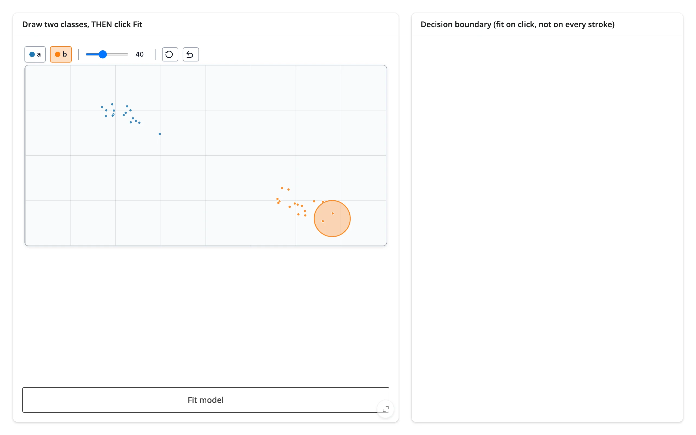
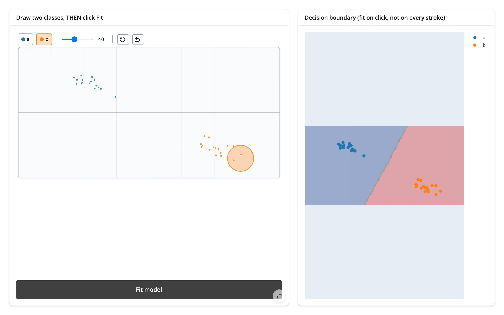

### A live regression fit (matplotlib)

With `n_classes=1`, every point is the same color; drawdata's own `data_as_X_y` property then reinterprets the
drawing as regression data (`X` = the x-coordinates, `y` = the y-coordinates) instead of classification data.
Draw a trend left to right and a quadratic curve refits underneath it.

```{.python file="examples/08_regression_fit.py"}
        @render_matplotlib
        def fit():
            # A dependency on "data" also covers data_as_X_y, computed from
            # the same trait; with one color drawn, it returns (X, y) for
            # regression instead of (X, hex colors) for classification.
            canvas.read("data")
            X, y = canvas.widget.data_as_X_y

            fig, ax = plt.subplots(figsize=(5, 2.5))
            ax.set_xlim(0, W)
            ax.set_ylim(0, H)
            if len(X) < 3:
                ax.text(
                    W / 2, H / 2, "draw at least 3 points", ha="center", color="grey"
                )
                return fig
            x = X.ravel()
            coeffs = np.polyfit(x, y, deg=2)
            xs = np.linspace(x.min(), x.max(), 100)
            ax.scatter(x, y, s=12, color="#1f77b4")
            ax.plot(xs, np.polyval(coeffs, xs), color="#d62728", linewidth=2)
            return fig
```

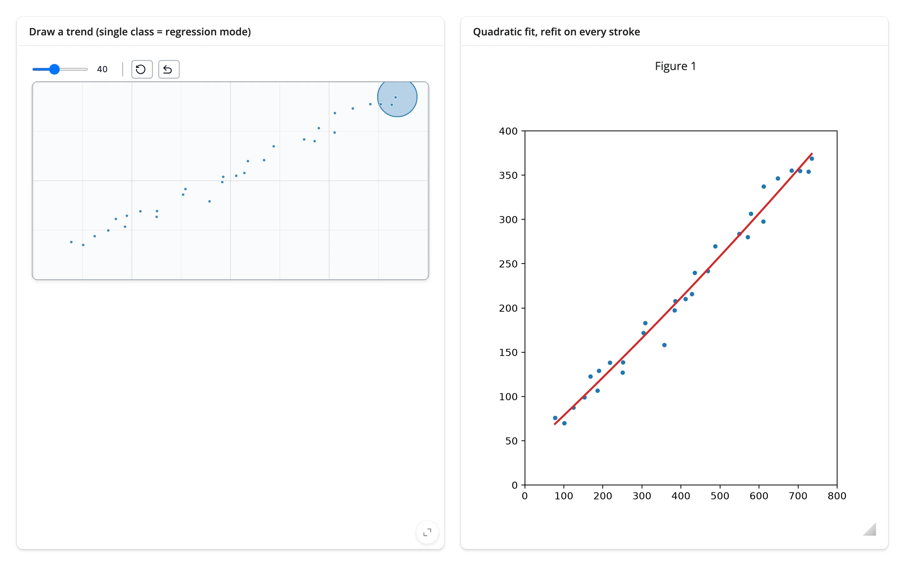

### Comparing two sculpted distributions (altair)

`BarWidget`'s default `collection_names` (`["collection1", "collection2"]`) gives you a button to switch which
distribution you're currently sculpting -- useful for drawing two distributions to compare side by side. Altair
redraws both, overlaid with opacity, from the same `data` trait every other example uses.

```{.python file="examples/09_compare_distributions.py"}
        @render_altair
        def overlay():
            df = pd.DataFrame(hist.read("data"))
            chart = (
                alt.Chart(df)
                .mark_bar(opacity=0.7)
                .encode(
                    x=alt.X("bin:O", title=None),
                    y=alt.Y("value:Q", title=None, stack=None),
                    color=alt.Color("collection:N", legend=alt.Legend(title=None)),
                )
            )
            return chart
```

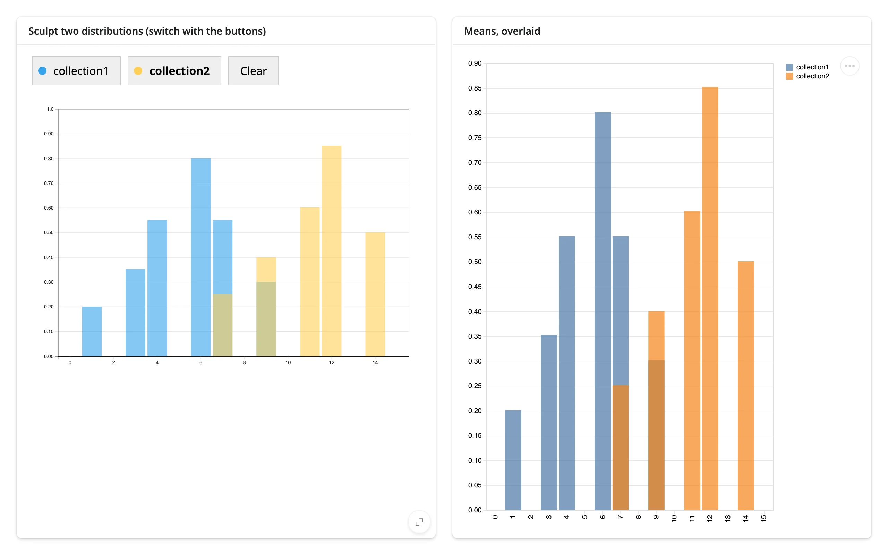

### Live clustering (altair)

Clustering doesn't need labels at all: draw a single-color cloud of points (`n_classes=1`) and k-means (`k` from
a slider) assigns and colors clusters live.

```{.python file="examples/10_clustering.py"}
        @render_altair
        def clusters():
            df = pd.DataFrame(canvas.read("data"))
            base = (
                alt.Chart()
                .mark_point()
                .encode(
                    x=alt.X("x:Q", scale=alt.Scale(domain=[0, W])),
                    y=alt.Y("y:Q", scale=alt.Scale(domain=[0, H])),
                )
            )
            if len(df) < input.k():
                return base
            labels = KMeans(n_clusters=input.k(), n_init=5, random_state=0).fit_predict(
                df[["x", "y"]]
            )
            df["cluster"] = [str(c) for c in labels]
            return (
                alt.Chart(df)
                .mark_point(filled=True, size=60)
                .encode(
                    x=alt.X("x:Q", scale=alt.Scale(domain=[0, W])),
                    y=alt.Y("y:Q", scale=alt.Scale(domain=[0, H])),
                    color=alt.Color("cluster:N", legend=None),
                )
            )
```

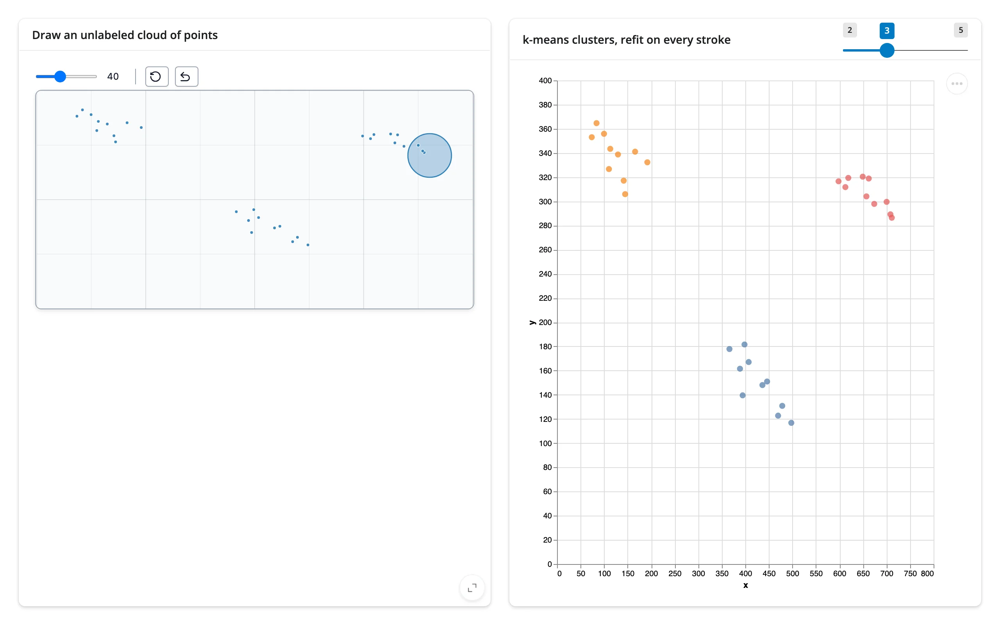

**Pairs with**: [plotly](../plotly/index.md) (contour fills for decision regions), [matplotlib](../matplotlib/index.md)
(quick static fits), [altair](../altair/index.md) (categorical overlays and grouped bars).

## Layout and sizing

Both widgets have an intrinsic pixel size from their constructor's `width`/`height` traits (`ScatterWidget`
defaults to 800x400, `BarWidget` to 800x550) -- but that size is really the *data coordinate space* the drawing
is stored in, not a fixed display size. Upstream, both widgets cap their on-screen display at that same pixel
size; `render_drawdata` lifts the cap so the widget instead fills the output's width, scaling its display while
preserving the trait-defined aspect ratio. In an output with an explicit height (`output_widget(height=...)`, or
any fill layout), the chart is also constrained to fit that height. This is the one real shinywidgets-side fix
in this renderer -- without it, `BarWidget`'s default 550px-tall chart gets clipped at the generic 400px flex
basis most other outputs use.

Practical implications:
- Pick the constructor's `width`/`height` for the coordinate range and aspect ratio you want to draw in, not for
  a target pixel size -- `ScatterWidget(width=1000, height=500)` draws in a 2:1 box no matter how large or small
  the rendered output ends up.
- `BarWidget`'s bars are keyed by index (`bin`), independent of display size, so sizing never affects how a
  drawn distribution reads back.
- Use `ui.card(full_screen=True)` and `fill=True` as you would for any other widget; nothing about drawdata's
  sizing behavior requires special handling in the UI.

## Gotchas and limitations

Verified on current main (drawdata 0.5.2):

- **`ScatterWidget`'s first drawing batch doesn't sync until a second one starts** -- see
  ["The one-batch sync lag"](#the-one-batch-sync-lag) above. This is the thing you will hit first; don't build a
  flow that depends on seeing the user's very first stroke in isolation.
- **`BarWidget` ignores every Python-side trait write after its first render**, including the `data` you pass to
  its constructor (which gets silently overwritten with zeros on mount). Treat a rendered `BarWidget` as
  browser-driven only; re-render to change anything, including resetting it.
- **`BarWidget`'s default `collection_names` is `["collection1", "collection2"]`**, not a single distribution --
  you get a two-way switcher and a "Clear" button out of the box. Pass a one-element list
  (`collection_names=["dist"]`) for a single plain distribution with no extra controls.
  Also avoid putting two `BarWidget`s on the same page: clicking one's collection buttons can affect the other's
  active collection (both attach the same global `button.control` click listener).
- **`data_as_X_y` reports hex color codes as `y` for classification**, not the `"a"`/`"b"`/`"c"`/`"d"` labels --
  use `data_as_pandas["label"]` (or build the array from `.read("data")` yourself, as the classifier
  example above does) if you need the actual class names.
- **One harmless console error per `ScatterWidget` render**: `<svg> attribute height: Expected length, "auto"`.
  It's an invalid attribute upstream sets (the real sizing comes from CSS `aspect-ratio`); it shows up in Jupyter
  too and has no visible effect.
- **`.data_as_pandas` / `.data_as_polars` / `.data_as_X_y` are plain property reads, not reactive.** Call them
  only after a `.read("data")` elsewhere in the same function; on their own they compute once
  from whatever the trait held at that moment and never refire.

## Gallery candidates

### Template: classifier playground

[`gallery/template_classifier_playground.py`](gallery/template_classifier_playground.py) -- the classifier
pattern above, cleaned up with a neighbor-count slider and a clear button. ~65 lines; swap
`KNeighborsClassifier` for any other scikit-learn classifier to adapt it.

```sh
uv run --with scikit-learn shiny run docs/widget-guides/drawdata/gallery/template_classifier_playground.py
```

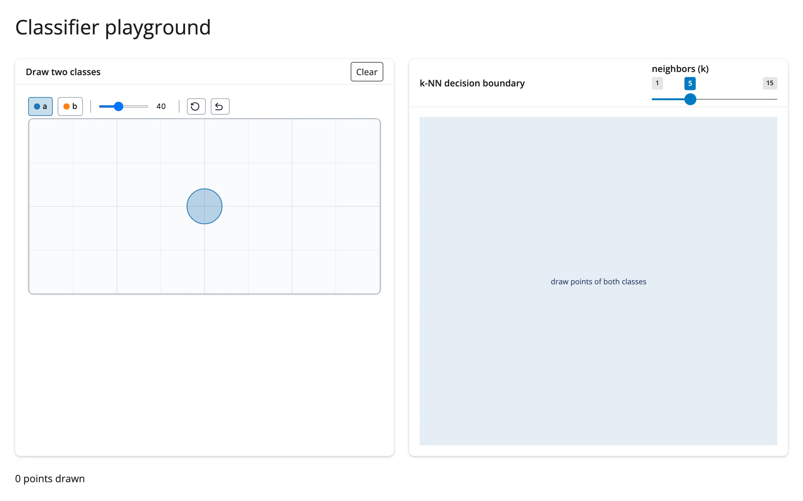


### Showcase: draw-a-dataset model explorer

[`gallery/showcase_model_explorer.py`](gallery/showcase_model_explorer.py) -- one canvas, three ML tasks
(classification, regression, clustering) picked with a sidebar radio button. Switching tasks re-renders the
canvas with the right `n_classes` for that task and clears the drawing; a "Clear canvas" button does the same on
demand.

```sh
uv run --with scikit-learn shiny run docs/widget-guides/drawdata/gallery/showcase_model_explorer.py
```

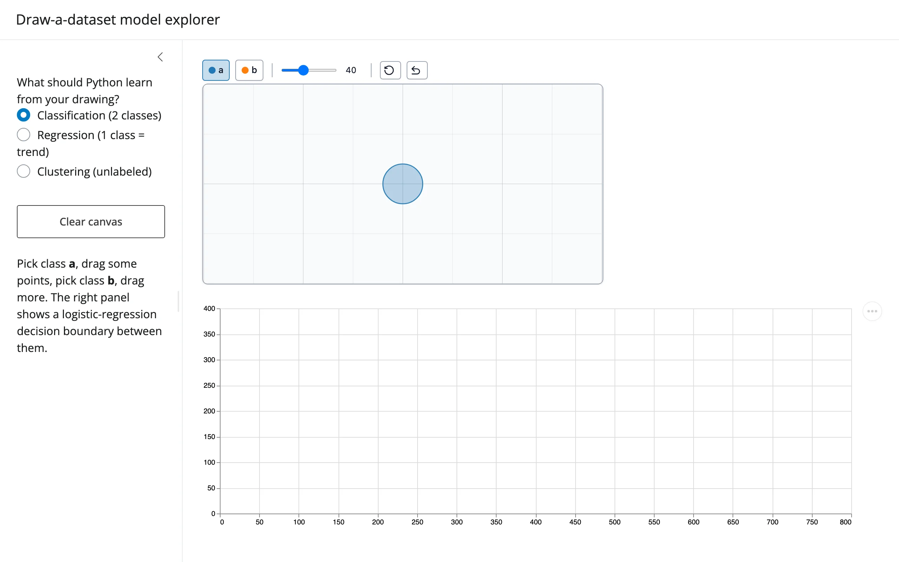
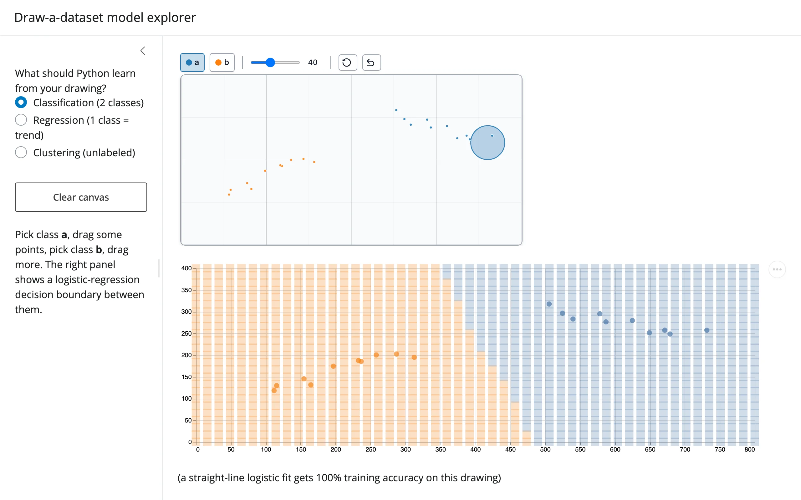
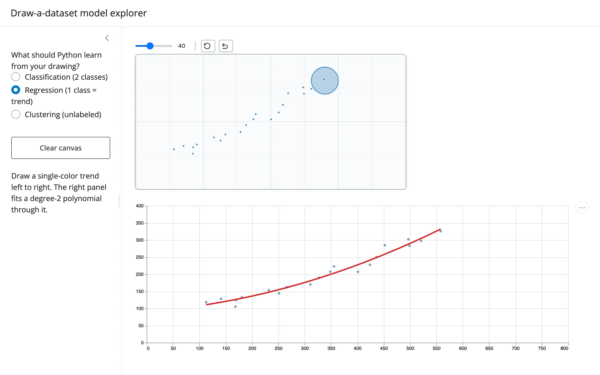
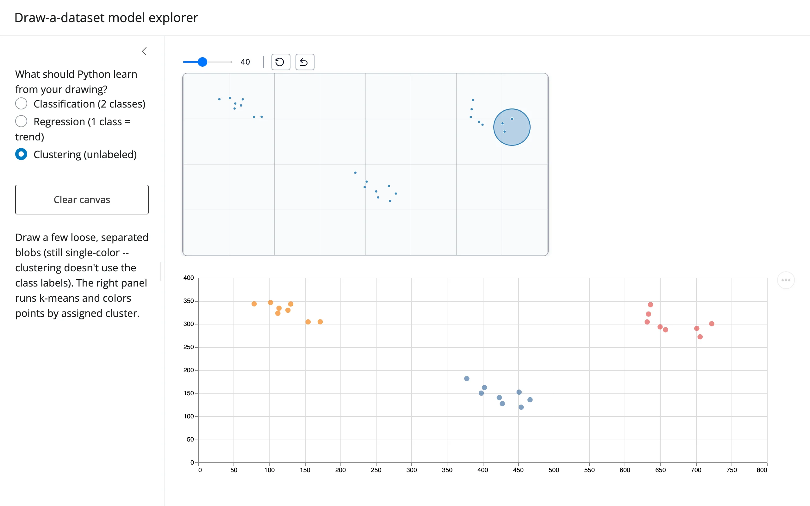

## Learn more

- [drawdata docs / live demo](https://koaning.github.io/drawdata/)
- [drawdata on GitHub](https://github.com/koaning/drawdata)
- [render-widget guide](../../guide/any-widget/index.md) -- the general `.read()` pattern used throughout this
  guide
- [plotly](../plotly/index.md), [matplotlib](../matplotlib/index.md), [altair](../altair/index.md) -- the model
  views paired with drawdata above
- [ipycanvas](../ipycanvas/index.md) -- for free-form drawing/annotation rather than point-and-bar datasets
