[Embedding Atlas](https://apple.github.io/embedding-atlas/) is Apple's tool for exploring large collections of
text or image embeddings: drop in a data frame with a 2D projection (or let the library compute one for you with
UMAP) and it builds a GPU-rendered scatter map, automatic bar/histogram charts for every other column, a
searchable/paginated table, and automatically generated cluster labels -- all wired together by a shared,
in-process DuckDB cross-filter. It's built for the same job as tools like Nomic Atlas or TensorFlow Projector:
finding structure (clusters, duplicates, outliers) in thousands to millions of embedded documents, images, or
rows, without writing a clustering or labeling pipeline yourself.

`@render_embedding_atlas` takes an `embedding_atlas.widget.EmbeddingAtlasWidget` that you construct yourself (a
bare data frame isn't enough here, unlike most renderers in this roster, since the widget needs to know which
columns hold the projection, text, and so on). The renderer applies shinywidgets' usual layout defaults (fill its
card, or keep the library's own 650px height when space isn't fillable) and, critically, **locks down the
widget's DuckDB connection before display** so that the SQL the browser sends can't reach your server's files --
see the security gotcha below before deploying this. Two accessors turn the explorer's cross-filter into reactive
values: `predicate()` gives you the live filter as a SQL `WHERE` expression, and `selected()` gives you the
matching rows directly, both debounced so a dragging lasso or brush doesn't flood your server with DuckDB queries.

Choose Embedding Atlas over a sibling in this roster when the point is semantic/cluster exploration of a column
of text or images at the center of the app -- its auto-charts, auto-labels, and built-in table are the draw. For
a bare, fast, million-point GPU scatter without the chart/table/SQL machinery, see
[jupyter-scatter](../jscatter/index.md). For million-row exploration via a Vega-Lite-style grammar instead of a
fixed layout, see [mosaic](../mosaic/index.md). For tabular search and paging without a map, see
[itables](../itables/index.md) or [perspective](../perspective/index.md).

**The embedding (scatter) view itself needs a browser with WebGPU and the `shader-f16` feature** (recent desktop
Chrome, Edge, or Firefox). Everywhere else, the map is replaced by a "WebGPU is unavailable" placeholder, but the
charts, the table, search, and SQL predicates keep working, and they alone are enough to drive every accessor in
this guide. Confirm your deployment target has WebGPU before relying on the map for the finished product --
headless Chromium needs `channel="chromium"` plus `--enable-unsafe-webgpu --use-angle=metal` and a real
`http(s)://` origin (not `about:blank` or a `data:` URL, which aren't secure contexts) to get it at all, which is
how every screenshot in this guide was produced.

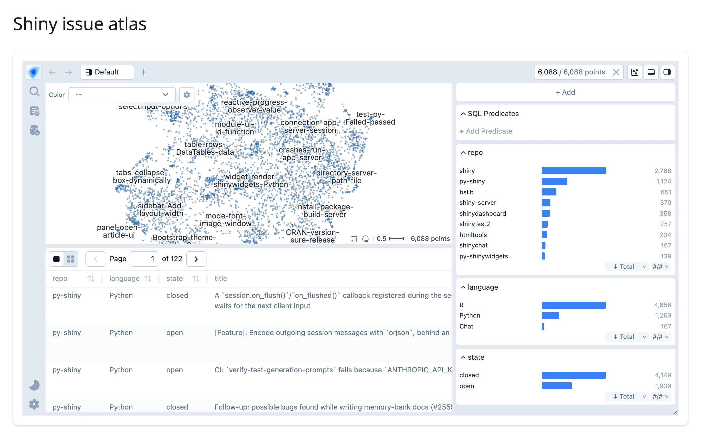

## Installation

```sh
pip install 'shinywidgets[embedding_atlas]'
```

This needs **Python 3.11 or newer** (embedding-atlas's own requirement). The package's full dependency tree is
heavy -- it pulls in torch, sentence-transformers, litellm, accelerate, and umap-learn for its optional embedding
and projection helpers -- but `EmbeddingAtlasWidget` itself needs none of that; only
`embedding_atlas.projection.compute_projection()` (see below) touches umap-learn, and only when you call it.

## Quick start

```{.python file="examples/01_quickstart.py"}
# A minimal Embedding Atlas explorer over a real dataset: 6,088 GitHub issues
# from the Shiny ecosystem (R and Python Shiny, bslib, shinywidgets, ...), with
# a 2D projection already computed offline (see "Computing a projection").
# Data: docs/showcase/issues/embed.py built data/issues.parquet from public
# GitHub issues using embedding_atlas.projection.compute_projection().
from pathlib import Path

import pandas as pd
from embedding_atlas.widget import EmbeddingAtlasWidget
from shiny.express import ui
from shinywidgets import render_embedding_atlas

ISSUES = pd.read_parquet(Path(__file__).parent / "data" / "issues.parquet")
COLUMNS = ["repo", "language", "state", "title", "text", "projection_x", "projection_y"]

ui.page_opts(title="Shiny issue atlas", fillable=True)

with ui.card(full_screen=True):

    @render_embedding_atlas
    def atlas():
        return EmbeddingAtlasWidget(
            ISSUES[COLUMNS], x="projection_x", y="projection_y", text="text"
        )
```


That's the whole app: one data frame, four column names, and you get a GPU-rendered map with automatic cluster
labels, auto-generated bar charts for `repo`, `language`, and `state`, and a searchable, paginated table -- all
answered by DuckDB queries your Python process runs. The dataset is real: 6,088 issues from nine repos in the
Shiny ecosystem, with a text projection computed once, offline (the next section shows how), and the cluster
labels ("reactive-progress-observer-value", "crashes-run-app-server", ...) are generated automatically from issue
text, with no configuration at all (see "Auto-generated cluster labels" below).

## What you can build

### Computing a projection, or bringing your own

[`examples/02_compute_projection.py`](examples/02_compute_projection.py)

`EmbeddingAtlasWidget` only ever plots `x`/`y` columns you give it -- it doesn't embed anything itself. Upstream's
`embedding_atlas.projection.compute_projection()` does that part: it embeds a text, image, or vector column (text
and image need `sentence-transformers`/`transformers`; a column of precomputed vectors needs nothing but
`umap-learn`) and runs UMAP to lay the result out in 2D. **It can't run inside a Shiny app's own event loop** --
it calls `asyncio.run()` internally, which raises once a loop is already running, the same restriction that keeps
it out of Jupyter -- so treat it as an offline step: compute once, cache to Parquet, and have your app's render
function only ever read the cached columns. That's exactly what builds `issues.parquet`, used throughout this
guide (see `docs/showcase/issues/embed.py` for the real text/`sentence-transformers` version)
([`examples/02_compute_projection.py`](examples/02_compute_projection.py)):

```{.python file="examples/02_compute_projection.py"}
# Turn embedding vectors into the x/y columns an atlas needs, with
# embedding_atlas.projection.compute_projection(). A real app embeds raw text
# or images (modality="text"/"image", needs sentence-transformers); here the
# vectors are already computed, so modality="vector" skips straight to UMAP.
#
# compute_projection() can't run inside a Shiny app's own event loop (it
# calls asyncio.run() internally, which raises once a loop is already
# running -- the same reason Jupyter can't call it directly either). Compute
# it once, offline, the way docs/showcase/issues/embed.py does for the real
# GitHub-issues dataset used elsewhere in this guide:
#   uv run --with umap-learn python 02_compute_projection.py
# (UMAP's first call compiles its numba kernels, about a minute; reruns are
# fast.) Then view the cached result with `shiny run 02_compute_projection.py`.
from pathlib import Path

import numpy as np
import pandas as pd
from embedding_atlas.widget import EmbeddingAtlasWidget
from shiny.express import ui
from shinywidgets import render_embedding_atlas

CACHE = Path(__file__).parent / "data" / "projected_topics.parquet"


def build_cache() -> None:
    rng = np.random.default_rng(0)
    topics = {"astronomy": 0, "cooking": 1, "sailing": 2, "chess": 3}
    docs = pd.DataFrame(
        {
            "topic": [t for t in topics for _ in range(60)],
            "text": [f"{t} note {i}" for t in topics for i in range(60)],
        }
    )
    # 16-dim stand-ins for real text embeddings: one Gaussian cluster per topic
    centers = rng.normal(scale=4, size=(len(topics), 16))
    docs["vector"] = [
        (centers[topics[t]] + rng.normal(size=16)).tolist() for t in docs["topic"]
    ]

    # Imported here, not at module level: needs umap-learn, which only the
    # cache-building path below requires -- `shiny run` never hits this branch
    from embedding_atlas.projection import compute_projection

    docs = compute_projection(docs, inputs="vector", modality="vector", neighbors=None)
    docs.drop(columns=["vector"]).to_parquet(CACHE, index=False)


if __name__ == "__main__":
    build_cache()
    print(f"wrote {CACHE}")
else:
    docs = pd.read_parquet(CACHE)

    ui.page_opts(title="Projected from embedding vectors", fillable=True)

    with ui.card(full_screen=True):

        @render_embedding_atlas
        def atlas():
            return EmbeddingAtlasWidget(docs, x="projection_x", y="projection_y", text="text")
```

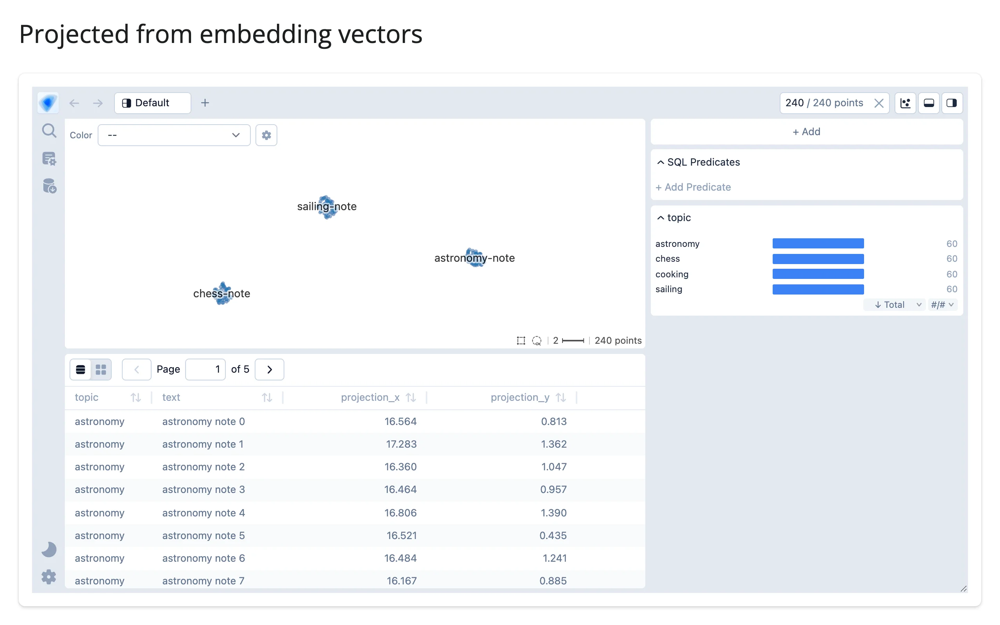

The four synthetic topics (astronomy, cooking, sailing, chess) land in four well-separated regions, confirming
UMAP placed semantically similar vectors near each other. Swap `modality="vector"` for `modality="text"` and an
`embedder="sentence-transformers"` to embed raw strings instead -- the rest of the call is identical.

### Auto-generated cluster labels

[`examples/03_auto_labels.py`](examples/03_auto_labels.py)

The cluster labels visible in the hero and quick start screenshots ("reactive-progress-observer-value",
"crashes-run-app-server", ...) aren't something you configure -- they're on by default whenever you give `text=`.
The map clusters by 2D density and titles each cluster with its own top TF-IDF keywords from that column, so you
get a labeled map with no topic-modeling code and no extra argument
([`examples/03_auto_labels.py`](examples/03_auto_labels.py)):

```{.python file="examples/03_auto_labels.py"}
# Automatic cluster labels are the library's default whenever `text` is
# given -- you don't pass anything to get them (the quick start already has
# them; this is the same data, cropped in on the embedding view itself). The
# `labels=` option is for supplying your own list of label dicts instead, not
# a flag to toggle the automatic ones (see Gotchas: the documented
# "automatic"/"disabled" sentinel strings don't work as described).
from pathlib import Path

import pandas as pd
from embedding_atlas.widget import EmbeddingAtlasWidget
from shiny.express import ui
from shinywidgets import render_embedding_atlas

ISSUES = pd.read_parquet(Path(__file__).parent / "data" / "issues.parquet")
COLUMNS = ["repo", "language", "title", "text", "projection_x", "projection_y"]

ui.page_opts(title="Auto-labeled issue clusters", fillable=True)

with ui.card(full_screen=True):

    @render_embedding_atlas
    def atlas():
        return EmbeddingAtlasWidget(
            ISSUES[COLUMNS], x="projection_x", y="projection_y", text="text"
        )
```

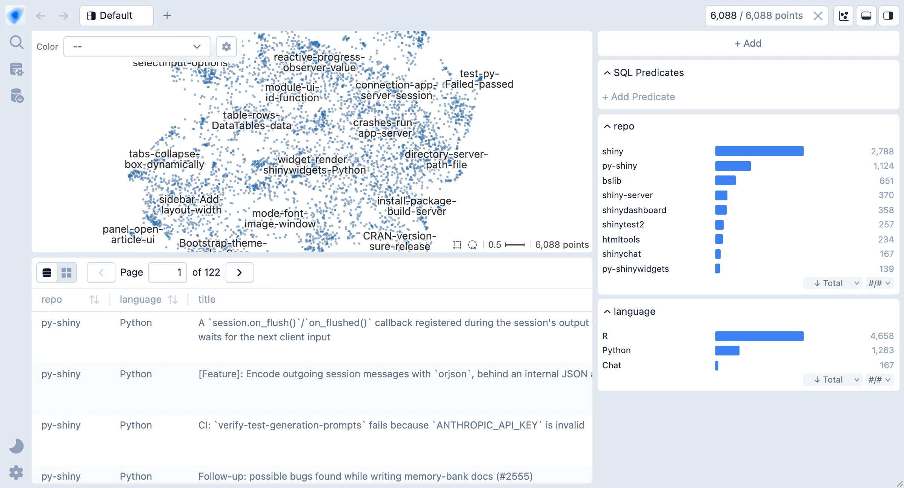

The Python `labels=` option (documented as taking the strings `"automatic"` or `"disabled"`, or a list of your own
label dicts) doesn't do what its docstring says -- see the Gotchas section below before reaching for it.

### Images in the explorer

Put PNG or JPEG bytes (or a `data:`/`http(s)` URL) in a column and pass it as `image=`: the table and hover
tooltips show the picture alongside every other column, and it participates in the same cross-filter as
everything else. `sklearn`'s bundled 8x8 handwritten-digit images, blown up to 64x64, make this concrete
([`examples/04_images.py`](examples/04_images.py)):

```{.python file="examples/04_images.py"}
# Put PNG bytes in a column and pass it as `image=`: the explorer shows the
# image in hover tooltips and the detail table, alongside the auto-generated
# charts for every other column. Needs scikit-learn for the bundled digits
# dataset: `uv run --with scikit-learn shiny run 04_images.py`
import io

import numpy as np
import pandas as pd
from embedding_atlas.widget import EmbeddingAtlasWidget
from PIL import Image
from shiny.express import ui
from shinywidgets import render_embedding_atlas
from sklearn.datasets import load_digits
from sklearn.decomposition import PCA

digits = load_digits()
rng = np.random.default_rng(0)
idx = rng.choice(len(digits.images), size=600, replace=False)


def to_png(pixels: "np.ndarray") -> bytes:
    img = Image.fromarray((pixels / 16 * 255).astype("uint8")).resize((64, 64))
    buf = io.BytesIO()
    img.save(buf, format="PNG")
    return buf.getvalue()


xy = PCA(n_components=2).fit_transform(digits.data[idx])
docs = pd.DataFrame(
    {
        "digit": digits.target[idx].astype(str),
        "image": [to_png(p) for p in digits.images[idx]],
        "x": xy[:, 0],
        "y": xy[:, 1],
    }
)

ui.page_opts(title="Handwritten digits with image previews", fillable=True)

with ui.card(full_screen=True):

    @render_embedding_atlas
    def atlas():
        return EmbeddingAtlasWidget(docs, x="x", y="y", image="image")
```

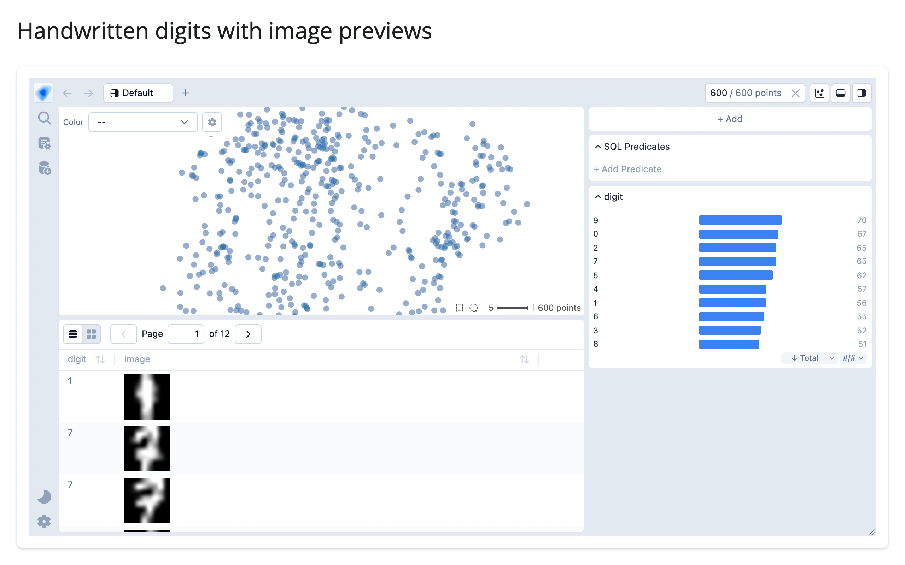

The digit thumbnails appear right in the table rows, resized and legible, with no client-side image-loading code
of your own.

## Reacting to user interaction

Every chart click, shift-drag box, lasso, and typed SQL predicate the user builds in the explorer funnels into one
place: the widget's (upstream-internal) `_predicate` trait, a DuckDB `WHERE` expression. `predicate()` exposes
that expression directly; `selected()` re-runs it against the widget's own DuckDB connection and hands you the
matching rows. Both read from the same debounced, published value, so they always describe the same filter --
even mid-debounce, before the widget's own live trait has settled.

### Accessor reference

| accessor | returns | before any interaction | across re-render | default rate policy |
|---|---|---|---|---|
| `predicate()` | `str \| None` (a DuckDB boolean expression) | seeded `None`: nothing is filtered | re-seeded from the new explorer | debounce, 250 ms |
| `selected()` | the same frame type (pandas/polars/pyarrow) the widget was built from, plus a `__row_index__` column | seeded; **all rows** while nothing is filtered (library semantics) | re-seeded, following `predicate()` | debounce, 250 ms (shares `predicate()`'s window) |

Both accessors raise `RuntimeError` with a specific message if you try to read them inside their own render
function (see Gotchas) and otherwise behave like `reactive_read()`-backed values: reading one before the explorer
has ever rendered cancels the current reactive context (`req(False)`), the way `.widget` does. Both describe the
explorer's *current* cross-filter, not a memory of past interaction, so a re-render always re-seeds them from the
new explorer's own (unfiltered) state -- there's nothing carried over from before the re-render to reset or
preserve.

### `predicate()`: push the filter into a query of your own

[`examples/05_predicate_query.py`](examples/05_predicate_query.py)

`predicate()` is a SQL fragment over the exact column names the widget was built from, so you can run your own
aggregate against it -- useful when you want a number, not the rows themselves, and would rather not materialize
them in Python first. This example applies it against a second DuckDB connection over the same data frame, kept
separate from the widget's own locked-down connection
([`examples/05_predicate_query.py`](examples/05_predicate_query.py)):

```{.python file="examples/05_predicate_query.py"}
# predicate() is the cross-filter as a DuckDB WHERE expression, so you can
# push it into a query of your own instead of pulling the rows into Python
# first. Here it drives a server-side aggregate (average reactions) over a
# duckdb connection that's separate from the widget's own.
from pathlib import Path

import duckdb
import pandas as pd
from embedding_atlas.widget import EmbeddingAtlasWidget
from shiny.express import render, ui
from shinywidgets import render_embedding_atlas

ISSUES = pd.read_parquet(Path(__file__).parent / "data" / "issues.parquet")
COLUMNS = ["repo", "language", "state", "title", "text", "comments", "reactions", "projection_x", "projection_y"]  # fmt: skip

# `.register()` returns the connection; keep that as an assignment, not a
# bare statement -- shiny.express would otherwise treat its non-None result
# as a UI child, like it would a bare module-level docstring
con = duckdb.connect().register("issues", ISSUES)

ui.page_opts(title="predicate() driving a server-side aggregate", fillable=True)

with ui.layout_columns(col_widths=[8, 4]):
    with ui.card(full_screen=True):

        @render_embedding_atlas
        def atlas():
            return EmbeddingAtlasWidget(
                ISSUES[COLUMNS], x="projection_x", y="projection_y", text="text"
            )

    with ui.card():
        ui.card_header("Average engagement, selected rows")

        @render.text
        def stat():
            where = atlas.predicate()
            clause = f"WHERE {where}" if where else ""
            n, reactions, comments = con.sql(
                f"SELECT count(*), avg(reactions), avg(comments) FROM issues {clause}"
            ).fetchone()
            return f"{n:,} issues · {reactions:.2f} avg reactions · {comments:.2f} avg comments"
```

Before any filter, and after clicking the "closed" bar in the `state` chart:

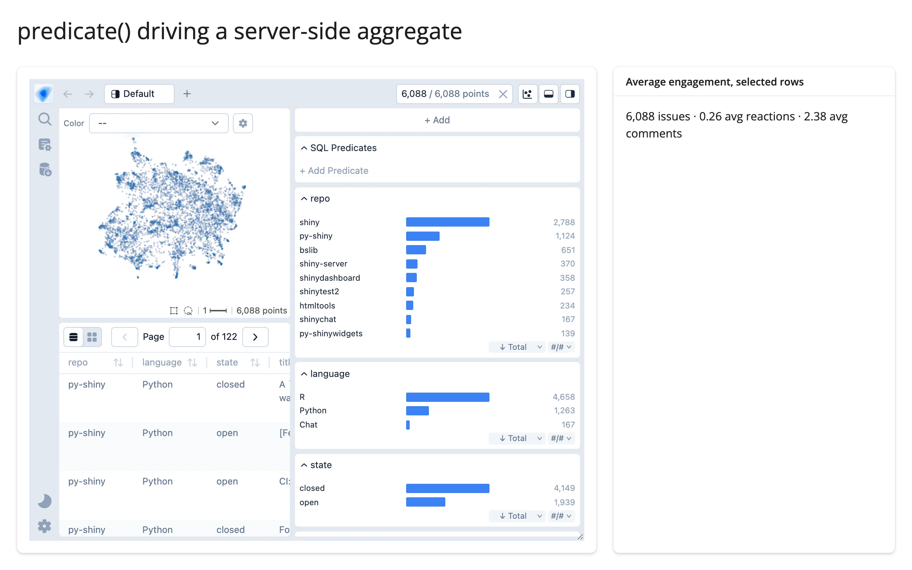
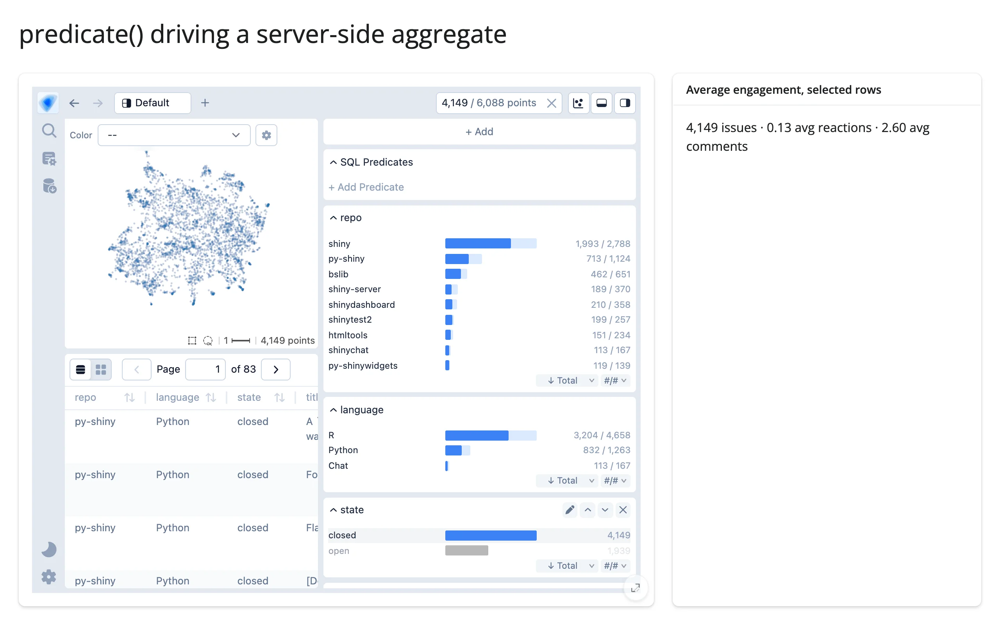

### `selected()`: the filtered rows, as a detail table

```{.python file="examples/06_selection_table.py"}
# selected() returns the rows passing the current cross-filter, as the same
# frame type (here pandas) the widget was built from -- a detail table for
# exactly what the user selected, with no SQL of your own to write.
from pathlib import Path

import pandas as pd
from embedding_atlas.widget import EmbeddingAtlasWidget
from shiny.express import render, ui
from shinywidgets import render_embedding_atlas

ISSUES = pd.read_parquet(Path(__file__).parent / "data" / "issues.parquet")
COLUMNS = ["repo", "language", "state", "title", "text", "projection_x", "projection_y"]  # fmt: skip

ui.page_opts(title="selected() as a detail table", fillable=True)

with ui.layout_columns(col_widths=[7, 5]):
    with ui.card(full_screen=True):

        @render_embedding_atlas
        def atlas():
            return EmbeddingAtlasWidget(
                ISSUES[COLUMNS], x="projection_x", y="projection_y", text="text"
            )

    with ui.card(full_screen=True):
        ui.card_header("Selected rows")

        @render.data_frame
        def table():
            sel = atlas.selected()
            return sel[["repo", "state", "title"]].reset_index(drop=True)
```

Before any filter (all 6,088 rows), and after clicking the "py-shinywidgets" bar in the `repo` chart (139 rows):

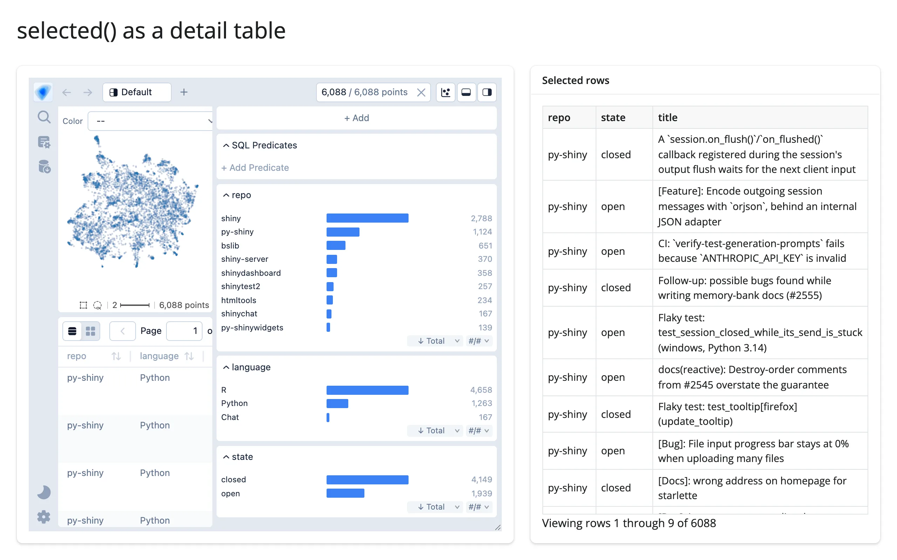
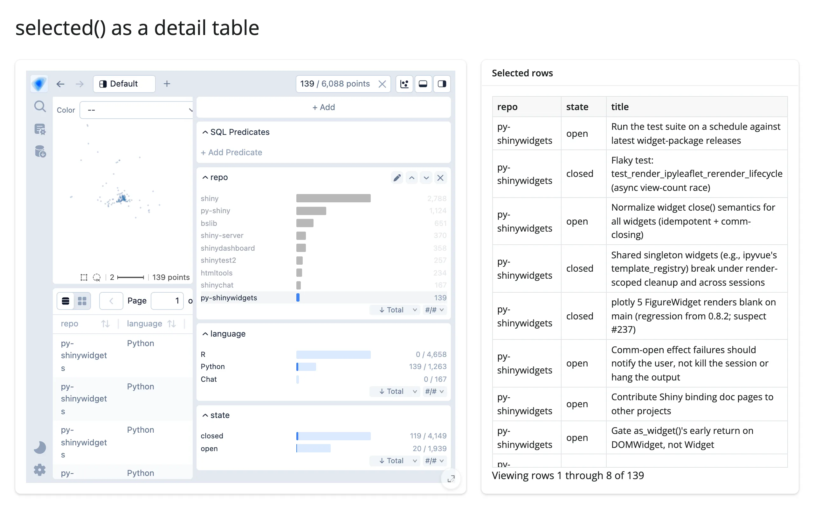

`selected()` runs a DuckDB query every time it's read, so read it once into a `@reactive.calc` if several
outputs need the same selection (as the gallery template does), rather than calling it from each one.

### Driving it from the map itself

Every example so far clicks a chart bar, since that's the gesture a browser without WebGPU can still make. The
same two accessors answer to the embedding canvas's own gestures too -- shift-drag for a box, shift+⌘-drag (Ctrl
on non-Mac) for a lasso -- because both update the same `_predicate` trait. Shift-dragging a box over the dense
center of [`examples/06_selection_table.py`](examples/06_selection_table.py)'s map narrows it from 6,088 to 1,723
points, and the linked table updates exactly as it does for a bar click:

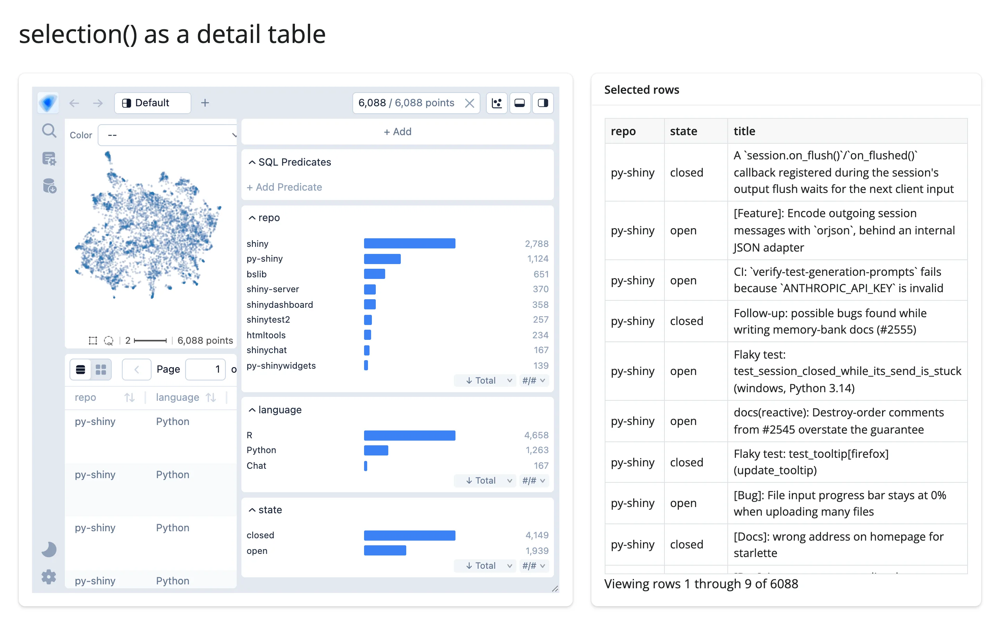
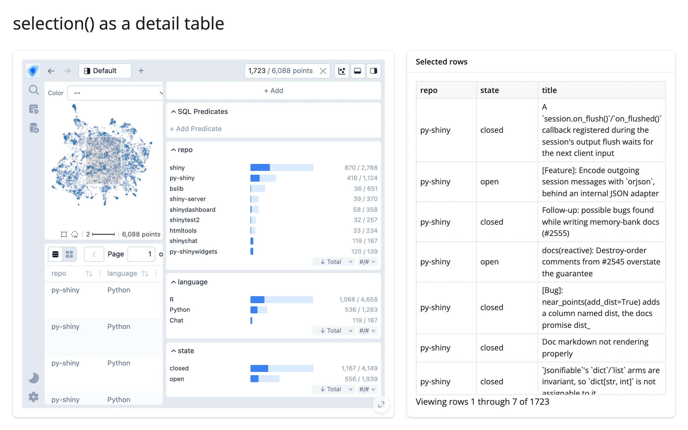

### Beyond the accessors: `atlas.read("_state")`

The only other trait worth reading directly is `_state` -- the explorer's full UI state (coloring, active charts,
viewport, and the current filter) as a JSON string, synced from the browser the same way `_predicate` is. It's
not wrapped in an accessor because on its own it's not something you'd react to; its job is letting you **carry
the view across a re-render** (`atlas.read("_state")`, which falls through to `reactive_read()` on the rendered
widget -- prefer it over calling `reactive_read(atlas.widget, "_state")` directly), covered next.

### Rate limiting

Both accessors debounce at 250 ms by default, because a dragging box or lasso streams many intermediate filter
values, and each one costs a DuckDB query if you're reading `selected()`. Pass `rate_policy="throttle"` to
`@render_embedding_atlas(...)` for a steady trickle of updates during a long drag instead of one at the end, or
`rate_delay=0` to react to every intermediate value (only worth it for cheap downstream work). Both keyword
arguments also apply to `atlas.read()`/`reactive_read()` on the widget's own traits, including `_state`.

## Updating the widget from Python

The explorer **ignores trait changes made from Python**: setting `atlas.widget._predicate` or `atlas.widget._props`
from a `@reactive.effect` has no visible effect, because the frontend only listens for browser-driven changes to
sync outward, not for Python-driven changes to apply inward (verified: after setting `_predicate` directly, the
point count stays unchanged -- "6,088 / 6,088 points" either way). **Re-rendering is the only way to change what
the explorer shows.**

A plain re-render throws away the user's pan, zoom, coloring, and filter, though. `_state` round-trips that whole
view as JSON, so capturing it in a `reactive.value` and passing it back as `initial_state` on the next render
carries it forward:

```{.python file="examples/07_update_in_place.py"}
# The explorer ignores trait changes made from Python (setting
# `atlas.widget._predicate` or `._props` has no visible effect; there's no
# `change:_props` listener wired up for it on the frontend), so the only way
# to change what it shows is a re-render. A plain re-render would reset the
# user's pan/zoom/filter/coloring, though -- `_state` round-trips that view as
# JSON, so capturing it and passing it back as `initial_state` carries it
# across the data change below.
import json
from pathlib import Path

import pandas as pd
from embedding_atlas.widget import EmbeddingAtlasWidget
from shiny import reactive
from shiny.express import input, render, ui
from shinywidgets import render_embedding_atlas

ISSUES = pd.read_parquet(Path(__file__).parent / "data" / "issues.parquet")
COLUMNS = ["repo", "language", "state", "title", "text", "projection_x", "projection_y"]  # fmt: skip
REPOS = ["All repos", *sorted(ISSUES["repo"].unique())]

ui.page_opts(title="Re-render while carrying the view forward", fillable=True)
ui.input_select("repo", "Repo", REPOS)

last_state = reactive.value(None)


@reactive.effect
def _capture_state():
    s = atlas.read("_state")
    if s is not None:
        last_state.set(s)


@reactive.calc
def filtered():
    repo = input.repo()
    return ISSUES if repo == "All repos" else ISSUES[ISSUES["repo"] == repo]


with ui.card(full_screen=True):

    @render_embedding_atlas
    def atlas():
        df = filtered()
        with reactive.isolate():
            # NOT atlas.widget here: reading a renderer's own accessor/widget
            # inside its own render function cancels the render (see the
            # Gotchas section)
            prev = last_state.get()
        opts = {"initial_state": json.loads(prev)} if prev else {}
        return EmbeddingAtlasWidget(
            df[COLUMNS], x="projection_x", y="projection_y", text="text", **opts
        )

    @render.text
    def note():
        return f"{len(filtered()):,} rows loaded"
```

Before: filtered to "closed" issues (4,149 of 6,088). After switching the repo dropdown to "py-shinywidgets" (a
brand new, much smaller data frame, so a real re-render): the "closed" filter is still active, now against the
new 139-row dataset (119 of 139) -- the user never had to redo it.

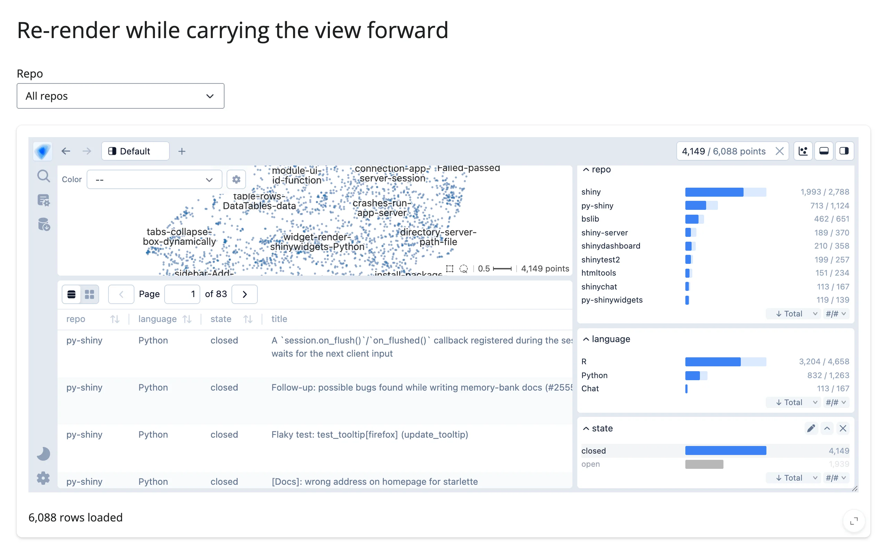
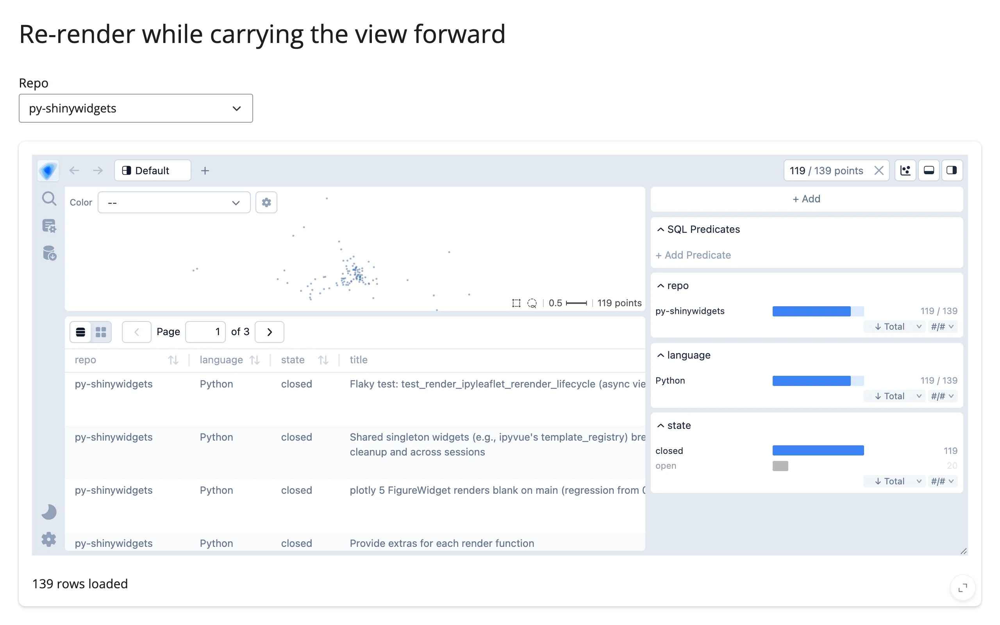

Note the comment in `atlas()`: fetch the previous state from the `reactive.value`, not from `atlas.widget` itself
-- see Gotchas for why that specific read is dangerous here.

## Coordinating multiple views

Because the explorer can only be changed by a re-render (previous section), every pattern below flows data **out
of** the atlas into something else; there's no way to drive the atlas's own filter or viewport from another
widget's selection in place.

### Crossfilter driving a plotly breakdown

[`examples/08_predicate_to_plotly.py`](examples/08_predicate_to_plotly.py) -- pairs well with the
[plotly guide](../plotly/index.md). The same `predicate()` string, applied to a second connection over the same
data, drives a live bar chart of whatever categorical breakdown you want for just the selected rows:

```{.python file="examples/08_predicate_to_plotly.py"}
# Pattern: atlas crossfilter -> a plotly chart of exactly the selected rows.
# predicate() is a DuckDB WHERE expression over the *same* column names the
# widget was built from, so it applies directly to a pandas boolean mask via
# a second DuckDB connection registered on the same frame -- no need to
# touch the widget's own (locked-down) connection. Pairs with the plotly guide.
from pathlib import Path

import duckdb
import pandas as pd
import plotly.express as px
from embedding_atlas.widget import EmbeddingAtlasWidget
from shiny.express import render, ui
from shinywidgets import render_embedding_atlas, render_plotly

ISSUES = pd.read_parquet(Path(__file__).parent / "data" / "issues.parquet")
COLUMNS = ["repo", "language", "state", "title", "text", "projection_x", "projection_y"]  # fmt: skip

# Chained as an assignment, not a bare statement: shiny.express would
# otherwise capture .register()'s non-None return as a UI child
con = duckdb.connect().register("issues", ISSUES)

ui.page_opts(title="Crossfilter driving a plotly breakdown", fillable=True)

with ui.layout_columns(col_widths=[7, 5]):
    with ui.card(full_screen=True):

        @render_embedding_atlas
        def atlas():
            return EmbeddingAtlasWidget(
                ISSUES[COLUMNS], x="projection_x", y="projection_y", text="text"
            )

    with ui.card():
        ui.card_header("Language mix of the current selection")

        @render_plotly
        def breakdown():
            where = atlas.predicate()
            clause = f"WHERE {where}" if where else ""
            counts = con.sql(
                f"SELECT language, count(*) AS n FROM issues {clause} GROUP BY language"
            ).df()
            return px.bar(counts, x="language", y="n", text="n")
```

Before (all languages), and after clicking the "shinychat" bar (which is 100% Chat, not R/Python like the rest):

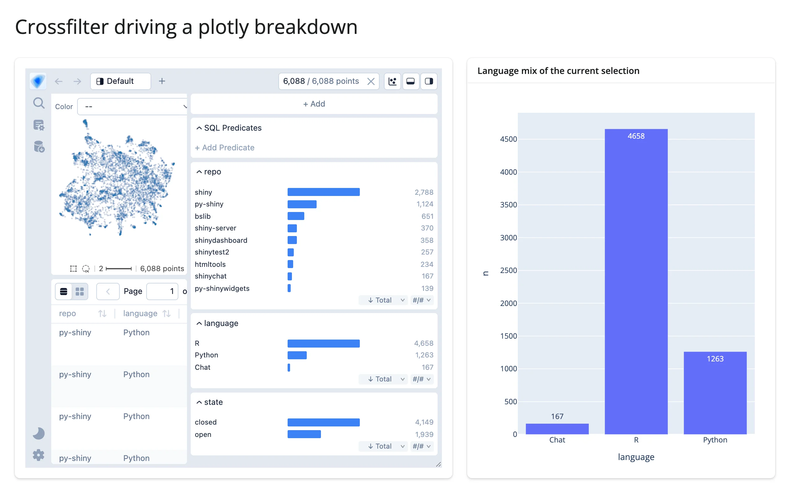
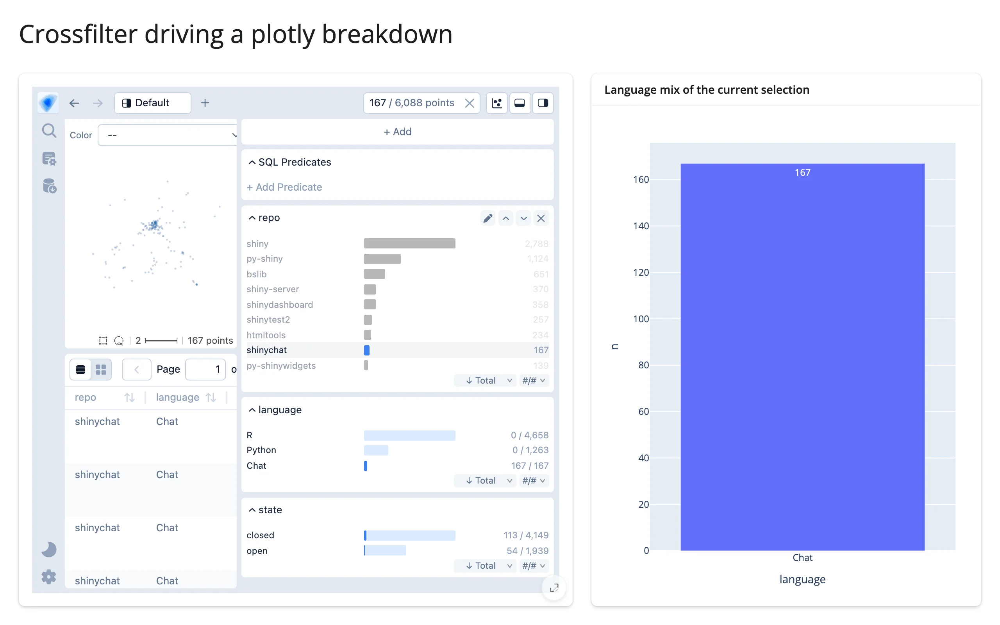

### Selection as linked detail cards

[`examples/09_selection_to_cards.py`](examples/09_selection_to_cards.py) -- `selected()` feeding `ui.a()` links
instead of a plain table, for a richer linked panel:

```{.python file="examples/09_selection_to_cards.py"}
# Pattern: lasso/filter -> a linked detail list, built from selected()
# instead of a plain data_frame so each row can carry a live link.
from pathlib import Path

import pandas as pd
from embedding_atlas.widget import EmbeddingAtlasWidget
from shiny.express import render, ui
from shinywidgets import render_embedding_atlas

ISSUES = pd.read_parquet(Path(__file__).parent / "data" / "issues.parquet")
COLUMNS = ["repo", "language", "state", "title", "text", "url", "projection_x", "projection_y"]  # fmt: skip

ui.page_opts(title="Selection as linked detail cards", fillable=True)

with ui.layout_columns(col_widths=[7, 5]):
    with ui.card(full_screen=True):

        @render_embedding_atlas
        def atlas():
            return EmbeddingAtlasWidget(
                ISSUES[COLUMNS], x="projection_x", y="projection_y", text="text"
            )

    with ui.card(full_screen=True):
        ui.card_header("Selected issues")

        @render.ui
        def cards():
            sel = atlas.selected()
            if len(sel) == len(ISSUES):
                return ui.p("Select a region or click a bar to see issues here.")
            rows = sel.sort_values("state").head(15)
            return ui.div(
                *[
                    ui.p(
                        ui.a(f"{r.repo} ({r.state})", href=r.url, target="_blank"),
                        ": ",
                        r.title,
                        class_="mb-2",
                    )
                    for r in rows.itertuples()
                ]
            )
```

Before any selection, and after clicking the "shinytest2" bar:

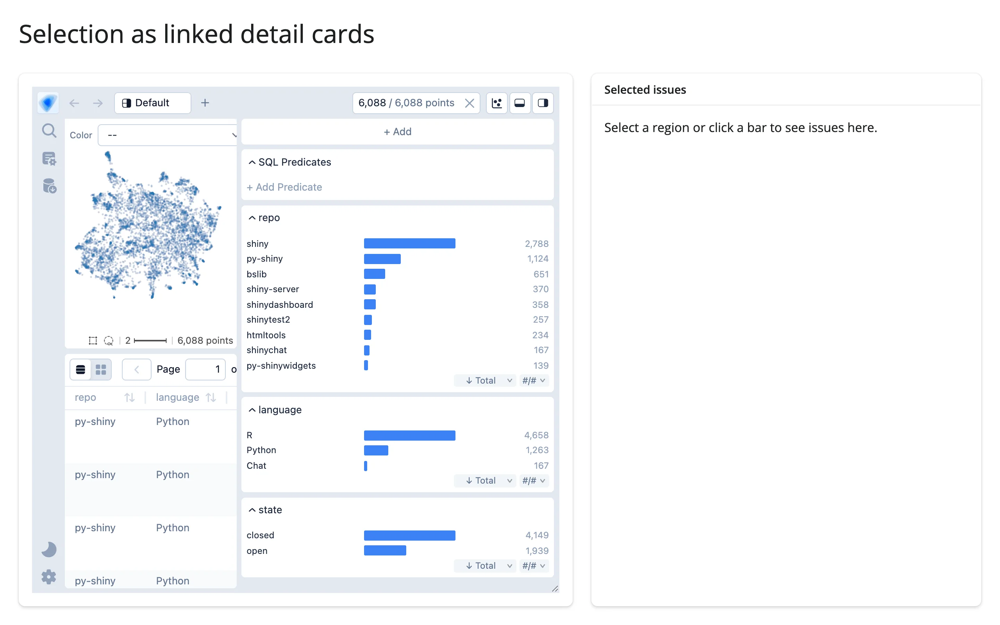
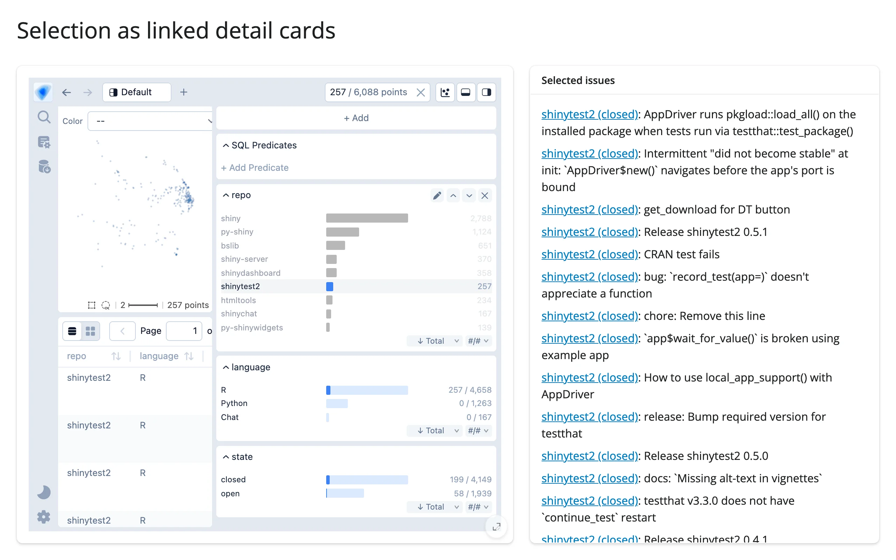

### Selection summary (a stand-in for an LLM call)

[`examples/10_selection_summary_stub.py`](examples/10_selection_summary_stub.py). The release showcase
(`docs/showcase/issues/app.py` and `summarize.py`) wires a real selection into Claude: it reads `selected()`'s
titles, sends them to `chatlas.ChatAnthropic(...).chat_async(prompt)`, and shows "what these issues have in
common" in a couple of sentences. This guide can't call a real LLM (no API keys), so this example keeps the exact
shape -- `selected()` in, a one-line text summary out -- with a keyword-frequency stand-in in place of the model
call ([`examples/10_selection_summary_stub.py`](examples/10_selection_summary_stub.py)):

```{.python file="examples/10_selection_summary_stub.py"}
# Pattern: selected() -> a one-line summary of what the user circled. This
# guide can't call a real LLM (no API keys), so `stub_summary()` below ranks
# keywords by frequency as a stand-in. The release showcase
# (docs/showcase/issues/summarize.py) wires the same selection into a real
# call: `await ChatAnthropic(model=..., system_prompt=...).chat_async(prompt)`
# with the selected titles in the prompt -- swap `stub_summary` for that.
import re
from collections import Counter
from pathlib import Path

import pandas as pd
from embedding_atlas.widget import EmbeddingAtlasWidget
from shiny.express import render, ui
from shinywidgets import render_embedding_atlas

ISSUES = pd.read_parquet(Path(__file__).parent / "data" / "issues.parquet")
COLUMNS = ["repo", "language", "state", "title", "text", "projection_x", "projection_y"]  # fmt: skip
STOP_WORDS = {"the", "a", "an", "to", "in", "on", "for", "and", "is", "of", "with"}


def stub_summary(titles: list[str]) -> str:
    words = [w for t in titles for w in re.findall(r"[a-z]+", t.lower())]
    top = Counter(w for w in words if w not in STOP_WORDS).most_common(3)
    return f"{len(titles)} issues, mostly about: {', '.join(w for w, _ in top)}"


ui.page_opts(title="Selection summary (stand-in for an LLM call)", fillable=True)

with ui.layout_columns(col_widths=[8, 4]):
    with ui.card(full_screen=True):

        @render_embedding_atlas
        def atlas():
            return EmbeddingAtlasWidget(
                ISSUES[COLUMNS], x="projection_x", y="projection_y", text="text"
            )

    with ui.card():
        ui.card_header("Summary of the selection")

        @render.text
        def summary():
            sel = atlas.selected()
            if len(sel) == len(ISSUES):
                return "Select a region to summarize it."
            return stub_summary(sel["title"].tolist())
```

Before any selection, and after clicking the "bslib" bar -- the keyword stand-in surfaces "theme, bs, sidebar",
which is a fair one-line description of what bslib's issues are actually about:

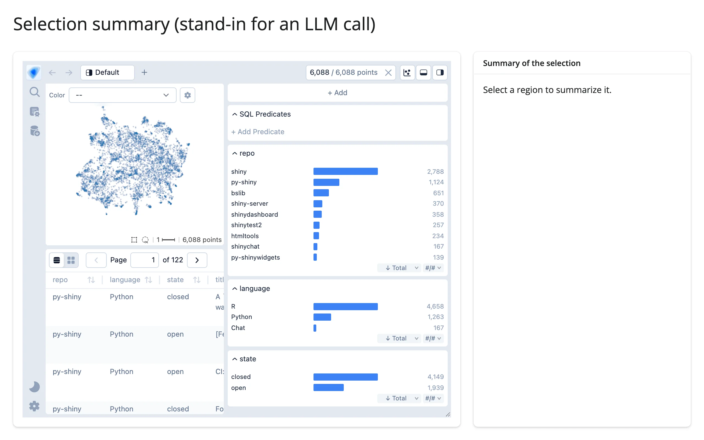
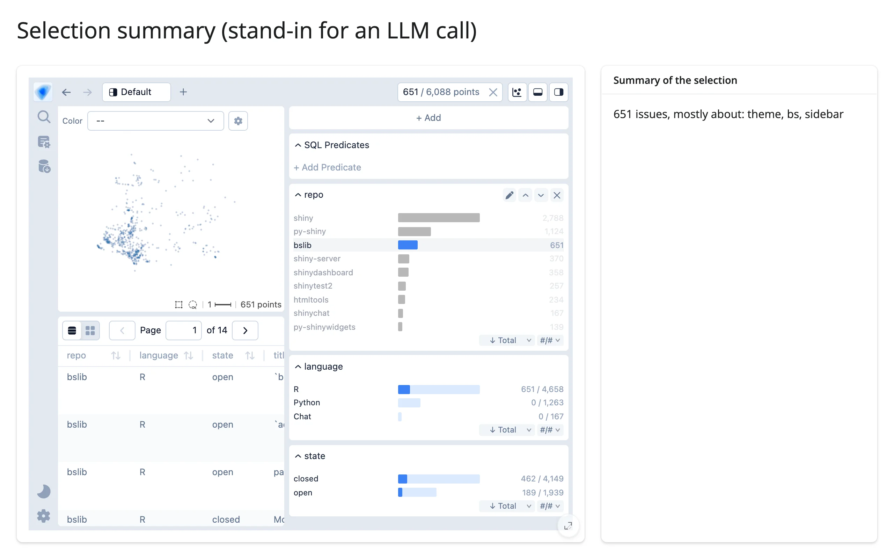

### Export the current selection, read on demand

Every pattern above reads `selected()` continuously, re-rendering as the user filters. A download handler
instead reads it **on demand**: it's live from the moment the explorer renders, so the handler needs no earlier
read to "arm" it, and no warm-up effect, even on the very first click
([`examples/12_export_selection.py`](examples/12_export_selection.py)):

```{.python file="examples/12_export_selection.py"}
# Read on demand: export the explorer's current selection as a CSV, read
# only when the user clicks Download -- no warm-up needed, since
# selected() is live from the moment the explorer renders.
from pathlib import Path

import pandas as pd
from embedding_atlas.widget import EmbeddingAtlasWidget
from shiny import render
from shiny.express import ui
from shinywidgets import render_embedding_atlas

ISSUES = pd.read_parquet(Path(__file__).parent / "data" / "issues.parquet")
COLUMNS = ["repo", "language", "state", "title", "text", "projection_x", "projection_y"]  # fmt: skip

ui.page_opts(title="Export the current selection, read on demand", fillable=True)

with ui.layout_columns(col_widths=[9, 3]):
    with ui.card(full_screen=True):

        @render_embedding_atlas
        def atlas():
            return EmbeddingAtlasWidget(
                ISSUES[COLUMNS], x="projection_x", y="projection_y", text="text"
            )

    with ui.card():
        ui.card_header("Export")
        "Download exactly the issues currently selected (chart click, box, or lasso)."

        @render.download_button(filename="issues_selected.csv", label="Download CSV")
        def download():
            sel = atlas.selected()
            yield sel[["repo", "state", "title"]].to_csv(index=False)
```

Before any selection (6,088 rows), and after clicking the "py-shinywidgets" bar:

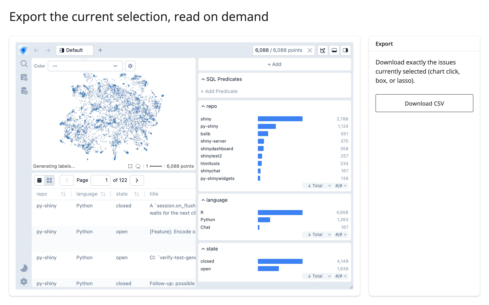
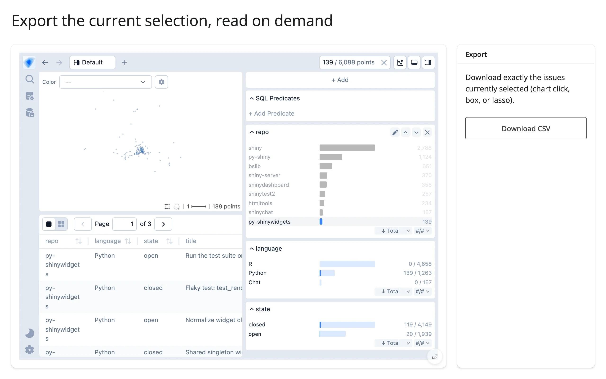

Verified end to end: the downloaded CSV has exactly 139 data rows, every one with `repo` equal to
`py-shinywidgets`, matching the explorer's own "139 / 6,088 points" count.

## Large data

Embedding Atlas combines two large-data approaches at once: the embedding map is a GPU-rendered scatter (WebGPU,
the same `regl`-style rendering jscatter uses), and every chart, table, and cross-filter runs as a DuckDB query
in-process, so only the matching rows or a predicate cross the wire -- not the underlying table. This guide's
own examples use a real but modest 6,088-row dataset (sized for a fast, gesture-verified demo), so we didn't
build a dedicated scale example here; for measured ceilings on each half, see
[jupyter-scatter](../jscatter/index.md#large-data) (bare GPU scatter at scale) and
[quak](../quak/index.md#large-data) or [mosaic](../mosaic/index.md#large-data) (DuckDB-backed views). This
combines the "draw it with the GPU in the browser" and "only send what's visible" approaches from
[Large data & performance](../../guide/performance/index.md#three-approaches-to-large-data).

## Layout and sizing

```{.python file="examples/11_layout.py"}
# Fill behavior: with no explicit height, the output grows to fill its card
# (left, `full_screen=True` card). An explicit height (right) always wins --
# the explorer fits itself to it, growing or shrinking from its own 650px
# default. Outside a fillable container, give it at least 600px.
from pathlib import Path

import pandas as pd
from embedding_atlas.widget import EmbeddingAtlasWidget
from shiny.express import ui
from shinywidgets import render_embedding_atlas

ISSUES = pd.read_parquet(Path(__file__).parent / "data" / "issues.parquet")
COLUMNS = ["repo", "language", "state", "title", "text", "projection_x", "projection_y"]  # fmt: skip


def small_atlas():
    return EmbeddingAtlasWidget(
        ISSUES[COLUMNS], x="projection_x", y="projection_y", text="text"
    )


ui.page_opts(title="Fillable card vs. a fixed-height output", fillable=True)

with ui.layout_columns(col_widths=[8, 4]):
    with ui.card(full_screen=True):
        ui.card_header("Fills the card (no explicit height)")

        @render_embedding_atlas
        def atlas_fill():
            return small_atlas()

    with ui.card():
        ui.card_header('height="650px"')

        @render_embedding_atlas(height="650px")
        def atlas_fixed():
            return small_atlas()
```

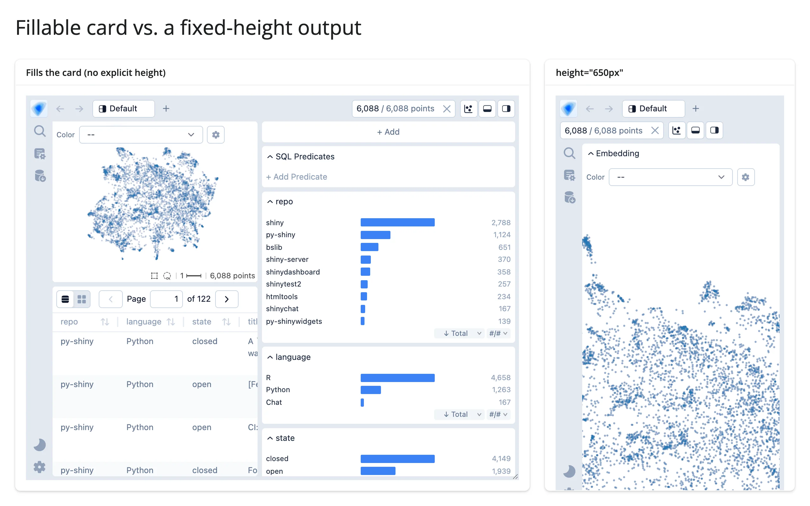

- With no explicit height, the output fills its parent (`full_screen=True` works well for an explorer this
  dense). In a non-fillable layout, give `output_widget()`/`@render_embedding_atlas` an explicit height of **at
  least 600px** -- the library's own default is 650px, and shinywidgets fits the explorer to a smaller explicit
  height too (it can clip the chart panel if you go much below that).
- The narrower card in the screenshot (about 590px) shows the library's own responsive behavior: below a certain
  width, the explorer collapses its chart/table side panel behind the toggle icon at the top right. That's
  upstream's layout, not something shinywidgets controls.

## Gotchas and limitations

- **Security: lock down the DuckDB connection, or don't deploy this.** The explorer works by sending SQL from the
  browser to the widget's DuckDB connection (`{type: "json"|"arrow"|"exec", sql: ...}`), and without
  restrictions, any visitor can run arbitrary SQL with the server process's permissions -- including reading or
  writing files. `@render_embedding_atlas` locks the connection down by default (`SET enable_external_access =
  false; SET lock_configuration = true` after construction), verified to block both file reads and file writes
  while leaving the explorer fully functional. Only pass `allow_unrestricted_connection=True` for a local,
  single-user app. Even locked down, a visitor can still run expensive queries that block your server while they
  run -- there's no DuckDB statement timeout to cap this. [quak](../quak/index.md) and
  [mosaic](../mosaic/index.md) lock down their connections the same way, with the same
  `allow_unrestricted_connection=True` opt-out; [pygwalker](../pygwalker/index.md) uses a related but stricter
  scheme (it *requires* the lockdown, with no opt-out, because every PyGWalker widget in the process shares one
  connection).
- **Reading `.widget` inside its own render function is a silent trap, and it's worse on a re-render than the
  first one.** On the very first render, `atlas.widget` is `None` there (so it cancels the output, the way an
  unready `req()` would). On every render *after* the first, it silently returns **last render's widget** --
  stale, not `None`, and nothing marks it as such. I verified this by instrumenting three consecutive renders
  directly. Keep the previous state you need in a `reactive.value` written by a separate `@reactive.effect` (as
  `examples/07_update_in_place.py` does), not by reading `.widget` from inside the render function that's about
  to replace it. `predicate()` and `selected()` are safer here: calling either inside `atlas`'s own render
  function raises a `RuntimeError` naming the problem, rather than returning something stale.
- **The `labels=` option's documented `"automatic"`/`"disabled"` strings don't work.** The class docstring (and
  `EmbeddingAtlasWidget`'s own) says to pass `labels="automatic"` for auto-labels or `labels="disabled"` to turn
  them off. Neither does what it says: I tried both, plus a custom label dict shaped exactly like the docstring's
  own example, against the same data that shows labels perfectly well when `labels` is just left unset. Both
  strings silently produced a map with **zero** labels -- identical results, despite claiming opposite behavior --
  and the custom label dict threw a page error (`Cannot read properties of undefined (reading 'width')`) that also
  left zero labels on screen. Tracing the frontend bundle confirms why: the literal strings `"automatic"` and
  `"disabled"` don't appear anywhere in it, and the real on/off switch (`embeddingViewConfig.autoLabelEnabled`,
  default on) isn't exposed by any Python option at all. `embeddingViewLabels` (what `labels=` actually sets) is a
  separate prop for supplying your own label list; giving it any non-`None` value -- even a bogus string --
  appears to suppress the automatic generator as a side effect, without successfully substituting your own labels
  either. **The only way to get automatic labels through this API is to not pass `labels=` at all.** I could not
  find a working way to explicitly disable them or supply custom ones from Python.
- **Two widgets can't share one DuckDB connection.** The second `EmbeddingAtlasWidget(df, connection=con)`
  construction on an already-used connection raises `CatalogException: Table "embedding_atlas" already exists`.
  Create the connection inside the render function (or pass none and let the widget make its own default one)
  rather than at module scope if you expect more than one render.
- **`_props` changes from Python don't apply to a live explorer**, including things that *do* work as
  construction-time options (`point_size`, ...). There's no frontend listener that reapplies them after mount; a
  re-render is the only way to change them, same as `_predicate`.
- **Automatic labels need some density to trigger.** The 139-row py-shinywidgets subset in
  ["Updating the widget from Python"](#updating-the-widget-from-python) shows no labels at all after filtering to
  it -- the full 6,088-row dataset's clusters are dense enough to pass the label generator's internal density
  threshold, but a small or sparse subset may not produce any. This looks like the library's intended behavior
  (there's no error, and it's consistent across repeated renders), not a bug.

## Gallery candidates

### Template: atlas + live stats + detail table

[`gallery/template_atlas_explorer.py`](gallery/template_atlas_explorer.py) -- a minimal, adaptable starting point:
an atlas next to a `predicate()`-driven count and a `selected()`-driven table, with the data frame and column
names pulled to the top as constants to swap for your own.

Before any selection, and after clicking the "py-shinywidgets" bar:

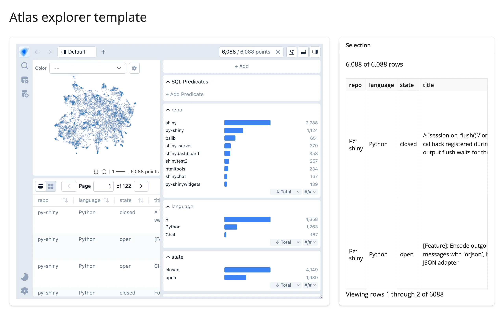
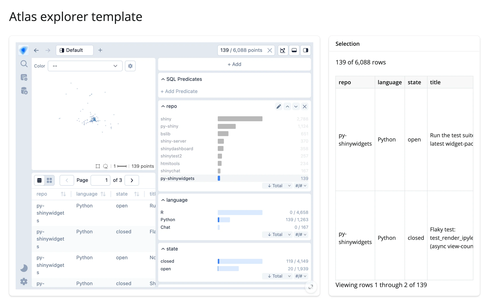

### Showcase: handwritten digits, with the average of your selection

[`gallery/showcase_digits_atlas.py`](gallery/showcase_digits_atlas.py) -- 1,797 of sklearn's bundled handwritten
digit images, PCA-projected to 2D, each with an image thumbnail (see "Images in the explorer" above). Filter to
any digit via the auto-generated bar chart and the sidebar reconstructs the **average image of exactly that
selection** from `selected()`'s `__row_index__` column -- a concrete, visual payoff for "Python computes on what
the user circled." It works through the chart crossfilter alone, so it's fully exercised even without a
WebGPU-capable browser for the lasso.

Before any selection (the average of all 1,797 digits, an indistinct blur), and after clicking "3" in the digit
chart (183 digits, and the average image is an unmistakable 3):

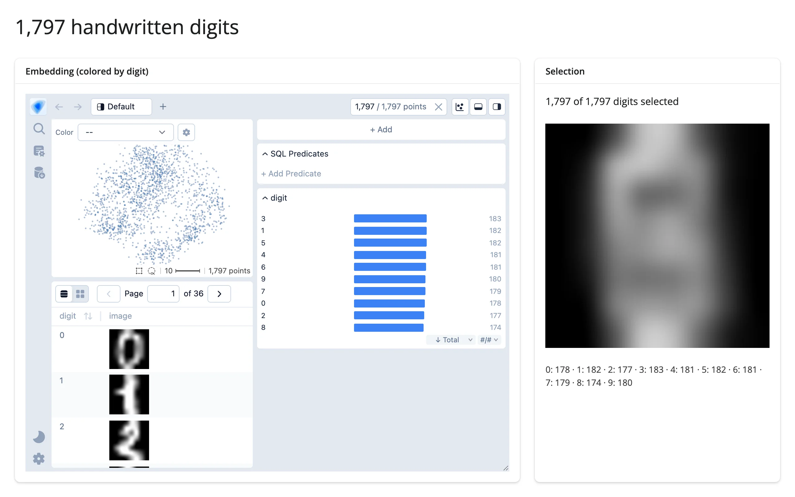
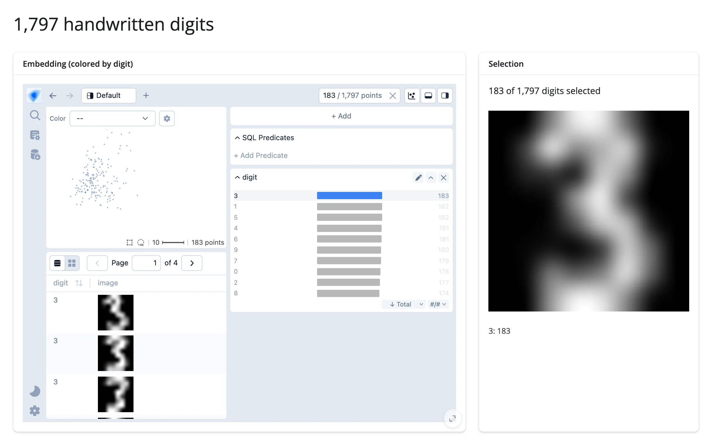

## Learn more

- [Embedding Atlas documentation](https://apple.github.io/embedding-atlas/) and
  [GitHub repository](https://github.com/apple/embedding-atlas)
- [`embedding_atlas.projection`](https://apple.github.io/embedding-atlas/python/projection.html) API reference for
  `compute_projection()` and the lower-level text/image/vector functions
- Related guides in this roster: [jupyter-scatter](../jscatter/index.md) (bare GPU scatter at scale),
  [mosaic](../mosaic/index.md) (grammar-based crossfilter dashboards), [itables](../itables/index.md) and
  [perspective](../perspective/index.md) (tabular search without a map)
