[GeoLibre](https://geolibre.app) is not a map widget -- it's a full GIS application (layer panel, styling tools,
drawing and measuring, algorithms, a basemap gallery) built on [MapLibre GL JS](https://maplibre.org) and shipped
as an [anywidget](https://anywidget.dev). Where most Python mapping libraries give you a canvas you draw layers
onto, GeoLibre gives you the application a GIS analyst would open: every layer you add from Python shows up in a
real layer panel with its own opacity slider, style editor, and visibility toggle, and the app's own toolbar
carries a measuring tool, a search box, bookmarks, and more, with zero extra code.

`@render_geolibre` renders a `geolibre.Map` as a Shiny output. It sizes the embedded app to fill its container
(unless the map has an explicit height), and -- this is the part that takes real engineering -- it serves
GeoLibre's bundled single-page app from the Shiny process itself, including a same-origin proxy for layers backed
by files on the server's disk. That means the integration works the same way locally and deployed (shinyapps.io,
Posit Connect), which is not true of a naive embed of a tool designed to run next to a Jupyter kernel.

GeoLibre has no reactive accessors (see the roster comparison below for widgets that do). The interaction story
here is two synced-trait tiers instead: register event callbacks (`on_click()`, `on_selection_change()`,
`on_layer_change()`) inside your render function to get clicks and selections as they happen, and
`map.read("project")` to read the map's whole live document -- its view, layers, and styling --
whenever the user changes it. Driving the map back from Python splits into two very different cases: project
edits (`add_geojson()`, `set_center()`, layer styling) are instant, in-place trait updates, while GeoLibre's
command methods (`fly_to()`, `get_center()`, `to_image()`, ...) wait for the running app's reply -- their
`*_async()` variants await that reply on Shiny's own event loop, but only from inside a
`reactive.extended_task` -- a real Shiny-specific wrinkle this guide covers in detail. Requires Python
3.11 or later.

Reach for GeoLibre when you want users to explore, style, and annotate spatial data themselves inside your app --
not just look at a map you built. If you want a lightweight, fully programmatic map you drive entirely from
Python, see [maplibre](../maplibre/index.md) or [leafmap](../leafmap/index.md). If your map needs to render
millions of points, see [lonboard](../lonboard/index.md).

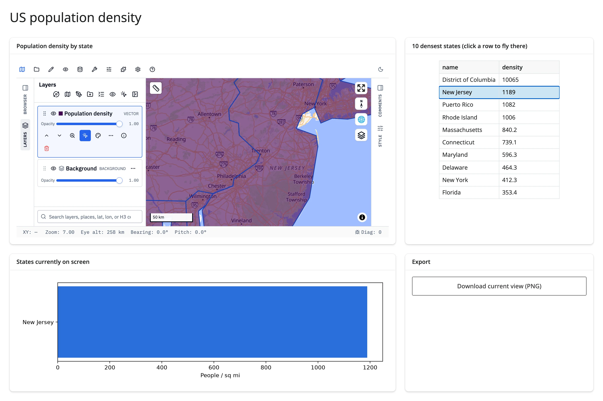

## Installation

```sh
pip install 'shinywidgets[geolibre]'
```

This pulls in `geolibre>=3.6.0` (the version floor with `*_async()` command-method variants; see "Updating the
widget from Python" below) and is only installable on Python 3.11+.

## Quick start

```{.python file="examples/01_quickstart.py"}
from __future__ import annotations

from geolibre import Map
from shiny.express import ui

from shinywidgets import render_geolibre

ui.page_opts(title="GeoLibre quickstart", fillable=True)

US_STATES = (
    "https://raw.githubusercontent.com/PublicaMundi/MappingAPI/"
    "master/data/geojson/us-states.json"
)

with ui.card(full_screen=True):
    ui.card_header("The full GeoLibre app, as a Shiny output")

    @render_geolibre
    def map():
        m = Map(center=(-98.5, 39.8), zoom=4)
        m.add_geojson(US_STATES, name="US States", fillColor="#2a6fdb", fillOpacity=0.25)
        return m
```

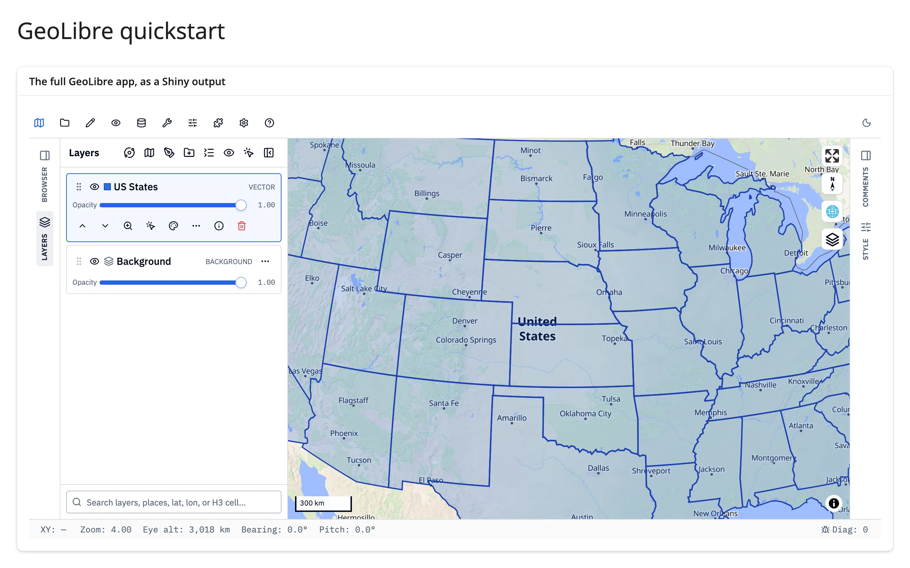

One `add_geojson()` call gives you the map *and* a layer panel entry with a visibility toggle, an opacity slider,
a style editor, and a delete button -- all of GeoLibre's, none of yours.

## What you can build

### Real layer types, not just one

`Map` has dozens of `add_*` methods for vector data (`add_geojson()`, `add_vector()`, `add_gdf()`, `add_csv()`,
...), rasters (`add_cog()`, `add_raster()`), and point data (`add_markers()`, `add_circle_markers()`,
`add_heatmap()`, `add_choropleth()`, ...). Each adds its own entry to the layer panel, so a polygon layer and a
point layer coexist with independent styling.

```{.python file="examples/02_vector_and_point_layers.py"}
    @render_geolibre
    def map():
        m = Map(center=(-98.5, 39.8), zoom=3.5)
        m.add_geojson(US_STATES, name="US States", fillColor="#cbd5e0", fillOpacity=0.25)
        m.add_circle_markers(
            [(lng, lat) for _, lng, lat, _ in CITIES],
            name="Largest cities",
            radius=10,
            fillColor="#e3342f",
        )
        return m
```

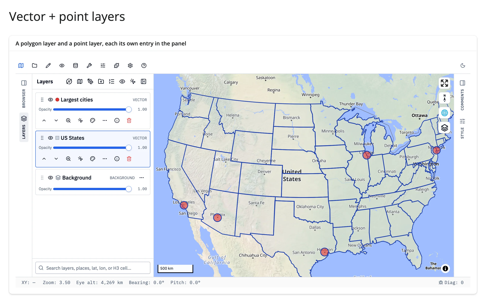

### Style layers and configure popups from Python

`layer.opacity = ...` and `layer.set_style(**paint_overrides)` restyle a layer in place. `set_popup()` picks
which fields show in a layer's click popup, with per-field labels, number formatting, and more; `set_identify()`
arms the Identify tool so a plain click opens that popup (normally a user turns this on from the Layers panel).

```{.python file="examples/03_styling_and_popups.py"}
    @render_geolibre
    def map():
        m = Map(center=(-98.5, 39.8), zoom=4)
        layer_id = m.add_choropleth(US_STATES, column="density", name="Population density")
        layer = m.get_layer(layer_id)
        # A click opens a popup with just these two fields, titled by name
        m.set_popup(
            layer,
            [
                {"field": "name", "label": "State"},
                {"field": "density", "label": "Density", "kind": "number", "decimals": 1},
            ],
            title="name",
            show_feature_id=False,
        )
        m.set_identify(layer)  # arm Identify so a click opens the popup
        return m
```

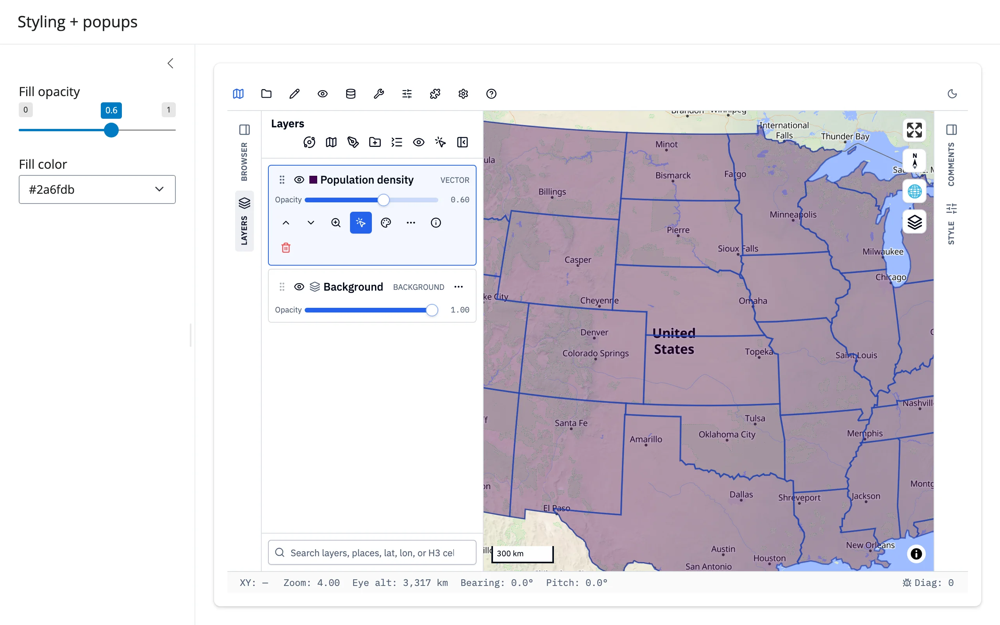
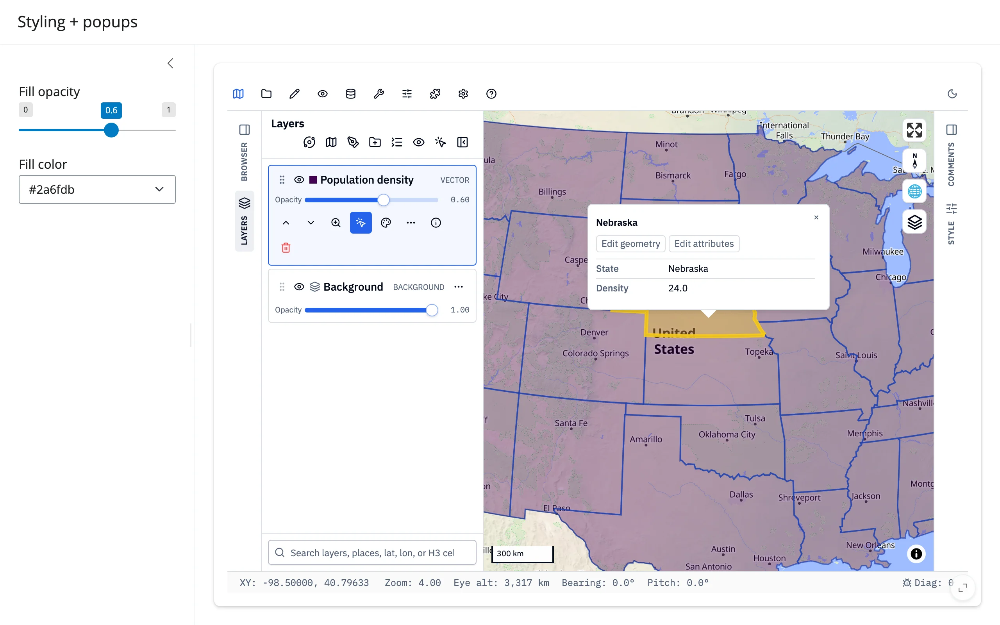

### Export the current view as an image

`to_image()` asks the running app to render its current view to a PNG and returns the bytes. It's a command
method that waits for the app's reply (see "Updating the widget from Python" below); its `to_image_async()`
variant awaits that reply directly, which works here because a `@render.download_button` handler runs outside
Shiny's reactive flush.

```{.python file="examples/04_snapshot_export.py"}
        # to_image_async() awaits the app's reply, so it runs directly on
        # Shiny's event loop -- a download handler isn't part of the
        # reactive flush, so (unlike a reactive.effect) awaiting it here
        # doesn't block the reply from being delivered.
        @render.download_button(filename="map.png", label="Download PNG")
        async def snapshot():
            yield await map.widget.to_image_async()
```

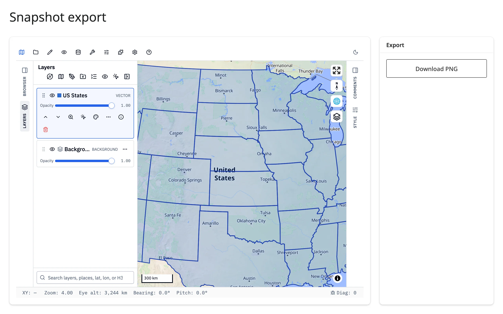

### The toolset ships for free

`add_legend()` and `show_control()` reach into the app's own Controls menu -- bookmarks, search, a minimap, and
the Measure panel (distance, area, and circle tools, with configurable units) -- all built, styled, and already
wired to the map.

```{.python file="examples/05_toolset_and_legend.py"}
    @render_geolibre
    def map():
        m = Map(center=(-98.5, 39.8), zoom=3.5)
        m.add_circle_markers(
            [(lng, lat) for _, lng, lat in CITIES],
            name="Major cities",
            radius=10,
            fillColor="#e3342f",
        )
        m.add_legend("Cities", legend_dict={"Population > 1M": "#e3342f"})
        m.show_control("measure", collapsed=False, distance_unit="miles")
        return m
```

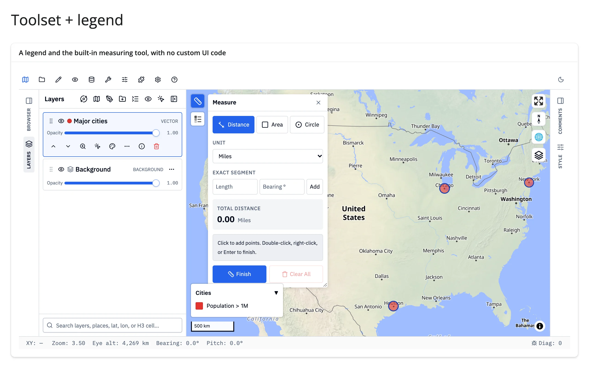

## Reacting to user interaction

GeoLibre has no reactive accessors -- no `map.clicked()` method you call from a render function. Instead there
are two tiers, both built on `geolibre.Map`'s own API: event callbacks you register once, and
`.read("project")` on the output -- GeoLibre's own synced `project` trait.

### Event callbacks

`on_click()`, `on_selection_change()`, and `on_layer_change()` register a plain Python callback, called with an
event dict whenever the user clicks the map, changes the selected feature, or adds/removes a layer. Register them
*inside* the render function (they need the freshly created widget) and have the callback set a
`reactive.value`, exactly like wiring up an ipywidgets trait observer.

With `set_identify()` armed, a map click's event dict carries a `"features"` list with each clicked feature's
properties and geometry -- not just the `lngLat` you'd get otherwise -- which is enough to build a detail card
with no extra round trip.

```{.python file="examples/06_events_and_detail_card.py"}
        @render_geolibre
        def map():
            m = Map(center=(-98.5, 39.8), zoom=4)
            layer_id = m.add_choropleth(US_STATES, column="density", name="Population density")
            m.set_identify(layer_id)  # include feature properties in click events
            m.on_click(lambda e: last_click.set(e))
            return m

    with ui.card():
        ui.card_header("Clicked state")

        @render.ui
        def detail():
            event = req(last_click())
            features = event.get("features") or []
            if not features:
                return core_ui.value_box("No state here", "click land to select one")
            props = features[0]["properties"]
            return core_ui.value_box(props["name"], f"{props['density']:.1f} people/sq mi")
```

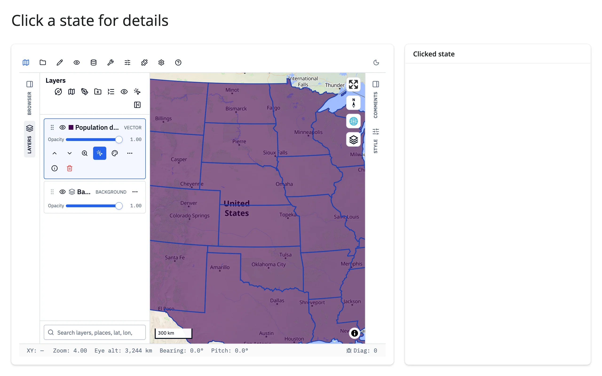
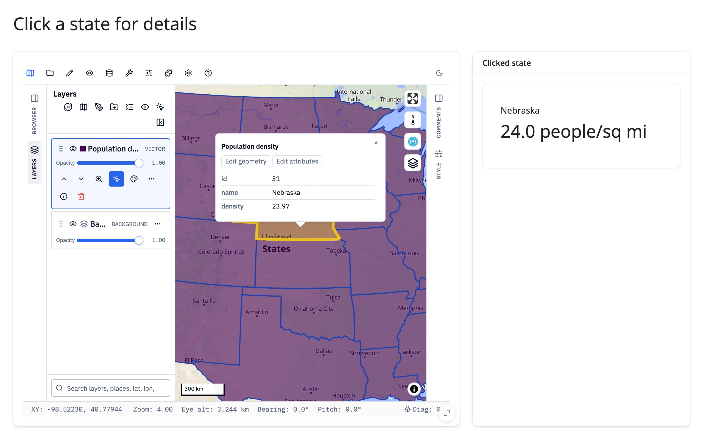

`on_click()`'s event is `{"lngLat": [lng, lat], "features": [...]}` -- `features` is only present (and only
populated) for layers Identify is armed on; it's `[]` for a click that misses every identifiable layer, never
`None`. There's no built-in rate limit on these callbacks: a `reactive.value` set from one fires the consuming
output on every call.

### Beyond callbacks: `.read()`

`map.read("project")` gives you GeoLibre's whole live document: the current view
(`project["mapView"]`: `center`, `zoom`, `bearing`, `pitch`, and -- once the browser's first state sync has
landed, a moment after the app boots -- `bbox`), every layer's name and style, basemap settings, and more. It
invalidates on *every* pan and zoom, because the whole project re-syncs, not just the view.

```{.python file="examples/07_reading_project_state.py"}
        @render.code
        def view_info():
            # Invalidates on every pan and zoom -- the whole project re-syncs,
            # not just the view, so keep downstream consumers cheap (see
            # "Rate limiting" below). "bbox" is filled in once the browser's
            # first sync lands (a moment after the app boots), so treat it as
            # optional rather than indexing it directly.
            project = map.read("project")
            view = project["mapView"]
            bbox = view.get("bbox")
            return json.dumps(
                {
                    "center": [round(c, 2) for c in view["center"]],
                    "zoom": round(view["zoom"], 2),
                    "bbox": [round(b, 2) for b in bbox] if bbox else None,
                    "layers": [layer["name"] for layer in project["layers"]],
                },
                indent=2,
            )
```

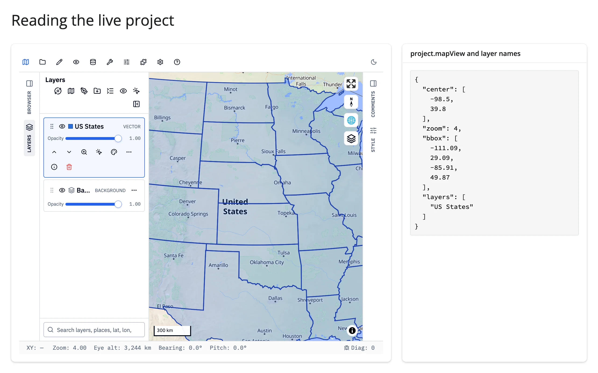
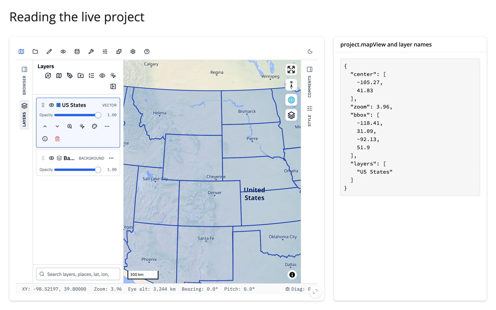

Worth calling out: on the very first render, before the browser has echoed anything back, `project["mapView"]`
has `center`/`zoom`/`bearing`/`pitch` but not yet `bbox` -- read it with `.get()`, or `req()` it, rather than
indexing it directly (see Gotchas).

### Rate limiting

There's no accessor-level `rate_policy`/`rate_delay` on `render_geolibre` (those only exist on renderers that
declare accessors). `map.read("project")` is unthrottled, and because it invalidates on every
pan/zoom frame-ish event with the *entire* project payload (including inlined layer data), a consumer that does
real work -- a chart recompute, a database query -- can fall behind during a drag. Prefer the event callbacks for
high-frequency interactions, and if you must react to `project` continuously, debounce it yourself (e.g. with a
small `reactive.poll()` or a manual timer) rather than assuming GeoLibre throttles it for you.

## Updating the widget from Python

GeoLibre's API splits cleanly into two kinds of methods, and only one of them is safe to call directly from a
Shiny reactive context.

**Project mutations are instant, in-place trait updates.** `add_geojson()`/`add_vector()`/`add_cog()`/etc.,
`set_center()`/`set_zoom()`/`fit_project_bounds()`, and layer styling (`layer.opacity = ...`,
`layer.set_style()`) all edit the map's synced `project` document and sync to the browser on the next flush --
call them from a `@reactive.effect` like any other trait write.

```{.python file="examples/08_driving_from_inputs.py"}
# set_center() mutates the project trait and syncs to the browser -- no
# re-render, so zoom, added layers, and styling are untouched.
@reactive.effect
def _():
    lng, lat = CITIES[input.city()]
    map.widget.set_center(lng, lat, zoom=9)
```

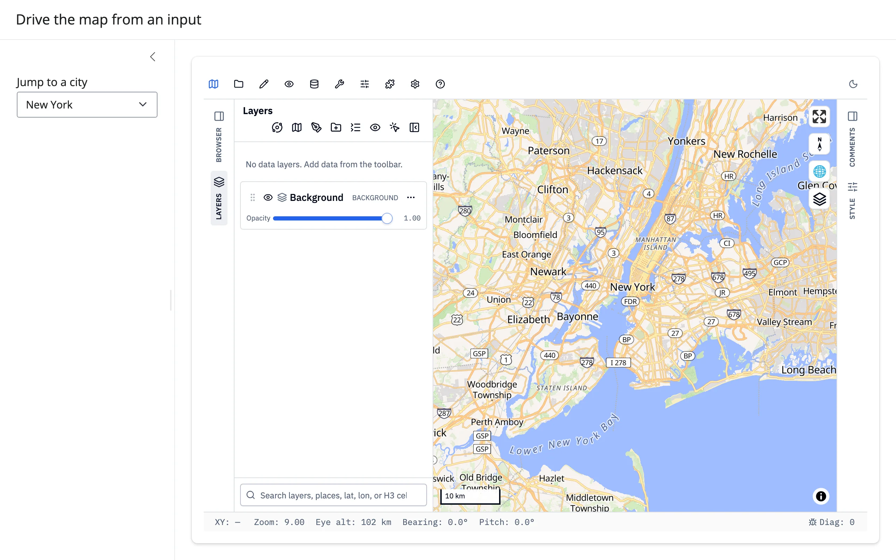
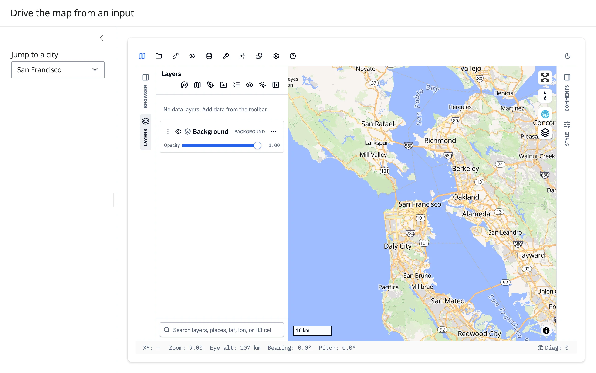

**Command methods wait for a reply, and that wait can never happen directly on Shiny's event-loop thread.**
`fly_to()`, `fit_bounds()`, `zoom_to_layer()`, `identify()`, `get_center()`/`get_view()`/`get_bounds()`,
`get_selected_features()`/`get_drawn_features()`, `run_algorithm()`, and `to_image()` all send a command to the
running app and wait for its reply. Call the blocking form directly inside a render function, `reactive.calc`, or
any `reactive.effect` and it would have to block the very event loop that must deliver the reply -- deadlock by
construction, so GeoLibre raises instead of hanging. Every one of these methods has an async `*_async()`
counterpart (`fly_to_async()`, `get_center_async()`, ...) that `await`s the reply instead of blocking a thread
for it, which runs directly on Shiny's event loop -- but **only from inside a `reactive.extended_task`**:
awaiting it from a plain `reactive.effect` hits the same deadlock, because the reply can't be delivered until
that effect finishes running. (Verified directly: awaiting `fly_to_async()` from a bare async
`@reactive.effect` hangs indefinitely; the same call from an `extended_task` returns normally.)

An `extended_task` also can't read reactive sources itself (`input.x()` inside its body raises) -- read what you
need before calling `.invoke()`, and pass it as an argument.

```{.python file="examples/09_fly_to_async.py"}
# fly_to_async() awaits the app's reply instead of blocking a thread for it,
# so it runs directly on Shiny's event loop -- but only from inside an
# extended_task: awaiting it from a plain reactive.effect deadlocks, because
# the reply can't be delivered until that effect finishes. An extended_task
# can't read reactive sources itself (input.city() would raise) -- read it
# before invoking, and pass it in as an argument.
@extended_task
async def fly_to_city(lng: float, lat: float):
    await map.widget.fly_to_async(lng, lat, zoom=9, duration=800)
    await asyncio.sleep(1)  # let the animation finish before querying the camera
    return await map.widget.get_center_async()


@reactive.effect
@reactive.event(input.fly)
def _():
    fly_to_city.invoke(*CITIES[input.city()])
```

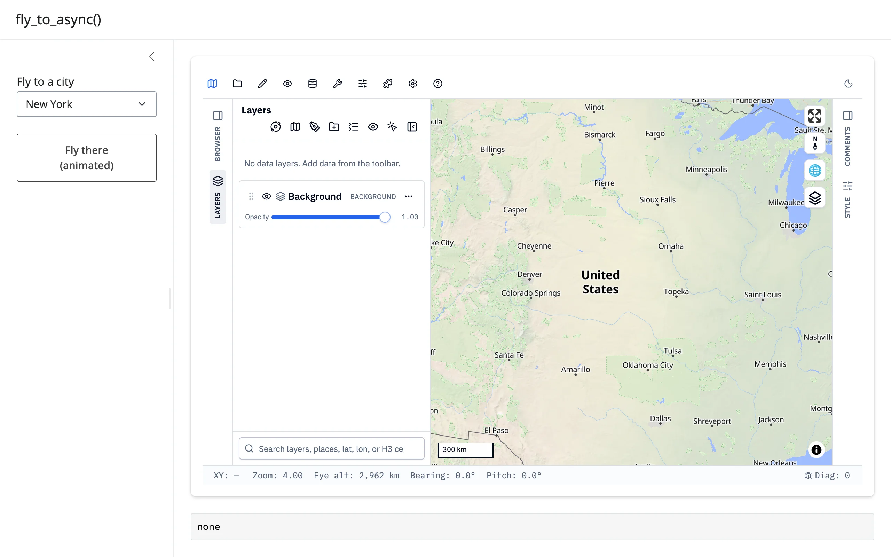
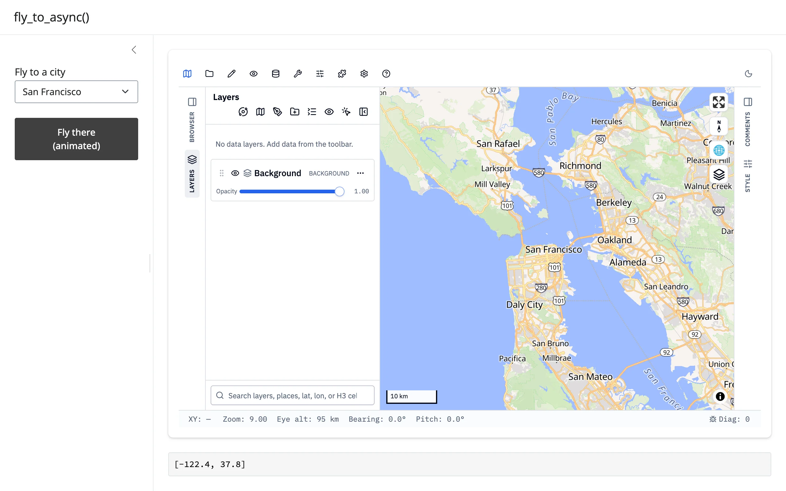

Where a project-mutation alternative exists -- `set_center()` for `fly_to()`, `fit_project_bounds()` for
`fit_bounds()`, the synced `project` trait for the query methods -- it's the cheaper, simpler option. Reach for
the `extended_task` + `*_async()` pattern for the methods that have no alternative: the camera animation,
`identify()`, `run_algorithm()`, and `to_image()`.

## Coordinating multiple views

### Map viewport drives a chart of what's visible

`project["mapView"]["bbox"]` is `[west, south, east, north]` for the current viewport. Filter any lng/lat-indexed
data against it in a downstream `@render.plot` (or any other output) to show exactly what's on screen.

```{.python file="examples/10_viewport_to_chart.py"}
        @render.plot
        def visible_cities():
            # "bbox" fills in once the browser's first sync lands, a moment
            # after the app boots -- req() cancels the output until then.
            bbox = map.read("project")["mapView"].get("bbox")
            west, south, east, north = req(bbox)
            shown = [
                (name, pop)
                for name, lng, lat, pop in CITIES
                if west <= lng <= east and south <= lat <= north
            ]
            fig = Figure(figsize=(5, 4), layout="tight")
            ax = fig.subplots()
            if shown:
                names, pops = zip(*sorted(shown, key=lambda c: c[1]))
                ax.barh(names, pops, color="#2a6fdb")
            ax.set_xlabel("Population (millions)")
            return fig
```

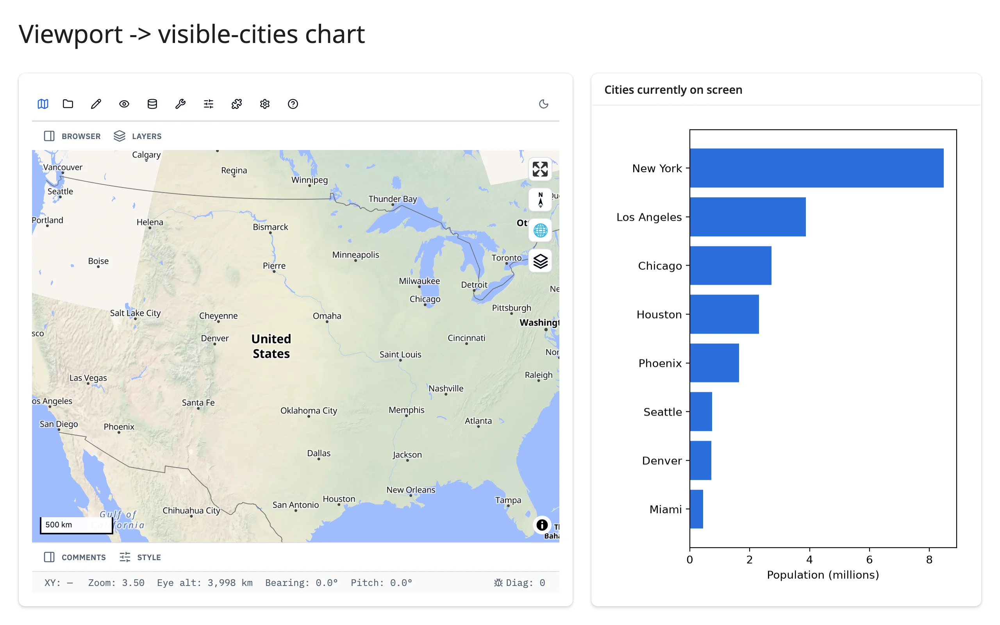
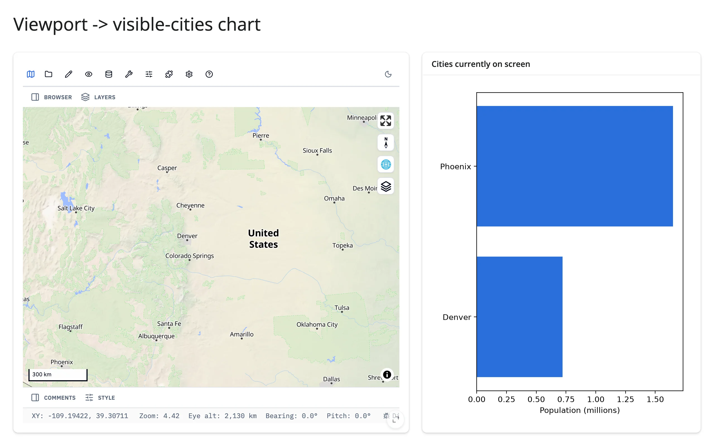

### A table drives the map

A plain `@render.data_frame` row selection (`table.cell_selection()["rows"]`) is a clean source for
`set_center()` -- no GeoLibre-side accessor needed, since the direction here is table-to-map.

```{.python file="examples/11_table_to_map.py"}
@reactive.effect
def _():
    rows = table.cell_selection()["rows"]
    if not rows:
        return
    row = CITIES.iloc[rows[0]]
    map.widget.set_center(row["lng"], row["lat"], zoom=9)
```

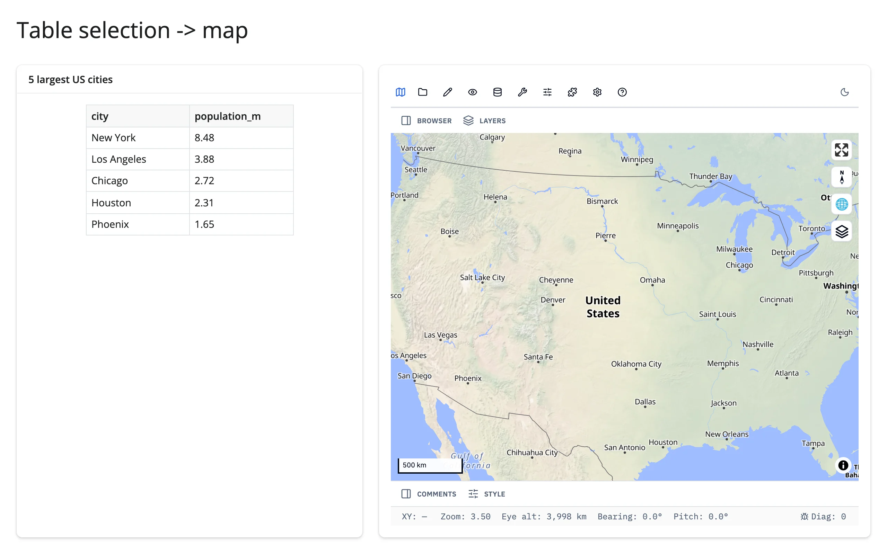
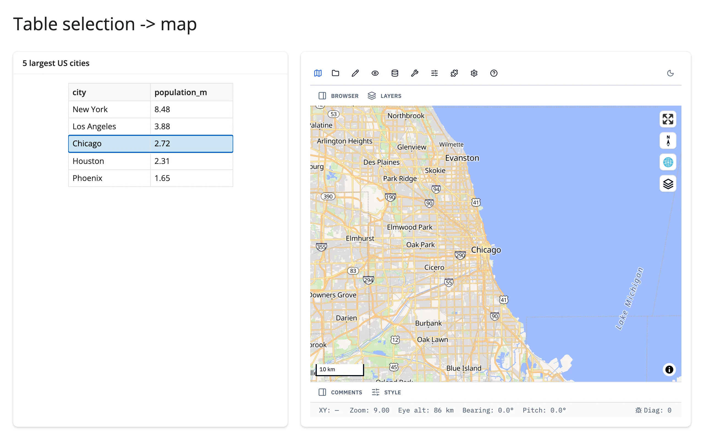

### Click for details (feature-rich version)

See "Event callbacks" above -- `06_events_and_detail_card.py` is itself a complete linked-view pattern (map
click, with Identify armed, drives a detail card showing the clicked feature's properties) and is the simplest
of the three to adapt.

## Large data

GeoLibre's basemaps are MapLibre vector tiles, so they're already "only send what's visible." But layers you add
from Python (`add_geojson()` and friends) ship the whole feature collection to the browser once, the same as
ipyleaflet -- there's no large-data mode specific to GeoLibre's own layer API. This guide's introduction already
points past it: for a point cloud of millions, use [lonboard](../lonboard/index.md#large-data) (GPU-rendered);
for code-driven deck.gl layers on a MapLibre basemap without the full GIS-app overhead, use
[maplibre](../maplibre/index.md#large-data) directly. See the
[Large data & performance article](../../guide/performance/index.md#three-approaches-to-large-data) for how
these approaches fit together.

## Layout and sizing

The embedded app reads its `height` trait once, when it loads, to size its `<iframe>` -- changing
`map.widget.height` after rendering does nothing (resize the output's container instead). GeoLibre's own default
is `"800px"`, which `render_geolibre` treats as "unset": in a filling layout the map fills its container; give
the `Map` an explicit height (e.g., `Map(height="500px")`) to opt out of filling, or size the *output* with
`render_geolibre(height=...)` to fill a fixed-size container with a still-default-height map.

```{.python file="examples/12_layout_sizing.py"}
from __future__ import annotations

from geolibre import Map
from shiny.express import ui

from shinywidgets import render_geolibre

ui.page_opts(title="Layout and sizing", fillable=True)

with ui.layout_columns(col_widths=[4, 4, 4]):
    with ui.card(full_screen=True):
        ui.card_header("Default: fills the card")

        @render_geolibre
        def fills():
            return Map(center=(-98.5, 39.8), zoom=3)

    with ui.card(full_screen=True):
        ui.card_header('Map(height="300px"): opts out of filling')

        @render_geolibre
        def fixed():
            return Map(center=(-98.5, 39.8), zoom=3, height="300px")

    with ui.card(full_screen=True):
        ui.card_header('render_geolibre(height="250px"): sizes a default-height map')

        @render_geolibre(height="250px")
        def sized():
            return Map(center=(-98.5, 39.8), zoom=3)
```

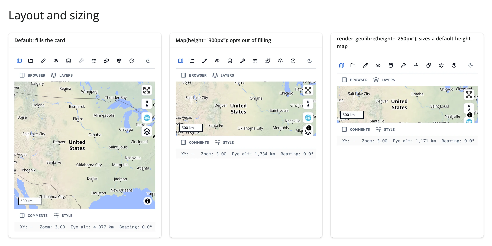

Measured: the default map filled a ~508px card, `height="300px"` held exactly to 300px, and the
`render_geolibre(height="250px")` output measured ~250px -- all three behave as documented.

## Gotchas and limitations

- **Blocking command methods can't run on the event-loop thread -- by design, not a bug.** `fly_to()`,
  `get_center()`, `to_image()`, and the rest raise immediately if called from a render function, `reactive.calc`,
  or any `reactive.effect`. Their `*_async()` variants (`fly_to_async()`, ...) can run directly on the event
  loop, but only from inside a `reactive.extended_task` -- awaiting one from a plain `reactive.effect` deadlocks
  the same way (verified directly; see "Updating the widget from Python"). This requires GeoLibre >= 3.6.0
  (enforced by the `shinywidgets[geolibre]` extra), which added the `*_async()` variants and polls for the
  command reply instead of pumping a Jupyter kernel event loop.
- **`extended_task` can't read reactive sources from inside its own body.** `input.x()` inside an
  `@extended_task async def` raises `"You're not allowed to read reactive sources from inside a Extended Task"`.
  Read the value before calling `.invoke()` and pass it as an argument, as every command-method example in this
  guide does.
- **`project["mapView"]` doesn't have a `"bbox"` key until the browser's first state sync lands**, a moment after
  the app boots. Code that reads `project["mapView"]["bbox"]` directly on a fast-loading page can throw a
  `KeyError` on the very first render before self-healing on the next invalidation. Use `.get("bbox")` with a
  `req()` or a `None` check.
- **`fly_to()`/`fly_to_async()` acknowledge at animation *start*, not animation end.** A `get_center()` issued
  immediately after the ack can report a mid-flight position. Pass an explicit `duration` and wait roughly that
  long (or a bit more) before querying the camera, as `09_fly_to_async.py` does.
- **GeoLibre's `layout` trait shadows ipywidgets' `Layout`.** `Map.layout` is GeoLibre's own string
  (`"embed"`/`"full"`/`"maponly"`, the app's chrome), not an `ipywidgets.Layout`, so `ipywidgets.Layout` styling
  isn't available on this widget, and the browser logs one harmless "Cannot read properties of undefined
  (reading 'then')" console error per render. Rendering and interaction are unaffected; this is an upstream
  naming collision shinywidgets can't fix from its side.
- **`map.read("project")` is chatty.** It invalidates on every pan and zoom and carries the
  whole project, including inlined layer data. Prefer the event callbacks (`on_click()`, `on_selection_change()`,
  `on_layer_change()`) for anything that fires often.
- **Local-file layers now work deployed, unlike earlier builds of this integration.** `add_cog()`/`add_raster()`
  of a file on the server's disk used to be local-host-only; shinywidgets now proxies GeoLibre's loopback server
  at `/proxy/{port}/`, so these layers load the same way locally and on shinyapps.io/Posit Connect. Basemap tiles
  and remote data URLs still need internet access from the *browser*, not the server.
- **GeoLibre is young and moves fast** (multiple releases in recent weeks at the time of writing). Pin or test
  against upgrades if your app depends on specific command-method behavior.

## Gallery candidates

### `template_city_explorer.py`

A small (~100-line) starting point: jump to a city instantly via `set_center()`, fly there with an animation via
the `fly_to_async()`/`extended_task` pattern, or click a marker for its population.

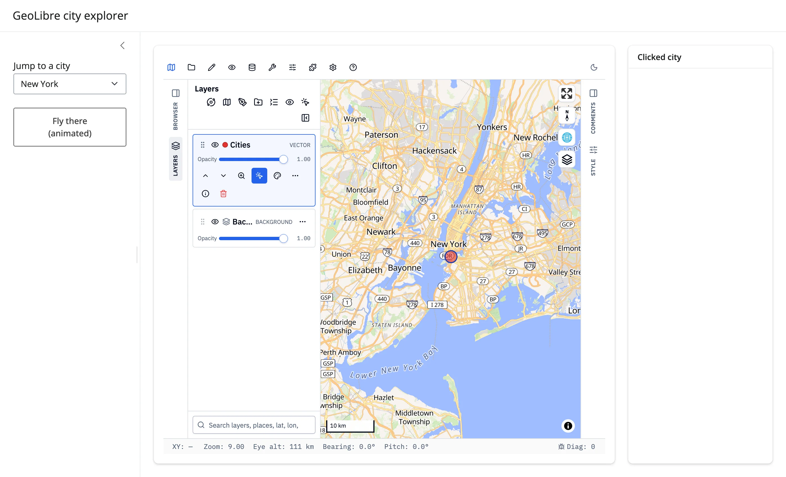
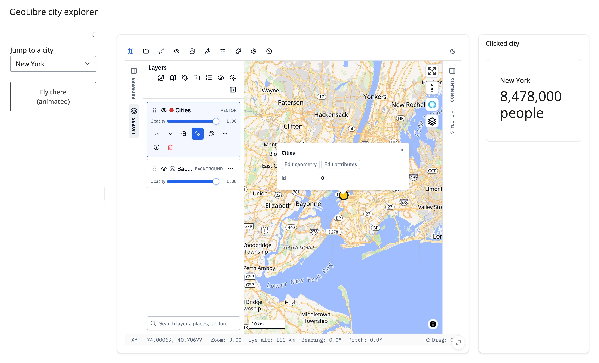

### `showcase_density_dashboard.py`

A fuller dashboard: a styled population-density choropleth with a configured click popup and the built-in Measure
tool, a table of the 10 densest states that flies the map to a selection, a chart of whatever's currently on
screen, and a PNG export of the live view -- combining most of this guide's patterns into one app.

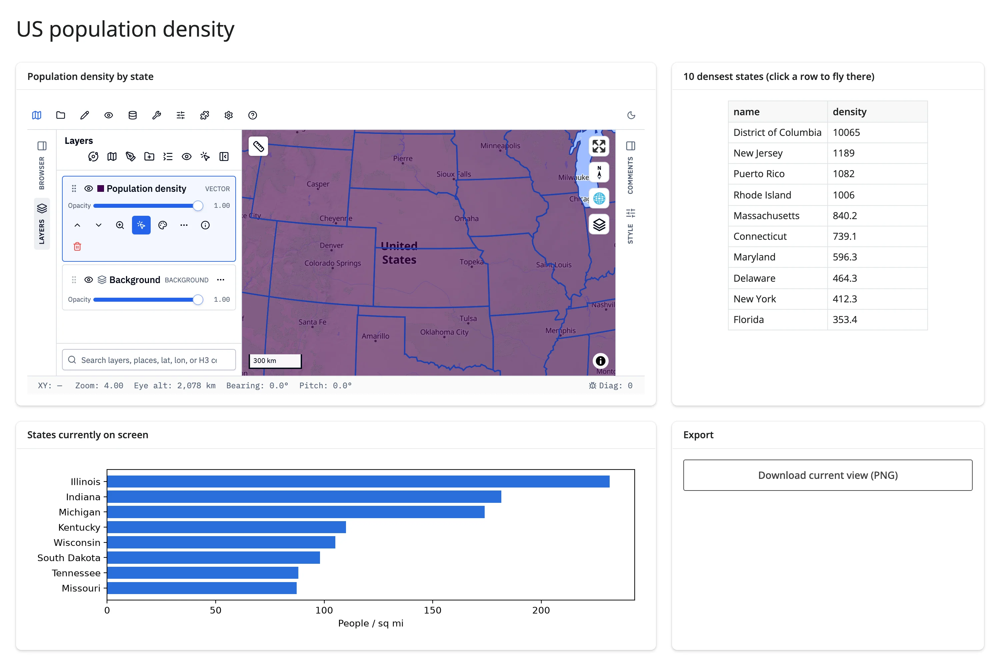


## Learn more

- [GeoLibre documentation](https://geolibre.app)
- [GeoLibre on GitHub](https://github.com/opengeos/GeoLibre) (maintained by the same author as leafmap)
- Related guides in this roster: [maplibre](../maplibre/index.md) (lightweight, fully programmatic MapLibre maps
  with accessors), [leafmap](../leafmap/index.md) (a multi-backend high-level wrapper, including an ipyleaflet
  backend with its own accessors), [lonboard](../lonboard/index.md) (GPU-accelerated large-scale point/polygon
  rendering), [ipyleaflet](../ipyleaflet/index.md) (a lighter Leaflet-based map with accessors)
