[GeoViews](https://geoviews.org) is the geographic member of the [HoloViz](https://holoviz.org) family (alongside
HoloViews, hvPlot, Panel, and Datashader). It adds a `crs` (coordinate reference system) to HoloViews elements --
`gv.Points`, `gv.Polygons`, `gv.Path`, `gv.Image`, `gv.FilledContours`, `gv.WMTS` tile layers, and
[Cartopy](https://scitools.org.uk/cartopy/) `Feature`s such as coastlines and borders -- and reprojects them
correctly when you overlay a web-map tile source or pick a real cartographic projection. It is maintained by the
HoloViz team and is the natural choice when your data already lives in GeoPandas or xarray and you want the same
declarative `*`/`+` composition and crossfilter story as plain HoloViews, just with geography done properly.

GeoViews maps render through the exact same `@render_holoviews` decorator as
[HoloViews/hvPlot](../holoviews/index.md) -- shinywidgets dispatches on the object's module path, and `geoviews.*`
classes route to the same Panel-to-Bokeh pipeline as `holoviews.*` ones. That means everything in the HoloViews
guide carries over unchanged: layout and sizing (`responsive=True`, the fixed-height `fillable=True` trap), **no
reactive accessors** (there's no `map.selected()` to call), and the **stream-subscriber recipe** for turning
clicks, box-selects, and viewport changes into Shiny reactive values. **This guide assumes you've read
[the HoloViews guide](../holoviews/index.md) and only covers what's geographic**: tile sources and projections,
GeoPandas choropleths, hvPlot's `geo=True` shortcut, and the specific coordinate-space behavior of each stream on a
projected map.

Choose GeoViews when you want Bokeh-quality interactivity (pan, zoom, hover, linked streams) on a real map with a
tile basemap or a non-Mercator projection, especially if you're already using HoloViews/hvPlot elsewhere in the
app or your data is a GeoDataFrame. For a point cloud in the tens or hundreds of thousands, prefer
[lonboard](../lonboard/index.md) (WebGL/deck.gl) or GeoViews' own [Datashader](../datashader/index.md)
rasterization (both covered below). For a Leaflet-style API with drawing tools and a more conventional "the map is
the input" feel, see [ipyleaflet](../ipyleaflet/index.md) or [leafmap](../leafmap/index.md). For vector-tile
styling with a Mapbox GL / MapLibre style spec, see [maplibre](../maplibre/index.md).

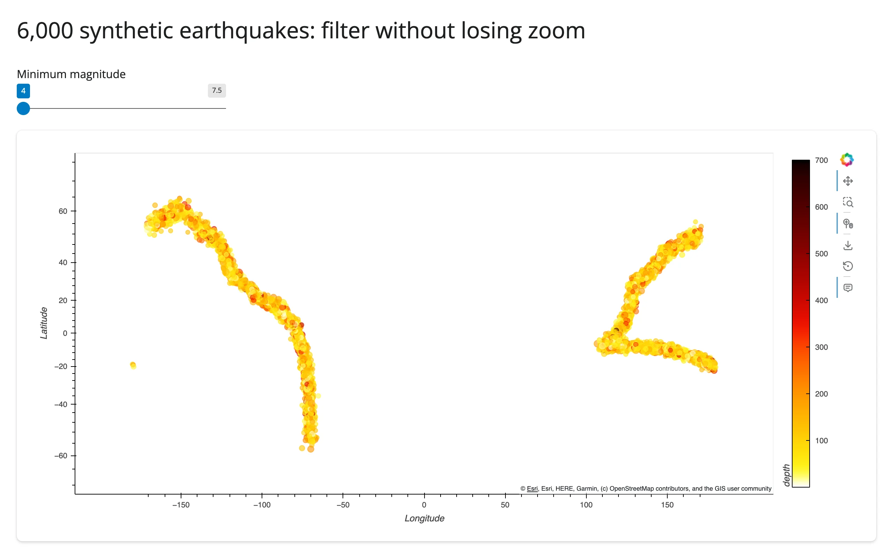

## Installation

```sh
pip install 'shinywidgets[holoviews]' geoviews "cartopy<0.26"
```

There is no separate `shinywidgets[geoviews]` extra -- GeoViews renders through the same `holoviews` extra
(`holoviews`, `panel`, `jupyter_bokeh>=4.1`), the same way the HoloViews guide has you add `hvplot` yourself. Add
`geoviews` and `cartopy` on top. **The `cartopy<0.26` pin matters**: geoviews 1.15/1.16 raise `KeyError: 'lon_0'`
from `project_extents` on cartopy 0.26 (fixed upstream in geoviews, not yet released as of this writing). This
pass was verified with geoviews 1.16.0 and cartopy 0.25.0, where the pin is still necessary. Call
`hv.extension("bokeh")` (or `gv.extension("bokeh")`) once per app, same as plain HoloViews, if you aren't also
importing `hvplot.pandas`.

## Quick start

```{.python file="examples/01_quickstart.py"}
# A quick-start geoviews map: a tile basemap plus a scatter of real points,
# sized and colored by two more columns. Pan, zoom, and hover all come free.
import geoviews as gv
import holoviews as hv
import plotly.express as px
from shiny.express import ui

from shinywidgets import render_holoviews

hv.extension("bokeh")

carshare = px.data.carshare()

ui.page_opts(title="Montreal car-share stations", fillable=True)


@render_holoviews
def map():
    points = gv.Points(
        carshare, kdims=["centroid_lon", "centroid_lat"], vdims=["car_hours", "peak_hour"]
    ).opts(
        color="car_hours",
        cmap="viridis",
        size=8,
        colorbar=True,
        tools=["hover"],
        title="Car-share hours by station",
    )
    return (gv.tile_sources.OSM * points).opts(responsive=True)
```

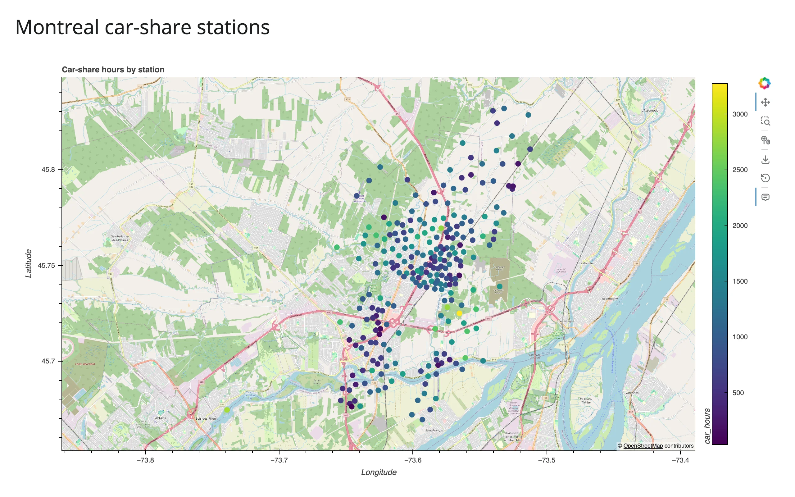

`gv.tile_sources.OSM * points` is the whole recipe: a tile layer overlaid (`*`) with a projected element. GeoViews
ships 30+ built-in tile sources under `gv.tile_sources` -- OSM, several Esri basemaps
(`EsriImagery`, `EsriWorldDarkGrayBase`, `EsriWorldShadedRelief`, ...), CartoDB, and more. **Avoid `CartoLight` and
`CartoDark`**: they now return an "API key required" watermark tile with no key configured (verified today);
Esri and OSM work without one. `kdims` are the point's coordinate columns (lon, lat by default -- GeoViews assumes
`PlateCarree`, i.e. plain lon/lat, unless you pass `crs=`), and `vdims` are extra columns available to `color=`,
`size=`, and hover tooltips.

## What you can build

### Polygons and choropleths from a real GeoDataFrame

[`examples/02_choropleth.py`](examples/02_choropleth.py) -- a world population choropleth from Natural Earth's
110m country polygons, built two ways: explicit `gv.Polygons`, and hvPlot's one-line `geo=True` shortcut (downloads
a small, public shapefile on first run):

```{.python file="examples/02_choropleth.py"}
# A world population choropleth from a real GeoDataFrame, two ways: explicit
# gv.Polygons, and hvPlot's one-line `geo=True` shortcut. Downloads Natural
# Earth's 110m country polygons (~200KB) on first run.
import geopandas as gpd
import geoviews as gv
import holoviews as hv
import hvplot.pandas  # noqa: F401
from shiny.express import ui

from shinywidgets import render_holoviews

hv.extension("bokeh")

NE_COUNTRIES = "https://naciscdn.org/naturalearth/110m/cultural/ne_110m_admin_0_countries.zip"
world = gpd.read_file(NE_COUNTRIES)
world = world[world.POP_EST > 0]  # a few disputed territories have no estimate

ui.page_opts(title="World population (Natural Earth, 110m)", fillable=True)

with ui.layout_columns():
    with ui.card(full_screen=True):
        ui.card_header("gv.Polygons, explicit")

        @render_holoviews
        def explicit():
            return gv.Polygons(
                world, vdims=["NAME", "POP_EST"]
            ).opts(
                color="POP_EST",
                cmap="viridis",
                logz=True,
                colorbar=True,
                tools=["hover"],
                responsive=True,
            )

    with ui.card(full_screen=True):
        ui.card_header("hvPlot, geo=True")

        @render_holoviews
        def shortcut():
            return world.hvplot(
                c="POP_EST",
                geo=True,
                cmap="viridis",
                logz=True,
                hover_cols=["NAME"],
                responsive=True,
            )
```

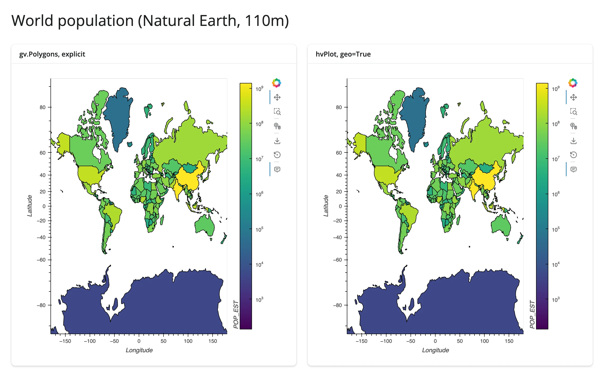

Both render identically. `gv.Polygons(gdf, vdims=[...])` reads the GeoDataFrame's geometry column directly --
no manual lon/lat extraction -- and `gdf.hvplot(geo=True, ...)` is the hvPlot equivalent for anyone who'd rather
stay in the `.hvplot` accessor style from the [HoloViews guide](../holoviews/index.md). `logz=True` is doing a lot
of work here: population is extremely right-skewed, and a linear color scale would make everything but China and
India look identical.

### Projections: Web Mercator vs. the real thing

[`examples/03_projections.py`](examples/03_projections.py) -- the same 300 scattered points, once with a Web
Mercator tile basemap (the default whenever tiles are involved), once with `projection=ccrs.Robinson()` and no
tiles:

```{.python file="examples/03_projections.py"}
# Web Mercator (the default, needed for tile basemaps) vs. a real cartographic
# projection. Swapping `projection=` reshapes the coastlines and repositions
# every point -- there is no "zoom into a Robinson map" the way there is with
# tiles, since tiles only exist pre-rendered in Web Mercator.
import cartopy.crs as ccrs
import geoviews as gv
import geoviews.feature as gf
import holoviews as hv
import numpy as np
from shiny.express import ui

from shinywidgets import render_holoviews

hv.extension("bokeh")

rng = np.random.default_rng(0)
# A few hundred points scattered near shipping lanes, for visual texture
lons = rng.uniform(-180, 180, 300)
lats = rng.uniform(-60, 75, 300)

ui.page_opts(title="Web Mercator vs. a real projection", fillable=True)

with ui.layout_columns():
    with ui.card(full_screen=True):
        ui.card_header("Default: Web Mercator, with tiles")

        @render_holoviews
        def mercator():
            pts = gv.Points((lons, lats)).opts(color="firebrick", size=3, alpha=0.6)
            return (gv.tile_sources.OSM * pts).opts(responsive=True)

    with ui.card(full_screen=True):
        ui.card_header("projection=ccrs.Robinson(), no tiles")

        @render_holoviews
        def robinson():
            pts = gv.Points((lons, lats)).opts(color="firebrick", size=3, alpha=0.6)
            overlay = gf.coastline * gf.borders * pts
            return overlay.opts(
                "Points",
                responsive=True,
            ).opts(
                projection=ccrs.Robinson(), global_extent=True, title="Robinson"
            )
```

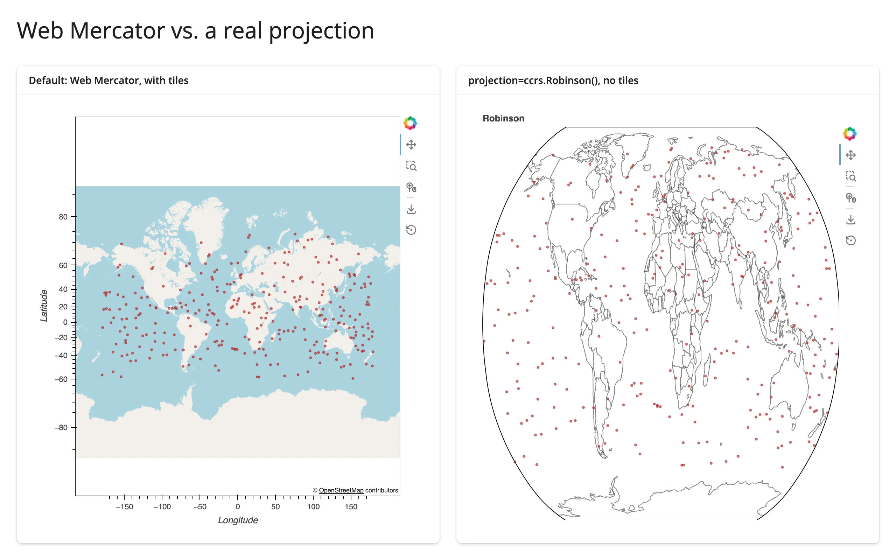

What actually changes: the axes go from lon/lat degrees to the projection's own linear units, every point and
coastline is reprojected (look at how much Alaska and Antarctica's apparent shape changes), and **the tile
basemap disappears** -- tiles are pre-rendered raster images that only exist in Web Mercator, so a non-Mercator
`projection=` has nothing to overlay them onto. `global_extent=True` tells GeoViews to frame the whole globe
instead of auto-ranging to just the data's bounding box, which matters once there's no tile layer providing an
implicit extent. `gf.coastline`, `gf.borders`, `gf.ocean`, `gf.land`, and `gf.lakes` are Cartopy Natural Earth
features that download on first use (see Gotchas) and project with everything else automatically.

### Paths

`gv.Path` works the same way as `gv.Points` -- a sequence of lon/lat vertices that reprojects with the rest of
the overlay. It isn't demonstrated as a separate example here since there's nothing geography-specific about it
beyond what `gv.Points`/`gv.Polygons` already show; see the
[HoloViews elements reference](https://holoviews.org/reference/index.html#elements) for the full element list.

### Scaling up: rasterizing points

[`examples/08_rasterize_scale.py`](examples/08_rasterize_scale.py) -- the same 200,000 points sent two ways: raw
coordinates, and pre-aggregated into a fixed-size image with hvPlot's `rasterize=True`:

```{.python file="examples/08_rasterize_scale.py"}
# 200,000 points sent as raw coordinates (left) vs. rasterized to a fixed-size
# image on the server before it ever reaches the browser (right). Both pan and
# zoom the same way, but the rasterized version re-aggregates per view instead
# of shipping every point -- see ../datashader/guide.md for the full story.
import geoviews as gv
import holoviews as hv
import hvplot.pandas  # noqa: F401
import numpy as np
import pandas as pd
from shiny.express import ui

from shinywidgets import render_holoviews

hv.extension("bokeh")

rng = np.random.default_rng(0)
n = 200_000
cities = np.array([(-74, 41), (-0.1, 51.5), (139, 35.7), (28, -26), (151, -34)])
center = cities[rng.integers(0, len(cities), n)]
points = pd.DataFrame(
    center + rng.normal(0, 3.0, (n, 2)), columns=["lon", "lat"]
)

ui.page_opts(title="200,000 points: raw vs. rasterized", fillable=True)

with ui.layout_columns():
    with ui.card(full_screen=True):
        ui.card_header("Raw gv.Points (every coordinate shipped)")

        @render_holoviews
        def raw():
            return (gv.tile_sources.EsriWorldDarkGrayBase * gv.Points(points, kdims=["lon", "lat"]).opts(
                size=2, alpha=0.1, color="cyan"
            )).opts(responsive=True)

    with ui.card(full_screen=True):
        ui.card_header("hvPlot rasterize=True (fixed-size image)")

        @render_holoviews
        def rasterized():
            return points.hvplot.points(
                "lon", "lat", geo=True, rasterize=True, dynspread=True,
                cmap="fire", tiles="EsriWorldDarkGrayBase", responsive=True,
            )
```

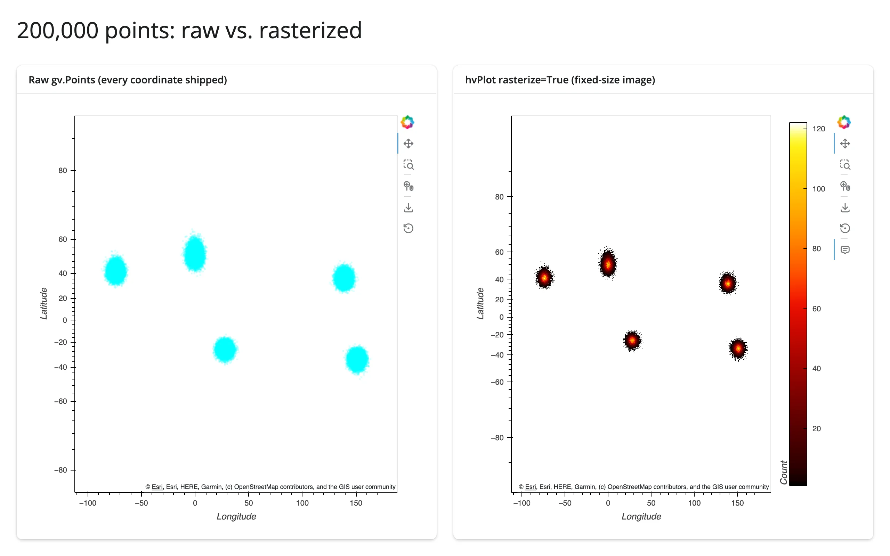

The left panel ships all 200,000 (lon, lat) pairs to the browser as plain glyph data -- every pan/zoom redraws the
same fixed set of circles, and the overplotted blob tells you nothing about density. The right panel's
`rasterize=True` runs [Datashader](../datashader/index.md) on the server: it bins every point into a small, fixed
number of pixels server-side and sends a single image, so the payload size doesn't grow with the point count and
you get an actual density field (the color ramp) instead of a solid blob. `dynspread=True` widens isolated pixels
by a point or two so sparse areas stay visible. This is the same mechanism as `rasterize()`/`datashade()` in plain
HoloViews -- see the [HoloViews guide](../holoviews/index.md#datashader-and-geoviews) and the
[Datashader guide](../datashader/index.md) for the full picture (rate of re-aggregation, `dynspread` vs. `spread`,
categorical aggregation, etc.).

**When to hand off:** a few thousand points render fine as plain `gv.Points` (the earthquake examples later in
this guide use ~6,000 with no issue). Tens of thousands to millions of points is GeoViews' and Datashader's
sweet spot *if* you want server-side aggregation (heatmap-style density, no picking of individual points). If you
need every point to stay pickable/selectable at that scale with GPU-smooth pan and zoom, prefer
[lonboard](../lonboard/index.md) (deck.gl/WebGL) instead -- its accessors (`selected()`, `clicked()`) also
give you per-point interactivity that a rasterized image can't. For local raster files (GeoTIFF/COG) rather than
point clouds, see [localtileserver](../localtileserver/index.md).

## Reacting to user interaction

Same story as plain HoloViews: **`render_holoviews` has no reactive accessors.** GeoViews elements use HoloViews'
own **streams** (`hv.streams.Tap`, `BoundsXY`, `RangeXY`, ...), and the recipe is identical --
subscribe to the stream inside the render function and set a `reactive.Value` from the callback. Read
[the HoloViews guide's recipe](../holoviews/index.md#the-recipe-stream-subscriber---reactivevalue) first; this
section only covers what's different about coordinates on a projected map.

**The coordinate-space rule that matters here:** streams attached to a GeoViews element report their
values **in that element's own coordinates** -- lon/lat by default -- regardless of what CRS the plot actually
draws in underneath a tile basemap (Web Mercator). This is true for `Tap`, `BoundsXY`, *and* `RangeXY`: GeoViews
reprojects the browser's reported pixel range back to the source element's `crs` before your subscriber ever sees
it. Verified directly: a `RangeXY` reading the *rendered Bokeh model's* raw `x_range`/`y_range` is in Web Mercator
meters (e.g. `-8211102.97`), but the exact same pan/zoom reported through `hv.streams.RangeXY(source=points)`
arrives in plain lon/lat (e.g. `-73.74`). You never need `holoviews.util.transform.easting_northing_to_lon_lat`
for reading stream values back -- only if you set a static `xlim=`/`ylim=` option on a tiled plot (see Gotchas).

### Pattern: click a feature for details

[`examples/04_tap_detail.py`](examples/04_tap_detail.py) -- `hv.streams.Tap` on a `gv.Points` layer, same as the
HoloViews guide's Tap example:

```{.python file="examples/04_tap_detail.py"}
# Click a station on the map to see its details. hv.streams.Tap reports the
# click in data coordinates (lon/lat), even though the map draws in Web
# Mercator -- geoviews un-projects it for you. Same recipe as the holoviews
# guide's Tap example; see ../holoviews/guide.md#the-recipe.
import geoviews as gv
import holoviews as hv
import plotly.express as px
from shiny import reactive
from shiny.express import render, ui

from shinywidgets import render_holoviews

hv.extension("bokeh")

carshare = px.data.carshare()
tap_xy = reactive.value(None)

ui.page_opts(title="Click a station for details", fillable=True)

with ui.layout_columns():
    with ui.card(full_screen=True):

        @render_holoviews
        def map():
            points = gv.Points(
                carshare, kdims=["centroid_lon", "centroid_lat"], vdims=["car_hours"]
            ).opts(color="car_hours", cmap="viridis", size=8, tools=["tap", "hover"])
            hv.streams.Tap(source=points).add_subscriber(
                lambda x, y: tap_xy.set((x, y))
            )
            return (gv.tile_sources.OSM * points).opts(responsive=True)

    with ui.card():
        ui.card_header("Nearest station")

        @render.ui
        def detail():
            xy = tap_xy()
            if xy is None:
                return ui.p("Click a station on the map.", class_="text-muted")
            x, y = xy
            dist = (carshare.centroid_lon - x) ** 2 + (carshare.centroid_lat - y) ** 2
            row = carshare.loc[dist.idxmin()]
            return ui.TagList(
                ui.h5(f"{row.car_hours:.0f} car-hours"),
                ui.p(f"Peak hour: {row.peak_hour:.0f}:00"),
                ui.p(f"{row.centroid_lat:.4f}, {row.centroid_lon:.4f}", class_="text-muted"),
            )
```

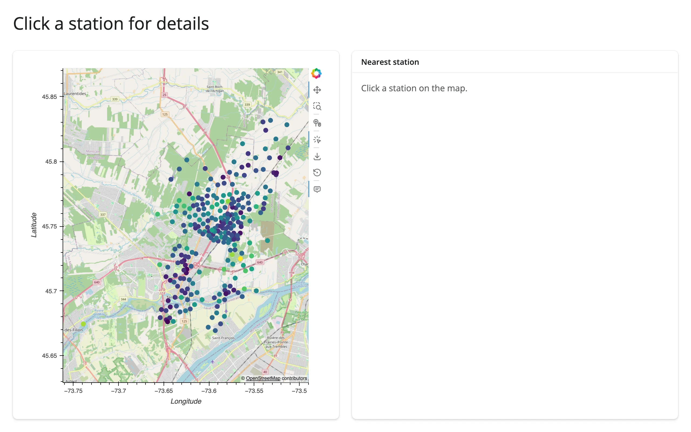
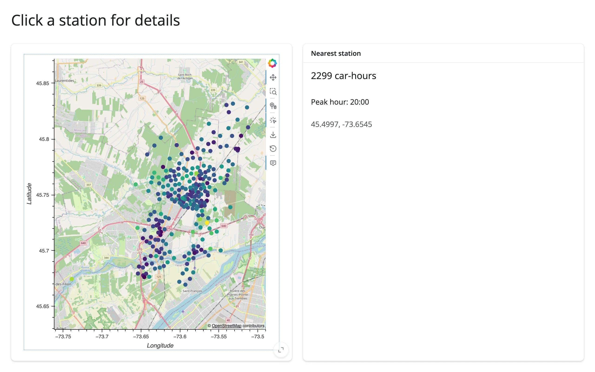

`Tap` reports the click location regardless of whether it landed exactly on a point glyph, so "nearest row by
squared distance" (same pattern as the HoloViews guide) is the right lookup on the Shiny side.

### Pattern: box-select to filter a table

[`examples/05_boundsxy_table.py`](examples/05_boundsxy_table.py) -- `hv.streams.BoundsXY` reports the dragged
rectangle, already in lon/lat, so it tests directly against a plain pandas DataFrame with no reprojection:

```{.python file="examples/05_boundsxy_table.py"}
# Box-select stations on the map to filter a table below it. BoundsXY reports
# the dragged rectangle in lon/lat, so the same bounds test a plain pandas
# DataFrame -- no re-projection needed on the Shiny side.
import geoviews as gv
import holoviews as hv
import plotly.express as px
from shiny import reactive
from shiny.express import render, ui

from shinywidgets import render_holoviews

hv.extension("bokeh")

carshare = px.data.carshare()
bounds_val = reactive.value(None)

ui.page_opts(title="Box-select stations to filter a table", fillable=True)

with ui.card(full_screen=True):

    @render_holoviews
    def map():
        points = gv.Points(
            carshare, kdims=["centroid_lon", "centroid_lat"], vdims=["car_hours"]
        ).opts(
            color="car_hours",
            cmap="viridis",
            size=8,
            tools=["box_select"],
            active_tools=["box_select"],
        )
        hv.streams.BoundsXY(source=points).add_subscriber(
            lambda bounds: bounds_val.set(bounds)
        )
        return (gv.tile_sources.OSM * points).opts(responsive=True)


with ui.card():
    ui.card_header("Stations in view")

    @render.data_frame
    def selected():
        b = bounds_val()
        if b is None:
            return carshare.iloc[:0]
        x0, y0, x1, y1 = b
        sel = carshare[
            carshare.centroid_lon.between(x0, x1) & carshare.centroid_lat.between(y0, y1)
        ]
        return render.DataGrid(sel.round(2), height="220px")
```

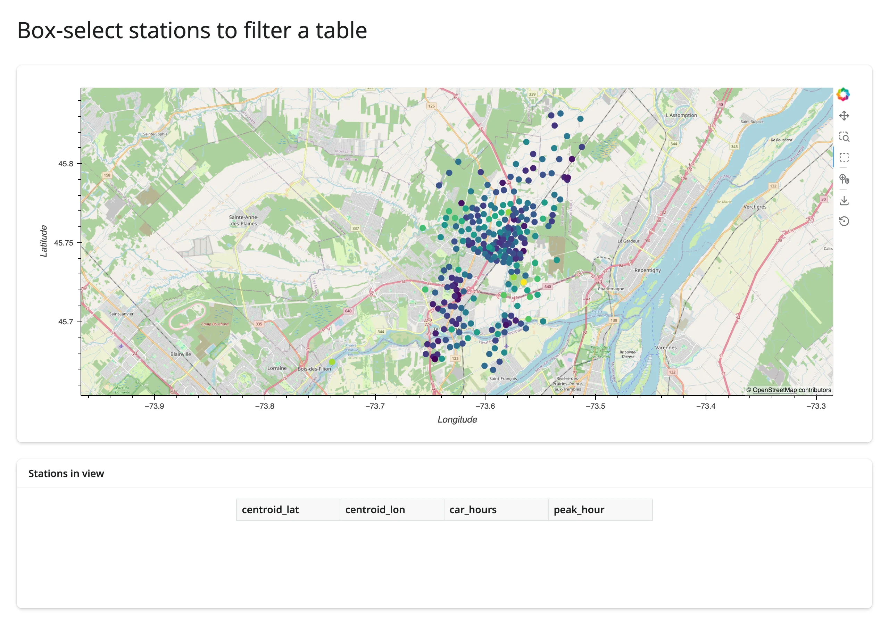
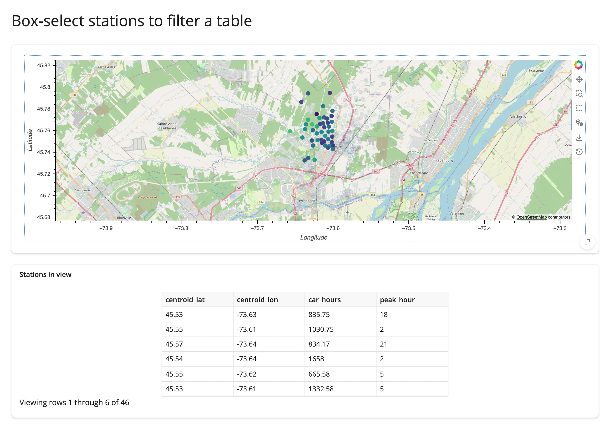

Note this example keeps the map output **full width** (not in a `ui.layout_columns()` column next to the table)
as a layout preference -- box-select itself works fine in a narrower column too, see
[Gotchas](#gotchas-and-limitations).

### Pattern: viewport drives summary stats

`hv.streams.RangeXY` reports the current pan/zoom extent continuously (on every frame of a drag or
scroll-zoom, not just once per gesture like `BoundsXY`/`Tap`). Store the stream's own range tuple, never a
counter -- `reactive.Value.set()` then skips invalidating readers on repeated, unchanged reports, so a long
scroll-zoom doesn't recompute anything after the range stops moving
([`examples/06_rangexy_viewport.py`](examples/06_rangexy_viewport.py)):

```{.python file="examples/06_rangexy_viewport.py"}
# The visible viewport drives two value boxes. hv.streams.RangeXY reports the
# current x_range/y_range in the *source element's* coordinates -- lon/lat for
# a geoviews element, same as BoundsXY/Tap -- even though the plot itself
# draws in Web Mercator underneath the tiles.
#
# Store the stream's own (idempotent) range tuple, never a counter: a stream
# that fires on every animation frame of a zoom, combined with an
# ever-different subscriber value, causes a render loop (see Gotchas).
import geoviews as gv
import holoviews as hv
import plotly.express as px
from shiny import reactive
from shiny.express import render, ui

from shinywidgets import render_holoviews

hv.extension("bokeh")

carshare = px.data.carshare()
range_val = reactive.value(None)

ui.page_opts(title="Viewport drives value boxes", fillable=True)

with ui.layout_columns(fill=False):
    with ui.value_box():
        "Stations visible"

        @render.text
        def n_visible():
            return str(len(visible()))

    with ui.value_box():
        "Avg car-hours (visible)"

        @render.text
        def avg_hours():
            v = visible()
            return f"{v.car_hours.mean():.0f}" if len(v) else "-"


with ui.card(full_screen=True):

    @render_holoviews
    def map():
        points = gv.Points(
            carshare, kdims=["centroid_lon", "centroid_lat"], vdims=["car_hours"]
        ).opts(
            color="car_hours", cmap="viridis", size=8,
            tools=["wheel_zoom"], active_tools=["wheel_zoom"],
        )
        hv.streams.RangeXY(source=points).add_subscriber(
            lambda x_range, y_range: range_val.set((x_range, y_range))
        )
        return (gv.tile_sources.OSM * points).opts(responsive=True)


@reactive.calc
def visible():
    r = range_val()
    if r is None or None in r[0] or None in r[1]:
        return carshare
    (lon0, lon1), (lat0, lat1) = r
    return carshare[
        carshare.centroid_lon.between(lon0, lon1)
        & carshare.centroid_lat.between(lat0, lat1)
    ]
```

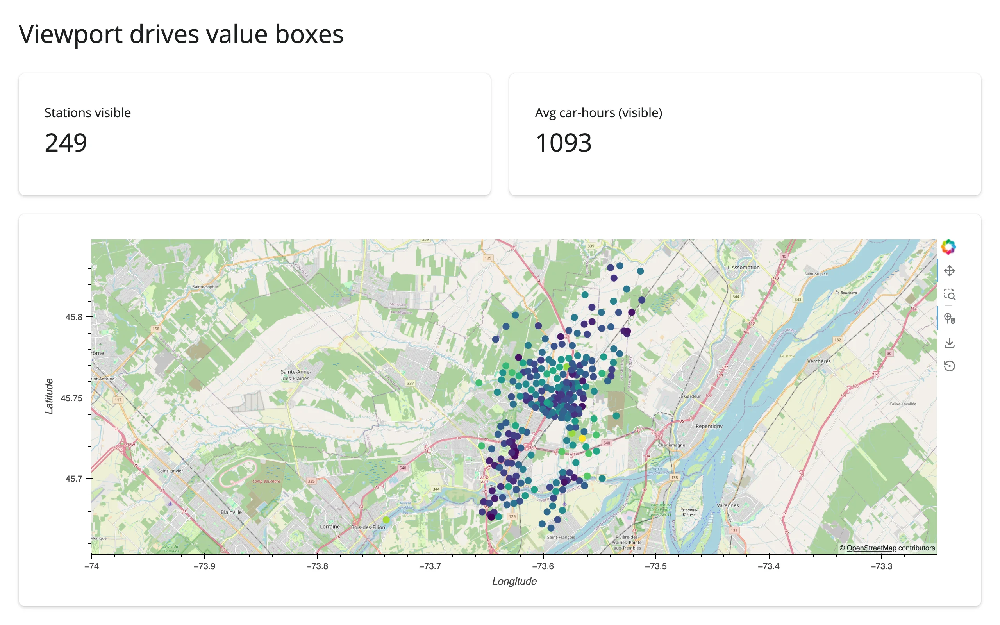
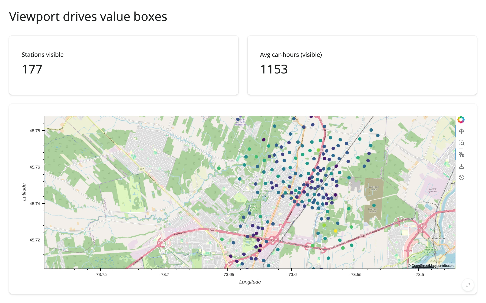

### Beyond streams: `reactive_read`

Same as the HoloViews guide: `reactive_read()` doesn't apply to streams or GeoViews elements themselves (they're
`param.Parameterized` objects, not ipywidgets traits). `reactive_read(x.widget, "trait")` (or the equivalent
`x.read("trait")`) still technically works on the rendered `BokehModel`, but there's rarely a reason to reach for
it here -- `render_holoviews` has no accessors, so `.read()`'s only job is that trait fallback, and a `BokehModel`'s
traits don't reflect anything map-specific.

### Rate limiting

`rate_policy`/`rate_delay` do nothing for this recipe, same caveat as the HoloViews guide. In practice `Tap` and
`BoundsXY` each fire once per gesture, so there's nothing to throttle. `RangeXY` is the one stream here that fires
repeatedly (every frame of a drag-pan or scroll-zoom) -- store its own value idempotently (as in the example
above) rather than rate-limiting it, so repeated frames with the same range are a no-op instead of extra traffic.

## Updating the widget from Python

Identical mechanism to the [HoloViews guide](../holoviews/index.md#updating-the-widget-from-python): driving a
`hv.DynamicMap` with a `hv.streams.Pipe` updates the existing Bokeh model in place (same comm, same JS-side
glyphs), which preserves the user's pan/zoom; re-rendering from a plain Shiny input read rebuilds the plot and
resets the view. [`examples/07_inplace_filter.py`](examples/07_inplace_filter.py) shows the geographic case: a
magnitude slider filters 6,000 synthetic earthquakes without losing the zoom.

```{.python file="examples/07_inplace_filter.py"}
# A magnitude slider filters 6,000 synthetic earthquakes without losing the
# user's zoom: the slider drives a holoviews.streams.Pipe, not a re-render.
# This is the same recipe as ../holoviews/guide.md's Pipe example -- see
# "Updating the widget from Python" there for the re-render-vs-in-place
# contrast in full. Synthetic data here is about *scale* (see "Performance
# with large point sets" in the guide text); the belt shape is just for
# visual plausibility.
import geoviews as gv
import holoviews as hv
import numpy as np
from shiny import reactive
from shiny.express import input, ui

from shinywidgets import render_holoviews

hv.extension("bokeh")

rng = np.random.default_rng(1)
# Two separate belts (Americas, Asia-Pacific) -- kept apart so linear
# interpolation never cuts straight across the Pacific at the antimeridian.
BELTS = [
    np.array([(-70, -55), (-71, -33), (-75, -10), (-80, 5), (-90, 15),
               (-100, 20), (-120, 35), (-125, 48), (-150, 60), (-170, 55)]),
    np.array([(170, 52), (150, 45), (140, 35), (130, 30), (125, 10),
               (120, 0), (110, -8), (130, -8), (150, -10), (170, -15), (178, -20)]),
]
lons, lats = [], []
for belt in BELTS:
    for a, b in zip(belt[:-1], belt[1:]):
        t = rng.uniform(0, 1, 320)
        seg = a * (1 - t[:, None]) + b * t[:, None] + rng.normal(0, 1.5, (320, 2))
        lons.append(seg[:, 0])
        lats.append(seg[:, 1])
lons, lats = np.concatenate(lons), np.concatenate(lats)
n = len(lons)
mag = rng.exponential(0.6, n).clip(0, 4) + 4.0  # Gutenberg-Richter-ish tail
depth = rng.gamma(2.0, 60, n).clip(0, 700)
quakes = {"lon": lons, "lat": lats, "mag": mag, "depth": depth}

ui.page_opts(title="6,000 synthetic earthquakes: filter without losing zoom", fillable=True)
ui.input_slider("min_mag", "Minimum magnitude", min=4.0, max=7.5, value=4.0, step=0.5)

pipe = hv.streams.Pipe(data=quakes)


def quake_points(data):
    return gv.Points(data, kdims=["lon", "lat"], vdims=["mag", "depth"]).opts(
        color="depth", cmap="fire_r", size=hv.dim("mag") * 1.5, alpha=0.6,
        colorbar=True, tools=["hover", "wheel_zoom"], active_tools=["wheel_zoom"],
    )


with ui.card(full_screen=True):

    @render_holoviews
    def map():
        dmap = hv.DynamicMap(quake_points, streams=[pipe])
        return (gv.tile_sources.EsriWorldDarkGrayBase * dmap).opts(responsive=True)


@reactive.effect
def _():
    mask = mag >= input.min_mag()
    pipe.send({"lon": lons[mask], "lat": lats[mask], "mag": mag[mask], "depth": depth[mask]})
```

Zoomed into Japan, then the slider moved from 4.0 to 5.5:


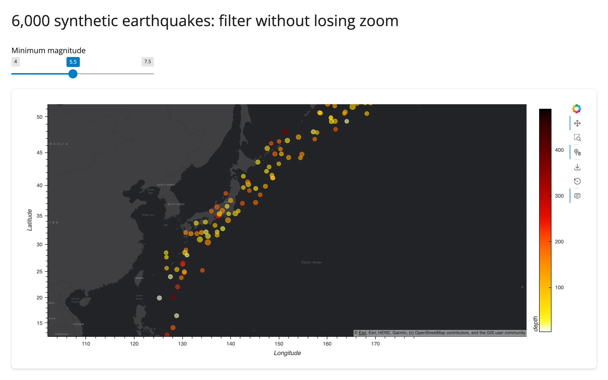

The viewport (axis range) is identical in both screenshots; only the points changed. **Important:** attach
`Tap`/`BoundsXY`/`RangeXY` to the `DynamicMap` object itself (`hv.streams.Tap(source=dmap)`), not to the element
returned from inside its callback function. A fresh stream instance created on every callback invocation never
gets wired to the live plot's JS callbacks -- only the very first invocation's streams do. This bit the
showcase gallery app during development; see Gotchas.

## Coordinating multiple views

Three complete, gesture-verified patterns -- building on the streams above:

1. **Click → nearest feature → detail card** -- [`examples/04_tap_detail.py`](examples/04_tap_detail.py),
   shown above under Reacting to user interaction.
2. **Box-select → filtered table** -- [`examples/05_boundsxy_table.py`](examples/05_boundsxy_table.py), shown
   above.
3. **Viewport (pan/zoom) → summary stats** -- [`examples/06_rangexy_viewport.py`](examples/06_rangexy_viewport.py),
   shown above, the same pattern as [the HoloViews guide's zoom-range example](../holoviews/index.md#continuous-streams-rangexy-needs-an-idempotent-subscriber).
   Store the stream's own range tuple, not a counter or anything else that changes on every call -- good practice
   regardless of the coordinate space, since `reactive.Value.set()` only re-runs readers when the range actually
   changed.

The gallery showcase (below) combines all three (slider → in-place filter, box-select → value boxes and a table,
click → detail card) in one dashboard.

## Large data

GeoViews' large-data mode is `rasterize=True` (via hvPlot or HoloViews' `rasterize()`), which runs
[Datashader](../datashader/index.md) on the server and sends one fixed-size image instead of every point --
summarize on the server. [Scaling up: rasterizing points](#scaling-up-rasterizing-points) above measures this
directly: 200,000 raw `gv.Points` ship every coordinate and overplot into a solid blob, while the rasterized
version sends a single image whose payload doesn't grow with point count. Plain (non-rasterized)
`gv.Points`/`gv.Polygons` render fine into the low thousands (this guide's earthquake examples use ~6,000);
past that, rasterize, or switch to [lonboard](../lonboard/index.md#large-data) if individual points need to stay
pickable. See the
[Large data & performance article](../../guide/performance/index.md#three-approaches-to-large-data) for how
this compares to the other two approaches.

## Layout and sizing

Nothing GeoViews-specific beyond the [HoloViews guide's section](../holoviews/index.md#layout-and-sizing):
`responsive=True` fills the container, a fixed `output_widget(..., height=)` needs `fillable=True` alongside it,
and `full_screen=True` on the card works normally. One thing worth calling out here because maps make it obvious:
a `colorbar=True` legend and a tile attribution string both live inside the same Bokeh figure, so they share
whatever width/height the plot gets -- there's no separate layout slot for them.

## Gotchas and limitations

Verified on current main (shiny 1.9.0, geoviews 1.16.0, holoviews 1.23.2, hvplot 0.12.2, cartopy 0.25.0,
panel 1.10.0, bokeh 3.10.1, geopandas 1.2.0, jupyter_bokeh 4.1.0). Everything in the
[HoloViews guide's Gotchas](../holoviews/index.md#gotchas-and-limitations) applies here too (the sidebar/second-output
`link_selections` claims there were retracted after a follow-up investigation; `RangeXY`'s old re-render-loop bug
is fixed -- see below); this list covers what's additionally true for GeoViews.

- **~~A `BoundsXY` (box-select) stream silently never fires below ~500-650px~~ -- retracted, test-methodology
  artifact, not a bug.** An earlier revision of this guide reported box-select failing on a narrow responsive
  canvas. A follow-up investigation
  (`../investigations/narrow-canvas-and-subclass/INVESTIGATION.md`, Item A) found the real mechanism: Bokeh's
  `BoxSelectTool` only starts a selection when the mousedown lands inside the plot's *data frame*, not its
  fixed-pixel y-axis label margin (~49px). A drag computed as a fraction of the canvas's full bounding rect clears
  that margin comfortably on a wide canvas (a few percent of the width) but lands *inside* the margin once the
  canvas is narrow enough (the same 49px is now ten-plus percent of the width) -- confirmed down to a 222px-wide
  canvas with a drag computed from the plot's actual frame bounds instead, which selects correctly at any width
  tested. This is a property of how a synthetic test drag is computed, not of the canvas width itself: a real
  user dragging with a mouse naturally starts inside the visible plot area and is unaffected. No code change or
  layout workaround is needed; `examples/05_boundsxy_table.py` keeps its map output full-width purely as a layout
  preference, not because narrower columns are broken.
- **Attach streams to the `DynamicMap`, not to the element its callback returns.** `hv.streams.Tap(source=pts)`
  created *inside* a `DynamicMap` callback function creates a fresh, disconnected stream object on every call;
  only a stream attached to the `DynamicMap` itself (`hv.streams.Tap(source=dmap)`, built once per render) stays
  wired to the live plot. Verified: the broken form renders fine and shows no error, but the subscriber is simply
  never invoked.
- **`RangeXY` no longer risks a re-render loop** -- shinywidgets runs widget coercion under `reactive.isolate()`,
  so a stream subscriber's reactive reads can't register the in-progress render as a dependent (see
  [the HoloViews guide's Gotchas](../holoviews/index.md#gotchas-and-limitations) for the mechanism). Still store
  the stream's own range tuple, not a counter, as this guide's viewport example does: it's idempotent once the
  user stops interacting, so `reactive.Value.set()` skips invalidating readers on repeats, which avoids pointless
  recomputation even though it's no longer needed to avoid a crash. Verified on current main: a multi-step
  scroll-zoom produced zero `RuntimeError: BokehModel was closed` tracebacks in the server log.
- **Stream values come back in the element's native coordinates (lon/lat by default), not the tile layer's Web
  Mercator -- for `Tap` and `BoundsXY` *and* `RangeXY`.** Only a *static* `.opts(xlim=..., ylim=...)` on an overlay
  that includes tiles needs Mercator meters (convert with
  `holoviews.util.transform.lon_lat_to_easting_northing`); reading values back out of any stream does not. This is
  worth being explicit about because it's easy to assume (incorrectly) that everything involving tiles needs that
  conversion.
- **A non-Mercator `projection=` drops any tile layer silently** (no error -- the overlay just renders without a
  basemap). Tiles are Web-Mercator-only raster images; there is no server-side reprojection path for them. Verified
  with `projection=ccrs.Robinson()` plus `gv.tile_sources.OSM` in the overlay.
- **`.opts()` on `gv.tile_sources.*` and `gv.feature.*` mutates the shared module-level object in place.** Style
  with `.opts(..., clone=True)` or one session's styling leaks into every other session and output that reuses the
  same tile/feature object (this follows from normal Python object-identity semantics, not something
  shinywidgets-specific, but it's an easy trap the first time you reach for `gv.tile_sources.OSM.opts(alpha=0.5)`).
- **`CartoLight`/`CartoDark` tiles now require an API key** and render an "API key required" watermark instead
  (verified today, both as a plain `gv.tile_sources.CartoDark` and via hvPlot's `tiles="CartoDark"`). Use an Esri
  preset or `OSM`.
- **`gv.feature.*` (coastline, borders, ocean, land, lakes) downloads Natural Earth shapefiles on first use**,
  synchronously, inside the render call. Offline servers should pre-warm Cartopy's data cache; the first request
  that needs a feature will otherwise stall.
- **geoviews 1.15/1.16 require `cartopy<0.26`** (`KeyError: 'lon_0'` from `project_extents` otherwise, reproduced
  directly with a bare `gv.Points`, no shinywidgets involved). The fix is merged upstream but unreleased as of this
  writing.
- **An empty element (e.g. a `req()`-guarded selection that filters everything out) collapses the map's extent**
  to a near-zero-degree box, which then floods the tile server with requests at the deepest zoom level. Guard with
  `req(...)` on the input that could produce an empty frame, same as any other shinywidgets output.

## Gallery candidates

### `gallery/template_city_map.py` (template)

A minimal, adaptable starting point: six world cities on an OSM basemap, sized by population, with a region
checkbox filter and click-for-detail. Swap in your own DataFrame and tile source.

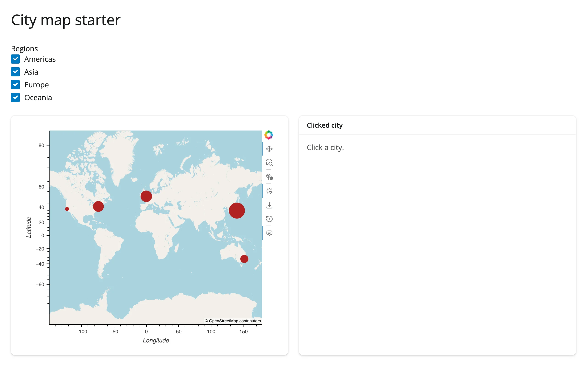
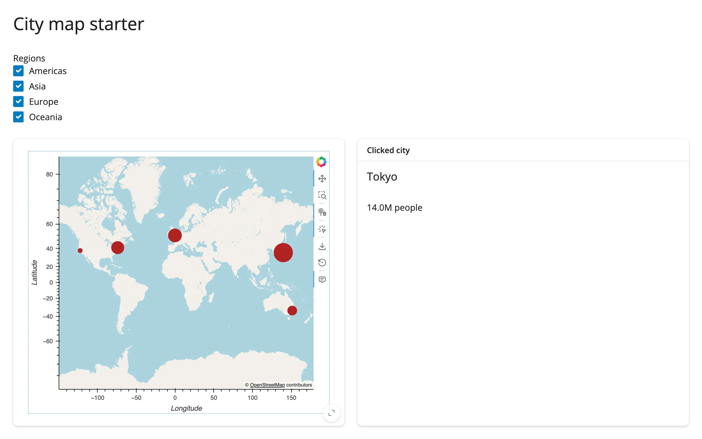

### `gallery/showcase_quake_explorer.py` (showcase)

"Ring of Fire quake explorer" -- 6,000 synthetic earthquakes on a dark Esri basemap, combining every pattern in
this guide: a magnitude slider drives an in-place `Pipe` update (preserves zoom), box-select drives three value
boxes and a by-region table via `BoundsXY`, and a click drives a detail card via `Tap`. The map is kept full-width
as a layout preference, not a workaround -- see [Gotchas](#gotchas-and-limitations).

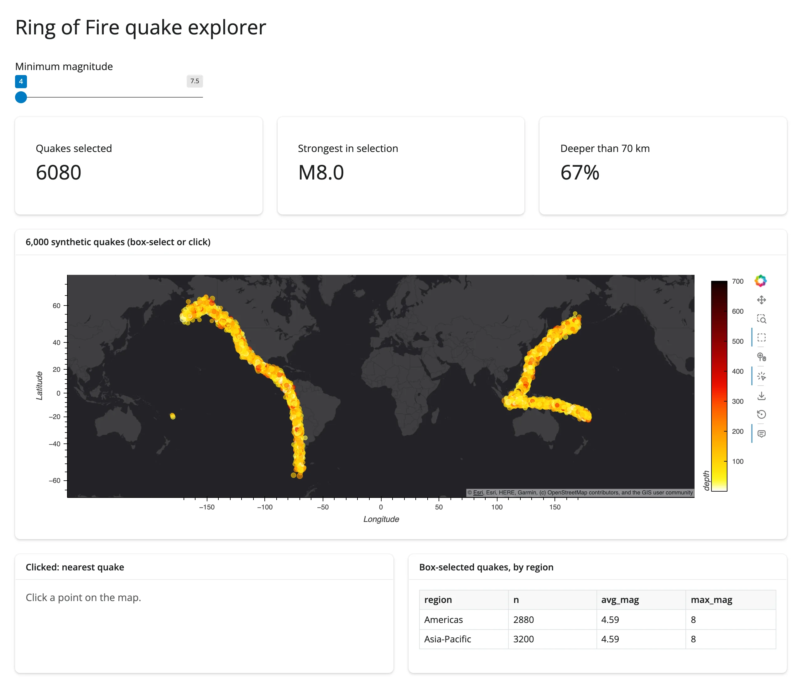
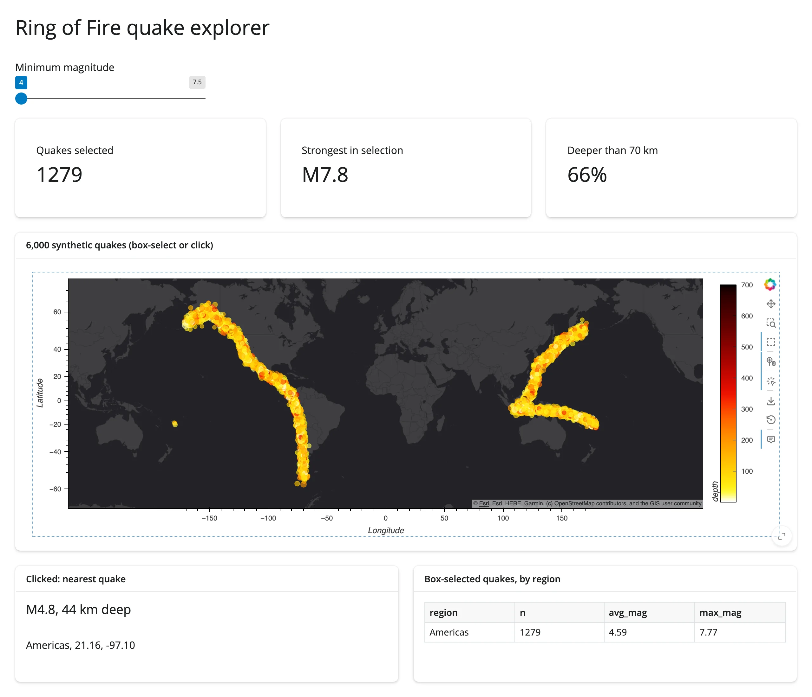

## Learn more

- [GeoViews documentation](https://geoviews.org) -- element types, projections, gallery
- [GeoViews user guide: Projecting data](https://geoviews.org/user_guide/Projections.html)
- [Cartopy CRS reference](https://scitools.org.uk/cartopy/docs/latest/reference/crs.html) -- all available
  `ccrs.*` projections
- Related guides in this roster: [holoviews](../holoviews/index.md) (read this first),
  [datashader](../datashader/index.md), [bokeh](../bokeh/index.md), [lonboard](../lonboard/index.md),
  [ipyleaflet](../ipyleaflet/index.md), [leafmap](../leafmap/index.md), [maplibre](../maplibre/index.md),
  [localtileserver](../localtileserver/index.md)
