[HoloViews](https://holoviews.org) is a declarative plotting library from the [HoloViz](https://holoviz.org) project
(the same group behind Panel, Datashader, and GeoViews). Instead of building a figure imperatively, you wrap data in
typed elements (`Curve`, `Scatter`, `Image`, ...) and HoloViews decides how to draw them; `*` overlays elements on
shared axes and `+` lays them out side by side, so multi-panel figures need no subplot bookkeeping. [hvPlot](https://hvplot.holoviz.org)
puts a `.hvplot` accessor on pandas (and xarray/dask/polars) objects that returns the same HoloViews objects from
one-line calls -- it's usually the faster way in, and this guide leans on it.

`@render_holoviews` accepts a HoloViews, hvPlot, or [GeoViews](../geoviews/index.md) object, or the underlying
`jupyter_bokeh.BokehModel` widget. It renders through Panel to Bokeh (`pip install 'shinywidgets[holoviews]'`),
gets the same layout defaults and sizing fixes as [`render_bokeh`](../bokeh/index.md) and
[`render_panel`](../panel/index.md), and keeps HoloViews' own Python-side interactivity alive without a Bokeh
server: `HoloMap`/`DynamicMap` widgets, linked streams (`Tap`, `BoundsXY`, `Selection1D`, ...), and
`hv.link_selections` crossfiltering all just work. There are no reactive accessors here (see
[Reacting to user interaction](#reacting-to-user-interaction) for why and what to do instead) -- the interaction
surface is HoloViews' own stream objects, and this guide is mostly about wiring those into Shiny.

Choose HoloViews/hvPlot when you want the HoloViz ecosystem's crossfilter story (`link_selections` across several
plots with no callbacks), quick exploratory one-liners over a DataFrame, or you're already building on
[Datashader](../datashader/index.md) or GeoViews. Choose [bokeh](../bokeh/index.md) directly for fine, low-level
control and four built-in accessors (`selected()`, `tapped()`, `zoomed()`, ...). Choose [panel](../panel/index.md)
if you're building a general Panel app rather than plotting.

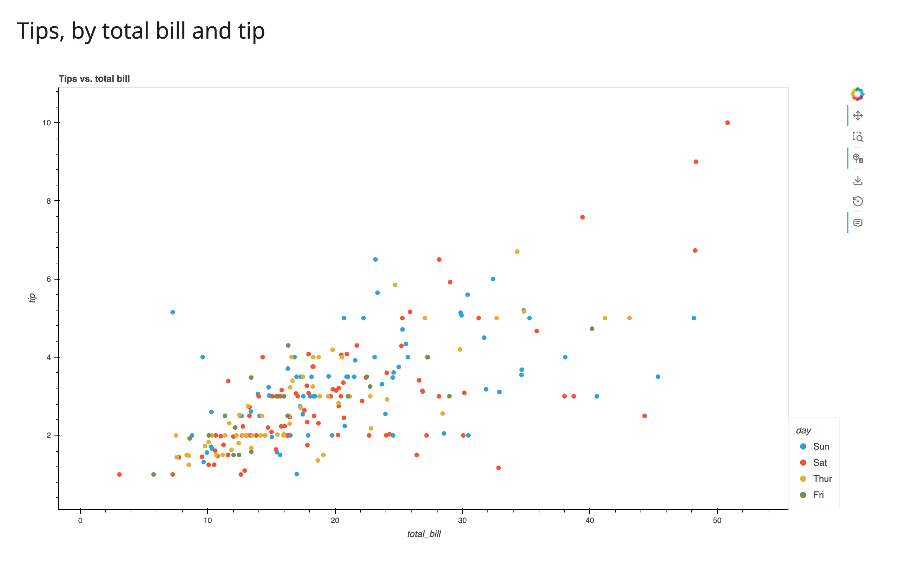

## Installation

```
pip install 'shinywidgets[holoviews]'
```

That installs `holoviews`, `panel`, and `jupyter_bokeh>=4.1` (the version floor matters: earlier `jupyter_bokeh`
falls back to a CDN for its JS, so offline apps render blank). **hvPlot is not included** -- add
`pip install hvplot` yourself; it's such a common pairing that every example below uses it. If you use pure
HoloViews without `import hvplot.pandas` (which registers the Bokeh extension as a side effect), call
`hv.extension("bokeh")` once at the top of your app before calling `.opts()` -- otherwise `.opts()` raises
`ValueError: No plotting extension is currently loaded` (verified on current main).
[Datashader](../datashader/index.md)-rasterized plots and [GeoViews](../geoviews/index.md) maps also render through
`@render_holoviews`; they get their own guides and are only mentioned in passing here.

## Quick start

```{.python file="examples/01_quickstart.py"}
# A quick-start hvPlot scatter: one line of pandas turns into an interactive
# Bokeh plot (pan, zoom, hover) with no extra ceremony.
import plotly.express as px
import hvplot.pandas  # noqa: F401 -- registers the .hvplot accessor on DataFrames
from shiny.express import ui

from shinywidgets import render_holoviews

tips = px.data.tips()

ui.page_opts(title="Tips, by total bill and tip", fillable=True)


@render_holoviews
def scatter():
    return tips.hvplot.scatter(
        "total_bill",
        "tip",
        by="day",
        responsive=True,
        title="Tips vs. total bill",
        hover_cols=["size"],
    )
```


One `.hvplot.scatter()` call produces a fully interactive Bokeh plot: pan, zoom, hover tooltips, and a clickable
legend, all for free. `responsive=True` is the one thing to remember -- without it the plot is a fixed 700x300px
and won't fill its card (see [Layout and sizing](#layout-and-sizing)).

## What you can build

### Composing with `*` and `+`

[`examples/02_overlays_layouts.py`](examples/02_overlays_layouts.py) -- overlay two elements on the same axes with
`*`, or lay out independent plots with `+`:

```{.python file="examples/02_overlays_layouts.py"}
# Compose plots with `*` (overlay, same axes) and `+` (layout, side by side) --
# no subplot bookkeeping required.
import holoviews as hv
import plotly.express as px
import hvplot.pandas  # noqa: F401
from shiny.express import ui

from shinywidgets import render_holoviews

hv.extension("bokeh")

tips = px.data.tips()
by_day = tips.groupby("day", observed=True)["tip"].mean().reindex(
    ["Thur", "Fri", "Sat", "Sun"]
)

ui.page_opts(title="Overlay and layout", fillable=True)

with ui.layout_columns():
    with ui.card(full_screen=True):
        ui.card_header("Overlay (*): scatter + a reference line, shared axes")

        @render_holoviews
        def overlay():
            points = tips.hvplot.scatter(
                "total_bill", "tip", responsive=True, color="gray", alpha=0.5
            )
            rule = hv.Slope(0.15, 0).opts(color="firebrick", line_width=2)
            return (points * rule).opts(title="15% tip reference line")

    with ui.card(full_screen=True):
        ui.card_header("Layout (+): two independent plots, one call")

        @render_holoviews
        def layout():
            bars = by_day.hvplot.bar(
                responsive=True, title="Average tip by day", ylabel="tip"
            )
            hist = tips.hvplot.hist(
                "total_bill", responsive=True, title="Bill distribution"
            )
            return (bars + hist).opts(shared_axes=False)
```

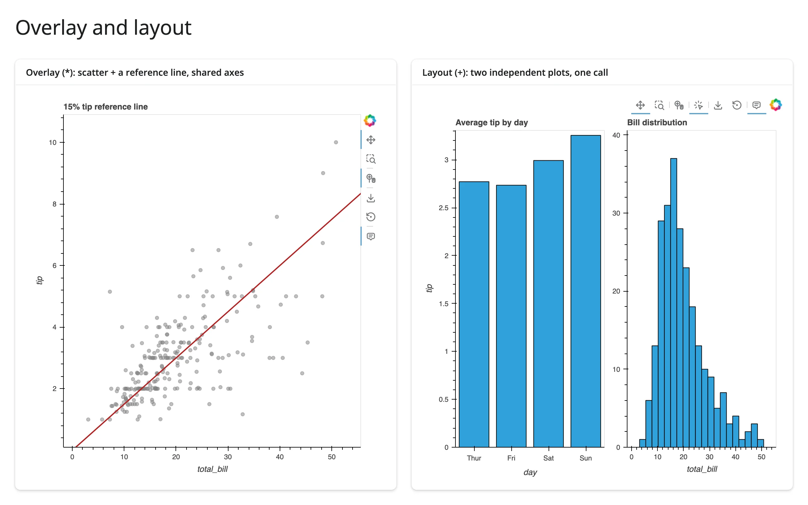

### Crossfilter with zero callbacks

`hv.link_selections` wraps any combination of plots and crossfilters them: box-select in one, and the others (plus
the held-out points in the first) restyle to show what's inside the selection -- no Python callback at all.
[`examples/03_link_selections.py`](examples/03_link_selections.py):

```{.python file="examples/03_link_selections.py"}
# hv.link_selections crossfilters every plot it wraps: box-select in one chart
# and the others (plus any held-out, non-selected points) restyle to match --
# no Python callback written. A composite Layout like this defaults its drag
# tool to Pan, not Box Select, regardless of panel width -- set
# active_tools=["box_select"] on each element so box-select is the
# ready-to-use default instead.
import holoviews as hv
import plotly.express as px
import hvplot.pandas  # noqa: F401
from shiny.express import ui

from shinywidgets import render_holoviews

hv.extension("bokeh")

tips = px.data.tips()

ui.page_opts(title="Crossfilter with link_selections", fillable=True)

# One instance per session (Express re-runs this module per session). A
# module-level instance would show every visitor's selection to everyone else.
links = hv.link_selections.instance(unselected_alpha=0.3)


@render_holoviews
def crossfilter():
    scatter = tips.hvplot.scatter(
        "total_bill", "tip", responsive=True, title="Bill vs. tip"
    ).opts(active_tools=["box_select"])
    bill_hist = tips.hvplot.hist(
        "total_bill", responsive=True, title="Bill distribution"
    ).opts(active_tools=["box_select"])
    size_hist = tips.hvplot.hist("size", responsive=True, title="Party size").opts(
        active_tools=["box_select"]
    )
    # Drag directly on any plot below to crossfilter the others -- box-select
    # is already the active drag tool on every panel, no toolbar click needed.
    return links(scatter + bill_hist + size_hist).opts(shared_axes=False)
```

Drag directly on any plot below -- `active_tools=["box_select"]` on each element already makes box-select the
default drag tool, so there's no toolbar icon to click first:

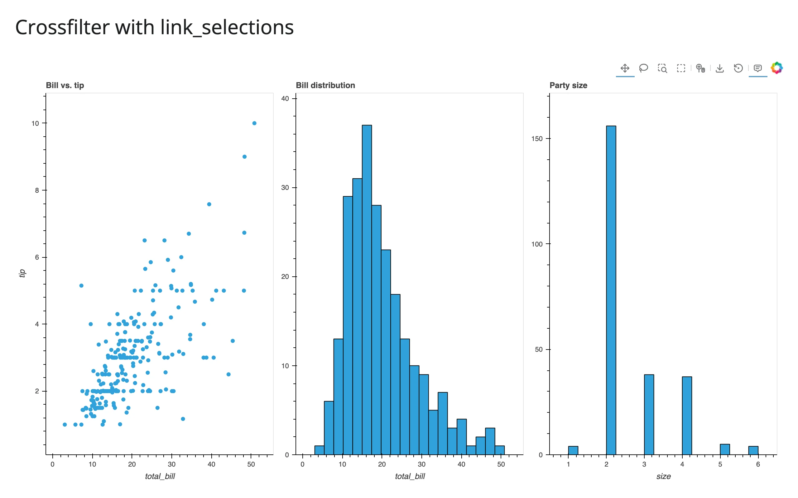
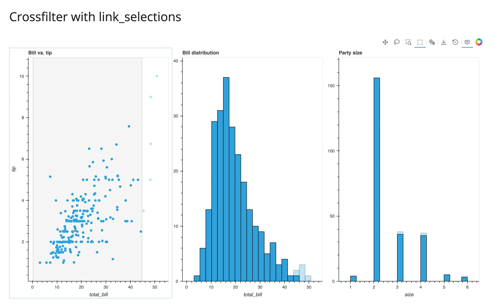

### Driving a plot from a Shiny input

The simplest way to connect a Shiny input to a HoloViews plot: read the input inside the render function.
[`examples/04_gapminder_slider.py`](examples/04_gapminder_slider.py) recreates the classic Gapminder animation as a
slider:

```{.python file="examples/04_gapminder_slider.py"}
# The simplest way to drive a plot from a Shiny input: read the input inside
# the render function. Shiny re-runs the function whenever the slider changes,
# and shinywidgets builds a brand-new plot each time (see 07_update_in_place.py
# for a HoloViews DynamicMap that updates the existing plot in place instead).
import plotly.express as px
import hvplot.pandas  # noqa: F401
from shiny.express import input, render, ui

from shinywidgets import render_holoviews

gapminder = px.data.gapminder()

ui.page_opts(title="Life expectancy vs. GDP per capita", fillable=True)
ui.input_slider("year", "Year", min=1952, max=2007, value=1952, step=5, sep="")


@render_holoviews
def scatter():
    year_df = gapminder[gapminder.year == input.year()]
    return year_df.hvplot.scatter(
        "gdpPercap",
        "lifeExp",
        by="continent",
        logx=True,
        responsive=True,
        size=80,
        alpha=0.7,
        xlim=(200, 120_000),
        ylim=(20, 90),
        title=f"{input.year()}",
    )
```

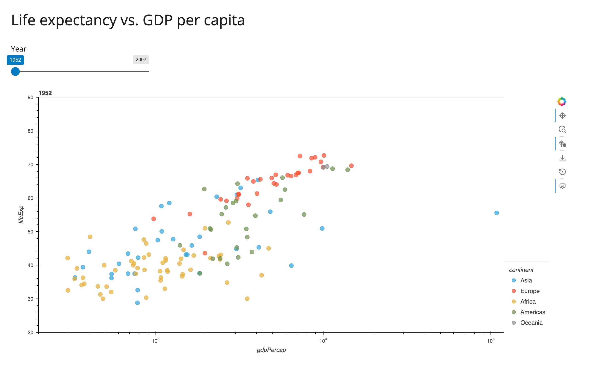
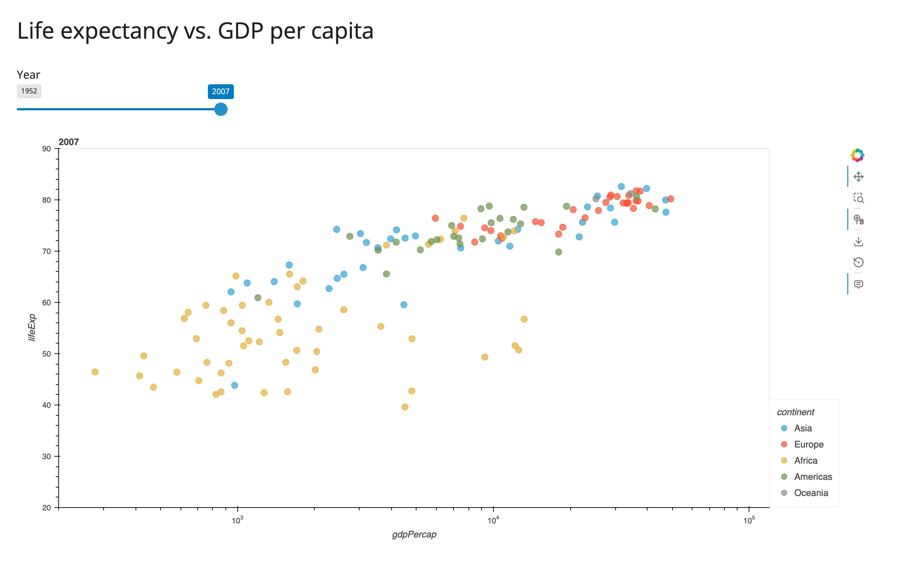

Shiny re-runs `scatter()` on every slider move, and shinywidgets builds a brand-new plot each time -- simple, and
fine for most apps. See [Updating the widget from Python](#updating-the-widget-from-python) for the alternative
(a `DynamicMap` driven by a stream) that updates the existing plot instead of replacing it, which matters when you
want to preserve zoom/pan state across updates.

### Filling the container

Pass `responsive=True` to make a plot fill its card instead of rendering at HoloViews' fixed default size; see
[Layout and sizing](#layout-and-sizing).

### Datashader and GeoViews

Plots rasterized with [Datashader](../datashader/index.md) (hvPlot's `rasterize=True`, or HoloViews'
`rasterize()` operation) and [GeoViews](../geoviews/index.md) maps both render through this same `@render_holoviews`
decorator. They get their own guides; the short version is that Datashader plots re-aggregate on the server as you
zoom and pan (build them inside the render function, not at module level, for the same per-session reason as
streams below), and GeoViews needs `.opts(..., clone=True)` on shared objects like `gv.tile_sources.OSM`.

## Reacting to user interaction

`render_holoviews` has **no reactive accessors** -- there's no `fig.selected()` to call. HoloViews' interaction
model is its own **streams** (`hv.streams.Tap`, `BoundsXY`, `Selection1D`, `RangeXY`, ...) and
`hv.link_selections`, both of which run their callbacks directly in Python, outside the accessor machinery the
other renderers use. The recipe below bridges that into Shiny's reactive graph, and is the pattern every
interactive example in this guide uses.

### The recipe: stream subscriber -> `reactive.Value`

[`examples/06_boxselect_table.py`](examples/06_boxselect_table.py) -- box-select on a scatter plot filters a table:

```{.python file="examples/06_boxselect_table.py"}
# The recipe for reacting to a HoloViews stream in Shiny: subscribe to it, and
# set a `reactive.Value` from the callback. The stream runs outside Shiny's
# render cycle, but setting a reactive value from it still invalidates
# whatever reads that value, same as any other reactive.Value.
import holoviews as hv
import plotly.express as px
import hvplot.pandas  # noqa: F401
from shiny import reactive
from shiny.express import render, ui

from shinywidgets import render_holoviews

hv.extension("bokeh")

tips = px.data.tips()

ui.page_opts(title="Box-select to filter a table", fillable=True)

bounds_val = reactive.value(None)


@render_holoviews
def scatter():
    points = tips.hvplot.scatter(
        "total_bill", "tip", responsive=True, tools=["box_select"]
    ).opts(active_tools=["box_select"])
    hv.streams.BoundsXY(source=points).add_subscriber(
        lambda bounds: bounds_val.set(bounds)
    )
    return points


@render.data_frame
def selected_rows():
    b = bounds_val()
    if b is None:
        return tips.iloc[:0]  # empty frame until the first selection
    x0, y0, x1, y1 = b
    sel = tips[tips.total_bill.between(x0, x1) & tips.tip.between(y0, y1)]
    return render.DataGrid(sel, height="250px")
```

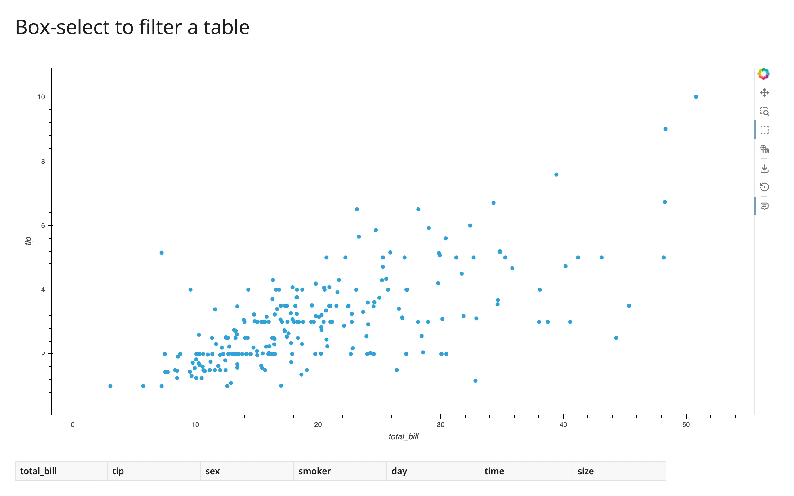
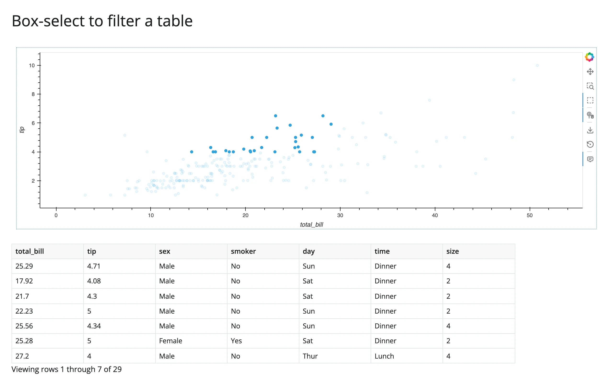

The shape is always the same: build the stream **inside the render function** (streams only attach to a plot
while it's being built; one created afterwards never fires), subscribe with a lambda that calls `.set()` on a
module-level `reactive.Value`, and read that value from any reactive function. A few things to know:

- **A fresh render starts the plot over, but not your `reactive.Value`.** Streams are rebuilt every time the
  render function runs, so the new plot shows no selection -- but the `reactive.Value` you set yourself keeps
  whatever it last held until the user interacts with the *new* plot. This is the same "kept across re-render
  until the user interacts with the new widget" behavior accessors have elsewhere in this roster; you're just
  managing it yourself here, since streams have no accessor machinery to do it for you.
- **`None` is the normal "nothing yet" state.** `req(bounds_val())` works if you want to wait for the first
  interaction instead of handling `None` explicitly.
- **It fires once per gesture**, not continuously during a drag (verified for `BoundsXY` and `Tap`).
- **`hv.link_selections` follows the same recipe** via its own param event: `links.param.watch(lambda event:
  some_value.set(event.new), "selection_expr")`. See [Coordinating multiple views](#coordinating-multiple-views)
  for a full example.
- Per-session construction matters here more than anywhere else in shinywidgets: build streams and
  `link_selections` instances inside the render function (or anywhere in a Shiny Express file, which already runs
  per session) -- never at the top level of a Shiny Core app, where one visitor's selection would become visible
  to everyone.

### Beyond streams: `reactive_read`

`reactive_read()` doesn't apply here. It works by calling `.observe()` on an ipywidgets trait, but HoloViews
streams and `link_selections` are plain `param.Parameterized` objects, not ipywidgets widgets -- `reactive_read`
raises if you try. (`reactive_read(x.widget, "trait")` -- or the equivalent `x.read("trait")`, which every
renderer gets -- still technically works on the rendered `BokehModel` itself, the same as `render_bokeh`, but you
don't normally have a direct handle on its `ColumnDataSource` the way `render_bokeh` users do, and
`render_holoviews` has no accessors for `.read()` to prefer over the trait fallback, so neither spelling is
useful here.)

### Rate limiting

`render_holoviews` accepts `rate_policy`/`rate_delay` kwargs (inherited from the base renderer class), but **they
do nothing for the stream recipe above** -- those kwargs only rate-limit accessors and `reactive_read()`, and
this renderer has neither wired into them. In practice this is rarely a problem: verified gesture-by-gesture,
`Tap` and `BoundsXY` each fire once per click or drag, not continuously, so there's nothing to debounce. If you do
attach a continuously-firing stream and need to throttle it, gate the subscriber yourself (e.g., check
`time.monotonic()` against a module-level timestamp before calling `.set()`).

### Continuous streams: `RangeXY` needs an idempotent subscriber

`hv.streams.RangeXY` reports the plot's current pan/zoom range, and unlike `Tap`/`BoundsXY` it fires on mount
with the default range as well as on every zoom or pan. **Store the range itself, not a counter or anything else
that changes on every call** -- `reactive.Value.set()` already skips invalidating readers when the new value
equals the old one, so once the range stops changing, the subscriber becomes a no-op. A subscriber that always
writes something new (`count.set(count.get() + 1)`, or any other accumulator) is a pointless invalidation storm
at best; on older shinywidgets versions (before coercion was reactively isolated) it caused a runaway re-render
loop -- see [Gotchas and limitations](#gotchas-and-limitations) for the mechanism.
[`examples/10_zoom_range_summary.py`](examples/10_zoom_range_summary.py) shows the working pattern -- the current
view's x-range drives a "how many points are visible right now" summary:

```{.python file="examples/10_zoom_range_summary.py"}
# hv.streams.RangeXY reports the plot's current pan/zoom range -- store the
# range itself (not a counter) in the reactive.Value. RangeXY fires once on
# mount with the default range and again on every zoom/pan, including
# transiently during a drag; storing an ever-changing value like a counter
# caused a runaway re-render loop on older shinywidgets versions (fixed --
# see the guide's gotchas section) and is still wasted invalidation. Storing
# the actual range is idempotent: reactive.Value.set() skips invalidation
# when the new value equals the old one, so repeats of the same range are a
# no-op and only a genuine zoom/pan triggers a recompute.
import holoviews as hv
import plotly.express as px
import hvplot.pandas  # noqa: F401
from shiny import reactive
from shiny.express import render, ui

from shinywidgets import render_holoviews

hv.extension("bokeh")

tips = px.data.tips()

ui.page_opts(title="Zoom range -> visible-point summary", fillable=True)

range_val = reactive.value((None, None))


@render_holoviews
def scatter():
    points = tips.hvplot.scatter("total_bill", "tip", responsive=True)
    hv.streams.RangeXY(source=points).add_subscriber(
        lambda x_range, y_range: range_val.set((x_range, y_range))
    )
    return points


@reactive.calc
def visible():
    x_range, y_range = range_val()
    sub = tips
    if x_range is not None:
        sub = sub[sub.total_bill.between(*x_range)]
    if y_range is not None:
        sub = sub[sub.tip.between(*y_range)]
    return sub


@render.text
def summary():
    x_range, _ = range_val()
    if x_range is None:
        return f"{len(visible())} of {len(tips)} points visible (full range)"
    lo, hi = x_range
    return f"{len(visible())} of {len(tips)} points visible (total_bill {lo:.0f}-{hi:.0f})"
```

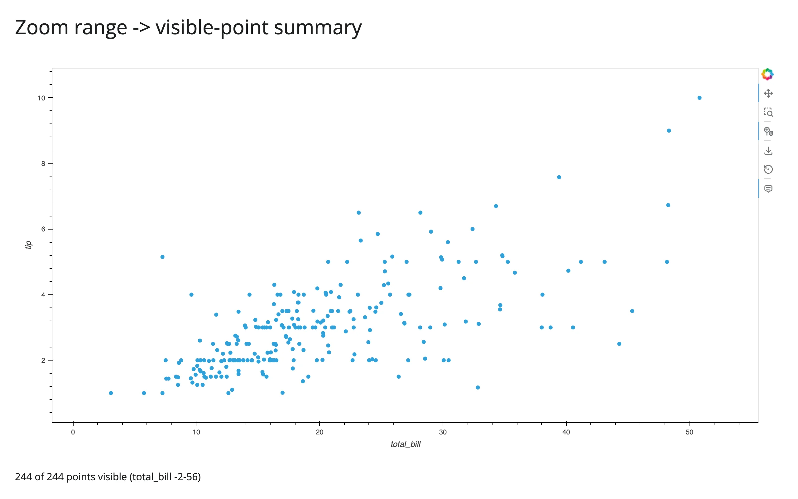
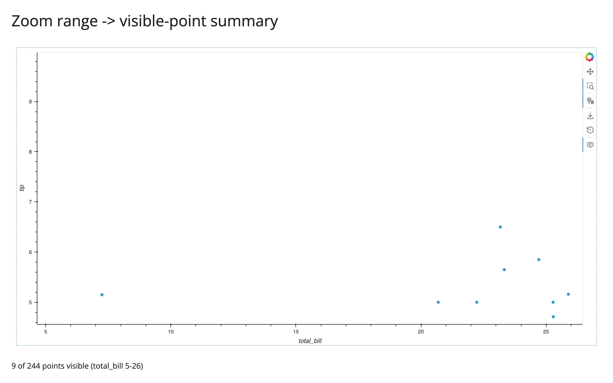

Verified with a real box-zoom gesture: the summary goes from "244 of 244 points visible" to "9 of 244 points
visible", with no re-render loop (0 `RuntimeError`s in the server log across the whole session).

## Updating the widget from Python

Re-rendering (as in the Gapminder slider above) is simplest, but it replaces the plot, so any zoom/pan the user
made is lost. Driving a `DynamicMap` with a stream updates the *existing* plot instead -- same bokeh model, same
comm, so the view survives. [`examples/07_update_in_place.py`](examples/07_update_in_place.py) shows both side by
side:

```{.python file="examples/07_update_in_place.py"}
# Driving a DynamicMap with a stream updates the existing plot: the bokeh
# model stays put, so pan/zoom state survives. Re-rendering (left as a
# contrast on the right) builds a brand-new plot every time, which resets
# the view. Click "New data" after zooming into both to see the difference.
import holoviews as hv
import numpy as np
from shiny import reactive
from shiny.express import input, render, ui

from shinywidgets import render_holoviews

hv.extension("bokeh")

rng = np.random.default_rng(0)


def random_walk(n=200):
    return np.cumsum(rng.normal(size=n))


ui.page_opts(title="In-place update vs. re-render", fillable=True)
ui.input_action_button("refresh", "New data")

pipe = hv.streams.Pipe(data=random_walk())

with ui.layout_columns():
    with ui.card(full_screen=True):
        ui.card_header("In place: hv.streams.Pipe (preserves zoom)")

        @render_holoviews
        def in_place():
            return hv.DynamicMap(
                lambda data: hv.Curve(data).opts(responsive=True), streams=[pipe]
            )

    with ui.card(full_screen=True):
        ui.card_header("Re-render: reads a reactive value directly (resets zoom)")
        data = reactive.value(random_walk())

        @render_holoviews
        def rerendered():
            return hv.Curve(data()).opts(responsive=True)


@reactive.effect
@reactive.event(input.refresh)
def _():
    new_data = random_walk()
    pipe.send(new_data)
    data.set(new_data)
```

Both plots zoomed in, then "New data" clicked once:

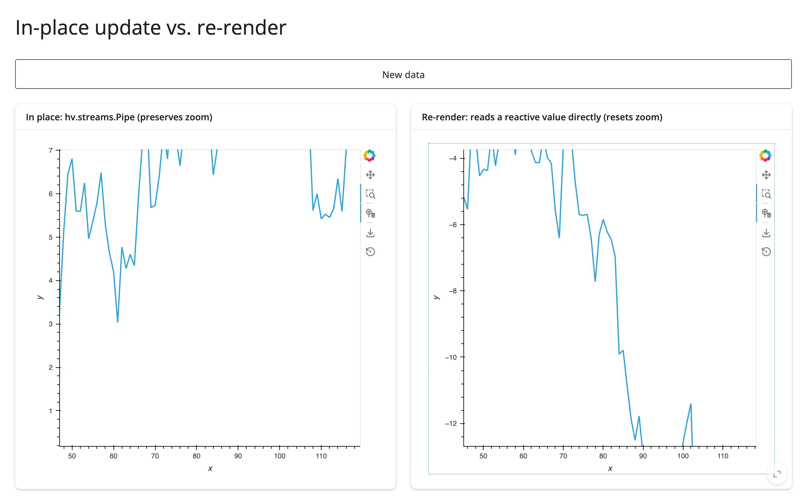
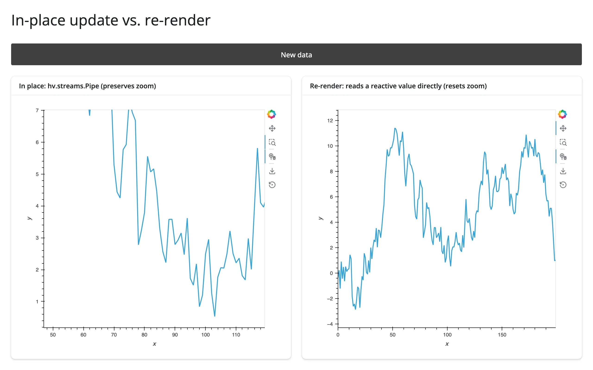

The left plot (driven by `pipe.send()`) keeps its zoomed x-range; the right plot (plain re-render) snaps back to
the full default range. Use the in-place form whenever preserving view state -- zoom, pan, a `link_selections`
selection -- across updates matters more than the simplicity of just reading an input directly. `stream.event(...)`
works the same way for a custom `hv.streams.Stream` subclass; `Pipe.send(data)` is the shortcut for "replace the
data entirely."

## Coordinating multiple views

### Pattern 1: box-select -> filtered table

Covered above in [The recipe](#the-recipe-stream-subscriber---reactivevalue)
([`examples/06_boxselect_table.py`](examples/06_boxselect_table.py)): a `BoundsXY` stream's bounds become a pandas
boolean mask, and a `@render.data_frame` shows the matching rows.

### Pattern 2: click -> detail card

[`examples/08_tap_detail.py`](examples/08_tap_detail.py) -- `hv.streams.Tap` reports the clicked point in data
coordinates; look up the nearest row and show its details:

```{.python file="examples/08_tap_detail.py"}
# Click a point to show its full row in a detail card. hv.streams.Tap reports
# the data-space (x, y) of the click; the nearest row is looked up on the
# Shiny side, same recipe as the box-select example.
import holoviews as hv
import plotly.express as px
import hvplot.pandas  # noqa: F401
from shiny import reactive
from shiny.express import render, ui

from shinywidgets import render_holoviews

hv.extension("bokeh")

tips = px.data.tips()
tap_xy = reactive.value(None)

ui.page_opts(title="Click a point for details", fillable=True)

with ui.layout_columns():
    with ui.card(full_screen=True):

        @render_holoviews
        def scatter():
            points = tips.hvplot.scatter(
                "total_bill", "tip", responsive=True, tools=["tap"]
            )
            hv.streams.Tap(source=points).add_subscriber(
                lambda x, y: tap_xy.set((x, y))
            )
            return points

    with ui.card():
        ui.card_header("Nearest table row")

        @render.ui
        def detail():
            xy = tap_xy()
            if xy is None:
                return ui.p("Click a point in the plot.", class_="text-muted")
            x, y = xy
            dist = (tips.total_bill - x) ** 2 + (tips.tip - y) ** 2
            row = tips.loc[dist.idxmin()]
            return ui.TagList(
                ui.h5(f"${row.total_bill:.2f} bill, ${row.tip:.2f} tip"),
                ui.p(f"{row['size']} people, {row.day} {row.time}, smoker: {row.smoker}"),
            )
```

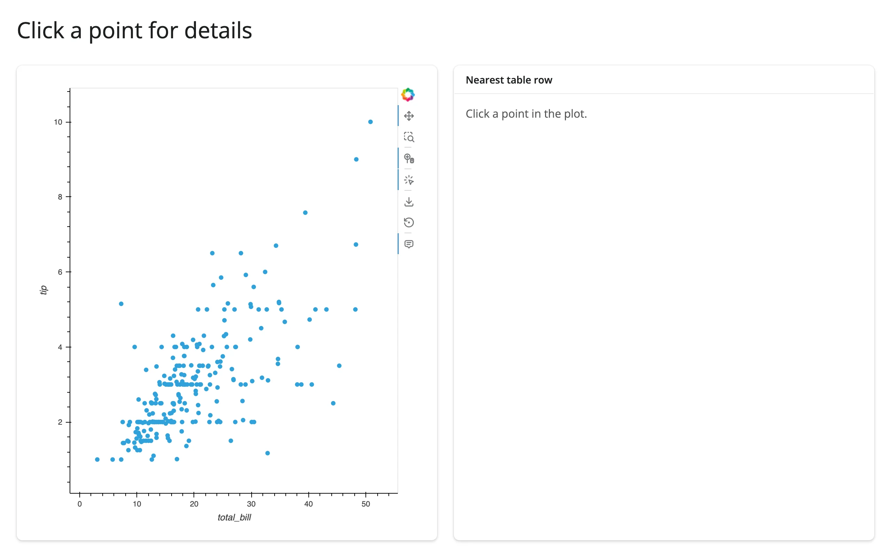
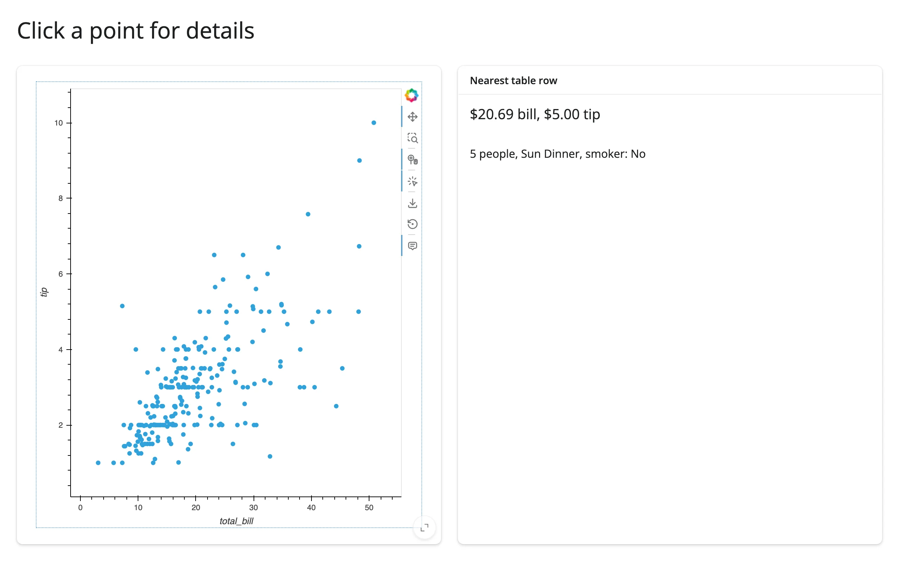

### Pattern 3: crossfilter dashboard, bridged into ordinary Shiny outputs

`link_selections` crossfilters its own plots with no callback, but its selection is also a `param` event -- watch
it to bring the same selection into ordinary Shiny outputs (value boxes, tables, anything).
[`examples/09_link_selections_dashboard.py`](examples/09_link_selections_dashboard.py):

```{.python file="examples/09_link_selections_dashboard.py"}
# link_selections crossfilters the plots on its own, but its selection is
# also a param event -- watch it to bring the same selection into ordinary
# Shiny outputs (here, two value boxes).
import holoviews as hv
import plotly.express as px
import hvplot.pandas  # noqa: F401
from shiny import reactive
from shiny.express import render, ui

from shinywidgets import render_holoviews

hv.extension("bokeh")

tips = px.data.tips()

ui.page_opts(title="Crossfilter dashboard", fillable=True)

links = hv.link_selections.instance()
selection_expr = reactive.value(None)
_watcher = links.param.watch(
    lambda event: selection_expr.set(event.new), "selection_expr"
)


@reactive.calc
def selected():
    expr = selection_expr()
    return tips if expr is None else links.filter(tips, selection_expr=expr)


with ui.layout_columns(fill=False):
    with ui.value_box():
        "Rows selected"

        @render.text
        def n_selected():
            return f"{len(selected())} of {len(tips)}"

    with ui.value_box():
        "Average tip %"

        @render.text
        def avg_pct():
            sel = selected()
            if not len(sel):
                return "-"
            return f"{(sel.tip / sel.total_bill).mean():.1%}"

with ui.card(full_screen=True):

    @render_holoviews
    def crossfilter():
        scatter = tips.hvplot.scatter(
            "total_bill", "tip", responsive=True, title="Bill vs. tip"
        ).opts(active_tools=["box_select"])
        tip_hist = tips.hvplot.hist(
            "tip", responsive=True, title="Tip distribution"
        ).opts(active_tools=["box_select"])
        return links(scatter + tip_hist).opts(shared_axes=False)
```

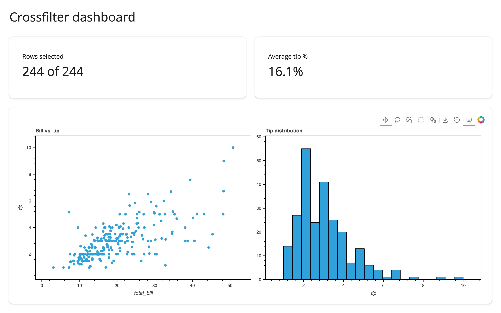
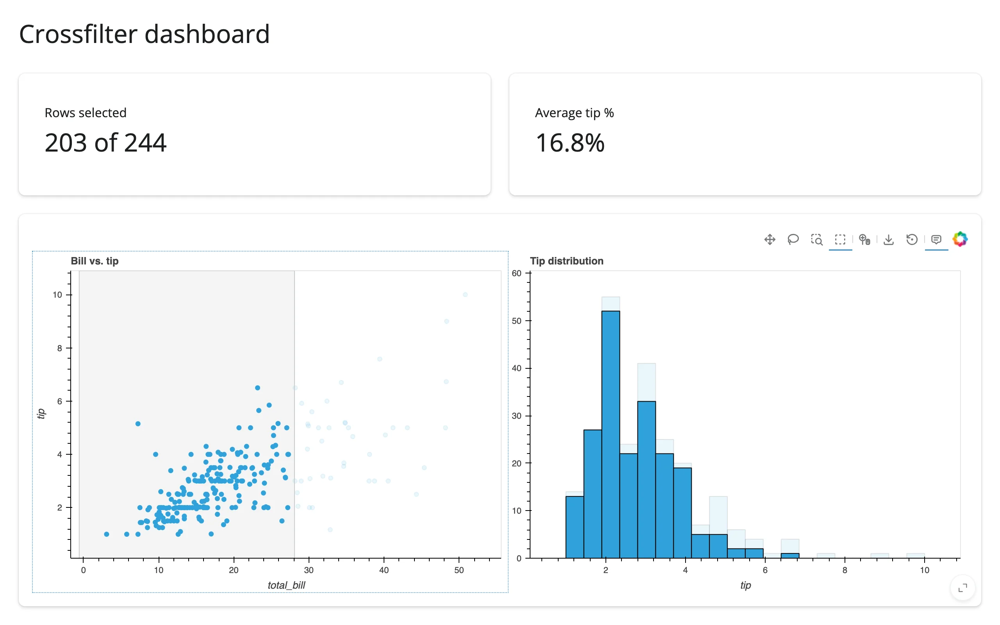

`links.filter(df, selection_expr=expr)` reproduces the selection as a pandas filter, so the same `expr` drives
both the restyled plots (via `link_selections` itself) and any ordinary Shiny output that needs the matching rows.

**Note:** a composite `Layout` wrapped in `link_selections` defaults its drag tool to Pan, not Box Select, at
any width -- set `.opts(active_tools=["box_select"])` on each element before combining them, as every crossfilter
example in this guide does, so box-select is ready to use without an extra toolbar click. A `ui.sidebar()`, a
narrow column, and a second, independent `@render_holoviews` output elsewhere on the page are all fine and don't
need to be avoided -- see [Gotchas and limitations](#gotchas-and-limitations).

## Large data

HoloViews' own large-data mode is [Datashader](../datashader/index.md): hvPlot's `rasterize=True`, or
HoloViews' `rasterize()` operation (see [Datashader and GeoViews](#datashader-and-geoviews) above), bins
millions of rows into a fixed-size image server-side through this same `@render_holoviews` decorator, so message
size and render cost are set by screen resolution, not row count. See the Datashader guide's own
[Large data](../datashader/index.md#large-data) section for the measured numbers. This is the "summarize on the
server" approach from
[Large data & performance](../../guide/performance/index.md#three-approaches-to-large-data). Without
`rasterize()`, a plain HoloViews/Bokeh element (a `Scatter`, a `Points` layer) has no scale story of its own
beyond [bokeh](../bokeh/index.md#large-data)'s `output_backend="webgl"`, which also applies here since HoloViews
renders through Bokeh.

## Layout and sizing

HoloViews and hvPlot elements are a **fixed size by default** -- 300x300 for a bare HoloViews element, 700x300 for
hvPlot -- and get clipped by a smaller container rather than scaled down. Pass `responsive=True` (as an hvPlot
kwarg, or `.opts(responsive=True)` for plain HoloViews) to make a plot fill its output instead; see
[`examples/05_responsive_sizing.py`](examples/05_responsive_sizing.py):

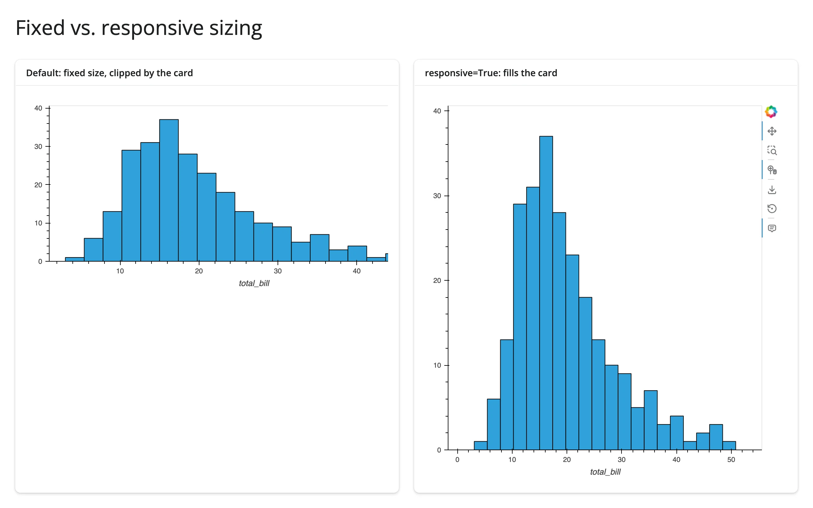

Giving the output an explicit height works as expected -- `@render_holoviews(height="300px")` (or
`output_widget(id, height="300px")` in Shiny Core) sizes a responsive plot to that height without needing
`fillable=True` as well (verified on current main; an older report described a collapse-to-sliver bug here, which
is fixed). `full_screen=True` on the enclosing `ui.card()` works the same as any other shinywidgets output.

Layouts (`+`) and overlays (`*`) made of responsive elements fill their container as a group; set
`.opts(shared_axes=False)` if you don't want HoloViews to link every subplot's axes together (usually desired for
a `+` of unrelated plots, usually not for a crossfilter).

## Gotchas and limitations

Verified on current main (shiny 1.9.0, holoviews 1.23.2, hvplot 0.12.2, panel 1.10.0, bokeh 3.10.1, jupyter_bokeh
4.1.0).

- **A composite `Layout` wrapped in `link_selections` defaults its drag tool to Pan, not Box Select -- at any
  width.** An earlier revision of this guide blamed this on narrow panels (a card squeezed below roughly 300px);
  a follow-up investigation found that was a test-methodology artifact (the repro's Playwright drag never
  clicked the box-select toolbar icon first, unlike this guide's own working examples, which do). Panel width
  is not the variable. The real,
  width-independent fix: set `.opts(active_tools=["box_select"])` on each element before combining them with
  `links(...)`, as every crossfilter example in this guide does, so box-select is the default drag tool from the
  first render -- no toolbar click needed for a real interactive user. (A scripted/headless client that sets
  `active_tools` and then drags without ever having clicked the toolbar may still need one explicit click first to
  arm the gesture on a composite, multi-panel `Layout` -- an upstream Bokeh/HoloViews quirk, not something a real
  user hits.)
- **A `Tap` stream on an element that's also wrapped by `link_selections` reportedly never fires (unverified).**
  An earlier revision reported the tap-select tool showing up in the toolbar but clicks doing nothing; a
  follow-up investigation downgraded the neighboring `link_selections` bug reports to false positives but did
  not re-verify this one with the corrected methodology, so treat it as a plausible wiring quirk, not a
  confirmed bug. Attaching `Tap` (or any stream you need alongside crossfiltering) to a separate, unlinked plot
  -- as `examples/08_tap_detail.py` and the showcase gallery app do -- avoids it either way.
- **`hv.streams.RangeXY` with a non-idempotent subscriber caused an infinite re-render loop on older
  shinywidgets versions -- fixed in shinywidgets, but the idempotent pattern is still the right recipe.**
  `RangeXY` fires on mount (with the default range) and again on every zoom/pan. The mount-time fire happens
  *synchronously inside the render*: holoviews' `get_plot()` calls `Stream.trigger()` while shinywidgets is
  coercing the element into a widget, so the subscriber runs mid-render. On older versions, the subscriber's
  reactive read (e.g. `count()` in `count.set(count() + 1)`) registered the in-progress render as a dependent,
  and its write invalidated that render -- looping forever, visible as a flood of `RuntimeError: BokehModel was
  closed` from a single page load with zero user interaction. shinywidgets now runs widget coercion under
  `reactive.isolate()`, so such callbacks can no longer hijack the render's dependencies (verified: one render,
  no errors, plus a unit regression test). Still, prefer storing the stream's actual value (e.g.,
  `range_val.set((x_range, y_range))`): `reactive.Value.set()` already skips invalidation when the new value
  equals the old one, and a counter subscriber is a pointless invalidation storm on every zoom/pan. See
  [Continuous streams: `RangeXY` needs an idempotent subscriber](#continuous-streams-rangexy-needs-an-idempotent-subscriber)
  for the recommended pattern; `BoundsXY` and `Tap` don't need this care since they only fire on a real user
  gesture, never on mount.
- **hvPlot silently drops `active_tools=` passed as a plotting kwarg.** `df.hvplot.scatter(..., active_tools=["box_select"])`
  adds nothing -- pan stays the default drag tool. Chain `.opts(active_tools=["box_select"])` after the hvPlot
  call instead, *and* make sure the tool itself is present (`tools=["box_select"]` as an hvPlot kwarg, or rely on
  `link_selections` to add it automatically, which it does for every plot it wraps).
- **A box-select on a `link_selections`-wrapped multi-panel layout logs a harmless exception.** After a successful
  drag (the selection and every downstream output are correct), the server log shows one or more
  `bokeh.core.serialization.UnknownReferenceError: can't resolve reference` tracebacks from
  `BokehModel._sync_model`. This doesn't affect correctness in any verified case -- just log noise from what looks
  like a duplicate or late property-change message. Not seen with a single, unlinked plot (e.g., the box-select
  table recipe).
- **Pure HoloViews needs `hv.extension("bokeh")` before `.opts()`.** Skipping it (when you aren't also importing
  `hvplot.pandas`, which registers the extension as a side effect) raises `ValueError: No plotting extension is
  currently loaded` in the output. Harmless to call even when hvPlot already registered it.
- **Build streams and `link_selections` per session.** A module-level instance in a Shiny Core app is shared by
  every visitor, so one person's selection becomes visible to everyone (this follows directly from normal Shiny
  Core semantics -- any shared mutable object at the top level of a Core app has this problem, not something
  specific to HoloViews). In Express, top-level code already runs per session, so this isn't a trap there.
- **Offline rendering needs `jupyter_bokeh>=4.1`**, which the `shinywidgets[holoviews]` extra already requires --
  older `jupyter_bokeh` falls back to a CDN for its widget JS and renders blank with no network. Not an issue if
  you installed via the extra.

## Gallery candidates

### `gallery/template_crossfilter.py` (template)

A minimal, adaptable two-plot crossfilter starter -- the smallest version of the `link_selections` pattern, ready
to drop your own data and plots into.

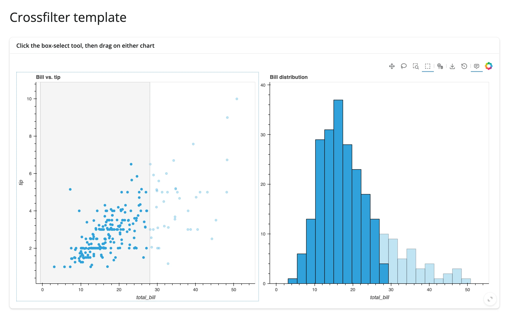

### `gallery/showcase_tips_explorer.py` (showcase)

A fuller dashboard: a sidebar with a day-of-week filter, three linked charts (scatter plus two histograms)
crossfiltered with `link_selections` at full row width, a separate click-for-detail plot, and a data table -- the
value boxes and table both driven by the same selection.

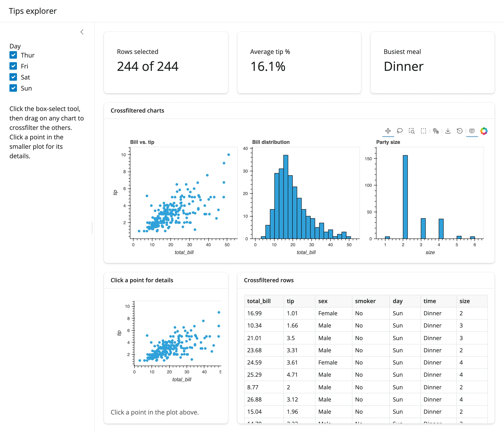
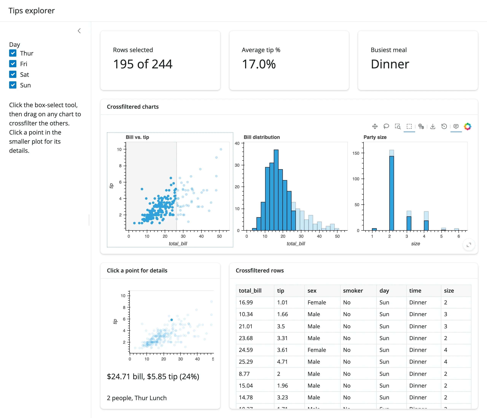

## Learn more

- [HoloViews documentation](https://holoviews.org) -- element types, containers, streams, operations
- [hvPlot documentation](https://hvplot.holoviz.org) -- the `.hvplot` accessor API
- [Linked Brushing / `link_selections` user guide](https://holoviews.org/user_guide/Linked_Brushing.html)
- [Custom Interactivity (streams) user guide](https://holoviews.org/user_guide/Custom_Interactivity.html)
- Related guides in this roster: [bokeh](../bokeh/index.md), [panel](../panel/index.md),
  [datashader](../datashader/index.md), [geoviews](../geoviews/index.md)
