[Aladin Lite](https://aladin.cds.unistra.fr/AladinLite/) is the sky atlas built and run by the
[Centre de Données astronomiques de Strasbourg](https://cds.unistra.fr/) (CDS), the archive behind SIMBAD and
VizieR. It streams [HiPS](https://aladin.cds.unistra.fr/hips/) survey imagery -- DSS, 2MASS, allWISE, GALEX,
Gaia, PanSTARRS, and dozens of others -- tiled and reprojected on demand, so panning and zooming across the
whole sky feels like a slippy map rather than a stack of FITS files. `ipyaladin` wraps the same JavaScript
engine CDS's own website uses as a Jupyter widget, and `@render_ipyaladin` makes it a first-class reactive
output: Shiny inputs drive what the viewer shows, and what a user does in the viewer -- clicking a catalog
source, box-selecting a region, panning, zooming -- comes back to Python as a value you read like any other
reactive input.

`@render_ipyaladin` takes an `ipyaladin.Aladin` instance and does the layout work every renderer in this
roster does: the viewer fills its card or output unless the `Aladin` (or the output) has an explicit height.
Beyond that it's a thin pass-through -- the interesting work is ipyaladin's own method surface (`add_table`,
`add_moc`, `add_graphic_overlay_from_stcs`, `selection()`, `set_color_map()`) plus four accessors --
`clicked_object()`, `selected()`, `target()`, and `fov()` -- that turn the viewer's own state and
interactions into values a Shiny app reacts to.

Reach for ipyaladin when the sky position itself is data: a catalog explorer, a "what's visible from here"
tool, an object-of-the-night dashboard, or any app that needs the real, navigable sky rather than a static
finder chart. For planetary surfaces, pair it with other 3D viewers in the roster (see
[k3d](../k3d/index.md), [pythreejs](../pythreejs/index.md)); for tabular-only catalog browsing without a sky
view, see [itables](../itables/index.md) or [reactable](../reactable/index.md).

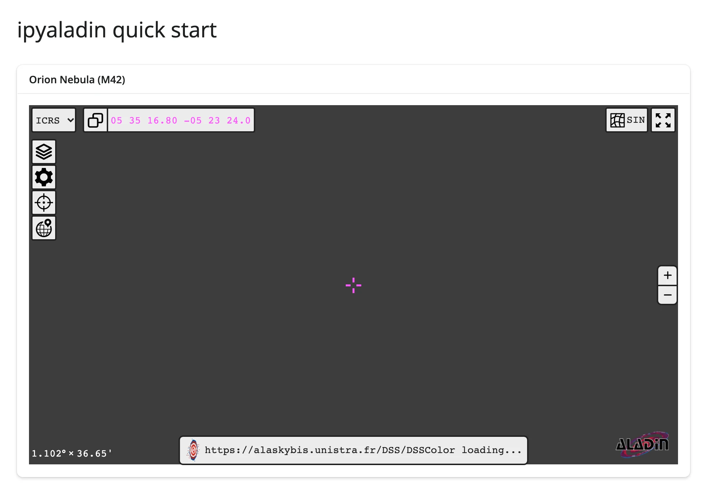

## Installation

```sh
pip install 'shinywidgets[ipyaladin]'
```

This installs `ipyaladin`, which pulls in `astropy` (every coordinate ipyaladin hands back is an astropy
`SkyCoord`, `Angle`, or `Table`). The viewer itself needs network access at render time: its JavaScript comes
from a CDN (esm.sh) and sky imagery streams from CDS's tile servers, so it won't render anything useful fully
offline. The [footprints and MOCs](#footprints-and-mocs) example additionally uses
[`mocpy`](https://cds-astro.github.io/mocpy/) to build a region to display; that's a separate, optional
dependency, not part of the `ipyaladin` extra.

## Quick start

```{.python file="examples/01_quickstart.py"}
from ipyaladin import Aladin
from shiny.express import ui
from shinywidgets import render_ipyaladin

ui.page_opts(title="ipyaladin quick start", fillable=True)

with ui.card(full_screen=True):
    ui.card_header("Orion Nebula (M42)")

    @render_ipyaladin
    def sky():
        return Aladin(target=(83.82, -5.39), fov=1.2)
```

That's the whole app: a card, a target, a field of view. The viewer fills the card, and dragging to pan or
scrolling to zoom already works -- there's no wiring to add for basic navigation.

## What you can build

### Navigate from a Shiny input

```{.python file="examples/02_navigate_from_input.py"}
from ipyaladin import Aladin
from shiny import reactive
from shiny.express import input, render, ui
from shinywidgets import render_ipyaladin

# Values are "ra dec" strings (parsed locally, no network call); a plain
# name like "M31" also works on the setter, but it resolves via a CDS web
# service and adds network latency -- fine for an occasional user-driven
# search, less fine for a value a dropdown sets on every click
TARGETS = {
    "10.685 41.269": "Andromeda Galaxy (M31)",
    "83.822 -5.391": "Orion Nebula (M42)",
    "56.75 24.12": "Pleiades (M45)",
    "83.633 22.014": "Crab Nebula (M1)",
}

ui.page_opts(title="Navigate by name", fillable=True)
ui.input_select("target", "Go to", TARGETS)

with ui.card(full_screen=True):

    @render_ipyaladin
    def sky():
        return Aladin(target=(10.685, 41.269), fov=3)

    @reactive.effect
    def _():
        w = sky.widget
        if w:
            w.target = input.target()

    @render.code
    def center():
        t = sky.target()
        return f"ra={t.ra.deg:.3f} dec={t.dec.deg:.3f}  fov={sky.fov().deg:.3f} deg"
```

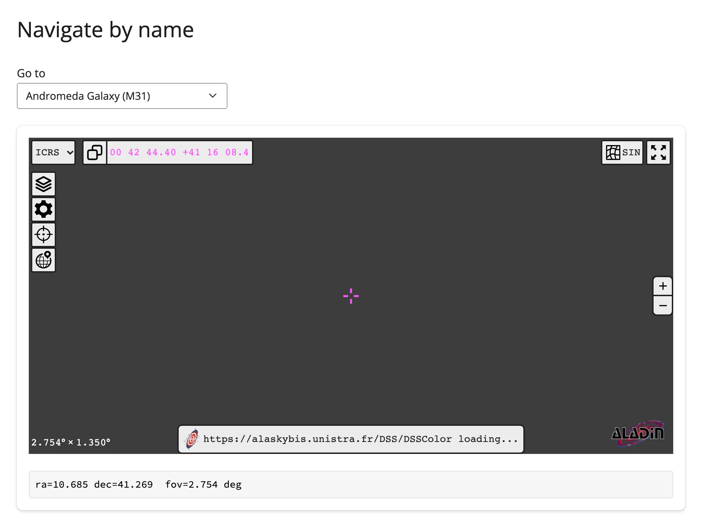
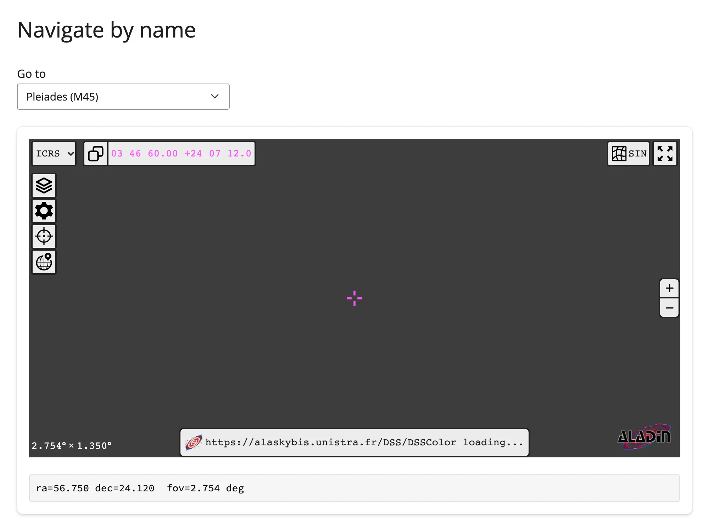

Setting `.widget.target` in a `@reactive.effect` flies the *existing* viewer to the new position in place --
no re-render, no reloaded tiles. `Aladin.target`'s setter also accepts a plain object name (`"M31"`, `"NGC
2244"`, a star name) resolved through CDS's [Sesame](https://vizier.cds.unistra.fr/viz-bin/Sesame) service --
useful for a free-text search box a user types into occasionally, less useful for a value that changes on
every dropdown click, since each name resolution is a blocking network round trip. Coordinate strings skip
that round trip entirely (see [Gotchas and limitations](#gotchas-and-limitations) for a case where the
setter's *other* accepted forms don't work the way you'd guess).

### Switch surveys and color maps in place

```{.python file="examples/03_survey_colormap_switch.py"}
from ipyaladin import Aladin
from shiny import reactive
from shiny.express import input, render, ui
from shinywidgets import reactive_read, render_ipyaladin

# A few HiPS surveys hosted by CDS (https://aladin.cds.unistra.fr/hips/)
SURVEYS = {
    "https://alaskybis.unistra.fr/DSS/DSSColor": "DSS color (optical)",
    "https://alaskybis.unistra.fr/2MASS/Color": "2MASS color (infrared)",
    "https://alaskybis.unistra.fr/AllWISE/Color": "allWISE color (mid-IR)",
}
CMAPS = ["native", "viridis", "cubehelix", "grayscale"]

ui.page_opts(title="Switch surveys and color maps", fillable=True)
ui.input_select("survey", "Survey", SURVEYS)
ui.input_select("cmap", "Color map", CMAPS)

with ui.card(full_screen=True):

    @render_ipyaladin
    def sky():
        return Aladin(target=(83.822, -5.391), fov=2, survey=list(SURVEYS)[0])  # M42

    # `survey` is a plain synced trait, so it updates as soon as it's set
    @reactive.effect
    def _():
        w = sky.widget
        if w:
            w.survey = input.survey()

    # set_color_map() sends a one-off message rather than syncing a trait,
    # so it's lost if sent before the browser has loaded -- gate on _is_loaded
    @reactive.effect
    def _():
        w = sky.widget
        if w and reactive_read(w, "_is_loaded") and input.cmap() != "native":
            w.set_color_map(input.cmap())

    @render.text
    def label():
        return f"{SURVEYS[input.survey()]}, {input.cmap()} color map"
```

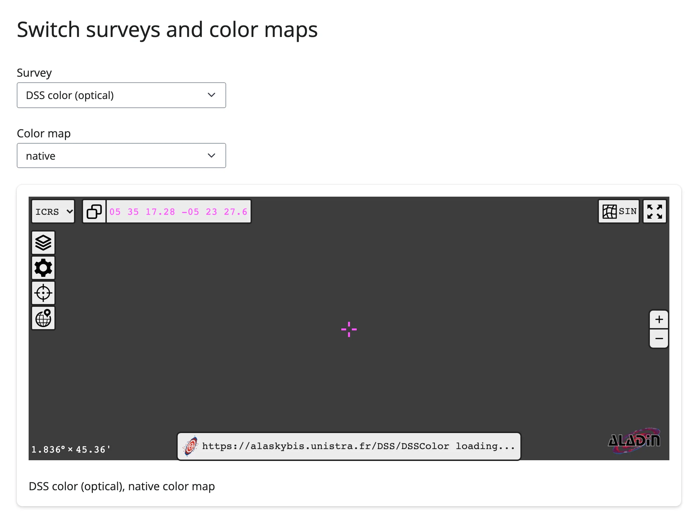


One HiPS URL swaps the base imagery entirely (optical, infrared, radio -- whatever HiPS survey you point it
at), and `set_color_map()` re-palettes it, both without touching the camera. The two effects above use
different update paths: `survey` is a synced trait, so assigning it works the moment the widget exists;
`set_color_map()` sends a one-off message that's silently dropped if the browser hasn't loaded yet, so it
needs the `_is_loaded` gate (see [Updating the widget from Python](#updating-the-widget-from-python)).

### Overlay a catalog

```{.python file="examples/04_catalog_overlay.py"}
from astropy.table import Table
from ipyaladin import Aladin
from shiny.express import ui
from shinywidgets import render_ipyaladin

# The seven bright stars of the Pleiades (real coordinates and V magnitudes)
PLEIADES = Table(
    {
        "name": ["Alcyone", "Atlas", "Electra", "Maia", "Merope", "Taygeta", "Pleione"],
        "ra": [56.871, 56.978, 56.216, 56.579, 56.752, 56.447, 56.751],
        "dec": [24.105, 24.054, 24.113, 24.367, 23.948, 24.467, 24.137],
        "vmag": [2.87, 3.62, 3.70, 3.87, 4.17, 4.30, 5.09],
    }
)

ui.page_opts(title="Overlay a catalog", fillable=True)

with ui.card(full_screen=True):
    ui.card_header("The Pleiades (M45), with its seven brightest stars overlaid")

    @render_ipyaladin
    def sky():
        aladin = Aladin(target=(56.75, 24.12), fov=1.2)
        aladin.add_table(PLEIADES, shape="circle", source_size=14, color="#ffd166")
        return aladin
```

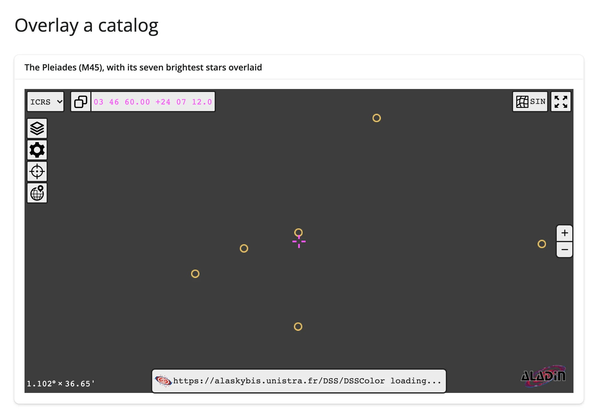

`add_table()` takes any astropy `Table` or `QTable` with recognizable coordinate columns (it auto-detects
`ra`/`dec`-like names, or you name them explicitly with `ra_field`/`dec_field`) and draws every row as a
marker. The whole row travels with the marker -- click one and its full catalog row, including columns that
never appear on screen, comes back to Python (see [`clicked_object()`](#clicked_object-click-a-catalog-source-for-detail)
below). This is the foundation every interactive example in this guide builds on.

### Footprints and MOCs

[`examples/05_footprints_moc.py`](examples/05_footprints_moc.py) -- run with
`uv run --with mocpy shiny run 05_footprints_moc.py` (mocpy isn't part of `shinywidgets[ipyaladin]`; it's used
here only to build the region):

```{.python file="examples/05_footprints_moc.py"}
# Run: uv run --with mocpy shiny run 05_footprints_moc.py
# (mocpy builds the MOC; it isn't needed for the rest of this guide)
import astropy.units as u
from ipyaladin import Aladin
from mocpy import MOC
from shiny.express import ui
from shinywidgets import render_ipyaladin

TARGET = (83.82, -5.39)  # Orion Nebula (M42)

ui.page_opts(title="Footprints and MOCs", fillable=True)

with ui.card(full_screen=True):
    ui.card_header("A MOC search region and an instrument footprint over M42")

    @render_ipyaladin
    def sky():
        aladin = Aladin(target=TARGET, fov=1.5)
        moc = MOC.from_cone(
            lon=TARGET[0] * u.deg, lat=TARGET[1] * u.deg, radius=0.2 * u.deg, max_depth=9
        )
        aladin.add_moc(moc, color="#06d6a0", opacity=0.4, name="search region")
        aladin.add_graphic_overlay_from_stcs(
            "Circle ICRS 83.82 -5.39 0.35", color="#ef476f", name="instrument footprint"
        )
        return aladin
```

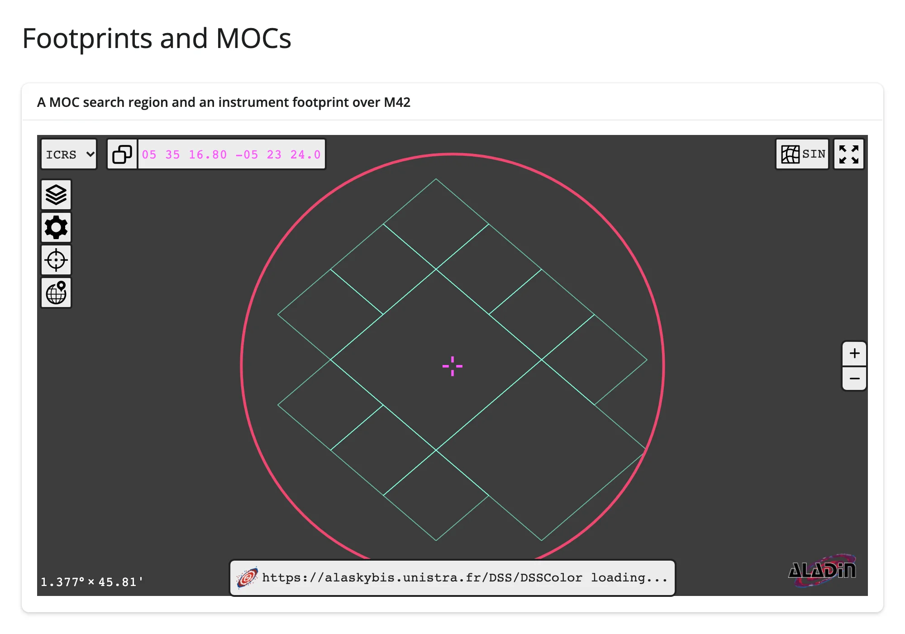

`add_moc()` accepts a [`mocpy.MOC`](https://cds-astro.github.io/mocpy/) object, a plain `{order: [pixels]}`
dict, or a URL to fetch one from -- it draws the HEALPix cells that make up the region (the diamond lattice
above is `MOC.from_cone()`'s approximation of a 0.2 deg circle at HEALPix order 9). `add_graphic_overlay_from_stcs()`
draws shapes from an [STC-S](https://www.ivoa.net/documents/STC-S/) string -- circles, polygons, and unions of
them -- without needing a sky-region library at all. Both are the building blocks for "what instrument footprint
covers this field" or "search radius around this point" overlays; VizieR and SIMBAD publish MOCs for exactly
this kind of cross-matching.

## Reacting to user interaction

### Accessor reference

| accessor | returns | before any interaction | across re-render | default rate policy |
|---|---|---|---|---|
| `clicked_object()` | `dict` (`ra`, `dec`, `data`) or `None` | `None` | re-seeded to `None` (a freshly built viewer has no click yet) | none |
| `selected()` | `list[astropy.table.Table]` (one per catalog) | `[]` | re-seeded to `[]` | none |
| `target()` | astropy `SkyCoord` (or `(Longitude, Latitude)` for planetary surveys) | seeded from the constructor's `target` | re-seeded from the new viewer's `target` | none |
| `fov()` | astropy `Angle` | seeded from the constructor's `fov` | re-seeded from the new viewer's `fov` | none |

All four attach the moment the viewer renders and are seeded from its state immediately, so an interaction
made before the first read (behind a button, a chat handler) is reflected in that read, not lost -- reading any
of them before the very first render simply cancels (like reading an output before it exists), never returns a
sentinel you have to check for. All four also **re-seed from the new viewer on every re-render**, rather than
carrying the previous viewer's value forward: a fresh `Aladin` has no click recorded yet, so `clicked_object()`
goes back to `None` and `selected()` to `[]`; `target()`/`fov()` pick up whatever the new constructor
call passed, discarding any pan or zoom the user did before the re-render. This is why `target()`/`fov()`
drive `req()`-free reads and `clicked_object()` needs `req(sky.clicked_object())` to wait for a click rather
than show a default state. None of the four declares a default rate limit -- see
[Rate limiting](#rate-limiting) for why that matters for `target()`/`fov()` specifically, and when to add one
yourself.

### `clicked_object()`: click a catalog source for detail

```{.python file="examples/06_clicked_object.py"}
from astropy.table import Table
from ipyaladin import Aladin
from shiny.express import render, ui
from shinywidgets import render_ipyaladin

PLEIADES = Table(
    {
        "name": ["Alcyone", "Atlas", "Electra", "Maia", "Merope", "Taygeta", "Pleione"],
        "ra": [56.871, 56.978, 56.216, 56.579, 56.752, 56.447, 56.751],
        "dec": [24.105, 24.054, 24.113, 24.367, 23.948, 24.467, 24.137],
        "vmag": [2.87, 3.62, 3.70, 3.87, 4.17, 4.30, 5.09],
    }
)

ui.page_opts(title="clicked_object(): click a source for detail", fillable=True)

with ui.layout_columns(col_widths=[8, 4]):
    with ui.card(full_screen=True):

        @render_ipyaladin
        def sky():
            # Centered on Alcyone, the cluster's brightest star
            aladin = Aladin(target=(56.871, 24.105), fov=1.2)
            aladin.add_table(PLEIADES, shape="circle", source_size=16, color="#ffd166")
            return aladin

    with ui.card():
        ui.card_header("Clicked star")

        @render.code
        def detail():
            clicked = sky.clicked_object()
            if clicked is None:
                return "Click a star to see its catalog row."
            return "\n".join(f"{k}: {v}" for k, v in clicked["data"].items())
```

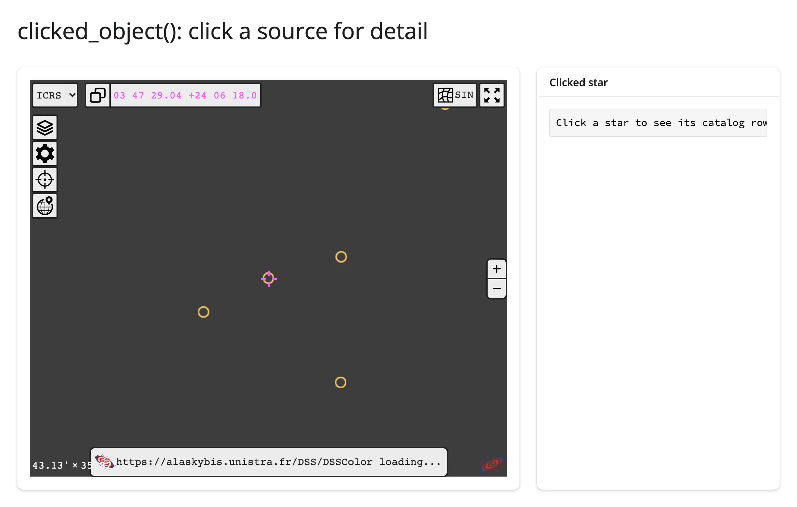
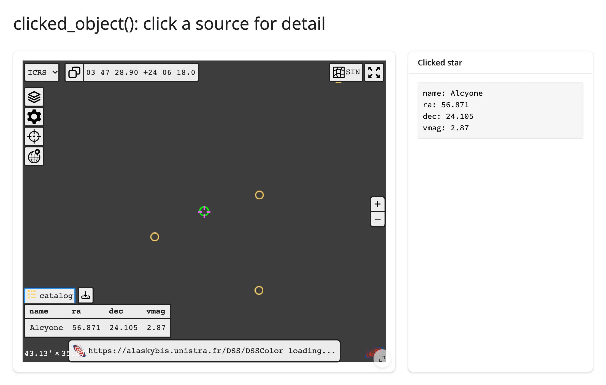

`clicked_object()["data"]` is the clicked source's full catalog row -- every column from the `Table` you
passed to `add_table()`, not just `ra`/`dec`. It's message-backed rather than trait-backed, which matters in
one specific way: ipyaladin's older `set_listener()` API shares one callback registry across *every* `Aladin`
instance in the process (a severe problem in a multi-session Shiny app -- session A's click can fire session
B's callback). `clicked_object()` goes through the same per-widget message dispatcher `reactive_read()` uses,
so it's correctly scoped to the one viewer that was clicked, in the one session that's reading it. Prefer it
(or the `selected()`/`target()`/`fov()` accessors) over `set_listener()` for anything multi-user.

### `selected()`: box-select sources

```{.python file="examples/07_selected.py"}
import pandas as pd
from astropy.table import Table
from ipyaladin import Aladin
from shiny import reactive
from shiny.express import input, render, ui
from shinywidgets import reactive_read, render_ipyaladin

PLEIADES = Table(
    {
        "name": ["Alcyone", "Atlas", "Electra", "Maia", "Merope", "Taygeta", "Pleione"],
        "ra": [56.871, 56.978, 56.216, 56.579, 56.752, 56.447, 56.751],
        "dec": [24.105, 24.054, 24.113, 24.367, 23.948, 24.467, 24.137],
        "vmag": [2.87, 3.62, 3.70, 3.87, 4.17, 4.30, 5.09],
    }
)

ui.page_opts(title="selected(): box-select sources", fillable=True)
ui.input_action_button("arm", "Arm rectangle selection")

with ui.layout_columns(col_widths=[7, 5]):
    with ui.card(full_screen=True):

        @render_ipyaladin
        def sky():
            aladin = Aladin(target=(56.871, 24.105), fov=1.2)
            aladin.add_table(PLEIADES, shape="circle", source_size=16, color="#ffd166")
            return aladin

        @reactive.effect
        def _():
            w = sky.widget
            if input.arm() > 0 and w and reactive_read(w, "_is_loaded"):
                w.selection("rectangle")

    with ui.card():
        ui.card_header("Stars inside the selection")

        @render.data_frame
        def table():
            tables = sky.selected()
            if not tables:
                return pd.DataFrame({"name": [], "vmag": []})
            return tables[0].to_pandas()[["name", "vmag"]]
```

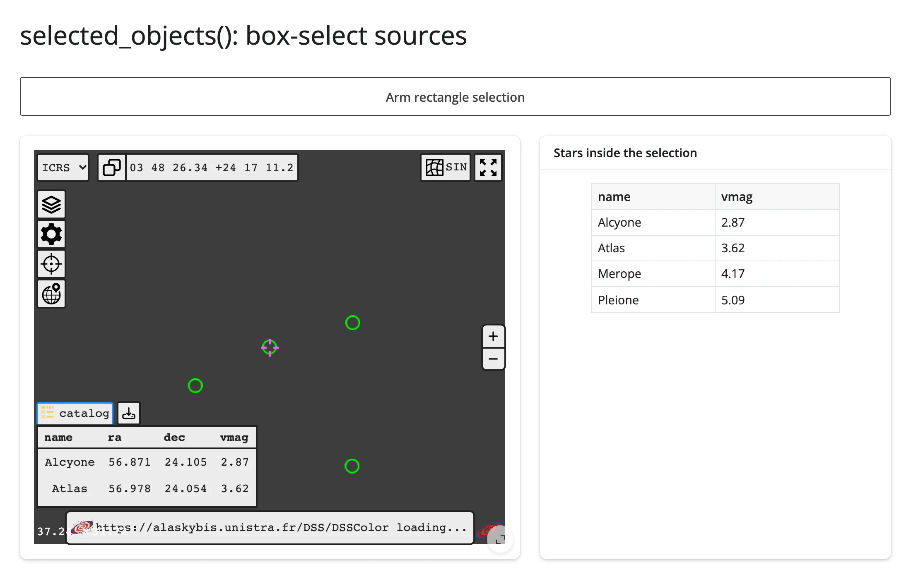

Box selection is opt-in: `.widget.selection("rectangle")` (or `"circle"`) arms it for the *next* drag, after
which the viewer goes back to its normal pan behavior -- drag-to-pan and drag-to-select share the same
gesture, so ipyaladin makes you choose which one a drag means at any given moment. `selected()`
returns one `Table` per catalog that has a `add_table()`-drawn overlay and sources inside the selection; with
a single catalog (as above) that's `tables[0]`.

### `target()` and `fov()`: what's in view

```{.python file="examples/08_whats_in_view.py"}
import numpy as np
import pandas as pd
from ipyaladin import Aladin
from shiny.express import render, ui
from shinywidgets import render_ipyaladin

MESSIER = pd.DataFrame(
    {
        "name": ["M31", "M42", "M45", "M1", "M13", "M51", "M57", "M81", "M27", "M33"],
        "ra": [10.685, 83.822, 56.75, 83.633, 250.423, 202.47, 283.396, 148.888, 299.902, 23.462],
        "dec": [41.269, -5.391, 24.12, 22.014, 36.46, 47.195, 33.029, 69.065, 22.721, 30.66],
        "type": [
            "Galaxy", "Nebula", "Open cluster", "Supernova remnant", "Globular cluster",
            "Galaxy", "Planetary nebula", "Galaxy", "Planetary nebula", "Galaxy",
        ],
    }
)

ui.page_opts(title="target()/fov(): what's in view", fillable=True)

with ui.layout_columns(col_widths=[8, 4]):
    with ui.card(full_screen=True):

        @render_ipyaladin
        def sky():
            return Aladin(target=(60, 20), fov=90)

    with ui.card():
        ui.card_header("Messier objects in the current view")

        @render.data_frame
        def in_view():
            center, radius = sky.target(), sky.fov().deg / 2
            dist = np.hypot(
                (MESSIER["ra"] - center.ra.deg) * np.cos(np.radians(center.dec.deg)),
                MESSIER["dec"] - center.dec.deg,
            )
            return MESSIER[dist <= radius].reset_index(drop=True)
```

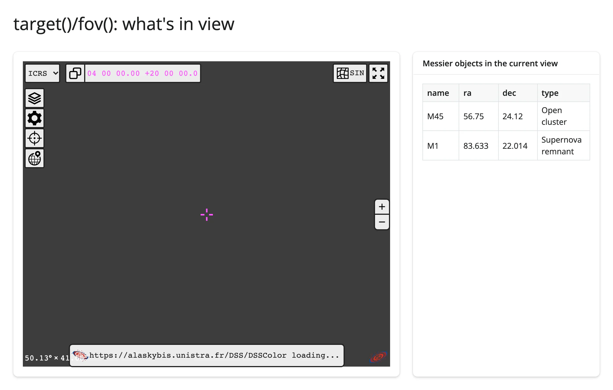
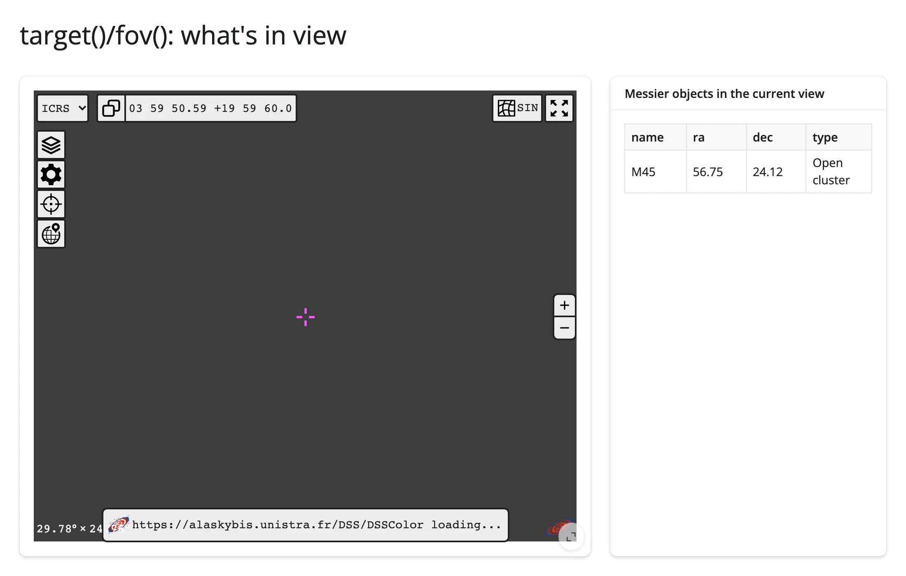

This is the pattern no static embed can offer: the viewport itself is a reactive input. `target()` and
`fov()` turn "where is the user looking and how zoomed in are they" into two ordinary values, and a
`@render.data_frame` (or any computation) built on top of them stays in sync with every pan and zoom. The
table above starts with two objects in a 90 deg field and narrows to one after zooming in -- the same
pattern scales to "nearby SIMBAD sources", "VizieR catalog cone search", or any lookup keyed on sky position.

### Reading on demand: save the current view

Because `target()`/`fov()` are seeded the moment the viewer renders and stay live from then on, they're safe
to read from a button handler that runs long after any pan or zoom -- no warm-up read needed first. This
button appends the current pointing to a running list of saved views each time it's pressed.

```{.python file="examples/13_save_view.py"}
from ipyaladin import Aladin
from shiny import reactive
from shiny.express import input, render, ui
from shinywidgets import render_ipyaladin

ui.page_opts(title="Save the current view", fillable=True)
ui.input_action_button("save", "Save this view")

views = reactive.Value([])

with ui.card(full_screen=True):

    @render_ipyaladin
    def sky():
        return Aladin(target=(83.822, -5.391), fov=1.2)  # Orion Nebula (M42)


@reactive.effect
@reactive.event(input.save)
def _():
    t, f = sky.target(), sky.fov()
    bookmark = f"ra={t.ra.deg:.2f} dec={t.dec.deg:.2f}  fov={f.deg:.2f} deg"
    views.set([*views(), bookmark])


@render.ui
def saved():
    if not views():
        return ui.p("No saved views yet.")
    return ui.tags.ul(*[ui.tags.li(v) for v in views()])
```

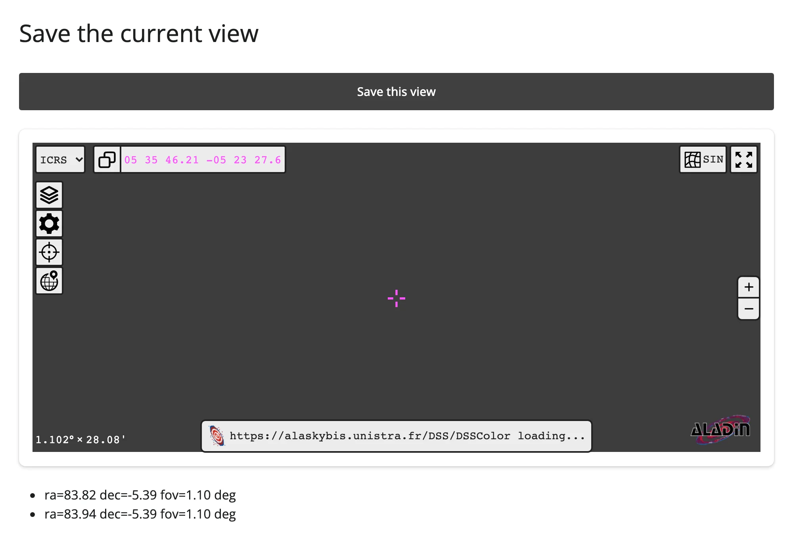

### Beyond the accessors: `reactive_read()`

The four accessors above cover the browser-driven interactions worth building on; the one widget-level trait
still worth reading directly is **`_is_loaded`**, which flips to `True` once the viewer has finished loading
in the browser. It isn't something a user does -- nothing "fires" it from the UI -- so it isn't an accessor,
but every effect in this guide that calls a method ipyaladin doesn't auto-queue (`set_color_map()`,
`selection()`) gates on it; see [Updating the widget from Python](#updating-the-widget-from-python).  Do not
gate on the `_ready` trait instead: ipyaladin 0.8.1 never sets it (see
[Gotchas and limitations](#gotchas-and-limitations)).

### Rate limiting

None of ipyaladin's four accessors declare a default rate policy, but `target()` and `fov()` are the ones
where that matters: a drag or a scroll-zoom reports many updates while it's in progress, not one at the end.
A 10-step synthetic drag in this pass's verification moved an undebounced counter from 2 to 13 -- every
intermediate mouse position republished. Pass `rate_policy="debounce"` (and optionally `rate_delay=`) to
`@render_ipyaladin(...)` to coalesce a burst of pans/zooms into the trailing one, the same two keyword
arguments every renderer in this roster accepts:

```{.python file="examples/09_rate_limiting.py"}
from ipyaladin import Aladin
from shiny import reactive
from shiny.express import render, ui
from shinywidgets import render_ipyaladin

ui.page_opts(title="Rate-limited target()/fov()", fillable=True)

with ui.layout_columns(col_widths=[8, 4]):
    with ui.card(full_screen=True):

        @render_ipyaladin(rate_policy="debounce", rate_delay=0.3)
        def sky():
            return Aladin(target=(83.63, 22.01), fov=5)

    with ui.card():
        ui.card_header("Pans/zooms seen by Python (debounced to 1 per 300 ms)")
        count = reactive.value(0)

        @reactive.effect
        def _count():
            sky.target()
            sky.fov()
            with reactive.isolate():
                count.set(count() + 1)

        @render.text
        def n():
            return f"updates received: {count()}"
```

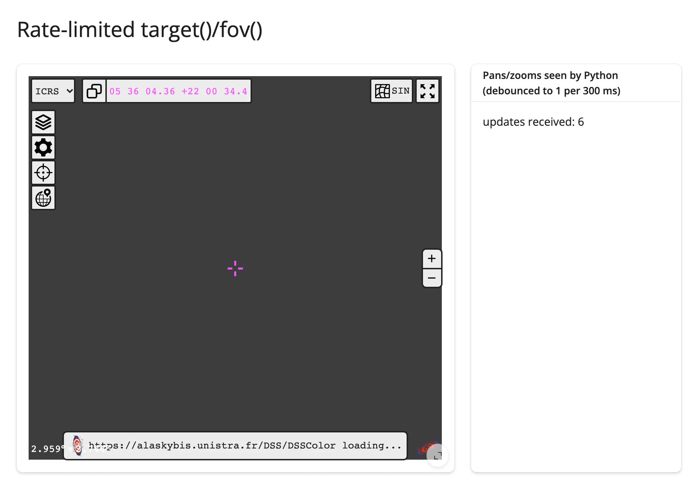

Debounce coalesces updates that arrive less than `rate_delay` apart, publishing once the stream goes quiet
for that long -- it does not guarantee exactly one publish per gesture, since a long or jittery drag can
still have quiet gaps longer than the delay in the middle of it. A 10-step synthetic drag against this
debounced app published 4 updates; the same drag with no rate limit (the earlier example) published 11 --
a real reduction, just not an exact 1:1 "one event per gesture" guarantee. If you need the latter, track the
drag's end yourself (e.g., `mouseup` isn't exposed, but a sufficiently long `rate_delay` relative to your
users' typical pause-between-moves gets close in practice).

## Updating the widget from Python

Two ways to change an already-rendered viewer, and when each is right:

- **Re-render** (return a new `Aladin` from the render function): simplest, but the viewer tears down and
  rebuilds -- camera position, zoom, color map, and any overlays are all reset to whatever the new
  constructor call specifies, and the JS bundle's load sequence runs again. Fine when the change really is a
  new viewer (a different base catalog, a fresh session).
- **Update in place** (`sky.widget.<trait> = ...` in a `@reactive.effect`): the existing viewer keeps its
  camera, zoom, and overlays; only what you explicitly set changes. This is almost always what you want for
  navigation, survey switches, and re-coloring.

[`examples/10_update_in_place_vs_rerender.py`](examples/10_update_in_place_vs_rerender.py) makes the
difference concrete: zoom the sky to a custom field of view, then compare the two buttons.

```{.python file="examples/10_update_in_place_vs_rerender.py"}
from ipyaladin import Aladin
from shiny import reactive
from shiny.express import input, render, ui
from shinywidgets import render_ipyaladin

ui.page_opts(title="Update in place vs. re-render", fillable=True)
ui.input_action_button("rerender", "Re-render (new Aladin())")
ui.input_action_button("in_place", "Update in place (.widget.target = ...)")
ui.p(
    "Zoom the sky to some custom field of view first, then try each button: "
    "in-place keeps it, re-render resets it to the constructor's fov=1.",
    class_="text-muted",
)

with ui.card(full_screen=True):

    @render_ipyaladin
    @reactive.event(input.rerender, ignore_none=False)
    def sky():
        return Aladin(target=(83.822, -5.391), fov=1)  # M42

    @reactive.effect
    @reactive.event(input.in_place)
    def _():
        sky.widget.target = "10.685 41.269"  # M31

    @render.text
    def fov():
        return f"field of view: {sky.fov().deg:.3f} deg"
```

Zoomed to a custom 0.205 deg field of view, then after "Update in place" (target changed to M31, **field of
view unchanged**):

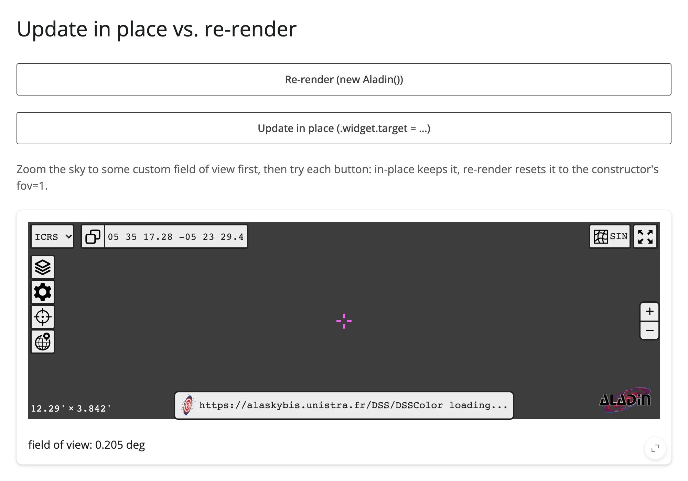
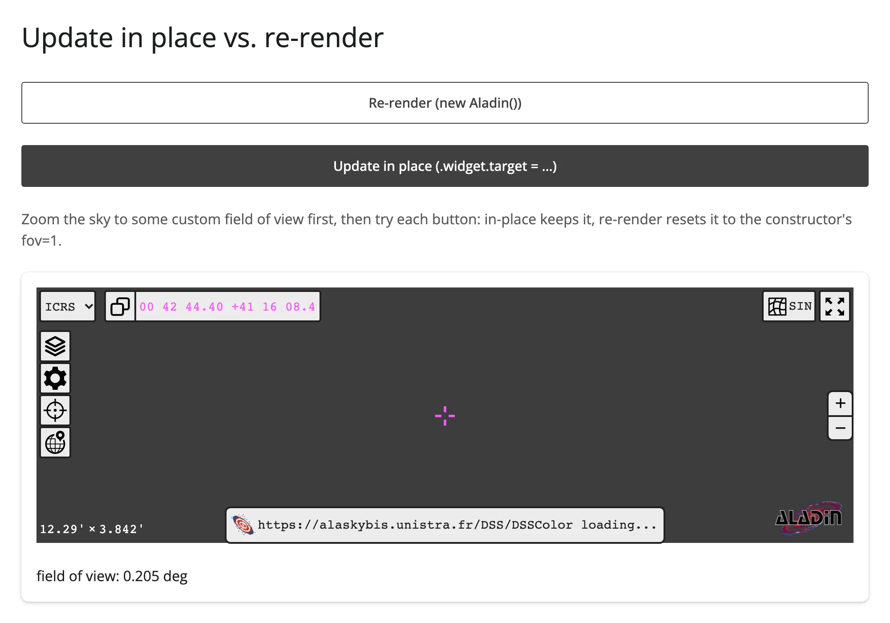

And after "Re-render" instead (field of view reset to the constructor's `fov=1`, snapped to 0.918 by
ipyaladin's own zoom steps -- see [Gotchas](#gotchas-and-limitations)):

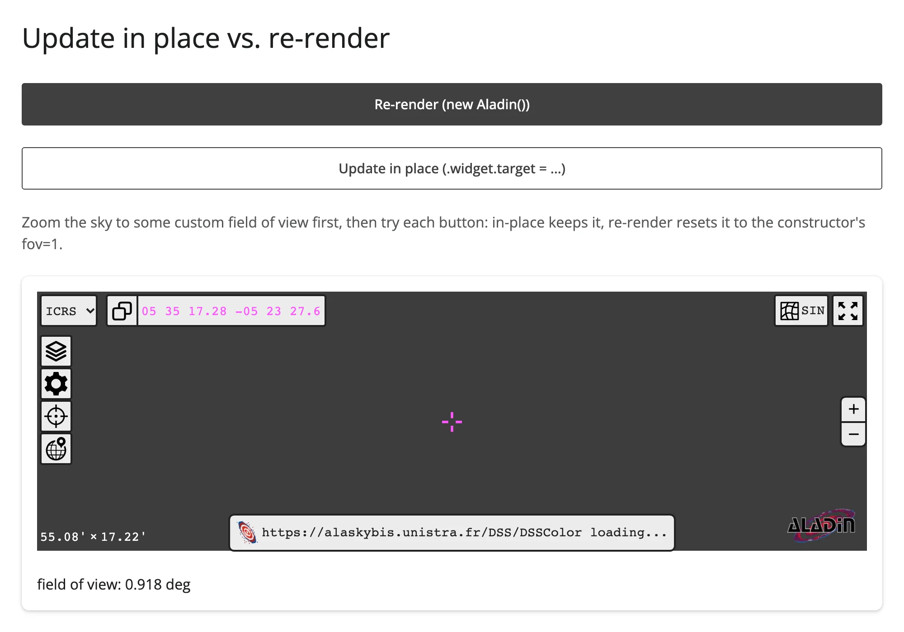

One more thing worth knowing about the constructor itself: **don't read a reactive input in the render
function for a value an effect also updates in place.** `Aladin(survey=input.survey(), ...)` plus a
`w.survey = input.survey()` effect looks harmless, but it rebuilds the whole viewer on every survey change
instead of re-skinning it -- keep the constructor's inputs static (or read them under `reactive.isolate()`)
and let effects own the updates, as every example in this guide does.

Finally, ipyaladin itself distinguishes two kinds of calls once a viewer exists: methods like `add_table()`,
`add_moc()`, and `add_graphic_overlay_from_stcs()` are automatically queued if the browser hasn't finished
loading yet (ipyaladin's internal `CallStore` replays them once it has), so you can call them straight from
the render function with no gating. Plain property assignments (`.widget.fov = ...`) are *not* queued --
they're ipywidgets trait syncs, which work from the moment the widget object exists, loaded or not. A couple
of methods (`set_color_map()`, `selection()`) send one-off messages that *are* lost if sent before load, so
those specifically need the `reactive_read(w, "_is_loaded")` gate shown throughout this guide.

## Coordinating multiple views

### Click a catalog source, show a detail card

Already shown above: [`examples/06_clicked_object.py`](examples/06_clicked_object.py) wires
`clicked_object()` straight into a `@render.code` detail panel. The same pattern works for any richer detail
view -- a `@render.ui` card with an image lookup, a linked plot of the object's light curve, anything keyed
on the clicked row's data.

### Box-select sources, populate a table

Also shown above: [`examples/07_selected.py`](examples/07_selected.py) turns a box selection
into a `@render.data_frame`. Swap the table for a `@render_plotly` color-magnitude diagram of the selected
sources and you have a from-sky-to-science-plot pipeline in a handful of lines.

### Pan and zoom drive a catalog query

Also shown above: [`examples/08_whats_in_view.py`](examples/08_whats_in_view.py). Replace the local
`MESSIER` DataFrame with a VizieR or SIMBAD cone search keyed on `target()`/`fov()` (via `astroquery`, when
CDS's web services are reachable) and the table becomes a live "what's nearby" lookup against the real
catalog, not just a hardcoded shortlist.

### Select stars in a plot, mark them on the sky

[`examples/11_jscatter_stars_on_sky.py`](examples/11_jscatter_stars_on_sky.py) pairs ipyaladin with
[jupyter-scatter](../jscatter/index.md): lasso a region of a color-magnitude diagram, and the selected stars'
real sky positions light up on the viewer, in place.

```{.python file="examples/11_jscatter_stars_on_sky.py"}
import numpy as np
import pandas as pd
from astropy.table import Table
from ipyaladin import Aladin
from jscatter import Scatter
from shiny import reactive
from shiny.express import ui
from shinywidgets import render_ipyaladin, render_jscatter

# A plausible color-magnitude diagram for ~400 field stars around the
# Pleiades (synthetic: real surveys of this field have far more stars than
# fit cleanly in a short demo, but the main-sequence shape is realistic)
rng = np.random.default_rng(0)
n = 400
bp_rp = rng.uniform(-0.3, 2.5, n)
abs_g = -(4.5 * bp_rp + rng.normal(0, 0.6, n) + 1.0)
stars = pd.DataFrame(
    {
        "ra": 56.75 + rng.normal(0, 0.6, n),
        "dec": 24.12 + rng.normal(0, 0.5, n),
        "bp_rp": bp_rp,
        "abs_g": abs_g,
    }
)

ui.page_opts(title="Select stars in a plot, mark them on the sky", fillable=True)

with ui.layout_columns():
    with ui.card(full_screen=True):
        ui.card_header("Color-magnitude diagram (lasso to select)")

        @render_jscatter
        def hr():
            return Scatter(data=stars, x="bp_rp", y="abs_g").lasso(initiator=True)

    with ui.card(full_screen=True):
        ui.card_header("Selected stars on the sky")

        @render_ipyaladin
        def sky():
            return Aladin(target=(56.75, 24.12), fov=2)


@reactive.effect
def _mark_selection():
    w = sky.widget
    idx = hr.selected()
    if w is None:
        return
    with reactive.isolate():
        try:
            w.remove_overlay("selected")
        except ValueError:
            pass
        if len(idx):
            w.add_table(
                Table.from_pandas(stars.iloc[idx]),
                name="selected",
                color="#ef476f",
                shape="circle",
                source_size=12,
            )
```

Before lassoing, and after (the lassoed points' real RA/Dec positions are marked on the sky):

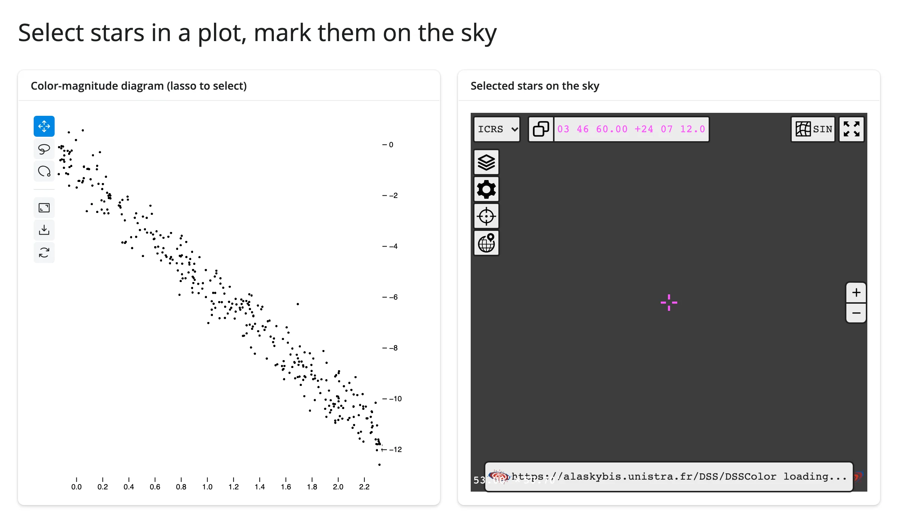
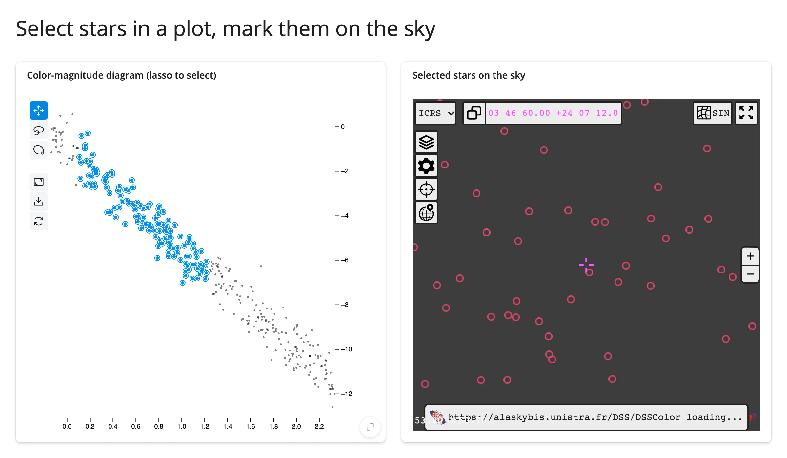

`remove_overlay()` clears the previous selection's markers before drawing the new ones -- without it,
re-lassoing would stack catalog layers rather than replace one. `jupyter-scatter`'s `selected()` returns row
*positions* into the same `stars` frame `add_table()` draws from, so `stars.iloc[idx]` lines the two up
directly; see the [jscatter guide](../jscatter/index.md) for more on that accessor.

## Large data

The sky imagery itself is "only send what's visible" by construction -- see
[Large data & performance's three approaches](../../guide/performance/index.md#three-approaches-to-large-data):
HiPS tiles are fetched from CDS only for the part of the sky currently in view, at the resolution the current
zoom level needs, the same idea as a web map's tile pyramid. `add_table()` catalogs are a different story: every
row travels to the browser in one message when you call it, same as a table-heavy renderer like
[mols2grid](../mols2grid/index.md#large-data) -- for catalogs past a few thousand rows, that message can approach
Shiny's websocket limit (`shiny run --ws-max-size` raises it). No exact row-count ceiling was measured this pass.

## Layout and sizing

```{.python file="examples/12_layout.py"}
from ipyaladin import Aladin
from shiny.express import ui
from shinywidgets import render_ipyaladin

ui.page_opts(title="Fill vs. fixed height", fillable=True)

with ui.layout_columns():
    with ui.card(full_screen=True):
        ui.card_header("Fills the card")

        @render_ipyaladin
        def fills():
            return Aladin(target=(83.822, -5.391), fov=2)  # M42

    with ui.card():
        ui.card_header("Fixed height (Aladin(height=250))")

        @render_ipyaladin
        def fixed():
            return Aladin(target=(83.822, -5.391), fov=2, height=250)
```

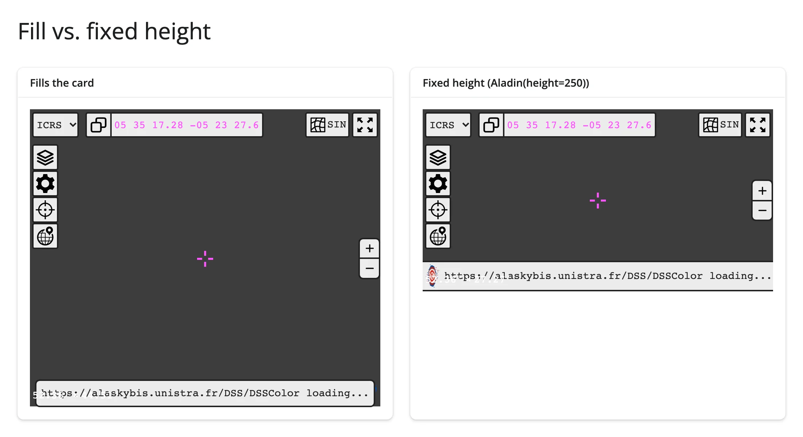

A viewer fills its card or output unless the `Aladin` has an explicit `height` (as above) or the output
itself is given one (`output_widget("sky", height="400px")`). `full_screen=True` cards, sidebars, and
`layout_columns()` all just work, including `full_screen`'s expand/collapse -- there's no viewer-specific
layout quirk to call out beyond the general shinywidgets fill behavior.

## Gotchas and limitations

Verified on current `main` (shinywidgets, ipyaladin 0.8.1, astropy 8.0.2):

- **`target`'s setter rejects a plain float tuple.** The constructor happily takes `Aladin(target=(83.63,
  22.01))`, but the equivalent in-place assignment `w.target = (83.63, 22.01)` raises `AttributeError:
  'float' object has no attribute 'deg'` -- the setter's tuple branch expects astropy `Longitude`/`Latitude`
  objects specifically, not plain floats or even `Quantity`s. Use a `"ra dec"` string (`w.target = "83.63
  22.01"`, parsed locally) or a `SkyCoord` instead; every example in this guide that sets `.widget.target`
  in place does exactly that.
- **`_ready` is never set anywhere in ipyaladin 0.8.1** (not in Python, not in the bundled JS). Gate
  in-place effects on `reactive_read(w, "_is_loaded")` instead, as this guide does throughout. One
  consequence: resolving an unresolvable object name can raise the misleading `WidgetNotReadyError`
  ("you need to wait for the widget to be fully loaded") even when the widget is fully loaded and the real
  problem is that the name doesn't exist.
- **Name resolution (`target="some name"`) is a blocking HTTP call to CDS's Sesame service**, including at
  *construction* time -- `Aladin(target="M31")` blocks the render function on that request. If CDS is slow
  or unreachable, this raises `WidgetNotReadyError`/`NameResolveError` and the render fails outright (verified
  this pass: CDS's Sesame endpoints were unreachable from this machine for the entire verification session,
  and every example that named a target directly in the constructor failed until changed to a coordinate
  string). Prefer coordinates (or a pre-resolved lookup table, as in every example above) for anything set
  programmatically, and reserve name strings for a user-driven search box where the occasional network
  round trip is expected.
- **Constructor `fov` is approximate.** Aladin Lite applies it before the container reaches its final
  pixel size, then snaps to its own internal zoom steps once it does -- a constructor `fov=1` rendered at
  0.918 deg and a constructor `fov=3` rendered at 2.754 deg in this pass's verification. An in-place
  `w.fov = x` assignment after load is exact. If you need a precise initial framing, set `.widget.fov` in an
  `_is_loaded`-gated effect rather than relying on the constructor argument.
- **`set_listener()` is not session-safe.** `Aladin.listener_callback` is a class-level dict shared by every
  `Aladin` instance in the process, so in a multi-session Shiny app the last session to call
  `set_listener("object_clicked", cb)` wins for *everyone* -- session A's click can fire session B's
  callback. This is why `clicked_object()` (message-backed, correctly scoped per widget) and
  `selected()`/`target()`/`fov()` (trait-backed, also per-widget) are the accessors
  to reach for; avoid `set_listener()` in anything a second user might open concurrently.
- **A plain click on the sky also moves `target`.** ipyaladin's "SIMBAD pointer" behavior is on by default,
  so a non-drag click recenters the view on the clicked point in addition to anything catalog-click
  handling does. If your app reads `target()` for a "what's in view" computation, expect it to change on
  plain sky clicks too, not just drags.
- **The viewer needs live network access.** Its JavaScript loads from a CDN (esm.sh) and imagery streams
  from CDS tile servers at render time; there's no offline or bundled-tile mode. During this guide's
  verification, CDS's own servers (`alasky*.unistra.fr`, `simbad.cds.unistra.fr`,
  `vizier.cds.unistra.fr`) were unreachable from the build machine for the full session -- every screenshot
  in this guide shows the viewer's UI, markers, and overlays rendering correctly, but with imagery stuck at
  "loading..." rather than actual sky tiles. This is an external network condition, not a shinywidgets or
  ipyaladin defect (the renderer, accessors, and overlay machinery all worked exactly as documented); retry
  from a machine with CDS access if you want to confirm imagery itself loads.

## Gallery candidates

### Template: sky explorer

[`gallery/template_sky_explorer.py`](gallery/template_sky_explorer.py) -- a ~85-line starting point: a
dropdown of six well-known deep-sky objects flies the viewer there in place, a survey picker re-skins the
imagery, and clicking a marker shows its catalog row via `clicked_object()`.

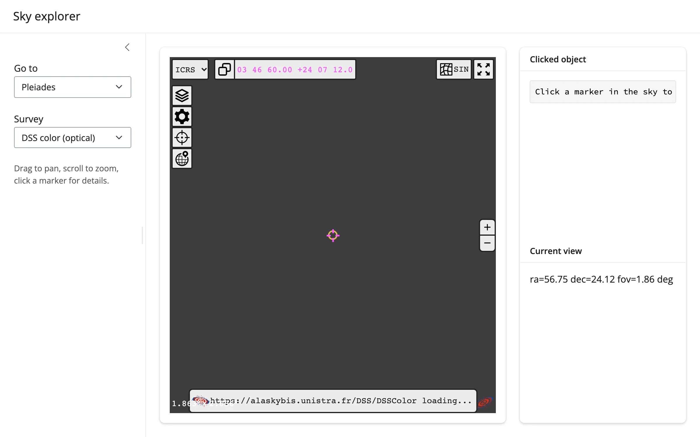
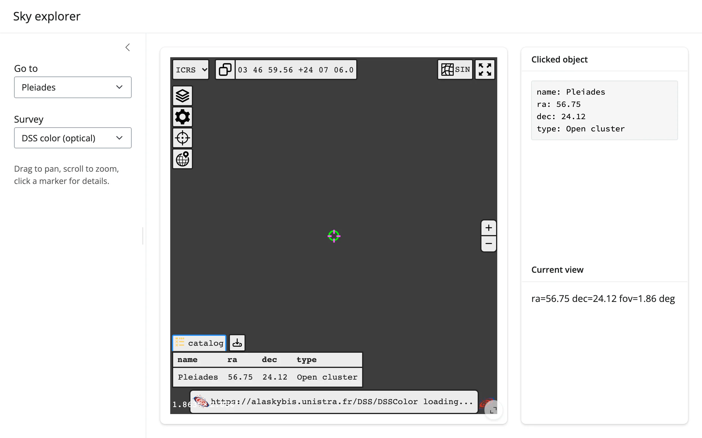

### Showcase: Messier explorer

[`gallery/showcase_messier_explorer.py`](gallery/showcase_messier_explorer.py) -- all 110 Messier objects
plotted on the viewer. The table below the sky always lists whatever's currently in view (`target()`/`fov()`);
selecting a row flies the viewer there and frames it at 4 deg, in place; clicking a marker shows its full
catalog row (`clicked_object()`); box-selecting a region (after arming it) lists the sources inside
(`selected()`); survey and color map re-skin the imagery without a re-render.

Initial view (centered on the Pleiades, only M45 in range) and after clicking it:

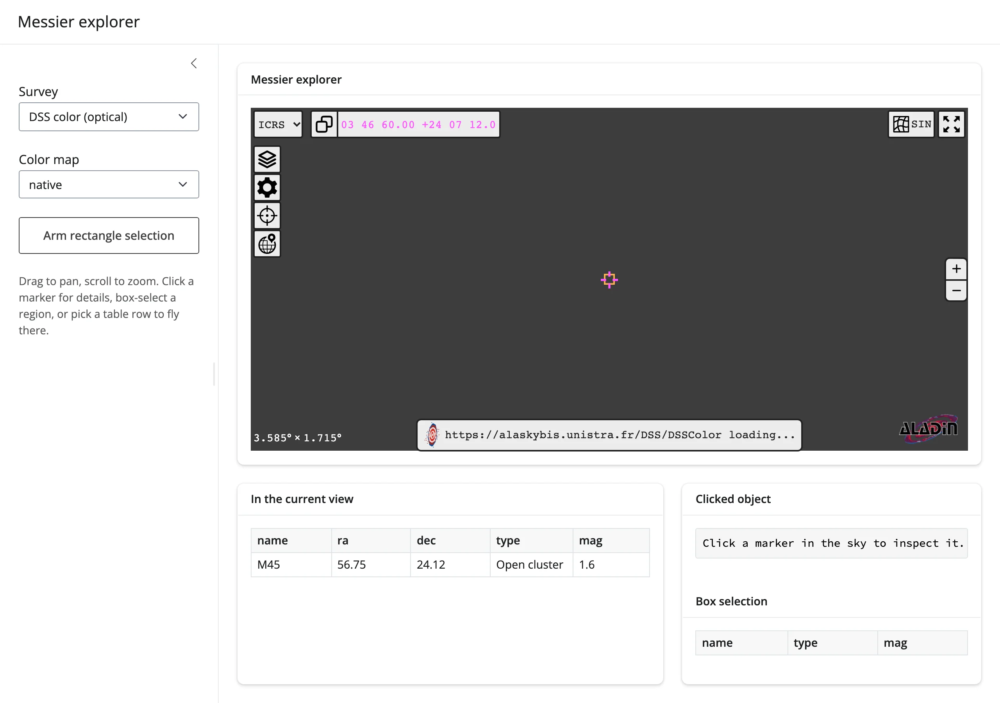
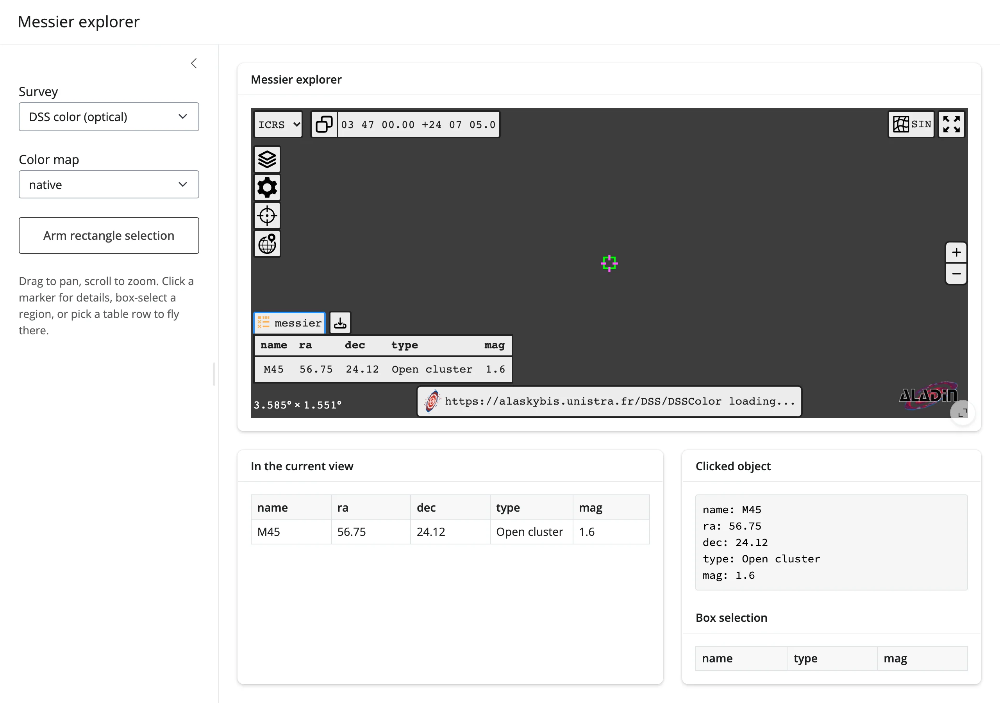

Zoomed out to a 180 deg field (27 Messier objects now in view), and after selecting M31 in the table --
the viewer flies there and frames it at 4 deg, revealing its satellite galaxies M32 and M110 in the same
field:

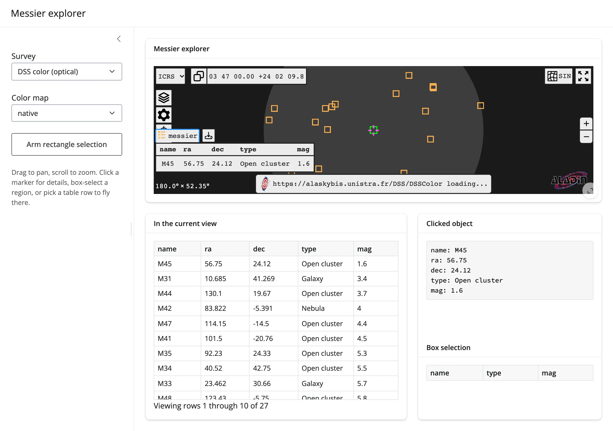
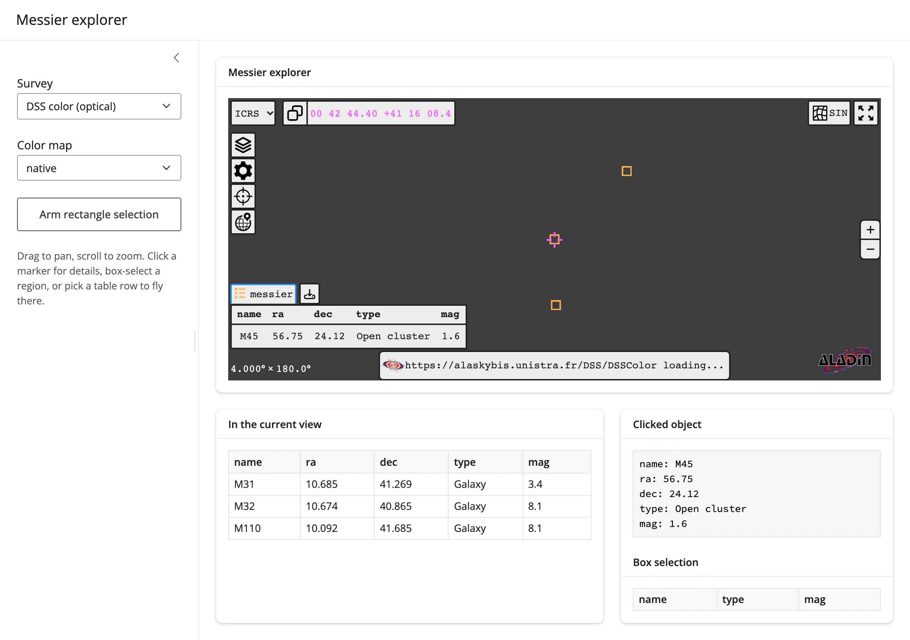

This exercises all four accessors at once and is the clearest demonstration in this guide of "the sky is a
reactive input": every one of the views above was produced by a pan, a zoom, a click, or a table-row
selection -- none of it required touching the sidebar controls.

## Learn more

- [Aladin Lite documentation](https://aladin.cds.unistra.fr/AladinLite/) and
  [HiPS survey list](https://aladin.cds.unistra.fr/hips/) -- every available survey, plus the viewer's full
  JavaScript API (most of which ipyaladin exposes as Python methods with the same names).
- [ipyaladin documentation](https://cds-astro.github.io/ipyaladin/) -- notebooks covering tables, MOCs,
  footprints, and the overlay API in more depth than this guide's short snippets.
- [mocpy documentation](https://cds-astro.github.io/mocpy/) -- building Multi-Order Coverage maps from cone
  searches, polygons, or set operations on other MOCs.
- [astroquery documentation](https://astroquery.readthedocs.io/) -- querying VizieR, SIMBAD, and other CDS
  services from Python to build catalogs for `add_table()` beyond what's hardcoded in this guide's examples.
- [jscatter guide](../jscatter/index.md) -- the plotting side of the [linked-view pairing](#select-stars-in-a-plot-mark-them-on-the-sky)
  above.
- [itables guide](../itables/index.md) and [reactable guide](../reactable/index.md) -- for catalog browsing
  that leads with a table rather than a sky view.
