[ipycanvas](https://ipycanvas.readthedocs.io) is a Python binding to the browser's HTML5 Canvas 2D drawing API,
built by the same Jupyter widgets maintainers behind ipyleaflet and ipywidgets itself. Where most widgets in this
roster wrap an existing visualization library, ipycanvas *is* the raw surface: rectangles, circles, paths, text,
gradients, and pixel buffers, drawn with plain method calls on a `Canvas` object. Draw commands are batched over a
binary comm channel, so even thousands of shapes or a full-resolution image land quickly.

`@render_ipycanvas` renders a `Canvas`, `MultiCanvas`, `RoughCanvas`, or `MultiRoughCanvas` (requires `pip install
'shinywidgets[ipycanvas]'`). The canvas's `width`/`height` are drawing-buffer pixels, not layout sizes: shinywidgets
fills the output's container and centers the canvas within it (shrinking to fit, aspect preserved), never
stretching the bitmap. The decorated function's `.widget` attribute is a live handle to the rendered canvas --
draw on it from anywhere (a `reactive.effect`, a button handler, an `asyncio` task) and the browser updates in
place, without re-rendering.

Unlike the other widgets in this roster, ipycanvas has no reactive accessors: there's no single "selection" or
"viewport" concept to expose. Instead, its interaction model is raw browser events -- `on_mouse_down`,
`on_mouse_move`, `on_key_down`, and friends -- each a plain Python callback. This guide's "Reacting to user
interaction" section teaches the one recipe that turns those callbacks into Shiny reactive values, which is really
all you need.

Reach for ipycanvas when you need the canvas itself: freehand sketch pads, pixel editors, cellular automata and
particle simulations, click-to-annotate tools, or any visualization that doesn't fit an existing charting library.
For charts, maps, or tables, use a dedicated widget elsewhere in this roster instead; for another browser-drawing
surface with a different shape (dataframe-producing scatter/line sketches), see
[drawdata](../drawdata/index.md).

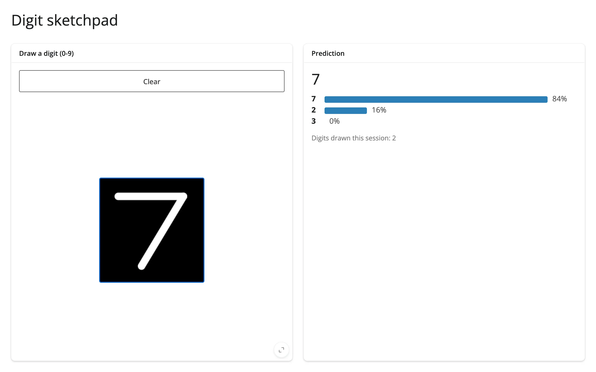

## Installation

```sh
pip install 'shinywidgets[ipycanvas]'
```

ipycanvas is pure Python with no native dependencies, so this resolves on every Python version shinywidgets
supports.

## Quick start

A `Canvas` is a drawing surface sized in buffer pixels. Draw on it once at render time with the same method calls
you'd use in a Jupyter notebook:

```{.python file="examples/01_quickstart.py"}
from ipycanvas import Canvas
from shiny.express import ui
from shinywidgets import render_ipycanvas

ui.page_opts(title="ipycanvas quickstart", fillable=True)

with ui.card(full_screen=True):

    @render_ipycanvas
    def canvas():
        c = Canvas(width=400, height=250)
        c.fill_style = "#f4f1ea"
        c.fill_rect(0, 0, 400, 250)
        c.fill_style = "steelblue"
        c.fill_rect(20, 20, 140, 90)
        c.fill_style = "#e67e22"
        c.fill_circle(260, 90, 55)
        c.font = "20px sans-serif"
        c.fill_style = "#222"
        c.fill_text("Hello from Python", 20, 160)
        return c
```

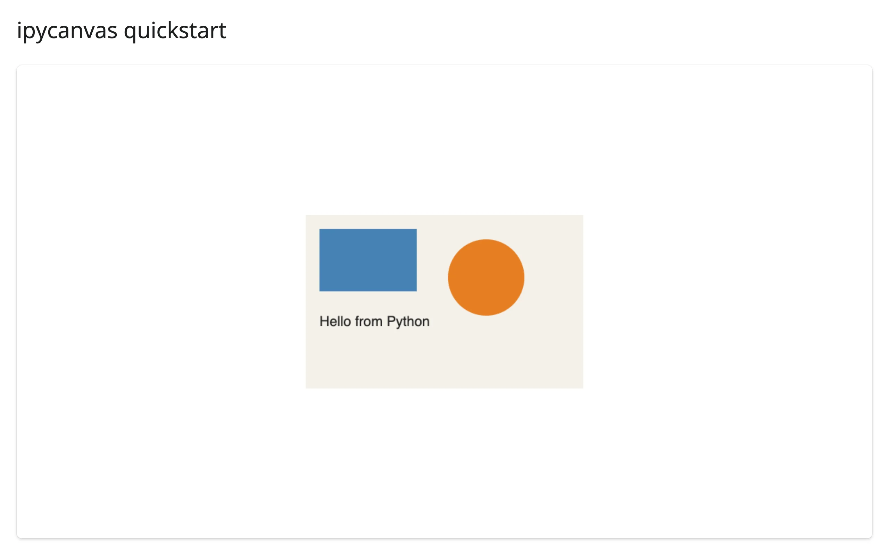

In a filling layout (`ui.card(full_screen=True)`, no explicit `output_widget(height=)`), the canvas keeps its
400x250 buffer size and centers itself in the available space -- it never stretches to fill.

## What you can build

### A full 2D drawing API, from Python

Every canvas method (`fill_rect`, `stroke_circle`, `stroke_line`, `fill_text`, gradients, `clip`, transforms, ...)
is a direct call -- there's no scene graph or re-render step. That makes ipycanvas a general-purpose drawing
surface for things a charting library won't do out of the box, like a hand-rolled bar chart with exact pixel
control:

```{.python file="examples/02_drawing_primitives.py"}
        for i, (_, row) in enumerate(top.iterrows()):
            y = 10 + i * (BAR_H + 10)
            width = 260 * row["gdpPercap"] / MAX_GDP
            c.fill_style = "#2c7fb8"
            c.fill_rect(150, y, width, BAR_H)
            c.stroke_style = "#1c4f73"
            c.stroke_rect(150, y, width, BAR_H)
            c.fill_style = "#222"
            c.text_align = "right"
            c.fill_text(row["country"], 140, y + BAR_H / 2 + 5)
            c.text_align = "left"
            c.fill_text(f"${row['gdpPercap']:,.0f}", 150 + width + 8, y + BAR_H / 2 + 5)
```

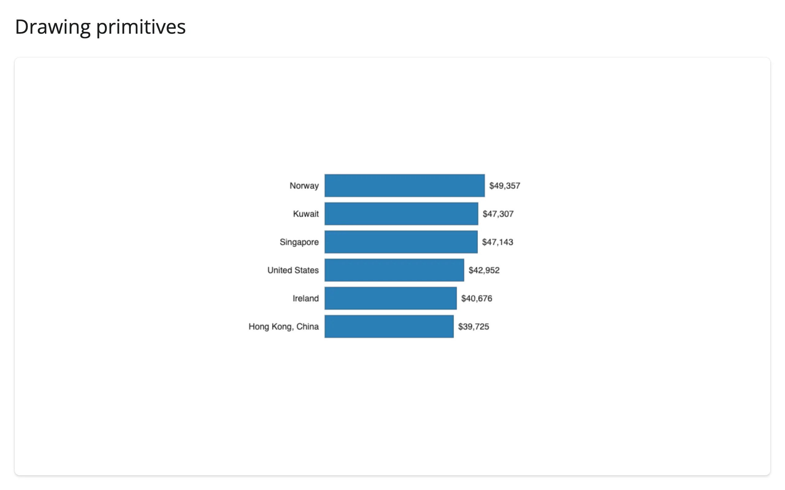

### `MultiCanvas` gives you layers for free

A `MultiCanvas(n, width=, height=)` is `n` independently-addressable canvases (`mc[0]`, `mc[1]`, ...) composited
into a single element. Put a background that never changes on one layer and foreground ink on another -- clearing
the ink never touches the background:

```{.python file="examples/03_multicanvas_layers.py"}
    @render_ipycanvas
    def mc():
        canvas = MultiCanvas(2, width=W, height=H)
        grid, ink = canvas[0], canvas[1]

        # Layer 0: a dot grid, drawn once -- it's never touched again
        grid.fill_style = "#ccc"
        for x in range(10, W, 20):
            for y in range(10, H, 20):
                grid.fill_circle(x, y, 1.2)

        # Layer 1: a few "sticky note" shapes
        ink.fill_style = "#f1c40f"
        ink.fill_rect(40, 40, 90, 90)
        ink.fill_style = "#e74c3c"
        ink.fill_rect(160, 90, 90, 90)
        ink.fill_style = "#2ecc71"
        ink.fill_rect(260, 50, 90, 90)
        return canvas

    @reactive.effect
    @reactive.event(input.clear)
    def _():
        canvas = mc.widget
        if canvas is not None:
            canvas[1].clear()  # only the ink layer is erased
```

| Before | After clearing layer 1 |
|---|---|
| 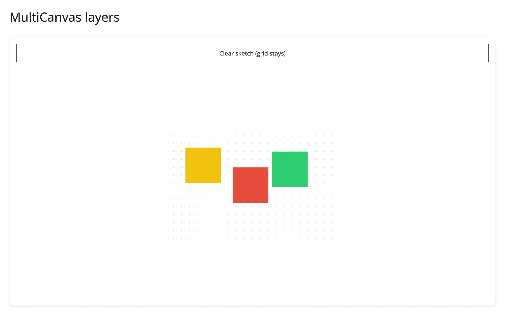 | 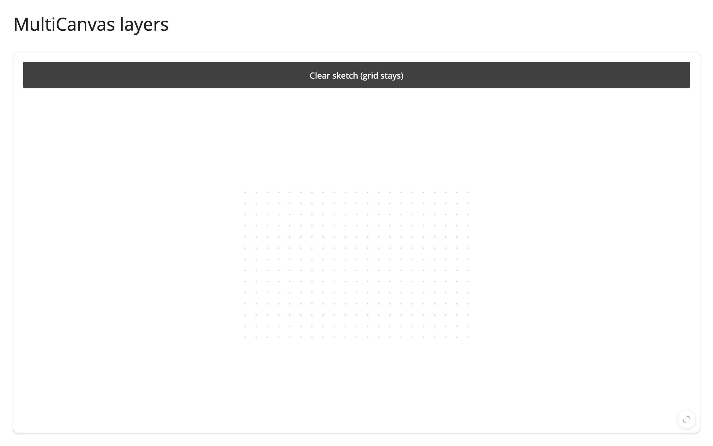 |

### Drawing numpy arrays with `put_image_data`

`put_image_data(array, x, y)` pushes an `(h, w, 4)` uint8 RGBA numpy array straight onto the canvas -- useful for
anything you'd rather compute as pixels than as a sequence of shape calls (heatmaps, images, simulation frames):

```{.python file="examples/04_put_image_data.py"}
c.put_image_data(corr_to_rgba(corr, CELL), 0, 0)
```

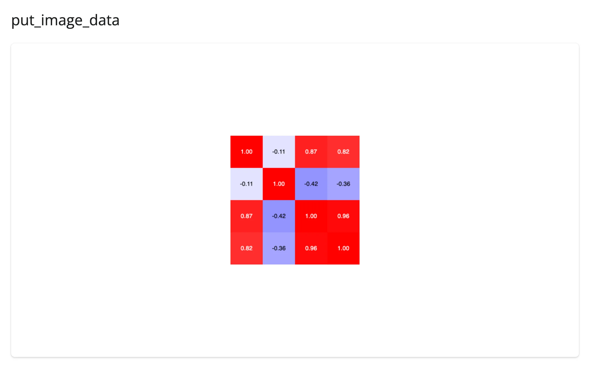

### A Python-driven animation loop: Conway's Game of Life

Because `.widget` stays live after render, a `@reactive.effect` with `reactive.invalidate_later()` can step a
simulation and redraw every frame, entirely from Python -- no client-side JavaScript loop required:

```{.python file="examples/05_game_of_life.py"}
    @reactive.effect
    def _tick():
        global grid
        reactive.invalidate_later(0.15)
        if not running():
            return
        grid = step(grid)
        c = life.widget
        if c is not None:
            c.put_image_data(grid_to_rgba(grid), 0, 0)
```

| Frame 1 | ~1s later |
|---|---|
| 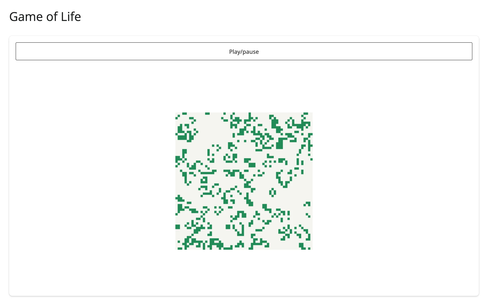 | 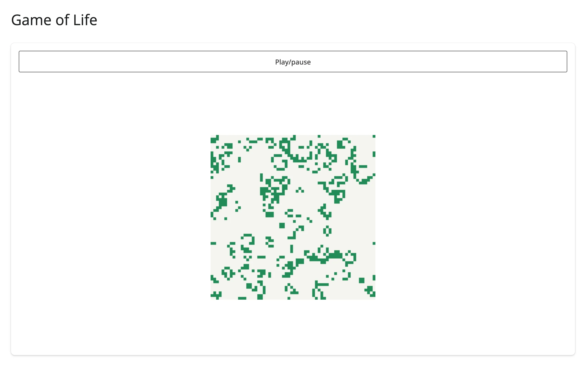 |

### `RoughCanvas`: a hand-drawn look for free

Swap `Canvas` for `RoughCanvas` and every fill/stroke gets a sketchy, hand-drawn rendering style (`rough_fill_style`:
hachure, cross-hatch, zigzag, dots, solid, and more) -- no extra drawing code needed. The example wires the
style choice to an `input_select`, so you can flip it live:

```{.python file="examples/06_rough_canvas.py"}
        c = RoughCanvas(width=420, height=220)
        c.rough_fill_style = input.style()
        c.fill_style = "#2c7fb8"
        c.fill_rect(20, 20, 160, 120)
        c.fill_style = "#e67e22"
        c.fill_circle(320, 80, 60)
        c.stroke_style = "#333"
        c.stroke_line(20, 180, 400, 180)
        return c
```

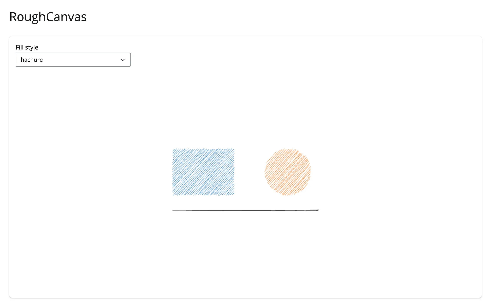

### `hold_canvas()` is a no-op here (verified)

Upstream, `ipycanvas.hold_canvas()` batches draw commands by toggling a *module-level* manager shared by every
kernel. shinywidgets gives each rendered canvas its own per-session manager instead (so one session's drawing can
never leak into another's browser) -- so `hold_canvas()` ends up toggling a manager nobody's canvas is actually
using. Drawing inside the block still works, command by command, just not batched into one message:

```{.python file="examples/07_hold_canvas_noop.py"}
with hold_canvas(c):
    for i in range(8):
        c.fill_style = f"hsl({i * 40}, 65%, 55%)"
        c.fill_rect(10 + i * 50, 20, 40, 20 + i * 20)
```

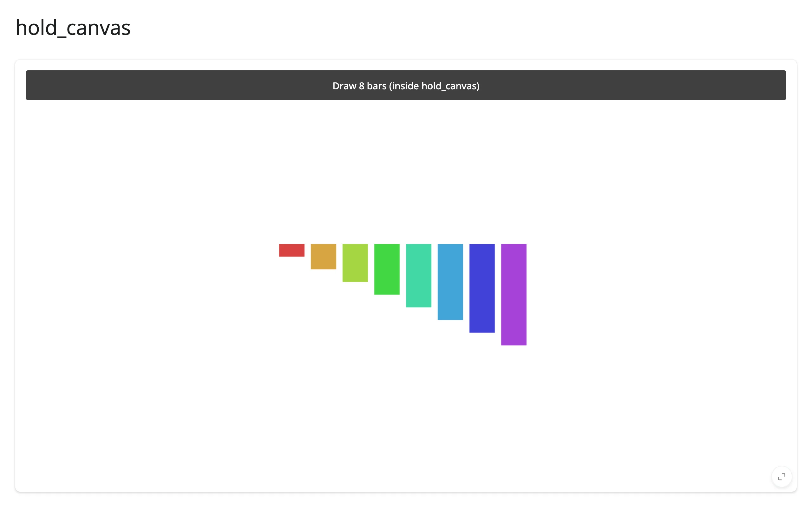

All 8 bars still appear correctly -- the only thing lost is a network-level optimization, confirmed by reading
ipycanvas 0.14.3's own source (`hold_canvas()` toggles `ipycanvas.canvas._CANVAS_MANAGER`, which shinywidgets
replaces per-canvas before the canvas's state is ever serialized). It's safe to leave `hold_canvas()` in code
shared with Jupyter; it just won't do anything extra under Shiny.

## Reacting to user interaction

ipycanvas declares no accessors. Its events are lower-level than "a selection changed" -- they're raw browser
events (`on_mouse_down`, `on_mouse_move`, `on_mouse_up`, `on_mouse_out`, `on_mouse_wheel`, `on_key_down`, touch
start/end/move/cancel) that call a plain Python function with the event's data. The recipe below is the one thing
to learn; everything else in this roster's "accessors" is this pattern pre-built for you.

### The recipe: browser events to reactive values

Register a callback inside the render function. Inside it, read `input.*()` directly (no reactive context is
needed there) and call `.set()` on a `reactive.value` to publish what happened
([`examples/08_mouse_events_recipe.py`](examples/08_mouse_events_recipe.py)):

```{.python file="examples/08_mouse_events_recipe.py"}
last_point = reactive.value(None)
stroke_count = reactive.value(0)
drawing = {"active": False}

with ui.layout_columns(col_widths=(8, 4)):
    with ui.card(full_screen=True):

        @render_ipycanvas
        def canvas():
            c = Canvas(width=420, height=260)
            c.fill_style = "#f4f1ea"
            c.fill_rect(0, 0, 420, 260)

            def on_down(x, y):
                drawing["active"] = True
                stroke_count.set(stroke_count() + 1)
                last_point.set((x, y))

            def on_move(x, y):
                if not drawing["active"]:
                    return
                c.stroke_style = "#2c7fb8"
                c.line_width = 3
                c.stroke_line(*last_point(), x, y)
                last_point.set((x, y))

            def on_up(x, y):
                drawing["active"] = False

            c.on_mouse_down(on_down)
            c.on_mouse_move(on_move)
            c.on_mouse_up(on_up)
            c.on_mouse_out(on_up)
            return c

    with ui.card():
        ui.card_header("What Python saw")

        @render.text
        def info():
            pt = last_point()
            pt_str = f"{pt[0]:.0f}, {pt[1]:.0f}" if pt else "none yet"
            return f"Strokes started: {stroke_count()}\nLast point: {pt_str}"
```

`(x, y)` arrive in **drawing-buffer pixels**, already correctly scaled even when the canvas is CSS-shrunk by a
filling layout. Other outputs read `stroke_count()`/`last_point()` like any other reactive value (the `info()`
output in the example).

| Before | After a drag |
|---|---|
| 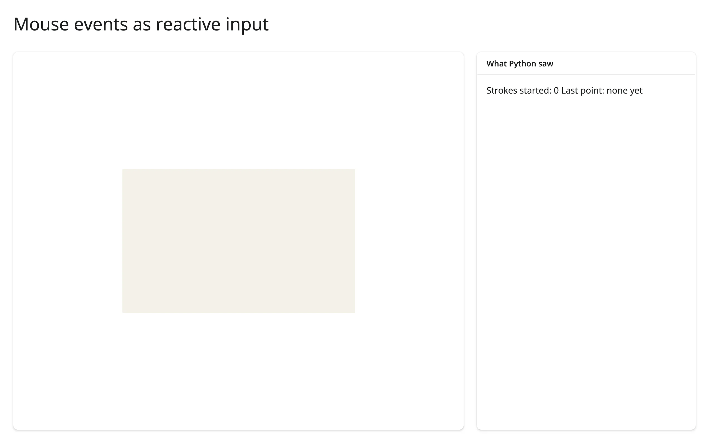 | 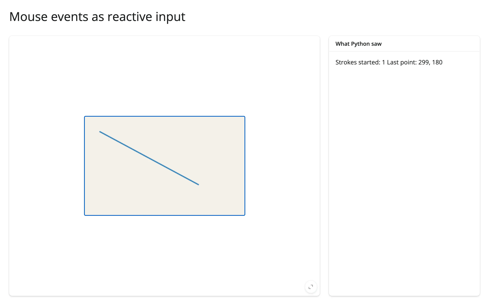 |

### Keyboard events

A canvas is focusable (`tabindex=0`): click it once, then `on_key_down(key, shift_key, ctrl_key, meta_key)` fires
like any other keydown handler:

```{.python file="examples/09_keyboard_recipe.py"}
def on_key(key, shift_key, ctrl_key, meta_key):
    last_key.set(key)
    dx, dy = MOVES.get(key, (0, 0))
    pos["x"] = min(max(pos["x"] + dx, 0), 290)
    pos["y"] = min(max(pos["y"] + dy, 0), 210)
    redraw()

c.on_key_down(on_key)
```

| Before | After clicking the canvas and pressing arrow keys |
|---|---|
| 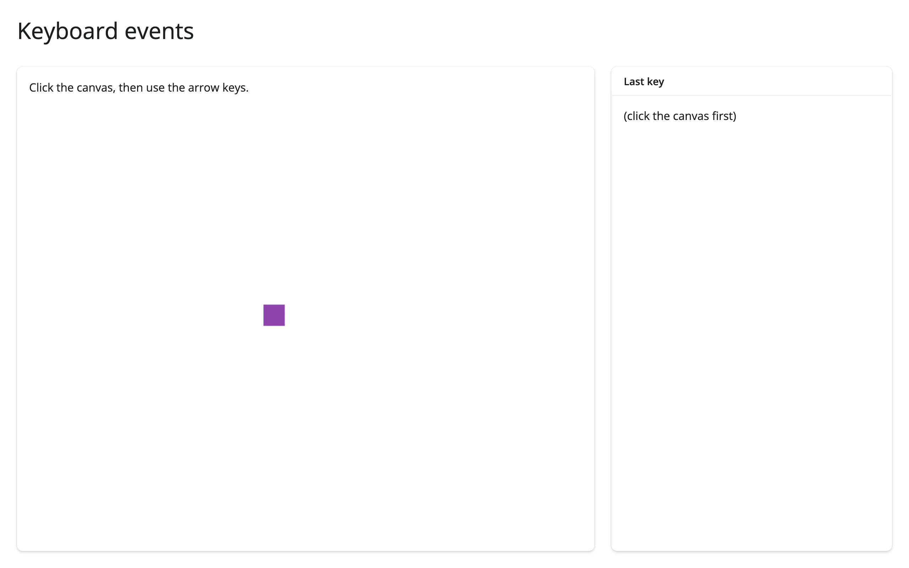 | 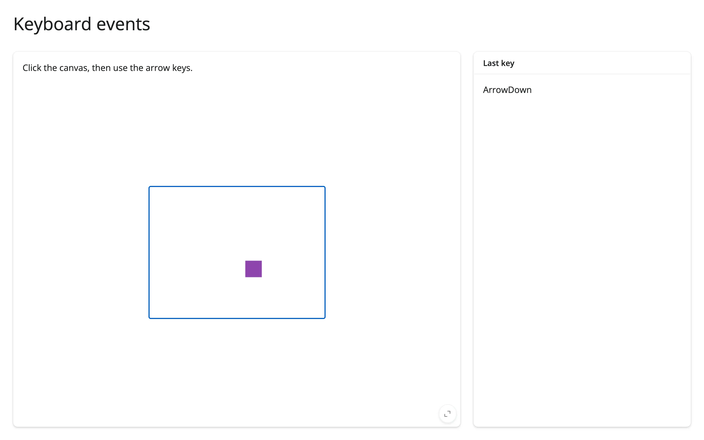 |

### Beyond callbacks: reading pixels back with `.read()`

For one specific trait, reading it reactively works too: set `sync_image_data=True` on the constructor, and the
browser pushes the composited bitmap back to Python as PNG bytes on the `image_data` trait. `canvas.read("image_data")`
is the shortcut for this (the same thing as `reactive_read(canvas.widget, "image_data")`, since `render_ipycanvas`
has no accessor for it -- see the [Reacting to widgets](../../guide/reacting-to-widgets/index.md#beyond-the-accessors-read-and-reactive_read)
article for when each form applies). Verified in a real browser: drawing a stroke changed a 1645-byte initial PNG
to 3489 bytes, with `canvas.read("image_data")` picking up the change. This is the bridge for anything that needs
to *see* what was drawn, not just *where* -- classifying a sketch, cropping a signature, saving a snapshot:

<!-- snippet: skip -->
```python
c = Canvas(width=SIZE, height=SIZE, sync_image_data=True)
...
png_bytes = canvas.read("image_data")
if png_bytes is not None:
    img = Image.open(io.BytesIO(png_bytes))
```

No other ipycanvas trait is worth reading reactively: `width`/`height` are set by you, not the browser, and
everything else is write-only draw state.

### Rate limiting

There's no built-in rate policy for raw callbacks (that's an accessor-only feature). `on_mouse_move` fires on
every browser mousemove -- 80 synthetic moves over ~2.3s produced 80 raw events in testing. Throttle yourself with
a timestamp gate, keeping a cheap counter ungated if you want every event to register and a throttled one to drive
expensive downstream work:

```{.python file="examples/10_rate_limiting.py"}
def on_move(x, y):
    event_count.set(event_count() + 1)  # cheap, update every time
    now = time.monotonic()
    if now - _last_sample["t"] < THROTTLE_S:
        return  # too soon since the last sample -- drop it
    _last_sample["t"] = now
    sampled_count.set(sampled_count() + 1)  # drives expensive work
```

[`examples/10_rate_limiting.py`](examples/10_rate_limiting.py) -- verified 80 raw events collapsing to 14 samples
at a 100ms gate.

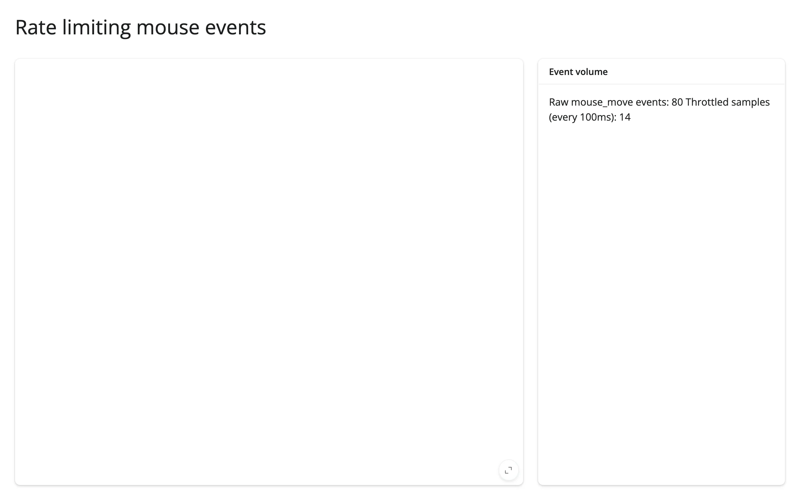

## Updating the widget from Python

Draw on `.widget` from a `@reactive.effect` to update the canvas in place, without re-rendering the function that
created it. This matters because re-rendering tears down and rebuilds the widget from scratch -- anything drawn
outside the render function (mouse strokes, animation frames) is lost, since canvas content is draw commands, not
widget state:

```{.python file="examples/11_inplace_vs_rerender.py"}
@reactive.effect
def _update_square():
    c = canvas.widget
    if c is not None:
        c.fill_style = input.color()
        c.fill_rect(20, 20, 80, 80)


@reactive.effect
@reactive.event(input.rerender)
def _force_rerender():
    rerender_trigger.set(rerender_trigger() + 1)
```

| Strokes drawn, then color changed in place | After forcing a re-render |
|---|---|
| 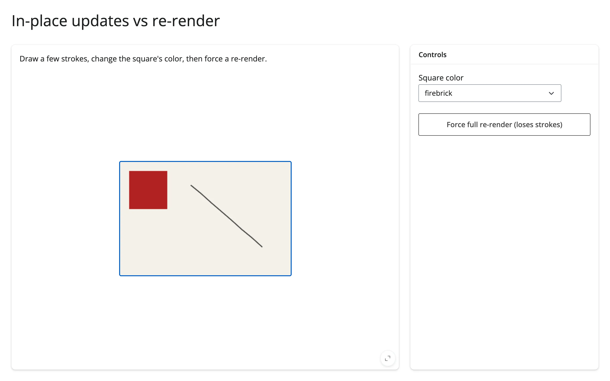 | 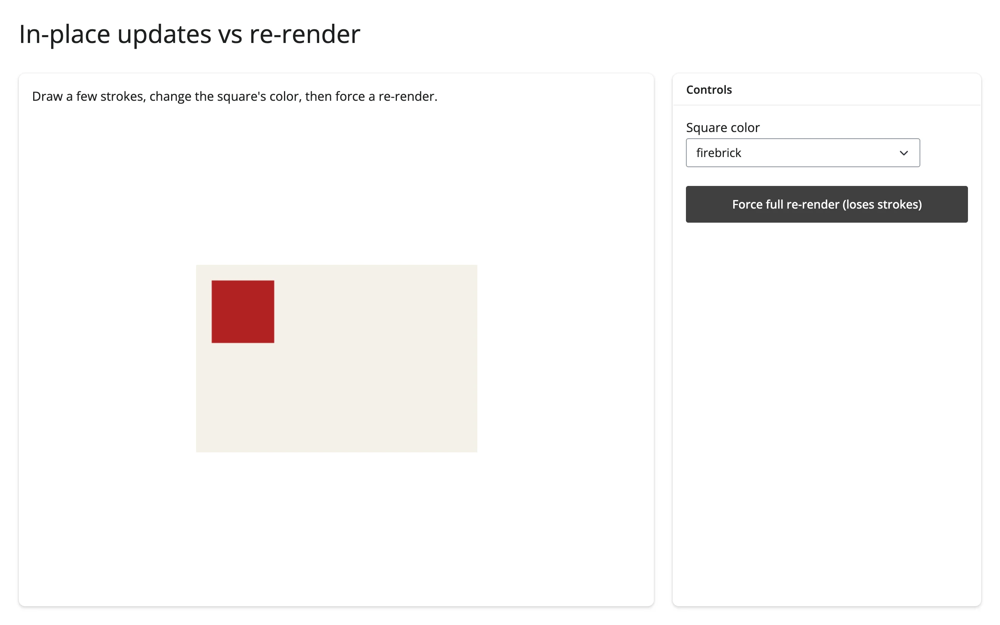 |

The hand-drawn stroke survives the color change (an in-place update) but disappears after the forced re-render,
while the square's color is correctly reapplied -- reading `.widget` inside an effect subscribes that effect to
re-renders too, so in-place-update effects automatically re-run against a freshly rendered widget. `reactive.isolate()`
isn't needed in either effect above since neither reads a value it also writes; reach for it if you ever
`.read()`/`reactive_read()` a trait inside the same effect that sets it, to avoid a feedback loop.

**A pattern to copy for animation loops:** keep frequently-redrawn state (a grid, a particle list) as a plain
mutable Python object rather than a `reactive.value`, and have every writer (a click handler, a button effect, the
`invalidate_later` tick) redraw the widget directly afterwards. `examples/05_game_of_life.py` and the Game of Life
gallery template both use this shape. It sidesteps a sharp edge covered in Gotchas below.

## Coordinating multiple views

### Click to place points, in a table

A mouse callback that appends to a reactive list, paired with an effect that redraws everything from that list, is
the general pattern for any "accumulate points" interaction:

```{.python file="examples/12_coordinate_click_to_table.py"}
with ui.layout_columns(col_widths=(7, 5)):
    with ui.card(full_screen=True):
        ui.p("Click anywhere on the canvas to drop a point.")

        @render_ipycanvas
        def canvas():
            c = Canvas(width=400, height=280)
            c.fill_style = "#f4f1ea"
            c.fill_rect(0, 0, 400, 280)

            def on_click(x, y):
                points.set(points() + [(x, y)])

            c.on_mouse_down(on_click)
            return c

    with ui.card():
        ui.card_header("Points (click order)")

        @render.data_frame
        def table():
            return pd.DataFrame(points(), columns=["x", "y"])


# Canvas content is stateless (draw commands, not widget state), so the
# simplest way to keep it in sync with `points` is to redraw everything each
# time it changes: clear, then replay.
@reactive.effect
def _draw_points():
    c = canvas.widget
    if c is None:
        return
    c.clear()
    c.fill_style = "#f4f1ea"
    c.fill_rect(0, 0, 400, 280)
    c.fill_style = "#c0392b"
    for x, y in points():
        c.fill_circle(x, y, 6)
```

| Before | After 4 clicks |
|---|---|
| 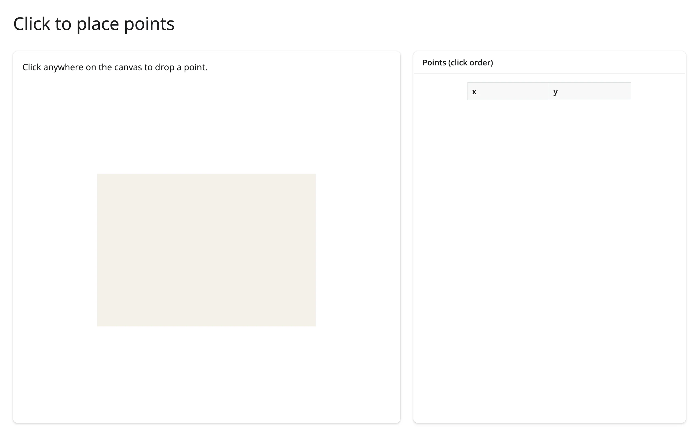 | 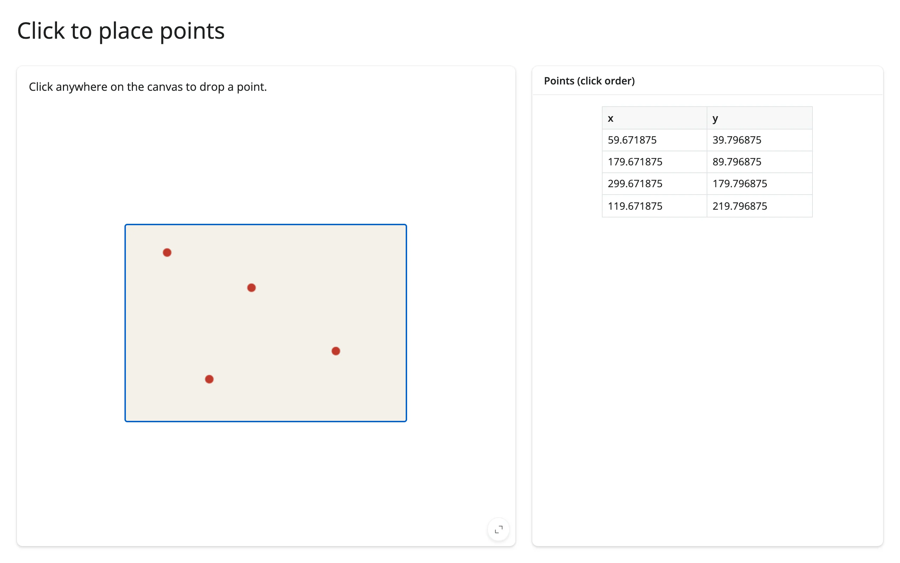 |

### Table row selection highlights the canvas

The reverse direction: a `render.DataGrid(selection_mode="row")` drives which point gets a highlight ring on the
canvas, redrawn in an effect that reads `table.cell_selection()["rows"]`:

```{.python file="examples/13_coordinate_table_to_canvas.py"}
@reactive.effect
def _highlight_selected():
    rows = table.cell_selection()["rows"]
    redraw(rows[0] if rows else None)
```

| Before | After selecting "Mizar" |
|---|---|
| 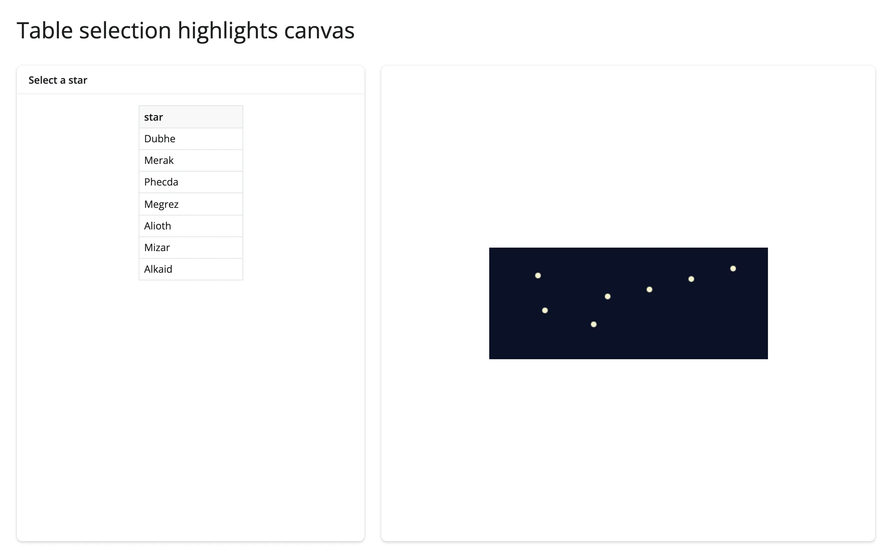 | 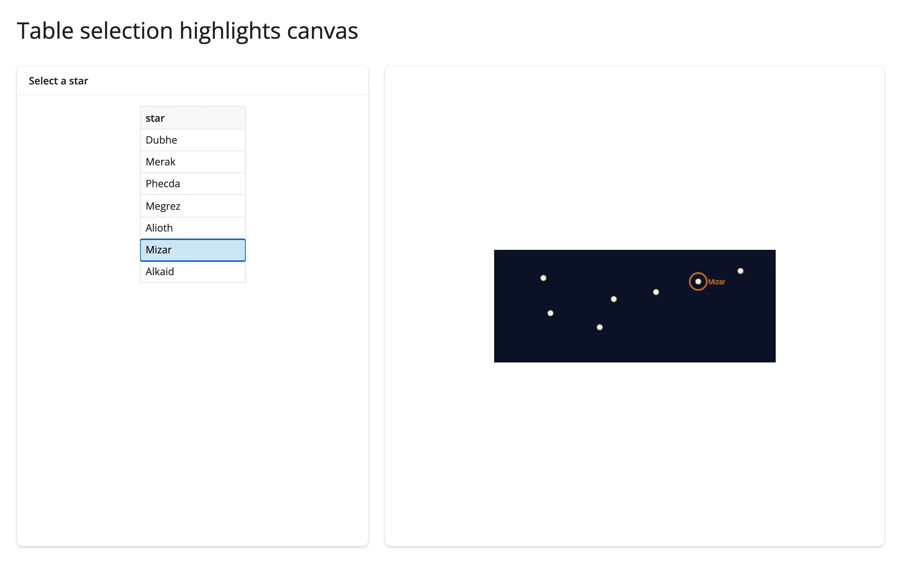 |

### Draw a digit, classify it with a model

The flagship pattern: `sync_image_data` + `.read()` turns ink into pixels Python can hand to any model.
Here, a tiny scikit-learn SVM trained on `sklearn.datasets.load_digits()` (1797 handwritten 0-9's, 8x8 grayscale)
classifies whatever you draw:

```{.python file="examples/14_coordinate_digit_classifier.py"}
        @render.text
        def guess():
            png_bytes = canvas.read("image_data")
            if png_bytes is None:
                return "Draw something!"
            img = Image.open(io.BytesIO(png_bytes)).convert("L").resize((8, 8))
            pixels = np.asarray(img, dtype=float) / 255 * 16  # match 0-16 scale
            pred = clf.predict(pixels.reshape(1, -1))[0]
            return f"That looks like a {pred}"
```

[`examples/14_coordinate_digit_classifier.py`](examples/14_coordinate_digit_classifier.py) -- verified against
both a drawn "1" and a drawn "0", each classified correctly.

| Before | Drew a "1" | Drew a "0" |
|---|---|---|
| 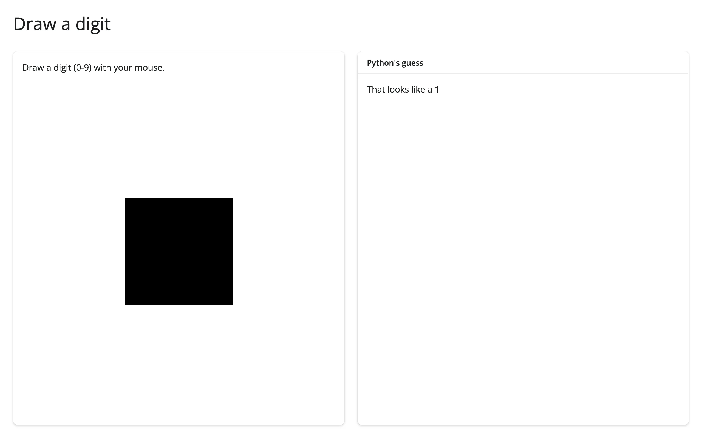 | 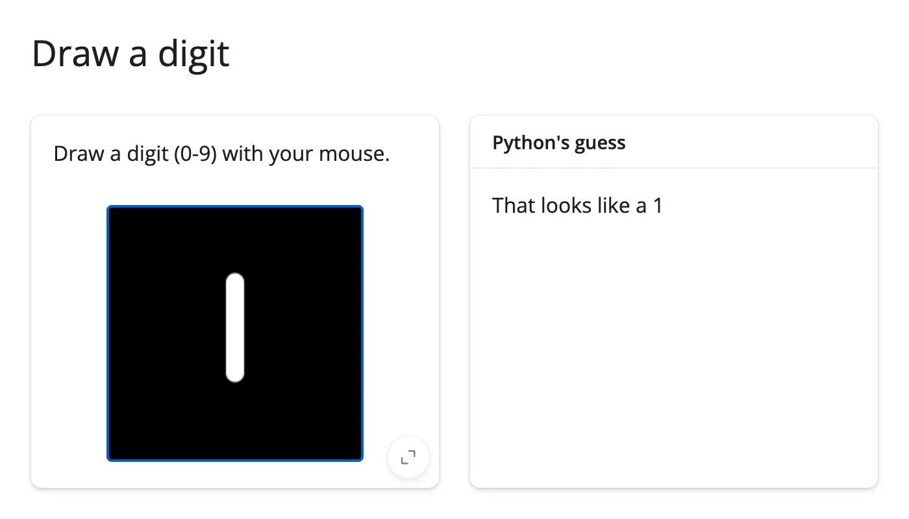 | 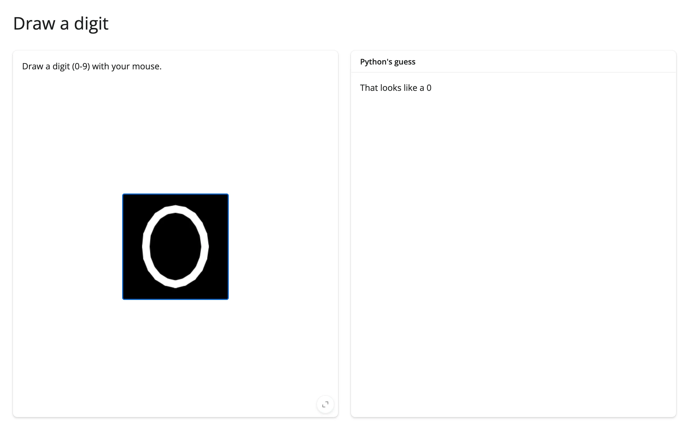 |

See the full version, with confidence bars and a running tally, in [Gallery candidates](#gallery-candidates) below.

## Large data

ipycanvas has no large-data mode of its own -- it's a drawing surface, not a data renderer, so there's no point
count or row count to scale against; draw commands just land quickly because they're batched over a binary comm
channel (see the intro above), not because of any GPU-accelerated data pipeline. If you need to interactively
explore millions of actual data points rather than draw shapes, reach for [k3d](../k3d/index.md#large-data)
instead.

## Layout and sizing

In a filling layout (the default), the canvas keeps its constructor `width`/`height` as the drawing-buffer size and
centers itself, shrinking (aspect preserved) if the container is smaller. An explicit `@render_ipycanvas(height=
"150px")` opts out of fill but still shrinks-and-centers. Setting `widget.layout.height` directly also opts out of
fill -- prefer the constructor or the output's `height=` instead, since the buffer size itself is what you're
actually sizing:

```{.python file="examples/15_layout_sizing.py"}
@render_ipycanvas(height="150px")
def fixed_height():
    return draw(Canvas(width=300, height=200))
```

[`examples/15_layout_sizing.py`](examples/15_layout_sizing.py) -- measured all three paths in a real browser: the
default fills and centers at 300x200; `height="150px"` shrinks to 225x150 (aspect preserved) and centers; and even
`widget.layout.height = "120px"` (discouraged) now shrinks to 180x120 and centers correctly rather than
stretching, on current main.

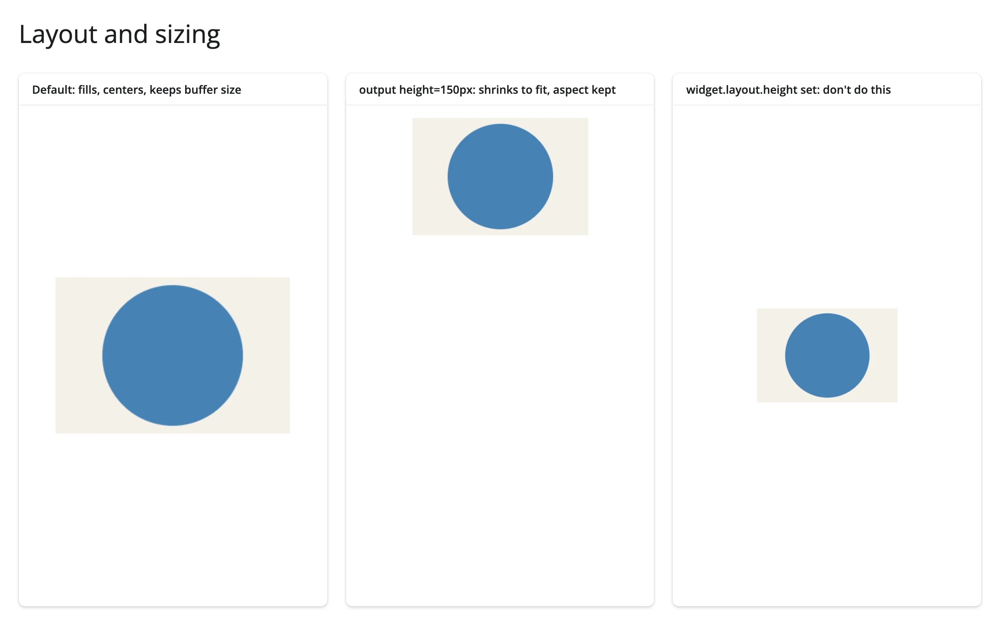

## Gotchas and limitations

- **No accessors.** Use the `canvas.read("image_data")` recipe above for anything that needs to see pixels;
  everything else goes through plain mouse/keyboard callbacks.
- **`hold_canvas()` is a no-op** (verified above) -- harmless to use, just doesn't batch.
- **Canvas content is stateless.** Draw commands aren't part of widget state, so a browser refresh (a new Shiny
  session) starts blank, and there's no built-in undo. Keep your own list of what you've drawn if you need either.
- **A reactive value read *and* written inside an `invalidate_later()` loop can starve input events.** The
  classic animation-loop line `generation.set(generation() + 1)` makes the tick effect depend on the very value
  it writes, so it re-invalidates itself continuously and button clicks stop registering (verified in plain core
  Shiny, no shinywidgets or ipycanvas involved: the play/pause button's `@reactive.event`-gated effect never
  ran). Two fixes, both verified: keep animation-loop state in a plain mutable Python object and have each
  writer redraw the widget directly (the `examples/05_game_of_life.py` pattern), or keep the `reactive.value`
  but read it inside `with reactive.isolate():` so the tick effect doesn't take a dependency on it. Ordinary
  reactive-semantics footgun, not an ipycanvas or shinywidgets issue. See NOTES.md for the full investigation.
- **Touch events are declared** (`on_touch_start/end/move/cancel`) but unverified in this guide: headless Chromium
  via Playwright doesn't have a simple way to synthesize multi-touch, so this wasn't exercised.
- **`MultiCanvas` renders as a single `<canvas>` element.** The browser composites every sub-canvas into one; don't
  expect `n` separate DOM canvases when writing tests or custom JS.
- **Size with the constructor, not `layout.height`.** See Layout and sizing above -- both now behave the same
  (shrink, center, preserve aspect), but the constructor is the one place that also controls pixel resolution.

## Gallery candidates

### `template_game_of_life.py` -- template

Click cells to seed a pattern while paused, then press Play to watch a `reactive.invalidate_later()` loop step
Conway's Game of Life. A clean, ~100-line starting point for anything that mixes click-to-edit state with a
Python-driven animation loop.

Run: `uv run shiny run template_game_of_life.py`

| Seeded (paused) | Running |
|---|---|
| 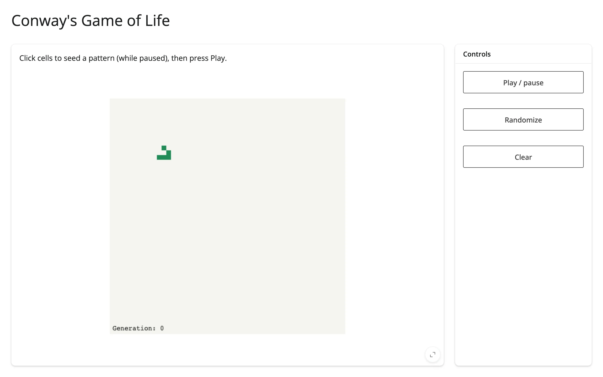 | 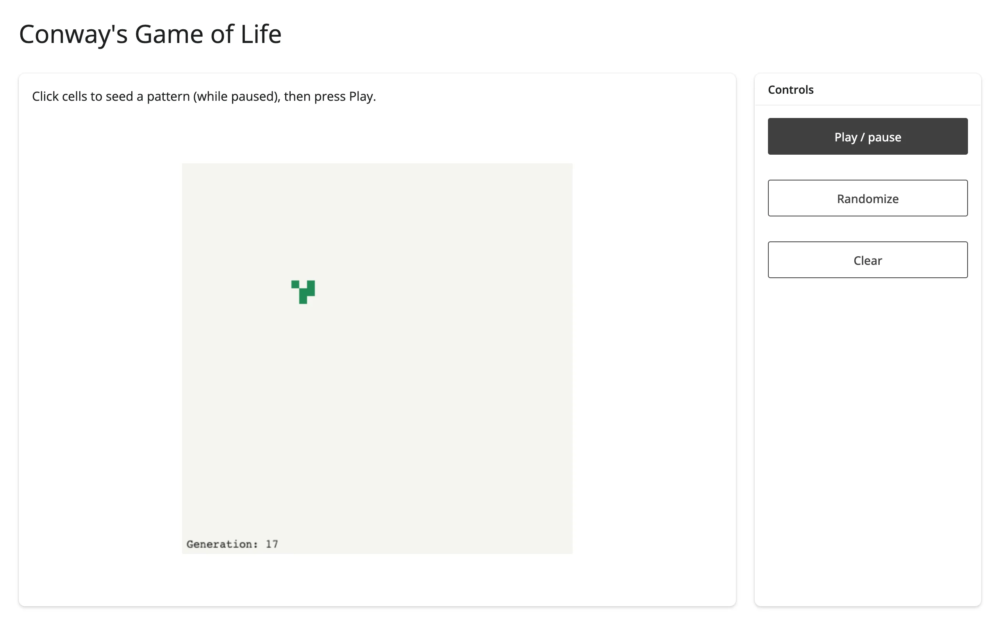 |

### `showcase_digit_sketchpad.py` -- showcase

The full digit classifier from "Coordinating multiple views," with confidence bars for the model's top 3 guesses
and a running count of digits drawn this session. Trains a `CalibratedClassifierCV(SVC())` on
`sklearn.datasets.load_digits()` at startup (a few hundred milliseconds), then classifies every stroke live via
`sync_image_data` + `.read()`.

Run: `uv run --with scikit-learn shiny run showcase_digit_sketchpad.py`

Data: `sklearn.datasets.load_digits()` (bundled with scikit-learn)

| Before | Drew a "7" |
|---|---|
| 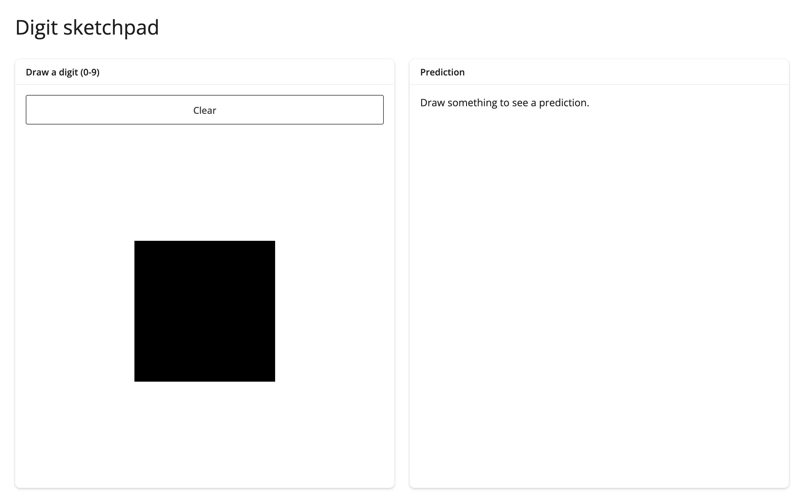 | 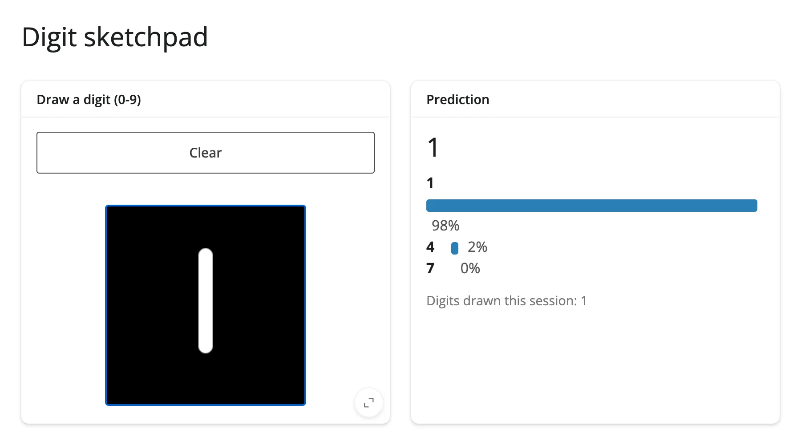 |

## Learn more

- [ipycanvas documentation](https://ipycanvas.readthedocs.io)
- [ipycanvas API reference](https://ipycanvas.readthedocs.io/en/latest/api_reference.html) -- the full drawing
  method list, events, and `MultiCanvas`/`RoughCanvas` details this guide doesn't repeat
- [drawdata guide](../drawdata/index.md) -- a different browser-drawing surface, producing labeled point/line data
  instead of raw pixels
- [matplotlib guide](../matplotlib/index.md) and [pythreejs guide](../pythreejs/index.md) -- for chart- and
  3D-scene-shaped drawing instead of a raw 2D canvas
