[ipycytoscape](https://github.com/cytoscape/ipycytoscape) is a Jupyter widget built by QuantStack that wraps
[Cytoscape.js](https://js.cytoscape.org), the network-visualization library behind a lot of bioinformatics and graph
tooling. Its appeal is the combination: networkx does the graph analysis in Python (communities, shortest paths,
centrality), and Cytoscape.js draws the result as a draggable, zoomable network with a CSS-like stylesheet language
for mapping data onto size, color, and shape.

`@render_ipycytoscape` accepts a `networkx.Graph` (`Graph`, `DiGraph`, or `MultiGraph`, coerced automatically) or an
`ipycytoscape.CytoscapeWidget` you've already built, and handles the layout work shinywidgets does for every
widget: filling its card or output, tracking container resizes, and sizing correctly whether you pass a fixed
height or let it fill. Four accessors turn graph interaction into reactive values, so reading them is like reading
`input.my_slider()`: `clicked_node()`/`clicked_edge()` report single clicks, and `selected_nodes()`/
`selected_edges()` report the current selection, including shift-drag box-select and multi-select.

Reach for ipycytoscape when you want an interactive, explorable network for small-to-medium graphs (up to roughly a
thousand nodes) with a rich styling and layout vocabulary. For graphs in the tens of thousands of nodes or more,
where ipycytoscape's one-ipywidget-per-element design becomes the bottleneck, see
[ipysigma](../ipysigma/index.md), which renders with WebGL instead. For geographic networks, see
[ipyleaflet](../ipyleaflet/index.md) or [lonboard](../lonboard/index.md) with line layers.

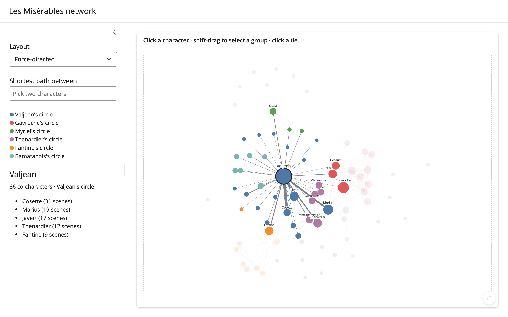

One honest caveat up front: ipycytoscape is lightly maintained upstream (last PyPI release April 2022; see
"Gotchas and limitations" below). It is still the most capable interactive-network widget in the Jupyter
ecosystem, and everything in this guide is verified against the pinned 1.3.3 release.

## Installation

```sh
pip install 'shinywidgets[ipycytoscape]'
```

This installs `ipycytoscape` itself. Building graphs from networkx also needs `pip install networkx` (not a hard
dependency of the extra, since the renderer also accepts a `CytoscapeWidget` you build yourself from other
sources, e.g. Cytoscape JSON or a `py2neo` graph).

## Quick start

```{.python file="examples/01_quickstart.py"}
import networkx as nx
from shiny.express import ui
from shinywidgets import render_ipycytoscape

ui.page_opts(title="Zachary's karate club", fillable=True)

with ui.card(full_screen=True):

    @render_ipycytoscape
    def network():
        return nx.karate_club_graph()
```

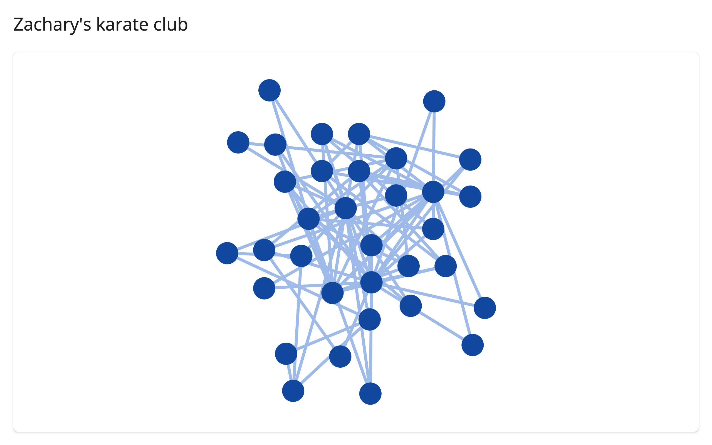

Returning a plain networkx graph is enough for a pannable, zoomable, draggable network: node ids become strings,
node and edge attributes land in each element's `data`, and `DiGraph`/`MultiGraph` get arrows and curved parallel
edges automatically. The graph fills its card and tracks resizes, sidebar toggles, and full-screen mode.

## What you can build

### A stylesheet for your data

Cytoscape's selector language maps data onto visual properties declaratively: `mapData(attr, min, max, loVal,
hiVal)` scales a numeric attribute into a size or width range, and selectors like `node[degree >= 10]` or
`node.focus` combine data conditions with manually-toggled classes.

```{.python file="examples/02_data_driven_style.py"}
import networkx as nx
from ipycytoscape import CytoscapeWidget
from shiny.express import ui
from shinywidgets import render_ipycytoscape

G = nx.les_miserables_graph()
for n in G.nodes:
    G.nodes[n]["degree"] = G.degree(n)

STYLE = [
    {
        "selector": "node",
        "style": {
            "background-color": "#447099",
            "width": "mapData(degree, 1, 36, 10, 46)",
            "height": "mapData(degree, 1, 36, 10, 46)",
        },
    },
    {
        "selector": "node[degree >= 15]",
        "style": {"label": "data(id)", "font-size": "10px", "color": "#212529"},
    },
    {
        "selector": "edge",
        "style": {
            "width": "mapData(weight, 1, 31, 0.5, 8)",
            "line-color": "#c9d6e8",
            "curve-style": "haystack",
        },
    },
]

ui.page_opts(title="Les Misérables: degree and co-appearance weight", fillable=True)

with ui.card(full_screen=True):

    @render_ipycytoscape
    def network():
        widget = CytoscapeWidget(G)
        widget.set_style(STYLE)
        widget.set_layout(name="cose", idealEdgeLength=80, nodeRepulsion=8000)
        return widget
```

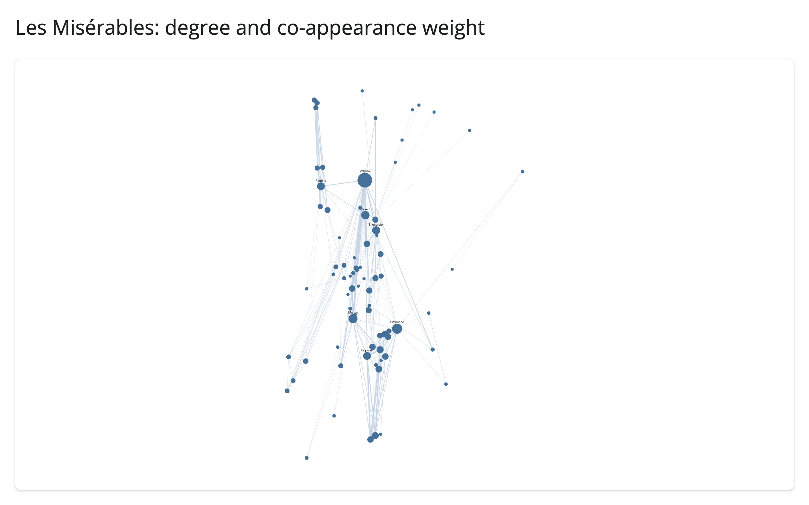

Node and edge attributes computed in Python (here, just `G.degree(n)`, but community membership, centrality, or
anything else networkx computes works the same way) flow straight into `data(...)` and `mapData(...)`. Attributes
named `classes`, `position`, `locked`, `selected`, or `selectable` are special: they set the element's own trait
instead of landing in `data`.

### Build from a pandas edge list

`nx.from_pandas_edgelist()` turns a two-column (or weighted) data frame into a graph, which the renderer accepts
exactly like any other networkx graph.

```{.python file="examples/03_pandas_edgelist.py"}
import networkx as nx
import pandas as pd
from ipycytoscape import CytoscapeWidget
from shiny.express import ui
from shinywidgets import render_ipycytoscape

edges = pd.DataFrame(
    {
        "source": [
            "shinywidgets",
            "shinywidgets",
            "shiny",
            "shiny",
            "shiny",
            "pandas",
            "ipywidgets",
            "ipywidgets",
        ],
        "target": [
            "shiny",
            "ipywidgets",
            "starlette",
            "uvicorn",
            "htmltools",
            "numpy",
            "traitlets",
            "ipython",
        ],
    }
)
G = nx.from_pandas_edgelist(edges, create_using=nx.DiGraph)

STYLE = [
    {"selector": "node", "style": {"label": "data(id)", "background-color": "#447099"}},
    {
        "selector": "edge",
        "style": {
            "curve-style": "bezier",
            "target-arrow-shape": "triangle",
            "target-arrow-color": "#9dbaea",
            "line-color": "#9dbaea",
        },
    },
]

ui.page_opts(title="A dependency graph from a pandas edge list", fillable=True)

with ui.card(full_screen=True):

    @render_ipycytoscape
    def network():
        widget = CytoscapeWidget(G)
        widget.set_style(STYLE)
        widget.set_layout(name="breadthfirst", directed=True, padding=20)
        return widget
```

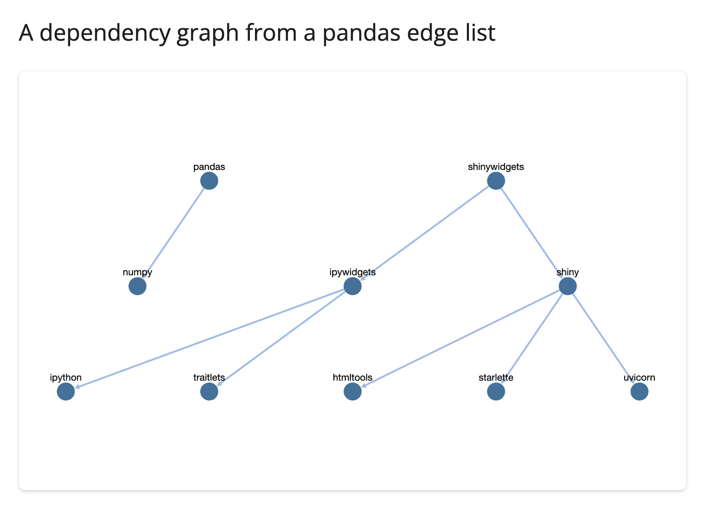

ipycytoscape also accepts Cytoscape JSON (a dict or path) and pandas data frames directly via
`CytoscapeWidget(json_or_df)` or `widget.graph.add_graph_from_json(...)`/`add_graph_from_df(...)`; the renderer
itself only auto-coerces networkx graphs, so wrap other formats yourself before returning them.

### A layout for every shape

Cytoscape ships force-directed (`cose`), radial (`concentric`, `circle`), and hierarchical (`breadthfirst`) layouts
in its core, and ipycytoscape bundles the `cola`, `dagre`, and `klay` extensions on top. Switch layouts in place
with `widget.set_layout(name=...)`.

```{.python file="examples/04_layouts.py"}
import networkx as nx
from ipycytoscape import CytoscapeWidget
from shiny import reactive
from shiny.express import input, ui
from shinywidgets import render_ipycytoscape

G = nx.les_miserables_graph()
LAYOUTS = ["cose", "concentric", "breadthfirst", "dagre"]

ui.page_opts(title="Layouts", fillable=True)
ui.input_select("layout", "Layout", LAYOUTS)

with ui.card(full_screen=True):

    @render_ipycytoscape
    def network():
        widget = CytoscapeWidget(G)
        with reactive.isolate():
            widget.set_layout(name=input.layout())
        return widget

    @reactive.effect
    def _():
        # Re-run the chosen layout in place; the graph is never re-rendered
        network.widget.set_layout(name=input.layout())
```

| `cose` (force-directed) | `dagre` (hierarchical) |
|---|---|
| 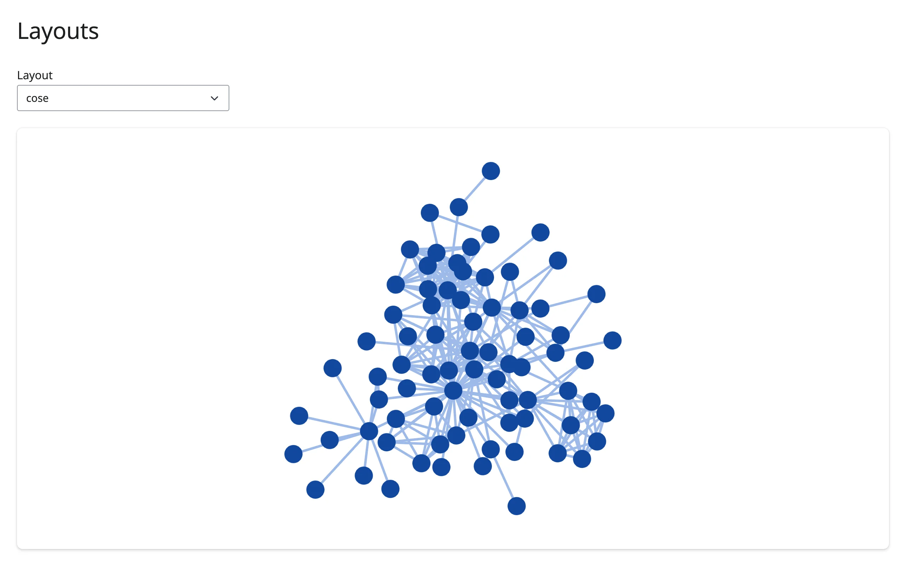 | 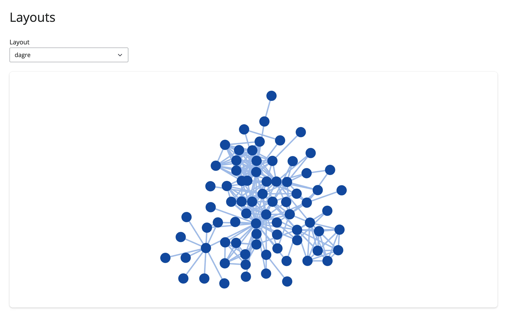 |

`set_layout()` merges its keyword arguments onto the existing layout dict rather than replacing it, so switching
`name` keeps any spacing options you've already set. Every layout change re-fits the viewport to the new
arrangement and re-runs on the *whole* graph (there's no incremental layout), which is fine for the graph sizes
this widget is meant for.

### Tooltips

Put text in a node's `data["tooltip"]` (or point `set_tooltip_source()` at a different key) and ipycytoscape shows
it in a popup on click.

```{.python file="examples/05_tooltips.py"}
import networkx as nx
from ipycytoscape import CytoscapeWidget
from shiny.express import ui
from shinywidgets import render_ipycytoscape

G = nx.les_miserables_graph()
for n in G.nodes:
    scenes = sorted(G[n].items(), key=lambda kv: -kv[1]["weight"])[:3]
    top = ", ".join(f"{m} ({d['weight']})" for m, d in scenes)
    G.nodes[n]["tooltip"] = f"{n}\nTop co-stars: {top}"

STYLE = [{"selector": "node", "style": {"background-color": "#447099"}}]

ui.page_opts(title="Click a node for its tooltip", fillable=True)

with ui.card(full_screen=True):

    @render_ipycytoscape
    def network():
        widget = CytoscapeWidget(G)
        widget.set_style(STYLE)
        widget.set_layout(name="concentric")
        return widget
```

| Before | After clicking Valjean |
|---|---|
| 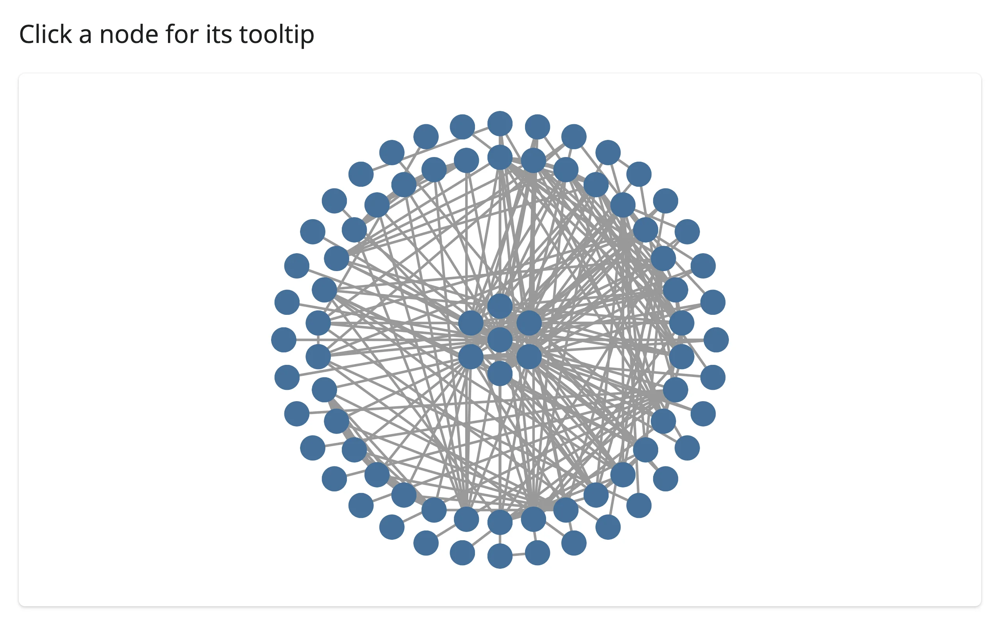 | 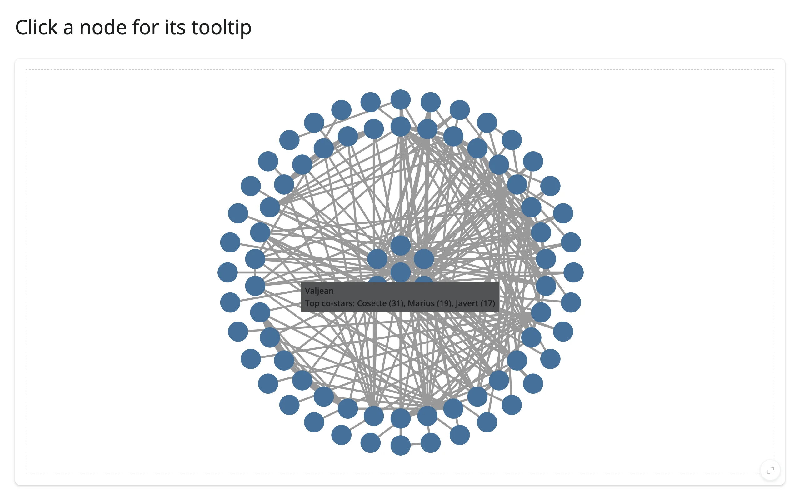 |

Newlines in the tooltip text become `<br>`. The tooltip toggles on each click of the same node and hides on the
next click.

## Reacting to user interaction

### Accessor reference

| accessor | returns | before any interaction | across re-render | default rate policy |
|---|---|---|---|---|
| `clicked_node()` | the clicked node's cytoscape `ele.json()` dict (`["data"]` holds its data, including `"id"`) | `None` | kept | none |
| `clicked_edge()` | the clicked edge's `ele.json()` dict (`["data"]` has `"id"`, `"source"`, `"target"`) | `None` | kept | none |
| `selected_nodes()` | the selected nodes' `data` dicts, in graph order | `[]` | re-seeded | debounce (0.25s) |
| `selected_edges()` | the selected edges' `data` dicts, in graph order | `[]` | re-seeded | debounce (0.25s) |

All four attach the moment the graph renders, so an interaction is never lost to timing -- there's no warm-up
step and no "first read" gotcha. `clicked_node()`/`clicked_edge()` are click events: they return `None` until the
first matching click, and then **keep** that payload across a re-render until the user clicks the new graph (the
click still happened, though the payload then refers to the previous render's graph -- node ids from networkx are
always strings, but edge ids are fresh UUIDs every render, so don't persist a retained edge id across renders).
`selected_nodes()`/`selected_edges()` instead **re-seed** from the new graph on every render, so they always
describe what's currently selected -- `[]` right after a render unless you pre-select nodes in the render function.
Wrap a dependent read in `req(...)` when you want to wait for the first click; the selection accessors need no
`req()` since `[]` is already a valid, checkable "nothing selected" value.

All four are **eager**: shinywidgets registers their handlers (`CytoscapeWidget.on()` for clicks,
`Node`/`Edge.observe()` for selection) while the widget is being constructed, before the view reaches the browser.
This matters because of an upstream quirk (verified on ipycytoscape 1.3.3): the frontend only wires up *new* event
types the first time it sees them per element type, so a handler registered later -- for example, from inside a
`@reactive.effect` instead of at render time -- can be silently dropped. If you register your own `widget.on(...)`
callbacks for other event types (`mouseover`, `tap`, etc.), do it inside the render function before returning the
widget, the same way the built-in accessors do. Each accessor can also be read by name, `network.read("clicked_node")`,
which is useful for code that reads accessors generically.

### `clicked_node()`: a detail card and neighbor list

```{.python file="examples/06_clicked_node.py"}
import networkx as nx
from ipycytoscape import CytoscapeWidget
from shiny.express import render, ui
from shinywidgets import render_ipycytoscape

G = nx.karate_club_graph()

ui.page_opts(title="clicked_node()", fillable=True)

with ui.layout_columns(col_widths=[8, 4]):
    with ui.card(full_screen=True):

        @render_ipycytoscape
        def network():
            widget = CytoscapeWidget(G)
            widget.set_layout(name="concentric")
            return widget

    with ui.card():
        ui.card_header("Clicked member")

        @render.ui
        def detail():
            clicked = network.clicked_node()
            if clicked is None:
                return ui.p("Click a member to see their connections.")
            member = int(clicked["data"]["id"])
            friends = sorted(G.neighbors(member))
            return ui.TagList(
                ui.h5(f"Member {member}"),
                ui.p(f"{G.nodes[member]['club']}'s faction"),
                ui.p(f"Connected to {len(friends)}: {', '.join(map(str, friends))}"),
            )
```

| Before | After clicking member 33 |
|---|---|
| 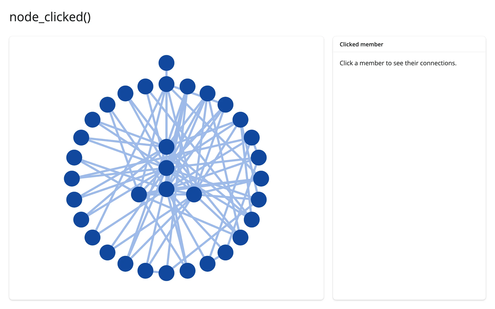 | 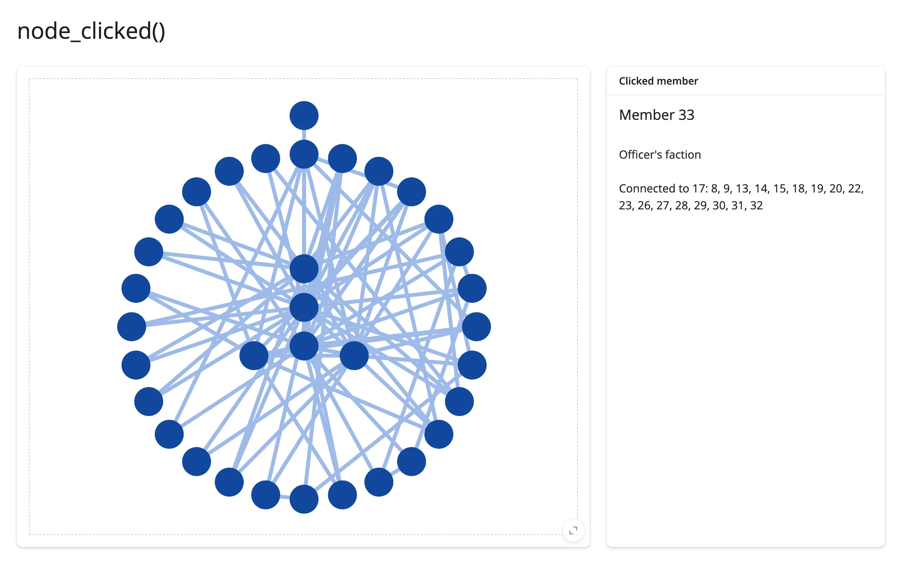 |

### `clicked_edge()`: the data behind a tie

```{.python file="examples/07_clicked_edge.py"}
import networkx as nx
from ipycytoscape import CytoscapeWidget
from shiny.express import render, ui
from shinywidgets import render_ipycytoscape

# A small corner of the Les Miserables co-appearance graph, with fixed
# positions so every edge lands in a predictable spot
G = (
    nx.les_miserables_graph()
    .subgraph(["Valjean", "Cosette", "Javert", "Marius"])
    .copy()
)
POSITIONS = {
    "Valjean": (200, 150),
    "Cosette": (400, 150),
    "Javert": (200, 300),
    "Marius": (400, 300),
}

STYLE = [
    {"selector": "node", "style": {"label": "data(id)"}},
    {"selector": "edge", "style": {"width": "mapData(weight, 1, 31, 1, 10)"}},
]

ui.page_opts(title="clicked_edge()", fillable=True)

with ui.layout_columns(col_widths=[8, 4]):
    with ui.card(full_screen=True):

        @render_ipycytoscape
        def network():
            widget = CytoscapeWidget(G)
            widget.set_style(STYLE)
            for node in widget.graph.nodes:
                node.position = {
                    "x": POSITIONS[node.data["id"]][0],
                    "y": POSITIONS[node.data["id"]][1],
                }
            widget.set_layout(name="preset", fit=True, padding=40)
            return widget

    with ui.card():
        ui.card_header("Clicked tie")

        @render.ui
        def detail():
            clicked = network.clicked_edge()
            if clicked is None:
                return ui.p("Click an edge to see the shared scene count.")
            d = clicked["data"]
            return ui.p(f"{d['source']} and {d['target']} share {d['weight']} scenes.")
```

| Before | After clicking Valjean–Cosette |
|---|---|
| 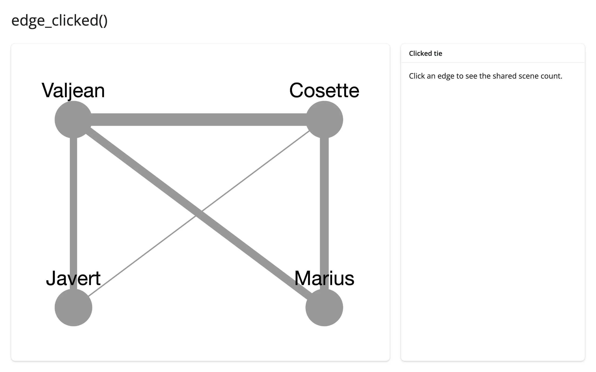 | 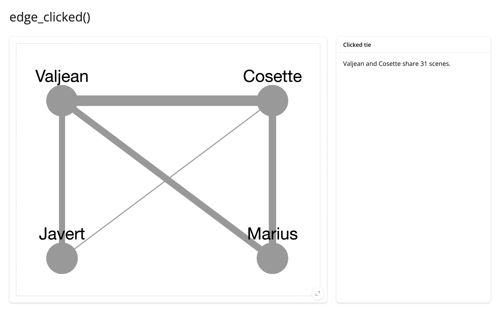 |

### `selected_nodes()`/`selected_edges()`: box and multi-select

`clicked_node()` only reports single clicks. `selected_nodes()` and `selected_edges()` cover the rest of
ipycytoscape's selection model -- shift-drag box selection and multi-select -- as a one-line read of the current
selection, with no need to loop over the graph's children yourself.

Two things to set up first, both verified on current main: ipycytoscape makes nodes unselectable by
default (`Node.selectable` defaults to `False`, diverging from the JS default), so set `node.selectable = True` on
each node; and box selection itself needs `CytoscapeWidget(..., auto_unselectify=False,
box_selection_enabled=True)`.

```{.python file="examples/08_selected_nodes.py"}
import networkx as nx
from ipycytoscape import CytoscapeWidget
from shiny.express import render, ui
from shinywidgets import render_ipycytoscape

G = nx.les_miserables_graph()
STYLE = [{"selector": "node:selected", "style": {"background-color": "#e15759"}}]

ui.page_opts(title="selected_nodes()", fillable=True)

with ui.layout_columns(col_widths=[8, 4]):
    with ui.card(full_screen=True):
        ui.card_header("Click a node, or shift-drag a box to select a group")

        @render_ipycytoscape
        def network():
            widget = CytoscapeWidget(
                G, auto_unselectify=False, box_selection_enabled=True
            )
            widget.set_style(STYLE)
            widget.set_layout(name="cose")
            for node in widget.graph.nodes:
                node.selectable = True  # ipycytoscape defaults nodes to unselectable
            return widget

    with ui.card():
        ui.card_header("Group stats")

        @render.ui
        def stats():
            selected = {d["id"] for d in network.selected_nodes()}
            if not selected:
                return ui.p("Nothing selected.")
            sub = G.subgraph(selected)
            return ui.p(
                f"{len(selected)} characters, {sub.number_of_edges()} ties inside "
                f"the group, density {nx.density(sub):.2f}"
            )
```

| Before | After a shift-drag box select |
|---|---|
| 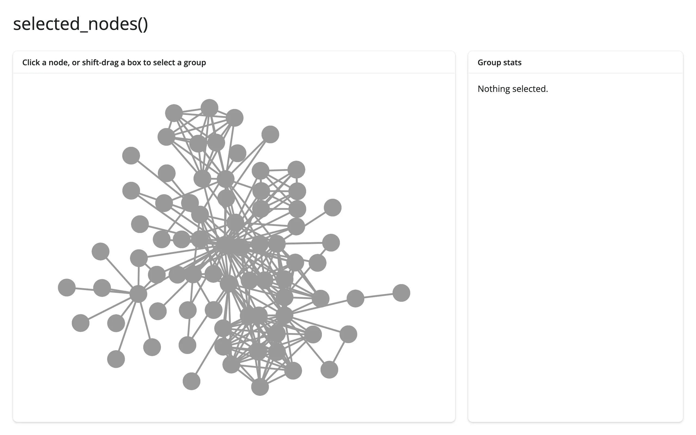 | 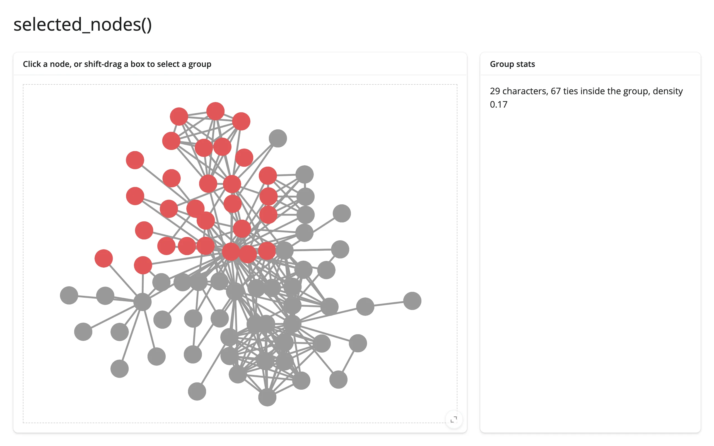 |

A click selects one node (or adds to the selection with `selection_type="additive"`); shift-drag box-selects a
group; clicking the background clears everything. Don't try to *set* `node.selected` from Python to drive
selection -- on current main, writing it toggles the node's *selectability* instead of its selection state, an
upstream mismatch between the Python trait and the JS property it's supposed to mirror. Use classes to highlight
from Python instead (see "Coordinating multiple views" below).

### Reading an accessor on demand

Because every accessor is already live and recording interactions the moment the graph renders, reading one for
the first time inside a button handler or download handler works -- there's no need to display it reactively
first to "warm it up". A handler that only runs when the user asks for it still sees the latest selection:

```{.python file="examples/13_read_on_demand.py"}
import io

import networkx as nx
from ipycytoscape import CytoscapeWidget
from shiny.express import render, ui
from shinywidgets import render_ipycytoscape

G = nx.les_miserables_graph()
STYLE = [{"selector": "node:selected", "style": {"background-color": "#e15759"}}]

ui.page_opts(title="Read on demand", fillable=True)

with ui.layout_columns(col_widths=[8, 4]):
    with ui.card(full_screen=True):
        ui.card_header("Select a group, then export it -- no need to display it first")

        @render_ipycytoscape
        def network():
            widget = CytoscapeWidget(
                G, auto_unselectify=False, box_selection_enabled=True
            )
            widget.set_style(STYLE)
            widget.set_layout(name="cose")
            for node in widget.graph.nodes:
                node.selectable = True
            return widget

    with ui.card():
        ui.card_header("Export")
        ui.p("Nothing on this page reads selected_nodes() until you click Download.")

        @render.download_button(
            filename="selection.csv", label="Download selected characters"
        )
        def export():
            # Read on demand: no warm-up, no earlier display of this value --
            # selected_nodes() already has the latest selection the moment
            # the handler runs.
            rows = ["id"] + [d["id"] for d in network.selected_nodes()]
            yield io.BytesIO("\n".join(rows).encode()).getvalue()
```

| Before download | Downloaded file |
|---|---|
| 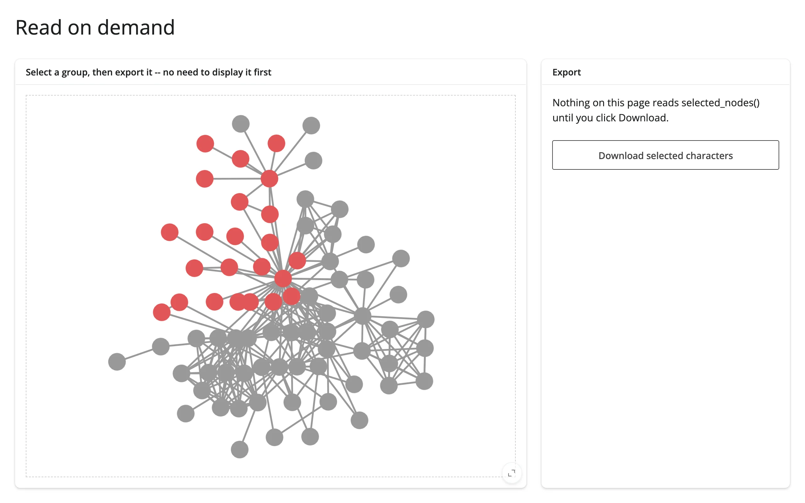 | 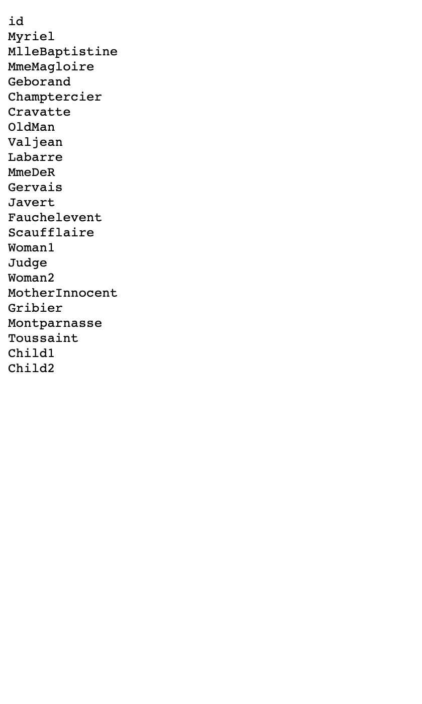 |

### Beyond the accessors: `reactive_read`

The accessors above cover clicks and selection. A couple of other traits sync from the browser but aren't worth an
accessor of their own: each node's `grabbed` trait is `True` while the user is actively dragging it, and `removed`
tracks structural edits. Read either with `reactive_read(node, "grabbed")` on a node in
`.widget.graph.nodes`. Node `position` does *not* sync back (see "Gotchas and limitations"), so there's no way to
read a user's manual drag target from Python.

For box-selection at a larger scale than `selected_nodes()`/`selected_edges()` comfortably handle (well past Les
Mis's 77 nodes, under very heavy selection churn), the accessors' own implementation is the pattern to copy: one
`node.observe(callback, "selected")` per node, folded into a single `reactive.value`, which is exactly what
`selected_nodes()` already does for you in the common case.

### Rate limiting

`render_ipycytoscape`'s `rate_policy`/`rate_delay` kwargs cover `reactive_read()` on the top-level
`CytoscapeWidget` *and* the graph's child `Node`/`Edge` widgets -- the ones that actually own `selected` and
`grabbed`. They also override `selected_nodes()`/`selected_edges()`'s own debounce default (0.25s);
`clicked_node()`/`clicked_edge()` aren't rate-limited (every click is discrete and immediate, so there's nothing to
smooth out). One limitation worth knowing: nodes or edges added to the graph *after* a render aren't covered until
the next render.

## Updating the widget from Python

Because the widget lives on in the browser between renders, you can restyle it from Python without resending the
graph or losing the user's pan and zoom. The difference matters: re-rendering (returning a new value from the
`@render_ipycytoscape` function) tears down and rebuilds every node and edge widget -- recall each one is its own
ipywidget -- resets the camera to the layout's default fit, and clears any classes you'd set. An in-place update
(`network.widget.<trait> = ...`, called from a `@reactive.effect`) touches only what you change.

```{.python file="examples/09_inplace_vs_rerender.py"}
import networkx as nx
from ipycytoscape import CytoscapeWidget
from shiny import reactive
from shiny.express import input, ui
from shinywidgets import render_ipycytoscape

G = nx.les_miserables_graph()
STYLE = [
    {"selector": "node", "style": {"background-color": "#447099"}},
    {"selector": "node.highlight", "style": {"background-color": "#e15759"}},
]

ui.page_opts(title="In-place update vs. re-render", fillable=True)
ui.p("Scroll to zoom or drag to pan, then try each button.", class_="text-muted")
with ui.layout_columns(col_widths=[6, 6]):
    ui.input_action_button("highlight", "Highlight high-degree nodes (in place)")
    ui.input_action_button("rerender", "Re-render from scratch")

with ui.card(full_screen=True):

    @render_ipycytoscape
    def network():
        input.rerender()  # only this button forces a full rebuild
        widget = CytoscapeWidget(G)
        widget.set_style(STYLE)
        widget.set_layout(name="cose")
        return widget

    @reactive.effect
    @reactive.event(input.highlight)
    def _():
        # Toggles a class on each node: no re-render, no relayout, so the
        # user's current pan/zoom is untouched
        for node in network.widget.graph.nodes:
            node.classes = "highlight" if G.degree(node.data["id"]) >= 15 else ""
```

Zoomed in, then highlighted in place (same pan/zoom):

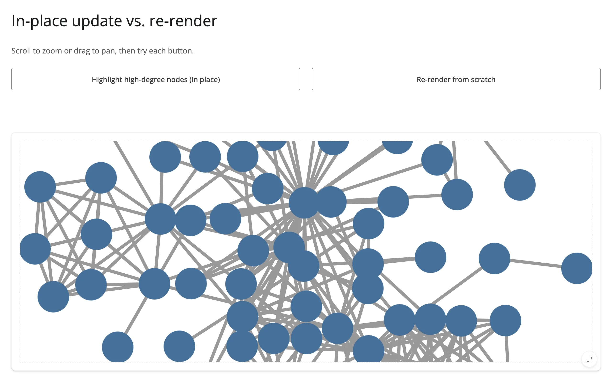
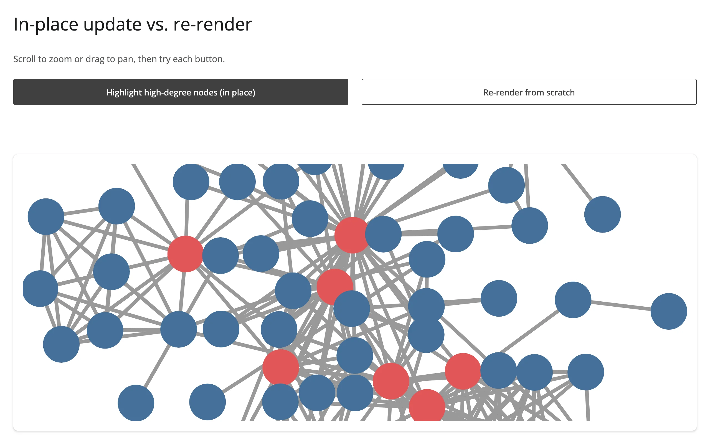

After "re-render from scratch" (camera reset to the default fit, highlight lost):

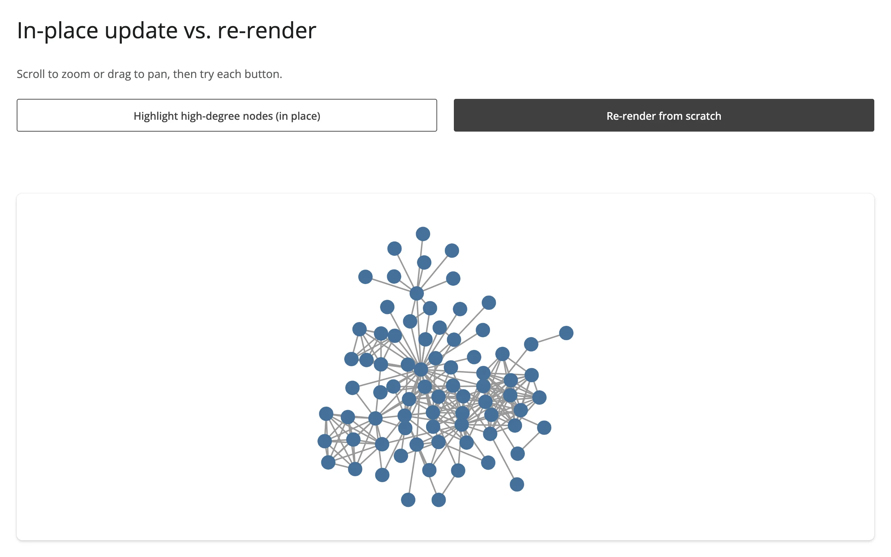

Verified directly: reading `cytoscape_obj.zoom()` through the browser's live widget manager held at exactly `2.2`
across the in-place highlight, then reset to the layout's default fit (`~0.7`) after the re-render button.

Use in-place updates for anything the user is actively exploring (styling, classes, layout tweaks, selection
handling); reserve re-rendering for when the underlying data actually changes shape (different graph, different
node set).

## Coordinating multiple views

### Click a node, highlight its neighborhood

Combining `clicked_node()` with a restyle effect gives you a "focus" interaction: fade everything except the
clicked node and its neighbors, without ever re-running the layout.

```{.python file="examples/10_click_neighborhood_highlight.py"}
import networkx as nx
from ipycytoscape import CytoscapeWidget
from shiny import reactive
from shiny.express import render, ui
from shinywidgets import render_ipycytoscape

G = nx.les_miserables_graph()
STYLE = [
    {"selector": "node", "style": {"background-color": "#447099"}},
    {"selector": "node[degree >= 15]", "style": {"label": "data(id)"}},
    {"selector": ".faded", "style": {"opacity": 0.1, "text-opacity": 0}},
    {"selector": "node.focus", "style": {"border-width": 3, "border-color": "#212529"}},
]
for n in G.nodes:
    G.nodes[n]["degree"] = G.degree(n)

ui.page_opts(title="Click to highlight a neighborhood", fillable=True)

with ui.layout_columns(col_widths=[8, 4]):
    with ui.card(full_screen=True):

        @render_ipycytoscape
        def network():
            widget = CytoscapeWidget(G)
            widget.set_style(STYLE)
            widget.set_layout(name="concentric")
            return widget

    with ui.card():
        ui.card_header("Selected character")

        @render.ui
        def detail():
            clicked = network.clicked_node()
            if clicked is None:
                return ui.p("Click a character to see their circle.")
            name = clicked["data"]["id"]
            return ui.p(f"{name} and {G.degree(name)} co-characters are highlighted.")

    @reactive.effect
    def _():
        # Restyle in place by toggling classes: the layout never reruns and
        # the user's pan/zoom is kept
        clicked = network.clicked_node()
        center = clicked["data"]["id"] if clicked else None
        focus = {center, *G[center]} if center else set()
        for node in network.widget.graph.nodes:
            name = node.data["id"]
            if not focus:
                node.classes = ""
            else:
                node.classes = (
                    "focus" if name == center else "" if name in focus else "faded"
                )
        for edge in network.widget.graph.edges:
            s, t = edge.data["source"], edge.data["target"]
            edge.classes = "" if not focus or center in (s, t) else "faded"
```

| Before | After clicking Valjean |
|---|---|
| 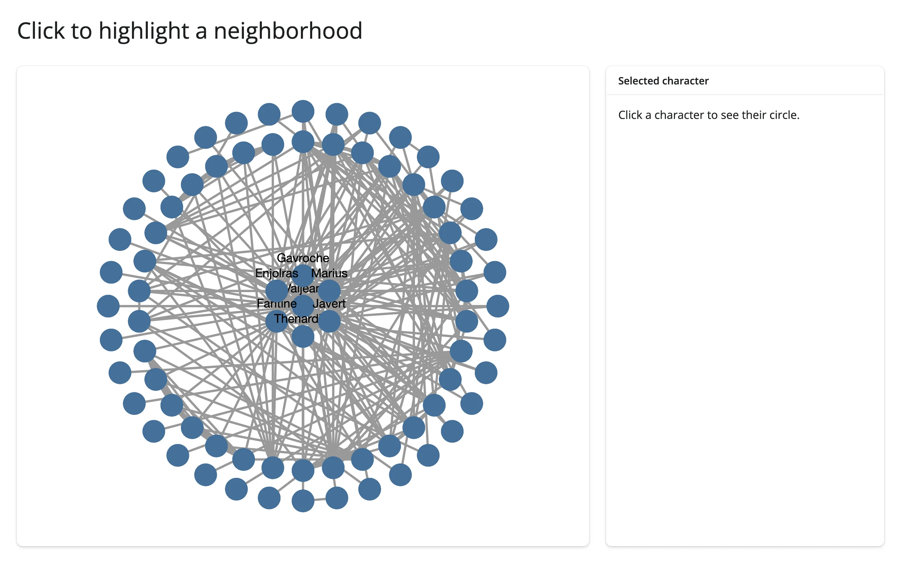 | 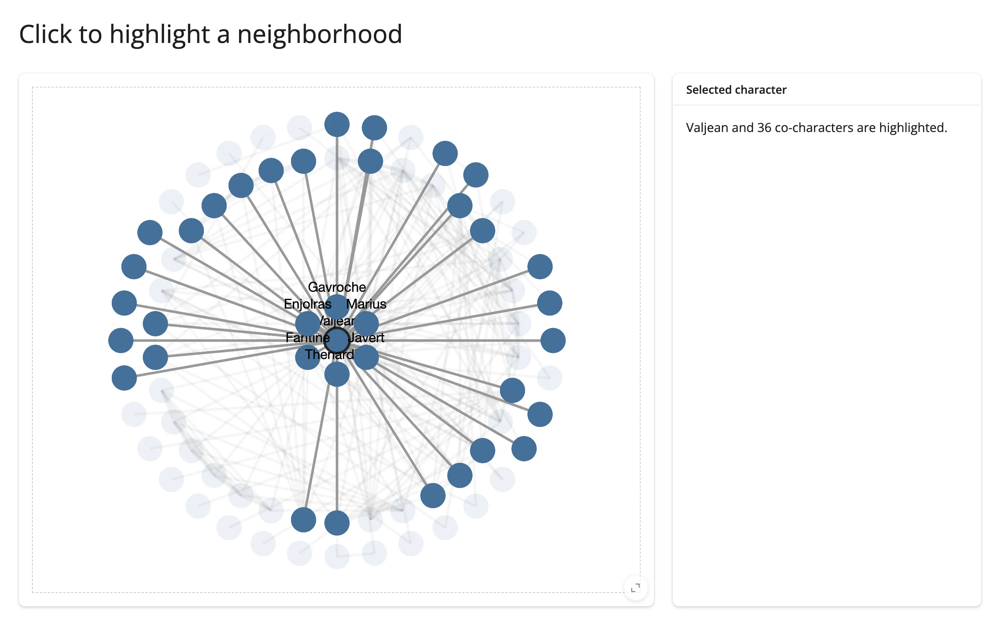 |

### Shortest path between two picks

A pair of `input_selectize()` values feeds `nx.shortest_path()`; the result is drawn by toggling a `path` class,
not by re-rendering.

```{.python file="examples/11_shortest_path.py"}
import networkx as nx
from ipycytoscape import CytoscapeWidget
from shiny import reactive
from shiny.express import input, render, ui
from shinywidgets import render_ipycytoscape

G = nx.les_miserables_graph()
CHARACTERS = sorted(G.nodes)
STYLE = [
    {"selector": "node", "style": {"background-color": "#447099"}},
    {"selector": "node.path", "style": {"label": "data(id)", "border-width": 3}},
    {"selector": "edge.path", "style": {"line-color": "#e15759", "width": 5}},
]

ui.page_opts(title="Shortest path, drawn in place", fillable=True)

with ui.layout_columns(col_widths=[8, 4]):
    with ui.card(full_screen=True):

        @render_ipycytoscape
        def network():
            widget = CytoscapeWidget(G)
            widget.set_style(STYLE)
            widget.set_layout(name="cose")
            return widget

    with ui.card():
        ui.input_selectize(
            "ends",
            "Shortest path between",
            CHARACTERS,
            multiple=True,
            options={"maxItems": 2},
        )

        @render.ui
        def info():
            if len(input.ends()) != 2:
                return ui.p("Pick two characters.")
            return ui.p(" → ".join(path()))


@reactive.calc
def path() -> list[str]:
    ends = input.ends()
    if len(ends) != 2:
        return []
    return nx.shortest_path(G, *ends)


@reactive.effect
def _():
    # No re-render and no relayout: only each element's classes change
    p = set(path())
    on_path_edges = set(zip(path(), path()[1:])) | set(zip(path()[1:], path()))
    for node in network.widget.graph.nodes:
        node.classes = "path" if node.data["id"] in p else ""
    for edge in network.widget.graph.edges:
        key = (edge.data["source"], edge.data["target"])
        edge.classes = "path" if key in on_path_edges else ""
```

| Before | After picking Champtercier / Grantaire |
|---|---|
| 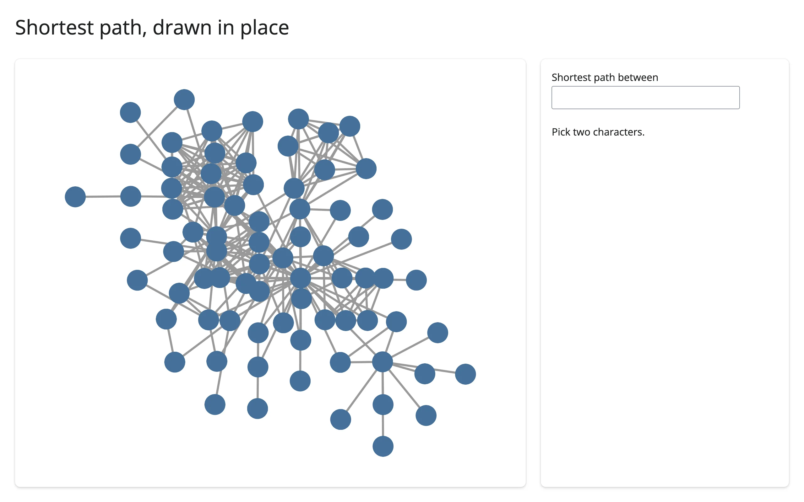 | 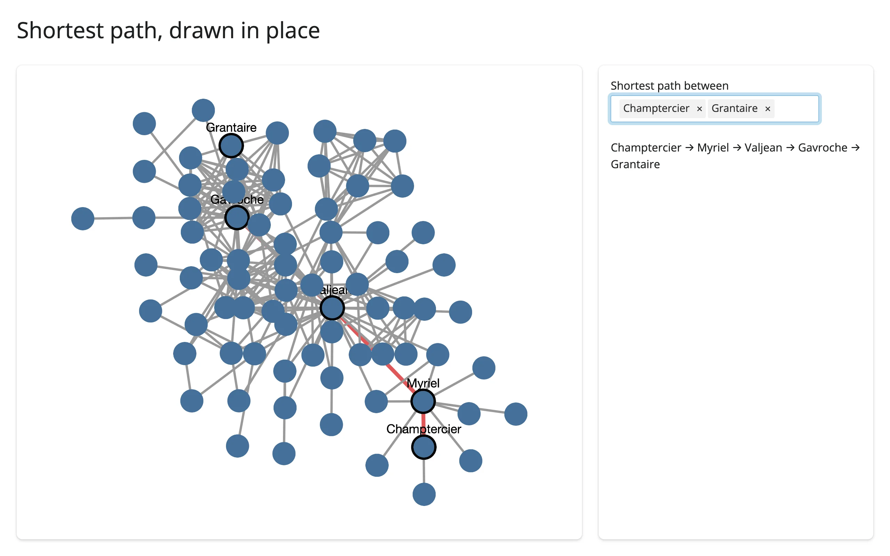 |

### Filter from a slider without losing the layout

A force-directed layout is expensive to compute and meaningful positions take a moment to settle, so you don't
want to re-run it every time a filter changes. Hiding elements with a `display: none` style class -- rather than
removing them from the graph -- keeps every remaining node exactly where it was.

```{.python file="examples/12_filter_preserve_layout.py"}
import networkx as nx
from ipycytoscape import CytoscapeWidget
from shiny import reactive
from shiny.express import input, ui
from shinywidgets import render_ipycytoscape

G = nx.les_miserables_graph()
for n in G.nodes:
    G.nodes[n]["degree"] = G.degree(n)
STYLE = [
    {"selector": "node", "style": {"background-color": "#447099"}},
    {"selector": ".hidden", "style": {"display": "none"}},
]

ui.page_opts(title="Filter without losing the layout", fillable=True)
ui.input_slider("min_degree", "Minimum number of co-stars", 1, 20, 1)

with ui.card(full_screen=True):

    @render_ipycytoscape
    def network():
        widget = CytoscapeWidget(G)
        widget.set_style(STYLE)
        widget.set_layout(name="cose")  # computed once, from the full graph
        return widget

    @reactive.effect
    def _():
        # Hiding elements (not removing them) keeps every node's position, so
        # raising the slider back down instantly restores the full layout
        shown = {n for n in G if G.nodes[n]["degree"] >= input.min_degree()}
        for node in network.widget.graph.nodes:
            node.classes = "" if node.data["id"] in shown else "hidden"
        for edge in network.widget.graph.edges:
            s, t = edge.data["source"], edge.data["target"]
            edge.classes = "" if s in shown and t in shown else "hidden"
```

| Before (all 77 characters) | After raising the slider to 11 |
|---|---|
| 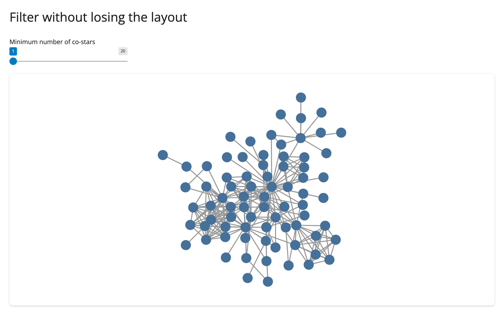 | 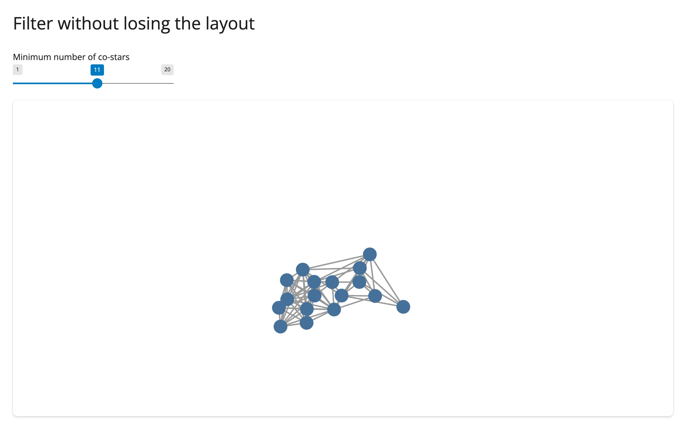 |

Verified directly: comparing every node's `renderedPosition()` before and after moving the slider shows zero
pixels of movement across all 77 nodes (17 of them stay visible at the `>= 11` threshold shown above). Removing
nodes instead (`remove_node_by_id()`) is a
structural edit covered in "Gotchas and limitations" -- it doesn't preserve positions and has its own bug; prefer
hiding for anything you expect the user to toggle back and forth.

## Large data

ipycytoscape doesn't have a large-data mode: every node and edge is its own ipywidget (see
["Gotchas and limitations"](#gotchas-and-limitations)), so render time scales with element count --
comfortable into the low thousands of nodes, slow well past that, verified on current `main`. For graphs in the
tens of thousands of nodes or more, reach for [ipysigma](../ipysigma/index.md#large-data) instead, which draws
with the GPU (WebGL) rather than one widget per element -- the "draw it with the GPU in the browser" approach in
[Large data & performance's three approaches](../../guide/performance/index.md#three-approaches-to-large-data).

## Layout and sizing

`render_ipycytoscape`'s `height`/`fill`/`fillable` kwargs (and `output_widget()`'s) work the way every shinywidgets
renderer's do: the graph fills its card or parent container unless you give it an explicit height, and it tracks
sidebar collapses, full-screen toggles, and window resizes. A few things specific to this widget:

- Prefer the decorator's or `output_widget()`'s `height=` over `widget.layout.height`: the latter sets the
  ipywidgets `Layout` trait directly, and the graph's internal layout algorithm can run before that CSS applies,
  clipping the result to the default 400px rather than your requested height.
- The graph does not re-fit itself on a container resize; pan and zoom are preserved through resizes exactly as
  they are through in-place updates (see above), which means part of the graph can end up outside the visible area
  after a big resize. Call `widget.relayout()` (re-runs the layout with a fresh fit) if you want to recover from
  that.
- `output_widget(height="auto")` (or `"fit-content"`) keeps ipycytoscape's intrinsic 400px default instead of
  collapsing to 0px -- this was a real shinywidgets regression in an earlier development branch, fixed on current
  main and covered by a Playwright test (`tests/playwright/render_ipycytoscape_fill`).

## Gotchas and limitations

All verified on ipycytoscape 1.3.3 against shinywidgets `main`:

- **Removing a node from Python corrupts the rest of the graph.** `graph.remove_node_by_id(...)` can take a
  35-node graph down to 16 nodes in the browser, with console errors about duplicate/missing elements. This is an
  upstream bug in how `ViewList` diffs removals; adding nodes is fine. Prefer re-rendering (or hiding, as in the
  filter pattern above) over removing nodes at runtime.
- **Don't set `node.selected` from Python.** It maps to the element's *selectability* in the frontend, not its
  selection state -- the opposite of what the name suggests. Use classes to drive highlighting from Python instead.
- **Positions, zoom, and pan don't sync from the browser to Python.** `node.position` stays empty after a layout
  runs or after the user drags a node (though setting it *from* Python does move the node); the top-level `zoom`
  trait has no browser-side listener at all. You can't persist a user's manual arrangement or read the current
  viewport.
- **Setting `CytoscapeWidget.zoom` from Python has no effect in the browser**, the opposite direction of the gap
  above -- there's no way to drive the viewport's zoom level from Python either way. Only node/edge-level traits
  (position, classes, style) sync Python -> browser.
- **An invalid event name passed to `widget.on()` corrupts the widget's callback registry**, and every later
  `.on()` call then raises. Only use names from `ipycytoscape.MONITORED_USER_INTERACTIONS` (there's no `dblclick`,
  for instance). Inside a Shiny effect, this is an unhandled exception that ends the session, so validate the
  event name once at import time if you're taking it from user input.
- **Every node and edge is a separate ipywidget** (three widget models per node: the node itself plus data/style
  bookkeeping), so render time scales with element count -- comfortable into the low thousands of nodes, slow
  beyond that. For bigger graphs, use [ipysigma](../ipysigma/index.md).
- **Upstream maintenance is light.** The last PyPI release was April 2022; the points above are open upstream
  issues, not shinywidgets bugs, and nothing here has changed in the current release.

## Gallery candidates

### Network explorer (template)

[`gallery/template_network_explorer.py`](gallery/template_network_explorer.py) -- pick a built-in graph and
layout, click a node for its neighbor list. A small, adaptable starting point: swap in your own graph by replacing
the `GRAPHS` dict.

| Before | After clicking member 33 |
|---|---|
| 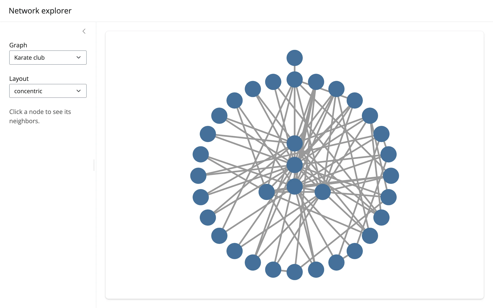 | 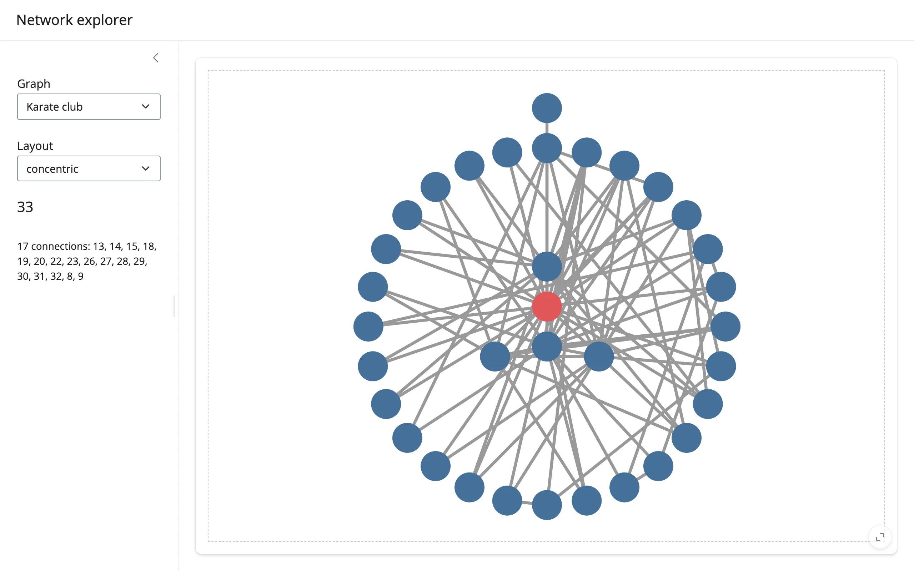 |

### Les Misérables network (showcase)

[`gallery/showcase_les_miserables.py`](gallery/showcase_les_miserables.py) -- the full combination: Louvain
communities drive node color, degree drives size, `clicked_node()` focuses a character's circle with a detail
card, shift-drag box selection (via `selected_nodes()`) reports group density, `clicked_edge()` reports a tie's
scene count, and a shortest-path picker traces the chain between any two characters. Everything restyles in place;
the graph is rendered once.

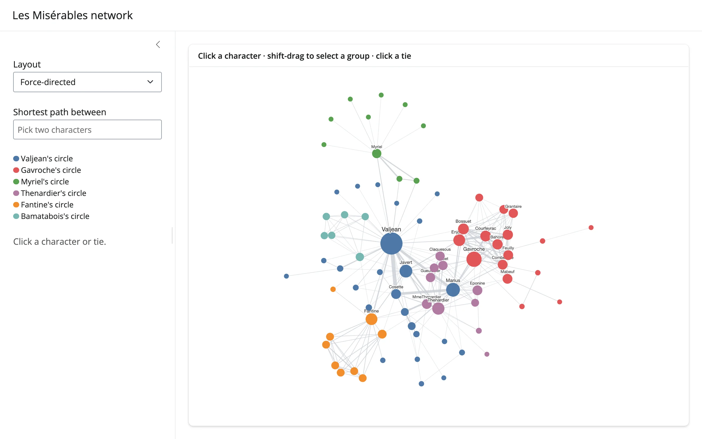

Clicking Valjean fades everyone outside his circle and lists his top co-stars:


Shift-dragging a box over a cluster reports its size and density:

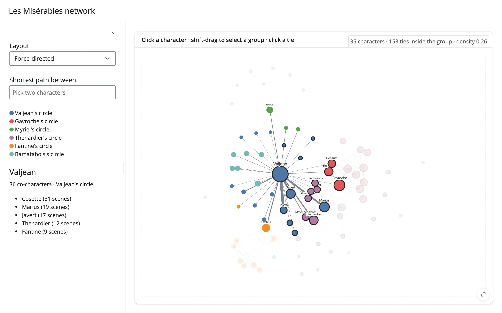

Picking two characters traces the path between them, on top of whatever focus/selection is already active:

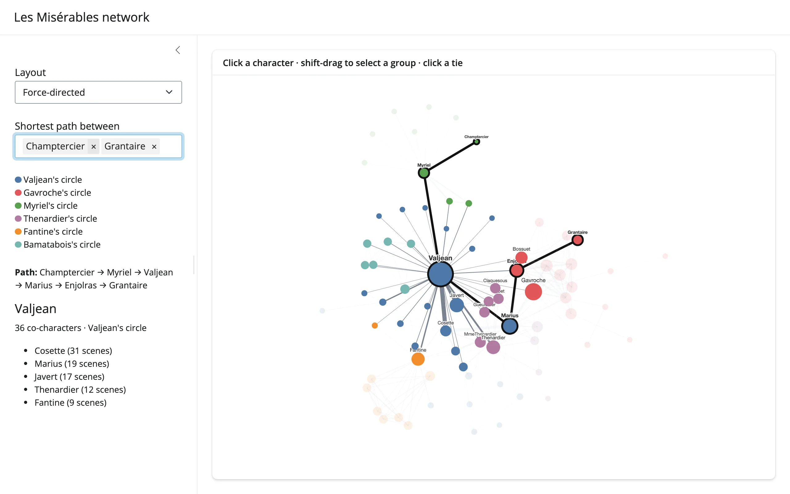

## Learn more

- [ipycytoscape on GitHub](https://github.com/cytoscape/ipycytoscape) and its
  [documentation](https://ipycytoscape.readthedocs.io)
- [Cytoscape.js documentation](https://js.cytoscape.org) for the full stylesheet and layout reference (every
  layout name and style property ipycytoscape accepts comes straight from here)
- [networkx documentation](https://networkx.org) for graph construction and algorithms (communities, shortest
  paths, centrality)
- [ipysigma](../ipysigma/index.md) for large graphs (tens of thousands of nodes and up)
- [ipyleaflet](../ipyleaflet/index.md) and [lonboard](../lonboard/index.md) for geographic networks
