[ipydatagrid](https://github.com/bloomberg/ipydatagrid) is Bloomberg's canvas-rendered data grid for Jupyter.
Unlike an HTML table, every cell is painted on a `<canvas>` by a [Lumino](https://github.com/jupyterlab/lumino)
`DataGrid`, which is what lets it show spreadsheet-style rectangular selections, per-cell renderers (bars,
heatmaps, conditional colors), and millions of rows without the DOM node count that an HTML table would need.

`render_ipydatagrid` takes a `pandas.DataFrame` for zero-config display, or an `ipydatagrid.DataGrid` (or
`StreamingDataGrid`) when you want to configure selection mode, editing, cell renderers, or column widths. The
decorator handles fill/height layout defaults the same way every other `shinywidgets` renderer does, and adds
four reactive accessors -- `.selected()`, `.clicked_cell()`, `.edited_cell()`, and `.visible_data()` -- so you
can read what the user selected, clicked, edited, or is currently looking at (after their own sort/filter)
without touching ipywidgets traits directly.

Reach for ipydatagrid when you want spreadsheet-like interaction: dragging out a rectangular block of cells (not
just rows), in-cell bars or heatmaps with no CSS, or editable cells with a Python callback. For a fast, zero-config
browsable table, or built-in client-side search, see [itables](../itables/index.md) or
[reactable](../reactable/index.md) instead; those don't give you cell-block selection or in-cell renderers. For
tables in the hundreds of thousands to millions of rows where you don't need per-cell renderers, `StreamingDataGrid`
(below) is also a strong fit, alongside [perspective](../perspective/index.md)'s aggregation-first view.

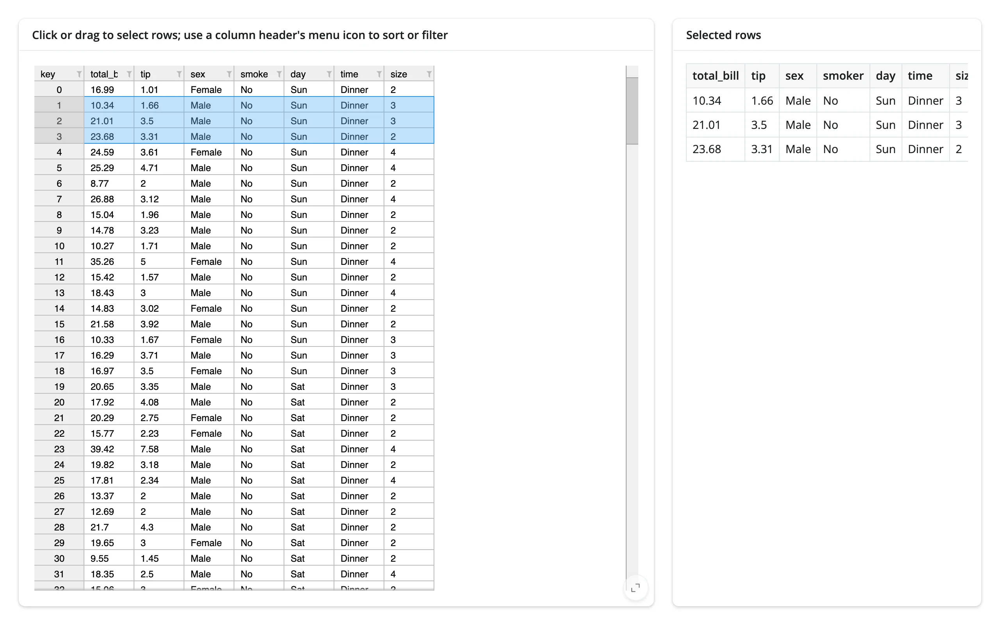

## Installation

```sh
pip install 'shinywidgets[ipydatagrid]'
```

This pulls in `ipydatagrid`, `bqscales` (for `LinearScale`/`ColorScale`), and `py2vega` (for `VegaExpr`), all pure
Python.

## Quick start

A `DataGrid(df, selection_mode="row")` with a card showing the rows the user has selected. `.selected()` gives
you the selected rectangles in the grid's *displayed* order; `.visible_data()` gives you that same displayed frame,
so indexing one into the other maps a selection straight to the matching rows -- no need to track sort/filter state
yourself.

```{.python file="examples/01_quickstart.py"}
import plotly.express as px
from ipydatagrid import DataGrid
from shiny.express import render, ui
from shinywidgets import render_ipydatagrid

tips = px.data.tips()  # 244 restaurant bills: total_bill, tip, sex, smoker, day, time, size

ui.page_opts(fillable=True)

with ui.layout_columns(col_widths=[8, 4]):
    with ui.card(full_screen=True):
        ui.card_header(
            "Click or drag to select rows; use a column header's "
            "menu icon to sort or filter"
        )

        @render_ipydatagrid
        def grid():
            return DataGrid(tips, selection_mode="row")

    with ui.card():
        ui.card_header("Selected rows")

        @render.data_frame
        def selected():
            rows = sorted(
                {r for s in grid.selected() for r in range(s["r1"], s["r2"] + 1)}
            )
            return grid.visible_data().iloc[rows].reset_index(drop=True)
```

A plain `DataFrame` return works too, but ipydatagrid's own default is `selection_mode="none"`, so
`.selected()` would always be `[]`. Pass a `DataGrid` with a `selection_mode` to get selection.

Clicking a header label selects the whole row (in row mode) or column (in cell/column mode) -- sorting and
filtering live in the small menu icon at a header's right edge, not in a plain click.

## What you can build

### In-cell renderers: heatmaps, bars, and conditional color

`TextRenderer` and `BarRenderer` paint each cell's background, text color, or a bar, driven by a `bqscales`
scale or a `VegaExpr` (a small per-cell JavaScript expression evaluated against `cell.value`). This gets you a
heatmap, an in-cell progress bar, or red/green conditional formatting with no custom CSS.

```{.python file="examples/02_renderers.py"}
import numpy as np
import pandas as pd
from bqscales import ColorScale, LinearScale
from ipydatagrid import BarRenderer, DataGrid, TextRenderer, VegaExpr
from shiny.express import ui
from shinywidgets import render_ipydatagrid

rng = np.random.default_rng(3)
months = ["Jan", "Feb", "Mar", "Apr", "May", "Jun"]
sales = pd.DataFrame(
    {"product": [f"Widget {c}" for c in "ABCDEFGH"]}
    | {m: rng.integers(20, 200, 8) for m in months}
)
sales["total"] = sales[months].sum(axis=1)
sales["yoy"] = rng.uniform(-0.3, 0.4, 8).round(3)

ui.page_opts(fillable=True)

with ui.card(full_screen=True):
    ui.card_header("Renderers: heatmap, bars, and conditional color")

    @render_ipydatagrid
    def grid():
        # Renderers and scales are widgets, so build them here (inside the
        # render function), not at module import time.
        heatmap = TextRenderer(
            background_color=ColorScale(min=20, max=200, scheme="Blues"),
            format=",",
        )
        bars = BarRenderer(
            # LinearScale's min/max are plain Python floats, not numpy scalars
            bar_value=LinearScale(min=0, max=float(sales["total"].max())),
            bar_color="#4C78A8",
            format=",",
        )
        yoy_color = TextRenderer(
            text_color=VegaExpr("cell.value >= 0 ? '#1a7f37' : '#cf222e'"),
            format="+.1%",
        )
        return DataGrid(
            sales,
            renderers={**{m: heatmap for m in months}, "total": bars, "yoy": yoy_color},
            selection_mode="none",
            column_widths={"product": 90},
        )
```

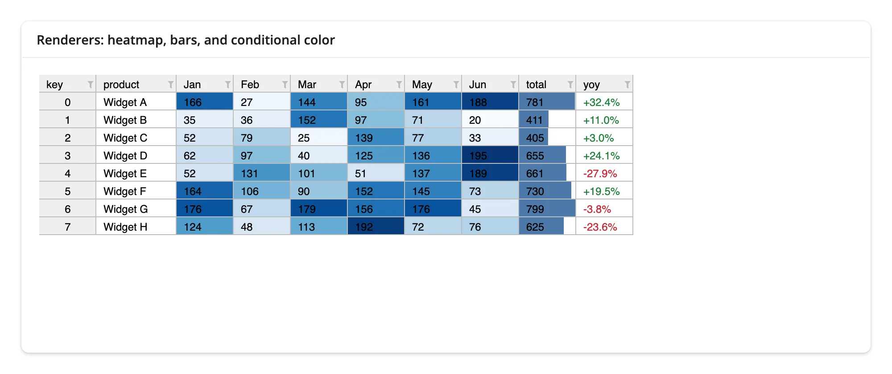

Two things that will trip you up the first time: `TextRenderer`, `BarRenderer`, `VegaExpr`, and the `bqscales`
scales are all ipywidgets, so building them at import time (the idiomatic notebook style) fails with
shinywidgets' "requires an active Shiny session" error -- build them inside the render function, as above. And
`BarRenderer`'s `bar_value` defaults to a scale with `max=0.0`, not an auto-scaling `None`, so an un-scaled
`BarRenderer()` silently draws no bars at all; always pass `bar_value=LinearScale(min=..., max=...)`.

### Canvas-rendered large grids

Because ipydatagrid paints cells on a canvas rather than creating one DOM node per cell, a plain `DataGrid` scales
far better than an HTML table -- but it still serializes and ships every cell's data to the browser up front.
`StreamingDataGrid` instead keeps the data server-side and answers only for the rows the client has scrolled into
view, plus server-side sort and filter. The practical effect: a `DataGrid` of a few hundred thousand rows sends a
multi-megabyte message and takes seconds to paint; the same data in a `StreamingDataGrid` sends only the visible
window and paints almost immediately, with no JS heap blowup.

```{.python file="examples/03_streaming_large_grid.py"}
import numpy as np
import pandas as pd
from ipydatagrid import StreamingDataGrid
from shiny.express import ui
from shinywidgets import render_ipydatagrid

rng = np.random.default_rng(0)
n = 200_000
big = pd.DataFrame(
    {
        "id": np.arange(n),
        "region": rng.choice(["North", "South", "East", "West"], n),
        "value": rng.normal(100, 20, n).round(2),
        "flag": rng.choice([True, False], n),
    }
)

ui.page_opts(fillable=True)

with ui.card(full_screen=True):
    ui.card_header(f"{n:,} rows, only the visible window crosses the wire")

    @render_ipydatagrid
    def grid():
        # StreamingDataGrid never sends the whole frame to the browser: it
        # keeps the data server-side and answers for the rows currently on
        # screen, plus server-side sort/filter. Pass a copy: it mutates the
        # frame it's given (adds a row-id column).
        return StreamingDataGrid(big.copy())
```

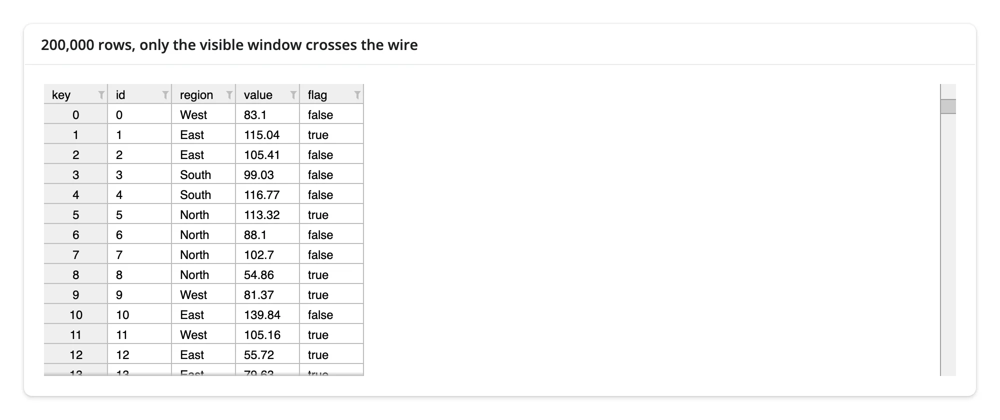

`StreamingDataGrid` mutates the frame you pass it (it adds a row-id column and stringifies column names), so pass
a `.copy()`. Cell-click and the `selected()`/`clicked_cell()` accessors are not reliable on `StreamingDataGrid`
in every ipydatagrid version (see Gotchas); treat it as a viewer/sort/filter tool for very large data first, and a
fully interactive grid second.

### Selection modes: cell, row, or column

`selection_mode` controls what a drag selects: `"cell"` for arbitrary rectangles, `"row"` for whole rows, or
`"column"` for whole columns. `.selected()` always returns the same rectangle shape (`r1`/`r2`/`c1`/`c2`)
regardless of mode, so the same code can compute a status bar for any of them.

```{.python file="examples/04_selection_modes.py"}
import numpy as np
import pandas as pd
from ipydatagrid import DataGrid
from shiny.express import input, render, ui
from shinywidgets import render_ipydatagrid

rng = np.random.default_rng(2)
scores = pd.DataFrame(
    rng.integers(50, 100, (10, 4)), columns=["Q1", "Q2", "Q3", "Q4"]
)

ui.page_opts(fillable=True)
ui.input_radio_buttons(
    "mode", "Selection mode", choices=["cell", "row", "column"], selected="cell"
)

with ui.layout_columns(col_widths=[8, 4]):
    with ui.card(full_screen=True):
        ui.card_header("Drag to select; the mode changes what a drag selects")

        @render_ipydatagrid
        def grid():
            return DataGrid(scores, selection_mode=input.mode())

    with ui.card():
        ui.card_header("Selection status bar")

        @render.ui
        def status():
            sels = grid.selected()
            if not sels:
                return "Nothing selected."
            vis = grid.visible_data()
            values = [
                vis.iloc[s["r1"] : s["r2"] + 1, s["c1"] : s["c2"] + 1].to_numpy()
                for s in sels
            ]
            flat = np.concatenate([v.ravel() for v in values])
            return ui.TagList(
                ui.p(f"Count {flat.size} · Sum {flat.sum()}"),
                ui.p(f"Average {flat.mean():.1f} · Min {flat.min()} · Max {flat.max()}"),
            )
```

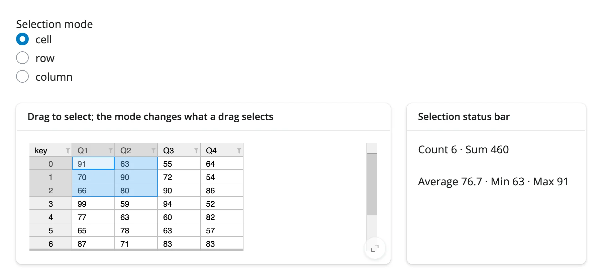
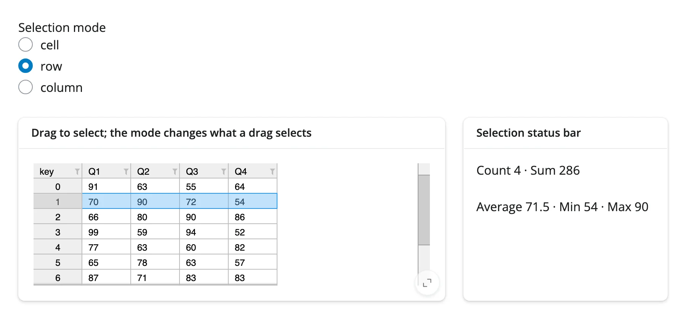

Changing `selection_mode` reactively rebuilds the grid (it's a constructor-time concept, not something you
reassign on `.widget` later), which is why the example re-renders on `input.mode()` rather than mutating the
existing widget.

### Editable cells

`editable=True` lets the user double-click a cell and type a new value. `.edited_cell()` reports each commit,
and you can write derived cells back into the same grid from a `@reactive.effect` -- see
[Reacting to user interaction](#reacting-to-user-interaction) below for the full recompute-and-redraw pattern.

## Reacting to user interaction

### Accessor reference

| Accessor | Returns | Before any interaction | Across re-render | Default rate policy |
|---|---|---|---|---|
| `selected()` | `list[dict]` -- `{"r1","r2","c1","c2"}` rectangles, inclusive, in *visible* (post sort/filter) coordinates | `[]` (seeded from the widget) | re-seeded | debounce (0.25s) |
| `clicked_cell()` | `dict` -- `{"region","column","column_index","row","primary_key_row","cell_value"}` | `None` | kept | none |
| `edited_cell()` | `dict` -- `{"row","column","column_index","value"}` | `None` | kept | none |
| `visible_data()` | `pandas.DataFrame` -- the grid's rows as currently displayed | seeded value (the whole frame) | re-seeded | none |

Every accessor attaches the moment the grid renders, so an interaction is never lost to timing -- there's no
warm-up step, and reading one from a button handler or download handler just works. `selected()` and
`visible_data()` describe the grid's own current state, so they **re-seed** from the new grid on every re-render
(`[]` and the whole frame, respectively, unless the render function pre-selects or the grid starts
sorted/filtered). `clicked_cell()` and `edited_cell()` describe something the user *did*, so they **keep** their
last value across a re-render until the next click or edit -- the gesture still happened, though a retained `row`
position can then point at a different record if the new render's data shifted rows (key lookups off the data's
index when that matters, not the position). Wrap a read in `req(...)` when you want to wait for the first click or
edit, as the recipes below do; the other two accessors need no `req()` since their seeded values (`[]`, the whole
frame) are already valid to check directly.

Two coordinate spaces matter here. `selected()` and `clicked_cell()["row"]` are *visible* positions -- they
shift after a sort. `clicked_cell()["primary_key_row"]`, `edited_cell()["row"]`, and every row of
`visible_data()` are also positions into the currently *displayed* frame (not the original unsorted data), which
is exactly why `visible_data()` exists: it's the one frame whose row order always matches what `selected()`
and `clicked_cell()` are indexing into, so you never need to reconstruct the sort yourself. Each accessor can
also be read by name, `grid.read("selected")`, which is useful for code that reads accessors generically.

### `selected()`: drag a block, get the rectangle

Dragging across cells publishes `{r1, r2, c1, c2}` rectangles, debounced by default (0.25s) so a long drag reports
once you stop moving rather than on every pointer move; sorting via the header menu clears the selection
(ipydatagrid's own behavior, not a shinywidgets choice). Index `visible_data()` with the rectangle to get the
selected values. The [selection-modes example above](#selection-modes-cell-row-or-column) is this accessor's
reference example: its status bar reads `.selected()` and `.visible_data()` directly
([`examples/04_selection_modes.py`](examples/04_selection_modes.py)).

### `clicked_cell()`: click for a detail view

`clicked_cell()` fires on every click, in *every* `selection_mode` including `"none"` -- it isn't tied to
selection at all, so it's the right accessor for a "click a row, see its detail" pattern where you don't want
drag-selection UI.

```{.python file="examples/05_clicked_cell.py"}
import pandas as pd
from ipydatagrid import DataGrid
from shiny import req
from shiny.express import render, ui
from shinywidgets import render_ipydatagrid

products = pd.DataFrame(
    {
        "sku": [f"SKU-{100 + i}" for i in range(12)],
        "name": [f"Product {i}" for i in range(12)],
        "category": (["Tools", "Garden", "Kitchen"] * 4),
        "price": [round(9.99 + i * 3.5, 2) for i in range(12)],
    }
)

ui.page_opts(fillable=True)

with ui.layout_columns(col_widths=[8, 4]):
    with ui.card(full_screen=True):
        ui.card_header("Click any cell, in any selection mode (even 'none')")

        @render_ipydatagrid
        def grid():
            # selection_mode="none" disables selected(), but clicked_cell()
            # still fires -- it isn't tied to selection_mode.
            return DataGrid(products, selection_mode="none")

    with ui.card():
        ui.card_header("Detail card")

        @render.ui
        def detail():
            click = grid.clicked_cell()
            req(click)
            # `row` is the visible position (after any sort); `primary_key_row`
            # is the underlying data row. Use get_visible_data() to look up
            # the full record the user actually clicked on.
            record = grid.widget.get_visible_data().iloc[click["row"]]
            return ui.TagList(
                ui.h5(record["name"]),
                ui.p(f"{record['sku']} · {record['category']} · ${record['price']}"),
                ui.p(f"Clicked column: {click['column']!r}, region: {click['region']!r}"),
            )
```

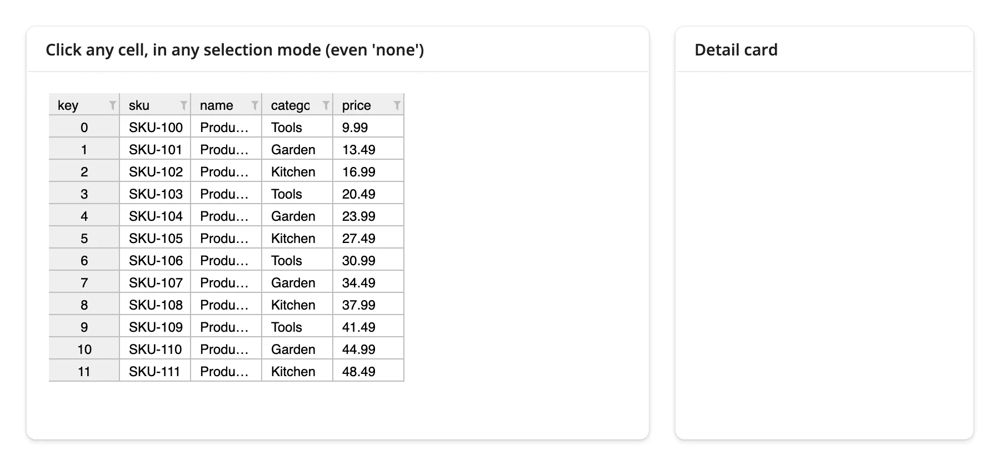
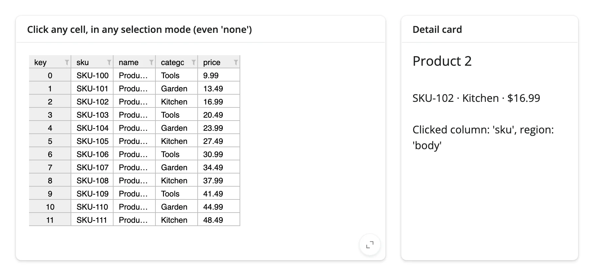

Watch for double-counting: `clicked_cell()` also fires for column-header clicks (`region="column-header"`), and
twice for a double-click (once per click). Check `region` if you only want body clicks.

### `edited_cell()`: edit a cell, recompute downstream

The grid's own data is already updated by the time `edited_cell()` fires, so a handler typically recomputes a
*different* cell (a total, a derived column) and writes it back -- and can push the new value into a completely
different widget, in place, with no re-render.

```{.python file="examples/06_edited_cell.py"}
import pandas as pd
import plotly.graph_objects as go
from ipydatagrid import DataGrid
from shiny import reactive, req
from shiny.express import ui
from shinywidgets import render_ipydatagrid, render_plotly

months = ["Jan", "Feb", "Mar"]
df = pd.DataFrame(
    {
        "product": ["Widget A", "Widget B", "Widget C"],
        "Jan": [120, 90, 60],
        "Feb": [140, 95, 70],
        "Mar": [160, 100, 80],
    }
)
df["total"] = df[months].sum(axis=1)

ui.page_opts(fillable=True)

with ui.layout_columns(col_widths=[7, 5]):
    with ui.card(full_screen=True):
        ui.card_header("Double-click a month to edit; Total recomputes in place")

        @render_ipydatagrid
        def grid():
            return DataGrid(df, selection_mode="none", editable=True)

    with ui.card():
        ui.card_header("Totals (updates without re-rendering the chart)")

        @render_plotly
        def chart():
            return go.FigureWidget(
                go.Bar(x=df["product"], y=df["total"], marker_color="#4C78A8")
            )


@reactive.effect
def _recompute_total():
    edit = grid.edited_cell()
    req(edit)
    if edit["column"] not in months:
        return  # ignore the write-echo when we ourselves edit `total` below
    with reactive.isolate():
        row = edit["row"]
        total = int(grid.widget.data.loc[row, months].sum())
        grid.widget.set_cell_value_by_index("total", row, total)
        # In-place trait update: no re-render, so the chart keeps its zoom
        # and hover state, and the JS bundle isn't re-sent.
        chart.widget.data[0].y = grid.widget.data["total"].tolist()
```

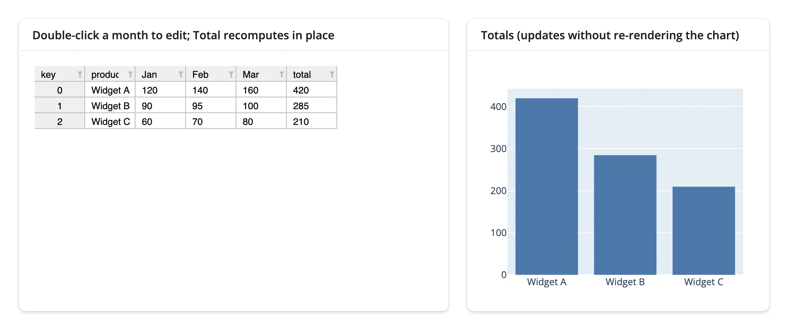
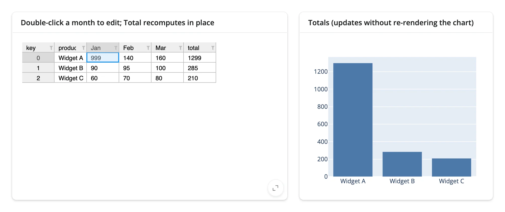

A Python-side `set_cell_value_by_index()` call also fires `edited_cell()` (ipydatagrid echoes the write back
through the same event path as a user edit), which is why the handler above checks `edit["column"]` and returns
early for its own write to `total` -- without that guard you'd recompute forever as each write re-triggers itself.

### `visible_data()`: sort or filter, see only what's shown

Every column header has a small menu icon (▾) with Sort and Filter -- a plain click on the label itself selects
the row/column instead. `visible_data()` tracks whatever the grid is currently displaying after any of that, so a
companion view can stay in sync without re-implementing the sort/filter logic.

```{.python file="examples/07_visible_data.py"}
import numpy as np
import pandas as pd
import plotly.graph_objects as go
from ipydatagrid import DataGrid
from shiny.express import ui
from shinywidgets import render_ipydatagrid, render_plotly

rng = np.random.default_rng(4)
stores = pd.DataFrame(
    {
        "store": [f"Store {i}" for i in range(15)],
        "region": rng.choice(["North", "South"], 15),
        "revenue": rng.integers(50, 500, 15),
    }
)

ui.page_opts(fillable=True)

with ui.layout_columns(col_widths=[7, 5]):
    with ui.card(full_screen=True):
        ui.card_header("Sort or filter from a column header's menu icon")

        @render_ipydatagrid
        def grid():
            return DataGrid(stores, selection_mode="none")

    with ui.card():
        ui.card_header("Chart of only what's currently visible")

        @render_plotly
        def chart():
            vis = grid.visible_data()
            return go.Figure(go.Bar(x=vis["store"], y=vis["revenue"]))
```

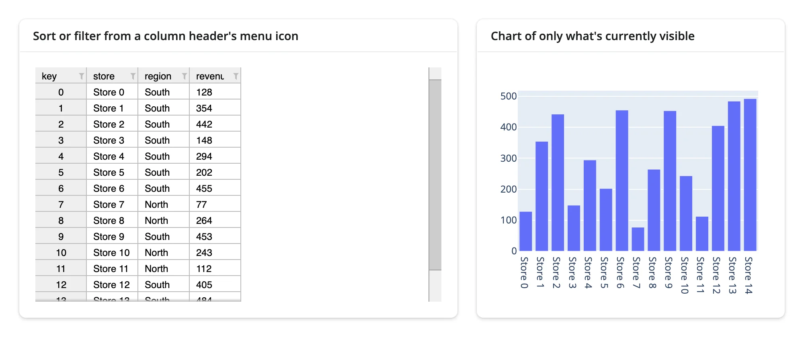
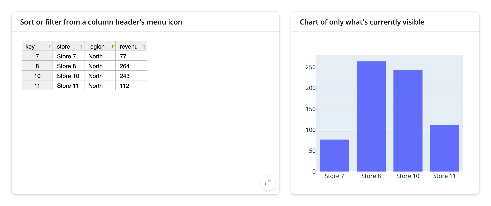

`visible_data()` starts as the whole frame, and returns an empty (but correctly shaped) frame when a filter
matches nothing -- a case the widget's own `get_visible_data()` gets wrong on its own (it returns the whole frame
instead), which is why the accessor exists rather than just calling that method directly.

### Reading an accessor on demand

Because every accessor is already live and recording interactions the moment the grid renders, reading one for
the first time inside a button handler or download handler works -- there's no need to display it reactively
first to "warm it up". A handler that only runs when the user asks for it still sees the latest selection:

```{.python file="examples/11_read_on_demand.py"}
import pandas as pd
from ipydatagrid import DataGrid
from shiny.express import render, ui
from shinywidgets import render_ipydatagrid

df = pd.DataFrame(
    {
        "sku": [f"SKU-{100 + i}" for i in range(12)],
        "name": [f"Product {i}" for i in range(12)],
        "price": [round(9.99 + i * 3.5, 2) for i in range(12)],
    }
)

ui.page_opts(fillable=True)

with ui.layout_columns(col_widths=[8, 4]):
    with ui.card(full_screen=True):
        ui.card_header("Select rows, then export -- no need to display them first")

        @render_ipydatagrid
        def grid():
            return DataGrid(df, selection_mode="row")

    with ui.card():
        ui.card_header("Export")
        ui.p("Nothing on this page reads selected() until you click Download.")

        @render.download_button(filename="selected_rows.csv", label="Download selected rows")
        def export():
            # Read on demand: no warm-up, no earlier display of this value --
            # selected() and visible_data() already hold the latest
            # selection the moment the handler runs.
            sels = grid.selected()
            rows = sorted({r for s in sels for r in range(s["r1"], s["r2"] + 1)})
            out = grid.visible_data().iloc[rows]
            yield out.to_csv(index=False).encode()
```

| Before download | Downloaded file |
|---|---|
| 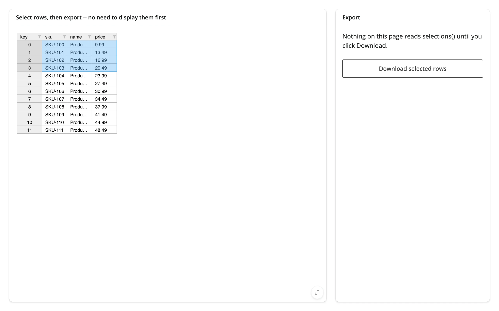 | 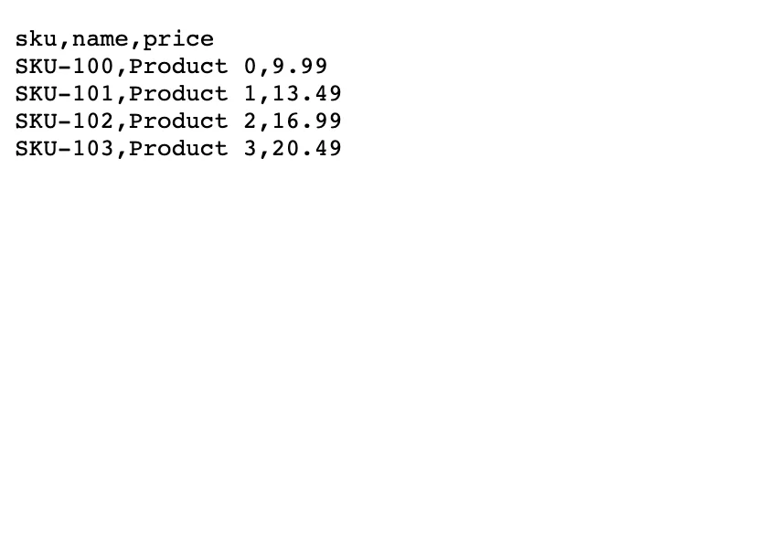 |

### Beyond the accessors: reactive_read

Everything ipydatagrid exposes through traits that are worth reading reactively -- `selections`, the sort/filter
state, and the visible row map -- is already covered by the four accessors above. There's no additional trait
worth reaching for with `reactive_read()` here; `grid.widget.get_visible_data()` and `grid.widget.data` are fine
to read in `reactive.isolate()` (e.g. inside an effect triggered by another accessor), but reading them directly
with `reactive_read()` either won't fire (writes to `data` don't notify; see Gotchas) or duplicates what
`visible_data()` already tracks.

### Rate limiting

`.selected()` debounces by default (0.25s): a drag publishes once, after the pointer stops moving, not on every
intermediate position. `.clicked_cell()` and `.edited_cell()` are discrete events with nothing to smooth out, and
`.visible_data()` only changes when `.selected()`/a sort/an edit does, so neither is rate-limited by default.

`reactive_read()` calls on `.widget` directly are a different story: by default they are **not** rate-limited at
all, so `reactive_read(grid.widget, "selections")` fires on every raw trait change, including every pointer move
mid-drag. Passing `rate_policy`/`rate_delay` to `@render_ipydatagrid(...)` governs *both*: it overrides
`.selected()`'s own debounce default, and it rate-limits `reactive_read()` calls on the widget the same way.

```{.python file="examples/08_rate_limiting.py"}
import pandas as pd
from ipydatagrid import DataGrid
from shiny import reactive
from shiny.express import render, ui
from shinywidgets import reactive_read, render_ipydatagrid

df = pd.DataFrame({"a": range(10), "b": range(10, 20)})

ui.page_opts(fillable=True)
ui.markdown(
    "`.selected()` debounces by default (0.25s), so dragging across many "
    "cells publishes once, after you stop moving. `reactive_read()` on the "
    "widget directly is **not** rate-limited unless you pass "
    "`rate_policy`/`rate_delay` to `@render_ipydatagrid`, at which point both "
    "follow the same setting."
)


@render_ipydatagrid
def grid():
    return DataGrid(df, selection_mode="row")


accessor_fires = reactive.value(0)
raw_fires = reactive.value(0)


@reactive.effect
def _count_accessor():
    grid.selected()
    # isolate(): reading accessor_fires without it would make this effect
    # depend on the value it's about to set, looping forever
    with reactive.isolate():
        accessor_fires.set(accessor_fires.get() + 1)


@reactive.effect
def _count_raw():
    reactive_read(grid.widget, "selections")
    with reactive.isolate():
        raw_fires.set(raw_fires.get() + 1)


@render.text
def accessor_count():
    return f"selected() fired: {accessor_fires.get()}"


@render.text
def raw_count():
    return f"reactive_read() fired: {raw_fires.get()}"
```

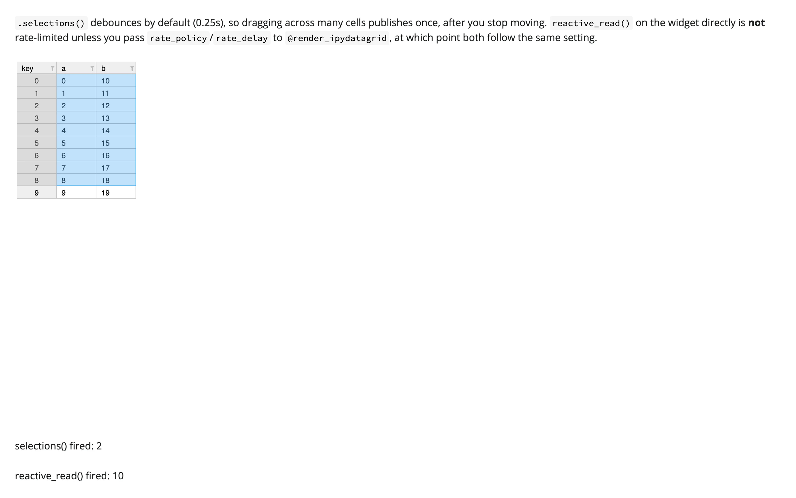

A 9-row drag (verified above) published `.selected()` twice (the initial seed plus one debounced value after the
drag settled) while the equivalent `reactive_read()` fired ten times, once per pointer move. Because a companion
view driven by `.selected()` no longer redraws *during* the drag by default, a heavy per-change rebuild (a fresh
`plotly` figure, say) is far less likely to stall the browser's own mouse tracking mid-gesture than it would be
reading an un-rate-limited trait. Updating the companion view's data in place rather than rebuilding it from
scratch is still the better pattern regardless -- it's cheaper and avoids a visible flash -- and is what
[Coordinating multiple views](#coordinating-multiple-views) and the showcase gallery app do.

## Updating the widget from Python

Writes to `.widget` sync to the browser in place -- no re-render, no re-sent JS bundle, and the grid's scroll
position is preserved. Three ipydatagrid methods are commonly used this way: `transform()` to sort/filter,
`set_cell_value*()` to edit a cell (shown above), and assigning `.selections` to drive the highlight
programmatically.

```{.python file="examples/09_update_in_place.py"}
import pandas as pd
from ipydatagrid import DataGrid
from shiny import reactive
from shiny.express import input, render, ui
from shinywidgets import render_ipydatagrid

df = pd.DataFrame({"name": ["Ann", "Bo", "Cy", "Di", "Ev"], "score": [91, 72, 88, 65, 99]})
df2 = pd.DataFrame({"name": ["Fay", "Gus", "Hu"], "score": [55, 80, 70]})

ui.page_opts(fillable=True)
with ui.layout_columns(col_widths=[4, 4, 4]):
    ui.input_action_button("highlight", "Highlight top score")
    ui.input_action_button("sort", "Sort by score (desc)")
    ui.input_action_button("replace", "Replace data")

with ui.card(full_screen=True):

    @render_ipydatagrid
    def grid():
        return DataGrid(df.copy(), selection_mode="cell")


@reactive.effect
@reactive.event(input.highlight)
def _highlight():
    # Assign a new list -- DataGrid.select()/clear_selection() mutate the
    # existing list in place, so observers (including .selected()) never
    # see the change.
    top = int(grid.widget.data["score"].idxmax())
    grid.widget.selections = [{"r1": top, "r2": top, "c1": 0, "c2": 1}]


@reactive.effect
@reactive.event(input.sort)
def _sort():
    # Updates the grid's displayed order in place -- no re-render, so the
    # scroll position and the JS bundle are untouched.
    grid.widget.transform([{"type": "sort", "column": "score", "desc": True}])


@reactive.effect
@reactive.event(input.replace)
def _replace():
    with reactive.isolate():
        # Swapping `data` doesn't depend on anything reactive here, but
        # isolate() is the pattern to reach for once a handler also reads
        # other reactive widget state, to avoid re-triggering itself.
        grid.widget.data = df2


@render.text
def selected():
    return str(grid.selected())
```

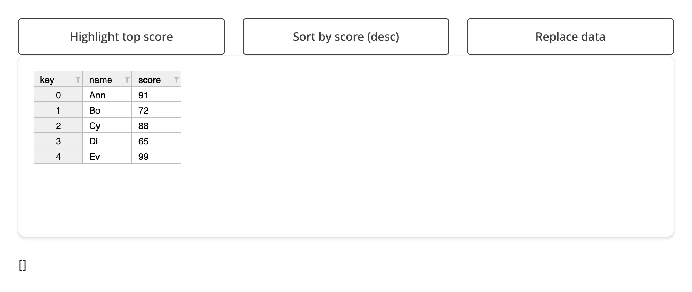
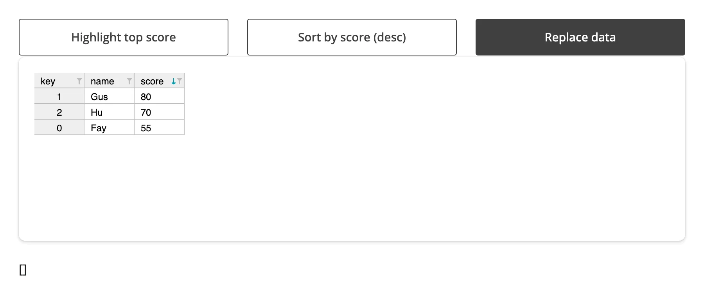

The one sharp edge here is `select()`/`clear_selection()`: both mutate ipydatagrid's internal `selections` list
in place and then push the new state to the browser directly, bypassing traitlets' change notification. The
browser highlight updates, but `.selected()` (and `reactive_read(grid.widget, "selections")`) never fires.
Assign a fresh list to `.selections` instead, as above, whenever you need Python-driven selection to be visible
to a reactive reader.

## Coordinating multiple views

These four patterns cover most of what "link a grid to something else" means in practice; each is a complete,
runnable app (the snippets above, re-used).

1. **Drag a block, get an instant status bar** -- `.selected()` + `.visible_data()` compute Count/Sum/Average
   live as the user drags, with no server round trip beyond the selection event itself
   ([`examples/04_selection_modes.py`](examples/04_selection_modes.py)).
2. **Click a row, show a detail card** -- `.clicked_cell()` in `selection_mode="none"` drives a detail panel,
   without needing selection UI at all ([`examples/05_clicked_cell.py`](examples/05_clicked_cell.py)).
3. **Edit a cell, update a chart in place** -- `.edited_cell()` recomputes a derived column in the grid and
   pushes the new values into a `plotly` `FigureWidget` trace, preserving the chart's zoom/hover state
   ([`examples/06_edited_cell.py`](examples/06_edited_cell.py); pairs with
   [plotly](../plotly/index.md)).
4. **Sort or filter the grid, chart only what's visible** -- `.visible_data()` feeds a `plotly` bar chart that
   always matches the grid's current view ([`examples/07_visible_data.py`](examples/07_visible_data.py); pairs
   with [plotly](../plotly/index.md)).

## Large data

**`StreamingDataGrid`** (see [`examples/03_streaming_large_grid.py`](examples/03_streaming_large_grid.py) above)
sends only the visible window to the browser, unlike a plain `DataGrid`, which ships the whole frame -- the
fit for tables in the hundreds of thousands to millions of rows mentioned in the introduction above. The
trade-off: cell-click and the `.selected()`/`.clicked_cell()` accessors aren't reliable on `StreamingDataGrid`
in every ipydatagrid version (see [Gotchas and limitations](#gotchas-and-limitations)), so treat it as a
viewer/sort/filter tool for very large data first, and a fully interactive grid second. This is the "only send
what's visible" approach from
[Large data & performance](../../guide/performance/index.md#three-approaches-to-large-data); see also
[perspective](../perspective/index.md#large-data) for an aggregation-first alternative at the same scale.

## Layout and sizing

Height behaves well: `output_widget(height=...)`, an explicit `DataGrid(layout={"height": ...})`, a fill card,
`full_screen`, and a hidden-then-shown tab all size the grid correctly (verified against
`tests/playwright/render_ipydatagrid`). Two things don't follow Shiny's usual fill behavior:

- **Columns don't stretch to fill the container's width.** ipydatagrid keeps each column at its configured pixel
  width (`base_column_size`, default 64px), so a wide fill card shows a void to the right of a narrow table, with
  the scrollbar sitting at the edge of that void rather than the edge of the data. `auto_fit_columns=True` doesn't
  stretch columns either -- it only shrinks oversized columns to fit their content. Set `column_widths={...}`
  explicitly to use the available width.
- **No auto-height.** On a page without a fill container, the output defaults to ipydatagrid's own height (around
  500px); a 3-row table still takes that much vertical space. Set an explicit `height=` on `output_widget()` or
  `DataGrid(layout={"height": ...})` for small tables.

```{.python file="examples/10_sizing.py"}
import pandas as pd
from ipydatagrid import DataGrid
from shiny.express import ui
from shinywidgets import render_ipydatagrid

df = pd.DataFrame({"name": ["Ann", "Bo", "Cy"], "score": [91, 72, 88]})

ui.page_opts(fillable=True)

with ui.layout_columns(col_widths=[6, 6]):
    with ui.card(full_screen=True):
        ui.card_header("Default column widths leave a void in a wide card")

        @render_ipydatagrid
        def grid_default():
            return DataGrid(df)

    with ui.card(full_screen=True):
        ui.card_header("column_widths= stretches columns to fill")

        @render_ipydatagrid
        def grid_sized():
            return DataGrid(df, column_widths={"name": 300, "score": 300})
```

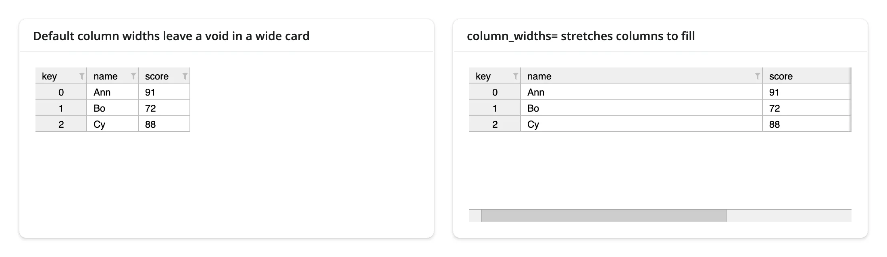

ipydatagrid also doesn't follow bslib's theme or dark mode -- it stays light on a dark page. It picks its palette
once, from JupyterLab-specific `<body>` attributes that a Shiny page doesn't set, so there's no supported way to
get a dark grid in a Shiny app short of setting those attributes yourself before the grid mounts. Fine-grained
styling (header colors, stripes) is available through `grid_style=` and the `--ipydatagrid-*` CSS variables
regardless of theme.

## Gotchas and limitations

- **`select()`/`clear_selection()` don't notify.** Both mutate ipydatagrid's internal list in place; use
  `grid.widget.selections = [...]` instead if anything reads `.selected()` or `reactive_read(..., "selections")`
  (see [Updating the widget from Python](#updating-the-widget-from-python)).
- **A Python-side cell write echoes back.** `set_cell_value_by_index()` makes `edited_cell()` fire a second time
  (ipydatagrid's frontend round-trips the write through the same `cell-changed` event a user edit uses). Guard
  recompute handlers against their own writes, as in the `edited_cell()` example.
- **Renderers and scales are widgets.** `TextRenderer`, `BarRenderer`, `VegaExpr`, and the `bqscales` scales must
  be constructed inside the render function, not at import time.
- **`BarRenderer()` with no `bar_value` draws nothing.** `bar_value` defaults to a scale with `max=0.0`; always
  pass `bar_value=LinearScale(min=..., max=...)`.
- **Only pandas is accepted.** Polars, PyArrow, and plain `Series`/`dict` inputs aren't coerced; convert with
  `.to_pandas()` first. `GeoDataFrame` and other pandas subclasses work (coerced via MRO, same as the lonboard
  and matplotlib renderers).
- **Numpy scalars break `bqscales` traits.** `LinearScale(min=0, max=df["x"].max())` raises if `.max()` returns
  `np.int64`/`np.float64` rather than a Python `int`/`float`; wrap in `float(...)`/`int(...)`.
- **No width auto-fill, no auto-height, no dark mode** -- see [Layout and sizing](#layout-and-sizing).
- **MultiIndex row-header groups can go stale after a sort.** This reproduces in ipydatagrid's own static HTML
  export with no shinywidgets involved, so it's an upstream rendering issue, not something shinywidgets can fix.
  Prefer flat key columns (as every example above does) if users will sort.
- **`StreamingDataGrid` throws on cell click.** Clicking a body cell raises a browser `TypeError` in
  `getDatasetRowFromView` (re-verified on current main), and `selected()`/`clicked_cell()` are unreliable as a
  result. Treat `StreamingDataGrid` as a fast viewer/sort/filter tool rather than a fully interactive grid; use
  plain `DataGrid` when you need selection or click accessors.
- **Prefer updating a companion view in place over rebuilding it from scratch.** `.selected()` now debounces by
  default, so a companion view driven by it only redraws once a drag settles, not on every pointer move -- a
  lighter trigger than before. Rebuilding a whole `plotly` figure on each change is still worth avoiding: it's
  slower and causes a visible flash. Update the companion figure's trace data in place instead (see
  [Rate limiting](#rate-limiting) and the showcase gallery app).

## Gallery candidates

**[`gallery/template_spreadsheet.py`](gallery/template_spreadsheet.py)** -- a clean, adaptable starting point: an
editable, cell-selectable grid with a status bar (`.selected()` + `.visible_data()`) and a live edit log
(`.edited_cell()`). Swap in your own `DataFrame`.

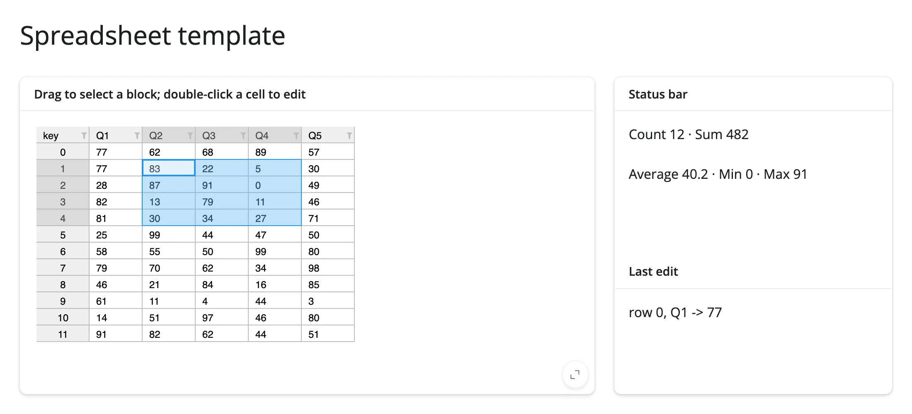

**[`gallery/showcase_monthly_sales.py`](gallery/showcase_monthly_sales.py)** -- a heatmap-and-bar sales grid:
editable monthly figures recompute Total and YoY in place after an edit, dragging a block of cells shows a
status bar, and a side `plotly` chart updates in place to compare the selected rows' monthly trend against the
overall average. The chart is updated trace-by-trace rather than rebuilt per selection tick -- see
[Gotchas](#gotchas-and-limitations) for why that matters here specifically.

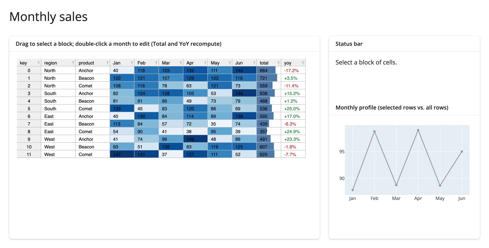
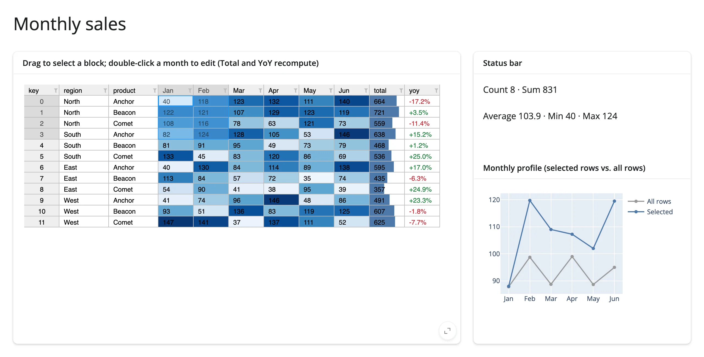
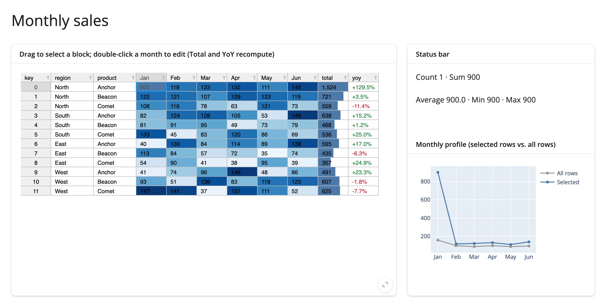

## Learn more

- [ipydatagrid documentation and examples](https://github.com/bloomberg/ipydatagrid) (the project's README links
  to its example notebooks; there's no separate hosted docs site)
- [Lumino](https://github.com/jupyterlab/lumino), the canvas-widget toolkit ipydatagrid's grid is built on
- Related guides in this roster: [itables](../itables/index.md) and [reactable](../reactable/index.md) for
  simpler, HTML-based tables; [perspective](../perspective/index.md) for aggregation-first large tables;
  [plotly](../plotly/index.md), used throughout this guide's linked-view patterns
