[ipyfilechooser](https://github.com/crahan/ipyfilechooser) is a small, single-purpose ipywidget by Thomas Bouve
(crahan): a file/directory browser built entirely out of core `ipywidgets` controls (a path dropdown, a listing,
a text field, and a button). It has no custom JavaScript, no canvas, nothing to compile -- it's about as simple
as a widget gets, and that simplicity is exactly why it's useful in Shiny: it's a stable, dependency-light way to
let an app read from the server's own filesystem.

That's the important distinction to get right up front. Shiny already has a file input,
[`ui.input_file()`](https://shiny.posit.co/py/api/core/ui.input_file.html) -- but it *uploads* a file from the
visitor's machine to the server. `@render_ipyfilechooser` does the opposite: it browses files that are **already
on the server**, which only makes sense when the server's filesystem is something your users (or you, as the
developer) should be looking at -- a desktop-style internal tool, a data lake mounted next to the app, a directory
of model checkpoints, a sandboxed scratch space. Never point an unsandboxed chooser at a multi-tenant server's
filesystem; see "Framing: whose files are these?" below.

The decorated function returns an `ipyfilechooser.FileChooser` and shinywidgets takes care of the rest: giving it
its own session-scoped layout (working around an import-time quirk in the library -- see Gotchas), sizing it as
an unfilled, natural-size control, and round-tripping a confirmed selection back to Python. This widget has no
reactive accessors (see below for why, and the pattern that replaces them); the rest of this guide is about using
it well regardless.

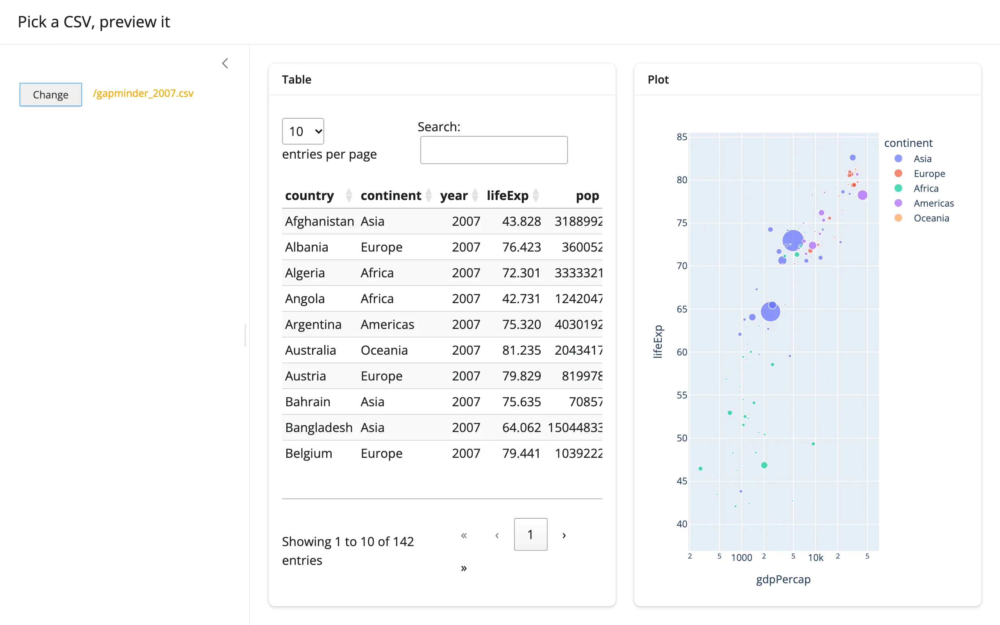

## Installation

```sh
pip install 'shinywidgets[ipyfilechooser]'
```

## Quick start

A chooser rooted at a directory, with the confirmed selection read back into a `reactive.value`. `selected` is a
plain Python property on `FileChooser`, not a widget trait, so getting the value back into Shiny means
`register_callback()` -- not `reactive_read()` or `.read()` (more on this below).

```{.python file="examples/01_quickstart.py"}
import os
import tempfile

from ipyfilechooser import FileChooser
from shiny import reactive, render
from shiny.express import ui
from shinywidgets import render_ipyfilechooser

def make_sample_dir() -> str:
    """A couple of sample files to browse (created fresh each run)."""
    data_dir = tempfile.mkdtemp(prefix="shinywidgets-quickstart-")
    for name in ("notes.txt", "report.csv"):
        with open(os.path.join(data_dir, name), "w") as f:
            f.write(f"sample contents of {name}\n")
    return data_dir


DATA_DIR = make_sample_dir()

ui.page_opts(title="ipyfilechooser quickstart")

selected_path = reactive.value(None)

with ui.card():

    @render_ipyfilechooser
    def chooser():
        fc = FileChooser(path=DATA_DIR)
        # `selected` is a plain property, not a trait: a callback -- not
        # reactive_read() -- is how a confirmed pick reaches Python
        fc.register_callback(lambda fc: selected_path.set(fc.selected))
        return fc

    @render.text
    def selected():
        return f"Selected: {selected_path()}"
```

Collapsed, before any interaction:


After opening the dialog, picking `report.csv`, and confirming:

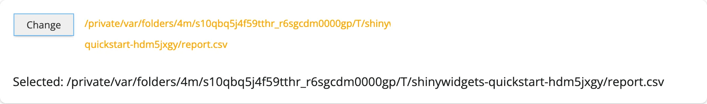

Notice the chooser renders at its natural width (ipyfilechooser's own 500px default) and doesn't stretch to fill
the card -- see "Layout and sizing".

## Framing: whose files are these?

Before reaching for this widget, be clear about which filesystem you're exposing:

| | `ui.input_file()` | `@render_ipyfilechooser` |
|---|---|---|
| Browses | the visitor's device | the Shiny server's filesystem |
| Data moves | browser -> server (upload) | nowhere -- selection is just a path |
| Good fit | public apps, user-supplied data | desktop-style internal tools, a single-tenant app, a data directory you control |
| Risk if unsandboxed | none beyond upload size | lets a user read/discover arbitrary server-readable files |

If your app is multi-tenant or public-facing, don't point a chooser at an unrestricted path. Use
`sandbox_path` to wall the user into a directory (a per-user scratch folder, a shared read-only data drop), and
pair it with `filter_pattern` to keep them on relevant files. The next section verifies that the sandbox actually
holds up against the obvious attempt to escape it.

### Does `sandbox_path` actually hold?

Yes, for the normal UI-driven paths: the path dropdown and the file/directory listing are built from the
filesystem under `sandbox_path` and never offer an entry outside it, and navigating a listed subdirectory can't
leave the sandbox because it's real subdirectories, all below `sandbox_path`.

The one place a user could *try* to escape is the filename text field, by typing something like `../secret.txt`.
We checked this directly: ipyfilechooser validates the filename on every keystroke
(`is_valid_filename()` rejects any `..` or path separator), and disables the Select/Change button while the field
is invalid -- in a real browser, a disabled button simply doesn't dispatch the click, so the attempt never reaches
Python. Verified with Playwright against a `sandbox_path` that has a real file one level up:

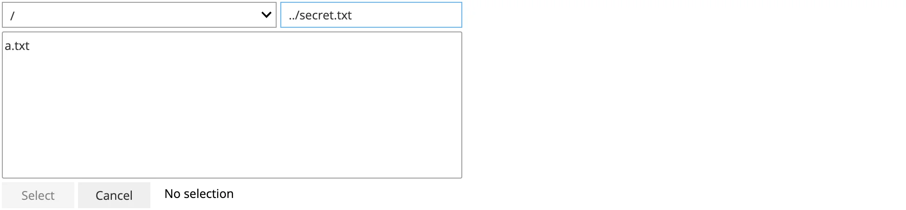

Typing `../secret.txt` leaves the Select button disabled (grayed out); Playwright's own `.click()` times out with
"element is not enabled". Calling `FileChooser` methods directly in Python (bypassing the browser) can still
construct an out-of-sandbox `selected` path -- the enforcement lives in the button's disabled state, not in
`_apply_selection()` itself -- but that's not a path a Shiny user can reach through the rendered UI.

Also sandbox-relevant: `show_only_dirs=True` (pair with a directory-listing app, below) and hiding dotfiles by
default (`show_hidden=False`, the default) keep a sandboxed browser from casually surfacing `.env`-style files.

## What you can build

### Pick a data file, then preview it as a table and a plot

Sandbox the chooser to a data directory, filter to `*.csv`, and read the confirmed path with `pandas` --
feeding both an [itables](../itables/index.md) table and a [plotly](../plotly/index.md) figure from the same
file.

```{.python file="examples/02_data_preview.py"}
import os
import tempfile

import pandas as pd
import plotly.express as px
from ipyfilechooser import FileChooser
from shiny import reactive, render, req
from shiny.express import ui
from shinywidgets import render_ipyfilechooser, render_itables, render_plotly


def make_data_dir() -> str:
    """A small sandboxed data directory: two CSVs plus a decoy text file."""
    data_dir = tempfile.mkdtemp(prefix="shinywidgets-preview-")
    gapminder = px.data.gapminder()
    gapminder[gapminder["year"] == 2007].to_csv(
        os.path.join(data_dir, "gapminder_2007.csv"), index=False
    )
    px.data.tips().to_csv(os.path.join(data_dir, "tips.csv"), index=False)
    with open(os.path.join(data_dir, "README.txt"), "w") as f:
        f.write("Only *.csv files are selectable here (see filter_pattern).\n")
    return data_dir


DATA_DIR = make_data_dir()

ui.page_opts(title="Pick a CSV, preview it", fillable=True)

picked_path = reactive.value(None)

with ui.sidebar(width=320):

    @render_ipyfilechooser
    def picker():
        fc = FileChooser(path=DATA_DIR, sandbox_path=DATA_DIR, filter_pattern=["*.csv"])
        fc.register_callback(lambda fc: picked_path.set(fc.selected))
        return fc


@reactive.calc
def df():
    req(picked_path())
    return pd.read_csv(picked_path())


with ui.layout_columns(col_widths=(6, 6)):
    with ui.card(full_screen=True):
        ui.card_header("Table")

        @render_itables
        def table():
            return df()

    with ui.card(full_screen=True):
        ui.card_header("Plot")

        @render_plotly
        def plot():
            data = df()
            if "lifeExp" in data.columns:
                return px.scatter(
                    data, x="gdpPercap", y="lifeExp", size="pop", color="continent",
                    log_x=True, hover_name="country",
                )
            return px.histogram(data, x="total_bill", color="sex")
```

`filter_pattern=["*.csv"]` keeps `README.txt` out of the listing entirely -- verified: opening the dialog shows
only `gapminder_2007.csv` and `tips.csv`. Before any pick, both panels are empty (an `req()`-gated calc with no
value yet is a normal state, not an error):

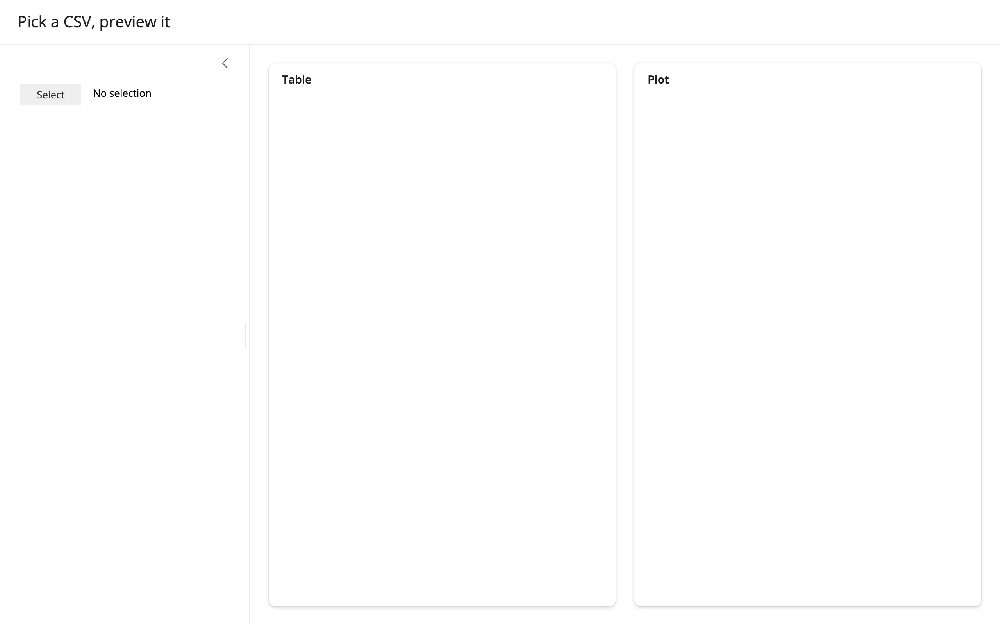

After picking `gapminder_2007.csv`:


### Pick a directory, list its contents

Set `show_only_dirs=True` and the listing shows only subdirectories; a single click on a row navigates into it
(there's no separate "open" gesture), and confirming with Select/Change applies the *current* directory as
`selected_path`.

```{.python file="examples/03_directory_listing.py"}
import os
import tempfile

import pandas as pd
from ipyfilechooser import FileChooser
from shiny import reactive, render, req
from shiny.express import ui
from shinywidgets import render_ipyfilechooser


def make_project_dir() -> str:
    """A small project tree: a few subdirectories, each with a few files."""
    root = tempfile.mkdtemp(prefix="shinywidgets-project-")
    for sub, files in {
        "data": ["gapminder.csv", "tips.csv"],
        "notebooks": ["exploration.ipynb"],
        "src": ["app.py", "utils.py", "__init__.py"],
    }.items():
        os.makedirs(os.path.join(root, sub))
        for name in files:
            with open(os.path.join(root, sub, name), "w") as f:
                f.write(name * 20)  # a little bulk so sizes aren't all 0
    return root


PROJECT_DIR = make_project_dir()

ui.page_opts(title="Pick a directory, list its contents")

picked_dir = reactive.value(PROJECT_DIR)

with ui.card():

    @render_ipyfilechooser
    def dirpicker():
        fc = FileChooser(
            path=PROJECT_DIR,
            sandbox_path=PROJECT_DIR,
            show_only_dirs=True,
            title="Pick a subdirectory",
        )
        fc.register_callback(lambda fc: picked_dir.set(fc.selected_path))
        return fc

    @render.data_frame
    def contents():
        req(picked_dir())
        entries = []
        with os.scandir(picked_dir()) as it:
            for entry in it:
                entries.append(
                    {
                        "name": entry.name,
                        "kind": "dir" if entry.is_dir() else "file",
                        "size": entry.stat().st_size,
                    }
                )
        return pd.DataFrame(entries).sort_values(["kind", "name"])
```

Initial state (the reactive value is seeded with the project root, so the listing shows immediately):

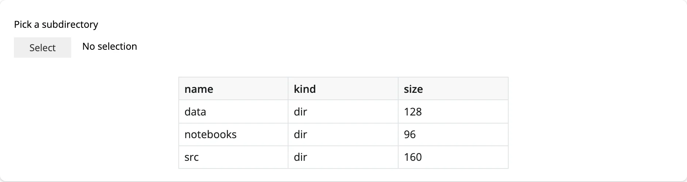

After navigating into `data/` and confirming:

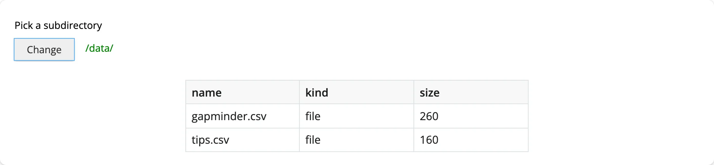

### Filters, hidden files, and starting path -- all steerable from Shiny

`filter_pattern`, `show_hidden`, and the starting path aren't just constructor arguments -- they're properties
you can change after the fact, from ordinary Shiny inputs, and the chooser updates in place. See "Updating the
widget from Python" below for the full pattern and what it verifies.

## Reacting to user interaction

**This renderer has no reactive accessors.** Every other `@render_*` in this roster that exposes user interaction
does it with accessor methods (`fig.selected()`, `tbl.selected_rows()`, ...), but `FileChooser`'s selection state
(`selected`, `selected_path`, `selected_filename`) is implemented as plain Python `@property` getters over private
fields -- not widget traits. That means three things don't work here, on purpose:

* `reactive_read(chooser.widget, "selected")` -- there's no `selected` *trait* to read; this will never fire.
* `chooser.read("selected")` -- `.read()` (see the [Reacting to widgets](../../guide/reacting-to-widgets/index.md)
  article) falls through to the same bare-trait check as `reactive_read()` when there's no accessor by that name,
  so it fails the same way: verified directly, it raises `AttributeError: render_ipyfilechooser has no accessor
  or synced trait named 'selected'` both before and after a real pick, never a stale or `None` value.
* An accessor method like `chooser.selected()` -- there isn't one, and there can't be a reactively-correct one,
  since nothing invalidates when the property's backing fields change.

### The pattern that replaces them: `register_callback()`

ipyfilechooser's own mechanism for "tell me when the user picks something" is `FileChooser.register_callback(fn)`:
`fn` is called with the chooser instance whenever the user **confirms** a selection (clicks Select/Change while
the dialog is open and the button is enabled). The idiomatic Shiny bridge is to have that callback set a
`reactive.value`:

<!-- snippet: skip -->
```python
selection = reactive.value(None)

@render_ipyfilechooser
def chooser():
    fc = FileChooser(path="/data", filter_pattern=["*.csv"])
    fc.register_callback(lambda fc: selection.set(fc.selected))
    return fc
```

What to know about this, all verified against current `main`:

* **Fires on confirm, not on every keystroke or navigation.** Browsing the listing or editing the filename field
  doesn't call the callback; only the button click that applies a selection does.
* **One callback per chooser.** `register_callback()` overwrites `_callback`; if you need to do more than one
  thing, compose it inside the lambda/function you register.
* **`None` before any pick** is the normal starting state for your mirrored `reactive.value` -- seed it with
  `None` (or a real default, see below) and gate downstream reads with `req()`.
* **A re-render gives the user a brand new `FileChooser`** with no selection, same as every other widget in this
  roster: re-running the decorated function throws away the old chooser (collapsed state, callback and all) and
  mounts a fresh one.
* **`select_default=True` does not fire the callback.** Constructing a chooser with `filename="app.py",
  select_default=True` shows `app.py` as selected in the UI, but the callback only runs on a *user-confirmed*
  pick -- a programmatic default never triggers it. Seed your `reactive.value` with that same default yourself
  (the gallery showcase below does this).
* **`.reset(path=...)` doesn't fire the callback either, but *does* silently reapply `select_default`.** If you
  built the chooser with `select_default=True` and later call `.reset(path=...)` from Python (e.g., a "jump to"
  button), ipyfilechooser re-selects the default filename in the new path internally -- updating `fc.selected` --
  without invoking your callback. If you mirror `fc.selected` elsewhere, re-read it manually right after calling
  `reset()`; see "Updating the widget from Python" for the exact pattern and the startup-ordering trap it avoids.

## Beyond the callback: reading plain attributes

There's no `reactive_read()`-worthy trait on this widget, but a few **non-reactive** attributes are worth reading
inside the same callback or right after, since they describe the chooser's current browsing state (not just the
final selection): `fc.show_hidden`, `fc.filter_pattern`, and `fc.sandbox_path` just return the values you set --
there's nothing to "discover" by reading them that you don't already know from your own inputs.

## Updating the widget from Python

Three `FileChooser` properties are real setters that refresh the rendered chooser in place -- no re-render, no
lost in-flight navigation:

* `chooser.widget.show_hidden = True/False`
* `chooser.widget.filter_pattern = [...]` (or `None` to clear it)
* `chooser.widget.reset(path=..., filename=...)` -- jump to a new starting location (and optionally seed a
  filename); clears any current selection, *and closes the dialog if it was open*.

```{.python file="examples/04_python_controlled.py"}
import os
import tempfile

from ipyfilechooser import FileChooser
from shiny import reactive, render
from shiny.express import input, ui
from shinywidgets import render_ipyfilechooser


def make_project_dir() -> str:
    root = tempfile.mkdtemp(prefix="shinywidgets-controlled-")
    os.makedirs(os.path.join(root, "data"))
    os.makedirs(os.path.join(root, "src"))
    for name in ("data/gapminder.csv", "data/tips.csv", "src/app.py", "notes.md"):
        with open(os.path.join(root, name), "w") as f:
            f.write("sample\n")
    with open(os.path.join(root, ".env"), "w") as f:
        f.write("SECRET=shh\n")
    return root


ROOT = make_project_dir()
BOOKMARKS = {"root": ROOT, "data": os.path.join(ROOT, "data"), "src": os.path.join(ROOT, "src")}

ui.page_opts(title="Steering the chooser from Shiny inputs")

with ui.sidebar():
    ui.input_select("jump", "Jump to", choices=list(BOOKMARKS))
    ui.input_checkbox("hidden", "Show hidden files", False)
    ui.input_select(
        "filter", "Filter", choices={"none": "all files", "csv": "*.csv", "py": "*.py"}
    )

selected_path = reactive.value(None)

with ui.card():

    @render_ipyfilechooser
    def chooser():
        fc = FileChooser(path=ROOT, sandbox_path=ROOT)
        fc.register_callback(lambda fc: selected_path.set(fc.selected))
        return fc

    @render.text
    def selected():
        return f"Selected: {selected_path()}"


# Python -> browser: jump the chooser to a bookmarked folder. reset() clears
# any current selection, so clear the mirrored reactive.value too
@reactive.effect
def _jump():
    chooser.widget.reset(path=BOOKMARKS[input.jump()])
    selected_path.set(None)


# These setters refresh the chooser's listing in place -- no re-render, and
# the user's current path and any confirmed selection are left untouched
@reactive.effect
def _toggle_hidden():
    chooser.widget.show_hidden = input.hidden()


@reactive.effect
def _set_filter():
    f = input.filter()
    chooser.widget.filter_pattern = None if f == "none" else [f"*.{f}"]
```

With the dialog open, hidden files on, and the filter set to `*.csv` (so only `data/` and `src/` show -- no
`.env`, no `notes.md`):

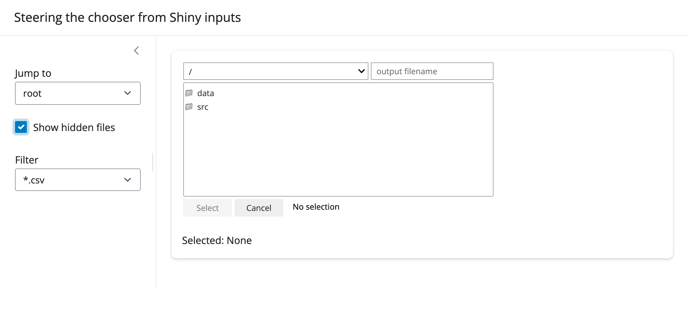

After choosing "data" from "Jump to" (which also closes the dialog -- reopened here to show the result): the
listing is now `data/`'s contents, still filtered to `*.csv`:

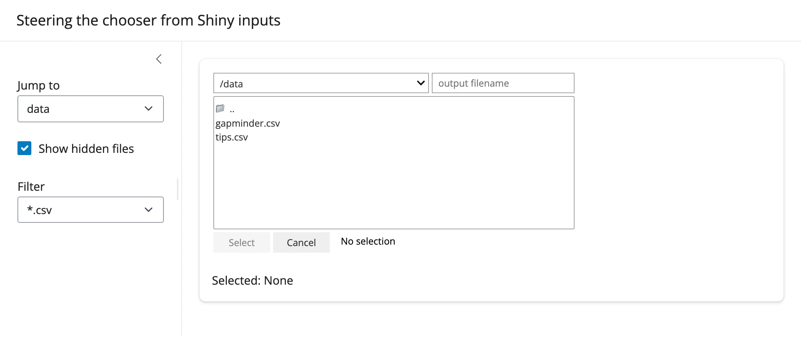

**Why effects instead of re-rendering:** re-running the decorated function would tear down and rebuild the whole
chooser (and any other in-flight dialog state) every time a sidebar input changes. Driving `.widget`'s own
setters from a `@reactive.effect` is the "move the existing control" equivalent of what `reactive.isolate()` +
`.widget` does for plot-like widgets -- except here there's no camera/zoom state to preserve, just the user's
current place in the directory tree, which setting `show_hidden`/`filter_pattern` leaves untouched (confirmed:
navigating into a subfolder, then toggling a filter, keeps you in that subfolder).

**A startup-ordering trap, if you combine `select_default=True` with a Python-driven `reset()`:** a
`@reactive.effect` that calls `.reset(path=...)` in response to an input runs once at startup too (Shiny effects
always run their first pass immediately), which would immediately call `reset()` on the just-constructed chooser
and silently reapply `select_default`'s pick -- clobbering whatever you seeded your mirrored `reactive.value`
with, before the user ever touches the input. Gate the effect with `@reactive.event(input.jump,
ignore_init=True)` so it only fires on an actual change. The gallery showcase below needs exactly this fix (see
NOTES.md).

## Coordinating multiple views

**Pick a CSV, drive a table and a plot.** This is "What you can build" -> "Pick a data file" above: one
`reactive.calc` reads the file once, two renderers (`render_itables`, `render_plotly`) each consume it. Because
both read the same calc, they always show the same file and recompute together.

**Pick a directory, drive a listing.** "What you can build" -> "Pick a directory" above: the confirmed
`selected_path` feeds a `render.data_frame` built from `os.scandir()`. The same shape works for a file count, a
total size, a thumbnail grid, or a second chooser scoped to the one just picked (nested browsing).

**Bookmarks + filters steering one chooser, one downstream view.** "Updating the widget from Python" above:
sidebar inputs change what the *chooser* shows (not a separate output), which is its own small linked-view
pattern -- Shiny inputs on one side, an ipywidget on the other, connected by plain attribute assignment instead
of a second render pass.

For a combination of all three -- bookmarks, filters, hidden-files, and a preview that adapts to what's picked
(CSV vs. text) -- see the `showcase_file_inspector.py` gallery app below.

## Layout and sizing

`FileChooser` is composed entirely of `@jupyter-widgets/controls` widgets (a `VBox` of a `Dropdown`, a `Select`,
a `Text`, and `Button`s), so shinywidgets' general "input-like widget" rule applies: the output renders at its
**natural size** and does not stretch to fill a fillable container, the same as a slider or checkbox would. This
was confirmed both by reading `set_layout_defaults()` and by measuring the rendered element: a default chooser
keeps ipyfilechooser's own 500px width in a 600px-tall card, rather than growing to fill it.

* To change the width, set it on the chooser itself: `FileChooser(layout=Layout(width="700px"))`. A user-supplied
  `layout` always wins over the default.
* Don't try to set a height -- there's nothing to fill; the dialog's own listing already scrolls (`rows=`
  controls how many rows show before it does).
* `output_widget("id", width=...)` also works if you'd rather size the *output container* than the widget itself,
  but sizing the `FileChooser`'s own `layout` is simpler and is what every example in this guide does.

## Gotchas and limitations

Verified on current `main`:

* **`selected`/`selected_path`/`selected_filename` are properties, not traits.** This is the single most
  important thing to internalize about this widget -- see "Reacting to user interaction" above. It's an upstream
  design choice, not a shinywidgets limitation.
* **`select_default=True` and `.reset(path=...)` don't fire `register_callback()`'s callback.** Both apply a
  selection *programmatically*; the callback is reserved for user-confirmed picks. Seed/re-read your mirrored
  `reactive.value` manually in both cases (see "Reacting to user interaction" and the startup-ordering trap in
  "Updating the widget from Python").
* **`.reset(path=...)` closes the dialog if it was open.** Driving the chooser to a new location from Python
  collapses any in-progress browsing back to the collapsed "Select"/"Change" button state. Verified with
  Playwright: the file listing is hidden immediately after a Python-triggered `reset()`.
* **Directory navigation is a single click on the row; Select/Change only opens or confirms.** Clicking a folder
  row navigates into it immediately; there's no separate "enter" gesture. This matches ipyfilechooser's own
  Jupyter behavior exactly and isn't shinywidgets-specific, but it means "click a folder, then click Select"
  confirms *the current directory* (useful with `show_only_dirs=True`), not "navigate into that folder and keep
  browsing."
* **A shared default `Layout` at import time, fixed by shinywidgets.** `FileChooser.__init__` defaults
  `layout=Layout(width='500px')`, a single object constructed once when `ipyfilechooser.filechooser` is imported
  -- outside any Shiny session, and shared by every default-constructed chooser unless something intervenes.
  shinywidgets detects this (`importing_ipyfilechooser()`) and gives each default-constructed chooser its own
  session-owned copy of that layout (`own_ipyfilechooser_layout()`) before it's displayed, so `FileChooser()`
  works regardless of import order and two choosers' layouts can never leak into each other. You don't need to do
  anything for this -- it's mentioned here because it's the reason `FileChooser()` with zero arguments is safe to
  use, which wasn't always true.
* **The output never fills its container** (see "Layout and sizing") -- don't expect `height=`/`fillable=True`
  to do anything useful here.

## Gallery candidates

### `template_data_explorer.py`

A small, adaptable starting point: a sandboxed chooser restricted to `*.csv`, feeding an itables table and a
plotly figure (with an animation frame, since gapminder has a `year` column). Good starting point for "let users
browse a data directory and explore whatever they pick."

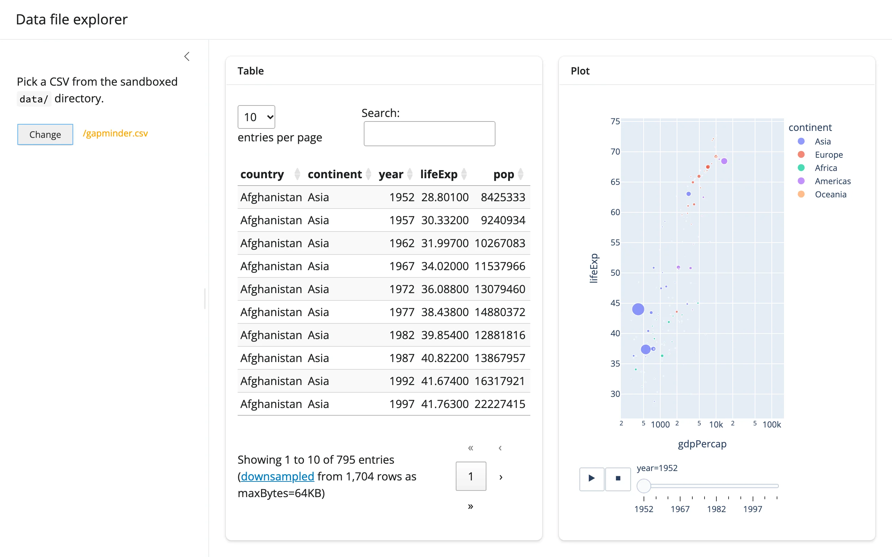

[`gallery/template_data_explorer.py`](gallery/template_data_explorer.py)

### `showcase_file_inspector.py`

A fuller server file inspector: bookmarked "jump to" locations, a hidden-files toggle, a filter selector, and a
preview that adapts to the pick -- a CSV gets the table + plot treatment, anything else gets a text/code preview
(with a caught exception message for anything unreadable as text). Demonstrates the `select_default` +
`reset()` + `@reactive.event(..., ignore_init=True)` pattern from "Updating the widget from Python" end to end.

Initial state (`README.md` selected by default, shown as a text preview):

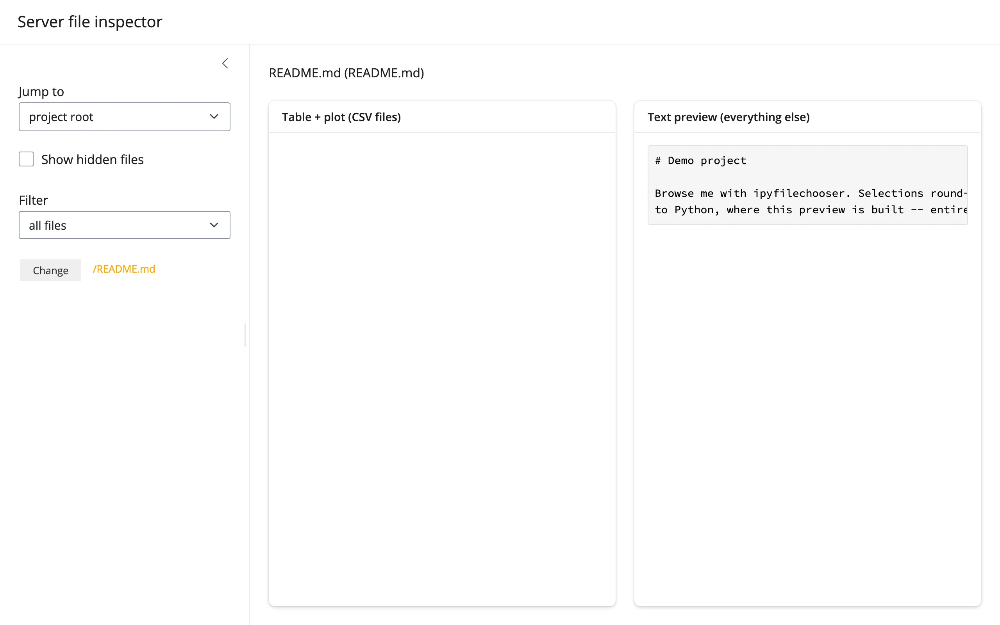

After jumping to `data/` and picking `gapminder.csv`:

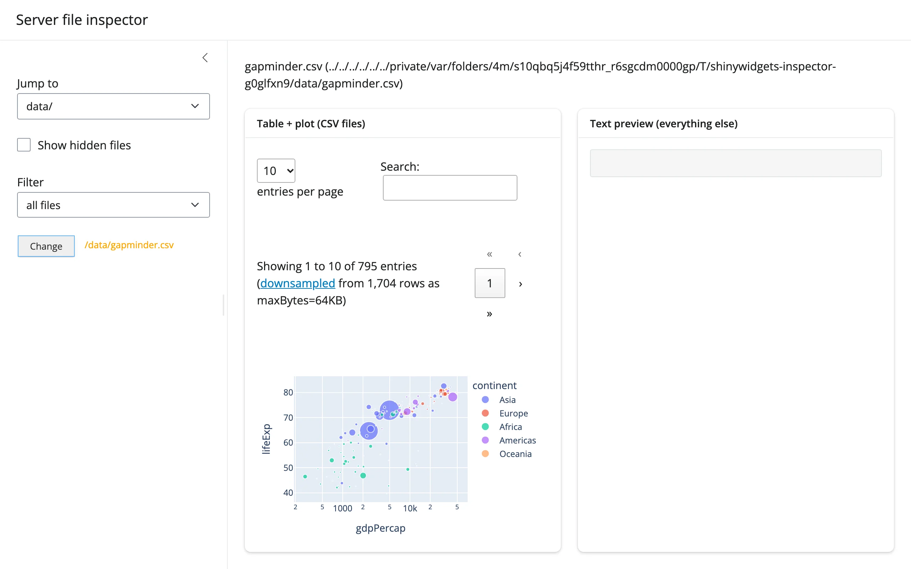

[`gallery/showcase_file_inspector.py`](gallery/showcase_file_inspector.py)

## Learn more

* [ipyfilechooser on GitHub](https://github.com/crahan/ipyfilechooser) -- source, issues, and the full
  constructor reference (`filter_pattern` glob syntax, `dir_icon`, `rows`, etc.)
* Related guides in this roster: [itables](../itables/index.md), [plotly](../plotly/index.md) (used here for
  previewing a picked CSV); [render-widget](../../guide/any-widget/index.md) for the generic `@render_widget` this
  decorator specializes.
