[ipyleaflet](https://ipyleaflet.readthedocs.io) is the Jupyter Widgets binding for
[Leaflet](https://leafletjs.com), the small, mature JavaScript mapping library that powers a large share of the
web's interactive maps. ipyleaflet is maintained as part of the Jupyter widgets ecosystem and gives you Leaflet's
whole toolbox as Python objects: tile layers and basemaps, markers and marker clustering, GeoJSON and choropleths,
drawing tools, split-screen comparison, legends, and more -- each one a widget with synced traits.

`@render_ipyleaflet` renders a function that returns an `ipyleaflet.Map` (or a subclass, such as
[leafmap](../leafmap/index.md)'s `leafmap.leafmap.Map`). It fills its container in a filling layout unless the map
has an explicit height, and it types `.widget` as a real `ipyleaflet.Map` so `.zoom`, `.add()`, and friends
autocomplete and type-check. Five accessors -- `bounds()`, `zoom()`, `center()`, `clicked()`, and
`drawn_features()` -- turn the map into a genuine Shiny input: pans, zooms, clicks, and drawn shapes all come back
to Python as reactive values, no `reactive_read()` boilerplate required.

Reach for ipyleaflet when you want the map itself to be an input (draw a region, click a feature, read the
viewport) with fine control over individual layers. For a point cloud with tens of thousands of rows, prefer
[lonboard](../lonboard/index.md) (WebGL, GPU-accelerated). For vector tiles, 3D terrain, or a globe, see
[maplibre](../maplibre/index.md). If you want one high-level API across several of these engines, plus a
ready-made toolbar and 100+ basemaps, see [leafmap](../leafmap/index.md), whose default backend *is* ipyleaflet
and shares these same five accessors. For local raster files (GeoTIFF/COG), pair ipyleaflet with
[localtileserver](../localtileserver/index.md).

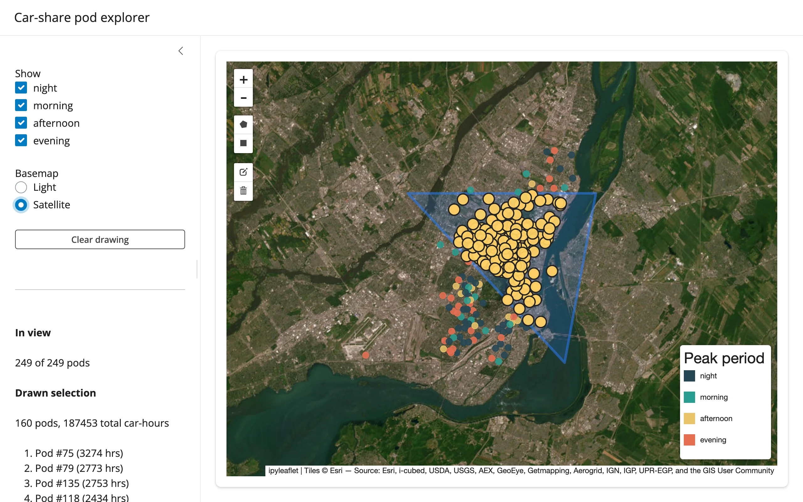

## Installation

```sh
pip install 'shinywidgets[ipyleaflet]'
```

## Quick start

A map is just an `ipyleaflet.Map` with layers added to it. This one centers on Union Square in Manhattan and
drops a marker with a popup:

```{.python file="examples/01_quickstart.py"}
import ipywidgets
import ipyleaflet as L
from shiny.express import ui
from shinywidgets import render_ipyleaflet

ui.page_opts(title="ipyleaflet quickstart", fillable=True)

with ui.card():

    @render_ipyleaflet
    def map():
        m = L.Map(center=(40.73, -73.99), zoom=15)
        marker = L.Marker(location=(40.735, -73.991))
        marker.popup = ipywidgets.HTML("<b>Union Square</b><br>14th St &amp; Broadway")
        m.add(marker)
        return m
```

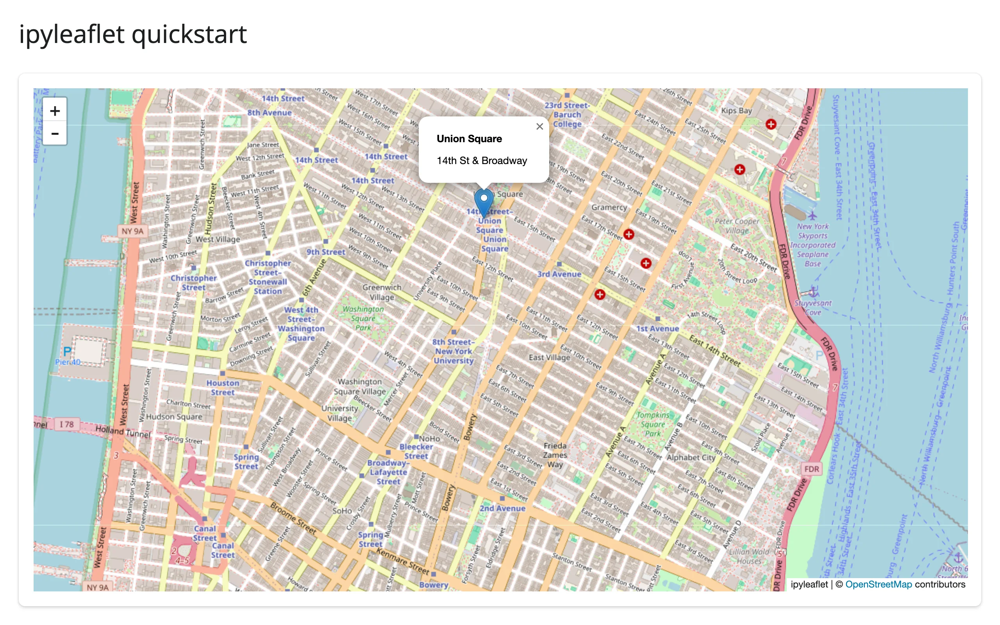

## What you can build

### Basemaps and layer switching

Any number of `ipyleaflet.TileLayer`s can be marked `base=True` and listed in a `LayersControl`, which draws a
radio-button picker. One quirk worth knowing up front: ipyleaflet doesn't enforce exclusivity before the user
interacts (see Gotchas), so add your intended default layer *last*.

```{.python file="examples/02_basemaps.py"}
import ipyleaflet as L
from shiny.express import ui
from shinywidgets import render_ipyleaflet

ui.page_opts(title="Basemaps", fillable=True)

with ui.card():

    @render_ipyleaflet
    def map():
        m = L.Map(center=(40.73, -73.99), zoom=12)  # default basemap: OSM Mapnik
        mapnik = m.layers[0]

        satellite = L.basemap_to_tiles(L.basemaps.Esri.WorldImagery)
        satellite.base, satellite.name = True, "Satellite"
        m.add(satellite)

        topo = L.basemap_to_tiles(L.basemaps.OpenTopoMap)
        topo.base, topo.name = True, "Topo"
        m.add(topo)

        m.add(L.LayersControl(position="topright"))

        # Every base=True layer stays visible until the user picks one in the
        # control (ipyleaflet doesn't enforce exclusivity up front), so
        # whichever was added last is what actually shows. Re-add the
        # intended default last so it's the one on top initially.
        m.remove(mapnik)
        m.add(mapnik)
        return m
```

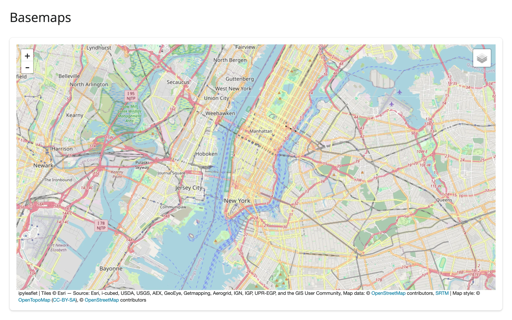
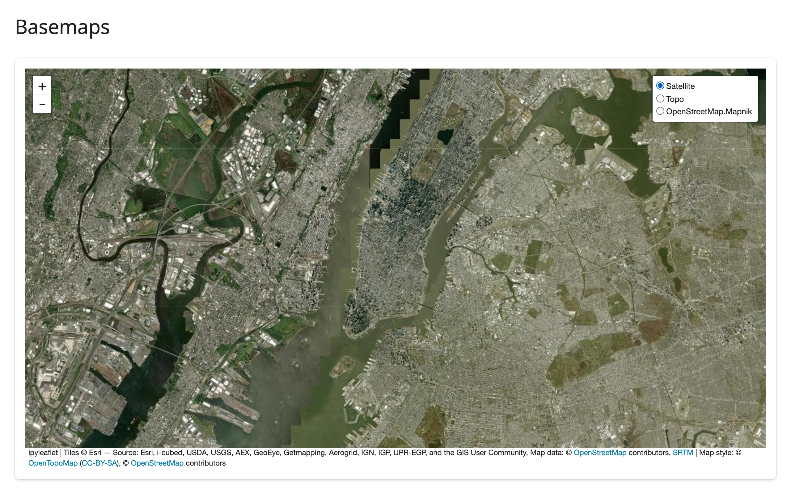

Esri's `WorldImagery` and `OpenTopoMap` are free; CARTO's basemaps (`CartoDB.Positron`, etc.) now require an API
key and render "API KEY REQUIRED" tiles without one.

### Marker clustering

For more than a few hundred points, wrap `Marker`s in a `MarkerCluster` so Leaflet groups nearby markers and only
draws what's visible. This map plots all 249 pods from plotly's `carshare` sample dataset (real, anonymized
car2go usage data for Montreal):

```{.python file="examples/03_markers_clusters.py"}
import ipyleaflet as L
import plotly.express as px
from shiny.express import ui
from shinywidgets import render_ipyleaflet

ui.page_opts(title="Marker clustering", fillable=True)

# plotly's carshare dataset: 249 real car2go pod locations around Montreal
pods = px.data.carshare()

with ui.card():

    @render_ipyleaflet
    def map():
        m = L.Map(center=(45.52, -73.59), zoom=11)
        markers = [L.Marker(location=(r.centroid_lat, r.centroid_lon)) for r in pods.itertuples()]
        m.add(L.MarkerCluster(markers=markers))
        return m
```

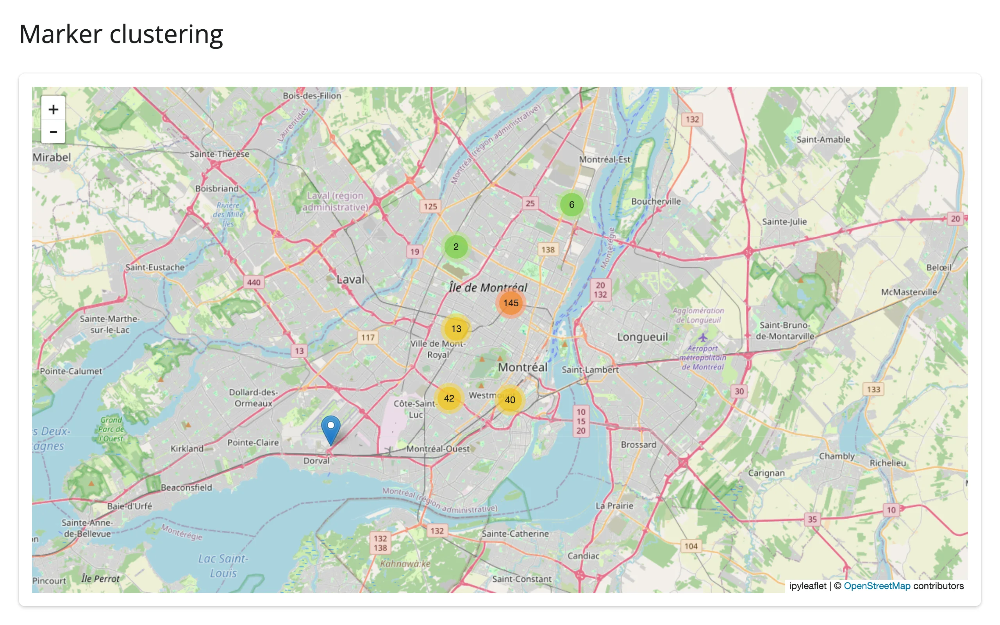

For thousands of points, a single `GeoJSON` layer (below) is dramatically cheaper to render and re-send than many
`Marker` widgets -- see Gotchas.

### GeoJSON choropleth

`ipyleaflet.Choropleth` colors GeoJSON polygons by a value you supply, using a `branca` colormap. Here the same
249 pods are aggregated by total usage (`car_hours`) into a 5x5 grid:

```{.python file="examples/04_choropleth.py"}
import numpy as np
import ipyleaflet as L
import plotly.express as px
from branca.colormap import linear
from shiny.express import ui
from shinywidgets import render_ipyleaflet

ui.page_opts(title="GeoJSON choropleth", fillable=True)

# plotly's carshare dataset: 249 real car2go pod locations around Montreal,
# aggregated by total usage (car_hours) into a 5x5 grid of cells
pods = px.data.carshare()
lats, lons, hours = pods["centroid_lat"], pods["centroid_lon"], pods["car_hours"]

GRID = 5
lat_edges = np.linspace(lats.min(), lats.max(), GRID + 1)
lon_edges = np.linspace(lons.min(), lons.max(), GRID + 1)
i = np.clip(np.digitize(lats, lat_edges) - 1, 0, GRID - 1)
j = np.clip(np.digitize(lons, lon_edges) - 1, 0, GRID - 1)

features, choro_data = [], {}
for r in range(GRID):
    for c in range(GRID):
        cell_id = f"{r}-{c}"
        mask = (i == r) & (j == c)
        choro_data[cell_id] = float(hours[mask].sum())
        lon0, lon1 = lon_edges[c], lon_edges[c + 1]
        lat0, lat1 = lat_edges[r], lat_edges[r + 1]
        features.append(
            {
                "type": "Feature",
                "id": cell_id,
                "properties": {},
                "geometry": {
                    "type": "Polygon",
                    "coordinates": [
                        [[lon0, lat0], [lon1, lat0], [lon1, lat1], [lon0, lat1], [lon0, lat0]]
                    ],
                },
            }
        )

with ui.card():

    @render_ipyleaflet
    def map():
        m = L.Map(center=(45.52, -73.59), zoom=11)
        m.add(
            L.Choropleth(
                geo_data={"type": "FeatureCollection", "features": features},
                choro_data=choro_data,
                colormap=linear.YlOrRd_06,
                border_color="white",
                style={"fillOpacity": 0.75},
            )
        )
        return m
```

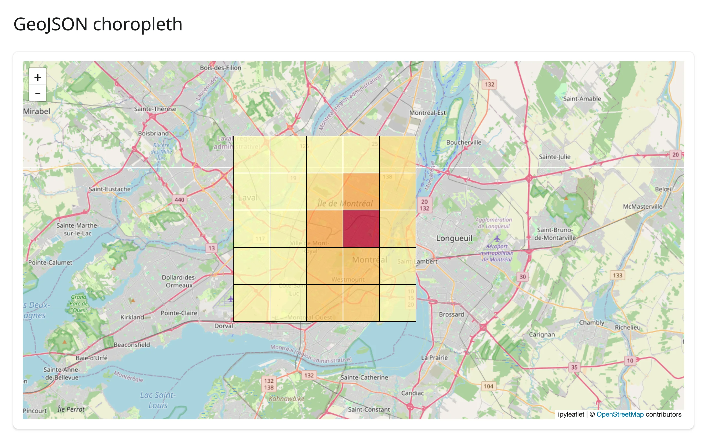

### Drawing tools

`ipyleaflet.DrawControl` adds a toolbar for drawing polygons, rectangles, circles, and markers directly on the
map. Note the `rectangle={"shapeOptions": {}}` below -- an empty dict (`{}`) disables a tool entirely, so to turn
one on, give it a (possibly empty) `shapeOptions`, matching how `polygon`/`polyline`/`circlemarker` already
default. This example also reads the shapes back with `drawn_features()`, covered in depth in the next section:

```{.python file="examples/05_draw_tool.py"}
import ipyleaflet as L
from shiny.express import render, ui
from shinywidgets import render_ipyleaflet

ui.page_opts(title="Draw on the map", fillable=True)

with ui.layout_columns(col_widths=[8, 4]):
    with ui.card():

        @render_ipyleaflet
        def map():
            m = L.Map(center=(40.73, -73.99), zoom=13)
            m.add(L.DrawControl(polygon={"shapeOptions": {"color": "#2a7fff"}}))
            return m

    with ui.card():
        ui.card_header("map.drawn_features()")

        @render.code
        def features():
            feats = map.drawn_features()
            kinds = [f["geometry"]["type"] for f in feats]
            return f"{len(feats)} shape(s)\n" + "\n".join(kinds)
```

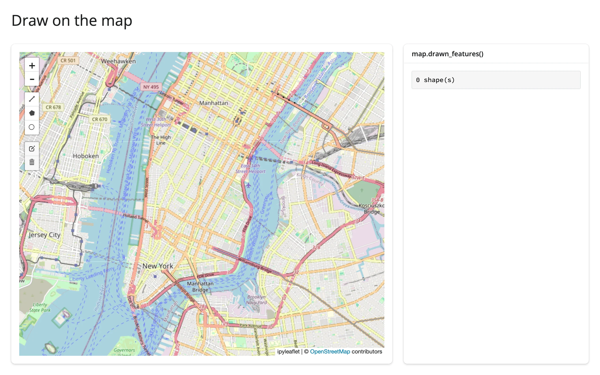
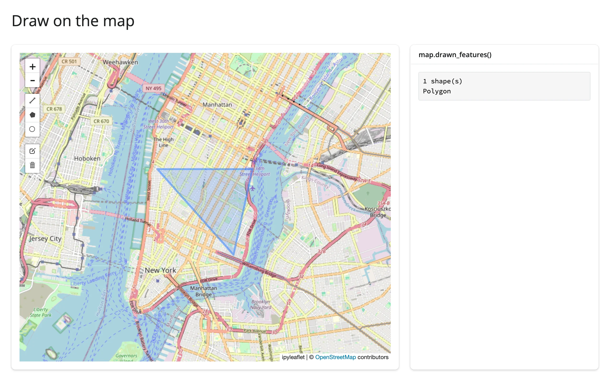

### Split-screen comparison

`ipyleaflet.SplitMapControl` puts two layers side by side with a draggable divider -- useful for before/after
imagery, two basemaps, or two time periods of the same data. Pass the two layers directly to the control; they
aren't also added to the map with `m.add()`:

```{.python file="examples/15_split_map.py"}
import ipyleaflet as L
from shiny.express import ui
from shinywidgets import render_ipyleaflet

ui.page_opts(title="Split map comparison", fillable=True)

with ui.card():

    @render_ipyleaflet
    def map():
        m = L.Map(center=(40.73, -73.99), zoom=12)
        left = L.basemap_to_tiles(L.basemaps.OpenStreetMap.Mapnik)
        right = L.basemap_to_tiles(L.basemaps.Esri.WorldImagery)
        m.add(L.SplitMapControl(left_layer=left, right_layer=right))
        return m
```

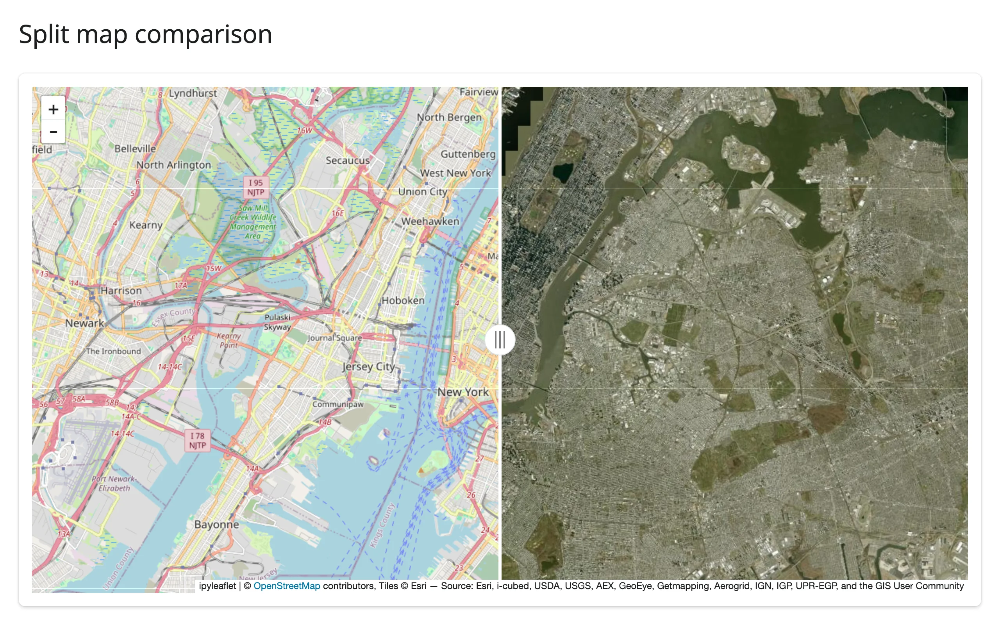

## Reacting to user interaction

### Accessor reference

Every accessor attaches the moment the map renders and records what the user does whether or not
anything has read it yet -- a click, pan, or drawn shape that happens before the first read still
shows up in it.

| accessor | returns | before any interaction | across re-render | default rate policy |
|---|---|---|---|---|
| `bounds()` | `((south, west), (north, east))`, `[lat, lng]` order | Cancels (like an unrendered output) until the browser's first report | Re-seeded; cancels again until the new map reports | none |
| `zoom()` | `float` | Seeded (the map's own `.zoom`) | Re-seeded from the new map | none |
| `center()` | `[lat, lng]` | Seeded (the map's own `.center`) | Re-seeded from the new map | none |
| `clicked()` | `dict` with `coordinates: [lat, lng]` (and other native `on_interaction` kwargs) | `None` until the first click | Kept until the user clicks the new map | none |
| `drawn_features()` | `List[dict]` of GeoJSON Features | `[]` until something is drawn | Re-seeded (`[]` for a fresh `DrawControl`) | none |

None of the five declares a default rate limit -- see [Rate limiting](#rate-limiting) for why, and
for when you'd add one yourself. Coordinates throughout are **`[lat, lng]`**, as ipyleaflet reports
them; lonboard and maplibre are `(lng, lat)`.

`bounds()`, `zoom()`, `center()`, and `drawn_features()` describe the map's own state, so a
re-render -- which builds a fresh `Map` -- re-seeds them from the new map: `zoom()`/`center()`
immediately reflect the new map's constructor arguments, `bounds()` goes back to cancelling until
the browser reports the new map's viewport, and `drawn_features()` goes back to `[]` for the new
map's own (empty) `DrawControl`. `clicked()` is different: a click is something the *user* did, not
something the map owns, so it survives a re-render and keeps reporting the previous click until the
user clicks the new map.

### Camera state: `bounds()`, `zoom()`, `center()`

These three track the map's viewport. `bounds()` is the one with a catch: it's `()` in the browser until the very
first render completes, so reading it cancels (silently, like an output that hasn't rendered yet) rather than
returning an empty tuple -- no `req()` guard needed. This example also shows the two-way sync pattern: a slider
sets `.zoom` on the widget, and `zoom()` (which also fires on that Python-side set) mirrors it back, without a
feedback loop -- `update_slider()` to a value the slider already holds doesn't re-fire the input:

```{.python file="examples/06_camera_state.py"}
import ipyleaflet as L
from shiny import reactive
from shiny.express import input, render, ui
from shinywidgets import render_ipyleaflet

ui.page_opts(title="Camera accessors", fillable=True)

with ui.sidebar():
    ui.input_slider("zoom", "Zoom", value=12, min=4, max=18)

with ui.card():

    @render_ipyleaflet
    def map():
        return L.Map(center=(40.73, -73.99), zoom=12)


@reactive.effect
def _slider_to_map():
    map.widget.zoom = input.zoom()


@reactive.effect
def _map_to_slider():
    # zoom() also fires when Python sets .zoom (the line above), but the
    # slider ignores an update to the value it already holds, so this
    # doesn't loop
    ui.update_slider("zoom", value=map.zoom())


with ui.card(fill=False):

    @render.code
    def status():
        b = map.bounds()  # cancels (no output) until the browser first reports it
        return (
            f"zoom:   {map.zoom()}\n"
            f"center: {[round(c, 3) for c in map.center()]}\n"
            f"bounds: south={b[0][0]:.3f} west={b[0][1]:.3f} "
            f"north={b[1][0]:.3f} east={b[1][1]:.3f}"
        )
```

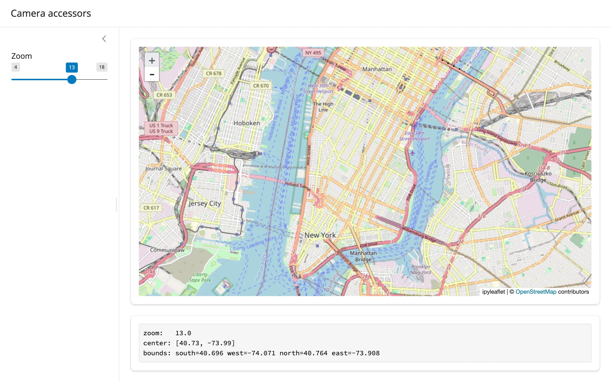

Verified: clicking the zoom-in control moved the slider from 12 to 13 and updated `bounds`/`center` in the status
box, in one Playwright pass.

### Clicks: `clicked()`

```{.python file="examples/07_clicked.py"}
import ipyleaflet as L
from shiny.express import render, ui
from shinywidgets import render_ipyleaflet

ui.page_opts(title="Map clicks", fillable=True)

with ui.layout_columns(col_widths=[8, 4]):
    with ui.card():

        @render_ipyleaflet
        def map():
            return L.Map(center=(40.73, -73.99), zoom=13)

    with ui.card():
        ui.card_header("map.clicked()")

        @render.code
        def click():
            c = map.clicked()
            if c is None:
                return "Click the map to see its coordinates."
            lat, lng = c["coordinates"]
            return f"lat={lat:.4f}\nlng={lng:.4f}"
```

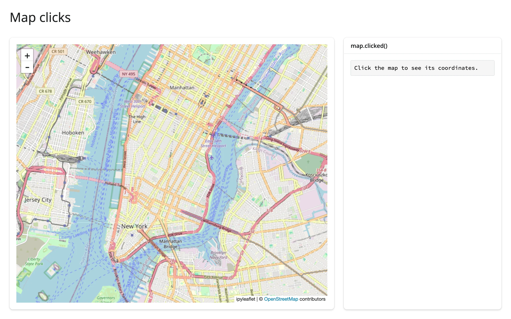
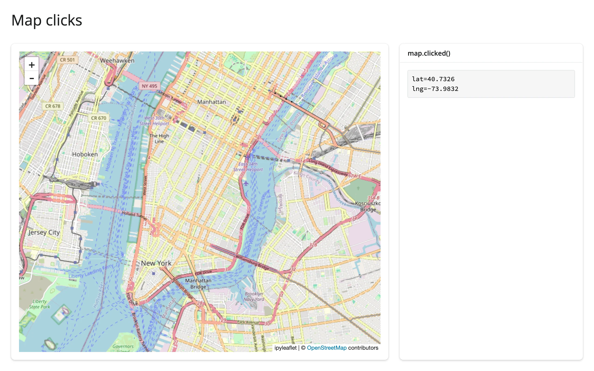

Verified with a real click in Chromium. `clicked()` is kept across a re-render: click the map, trigger a
re-render some other way (e.g. a sidebar input the map doesn't depend on), and the previous click's coordinates
are still there until the user clicks the new map -- verified by forcing a re-render after a click and confirming
the value survives. Two more things worth knowing: a double-click sends two native `click` events plus a
`dblclick` (which is ignored), but because both clicks of a double-click land on the same coordinate and
`clicked()` is deduplicated like any other input (identical consecutive values don't re-publish), a reader only
sees **one** update per double-click in practice, not two. Second: marker clicks don't bubble up to `clicked()`
-- use a layer's own `on_click` (e.g. `GeoJSON.on_click`) for those.

### Drawn shapes: `drawn_features()`

The same app as the drawing-tools example above demonstrates the accessor directly: `map.drawn_features()`
returns `[]` until something is drawn, then a list of GeoJSON Feature dicts that updates as shapes are added,
edited, or deleted. If the map has no `ipyleaflet.DrawControl`, reading it raises `TypeError` (add one with
`m.add(DrawControl())`). See [`examples/05_draw_tool.py`](examples/05_draw_tool.py) and its screenshots above --
verified by actually drawing a triangle with Playwright mouse events (click each vertex, double-click to finish)
and confirming the count and geometry type.

### Reading on demand

Because every accessor attaches at render, a button, download handler, or chat/LLM tool callback can read one
with no warm-up: nothing else needs to have read `bounds()` or `drawn_features()` first to keep them live. A
"Save view" button is the simplest version of this pattern -- capture the camera and any drawn shapes the
instant the user asks, not continuously:

```{.python file="examples/16_read_on_demand.py"}
import ipyleaflet as L
from shiny import reactive
from shiny.express import input, render, ui
from shinywidgets import render_ipyleaflet

ui.page_opts(title="Save the current view on demand", fillable=True)

# Every accessor attaches when the map renders, so nothing needs to keep
# reading bounds()/drawn_features() for this button's reads to see the
# user's latest pan or shape -- they're there the moment the button is
# clicked, with no warm-up read required first.
saved = reactive.value([])

with ui.layout_columns(col_widths=[8, 4]):
    with ui.card():
        ui.input_action_button("save", "Save current view", class_="mb-2")

        @render_ipyleaflet
        def map():
            m = L.Map(center=(40.73, -73.99), zoom=13)
            m.add(L.DrawControl(polygon={"shapeOptions": {"color": "#2a7fff"}}))
            return m

    with ui.card():
        ui.card_header("Saved views")

        @render.ui
        def views():
            if not saved():
                return "Pan the map, maybe draw a shape, then click Save."
            items = [
                ui.tags.li(f"center={c} zoom={z:.0f} shapes={n}") for c, z, n in saved()
            ]
            return ui.tags.ol(*items)


@reactive.effect
@reactive.event(input.save)
def _save_view():
    saved.set([*saved(), (map.center(), map.zoom(), len(map.drawn_features()))])
```

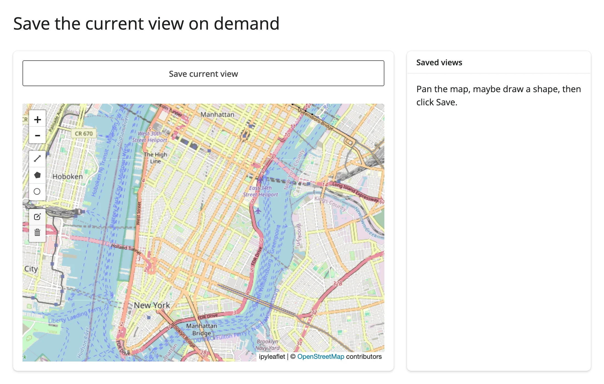
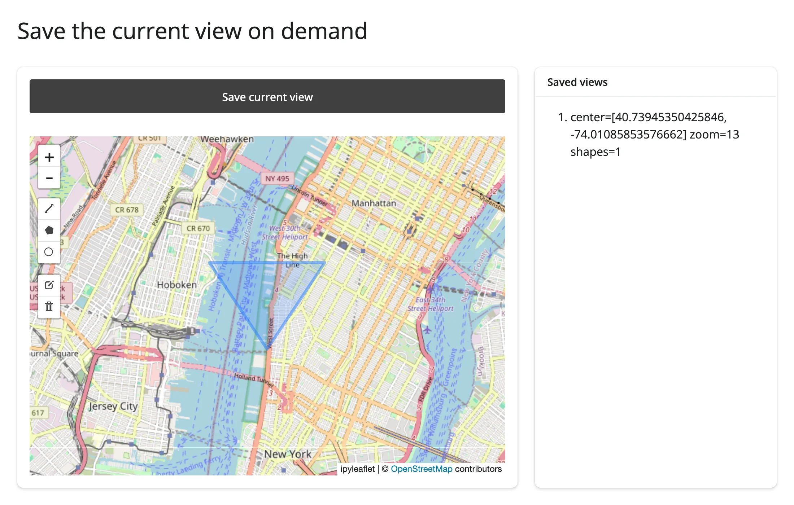

Verified: pan the map, draw a triangle, click Save once -- the saved entry has the panned-to center, the zoom
level, and `shapes=1`, all read inside the button's own `@reactive.event` handler with nothing else subscribed to
`center()`/`zoom()`/`drawn_features()` elsewhere in the app.

### Beyond the accessors: `reactive_read`

The accessors cover the map itself. For state on individual layers and controls -- a draggable marker's
position, a `GeoJSON` layer's hover state, anything not in the accessor table -- use
[`reactive_read()`](../../guide/any-widget/index.md) directly on the layer object. A layer or control isn't the
output's own `.widget`, so there's no `.read()` for it; `reactive_read()` is the tool for any child widget:

```{.python file="examples/08_reactive_read_marker_drag.py"}
import ipyleaflet as L
from shiny import req
from shiny.express import render, ui
from shinywidgets import reactive_read, render_ipyleaflet

ui.page_opts(title="Draggable marker (reactive_read)", fillable=True)

with ui.layout_columns(col_widths=[8, 4]):
    with ui.card():

        @render_ipyleaflet
        def map():
            m = L.Map(center=(40.73, -73.99), zoom=14)
            m.add(L.Marker(location=(40.73, -73.99), draggable=True, name="me"))
            return m

    with ui.card():
        ui.card_header("Drag the marker")

        @render.code
        def location():
            req(map.widget)
            marker = next(lyr for lyr in map.widget.layers if lyr.name == "me")
            lat, lng = reactive_read(marker, "location")
            return f"lat={lat:.4f}\nlng={lng:.4f}"
```

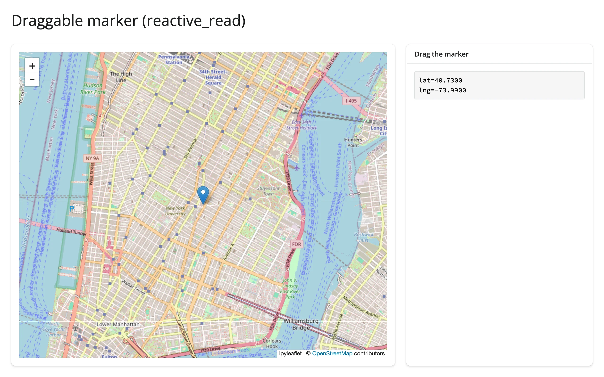
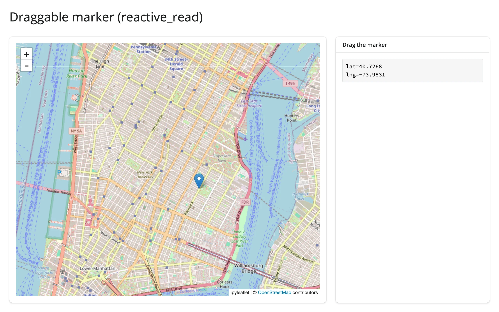

Verified by dragging the marker with Playwright mouse events; the reported coordinates moved from the marker's
starting location to the drop point. Other useful traits to `reactive_read()`: a `GeoJSON` layer's `hover_style`
interactions via `on_hover`, and any `DrawControl`'s `last_action`/`last_draw` for more detail than
`drawn_features()` exposes.

### Rate limiting

None of ipyleaflet's five accessors declare a default `rate_policy` -- each only fires once per user gesture
(one `bounds()`/`zoom()`/`center()` update per pan or zoom, one `clicked()` per click, one `drawn_features()`
update per edit), so there's nothing to smooth. The `rate_policy`/`rate_delay` parameters on `@render_ipyleaflet`
instead govern `reactive_read()` on the widget, which matters for traits that *do* stream many updates per
gesture -- a dragged marker's `location` fires continuously, not once at drop:

```{.python file="examples/09_rate_limiting.py"}
import ipyleaflet as L
from shiny import reactive, req
from shiny.express import render, ui
from shinywidgets import reactive_read, render_ipyleaflet

ui.page_opts(title="Rate-limited reactive_read", fillable=True)

# ipyleaflet's own accessors (bounds/zoom/center/clicked/drawn_features) only
# ever fire once per gesture, so rate_policy/rate_delay has nothing to smooth
# there. It matters for reactive_read() on a trait that streams many updates
# per gesture, like a dragged marker's "location".
with ui.layout_columns(col_widths=[8, 4]):
    with ui.card():

        @render_ipyleaflet(rate_policy="throttle", rate_delay=0.5)
        def map():
            m = L.Map(center=(40.73, -73.99), zoom=14)
            m.add(L.Marker(location=(40.73, -73.99), draggable=True, name="me"))
            return m

    with ui.card():
        ui.card_header("Drag updates seen by Python (throttled to 2/s)")
        count = reactive.value(0)

        @reactive.effect
        def _count():
            req(map.widget)
            marker = next(lyr for lyr in map.widget.layers if lyr.name == "me")
            reactive_read(marker, "location")
            # isolate(): count() is both read and set here, so without
            # isolating the read this effect would depend on its own output
            # and loop forever instead of running once per throttled update
            with reactive.isolate():
                count.set(count() + 1)

        @render.code
        def n():
            return str(count())
```

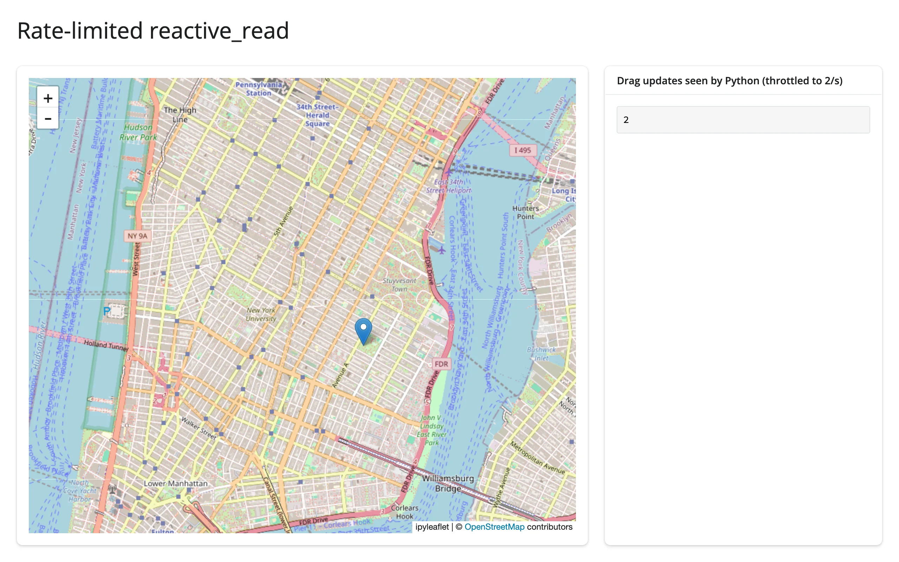

Verified with a 30-step Playwright drag: the throttle (0.5 s window) brought it down to 2 effect runs. Note the
`reactive.isolate()` around `count.set(count() + 1)` -- without it, this effect reads and writes the same
`reactive.Value` in one body, which makes it depend on its own output and re-run forever, freezing the whole
session (the map and every other output stop updating, with no error printed). This is a generic Shiny footgun,
not specific to ipyleaflet, but it's easy to hit the first time you wire up a counter like this.

## Updating the widget from Python

Mutate `map.widget`'s layers and traits from a `@reactive.effect` instead of re-rendering: the browser patches
just the layer that changed, the map keeps its current pan and zoom (and any shapes the user has drawn), and
nothing re-sends the base widget bundle. This example toggles a layer's visibility, restyles it, and swaps the
basemap, all in place:

```{.python file="examples/10_inplace_updates.py"}
import ipyleaflet as L
from shiny import reactive
from shiny.express import input, ui
from shinywidgets import render_ipyleaflet

ui.page_opts(title="In-place layer updates", fillable=True)

OUTLINE = {
    "type": "Feature",
    "properties": {},
    "geometry": {
        "type": "Polygon",
        "coordinates": [
            [[-74.00, 40.72], [-73.98, 40.72], [-73.98, 40.74], [-74.00, 40.74], [-74.00, 40.72]]
        ],
    },
}

with ui.sidebar():
    ui.input_checkbox("show_outline", "Show outline", True)
    ui.input_radio_buttons("color", "Outline color", ["blue", "red", "green"])
    ui.input_checkbox("satellite", "Satellite basemap", False)

with ui.card():

    @render_ipyleaflet
    def map():
        m = L.Map(center=(40.73, -73.99), zoom=13)
        m.add(L.GeoJSON(data=OUTLINE, style={"color": "blue", "fillOpacity": 0.1}, name="outline"))
        return m


def outline():
    return next(lyr for lyr in map.widget.layers if lyr.name == "outline")


# Each effect mutates a trait on the already-rendered map, so the browser
# patches the one layer that changed instead of rebuilding the whole map --
# the pan/zoom the user has done is never disturbed.
@reactive.effect
def _toggle_outline():
    outline().visible = input.show_outline()


@reactive.effect
def _restyle_outline():
    outline().style = {**outline().style, "color": input.color()}


@reactive.effect
def _swap_basemap():
    m = map.widget
    old = next(lyr for lyr in m.layers if lyr.base)
    basemap = L.basemaps.Esri.WorldImagery if input.satellite() else L.basemaps.OpenStreetMap.Mapnik
    new = L.basemap_to_tiles(basemap)
    new.base = True
    m.substitute(old, new)
```

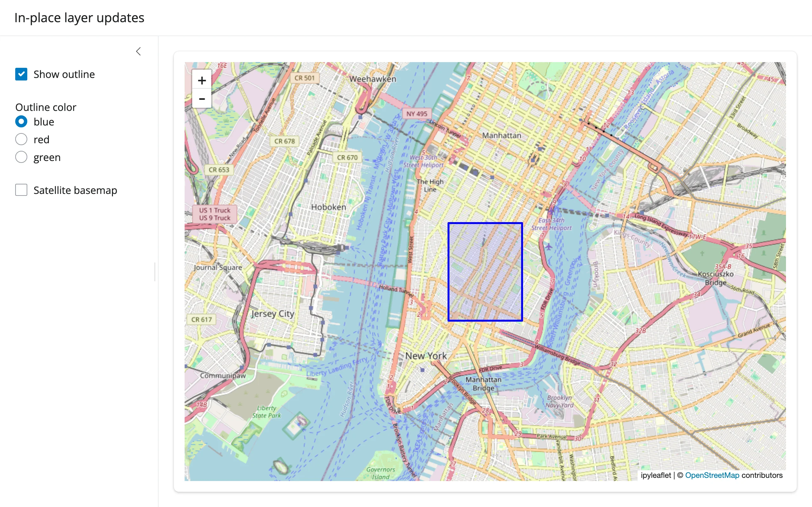
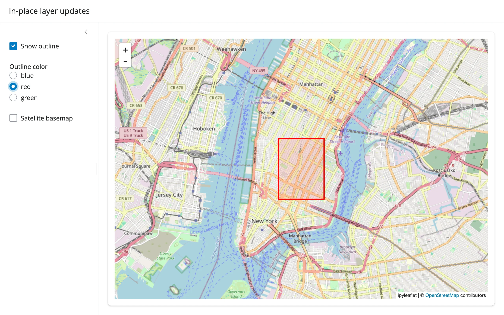
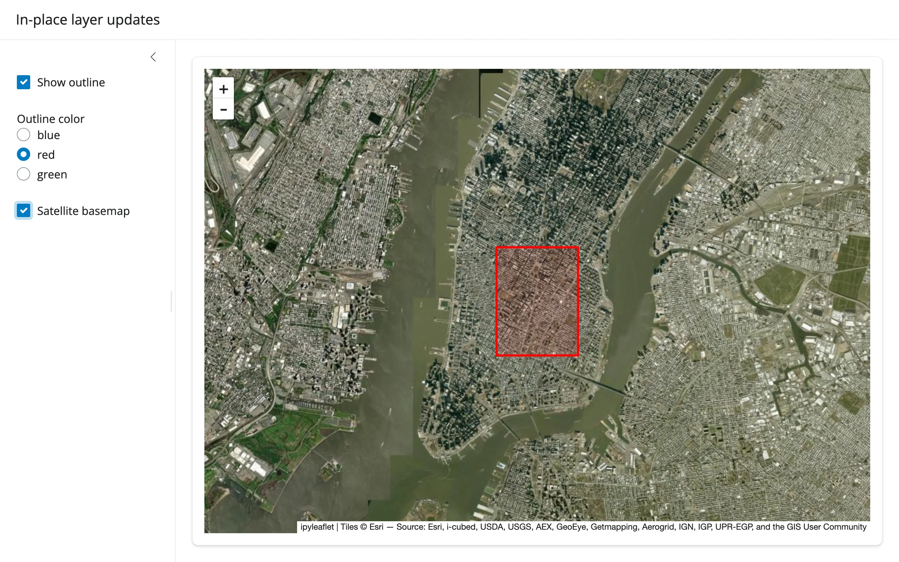
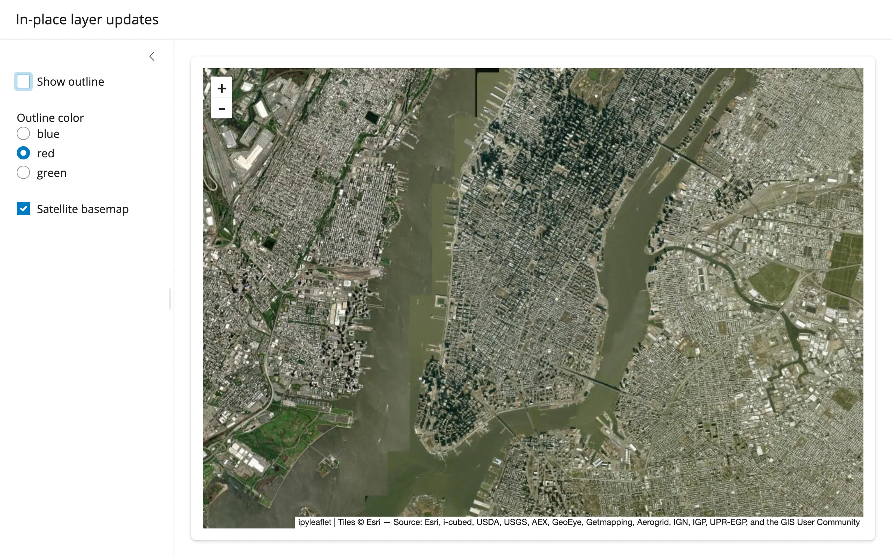

All three updates verified in Chromium: color swap, basemap swap (`m.substitute()`), and hiding the layer
entirely via its `visible` trait. One easy-to-miss detail that caused a real bug while writing this guide:
`basemap_to_tiles()` does not set `base=True` on its result, so if you look up "the current base layer" by
`layer.base` after a swap and forget to set it on the replacement, the next swap's lookup raises `StopIteration`
-- an uncaught one kills the session. Always set `new.base = True` on the replacement before substituting.

**When to re-render instead:** if the number or structure of layers changes substantially (e.g., switching
datasets entirely), or you need a clean slate, re-rendering is simpler and the cost is just the widget's own
JS bundle (already cached) plus its current layer data -- which can be non-trivial for many `Marker` widgets
(see Gotchas). In-place updates still avoid the full re-render (so pan/zoom/drawn shapes survive), but don't
assume every in-place update is cheap: a `visible` toggle is a tiny patch (~444 bytes, measured), but a `style`
change on a `GeoJSON` layer re-sends the *entire* feature collection with the new style baked into every
feature (~1.09 MB for this example's single-feature outline -- about the same payload as just re-rendering the
whole map), because ipyleaflet bakes `style` into each feature rather than syncing it as a separate trait. For
a handful of visibility toggles, in-place updates are both less code and imperceptibly fast; for frequent style
changes on data-heavy `GeoJSON` layers, re-rendering may cost about the same as updating in place.

## Coordinating multiple views

### Draw a shape, filter a table

`drawn_features()` returns GeoJSON; a few lines of `shapely` turn that into a spatial filter over any
point dataset:

```{.python file="examples/11_linked_spatial_filter.py"}
import ipyleaflet as L
import plotly.express as px
from shapely.geometry import Point, shape
from shiny.express import render, ui
from shinywidgets import render_ipyleaflet

ui.page_opts(title="Draw a shape, filter the table", fillable=True)

# plotly's carshare dataset: 249 real car2go pod locations around Montreal
pods = px.data.carshare()

with ui.layout_columns(col_widths=[7, 5]):
    with ui.card():

        @render_ipyleaflet
        def map():
            m = L.Map(center=(45.52, -73.59), zoom=11)
            # rectangle={}: an empty dict disables the tool; give it a
            # (possibly empty) shapeOptions to enable it, like the other tools
            m.add(
                L.DrawControl(
                    polygon={"shapeOptions": {"color": "#2a7fff"}},
                    rectangle={"shapeOptions": {}},
                )
            )
            return m

    with ui.card(full_screen=True):
        ui.card_header("Pods inside the drawn shape(s)")

        @render.data_frame
        def inside():
            feats = map.drawn_features()  # [] until something is drawn
            if not feats:
                return pods.iloc[0:0]
            polys = [shape(f["geometry"]) for f in feats]
            mask = [
                any(poly.contains(Point(lon, lat)) for poly in polys)
                for lat, lon in zip(pods["centroid_lat"], pods["centroid_lon"])
            ]
            return render.DataGrid(pods[mask].reset_index(drop=True))
```

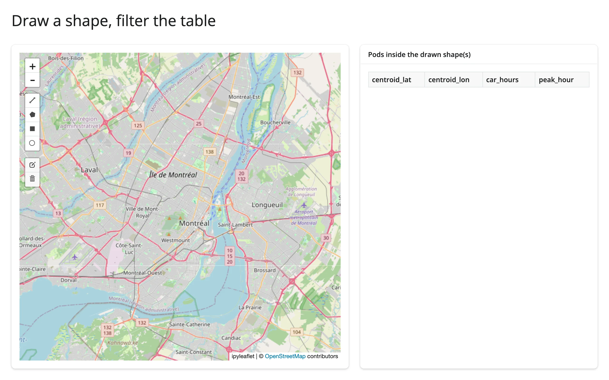
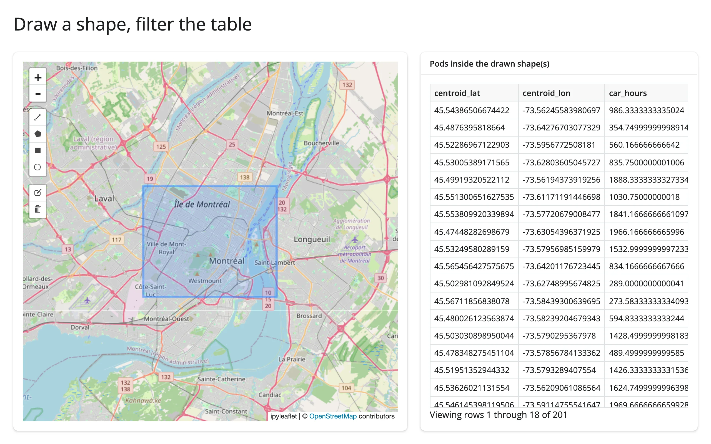

Verified by dragging a rectangle with Playwright: the table went from empty to 201 of 249 rows, matching the
drawn extent.

### Map viewport, a chart of what's visible

`bounds()` makes "what's on screen" a reactive value. Pairing it with a `render_plotly` output (pairs with:
plotly) gives a live summary of the visible subset as the user pans and zooms -- no manual event wiring:

```{.python file="examples/12_linked_viewport_summary.py"}
import pandas as pd
import plotly.express as px
import ipyleaflet as L
from shiny.express import ui
from shinywidgets import render_ipyleaflet, render_plotly

ui.page_opts(title="What's in view", fillable=True)

# plotly's carshare dataset: 249 real car2go pod locations around Montreal,
# labeled with when each pod sees its heaviest use
pods = px.data.carshare()
pods["period"] = pd.cut(
    pods["peak_hour"], bins=[-1, 5, 11, 17, 23], labels=["night", "morning", "afternoon", "evening"]
)

with ui.layout_columns(col_widths=[7, 5]):
    with ui.card():

        @render_ipyleaflet
        def map():
            m = L.Map(center=(45.52, -73.59), zoom=11)
            markers = [L.Marker(location=(r.centroid_lat, r.centroid_lon)) for r in pods.itertuples()]
            m.add(L.MarkerCluster(markers=markers))
            return m

    with ui.card():
        ui.card_header("Pods in the current viewport, by peak period")

        @render_plotly
        def in_view():
            (south, west), (north, east) = map.bounds()  # pairs with: plotly
            visible = pods[pods.centroid_lat.between(south, north) & pods.centroid_lon.between(west, east)]
            counts = visible["period"].value_counts().reindex(["night", "morning", "afternoon", "evening"]).reset_index()
            counts.columns = ["period", "count"]
            return px.bar(counts, x="period", y="count")
```

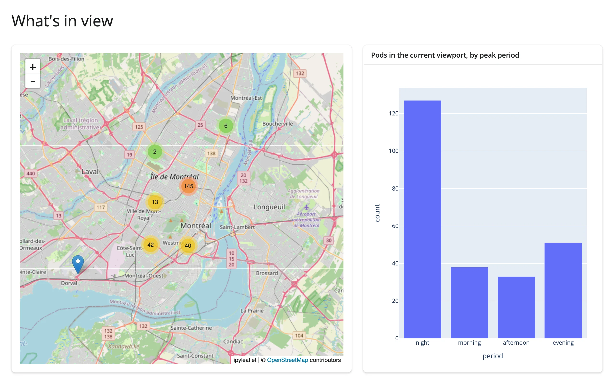
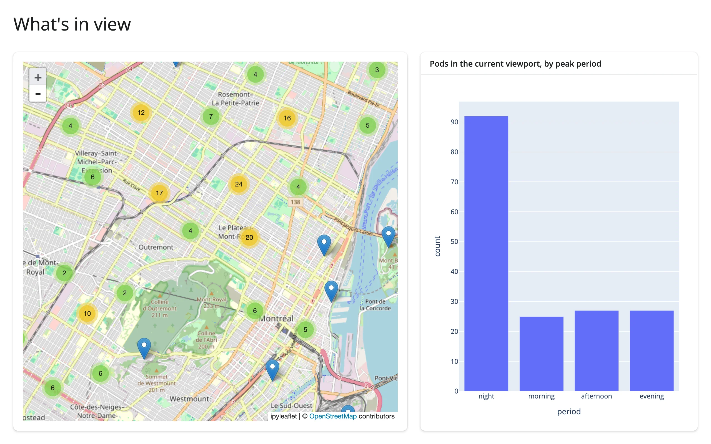

Verified: zooming in twice dropped the chart from all 249 pods to the ~172 inside the new viewport, with the
`night` bar shrinking proportionally more because that cluster sits further north.

### Click, find the nearest feature

`clicked()` plus a one-line distance calculation gives a "nearest neighbor" detail card -- useful any time a
dataset has too many points to label individually:

```{.python file="examples/13_linked_click_nearest.py"}
import plotly.express as px
import ipyleaflet as L
from shiny.express import render, ui
from shinywidgets import render_ipyleaflet

ui.page_opts(title="Click for the nearest pod", fillable=True)

# plotly's carshare dataset: 249 real car2go pod locations around Montreal
pods = px.data.carshare()

with ui.layout_columns(col_widths=[8, 4]):
    with ui.card():

        @render_ipyleaflet
        def map():
            m = L.Map(center=(45.52, -73.59), zoom=11)
            markers = [L.Marker(location=(r.centroid_lat, r.centroid_lon)) for r in pods.itertuples()]
            m.add(L.MarkerCluster(markers=markers))
            return m

    with ui.card():
        ui.card_header("Nearest pod to your last click")

        @render.ui
        def nearest():
            c = map.clicked()
            if c is None:
                return "Click the map."
            lat, lng = c["coordinates"]
            d2 = (pods["centroid_lat"] - lat) ** 2 + (pods["centroid_lon"] - lng) ** 2
            row = pods.loc[d2.idxmin()]
            return ui.div(ui.h5(f"Pod #{row.name}"), f"{row['car_hours']:.0f} car-hours")
```

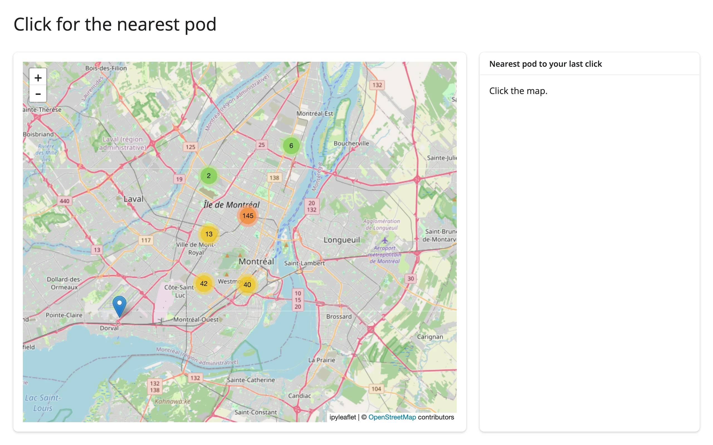


### Widget state updating another widget, in place

A second, smaller "overview" map stays synced to a detail map's camera -- a classic locator-map pattern. Reading
`center()`/`bounds()` on the detail map and assigning to the overview's own trait is enough; there's no feedback
loop because setting a trait to the value it already holds doesn't re-publish:

```{.python file="examples/14_linked_two_maps.py"}
import ipyleaflet as L
from shiny import reactive
from shiny.express import ui
from shinywidgets import render_ipyleaflet

ui.page_opts(title="Overview map stays in sync", fillable=True)

with ui.layout_columns(col_widths=[8, 4]):
    with ui.card():

        @render_ipyleaflet
        def main():
            return L.Map(center=(40.73, -73.99), zoom=14)

    with ui.card():

        @render_ipyleaflet
        def overview():
            m = L.Map(center=(40.73, -73.99), zoom=10)
            m.add(L.Rectangle(bounds=((40.72, -74.0), (40.74, -73.98)), name="extent"))
            return m


# The overview map never re-renders: panning or zooming the main map just
# moves its center and resizes its rectangle, so the overview keeps its own
# zoom level and any layers a user added to it.
@reactive.effect
def _sync_overview_center():
    overview.widget.center = main.center()


@reactive.effect
def _sync_extent_rectangle():
    extent = next(lyr for lyr in overview.widget.layers if lyr.name == "extent")
    extent.bounds = main.bounds()
```

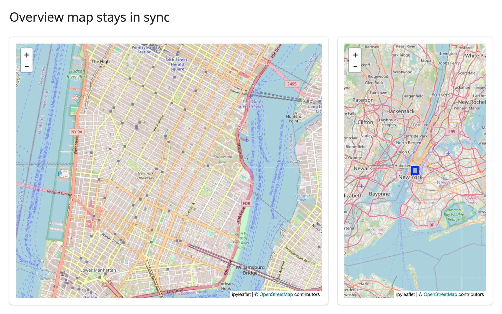
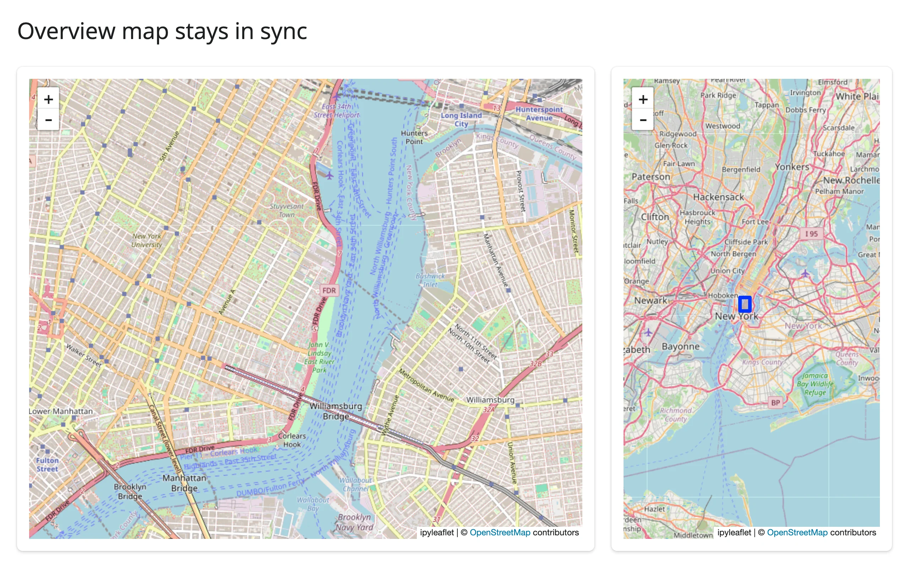

Verified by dragging the main map: the overview's center and its extent rectangle both followed, while the
overview kept its own, more zoomed-out, view.

## Large data

ipyleaflet has no large-data mode of its own: every marker and GeoJSON feature you add is sent to the browser in
full and drawn in the DOM/SVG, which is why [marker clustering](#marker-clustering) only helps into the low
thousands of points, not beyond. Its basemap tiles are the exception -- raster tile layers only ever load the
tiles the current viewport needs, "only send what's visible," but that applies to the basemap, not your data.
For a real point cloud (tens of thousands of rows or more), hand the same data to
[lonboard](../lonboard/index.md#large-data) instead, which draws it with the GPU rather than the DOM -- see this
guide's introduction for the comparison. For local raster files, pair ipyleaflet with
[localtileserver](../localtileserver/index.md#large-data), which gives your own raster data the same
only-send-what's-visible treatment the basemap gets. See the
[Large data & performance article](../../guide/performance/index.md#three-approaches-to-large-data) for how
these approaches compare in general.

## Layout and sizing

- The map fills its container in a filling layout (card, `fillable=True` page) unless it has its own height,
  either via `output_widget(height=...)` or `Layout(height=...)` on the `Map`. A subclass's own default height
  (e.g., leafmap's 600px) is treated as unset -- see the [leafmap guide](../leafmap/index.md) for that renderer's
  specifics.
- Use `output_widget(height="300px")` (or `@render_ipyleaflet(height=...)` in Express) for a fixed size.
  `output_widget(height="auto")`/`"fit-content"` are handled correctly (an older build of this renderer briefly
  turned those into a 0-height map; that's fixed on current `main`).
- `full_screen=True` cards work as expected; Leaflet resizes to fill the expanded card.
- A map in a hidden tab initializes at the correct size once the tab is shown (Shiny suspends the output while
  hidden), and resizing while hidden is tracked correctly.

## Gotchas and limitations

- **Multiple `base=True` layers all render until the user interacts.** ipyleaflet doesn't pick one for you up
  front: every base tile layer you `.add()` stays `visible=True`, so with several of them, whichever was added
  *last* ends up on top and is what's actually shown -- regardless of which radio button the `LayersControl`
  marks as selected. The fix (used in the basemaps example above) is to re-add your intended default layer last.
  This is reproducible on current `main`; we haven't checked whether it's ipyleaflet-the-Python-package or
  jupyter-leaflet-the-frontend's doing.
- **`rectangle={}`/`circle={}` on `DrawControl` silently disables the tool.** The traits default to `{}`, which
  looks "on" from Python, but the frontend only enables a tool when its options dict is non-empty (the other
  tools default to `{"shapeOptions": {}}`, which has one key). Pass `{"shapeOptions": {}}` explicitly to enable
  rectangle or circle drawing.
- **`basemap_to_tiles()` doesn't set `base=True`.** If your own code looks up "the current base layer" by
  `layer.base` (as the in-place basemap swap above does), the replacement needs `new.base = True` set explicitly,
  or the *next* lookup raises `StopIteration` -- uncaught, that kills the session.
- **A double-click publishes `clicked()` once, not twice.** The browser sends two native `click` events plus a
  `dblclick` for a double-click; both clicks land on the same coordinate, and `clicked()` dedupes identical
  consecutive values like any other input, so only one update reaches Python. See the `clicked()` section above.
- **Clicks on a layer also reach the map's `clicked()`.** Leaflet events bubble, so clicking a `GeoJSON` feature
  fires both that layer's own `on_click` and the map's `clicked()`. Not independently re-verified for this guide
  (carried over from the prior evaluation report), but it follows directly from Leaflet's event model.
- **Prefer one `GeoJSON` layer over many `Marker` widgets for large point counts.** Each `Marker` is its own
  ipywidgets model with its own comm traffic; a single `GeoJSON` layer with `point_style`/`style_callback` is
  far cheaper to construct and re-send, and is what the choropleth and "coordinating multiple views" examples
  above use for anything beyond a few hundred points.
- **Map controls can look transparent outside JupyterLab.** jupyter-leaflet's CSS reads `--jp-*` theme
  variables with no fallback; those variables don't exist until some other Jupyter-widgets control has loaded
  CSS. In this guide's screenshots the zoom buttons and draw toolbar render with solid backgrounds, so this
  does not currently reproduce on `main` -- it may already be mitigated, or may depend on which other widgets
  are on the page. Flagging as a known upstream wart rather than a confirmed current bug.

## Gallery candidates

**[`gallery/template_spatial_explorer.py`](gallery/template_spatial_explorer.py)** (template, ~55 lines) -- a
clean starting point for any point dataset: clustered markers, a live "N in view" count from `bounds()`, and a
click-to-detail card from `clicked()`.

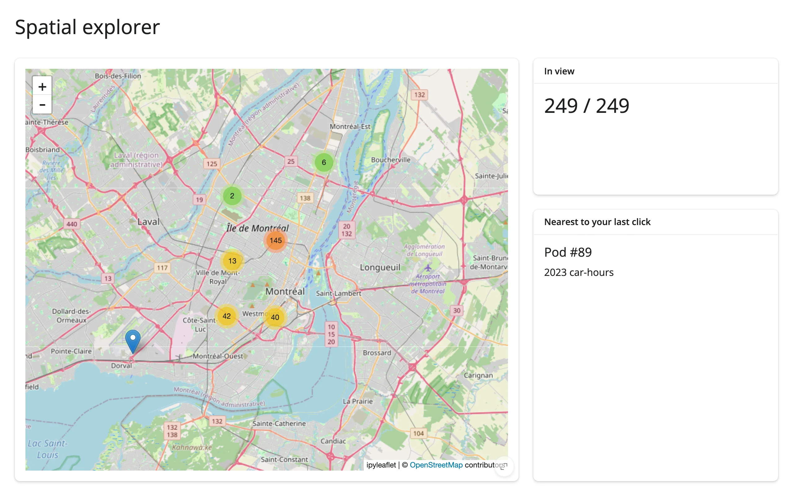

**[`gallery/showcase_carshare_explorer.py`](gallery/showcase_carshare_explorer.py)** (showcase, ~155 lines) --
draw a shape and get the count, total usage, and busiest-pod shortlist inside it, highlighted on the map without
re-rendering; filter by time-of-day and swap basemaps, both in place. Uses `drawn_features()` and `bounds()`.

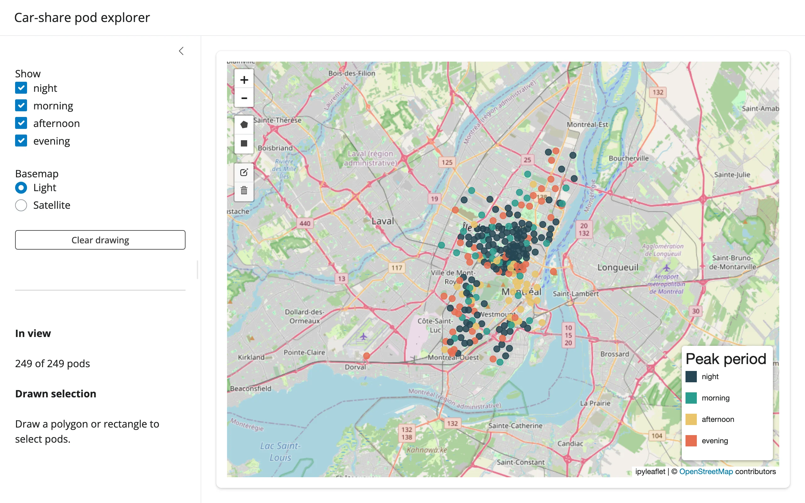


## Learn more

- [ipyleaflet documentation](https://ipyleaflet.readthedocs.io)
- [Leaflet.js](https://leafletjs.com) (the underlying JS library) and
  [Leaflet.draw](https://github.com/Leaflet/Leaflet.draw) (the drawing toolbar)
- [`shinywidgets.reactive_read`](../../guide/any-widget/index.md) for reading any widget trait
- Related guides: [leafmap](../leafmap/index.md) (same accessors, more basemaps and tools),
  [lonboard](../lonboard/index.md) (GPU-accelerated large point/polygon layers),
  [maplibre](../maplibre/index.md) (vector tiles, globe), [localtileserver](../localtileserver/index.md)
  (local raster tiles)
