[ipysigma](https://github.com/medialab/ipysigma) is a Jupyter widget built by [médialab](https://medialab.sciencespo.fr/en/)
(Sciences Po) on top of [sigma.js](https://www.sigmajs.org), a WebGL graph-rendering library, and
[graphology](https://graphology.github.io), its companion graph data structure library. It renders a
[networkx](https://networkx.org) or [igraph](https://python.igraph.org) graph directly, with search, a
clickable legend, pan/zoom, and PNG/SVG/GEXF/JSON export built in. Because it draws with the GPU, it stays
responsive at a scale (tens of thousands of nodes) that SVG-based renderers (and `pyvis`, which produces a
static HTML blob) can't reach.

`@render_ipysigma` accepts either a bare graph (coerced to a default `Sigma` widget) or a `Sigma(...)` you
construct yourself to control node/edge color, size, and labels from attributes or metrics computed in the
browser (community detection, for instance). It also fixes a real-world rendering bug: ipysigma's `kill()`
leaves dead WebGL contexts behind when a view is removed, which, left unpatched, blanks *other* graphs on the
page after a few re-renders (browsers cap live WebGL contexts per page) -- `shinywidgets` releases them. This
renderer has no reactive accessor methods, but every interaction still reaches Python through `.read()`
on the rendered widget's synced traits, covered below.

Reach for ipysigma when a graph is something the user should *explore*: click a node, search for one, filter by
category, zoom in on a cluster. For a graph that should be *themed and laid out explicitly* (fixed stylesheets,
compound nodes, small diagrams more than data explorations), see [ipycytoscape](../ipycytoscape/index.md)
instead -- it trades ipysigma's WebGL scale for Cytoscape.js's richer, CSS-like styling API and is the better
fit under a few hundred nodes.

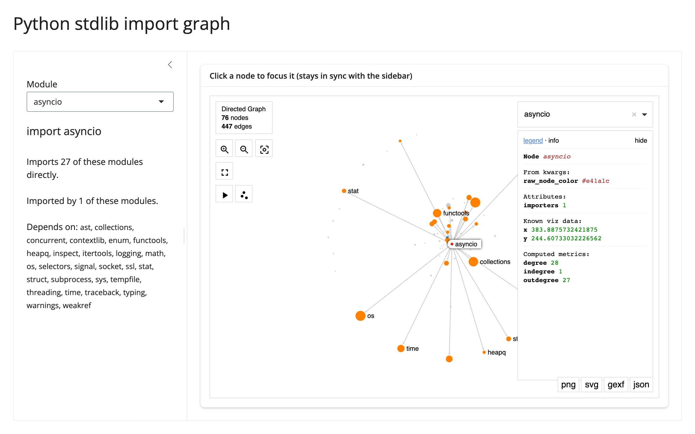

## Installation

```sh
pip install 'shinywidgets[ipysigma]'
```

This installs `ipysigma` itself. Bring your own graph library -- `networkx` (used throughout this guide) or
`python-igraph`.

## Quick start

```{.python file="examples/01_quickstart.py"}
from __future__ import annotations

import networkx as nx
from shiny.express import ui
from shinywidgets import render_ipysigma

ui.page_opts(title="ipysigma quickstart", fillable=True)

with ui.card(full_screen=True):
    ui.card_header("Zachary's karate club (34 members, 78 friendships)")

    @render_ipysigma
    def graph():
        return nx.karate_club_graph()
```

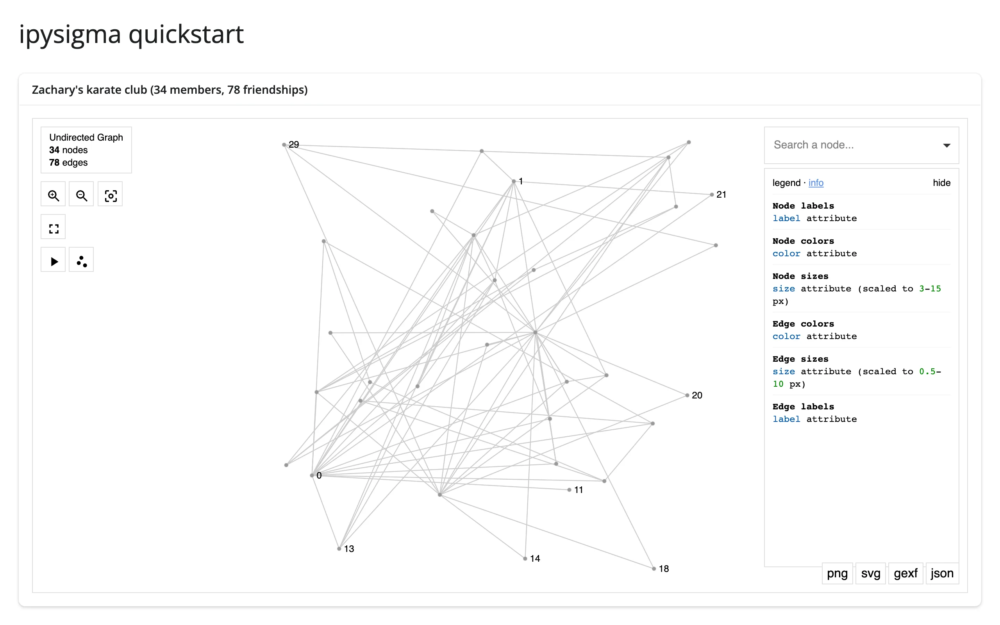

Returning a bare graph gets you search, zoom controls, a legend placeholder, and export buttons for free. For
any visual encoding, construct a `Sigma(...)` instead, as every other example in this guide does.

## What you can build

### Data-driven node color and size

Node attributes become visual variables by name; a `DegreeView` (or any `{node: value}` mapping) works directly
for numeric channels like size.

```{.python file="examples/02_encodings.py"}
    @render_ipysigma
    def graph():
        # node_color/node_size read straight from node attributes (club) or a
        # DegreeView; ipysigma adds a clickable legend for the categorical color.
        return Sigma(G, node_color="club", node_size=G.degree)
```

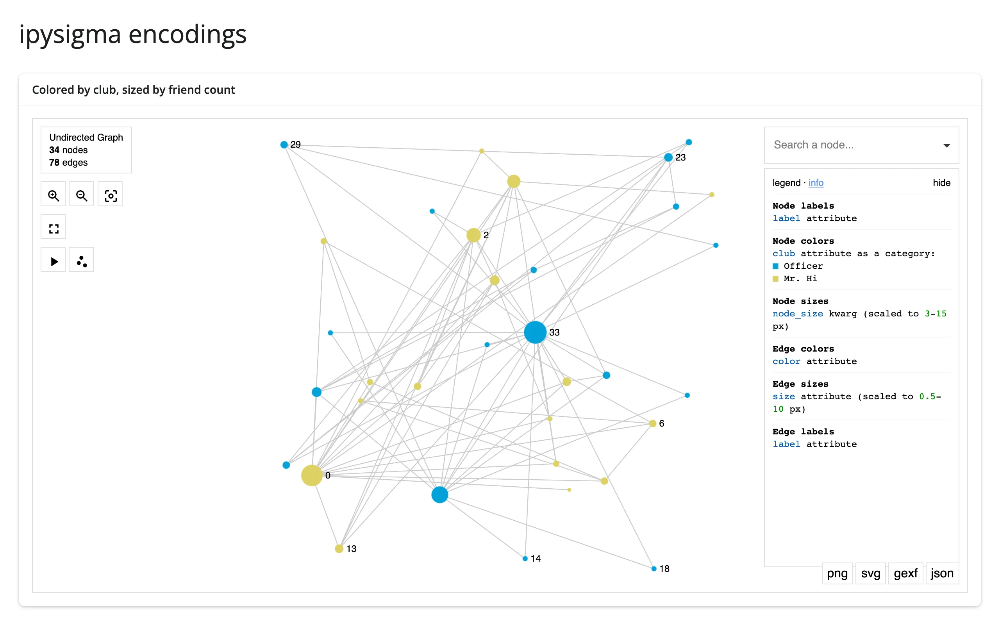

### Metrics computed where they're cheapest

`node_metrics={"community": "louvain"}` runs Louvain community detection in the browser with graphology, at no
Python cost. For anything else -- PageRank here -- compute it once in Python and set it as a node attribute.

```{.python file="examples/03_computed_metrics.py"}
    @render_ipysigma
    def graph():
        return Sigma(
            G,
            # Computed by graphology in the browser, not in Python
            node_metrics={"community": "louvain"},
            node_color="community",
            node_size="pagerank",
        )
```

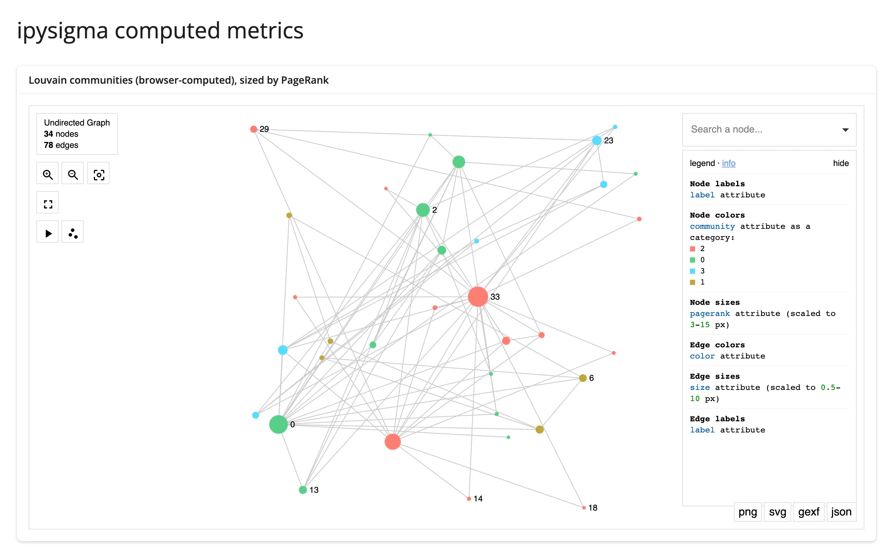

### Edges carry data too

`edge_color`/`edge_size` work exactly like their node counterparts, and `clickable_edges=True` lets users click
an edge (not just a node) to inspect it -- shown in [Reacting to user interaction](#reacting-to-user-interaction)
below.

```{.python file="examples/05_edges_and_weight.py"}
    @render_ipysigma
    def graph():
        return Sigma(
            G,
            node_size=G.degree,
            edge_size="weight",
            edge_color="weight",
            edge_color_gradient=("#ddd", "#c0392b"),
            # Lets users click an edge (not just a node) to inspect it
            clickable_edges=True,
        )
```

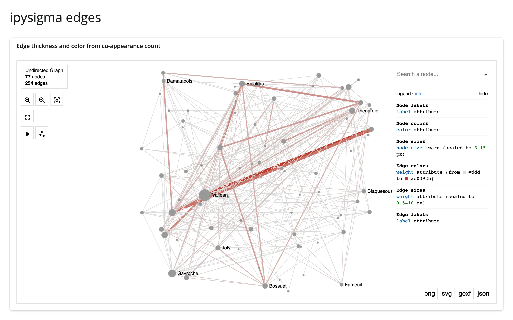

### ForceAtlas2, laid out live in the browser

`start_layout=<seconds>` runs the ForceAtlas2 force-directed algorithm in a web worker and stops after the given
time, writing the converged positions back to Python (see [`camera_state` and `layout`](#camera_state-and-layout)).
Prefer a number of seconds over `True`, which runs forever.

```{.python file="examples/04_layout_forceatlas2.py"}
    @render_ipysigma
    def graph():
        # No layout= is given, so nodes start at random positions; start_layout
        # runs ForceAtlas2 in a web worker for 4 seconds, then stops and writes
        # the converged positions back to the `layout` trait.
        return Sigma(G, start_layout=4, node_size=G.degree)
```

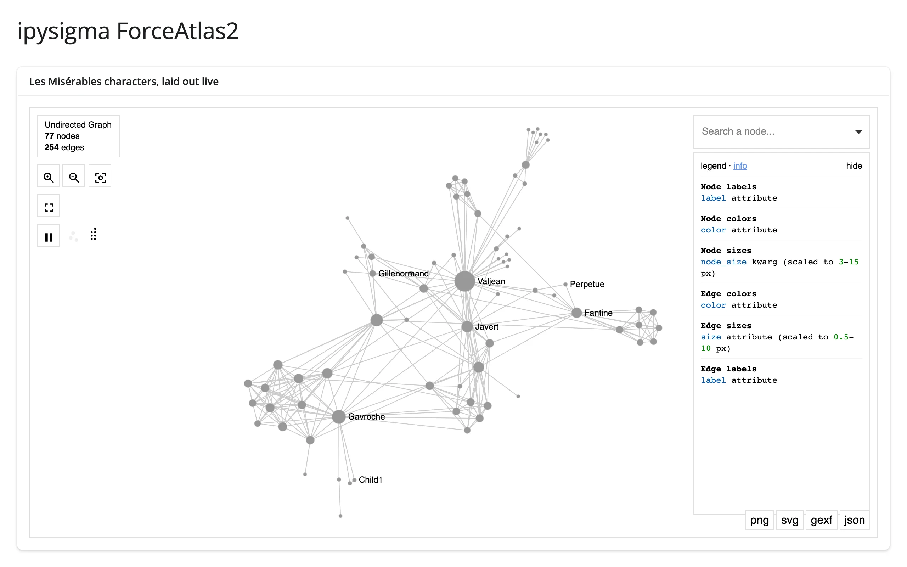

### Scale: tens of thousands of nodes

sigma.js draws on the GPU, so it stays interactive well past where SVG-based graph libraries bog down. Passing
precomputed `layout=` positions (rather than letting ipysigma lay the graph out) avoids both the random-hairball
first frame and a full position write-back to Python on first render.

```{.python file="examples/06_scale.py"}
    @render_ipysigma
    def graph():
        return Sigma(
            G,
            layout=layout,
            node_color="cluster",
            default_node_size=2,
            hide_edges_on_move=True,  # keeps panning smooth at this size
        )
```

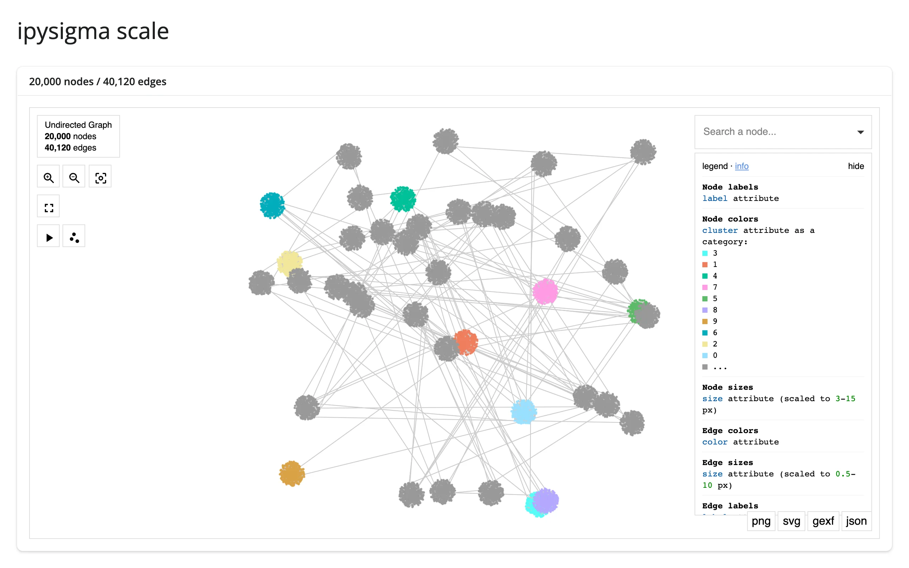

40 synthetic clusters, 20,000 nodes, ~40,000 edges, panned and zoomed smoothly in testing. The legend caps
categorical colors at 10 by default (`max_categorical_colors`) -- the other 30 clusters here render gray, which
is correct behavior worth knowing about before you wonder where your colors went.

## Reacting to user interaction

`render_ipysigma` declares no reactive accessor methods -- there's no `graph.selected()`. Every interaction
instead goes through `graph.read("<trait>")`, which reads a synced ipywidgets trait of the rendered `Sigma`
the same way `reactive_read(graph.widget, "<trait>")` would (see the [reacting to widgets
article](../../guide/reacting-to-widgets/index.md#beyond-the-accessors-read-and-reactive_read) for why
`.read()` is the taught way to reach for that now). The traits below are the ones a real gesture actually
changes; `graph.widget.trait_names()` lists many more (mostly write-only rendering options you pass to
`Sigma()` at construction instead).

### Traits worth reading

| trait | returns | fires when | `None`/`[]` means | default rate policy |
|---|---|---|---|---|
| `selected_node` | `str \| None` | clicking a node, choosing one in the search box, or in-graph search | nothing selected (also clears when an edge or stage is clicked) | not rate-limited |
| `selected_edge` | `(str, str) \| None` | clicking an edge (requires `clickable_edges=True`) | nothing selected (also clears when a node is clicked) | not rate-limited |
| `selected_node_category_values` | `list \| None` | clicking a swatch in the legend | `[]`/`None`: no filter, every category shown | not rate-limited |
| `camera_state` | `dict` (`x`, `y`, `ratio`, `angle`) | panning or zooming | n/a -- always has a value | not rate-limited |
| `layout` | `dict[node, {"x", "y"}] \| None` | once at mount, and again whenever ForceAtlas2 (`start_layout`) stops | `None` until the first layout exists | not rate-limited |
| `snapshot` | `str` (PNG data URL) `\| None` | after you send `{"msg": "render_snapshot"}` (there's no browser gesture for it) | no snapshot captured yet | not rate-limited |

`selected_node` is always a `str`, even for integer node keys (`int(graph.read("selected_node"))` or
`graph.widget.get_selected_node()`, which converts back to the original key type -- call it only after you've
already taken a reactive dependency via `.read()`, since it doesn't take one itself).

### Selecting nodes, edges, and the legend

Node and edge selection are mutually exclusive (selecting one clears the other); the legend's category filter
is independent of both and persists across node/edge clicks.

```{.python file="examples/07_selection_node_edge_legend.py"}
        @render.code
        def state():
            node = graph.read("selected_node")
            edge = graph.read("selected_edge")
            categories = graph.read("selected_node_category_values")
            return (
                f"selected_node:  {node!r}\n"
                f"selected_edge:  {edge!r}\n"
                f"selected_node_category_values: {categories!r}"
            )
```

Before any interaction, and after clicking a legend swatch (filtering to one community) and then an edge
(which clears the node selection but keeps the filter):

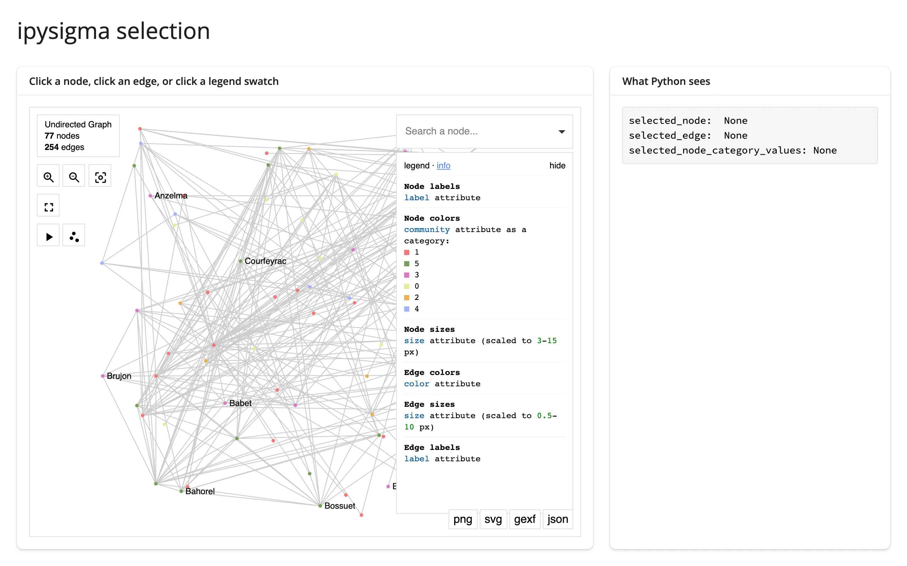
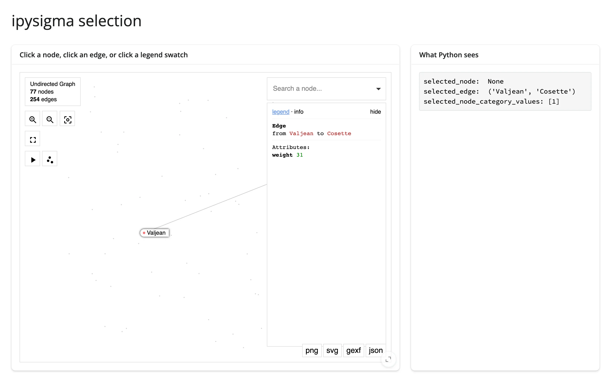

### `camera_state` and `layout`

Panning, zooming, and a running `start_layout` all write back reactively. Positions in `layout` are keyed by
node and already match the coordinate space you'd pass back into a new `Sigma(..., layout=...)`.

```{.python file="examples/08_camera_and_layout.py"}
        @render.code
        def state():
            camera = graph.read("camera_state")
            layout = graph.read("layout")
            n_positioned = 0 if layout is None else len(layout)
            camera_lines = "\n".join(f"  {k}: {v:.3g}" for k, v in camera.items())
            return f"camera_state:\n{camera_lines}\nlayout: {n_positioned} node positions"
```

Before any interaction, and after panning, zooming, and letting the 3-second `start_layout` finish:

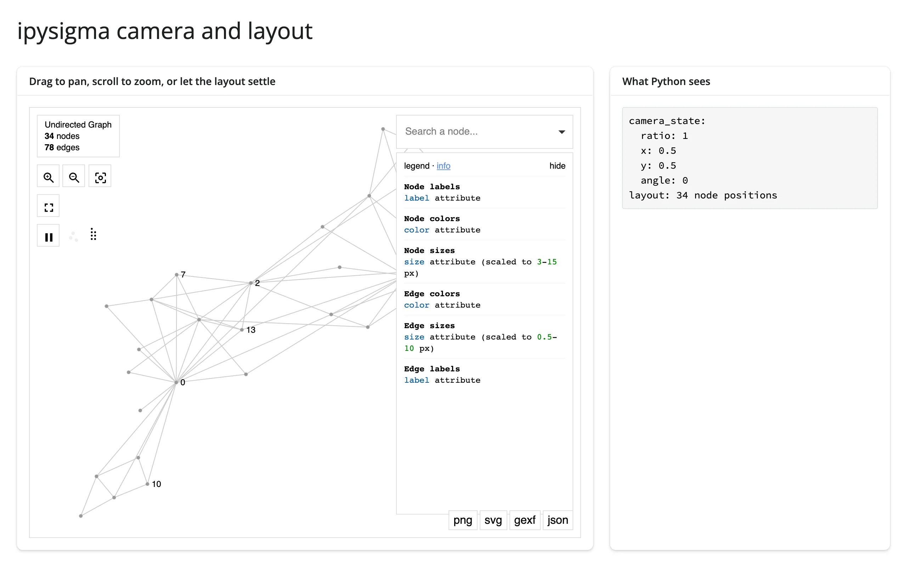
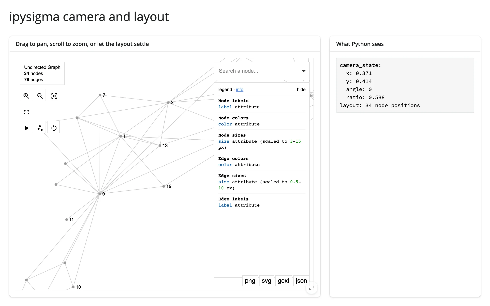

### Snapshot: asking the browser for a picture

ipysigma accepts exactly one command from Python: sending `{"msg": "render_snapshot"}` makes the browser render
a PNG and write it to the `snapshot` trait as a data URL, which `.read("snapshot")` picks up like any other
trait change.

```{.python file="examples/09_snapshot.py"}
        @reactive.effect
        @reactive.event(input.snap)
        def _request_snapshot():
            # The only Python -> browser command ipysigma exposes: it answers
            # by setting the `snapshot` trait to a PNG data URL.
            graph.widget.send({"msg": "render_snapshot"})

        @render.ui
        def png():
            data_url = graph.read("snapshot")
            if data_url is None:
                return ui.p("No snapshot yet -- click the button.")
            return ui.img(src=data_url, style="max-width: 100%;")
```

Before capturing, and after clicking "Capture PNG":

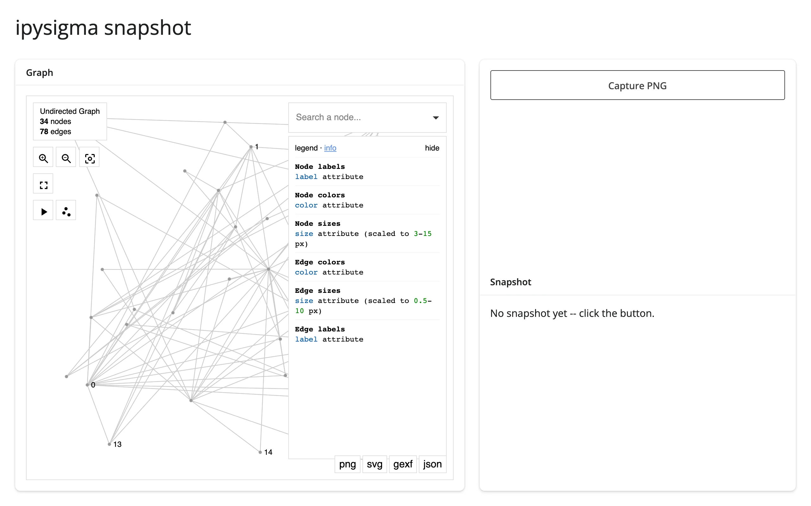
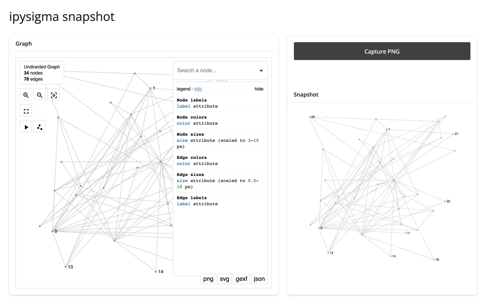

### Rate limiting

`rate_policy`/`rate_delay` on `@render_ipysigma` rate-limit `.read()`/`reactive_read()` for *every* trait on
that widget (not a per-trait setting), the same as every other renderer's `.read()` tier. Verified on current main:
ipysigma's own camera sync is already coarse under normal use -- a continuous ~4-second drag with 60 intermediate
mouse positions produced only 1-2 raw `camera_state` changes on the model, so a real pan/zoom rarely gives
`rate_policy` much to smooth. It matters when something else produces a genuine burst of changes close together
(the example below simulates one directly on the model to demonstrate it) or when the downstream computation a
read triggers is expensive enough that even ipysigma's own cadence is too frequent.

```{.python file="examples/10_rate_limiting.py"}
with ui.layout_columns(col_widths=[6, 6]):
    with ui.card(full_screen=True):
        ui.card_header("Drag me -- not rate-limited")

        @render_ipysigma
        def unthrottled():
            return Sigma(G, sync_key="cam")

    with ui.card(full_screen=True):
        ui.card_header("Same camera, throttled to 1 read per 2 seconds")

        @render_ipysigma(rate_policy="throttle", rate_delay=2)
        def throttled():
            return Sigma(G, sync_key="cam")
```

20 rapid, distinct `camera_state` changes mirrored to both widgets (`sync_key` keeps their cameras identical):
the unthrottled counter keeps pace; the throttled one, capped to one read per 2 seconds, falls behind during the
burst and catches up once it settles:

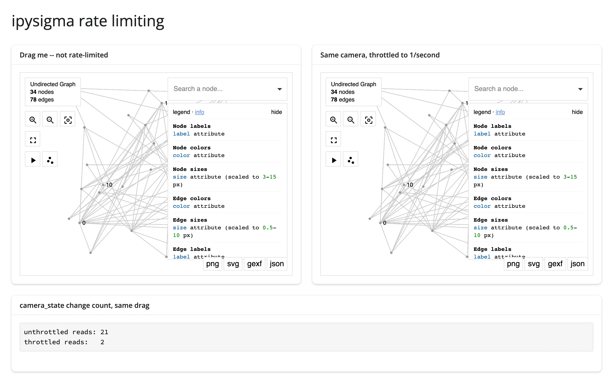


## Updating the widget from Python

ipysigma reads its constructor options once, when the graph is first drawn, and registers no listeners for
later trait changes -- verified on current main: setting `graph.widget.selected_node = "5"` from an effect does
reach the browser's copy of the model (`graph.read("selected_node")` sees the new value), but nothing changes
on screen, the same as the class docstring says. There's no in-place update path here, unlike widgets that
mirror trait changes into their view (plotly, itables' `.update()`).

The practical pattern is to re-render, carrying forward whatever state you don't want to lose -- typically
`camera_state` (and `layout`, if a layout has already converged) -- by mirroring it into a `reactive.value` with
an effect, then feeding it back into the next `Sigma(...)`:

```{.python file="examples/11_carry_state_rerender.py"}
    camera = reactive.value({"x": 0.5, "y": 0.5, "ratio": 1, "angle": 0})

    @reactive.effect
    def _track_camera():
        req(graph.widget)
        camera.set(graph.read("camera_state"))

    @render_ipysigma
    def graph():
        color_by = input.color_by()
        with reactive.isolate():
            # isolate(): reading .widget here (not just camera) would create a
            # circular dependency on this render's own previous output
            cam = camera.get()
        if color_by == "club":
            return Sigma(G, node_color="club", camera_state=cam)
        return Sigma(
            G,
            node_color=dict(G.degree()),
            node_color_gradient=("#dbe9f6", "#08306b"),
            camera_state=cam,
        )
```

Switching color schemes rebuilds the graph entirely, but the zoomed-in view from before the switch is preserved
exactly:

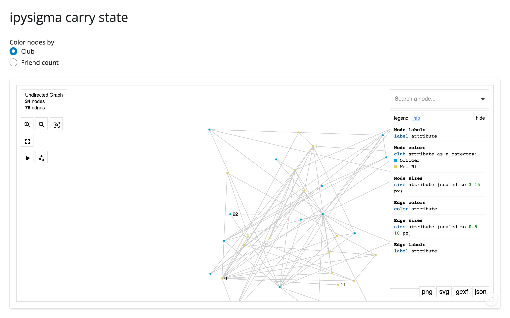
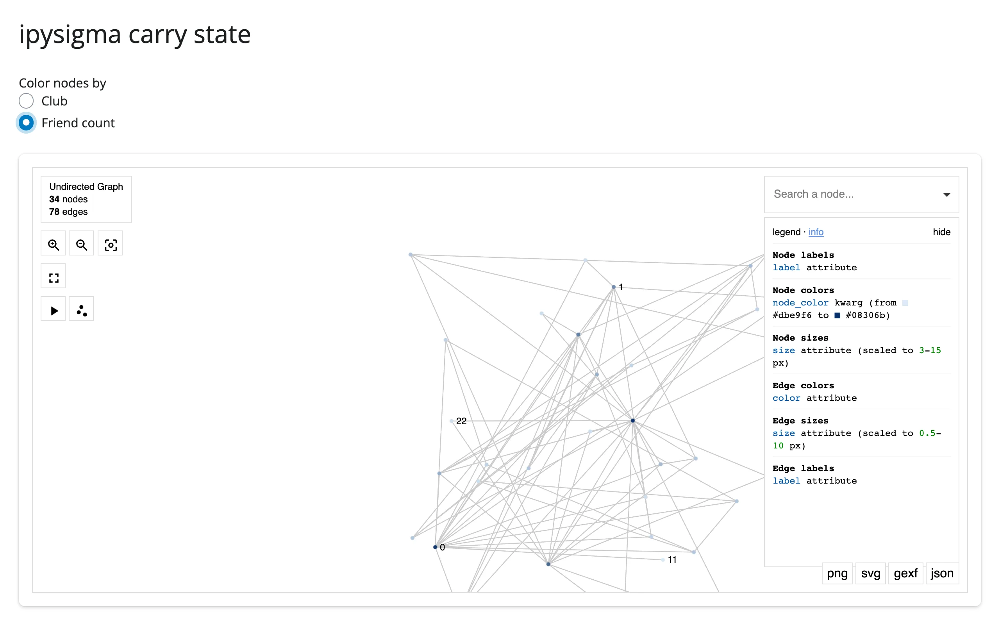

Don't read `graph.widget` inside `graph()` itself without `reactive.isolate()` -- before the first render, that
raises `req(False)` and cancels the output silently. Mirroring into a `reactive.value` via a separate effect (as
above) sidesteps this.

## Coordinating multiple views

### Click a node for a detail card

The most common pattern: read `selected_node` in a `@render.ui` and handle the "nothing selected" case for
first load.

```{.python file="examples/12_click_to_detail_card.py"}
        @render.ui
        def detail():
            raw = graph.read("selected_node")
            if raw is None:
                return ui.p("Click a node to see who they're friends with.")
            node = int(raw)  # selected_node is always a string
            friends = sorted(G.neighbors(node))
            return ui.TagList(
                ui.h5(f"Member {node}"),
                ui.p(f"Club: {G.nodes[node]['club']}"),
                ui.p(f"Friends ({len(friends)}): {', '.join(map(str, friends))}"),
            )
```

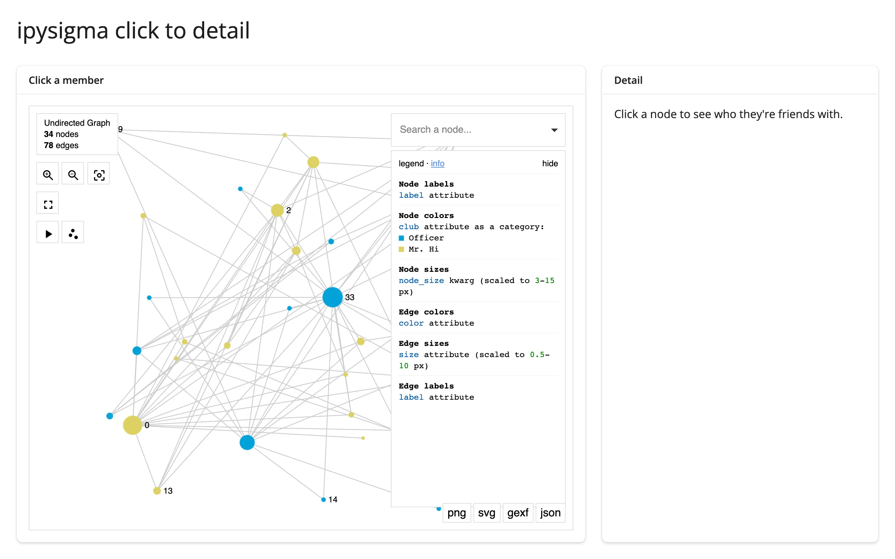
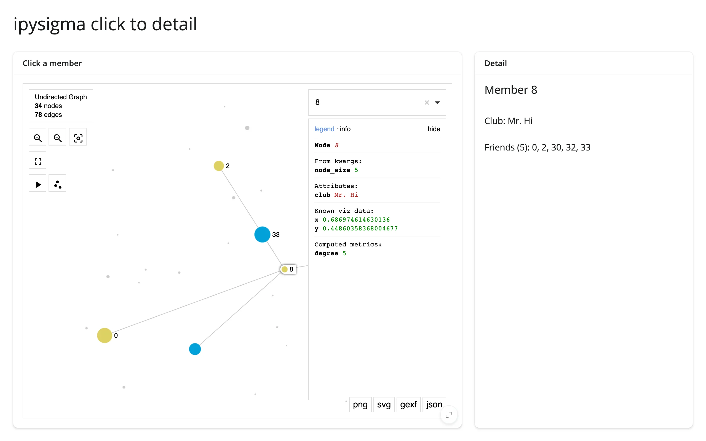

### Click a node to filter a table

Same read, different downstream view -- a selected node's neighbors as a data frame instead of prose.

```{.python file="examples/13_click_to_neighbor_table.py"}
        @render.data_frame
        def neighbor_table():
            raw = graph.read("selected_node")
            req(raw)
            neighbors = sorted(G.neighbors(int(raw)))
            return members[members["member"].isin(neighbors)].reset_index(drop=True)
```

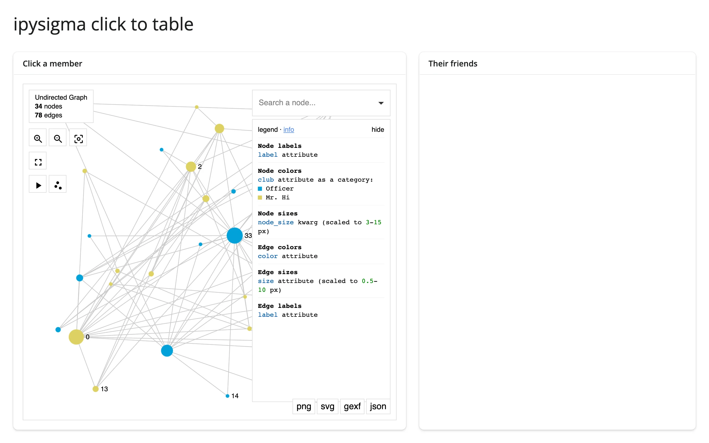
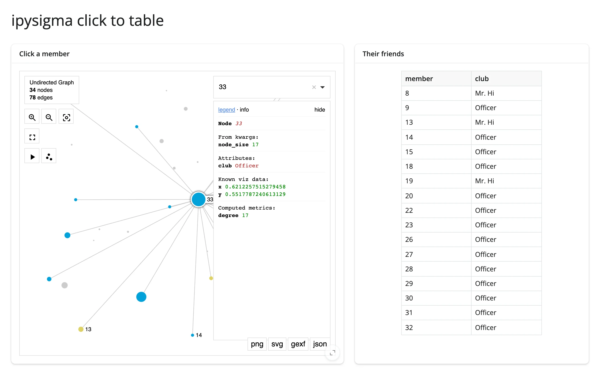

*(Pairs well with [itables](../itables/index.md) or [reactable](../reactable/index.md) for a richer table than
`render.data_frame`.)*

### Two linked views, no Python in the loop

Give two `Sigma`s the same `sync_key` and the browser keeps their camera, selection, and hover in sync directly
-- each still reports its own `selected_node` to Python, so both update together with no effect wiring at all.
This is the Shiny replacement for ipysigma's `SigmaGrid` (a Jupyter-only small-multiples helper that isn't a
widget and can't be returned from a render function).

```{.python file="examples/14_linked_views_sync_key.py"}
with ui.layout_columns(col_widths=[6, 6]):
    with ui.card(full_screen=True):
        ui.card_header("By club")

        @render_ipysigma
        def by_club():
            # sync_key links pan/zoom/selection/hover between every Sigma that
            # shares it, even across separate outputs
            return Sigma(G, node_color="club", sync_key="karate")

    with ui.card(full_screen=True):
        ui.card_header("By friend count")

        @render_ipysigma
        def by_degree():
            return Sigma(
                G,
                node_color=dict(G.degree()),
                node_color_gradient=("#dbe9f6", "#08306b"),
                sync_key="karate",
            )
```

Clicking node 33 in the left graph selects it in both, including the right graph's detail panel:

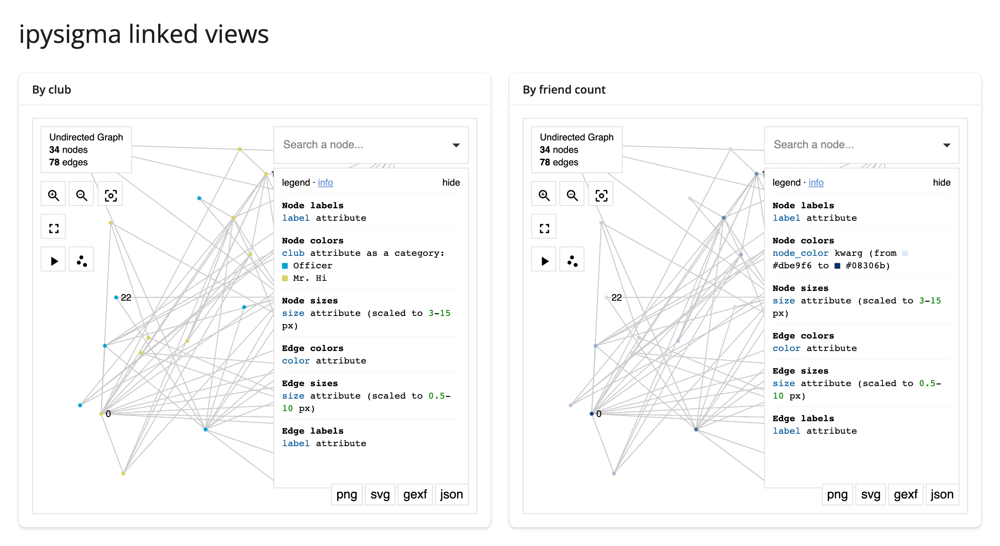
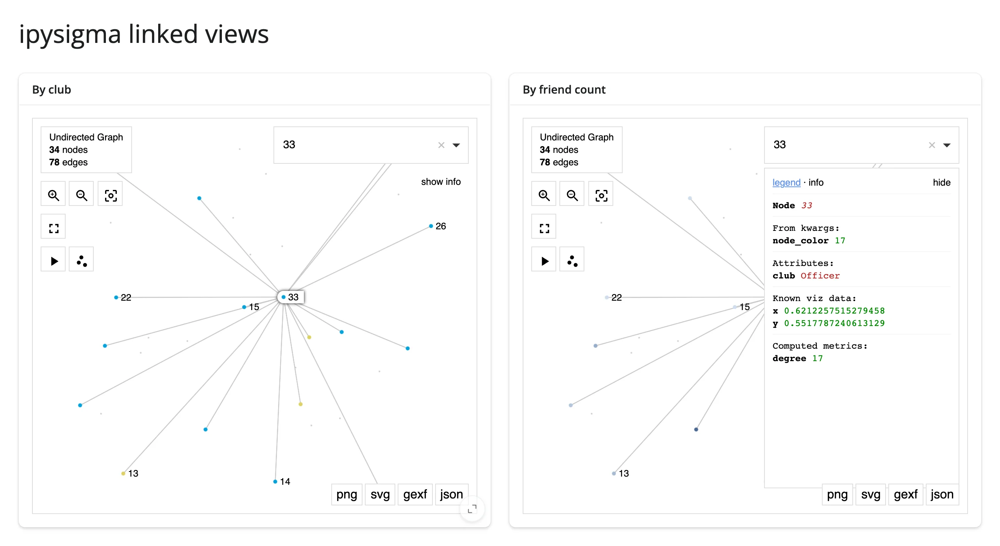

### Legend click filters a table

`selected_node_category_values` isn't just for dimming the graph -- read it anywhere a category filter is
useful.

```{.python file="examples/15_legend_filters_table.py"}
        @render.data_frame
        def visible():
            # [] (nothing filtered) means "show everything", not "show nothing"
            categories = graph.read("selected_node_category_values")
            shown = members if not categories else members[members["club"].isin(categories)]
            return shown.reset_index(drop=True)
```

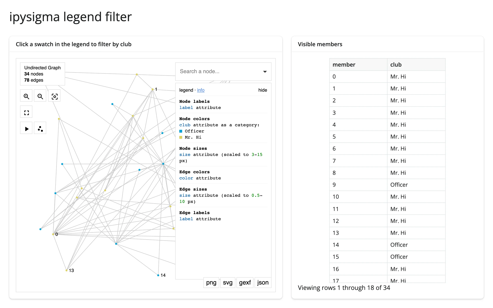
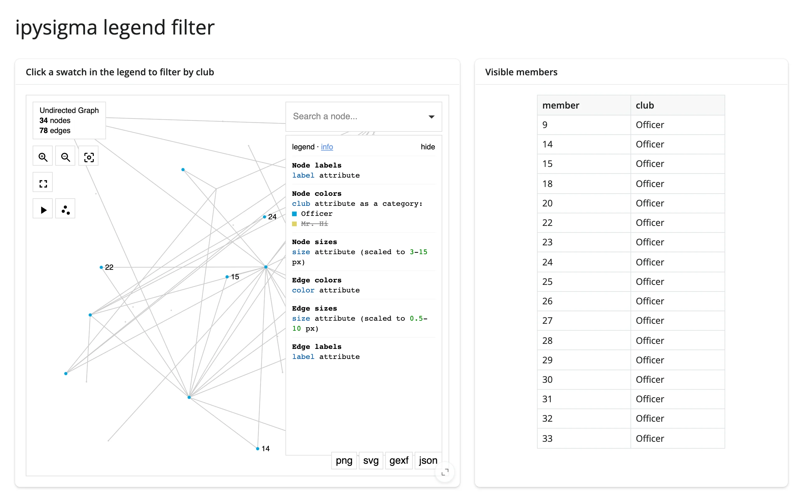

## Large data

ipysigma draws with the GPU (sigma.js/WebGL), the "draw it with the GPU in the browser" approach -- see
[Large data & performance's three approaches](../../guide/performance/index.md#three-approaches-to-large-data).
See ["Scale: tens of thousands of nodes"](#scale-tens-of-thousands-of-nodes) above, under "What you can build":
40 synthetic clusters, 20,000 nodes and ~40,000 edges panned and zoomed smoothly in testing, with precomputed
`layout=` positions (skipping both the random-hairball first frame and a full position write-back to Python on
first render). Past that scale, [ipycytoscape](../ipycytoscape/index.md#large-data) -- the sibling that renders
one ipywidget per element -- is the one that falls over first, not this renderer.

## Layout and sizing

In a filling layout, the graph fills its container -- unless the widget has an explicit `height`/`raw_height`
(a height of 500px, sigma's default, or one set globally with `Sigma.set_defaults(height=...)`, still counts as
"unset" and fills). `output_widget(..., fillable=False)` -- a container with no definite height -- falls back to
sigma's 500px default rather than collapsing to 0, fixed since the earlier PR-era evaluation
(`docs/widget-reports/ipysigma/`) and reverified here (`make test-playwright` ×7, current main).

`full_screen=True` cards and ipysigma's own fullscreen button both work and restore the prior size on exit. The
250px info/legend panel eats into a narrow card's width -- pass `hide_info_panel=True` if you're embedding a
small graph. The info panel can also visually overlap the canvas in a narrow container (it's absolutely
positioned on top), which only matters if you're scripting clicks against it, not for normal use.

## Gotchas and limitations

Verified on current main (shinywidgets, ipysigma 0.24.6, networkx 3.7):

- **Keep to about 5 ipysigma graphs on one page.** Each `Sigma` view uses 3 WebGL contexts (confirmed: 2 views
  measured 6 WebGL + 8 2D canvases total), and browsers cap live contexts at roughly 16 per page. Past that,
  the browser evicts the *oldest* contexts, blanking whichever graphs were already on the page -- a sigma.js/
  browser limit, not specific to Shiny's re-rendering. Re-rendering one graph no longer leaks its old context
  (confirmed: the full `render_ipysigma` Playwright suite, including the dedicated re-render/context-release
  tests, passes on current main), so the remaining constraint is the simultaneous-graphs-per-page ceiling itself.
- **No Python -> browser trait sync.** Setting `graph.widget.selected_node`, `.camera_state`, or any other trait
  from Python updates the ipywidgets model (so `graph.read()` sees the new value) but changes nothing on
  screen -- ipysigma reads its options once, at first draw. Re-render instead (see
  [Updating the widget from Python](#updating-the-widget-from-python)).
- **igraph works, undocumented.** `networkx_to_sigma()` (the coercion behind returning a bare graph) just calls
  `Sigma(x)`, which accepts an `igraph.Graph` directly (`ig.Graph.Famous("Zachary")` renders fine) even though
  neither ipysigma's nor shinywidgets' docs mention it for this path.
- **`node_metrics` only supports `"louvain"`.** It's not a general metrics engine -- PageRank, betweenness, and
  everything else still need computing in Python and attaching as a node attribute first (`03_computed_metrics.py`
  does both side by side).
- **A numeric mapping for `node_color` is categorical unless you add a gradient or scale.** `node_color=degree_dict`
  alone buckets values into (at most 10, by default) discrete colors; pass `node_color_gradient=(...)` for a
  continuous scale (used in `11_carry_state_rerender.py` and `14_linked_views_sync_key.py`). Literal CSS colors
  (e.g., a precomputed `{node: "#e41a1c"}` map) belong in `raw_node_color`, not `node_color`, which otherwise
  treats them as category labels needing a palette (used in `gallery/showcase_stdlib_imports.py`).
- **Node keys must be `int`, `str`, or `float`, and not mixed.** `selected_node` always comes back as a `str`
  regardless of the original key type; convert with `int(...)` or `graph.widget.get_selected_node()` (call the
  latter only after a `.read()` on the same widget has already established the reactive dependency, since
  `get_selected_node()` itself doesn't take one).
- **`SigmaGrid` isn't supported.** It's a Jupyter-only display helper, not a widget, so it can't be returned from
  `@render_ipysigma`. Use two outputs sharing a `sync_key` instead (see
  [Coordinating multiple views](#coordinating-multiple-views)).

## Gallery candidates

- [`gallery/template_network_explorer.py`](gallery/template_network_explorer.py) -- **template.** Any networkx
  graph, Louvain-colored and PageRank-sized with zero Python graph algorithms beyond one `nx.pagerank()` call, plus
  a sidebar detail card. Swap in your own graph and detail fields.

  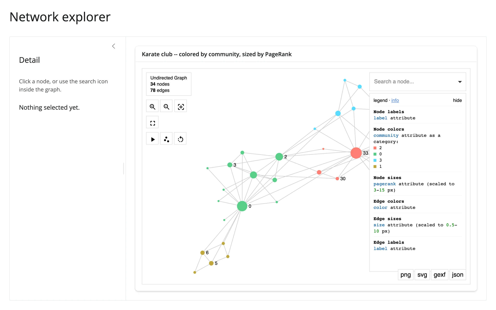
  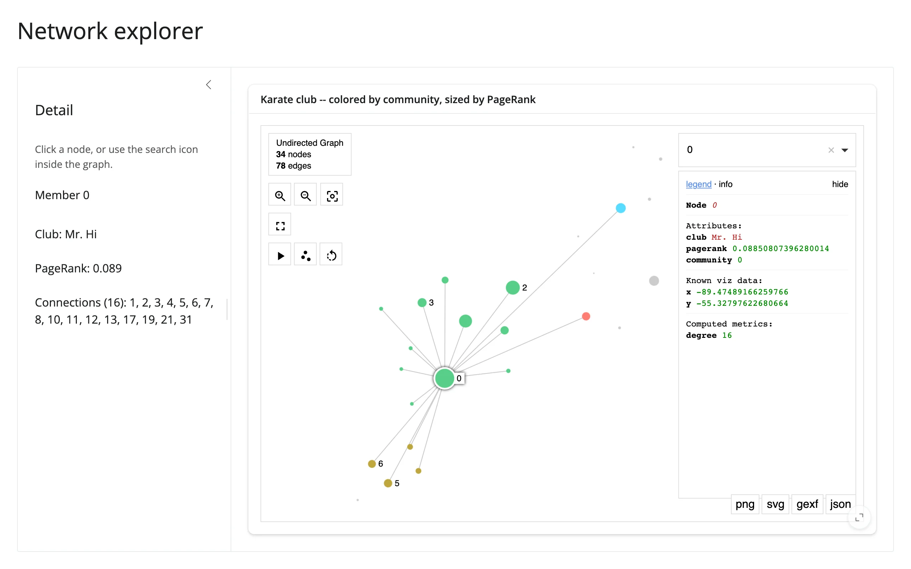

- [`gallery/showcase_stdlib_imports.py`](gallery/showcase_stdlib_imports.py) -- **showcase.** Python's own standard
  library as an import graph (built by `ast`-parsing ~80 modules' source -- no downloads, no network). Click a
  module (or pick one from the sidebar, kept in sync both ways) and the graph recolors around it: red for the
  focus, orange for what it imports, blue for what imports it. Demonstrates the full carry-state-across-re-render
  pattern -- the camera doesn't move when you click around.

  
  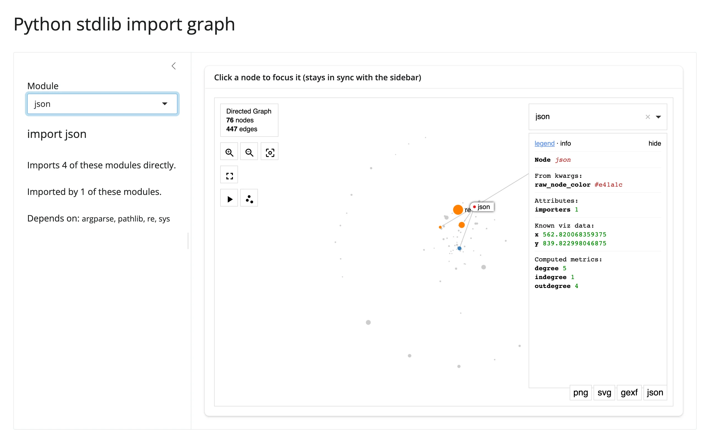

## Learn more

- [ipysigma on GitHub](https://github.com/medialab/ipysigma) -- the full `Sigma()` option reference (far more
  than this guide covers: pictograms, halos, borders, z-index, per-edge curveness and type, and more).
- [sigma.js](https://www.sigmajs.org) and [graphology](https://graphology.github.io) -- the underlying rendering
  and graph-data libraries, for anyone customizing further.
- Related guides in this roster: [ipycytoscape](../ipycytoscape/index.md) (smaller graphs, richer styling),
  [itables](../itables/index.md) and [reactable](../reactable/index.md) (good table partners for the linked-view
  patterns above).
