[ipyvolume](https://ipyvolume.readthedocs.io) is a WebGL-based 3D plotting library for Jupyter, written by
Maarten Breddels. It does four things that most Python 3D options don't: real-time **volume rendering** of
3D arrays (ray-marched in the browser), GPU-instanced scatter/quiver plots of tens of thousands of points,
surface and mesh plotting, and built-in frame-by-frame **animation** with a client-side Play control. All of
it runs on three.js underneath (it shares a camera type with `pythreejs`).

`@render_ipyvolume` accepts anything that produces an `ipyvolume.Figure`: the classic pylab API
(`ipv.figure()` / `ipv.scatter()` / `ipv.quickscatter()`, returning `ipv.gcf()`), or direct construction
(`ipyvolume.Figure()` with `ipyvolume.widgets.Scatter` and friends assigned to `fig.scatters`). The renderer
resizes the figure's WebGL canvas to fill its container (tracking resizes) unless you give it an explicit
size, and it exposes one reactive accessor, `camera()`, which turns every mouse-drag orbit into a value any
other output can read -- the camera becomes a first-class reactive input, the same way `input.my_slider()` is.

Reach for ipyvolume when you need genuine volumetric rendering or a GPU-friendly 3D point cloud/quiver/mesh
and don't need the broader scene-graph control of `pythreejs` or the picking/physics of `pyvista`. It's the
only option in the roster for ray-marched volume rendering of a 3D array. If you need object picking,
per-vertex selection that maps back to data indices, or very large point clouds (100k+), see `k3d` or
`pythreejs` instead (this guide's Gotchas section is specific about where ipyvolume falls short).

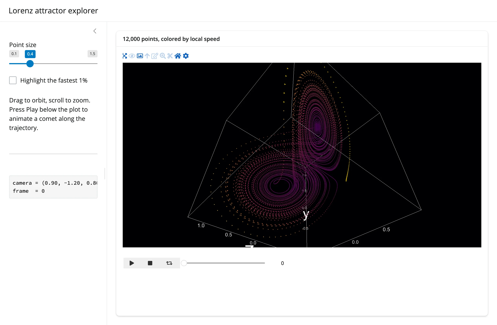

One thing to know up front: **ipyvolume has had no release since 0.6.3 (2021) and its upstream repo is
largely dormant.** It still works well for the things this guide covers, but don't expect upstream fixes --
treat the Gotchas section below as load-bearing, not optional reading.

## Installation

```sh
pip install 'shinywidgets[ipyvolume]'
```

ipyvolume 0.6.3 imports `ipython_genutils` but doesn't declare it as a dependency; the `ipyvolume` extra
installs it for you. Requires ipywidgets 8.1+.

## Quick start

The pylab API is the fastest way to get a figure on screen: draw with `ipv.quickscatter()` (or
`ipv.scatter()`/`ipv.figure()`), then return the current figure
([`examples/01_quickstart.py`](examples/01_quickstart.py), plotting the bundled iris dataset in 3D):

```{.python file="examples/01_quickstart.py"}
import ipyvolume as ipv
import numpy as np
import plotly.express as px
from shiny.express import ui

from shinywidgets import render_ipyvolume

iris = px.data.iris()
# Per-point color must be a numeric (N, 3) RGB array in [0, 1] -- a per-point
# array of color *strings* (e.g. "tomato") hangs ipyvolume's serializer; see
# the "Gotchas" section.
palette = np.array([[0.91, 0.30, 0.24], [0.18, 0.49, 0.20], [0.21, 0.45, 0.69]])
color = palette[iris["species_id"] - 1]

ui.page_opts(title="ipyvolume quickstart", fillable=True)


@render_ipyvolume
def plot():
    ipv.quickscatter(
        iris["sepal_length"],
        iris["petal_length"],
        iris["sepal_width"],
        size=1.2,
        marker="sphere",
        color=color,
    )
    return ipv.gcf()
```

The runnable version below colors by species instead of drawing from a normal distribution, so the result
is recognizable at a glance:

```{.python file="examples/01_quickstart.py"}
import ipyvolume as ipv
import numpy as np
import plotly.express as px
from shiny.express import ui

from shinywidgets import render_ipyvolume

iris = px.data.iris()
# Per-point color must be a numeric (N, 3) RGB array in [0, 1] -- a per-point
# array of color *strings* (e.g. "tomato") hangs ipyvolume's serializer; see
# the "Gotchas" section.
palette = np.array([[0.91, 0.30, 0.24], [0.18, 0.49, 0.20], [0.21, 0.45, 0.69]])
color = palette[iris["species_id"] - 1]

ui.page_opts(title="ipyvolume quickstart", fillable=True)


@render_ipyvolume
def plot():
    ipv.quickscatter(
        iris["sepal_length"],
        iris["petal_length"],
        iris["sepal_width"],
        size=1.2,
        marker="sphere",
        color=color,
    )
    return ipv.gcf()
```

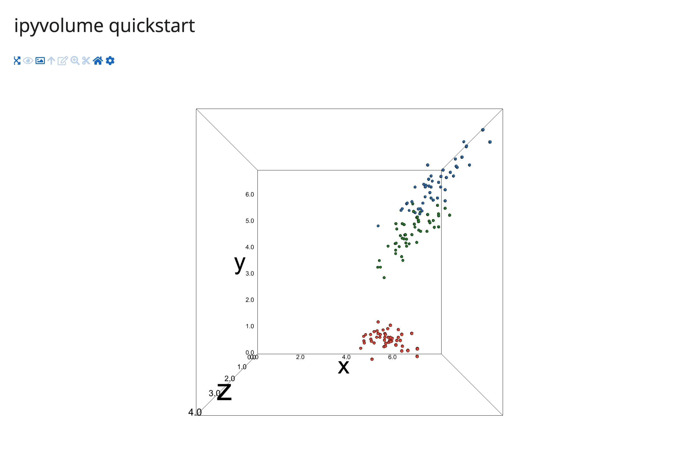

## What you can build

### Volume rendering

`ipv.volshow()`/`ipv.quickvolshow()` ray-march a 3D numpy array in the browser -- give it a density field
(medical imaging, simulation output, a 3D histogram) and it renders translucent iso-surfaces at the levels
you choose, with no VTK or server-side rendering involved.

```{.python file="examples/02_volume.py"}
import ipyvolume as ipv
import numpy as np
from shiny.express import ui

from shinywidgets import render_ipyvolume

ui.page_opts(title="Volume rendering", fillable=True)

# A synthetic density field (two overlapping Gaussian blobs) standing in for
# a CT/MRI-style 3D array -- any (nx, ny, nz) numpy array works.
grid = np.linspace(-1, 1, 64)
gx, gy, gz = np.meshgrid(grid, grid, grid, indexing="ij")
blob_a = np.exp(-((gx - 0.25) ** 2 + gy**2 + gz**2) / 0.05)
blob_b = np.exp(-((gx + 0.3) ** 2 + (gy - 0.2) ** 2 + gz**2) / 0.08)
density = blob_a + 0.7 * blob_b


@render_ipyvolume
def plot():
    ipv.quickvolshow(density, level=[0.2, 0.5, 0.8], opacity=[0.01, 0.05, 0.12])
    return ipv.gcf()
```

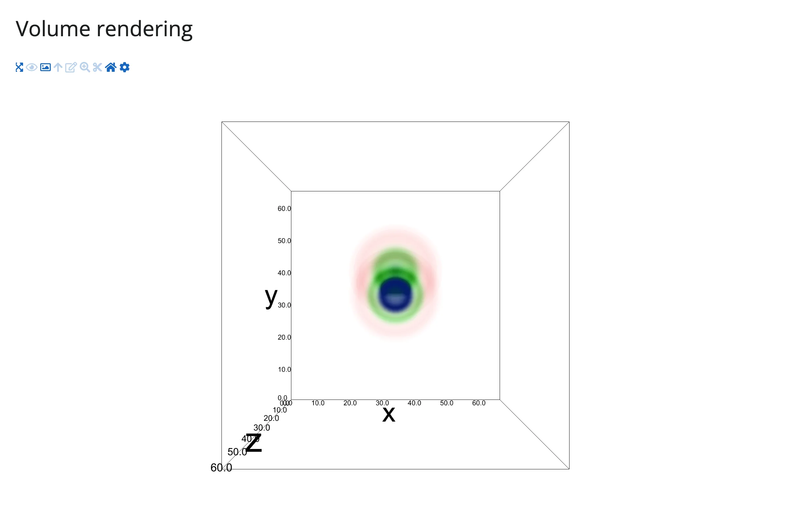

### Quiver (vector fields)

`ipv.quiver()` is a scatter plot with arrows: give it points and `(u, v, w)` directions and it draws one
arrow per point, GPU-instanced like the scatter marker.

```{.python file="examples/03_quiver.py"}
import ipyvolume as ipv
import numpy as np
from shiny.express import ui

from shinywidgets import render_ipyvolume

ui.page_opts(title="Quiver", fillable=True)

# A synthetic vortex vector field: points on a grid, with (u, v, w) giving
# the arrow direction at each point.
lin = np.linspace(-2, 2, 6)
x, y, z = np.meshgrid(lin, lin, lin, indexing="ij")
x, y, z = x.ravel(), y.ravel(), z.ravel()
u, v, w = -y, x, np.zeros_like(z) + 0.3


@render_ipyvolume
def plot():
    ipv.figure()
    ipv.quiver(x, y, z, u, v, w, size=8, color="steelblue")
    return ipv.gcf()
```

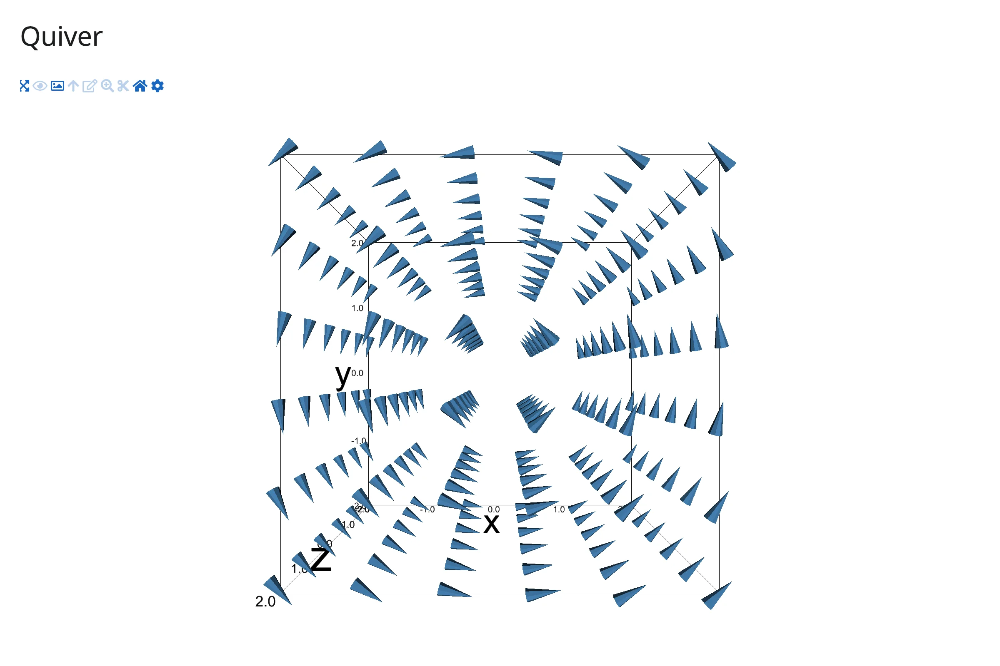

### Surfaces and wireframes

`ipv.plot_surface()`/`ipv.plot_wireframe()`/`ipv.plot_mesh()` take 2D-ordered `x`, `y`, `z` arrays (a
mathematical surface, a terrain grid) and auto-fit the axes for you.

```{.python file="examples/04_surface.py"}
import ipyvolume as ipv
import numpy as np
from shiny.express import ui

from shinywidgets import render_ipyvolume

ui.page_opts(title="Surface", fillable=True)

u = np.linspace(-5, 5, 60)
x, y = np.meshgrid(u, u)
r = np.sqrt(x**2 + y**2) + 1e-6
z = np.sin(r) / r


@render_ipyvolume
def plot():
    ipv.figure()
    ipv.plot_surface(x, z, y, color="orange")
    ipv.plot_wireframe(x, z, y, color="black")
    return ipv.gcf()
```

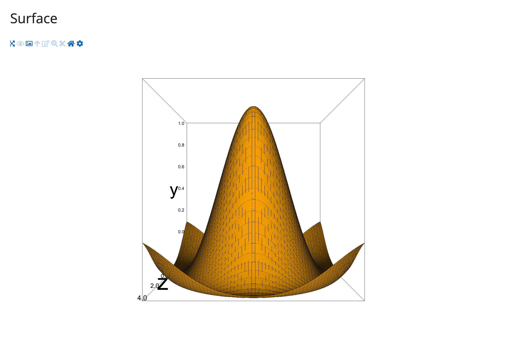

### Animation

`ipv.animation_control()` turns a `Scatter` whose arrays have an extra leading "frame" axis into an
animated comet, with a client-side Play/stop/loop control -- no Python callback runs per frame. The
control is a *separate* widget: with `add=False` it returns the Play/slider `HBox` for you to render as a
second output (the default `add=True` instead drops it into the pylab container, which isn't visible if
your render function returns the bare `Figure`).

```{.python file="examples/05_animation.py"}
import ipyvolume as ipv
import numpy as np
from shiny.express import ui

from shinywidgets import render_ipyvolume, render_widget

ui.page_opts(title="Animation", fillable=True)

# A helix traced out over time: shape (frames, points, 3). The first axis is
# the animation sequence -- get this axis order wrong and the animation plays
# the wrong dimension.
t = np.linspace(0, 4 * np.pi, 300)
helix = np.stack([np.cos(t), np.sin(t), t / 4], axis=1)
frames = np.stack([np.roll(helix, -i, axis=0)[:40] for i in range(len(t))])


@render_ipyvolume
def plot():
    fig = ipv.figure()
    ipv.scatter(
        frames[:, :, 0], frames[:, :, 1], frames[:, :, 2], size=1.5, marker="sphere", color="steelblue"
    )
    return fig


@render_widget
def controls():
    fig = plot.value  # re-runs once `plot` first renders (None before that)
    if fig is None:
        return None
    # add=False returns the Play/slider HBox; the default add=True instead
    # targets the pylab container (invisible here, since `plot` returns the
    # bare Figure) and returns None.
    return ipv.animation_control(fig.scatters[0], add=False, interval=40)
```

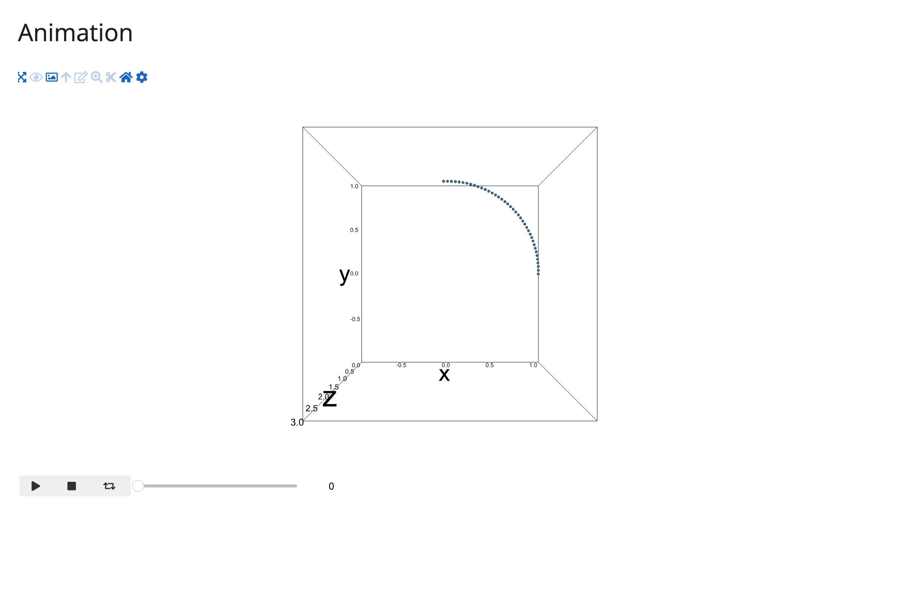

## Reacting to user interaction

### Accessor reference

| Accessor | Returns | Before any interaction | Across re-render | Default rate policy |
|---|---|---|---|---|
| `camera()` | the live `pythreejs.Camera` (same mutable instance every read) | seeded value: the figure's camera as constructed (never cancels unless `fig.camera` is explicitly `None`) | re-seeded to the new figure's camera | none -- the browser already coalesces a whole orbit gesture into one update |

`camera()` fires when the camera's `position`/`quaternion`/`zoom` change (end of an orbit/zoom) or the camera is
replaced.

That's the only accessor ipyvolume has. There is no `selected()`/`clicked()` accessor: selections arrive as
raw pixel-region custom messages, not indices (see Gotchas), so there's nothing index-shaped to expose.

### `camera()`

Orbit the figure and read the live position back in Python -- the camera becomes a reactive input, exactly
like a slider.

```{.python file="examples/06_camera_accessor.py"}
import ipyvolume as ipv
import numpy as np
from shiny.express import render, ui

from shinywidgets import render_ipyvolume

ui.page_opts(title="camera() accessor", fillable=True)

ui.markdown("Drag to orbit the scatter; the camera's live position updates below.")


@render_ipyvolume
def plot():
    rng = np.random.default_rng(0)
    x, y, z = rng.normal(size=(3, 300))
    fig = ipv.figure()
    ipv.scatter(x, y, z, size=1, marker="sphere", color="tomato")
    return fig


@render.code
def camera_position():
    # Fires once per completed orbit; the same live pythreejs.Camera instance
    # is returned every time, so read what you need rather than storing it.
    cam = plot.camera()
    return f"position = ({cam.position[0]:.2f}, {cam.position[1]:.2f}, {cam.position[2]:.2f})"
```

Before the orbit, the camera is still at its construction-time default:

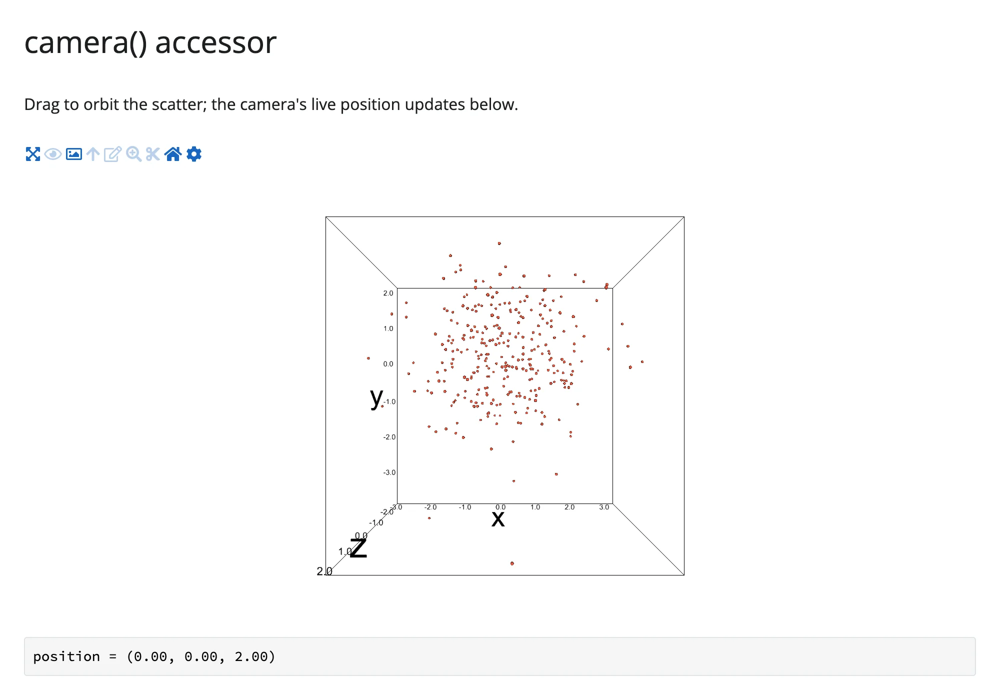

After a single drag, `camera()` has fired once with the new position:

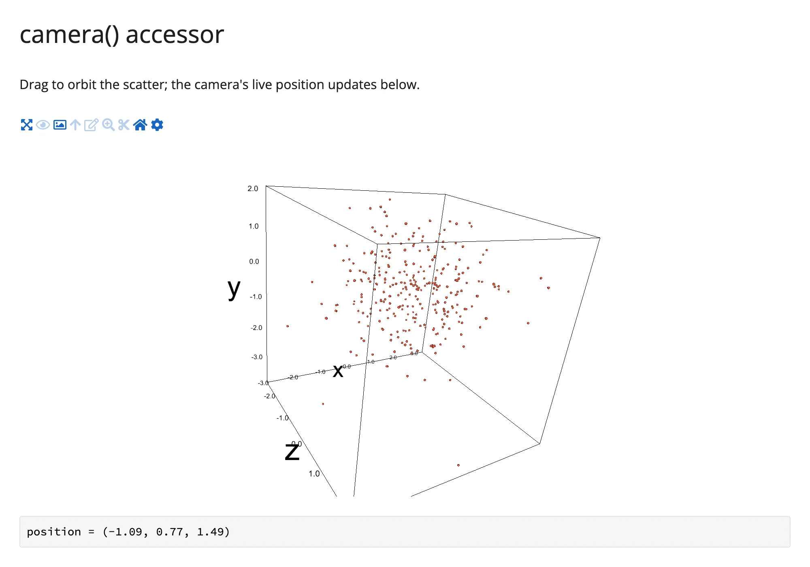

**Verified on current main:** `camera()` doesn't wait for an orbit to return something -- read it with no prior
interaction and it reports the figure's camera as constructed (`position = (0.00, 0.00, 2.00)` for the pylab
default above), the same way pythreejs's `camera()` does. It only cancels (like `req(False)`) in the narrow case
where `fig.camera` is explicitly set to `None`, which the pylab API never does on its own. Across a re-render it
re-seeds to the *new* figure's camera rather than keeping the old orbit (verified: re-rendering after an orbit
drops the camera back to the construction-time default, not the orbited position) -- it's inherent widget state,
describing the camera that exists right now, not a one-off interaction to carry over to a figure that no longer
exists. (`plot.read("camera")` is not a substitute for `plot.camera()`: it returns the raw synced snapshot, not
the live `Camera` object -- use the named method.)

### Beyond the accessors: `reactive_read`

A couple of other synced traits are worth reading directly, since they're not accessors:

- `reactive_read(plot.widget, "width")` / `"height"` -- the figure's canvas size in pixels. In a filling
  layout, the browser measures and resizes the canvas, then syncs the measured size back to these traits;
  reading them tells you the actual rendered size.
- `reactive_read(scatter, "sequence_index")` -- the current animation frame, if that scatter has an extra
  frame axis and an `animation_control()`. This is what lets a companion output track the Play button (see
  [Coordinating multiple views](#coordinating-multiple-views) below).

```{.python file="examples/07_reactive_read_beyond.py"}
import ipyvolume as ipv
import numpy as np
from shiny.express import render, ui

from shinywidgets import reactive_read, render_ipyvolume, render_widget

ui.page_opts(title="Beyond the accessors", fillable=True)

t = np.linspace(0, 4 * np.pi, 300)
helix = np.stack([np.cos(t), np.sin(t), t / 4], axis=1)
frames = np.stack([np.roll(helix, -i, axis=0)[:40] for i in range(len(t))])

with ui.card(height="320px"):

    @render_ipyvolume
    def plot():
        fig = ipv.figure()
        ipv.scatter(
            frames[:, :, 0], frames[:, :, 1], frames[:, :, 2], size=1.5, marker="sphere", color="steelblue"
        )
        return fig


@render_widget
def controls():
    fig = plot.value
    if fig is None:
        return None
    return ipv.animation_control(fig.scatters[0], add=False, interval=40)


@render.code
def state():
    # The browser syncs the figure's resized canvas back to these traits, and
    # the Play control advances this trait as it animates -- neither is an
    # accessor (no dedicated method), but both are ordinary synced traits.
    w = reactive_read(plot.widget, "width")
    h = reactive_read(plot.widget, "height")
    frame = reactive_read(plot.widget.scatters[0], "sequence_index")
    return f"canvas = {w}x{h}px\nframe = {frame}"
```

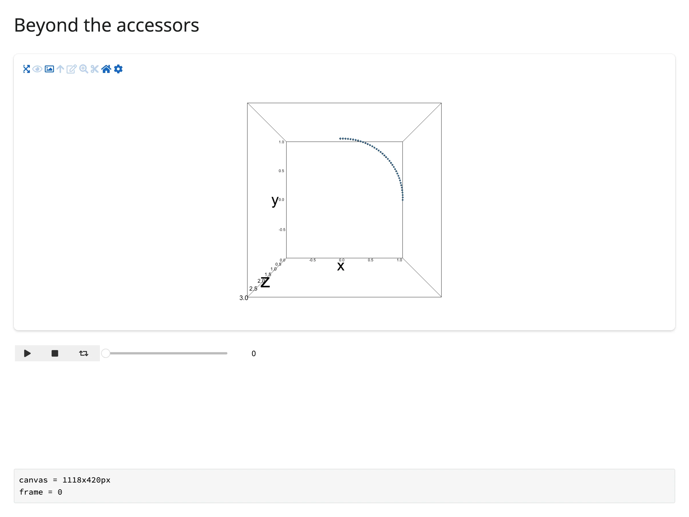

A trait *not* worth reading this way: `scatter.selected`. It's a real synced trait, but it only flows
Python-to-browser (see Gotchas) -- `reactive_read()` on it will only ever show you what you last set from
Python, never what the user lassoed.

### Rate limiting

`camera()` has no default rate policy because the pythreejs controls already collapse an entire orbit
drag into a single trait update -- there's nothing bursty to coalesce. `rate_policy`/`rate_delay` still
work on `render_ipyvolume` like any renderer, but for this widget they only affect plain `reactive_read()`
calls on the widget, not `camera()` itself (an accessor only gets a limiter if its spec declares a
default, and `camera`'s doesn't).

Where that matters in practice: a trait that *can* update repeatedly, like the canvas size during a
container resize. The example below renders two identical figures side by side and counts how often a
`reactive_read()`-driven text output recomputes during a burst of resizes -- one unthrottled, one
debounced:

```{.python file="examples/08_rate_limiting.py"}
import ipyvolume as ipv
import numpy as np
from shiny import reactive
from shiny.express import render, ui

from shinywidgets import reactive_read, render_ipyvolume

# camera() has no default rate policy: a drag already collapses to one trait
# update at the end of the orbit, so there's nothing bursty to coalesce.
# rate_policy/rate_delay still apply to plain reactive_read() calls on the
# widget -- useful for a trait that *does* update repeatedly, like the canvas
# size while its container is being resized.
ui.page_opts(title="Rate limiting", fillable=True)

rng = np.random.default_rng(0)
pts = rng.normal(size=(3, 300))


def make_fig():
    fig = ipv.figure()
    ipv.scatter(*pts, size=1, marker="sphere", color="tomato")
    return fig


with ui.layout_columns():
    with ui.card():
        ui.card_header("Unthrottled")

        @render_ipyvolume
        def plot_live():
            return make_fig()

    with ui.card():
        ui.card_header("Debounced 500ms")

        @render_ipyvolume(rate_policy="debounce", rate_delay=0.5)
        def plot_debounced():
            return make_fig()


live_count = reactive.value(0)
debounced_count = reactive.value(0)


@render.code
def live_recomputes():
    reactive_read(plot_live.widget, "width")
    with reactive.isolate():
        n = live_count.get() + 1
        live_count.set(n)
    return f"unthrottled recomputes: {n}"


@render.code
def debounced_recomputes():
    reactive_read(plot_debounced.widget, "width")
    with reactive.isolate():
        n = debounced_count.get() + 1
        debounced_count.set(n)
    return f"debounced recomputes: {n}"
```

Mid-burst (7 viewport resizes in quick succession), the unthrottled counter has already advanced with
every resize; the debounced one hasn't moved yet:

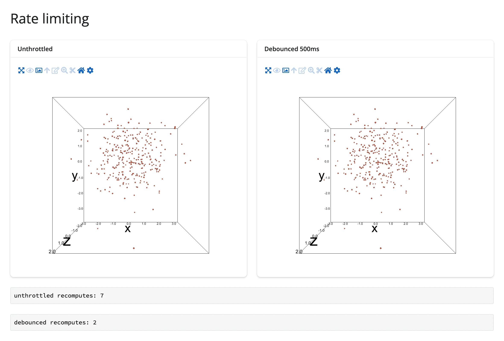

## Updating the widget from Python

Mutating `plot.widget` in place -- rather than re-rendering -- keeps the same WebGL canvas and camera, and
re-sends only the trait that changed (not the whole point cloud). Use an `@reactive.effect` for this; wrap
reads of your own reactive state in `reactive.isolate()` if you'd otherwise create a feedback loop.

```{.python file="examples/09_inplace_update.py"}
import ipyvolume as ipv
import numpy as np
from shiny import reactive
from shiny.express import input, render, ui

from shinywidgets import render_ipyvolume

# Re-rendering would reset the camera (and re-send all 2,000 points). Mutating
# the already-rendered Scatter's traits in an @reactive.effect instead keeps
# the same WebGL scene -- only the changed trait crosses the wire.
ui.page_opts(title="In-place updates", fillable=True)

ui.input_slider("size", "Point size", 0.2, 3, 1, step=0.1)
ui.input_select("color", "Color", ["tomato", "steelblue", "seagreen"])

rng = np.random.default_rng(0)
pts = rng.normal(size=(3, 2000))


@render_ipyvolume
def plot():
    fig = ipv.figure()
    ipv.scatter(*pts, size=1, marker="sphere", color="tomato")
    return fig


@reactive.effect
def _update_size():
    plot.widget.scatters[0].size = input.size()


@reactive.effect
def _update_color():
    # A single CSS color name is a solid color for every point (cheap, and
    # safe -- see the Gotchas section on *per-point* color arrays).
    plot.widget.scatters[0].color = input.color()


@render.code
def camera_unchanged():
    # Orbit the view, then move the sliders: the camera position you set by
    # dragging is untouched by either effect above.
    cam = plot.camera()
    return f"camera position = ({cam.position[0]:.2f}, {cam.position[1]:.2f}, {cam.position[2]:.2f})"
```

Before: default size and color, camera orbited to a custom position.

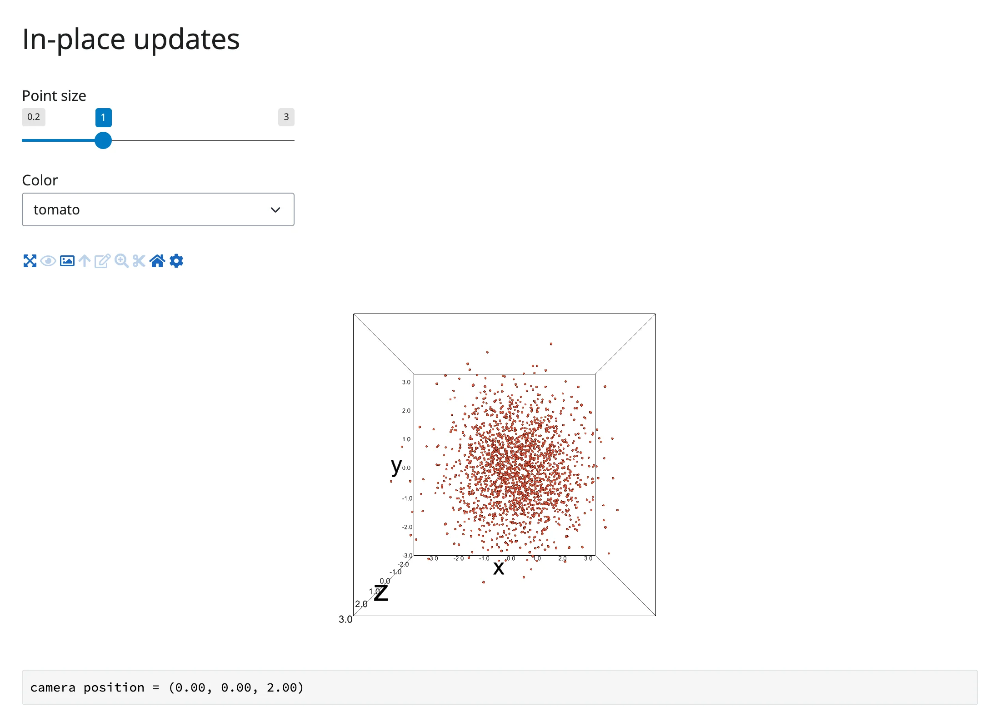

After moving the size slider and switching the color: bigger, blue points, same camera position --
confirmed by the readout at the bottom, which matches the value from before.

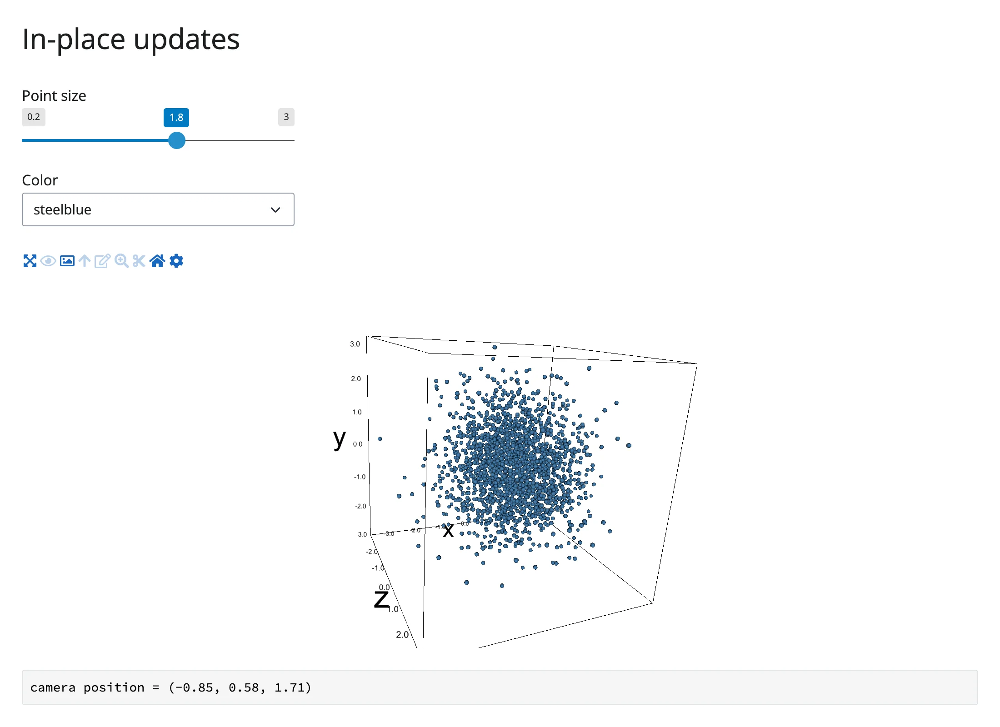

In-place updates beat re-rendering whenever the *shape* of the data doesn't change: the browser already
has the point cloud, so there's no reason to re-send it or reset the view. Re-render instead when the
dataset itself changes (different `x`/`y`/`z` arrays) or axis limits need to change -- direct construction
doesn't auto-fit, so a genuinely new dataset usually needs new `xlim`/`ylim`/`zlim` too.

## Coordinating multiple views

### Camera-linked twin views

`camera()` driving another view: orbit one figure, and a second "chase" figure copies the same camera pose.
This is the pattern behind an overview/detail pair, or two different representations of the same scene kept
in visual sync.

```{.python file="examples/10_linked_camera_views.py"}
import ipyvolume as ipv
import numpy as np
from shiny import reactive
from shiny.express import ui

from shinywidgets import render_ipyvolume

# camera() driving another view: orbit the big plot, and a small "chase" view
# mirrors the same camera pose -- a common pattern for a detail/overview pair.
ui.page_opts(title="Linked camera views", fillable=True)

rng = np.random.default_rng(0)
pts = rng.normal(size=(3, 1500))

with ui.layout_columns(col_widths=(8, 4)):
    with ui.card():
        ui.card_header("Orbit this one")

        @render_ipyvolume
        def main_plot():
            fig = ipv.figure()
            ipv.scatter(*pts, size=0.8, marker="sphere", color="tomato")
            return fig

    with ui.card():
        ui.card_header("Chase view (mirrors the camera)")

        @render_ipyvolume
        def chase_plot():
            fig = ipv.figure()
            ipv.scatter(*pts, size=0.8, marker="sphere", color="steelblue")
            return fig


@reactive.effect
def _sync_chase_camera():
    cam = main_plot.camera()
    chase_cam = chase_plot.widget.camera
    chase_cam.position = cam.position
    chase_cam.quaternion = cam.quaternion
    chase_cam.zoom = cam.zoom
```

Orbiting the left figure moves the right one to match, in the same reactive cycle:

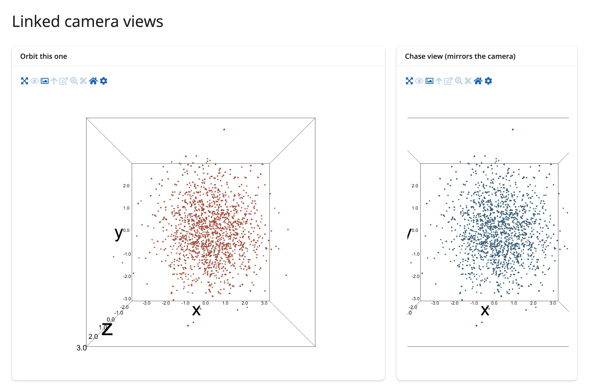
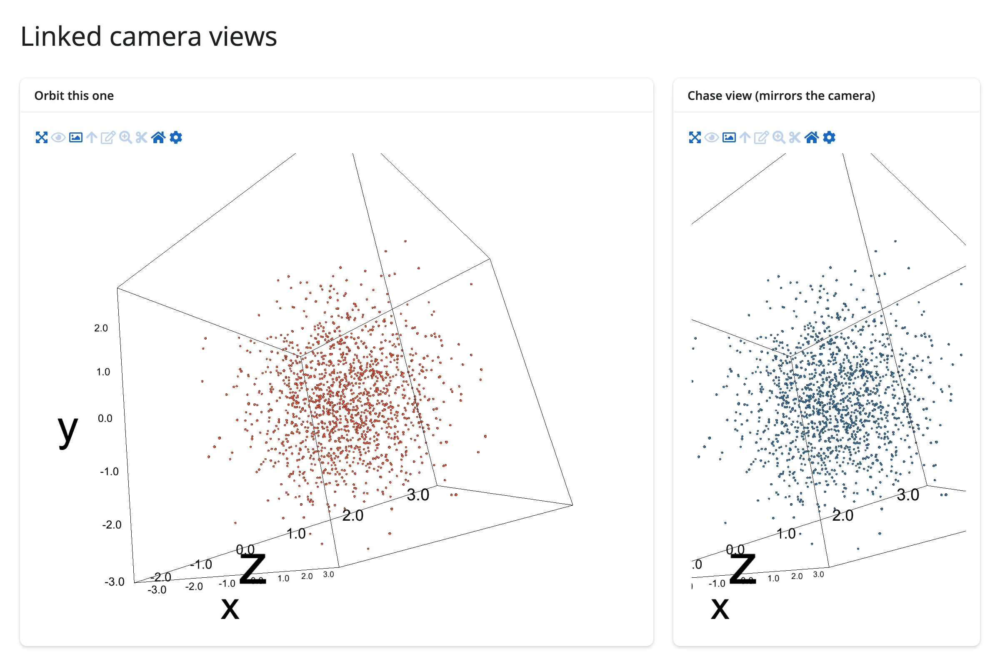

*Pairs with: `pythreejs` (shares the same `camera()` accessor and `Camera` type).*

### Table row selection -> 3D highlight

ipyvolume can't tell you which points a browser lasso covers (see Gotchas), but nothing stops you driving a
highlight the *other* way: select a row in an ordinary data table and highlight the matching point in 3D.
This recomputes plain `color`/`size` arrays (baking the highlight into them) rather than using ipyvolume's
dedicated `selected`/`size_selected` mechanism -- see the Gotchas section for why.

```{.python file="examples/11_table_selection_highlight.py"}
import ipyvolume as ipv
import numpy as np
import plotly.express as px
from shiny.express import render, ui

from shinywidgets import render_ipyvolume

# Table row selection -> 3D highlight: ipyvolume can't tell you which points a
# browser lasso covers (see Gotchas), but a table can drive a highlight the
# other way.
#
# This bakes the highlight into plain per-point `color`/`size` arrays rather
# than ipyvolume's dedicated `selected`/`size_selected`/`color_selected`
# mechanism. `selected` has two upstream bugs (see Gotchas): an empty
# `selected=[]` crashes the view, and -- verified separately -- even with a
# non-empty sentinel standing in for "nothing selected", the highlight only
# ever reflects the *first* value `selected` is set to after a figure
# renders; clicking a different row afterwards changes the trait (confirmed
# with `reactive_read`) but never moves the highlighted sphere, with no
# console error. Recomputing a plain color/size array on every selection
# sidesteps both bugs and re-renders the whole figure (the camera resets),
# which is a reasonable trade for a table-driven highlight.
ui.page_opts(title="Table row selection -> 3D highlight", fillable=True)

iris = px.data.iris()
palette = {1: (0.91, 0.30, 0.24), 2: (0.18, 0.49, 0.20), 3: (0.21, 0.45, 0.69)}
base_color = np.array([palette[i] for i in iris["species_id"]])
HIGHLIGHT = np.array([1.0, 1.0, 0.0])  # yellow

with ui.layout_columns():
    with ui.card():
        ui.card_header("Click a row to highlight it in 3D")

        @render.data_frame
        def table():
            return render.DataGrid(
                iris[["sepal_length", "petal_length", "sepal_width", "species"]],
                selection_mode="row",
                height="400px",
            )

    with ui.card():
        ui.card_header("Highlighted point")

        @render_ipyvolume
        def plot():
            rows = list(table.cell_selection()["rows"])
            color = base_color.copy()
            size = np.full(len(iris), 1.2)
            if rows:
                color[rows] = HIGHLIGHT
                size[rows] = 6
            fig = ipv.figure()
            ipv.scatter(
                iris["sepal_length"], iris["petal_length"], iris["sepal_width"],
                size=size, color=color, marker="sphere",
            )
            return fig
```

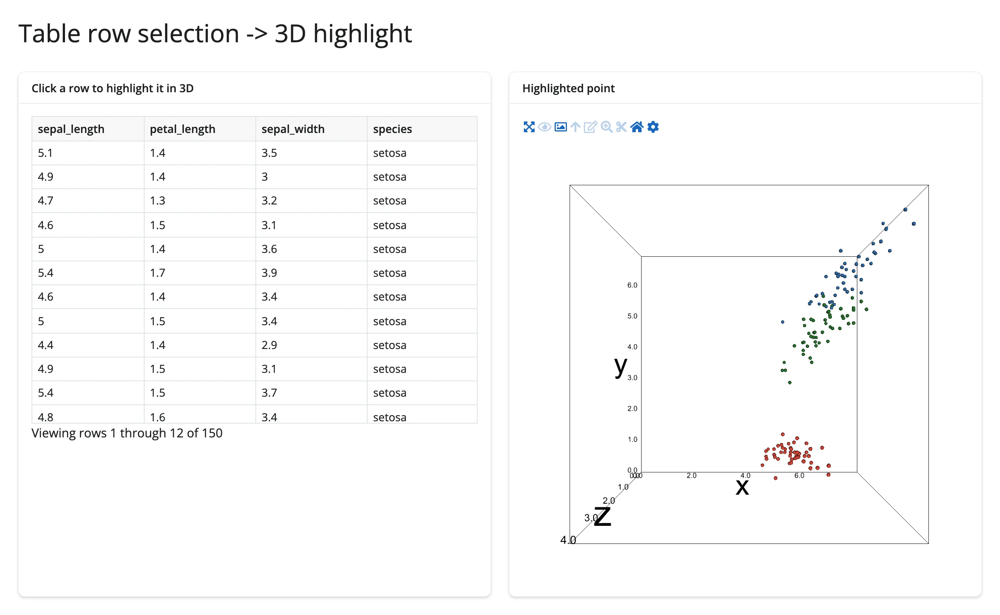
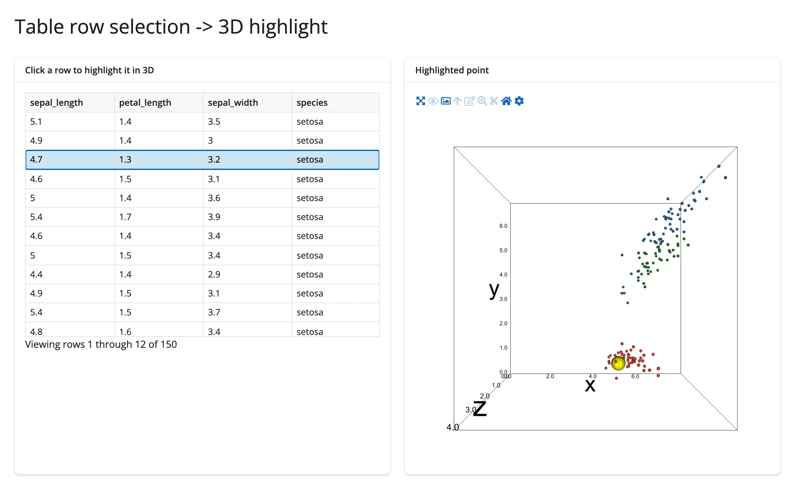

Clicking a second, different row relocates the highlight correctly -- unlike ipyvolume's native `selected`
mechanism (see Gotchas), which gets stuck on the first point it ever highlights:

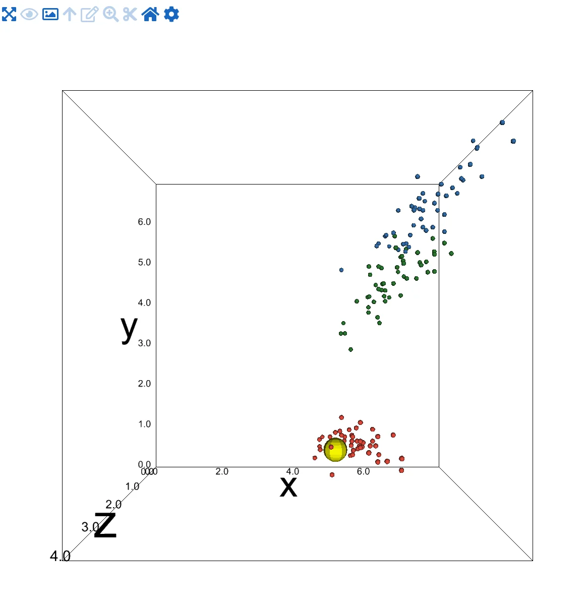

Because this recomputes the color/size arrays on every selection, the whole figure re-renders (the camera
resets) -- a reasonable trade for a table-driven highlight. *Pairs with: itables, reactable, ipydatagrid
(any table with row selection).*

### Animated sequence -> companion chart

`reactive_read(scatter, "sequence_index")` turns the Play button's current frame into a value a completely
separate output can use -- here, a vertical marker on a 2D speed chart that tracks a comet animating along
a Lorenz attractor.

```{.python file="examples/12_sequence_linked_chart.py"}
import ipyvolume as ipv
import numpy as np
from shiny.express import render, ui

from shinywidgets import reactive_read, render_ipyvolume, render_widget

# Animated scatter driving a 2D companion chart: `sequence_index` isn't an
# accessor (ipyvolume has none for it), but it's an ordinary synced trait, so
# `reactive_read()` turns the Play button's current frame into a reactive
# value any other output can use -- here, a vertical marker on a speed chart.
ui.page_opts(title="Sequence index -> companion chart", fillable=True)


def lorenz(n=4000, dt=0.006, sigma=10.0, rho=28.0, beta=8 / 3):
    pts = np.empty((n, 3))
    p = np.array([1.0, 1.0, 1.0])
    for i in range(n):
        v = np.array([sigma * (p[1] - p[0]), p[0] * (rho - p[2]) - p[1], p[0] * p[1] - beta * p[2]])
        p += dt * v
        pts[i] = p
    speed = np.linalg.norm(np.gradient(pts, axis=0), axis=1)
    return pts, speed


pts, speed = lorenz()
xyz = (pts - pts.mean(axis=0)) / pts.std(axis=0)

S, TAIL = 120, 50
starts = np.linspace(0, len(xyz) - TAIL - 1, S).astype(int)
comet = np.stack([xyz[s : s + TAIL] for s in starts], axis=0).astype(np.float32)

with ui.layout_columns():
    with ui.card():
        ui.card_header("Comet along the Lorenz attractor")

        @render_ipyvolume
        def plot():
            fig = ipv.figure()
            ipv.scatter(comet[:, :, 0], comet[:, :, 1], comet[:, :, 2], size=1, marker="sphere", color="tomato")
            return fig

        @render_widget
        def controls():
            fig = plot.value
            if fig is None:
                return None
            return ipv.animation_control(fig.scatters[0], add=False, interval=50)

    with ui.card():
        ui.card_header("Speed along the trajectory (marker = current frame)")

        @render.plot
        def speed_chart():
            import matplotlib.pyplot as plt

            frame = reactive_read(plot.widget.scatters[0], "sequence_index")
            fig, ax = plt.subplots()
            ax.plot(speed, color="steelblue", linewidth=0.8)
            ax.axvline(starts[frame], color="tomato", linewidth=2)
            ax.set_xlabel("step")
            ax.set_ylabel("speed")
            return fig
```

Before pressing Play, the marker sits at step 0:

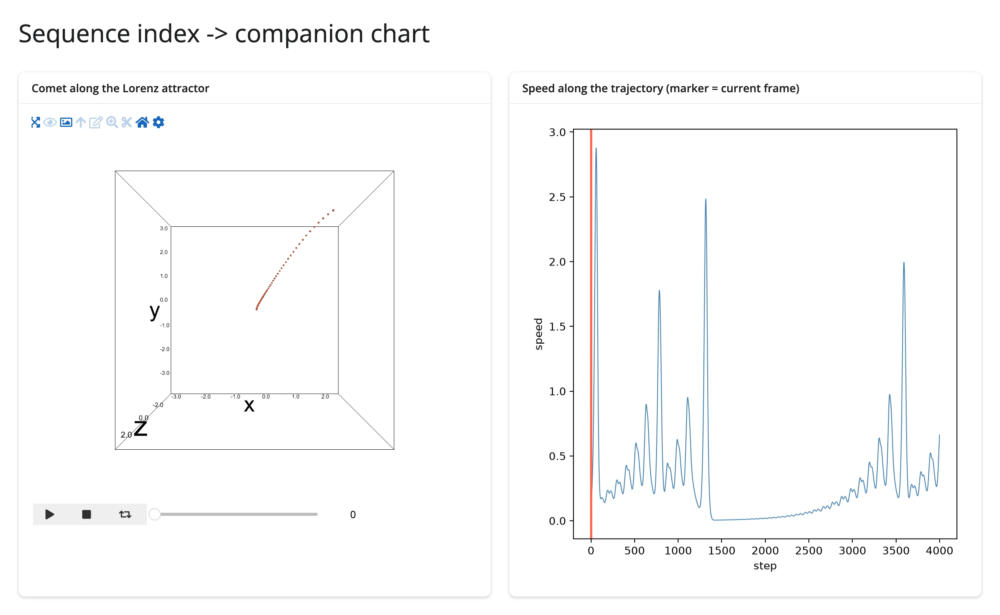

A few seconds after pressing Play, the comet has moved and the marker has tracked it to the matching step:

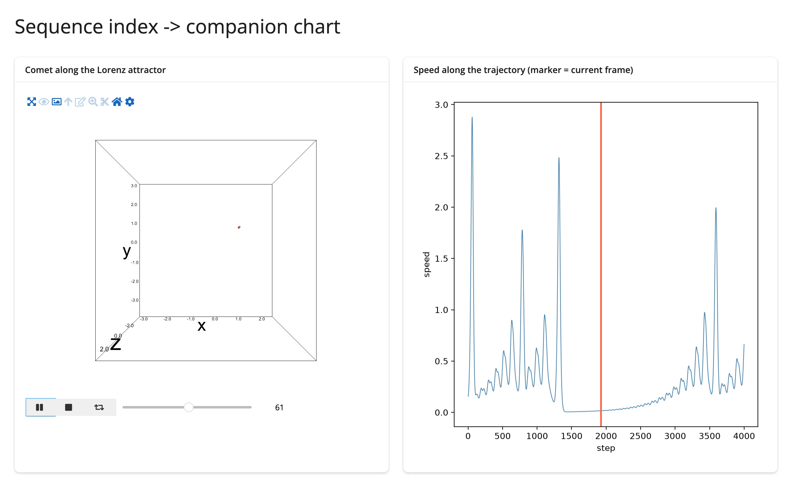

## Large data

ipyvolume draws with the GPU (WebGL), so it's the "draw it with the GPU in the browser" approach -- see
[Large data & performance's three approaches](../../guide/performance/index.md#three-approaches-to-large-data).
Scatter/quiver markers are GPU-instanced and comfortable into the tens of thousands of points; volume rendering
(`ipyvolume.volshow`) ray-marches a full 3D array in the browser, so its cost is dominated by texture upload
size, not point count. For single-figure point clouds past 100k points, or voxel grids larger than a texture
upload wants to carry, reach for [k3d](../k3d/index.md#large-data) instead -- it's built for exactly that scale
(see the guide's intro for this comparison).

## Layout and sizing

A figure's WebGL canvas is resized to fill its container (and tracks later resizes) unless the figure has
an explicit `width`/`height` -- set via `ipv.figure(width=..., height=...)`, `Layout(height=...)`, or
`output_widget(height=...)`. An explicitly sized figure keeps its pixel size even inside a differently
sized output (the output clips or pads it, rather than the output's CSS stretching the canvas).

```{.python file="examples/13_layout_sizing.py"}
import ipyvolume as ipv
import numpy as np
from shiny.express import ui

from shinywidgets import render_ipyvolume

ui.page_opts(title="Layout and sizing", fillable=True)

rng = np.random.default_rng(0)
pts = rng.normal(size=(3, 500))


def make_fig(**kwargs):
    fig = ipv.figure(**kwargs)
    ipv.scatter(*pts, size=1, marker="sphere", color="tomato")
    return fig


with ui.layout_columns():
    with ui.card(full_screen=True):
        ui.card_header("Fills its card (try full_screen)")

        @render_ipyvolume
        def fill_plot():
            return make_fig()

    with ui.card():
        ui.card_header("Explicit figure size (400x300px): clipped, not stretched")

        @render_ipyvolume
        def fixed_plot():
            return make_fig(width=400, height=300)
```

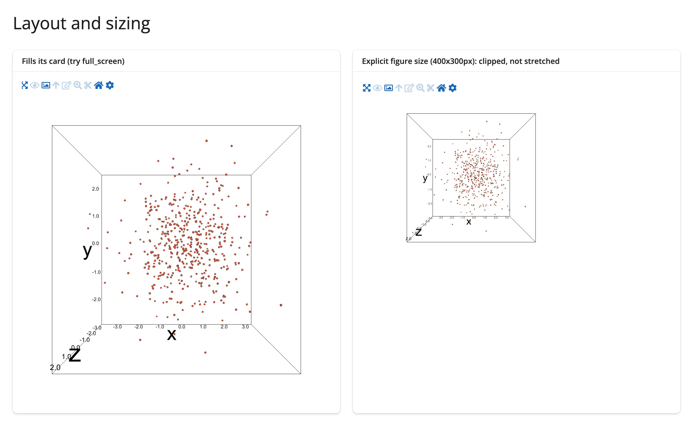

`full_screen=True` on the card works as expected (the canvas grows to fill the expanded card and shrinks
back on exit).

## Gotchas and limitations

Verified against shinywidgets `main` @ `00f90249` (ipyvolume 0.6.3); all of the following are upstream ipyvolume
bugs untouched by anything in the `00f90249..32ca7035` range (the accessor redesign, the comm-queue fix, and the
pythreejs model-leak fix don't reach this code), so they still apply on current `main`:

- **A per-point array of color *strings* hangs the entire server process -- not just that output.**
  `ipv.scatter(..., color=["tomato", "seagreen", ...])` (or any per-point array/list of multi-character
  strings) triggers an infinite loop in ipyvolume's own `color_to_binary_or_json()` serializer the moment
  anything (a real Jupyter kernel too, not just shinywidgets) requests that scatter's state. The whole
  server becomes unresponsive -- a second, unrelated request to the same app also hangs. A **solid** color
  string (`color="tomato"`) and a **numeric** `(N, 3)`/`(N, 4)` RGB(A) float array both work fine; only a
  per-point array of strings is broken. Always use a numeric RGB array for per-point coloring (every
  example above that colors by category does this).
- **`scatter.selected` is broken for a repeatedly-updated highlight -- two separate upstream bugs.**
  (1) Assigning `selected` to anything that serializes as an *empty* sequence (`selected = []`, the natural
  "nothing selected" state) crashes the view: ipyvolume's frontend treats an empty array as truthy, then
  indexes it with `i % 0` (`NaN` in JS), and a later `.forEach()` on the resulting `undefined` throws
  `Cannot read properties of undefined (reading 'forEach')`, blanking the figure. An out-of-range sentinel
  index (e.g. `selected=[len(x)]`) avoids this by never being empty. Filed upstream as
  [ipyvolume#451](https://github.com/widgetti/ipyvolume/issues/451). (2) Even with that sentinel, the
  highlight only ever reflects the *first* non-empty value `selected` is set to after a render: a second,
  different assignment changes the trait correctly (confirmed with `reactive_read()`) but the highlighted
  point never moves, with no error -- not after a redraw-forcing orbit-drag or viewport resize. Both are
  upstream ipyvolume bugs in its own bundled frontend JS, not shinywidgets. Net effect: don't use
  `selected`/`size_selected`/`color_selected` for a highlight that needs to change more than once. Bake it
  into plain `color`/`size` arrays instead (see
  [Table row selection -> 3D highlight](#table-row-selection---3d-highlight)), which re-renders the figure
  but is verified correct across repeated, different selections.
- **Lasso/rectangle selection is pixel-space only, not point indices.** Set `fig.selector = "rectangle"` or
  `"lasso"` and register `fig.on_selection(fn)`; the payload is `{"type": ..., "pixel": [[x, y], ...]}` --
  ipyvolume's JS never computes which points fall inside the region. Mapping a browser selection back to
  data indices would mean reimplementing the camera frustum/polygon test yourself (the camera is available
  via `camera()`, so it's possible, just not built in). `scatter.selected` is Python-to-browser only (and,
  per above, unreliable even for that): set it to highlight points you already know the indices of; it
  never reflects a user's lasso back to you.
- **Direct construction doesn't auto-fit axes.** `ipv.Figure()` defaults to a `[0, 1]^3` box with nothing
  clipped or reframed; pylab drawing functions (`ipv.scatter()`, `ipv.quiver()`, `ipv.plot_surface()`, ...)
  call `_grow_limits()` for you, but if you build `Scatter`/`Mesh` objects directly and assign them to
  `fig.scatters`, set `fig.xlim`/`ylim`/`zlim` explicitly (see the gallery showcase).
- **Direct `Scatter` construction needs `size_selected`/`color_selected` set explicitly.** Their trait
  defaults are 0-d numpy arrays, which don't JSON-serialize; the pylab functions set sensible defaults for
  you, but a bare `ipyvolume.widgets.Scatter(...)` does not.
- **`size` is a percentage of the viewport, not pixels.** `size=2` is roughly 20px on a 1000px-tall canvas;
  dense clouds usually want `size` in the 0.2-1 range. Points also balloon as the camera gets close (that's
  the 3D perspective, not a bug).
- **ipyvolume is unmaintained since 2023** (last release 0.6.3). It still renders correctly on current
  ipywidgets, but don't expect upstream fixes for anything above, including the color-array hang.
- An upstream docs nit, not worth a workaround beyond awareness: the pylab `scatter()`/`quiver()`/etc.
  functions document a `selection=` keyword for setting initial indices; it's a no-op on 0.6.3 (the real
  trait is `selected`, and the kwarg is silently dropped). Use `selected=` directly if you need to set it
  at construction time (but see the `selected`-after-render gotcha above before using it reactively).

What's *not* a gotcha, despite an earlier internal report flagging it: pylab-style re-renders (rebuilding a
figure with `ipv.figure()` + `ipv.scatter()` on every reactive invalidation) used to stall for ~29 seconds
on alternating re-renders, caused by ipyvue/ipyvuetify template widgets shared across figures being closed
by cleanup. That's fixed on current `main` (process-global widgets now survive re-renders and sessions) --
both pylab and direct construction re-render cleanly.

## Gallery candidates

### `gallery/template_3d_scatter.py` (template)

A clean starting point: direct construction with explicit axis limits, an in-place size slider, and a
`camera()` readout in the sidebar -- about 50 lines to adapt for your own 3D scatter.

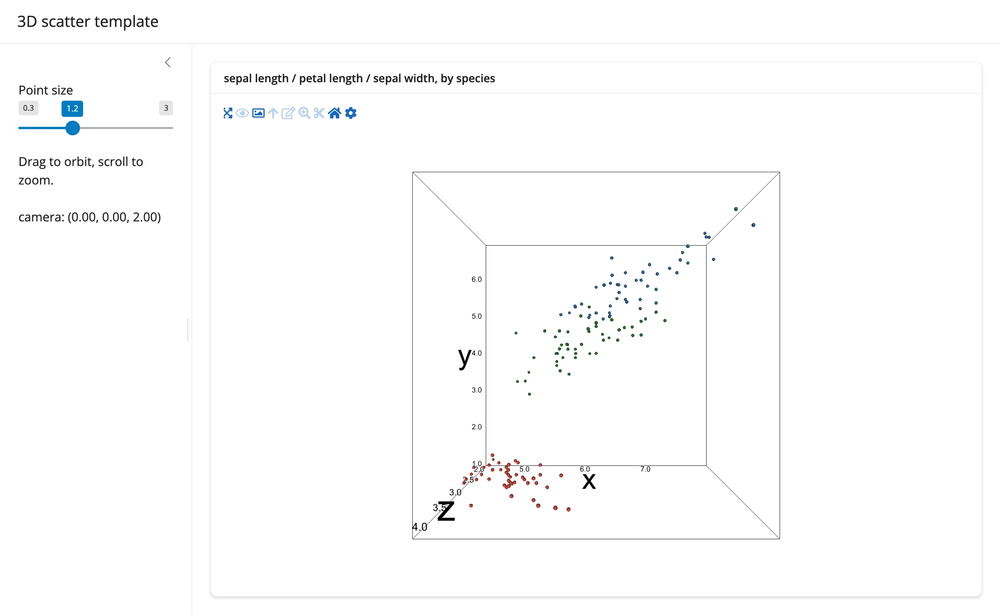

### `gallery/showcase_lorenz_explorer.py` (showcase)

A numerically integrated Lorenz attractor (12,000 points, colored by local speed) with: direct construction
and explicit limits, a dark theme, an in-place size slider, an in-place "highlight the fastest 1%" toggle
(plain color-array swap, not `selected`), `ipv.animation_control()` as a second output animating a comet
along the trajectory, and a `camera()` + `sequence_index` readout in the sidebar.


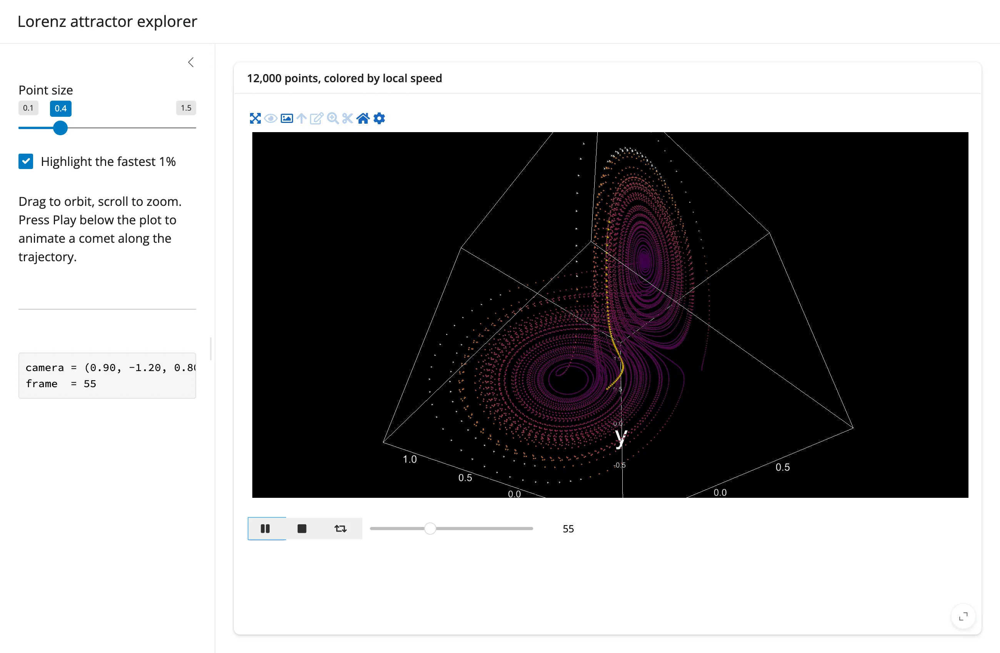

## Learn more

- [ipyvolume documentation](https://ipyvolume.readthedocs.io)
- [ipyvolume GitHub](https://github.com/maartenbreddels/ipyvolume) (dormant since 2023)
- Related guides in this roster: [pythreejs](../pythreejs/index.md) (shares the `camera()` accessor and
  `Camera` type; richer scene-graph control), [k3d](../k3d/index.md) (alternative 3D point
  cloud/mesh/volume renderer, different performance/feature trade-offs), [render-widget](../../guide/any-widget/index.md)
  (the generic `@render_widget`/`reactive_read()` patterns this guide builds on)
