[ITables](https://itables.org) wraps [DataTables](https://datatables.net) (the jQuery table library) for pandas
and polars, maintained by Marc Wouts. In Jupyter it renders any data frame as an interactive HTML table with
almost no code; in Shiny, `@render_itables` gives you the same table, with layout defaults that make it fill a
card and scroll its rows, and a fix for a conflict between itables' bundled jQuery and the page's own.

The decorated function returns either a plain data frame (coerced to a default `ITable`) or an
`itables.widget.ITable` constructed with options -- `select=True` for row selection, `buttons=[...]` for
export, `column_filters="header"` for per-column search, and the rest of DataTables' extension catalog
(SearchPanes, SearchBuilder, RowGroup, and more). `table.selected_rows()` reads the selected row positions
reactively, like a Shiny input; `table.widget` lets you update the table in place from Python, including setting
the selection programmatically.

Reach for ITables when you want a table that functions like Excel's AutoFilter plus a global search box, with
export built in, and you don't need to edit cells or handle more than a few hundred thousand rows. For editable
cells, virtualized scrolling through very large frames, or Python-defined conditional styling, see
[`render.data_frame`](#updating-the-widget-from-python) (Shiny's own table output) below, or
[ipydatagrid](../ipydatagrid/index.md) for a canvas-based alternative. For a flatter, dependency-light,
React-based table see [reactable](../reactable/index.md); for a columnar, OLAP-style explorer over very large
data see [perspective](../perspective/index.md).

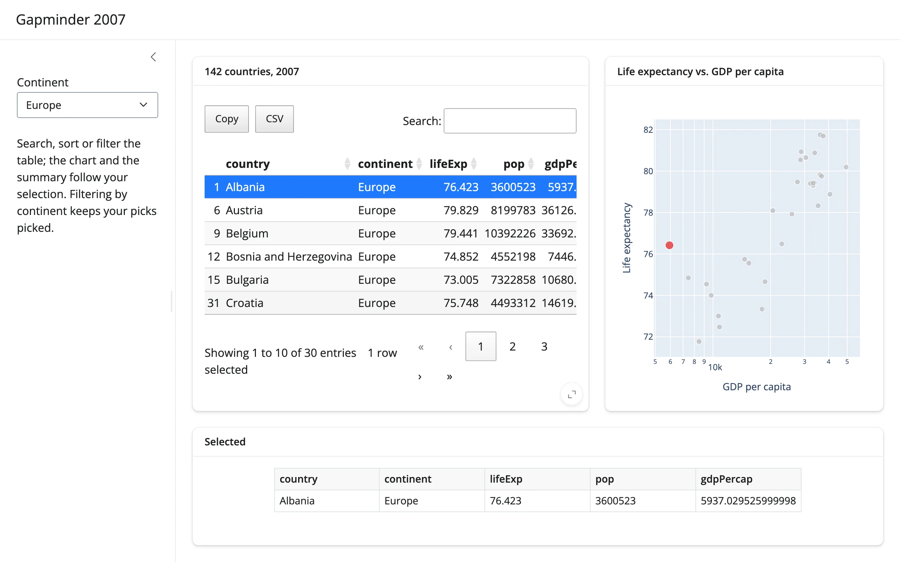

## Installation

```sh
pip install 'shinywidgets[itables]'
```

This installs `itables[widget]` (itables plus anywidget, which the Shiny integration requires).

## Quick start

```{.python file="examples/01_quickstart.py"}
from __future__ import annotations

import plotly.express as px
from itables.widget import ITable
from shiny.express import ui
from shinywidgets import render_itables

countries = px.data.gapminder().query("year == 2007")[
    ["country", "continent", "lifeExp", "pop", "gdpPercap"]
].reset_index(drop=True)

ui.page_opts(title="itables quickstart", fillable=True)

with ui.card(full_screen=True):
    ui.card_header("142 countries, 2007 (click a row to select it)")

    @render_itables
    def table():
        return ITable(countries, select=True)
```

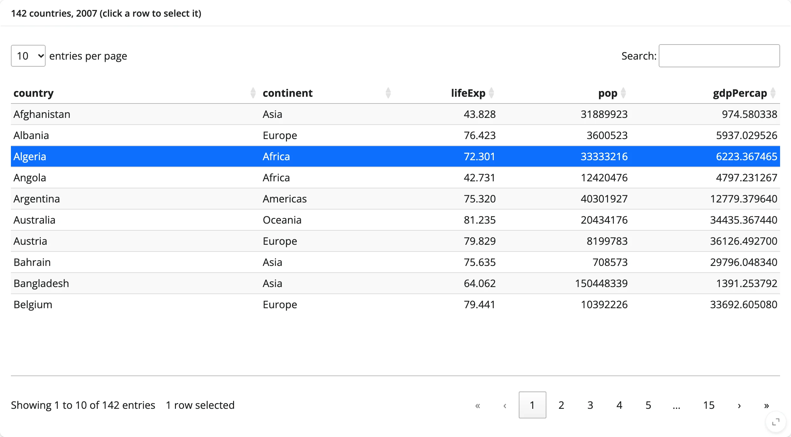

Returning a data frame directly (no `ITable(...)`) also works, but `select=True` and every other itables option
require constructing an `ITable` explicitly.

## What you can build

### Global search plus per-column filters

DataTables' global search box is on by default. Add `column_filters="header"` for a text input per column --
useful once a table has more than a handful of columns and a single search box starts returning too much.

```{.python file="examples/02_search_and_filters.py"}
    @render_itables
    def table():
        # The global search box is on by default; column_filters adds one text
        # input per column, wired to DataTables' own column search.
        return ITable(countries, column_filters="header", select=True)
```

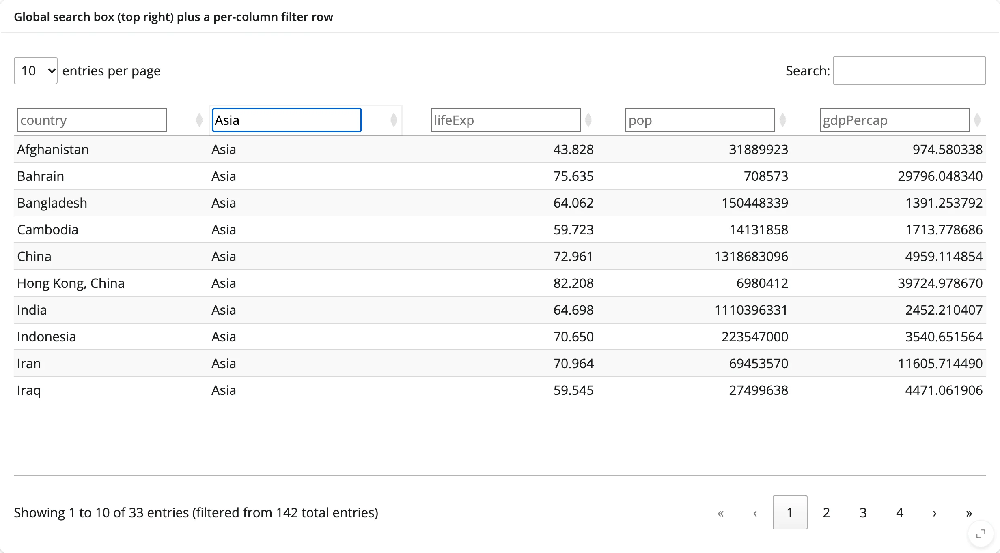

### SearchPanes: faceted filtering

For a categorical column, [SearchPanes](https://datatables.net/extensions/searchpanes/) draws a checkbox panel
with a live row count per value -- closer to a BI tool's filter pane than a text box.

```{.python file="examples/03_search_panes.py"}
    @render_itables
    def table():
        # SearchPanes draws a faceted filter panel (one pane per listed column,
        # with row counts) above the table; checking a value filters like a
        # column search would.
        return ITable(
            countries,
            layout={"top1": "searchPanes"},
            searchPanes={"layout": "columns-1", "columns": [1]},
            select=True,
        )
```

Before (unfiltered) and after checking "Asia":

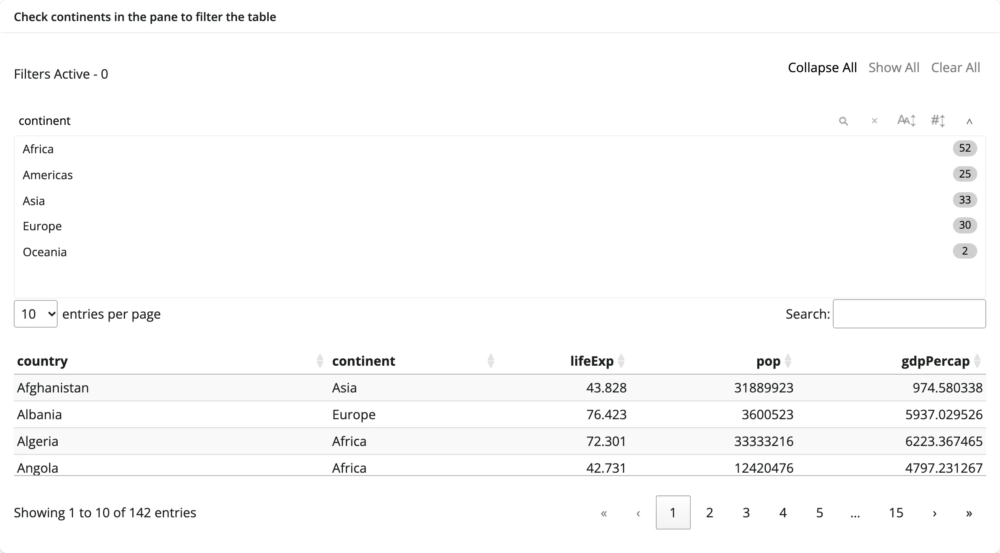
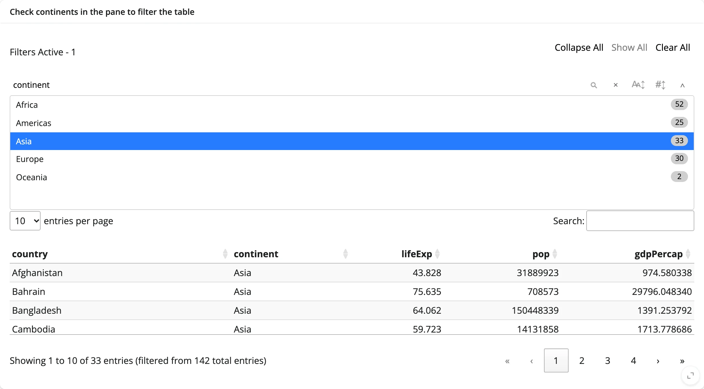

### Export buttons

The [Buttons](https://datatables.net/extensions/buttons/) extension adds copy-to-clipboard and CSV/Excel export,
with no server round trip -- the browser already has the data.

```{.python file="examples/04_buttons_export.py"}
    @render_itables
    def table():
        return ITable(countries, buttons=["copyHtml5", "csvHtml5"], select=True)
```

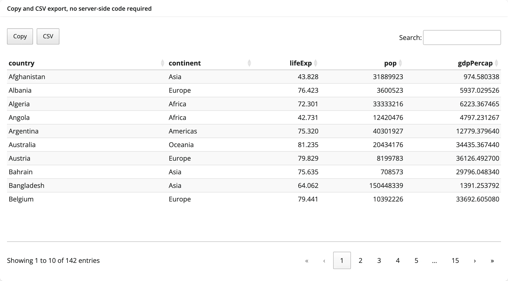

### Cell formatting and conditional styling

`columnDefs` accepts a DataTables `render` (reformat a cell's display value) or `createdCell` (restyle the `<td>`
after it's built) as a `JavascriptFunction`. This runs in the browser, so it costs nothing server-side and
applies as the user sorts, searches, and pages.

```{.python file="examples/05_styling.py"}
    @render_itables
    def table():
        return ITable(
            countries,
            columnDefs=[
                {
                    # Format gdpPercap (column index 4) as currency on display,
                    # but keep the raw number for sorting/filtering.
                    "targets": [4],
                    "render": JavascriptFunction(
                        "function(data, type) {"
                        "  return type === 'display' "
                        "    ? '$' + Number(data).toLocaleString() : data;"
                        "}"
                    ),
                },
                {
                    # Color the life-expectancy cell by value. Without a
                    # `render` of its own, this column's cell data arrives as
                    # itables' own [display_string, raw_number] pair, not a
                    # plain number -- index into it rather than comparing it
                    # directly.
                    "targets": [2],
                    "createdCell": JavascriptFunction(
                        "function(td, data) {"
                        "  var v = Array.isArray(data) ? data[1] : data;"
                        "  td.style.color = v < 60 ? '#c0392b'"
                        "    : v >= 75 ? '#1e8449' : '';"
                        "}"
                    ),
                },
            ],
        )
```

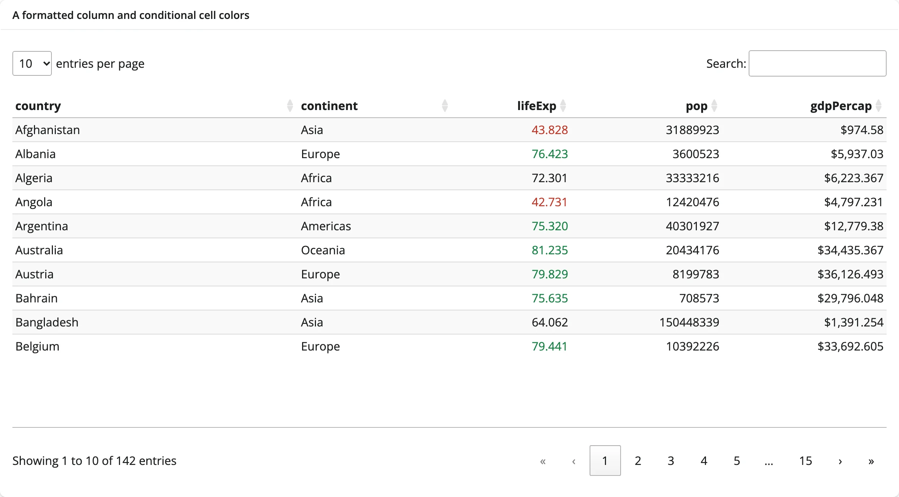

A gotcha verified while building this: a numeric column with no `render` of its own hands `createdCell` itables'
internal `[display_string, raw_number]` pair rather than a plain number (a column with its own `render`, like
`gdpPercap` above, isn't affected). Comparing that pair directly (`data < 60`) always comes out false. Index into
it (`data[1]`) as shown.

### pandas Styler, rendered as-is

Pass a `Styler` (e.g. from `.style.background_gradient()` or `.format()`) with `allow_html=True`, and itables
renders its computed HTML and inline styles unchanged -- gradients, bold, custom number formats, anything
`Styler` can produce.

```{.python file="examples/06_pandas_styler.py"}
    @render_itables
    def table():
        styler = (
            countries.style.background_gradient(subset=["lifeExp"], cmap="RdYlGn")
            .format({"lifeExp": "{:.1f}", "gdpPercap": "${:,.0f}", "pop": "{:,.0f}"})
        )
        # A Styler always carries HTML (its inline styles), so itables requires
        # an explicit opt-in to render it.
        return ITable(styler, allow_html=True, select=True)
```

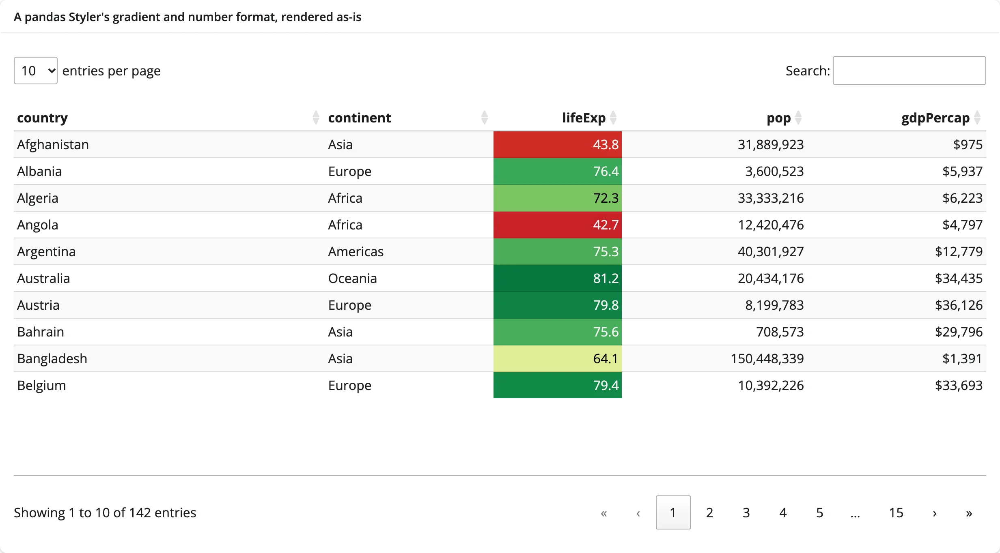

`allow_html=True` means the content is trusted; don't point it at user-supplied HTML.

### polars, unchanged

`ITable` accepts a polars `DataFrame` directly -- no conversion to pandas. `selected_rows()` still returns
plain positions, so index the polars frame the usual way (`pl_df[rows]`).

```{.python file="examples/07_polars.py"}
countries = pl.from_pandas(
    px.data.gapminder()
    .query("year == 2007")[["country", "continent", "lifeExp", "pop", "gdpPercap"]]
    .reset_index(drop=True)
)
```

The table sits next to a selected-rows output that indexes the polars frame directly
([`examples/07_polars.py`](examples/07_polars.py)):

```{.python file="examples/07_polars.py"}
with ui.layout_columns(col_widths=[8, 4]):
    with ui.card(full_screen=True):

        @render_itables
        def table():
            # itables accepts a polars DataFrame directly; no pandas conversion
            return ITable(countries, select=True)

    with ui.card():
        ui.card_header("Selected rows (polars indexing)")

        @render.data_frame
        def selected():
            return countries[table.selected_rows()]
```

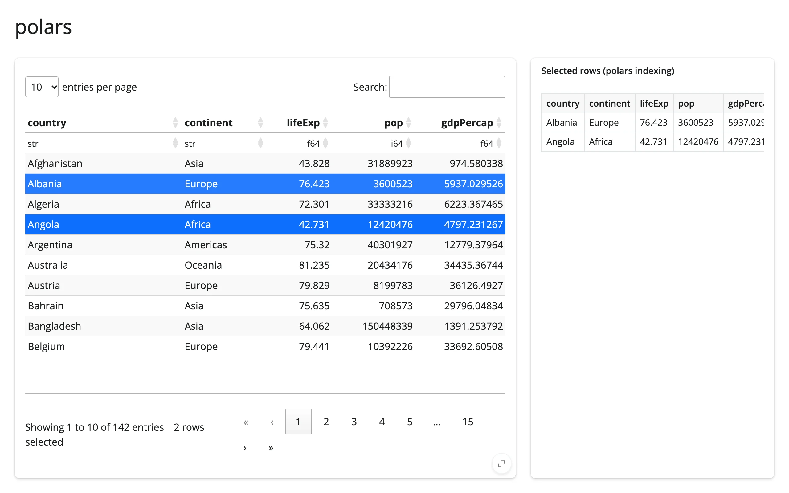

## Reacting to user interaction

### Accessor reference

| accessor | returns | before any interaction | across re-render | default rate policy |
|---|---|---|---|---|
| `selected_rows()` | `list[int]` | seeded `[]` (the widget's initial `selected_rows` trait) | re-seeded from the new table (starts `[]` unless the new `ITable(...)` is constructed with `selected_rows=` set) | not rate-limited -- fires once per click |

### `selected_rows()`

Positions are into the table's **data**, not its current display: they survive sorting, searching, and paging.
They don't survive the data itself changing, in either of the two ways it can: a **re-render** (a new
`ITable(...)` from the decorated function) resets `selected_rows()` to the new table's own selection (`[]`
unless you set one), so there's no stale-position risk there; `.widget.update(df)` (in place, same widget) is the
risky one -- the *old* positions carry over unchanged, now pointing into the *new* frame, which silently selects
the wrong rows if the position happens to still be in range. Either way, a plain integer position is only
meaningful against whatever data frame is currently shown. If your table's data can change, track selections by
a stable key (an ID column) instead of trusting the raw position across the change -- see
[A filter control updates the table in place, keeping the selection](#a-filter-control-updates-the-table-in-place-keeping-the-selection)
for the pattern.

```{.python file="examples/08_selected_rows_accessor.py"}
with ui.layout_columns(col_widths=[8, 4]):
    with ui.card(full_screen=True):

        @render_itables
        def table():
            return ITable(countries, select=True)

    with ui.card():
        ui.card_header("table.selected_rows()")

        @render.code
        def rows():
            return str(table.selected_rows())

        @render.data_frame
        def selected():
            # Positions are into the data, not the display: they survive
            # sorting and searching.
            return countries.iloc[table.selected_rows()]
```

Click two rows, then sort by life expectancy and click the new first row -- the position tracks the row, not the
screen location:

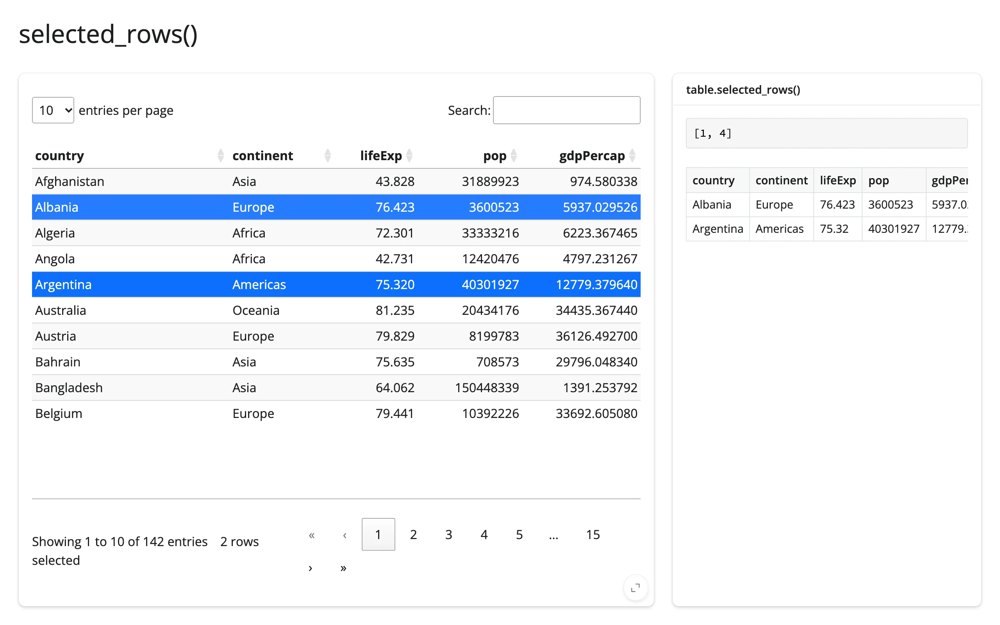
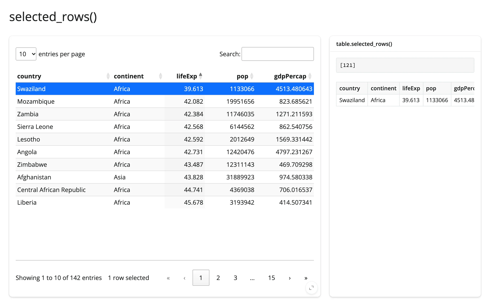

### Read on demand: export selected rows

Because the accessor is live from the moment the table renders, you can read it the instant you need the value
-- in a download handler, a button click, a chat tool call -- with no reader warming it up first.
[`examples/15_export_selected.py`](examples/15_export_selected.py):

```{.python file="examples/15_export_selected.py"}
import io

import plotly.express as px
from itables.widget import ITable
from shiny.express import render, ui
from shinywidgets import render_itables

ui.page_opts(title="Read on demand: export selected rows", fillable=True)

countries = px.data.gapminder().query("year == 2007")[
    ["country", "continent", "lifeExp", "pop", "gdpPercap"]
].reset_index(drop=True)

with ui.layout_columns(col_widths=[8, 4]):
    with ui.card(full_screen=True):

        @render_itables
        def table():
            return ITable(countries, select=True)

    with ui.card():
        ui.card_header("Export")
        ui.p("Click some rows, then download -- no need to read selected_rows() anywhere else first.")

        # selected_rows() is live from the moment the table renders, whether
        # or not anything has read it yet, so this handler can read it cold,
        # the instant the user clicks download: no warm-up reader required.
        @render.download_button(filename="selected_countries.csv", label="Download selected as CSV")
        def download_csv():
            rows = table.selected_rows()
            buf = io.StringIO()
            countries.iloc[rows].to_csv(buf, index=False)
            yield buf.getvalue()
```

Clicking Albania and Ctrl/Cmd-clicking Argentina, then downloading -- the exported CSV contains exactly those
two rows, read cold at click time:

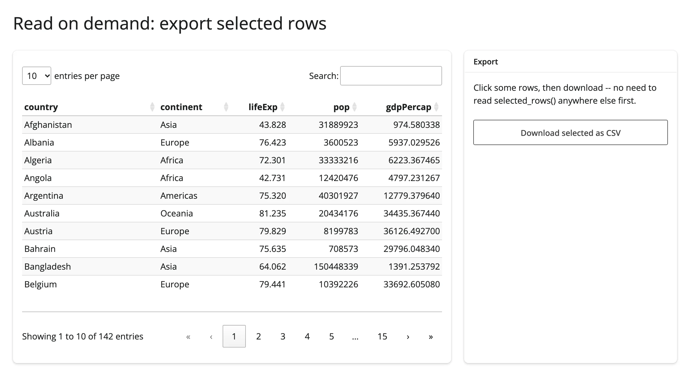
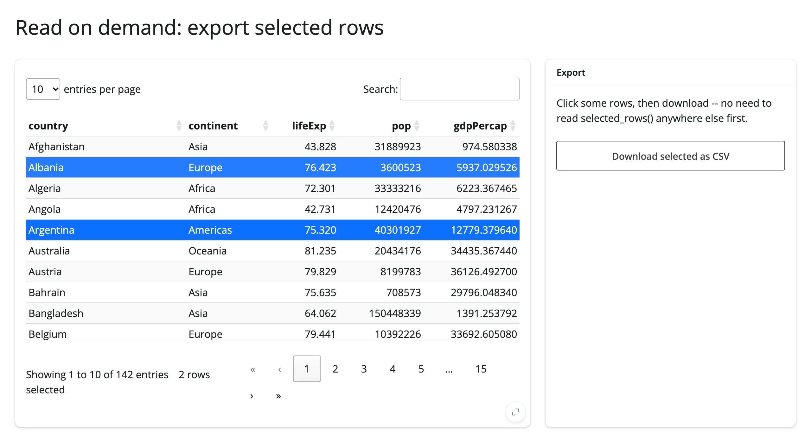

### Beyond the accessors: reactive_read

`ITable` has little else worth reading reactively: `selected_rows` is the only trait a user interaction changes.
`caption` and the DataTables options are write side (set from Python, not read back), and the data itself isn't
a trait at all. `table.read("selected_rows")` (or `reactive_read(table.widget, "selected_rows")`) behaves
identically to `table.selected_rows()` except for rate limiting (next section) -- there's no other synced trait
worth reaching for `read()` or `reactive_read()` over the named accessor.

### Rate limiting

`selected_rows()` fires once per click, not a continuous stream, so there's nothing to smooth: the renderer's
`rate_policy`/`rate_delay` kwargs have **no effect on the accessor**. They rate-limit `reactive_read()` on the
widget instead (any trait, not just `selected_rows`) -- useful if a burst of clicks (e.g. Shift-clicking across
many rows) would otherwise each trigger an expensive recompute downstream.

```{.python file="examples/09_rate_limiting.py"}
with ui.layout_columns(col_widths=[8, 4]):
    with ui.card(full_screen=True):

        @render_itables(rate_policy="debounce", rate_delay=1)
        def table():
            return ITable(countries, select=True)

    with ui.card():
        ui.card_header("Fires per click")
        accessor_count = reactive.value(0)
        read_count = reactive.value(0)

        @reactive.effect
        def _count_accessor():
            table.selected_rows()
            with reactive.isolate():
                accessor_count.set(accessor_count() + 1)

        @reactive.effect
        def _count_reactive_read():
            req(table.widget)
            reactive_read(table.widget, "selected_rows")
            with reactive.isolate():
                read_count.set(read_count() + 1)

        @render.code
        def counts():
            return (
                f"table.selected_rows(): {accessor_count()}\n"
                f"reactive_read() debounced 1s: {read_count()}"
            )
```

Four quick clicks: the accessor-driven counter climbs with every click; the `reactive_read()` counter, debounced
to 1 second, is still waiting out the window:


A second later, the debounce fires once and the counter catches up by exactly one:

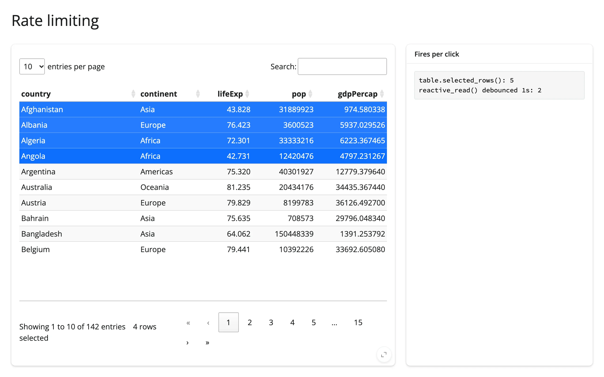

## Updating the widget from Python

**Selection**, set directly, applies immediately in the browser exactly as if the user had clicked -- no
re-render, so the rest of the table's state (sort, search, scroll, page) is untouched:

```{.python file="examples/10_programmatic_selection.py"}
@reactive.effect
@reactive.event(input.top5)
def _select_top5():
    # Setting .selected_rows on the widget highlights those rows in the
    # browser immediately, exactly as if the user had clicked them -- no
    # re-render, so sort/search/scroll state is untouched.
    top5 = countries.nlargest(5, "pop").index.tolist()
    table.widget.selected_rows = top5
```

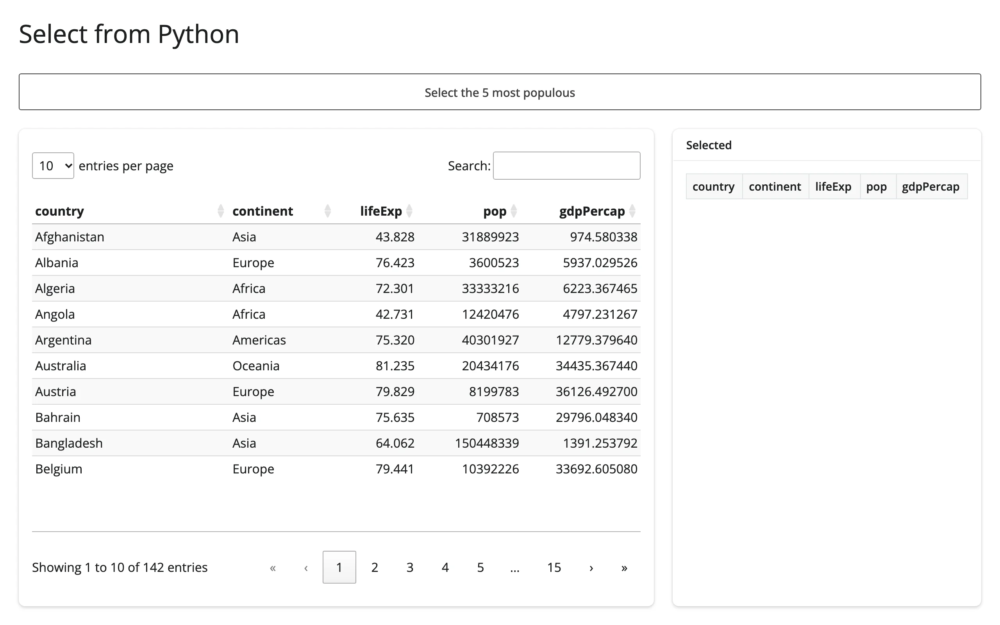
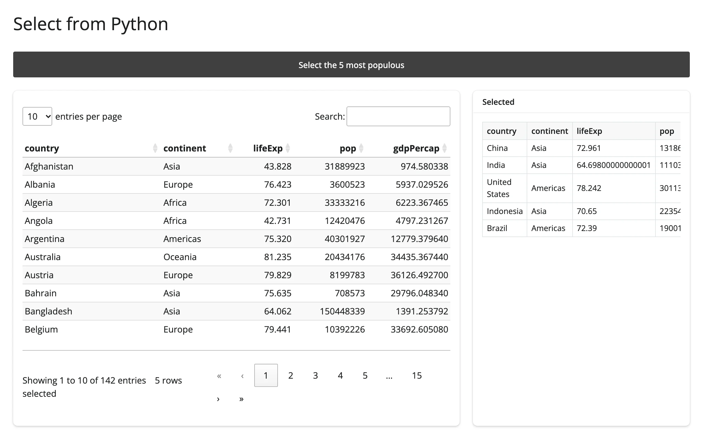

**Data**, swapped with `.widget.update(df, **options)`, updates in place rather than tearing down and rebuilding
the DataTables instance a re-render would cause -- the browser never re-fetches itables' JS bundle, and anything
the update doesn't touch (sort column, scroll position) survives. The catch: `update(df)` **drops** options like
`columnDefs` and `buttons` unless you pass them again, so keep them in one dict and reuse it everywhere:

```{.python file="examples/13_update_in_place.py"}
    @render_itables
    def table():
        return ITable(countries, select=True, buttons=["copyHtml5"])


@reactive.effect
@reactive.event(input.shrink)
def _shrink():
    top10 = countries.nlargest(10, "pop")
    # Re-passing `buttons` matters: .update(df) without it silently drops the
    # button row (and any columnDefs) that the original ITable(...) call set.
    table.widget.update(top10, buttons=["copyHtml5"])
```

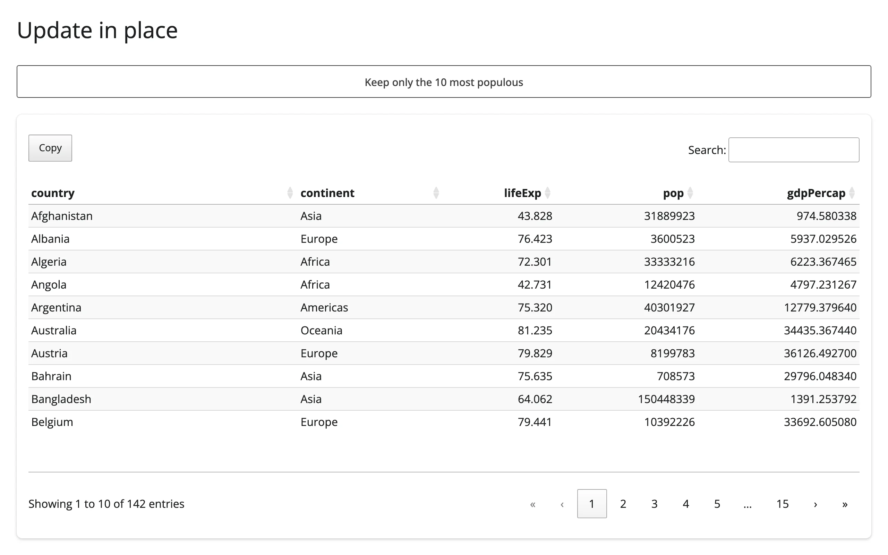
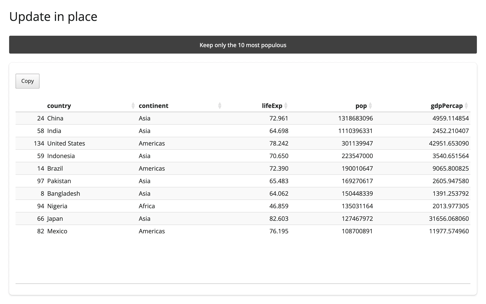

Re-rendering (returning a new value from the decorated function) is simpler and fine for an unrelated input
change, but it always starts the table over: sort, search, scroll position, and selection all reset. Prefer
`.widget.update()` when the user is mid-exploration of the same table and you don't want to throw that away --
see [Coordinating multiple views](#coordinating-multiple-views) for keeping the selection too.

## Coordinating multiple views

### Selection highlights a plot

Read `table.selected_rows()` in an effect and write the result into another widget's trait in place (inside
`reactive.isolate()`, so the write doesn't re-trigger the effect). The plot keeps its zoom/pan state across every
selection change, unlike re-rendering it each time.

```{.python file="examples/11_selection_updates_plot.py"}
@reactive.effect
def _highlight_selection():
    selected = set(table.selected_rows())
    with reactive.isolate():
        # In place: the scatter keeps its zoom/pan state across selections,
        # instead of rebuilding (and resending) the whole figure.
        scatter.widget.data[0].marker.color = [
            "#e41a1c" if i in selected else "#bbb" for i in range(len(countries))
        ]
```

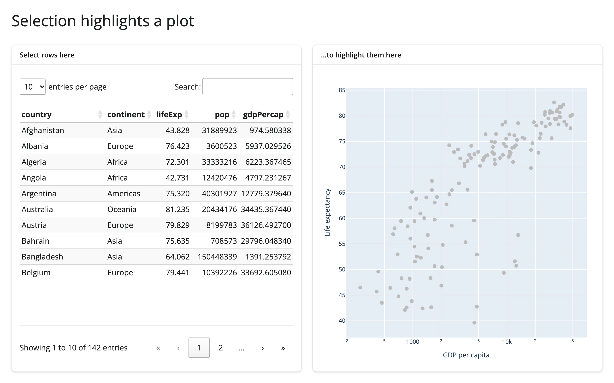
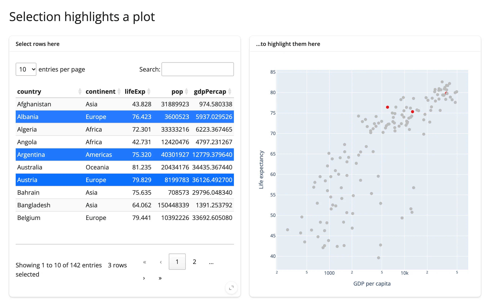

*(Pairs well with [plotly](../plotly/index.md); the same pattern works with any renderer whose widget exposes a
settable trait.)*

### Click row for detail

A single `@render.ui` reading `table.selected_rows()` is enough for a master-detail layout -- handle the
"nothing selected yet" case explicitly, since that's the state on first load.

```{.python file="examples/12_selection_detail_card.py"}
        @render.ui
        def detail():
            rows = table.selected_rows()
            if not rows:
                return ui.p("Click a row to see its detail.")
            row = countries.iloc[rows[-1]]
            return ui.TagList(
                ui.h5(row["country"]),
                ui.p(f"Continent: {row['continent']}"),
                ui.p(f"Life expectancy: {row['lifeExp']:.1f} years"),
                ui.p(f"Population: {row['pop']:,}"),
                ui.p(f"GDP per capita: ${row['gdpPercap']:,.0f}"),
            )
```

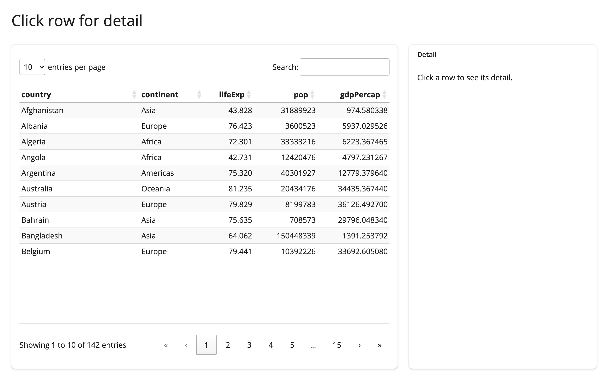
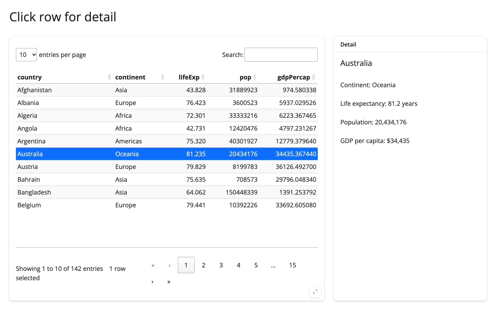

### A filter control updates the table in place, keeping the selection

Filtering swaps the data with `.widget.update()`, but positions from before the filter point at different rows
in the new (smaller) frame. Re-map the kept selection by a stable key (here, country name) before passing it
back:

```{.python file="examples/14_filter_preserves_selection.py"}
# The current (possibly continent-filtered) rows. Positions from
# table.selected_rows() are only meaningful against whatever data frame is
# currently shown, so track it here (ITable.update(df) doesn't expose its
# current data frame for reading it back).
current_rows = reactive.value(countries)


@reactive.effect
def _filter():
    continent = input.continent()
    req(table.widget)
    with reactive.isolate():
        shown = (
            countries
            if continent == "All"
            else countries[countries["continent"] == continent]
        )
        # Positions are into `shown`, so re-map the current selection by a
        # stable key (country name) instead of keeping the old positions,
        # which would now point at different rows (or be out of range).
        kept = set(current_rows().iloc[table.selected_rows()]["country"])
        remapped = [i for i, c in enumerate(shown["country"]) if c in kept]
        table.widget.update(shown, selected_rows=remapped, **TABLE_OPTS)
        current_rows.set(shown)
```

Albania and Australia selected, before filtering to Europe:

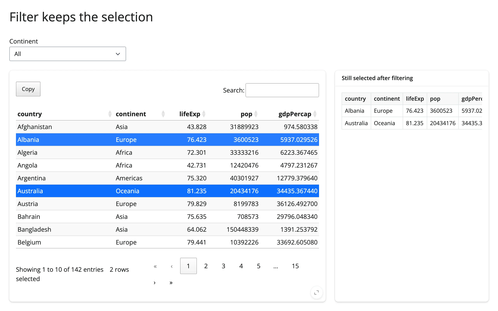

After: 30 Europe-only rows, Albania (the only one still in Europe) still selected:

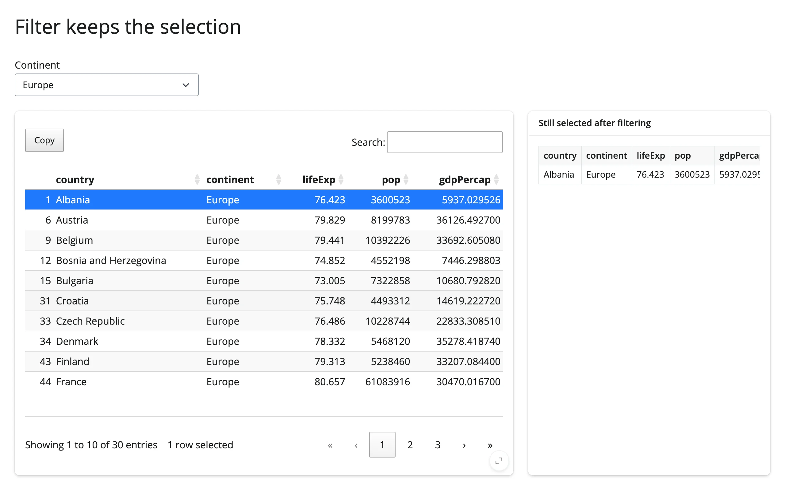

## Large data

itables is client-side: the whole frame is serialized to the browser up front. **`maxBytes`** (64 KB by
default, measured after JSON-encoding) downsamples anything larger and shows a note in the info line; pass
`maxBytes=0` to send everything, but expect tens of thousands of rows to take seconds to first paint -- see
[Gotchas and limitations](#gotchas-and-limitations) and the
[ITables vs. `render.DataGrid`](#render_itables-vs-shinys-renderdata_frame) comparison table below. This is the
"only send what's visible" approach from
[Large data & performance](../../guide/performance/index.md#three-approaches-to-large-data): downsampling
keeps the *initial* payload bounded, but it isn't a virtualized grid -- for real scale, prefer
`render.DataGrid`/`DataTable` (virtualized, 100k+ rows smoothly) or [ipydatagrid](../ipydatagrid/index.md#large-data)'s
`StreamingDataGrid`.

## Layout and sizing

In a filling layout (the default), the table fills its container: a flex layout keeps the search box, column
filters, and footer fixed while the row area scrolls. This needs DataTables' own scrolling body, so
`render_itables` defaults `scrollY="100%"` unless you set `scrollY` yourself.

Give the output **at least ~350px** of height. Verified on main: at 200px, the search box and footer alone eat
most of the budget and the scrolling row area shrinks to a sliver (one row, mostly clipped); at 350px there's
room for roughly five rows before scrolling kicks in. `height=` on `@render_itables` (or `output_widget(...,
height=...)`) opts out of filling and uses that height as a fixed size with its own internal scroll, the same as
other `shinywidgets` renderers.

`full_screen=True` on the containing card works as expected; the table re-measures on resize. `buttons` and
`column_filters="header"` each add a row of controls, which eats into the same fixed height budget -- account
for that if you also set a short explicit height.

## Gotchas and limitations

Verified on current main (shinywidgets, itables 2.9.1):

- **Client-side only.** The whole data frame is serialized to the browser. itables downsamples anything over
  `maxBytes` (64KB by default, applied after JSON-encoding) and shows a note in the info line ("downsampled from
  N rows..."); nothing is logged on the Python side. Pass `maxBytes=0` to send everything, but expect tens of
  thousands of rows to take seconds to first paint -- for real scale, see `render.DataGrid` below.
- **`columnDefs` targeting a numeric column without its own `render` sees itables' internal `[display, raw]`
  pair in `createdCell`, not a plain number.** Index `data[1]` for the raw value (see "What you can build" above
  for a worked example). Not shinywidgets-specific; this is how itables' own number formatting is implemented.
- **`ITable.update(df)` drops options you don't re-pass.** `columnDefs`, `buttons`, and similar are not
  preserved across `.update()` unless included in that call too. Keep them in one dict and reuse it (see
  "Updating the widget from Python").
- **The initial `caption` doesn't render.** `ITable(df, caption="...")` sets the `caption` trait, but the table's
  HTML is built before that trait change is observed, so nothing appears until a later `.update(caption=...)`.
  Upstream itables behavior, not new. Put the caption in the card header instead, or set it via `update()`
  immediately after first use if you need the trait path.
- **`footer=True` together with `column_filters="header"` renders empty data cells** (verified: all `<td>`s
  blank, with the column names duplicated into the footer instead). Avoid the combination; use `footer=True`
  with `column_filters="row"` or without column filters.
- **Sorting is icon-only by default.** `text_in_header_can_be_selected=True` (itables' default) makes header
  text selectable, so clicking it doesn't sort -- only the small arrow does. Pass
  `text_in_header_can_be_selected=False` to make the whole header clickable.
- **A plain `@render_widget` works too.** `@render_widget` returning an `ITable` gets the same fill defaults and
  the jQuery fix as `@render_itables`; use `@render_itables` for the typed `.selected_rows()` accessor and the
  narrower `ImportError` message.

Fixed since the earlier PR-era evaluation (`docs/widget-reports/itables/`), confirmed on current main:
itables' bundled jQuery no longer clobbers Shiny's/bslib's global `$` (verified with bslib card resize,
full-screen, `ui.input_dark_mode()`, and a page script using `$.fn.myPlugin`); `$.fn.dataTable.render.number(...)`
and other JS option recipes that depend on DataTables' jQuery plugin now work via a compatibility shim; and
dark mode (`ui.input_dark_mode()`) is legible (a CSS rule maps itables' DataTables theme variables onto
Bootstrap's).

## `@render_itables` vs. Shiny's `render.data_frame`

Both render a data frame as an interactive table; the difference is in what the table is *for*.

| | ITables (`@render_itables`) | Shiny `render.DataGrid` / `render.DataTable` |
|---|---|---|
| Scale | Whole frame shipped to the browser; downsamples past ~64KB by default | Virtualized: renders only visible rows, handles 100k+ rows smoothly |
| Selection | Row(s), via click/Ctrl/Shift | Row, column, cell, or rectangular region |
| Editing | No | `editable=True`, cell-level |
| Search | Global search box + optional per-column filters/SearchPanes, built in | `filters=True` for per-column text filters; no global search box |
| Styling | DataTables `columnDefs`/CSS (JS), or a rendered pandas `Styler` | Python `styles=` callable -- no JS required |
| Export | `buttons=[...]` (copy, CSV, Excel, print) built in | None built in |
| Extras | SearchPanes, RowGroup, FixedColumns, and the rest of the DataTables extension catalog | None of that catalog; zero extra JS dependency |
| Dark mode | Needs the shinywidgets CSS fix (included) | Native (it's a Shiny/bslib component) |

Choose ITables when you want the DataTables feature set -- global search, export buttons, SearchPanes, a
Jupyter-familiar look -- and your data comfortably fits in the browser. Choose `render.DataGrid`/`DataTable`
for large data, cell editing, or finer-grained selection, with no extra dependency.

## Gallery candidates

- [`gallery/template_table_as_input.py`](gallery/template_table_as_input.py) -- **template.** A table with
  search, column filters, and export buttons, whose selection drives a one-paragraph summary panel. Adapt by
  swapping the data frame and the summary logic.

  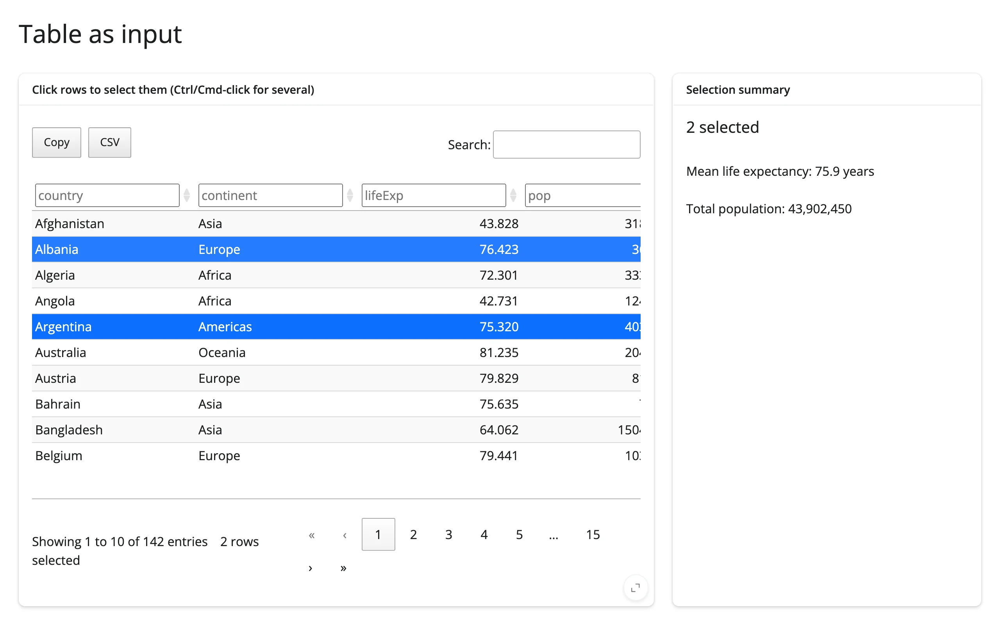

- [`gallery/showcase_gapminder_dashboard.py`](gallery/showcase_gapminder_dashboard.py) -- **showcase.** The
  quickstart table, a continent filter, and a plotly scatter plot, all kept in sync: selecting rows highlights
  them on the plot in place; filtering by continent narrows the table and the plot together while re-mapping the
  kept selection by country name.

  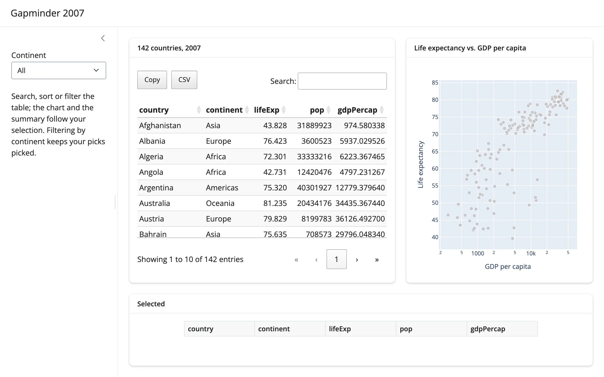
  

## Learn more

- [itables.org](https://itables.org) -- the full options reference, including every DataTables extension
  itables bundles (SearchPanes, SearchBuilder, RowGroup, FixedColumns, KeyTable, and more).
- [itables.org: Shiny](https://mwouts.github.io/itables/shiny.html) -- upstream's own Shiny notes.
- [DataTables](https://datatables.net) -- the underlying jQuery table library, for option names and extension
  docs that itables passes through.
- Related guides in this roster: [reactable](../reactable/index.md), [ipydatagrid](../ipydatagrid/index.md),
  [perspective](../perspective/index.md), [plotly](../plotly/index.md).
