[jupyter-scatter](https://jupyter-scatter.dev) (the `jscatter` package) is a WebGL scatter plot built by Fritz Lekschas
on top of [regl-scatterplot](https://github.com/flekschas/regl-scatterplot). Its whole reason to exist is scale:
where most Python plotting libraries start to struggle in the tens or hundreds of thousands of points,
jupyter-scatter stays interactive into the millions, because every point is drawn by the GPU instead of the DOM or
an SVG. It also ships a real interaction model out of the box -- lasso selection with modifier keys, hover tooltips
with histograms, animated transitions between coordinate sets -- rather than leaving you to build those on top of a
bare canvas.

`@render_jscatter` takes a `jscatter.Scatter` (jupyter-scatter's builder object) or its underlying
`JupyterScatter` widget, and does the usual shinywidgets layout work: the plot resizes to fill its card or output,
unless it has a height of its own. The renderer's accessors turn the plot's lasso/click selection into reactive
values: `.selected()` is the selection as row positions, and `.selected_rows()` the selected rows of the plot's
data frame -- so "what did the user select" reads like `input.my_slider()` instead of a widget trait you have to
wire up by hand.

Reach for jupyter-scatter when the point count is the thing standing between you and plotly or altair -- a few
hundred thousand points and up, or any time pan/zoom needs to stay smooth while the user explores. For moderate
data sizes where you also want axes, facets, or non-scatter marks, plotly's `Scattergl` or altair are a better
fit; see the [plotly](../plotly/index.md) and [altair](../altair/index.md) guides. For a SQL-backed cross-filtering
explorer across many chart types rather than a single scatter plot, see
[embedding-atlas](../embedding-atlas/index.md).

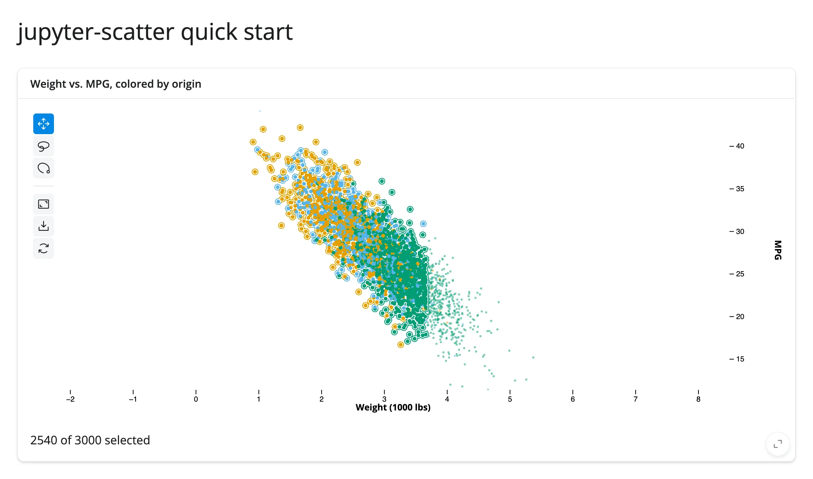

## Installation

```sh
pip install 'shinywidgets[jscatter]'
```

This installs `jupyter-scatter` itself. jupyter-scatter is built on [anywidget](https://anywidget.dev), so there
are no extra JavaScript assets to configure -- its bundle ships inside the Python package.

## Quick start

```{.python file="examples/01_quickstart.py"}
import numpy as np
import pandas as pd
from jscatter import Scatter
from shiny.express import render, ui
from shinywidgets import render_jscatter

rng = np.random.default_rng(1)
n = 3000
origin = pd.Series(rng.choice(["USA", "Europe", "Japan"], n, p=[0.5, 0.25, 0.25]))
weight = origin.map({"USA": 3.4, "Europe": 2.6, "Japan": 2.4}) + rng.normal(0, 0.5, n)
cars = pd.DataFrame(
    {
        "origin": origin.astype("category"),
        "weight": weight.round(2),
        "mpg": (45 - 6 * weight + rng.normal(0, 2.5, n)).round(1),
    }
)

ui.page_opts(title="jupyter-scatter quick start", fillable=True)

with ui.card(full_screen=True):
    ui.card_header("Weight vs. MPG, colored by origin")

    @render_jscatter
    def plot():
        return (
            Scatter(data=cars, x="weight", y="mpg", color_by="origin")
            .axes(labels=["Weight (1000 lbs)", "MPG"])
            .lasso(initiator=True)
        )

    @render.text
    def n_selected():
        return f"{len(plot.selected())} of {len(cars)} selected"
```

`.lasso(initiator=True)` lets a user start a lasso with a click-and-drag from anywhere, in addition to the
default long-press gesture; both reach `plot.selected()` the same way. The screenshot above shows the app after
lassoing a region: the plot rings the selected points, and the text output below it reads directly off the
accessor.

## What you can build

### Millions of points, interactively

```{.python file="examples/02_scale.py"}
import numpy as np
import pandas as pd
from jscatter import Scatter
from shiny.express import render, ui
from shinywidgets import render_jscatter

N = 2_000_000
rng = np.random.default_rng(0)
centers = rng.uniform(-5, 5, size=(8, 2))
cluster = rng.integers(0, 8, N)
xy = centers[cluster] + rng.normal(scale=0.6, size=(N, 2))
points = pd.DataFrame({"x": xy[:, 0], "y": xy[:, 1], "cluster": cluster.astype(str)})

ui.page_opts(title="2,000,000 points", fillable=True)
ui.p(f"{N:,} points on the GPU. Drag to pan, scroll to zoom, or lasso a cluster.")

with ui.card(full_screen=True):

    @render_jscatter
    def plot():
        return (
            Scatter(data=points, x="x", y="y", color_by="cluster")
            .size(default=2)
            .lasso(initiator=True)
        )

    @render.text
    def n_selected():
        return f"{len(plot.selected()):,} selected"
```

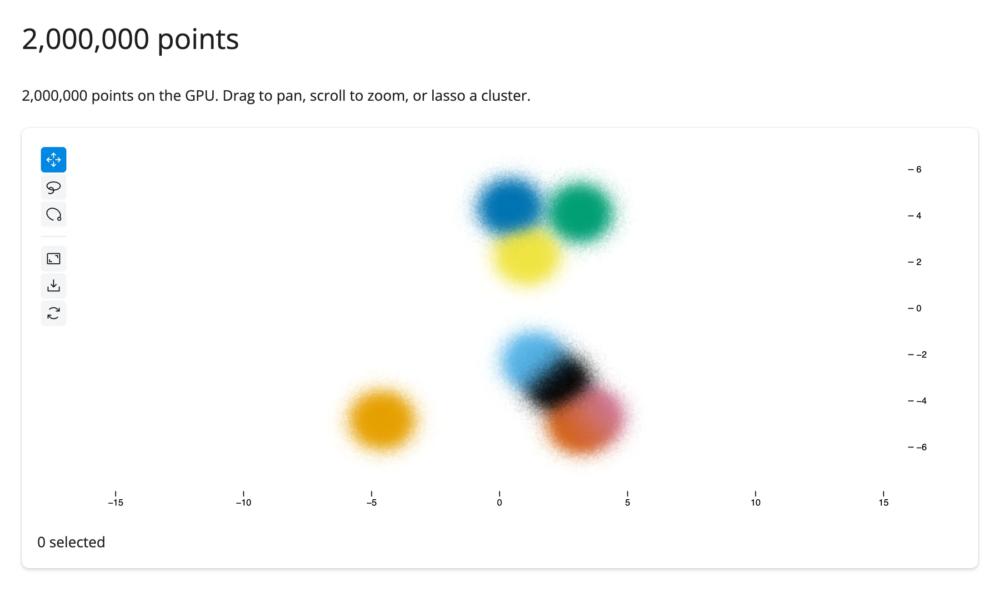

This renders and stays responsive to pan, zoom, and lasso with 2 million points on an ordinary laptop in headless
Chromium. Zoomed out, dense clusters blend into soft density blobs (above); scroll in and you see the individual
points (below). The practical ceiling is less about rendering and more about getting the selection back to
Python -- see [Gotchas and limitations](#gotchas-and-limitations) for the message-size limit on very large
lasso selections.

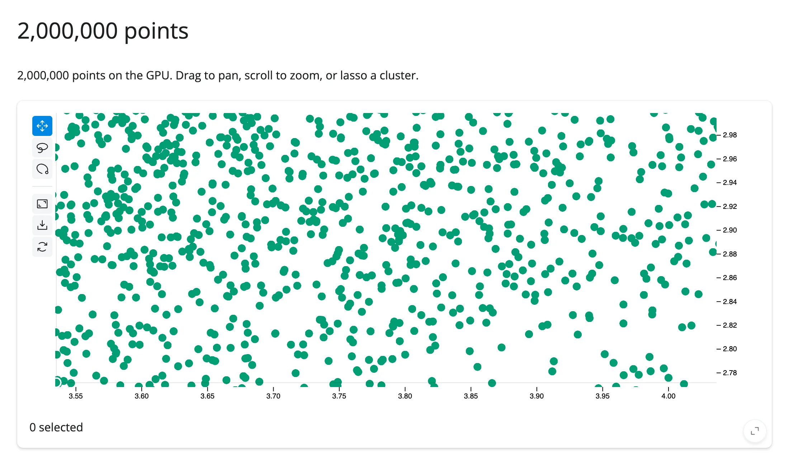

### Color, size, and opacity encodings

```{.python file="examples/03_encodings.py"}
import numpy as np
import pandas as pd
from jscatter import Scatter
from shiny.express import ui
from shinywidgets import render_jscatter

rng = np.random.default_rng(3)
n = 4000
origin = pd.Series(rng.choice(["USA", "Europe", "Japan"], n, p=[0.5, 0.25, 0.25]))
weight = origin.map({"USA": 3.4, "Europe": 2.6, "Japan": 2.4}) + rng.normal(0, 0.5, n)
cars = pd.DataFrame(
    {
        "origin": origin.astype("category"),
        "weight": weight.round(2),
        "mpg": (45 - 6 * weight + rng.normal(0, 2.5, n)).round(1),
        "hp": (45 * weight + rng.normal(0, 25, n)).round(),
    }
)

ui.page_opts(title="Color, size, and opacity encodings", fillable=True)

with ui.card(full_screen=True):
    ui.card_header("Color = origin, size and opacity = horsepower")

    @render_jscatter
    def plot():
        # jscatter allows at most 2 distinct *data dimensions* driving
        # color/size/opacity at once; reuse one dimension (here "hp") across
        # more than one channel to combine three encodings anyway.
        return (
            Scatter(data=cars, x="weight", y="mpg")
            .color(by="origin")
            .size(by="hp", map=[2, 4, 6, 8, 10])
            .opacity(by="hp")
            .legend(True)
        )
```

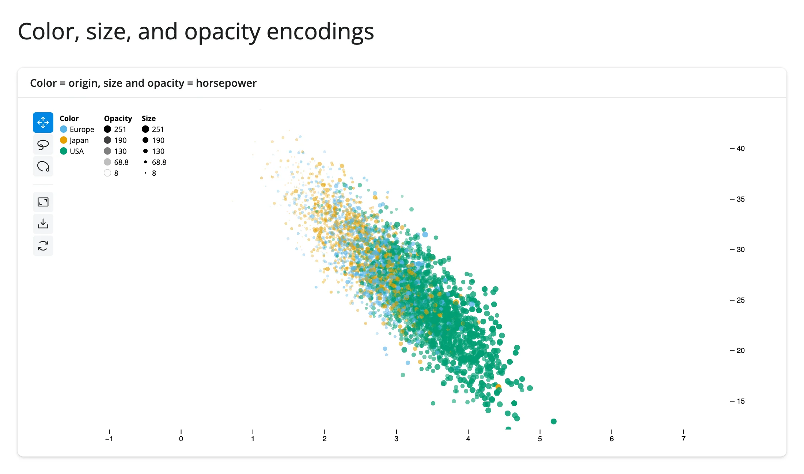

`.color()`, `.size()`, and `.opacity()` all take `by=` (a column name or array) plus `map=` for the color/size
scale. The legend (`.legend(True)`) reflects whatever is encoded. One constraint worth knowing before you reach
for three encodings: jupyter-scatter packs point attributes into a fixed number of GPU buffer components, so
**at most 2 distinct data columns** can drive color/size/opacity combined -- a third *distinct* column raises
`AssertionError: Only 2 data encodings are supported`. Reusing one column across two channels (as above, `hp` for
both size and opacity) doesn't count twice.

### Animated transitions between embeddings

```{.python file="examples/04_animated_xy.py"}
import numpy as np
import pandas as pd
from jscatter import Scatter
from shiny import reactive
from shiny.express import input, render, ui
from shinywidgets import render_jscatter

rng = np.random.default_rng(2)
n = 600
label = rng.integers(0, 5, n)
grid_x, grid_y = (np.arange(n) % 30).astype(float), (np.arange(n) // 30).astype(float)
angle = rng.uniform(0, 2 * np.pi, n)
radius = label + rng.normal(0, 0.15, n)
points = pd.DataFrame(
    {
        "grid_x": grid_x,
        "grid_y": grid_y,
        "circle_x": radius * np.cos(angle),
        "circle_y": radius * np.sin(angle),
        "label": label.astype(str),
    }
)

ui.page_opts(title="Animated transition between embeddings", fillable=True)
ui.input_action_button("toggle", "Switch embedding", class_="mb-2")

with ui.card(full_screen=True):

    @render_jscatter
    def plot():
        return Scatter(data=points, x="grid_x", y="grid_y", color_by="label")

    @reactive.effect
    @reactive.event(input.toggle)
    def _switch():
        to_circle = input.toggle() % 2 == 1
        x, y = ("circle_x", "circle_y") if to_circle else ("grid_x", "grid_y")
        with reactive.isolate():
            plot.value.xy(x=x, y=y, animate=True)
```

Before (a grid layout) and after clicking "Switch embedding" (the same points, re-laid-out on a circle, points
colored the same throughout):

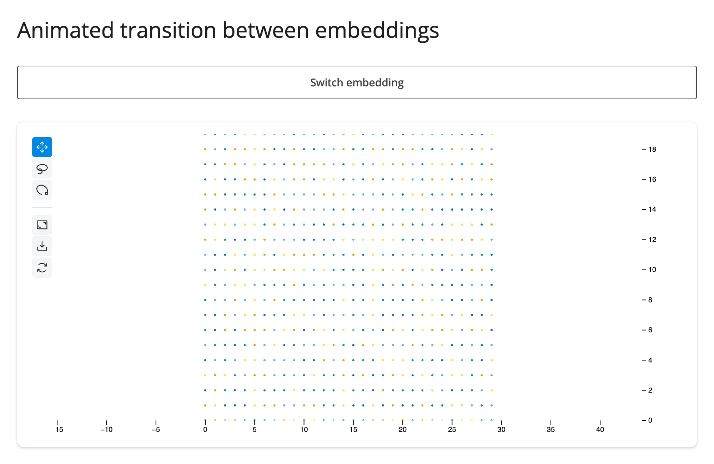
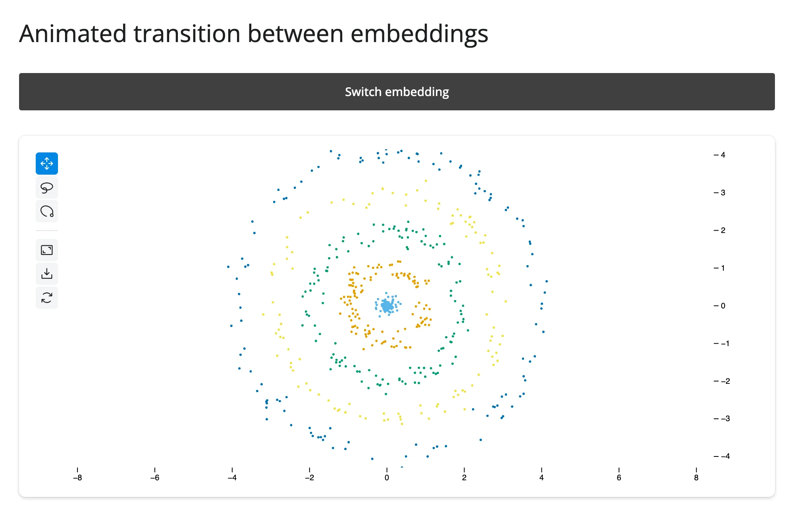

`.xy(x=, y=, animate=True)` is the one call that moves both coordinates at once and tweens between them --
exactly the pattern for comparing two embeddings of the same points (PCA vs. UMAP, before vs. after a model
update, raw vs. batch-corrected). It's called on `plot.value` (the `Scatter` builder) inside
`reactive.isolate()`; see [Updating the widget from Python](#updating-the-widget-from-python) for why.

### Tooltips with built-in histograms

```{.python file="examples/05_tooltips.py"}
import numpy as np
import pandas as pd
from jscatter import Scatter
from shiny.express import ui
from shinywidgets import render_jscatter

rng = np.random.default_rng(4)
n = 500
origin = pd.Series(rng.choice(["USA", "Europe", "Japan"], n, p=[0.5, 0.25, 0.25]))
weight = origin.map({"USA": 3.4, "Europe": 2.6, "Japan": 2.4}) + rng.normal(0, 0.5, n)
cars = pd.DataFrame(
    {
        "model": [f"Car {i}" for i in range(n)],
        "origin": origin.astype("category"),
        "weight": weight.round(2),
        "mpg": (45 - 6 * weight + rng.normal(0, 2.5, n)).round(1),
    }
)

ui.page_opts(title="Tooltips", fillable=True)
ui.p("Hover a point to see its data, right in the plot.")

with ui.card(full_screen=True):

    @render_jscatter
    def plot():
        return (
            Scatter(data=cars, x="weight", y="mpg", color_by="origin")
            .tooltip(True, properties=["x", "y", "color", "model"])
        )
```

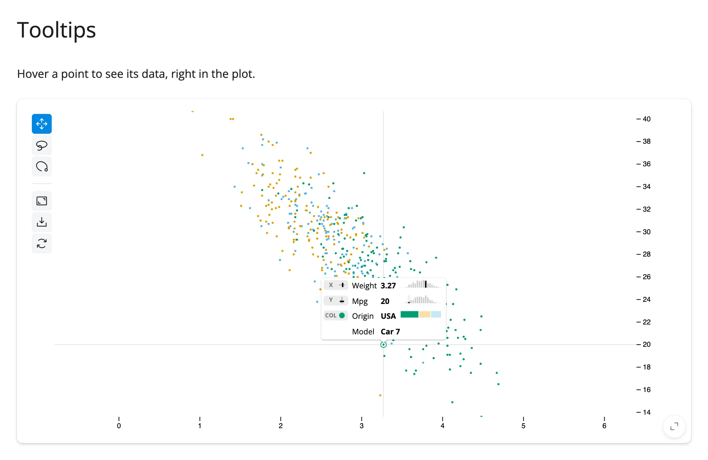

`properties` names the visual channels (`"x"`, `"y"`, `"color"`, `"opacity"`, `"size"`) that are already encoded,
plus any other data column by name (`"model"` here) -- it draws a mini histogram next to each numeric property for
free. This is entirely client-side: hovering doesn't round-trip to Python (see `hovering` below if you need the
hovered point in Python too).

## Reacting to user interaction

### Accessor reference

| accessor | returns | before any interaction | across re-render | default rate policy |
|---|---|---|---|---|
| `selected()` | `numpy.ndarray` (`uint32`) of row *positions* | seeded: empty array (every normal `Scatter(...)`-returning render); **cancels** instead, for a bare `JupyterScatter` built without going through `Scatter`, until the browser reports once | re-seeded: a new plot's selection starts empty | none (reports once per gesture, not during the drag) |
| `selected_rows(df=None)` | the selected rows of `df` (default: the frame the `Scatter` was built with), in `df`'s own type (pandas, polars, ...) | empty frame (cancels when `selected()` does) | derived from `selected()` | none (follows `selected()`) |

`selected()` cancels the same way reading `.widget` does before first render -- and, only for a bare
`JupyterScatter` constructed without going through `Scatter`, continues to cancel until the browser reports once.
Every normal `Scatter(...)`-returning render function starts `selected()` at an empty array immediately instead,
since `Scatter` itself seeds the widget's `selection` trait.

### `selected()`: the lasso and click selection, as a reactive value

```{.python file="examples/06_selection_accessor.py"}
import numpy as np
import pandas as pd
from jscatter import Scatter
from shiny.express import render, ui
from shinywidgets import render_jscatter

rng = np.random.default_rng(1)
n = 3000
origin = pd.Series(rng.choice(["USA", "Europe", "Japan"], n, p=[0.5, 0.25, 0.25]))
weight = origin.map({"USA": 3.4, "Europe": 2.6, "Japan": 2.4}) + rng.normal(0, 0.5, n)
cars = pd.DataFrame(
    {
        "origin": origin.astype("category"),
        "weight": weight.round(2),
        "mpg": (45 - 6 * weight + rng.normal(0, 2.5, n)).round(1),
    }
)

ui.page_opts(title="plot.selected()", fillable=True)

with ui.layout_columns():
    with ui.card(full_screen=True):

        @render_jscatter
        def plot():
            return Scatter(data=cars, x="weight", y="mpg", color_by="origin").lasso(
                initiator=True
            )

    with ui.card(full_screen=True):

        @render.text
        def n_selected():
            return f"{len(plot.selected())} of {len(cars)} cars selected"

        @render.data_frame
        def selected_cars():
            return plot.selected_rows()
```

Before any selection, and after lassoing roughly half the plot:

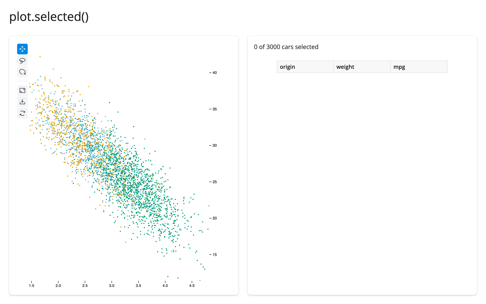
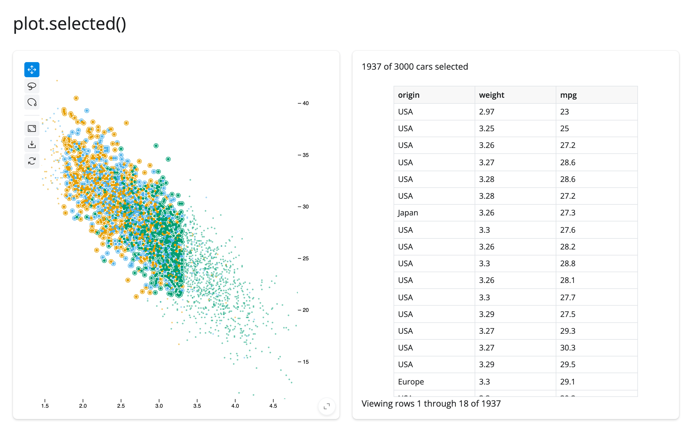

`selected()` holds **row positions** into whatever data frame built the plot, not index labels -- the right
shape for programmatic selection and filtering (see
[Updating the widget from Python](#updating-the-widget-from-python)), where the setters also take positions. If
you build the plot with `Scatter(..., data_use_index=True)` and want index *labels* instead, read
`plot.value.selection()` (the builder's own method) rather than the accessor. A re-render (e.g., the render
function reading an input) gives the user a brand new plot whose selection starts empty; `selected()` can't be
read inside `plot`'s own render function for the same reason `.widget` can't -- read it from another output or a
`@reactive.effect`.

### `selected_rows()`: the selection, as rows of your data frame

When what you want is the selected *rows* -- for a table, a download, or a downstream calculation --
`plot.selected_rows()` is the accessor: it maps the selection's positions back into the data frame the
`Scatter` was built with and returns those rows (the table in the example above). It's an empty frame while
nothing is selected, so it can be passed straight to `@render.data_frame`.

Pass a frame explicitly -- `plot.selected_rows(df)` -- when the render function returns a bare `JupyterScatter`
(which retains no frame), or when the plot's rows aren't your frame's rows in order. Any frame type works:
pandas in, pandas out; polars in, polars out. The match is positional, like `df.iloc[plot.selected()]` --
after a re-render or in-place data replacement with different rows, a retained position can point at a
different row, so carry an ID column and look rows up by it when the data can change.

### Beyond the accessor: `.read()`

`hovering`, `zoom_level`, and `lasso_selection_polygon` are synced traits of the plot's own widget, with no
dedicated accessor. Because they're traits of the output's own widget (not a nested object), `plot.read(name)`
reaches them directly -- no `reactive_read()`, and no `req(plot.widget)` guard to write yourself; `.read()`
cancels on its own until the plot first renders, the same way the `selected()` accessor does.

```{.python file="examples/07_read_traits.py"}
import numpy as np
import pandas as pd
from jscatter import Scatter
from shiny.express import render, ui
from shinywidgets import render_jscatter

rng = np.random.default_rng(5)
n = 400
points = pd.DataFrame({"x": rng.uniform(0, 1, n), "y": rng.uniform(0, 1, n)})

ui.page_opts(title="Beyond the accessor: .read()", fillable=True)

with ui.layout_columns():
    with ui.card(full_screen=True):

        @render_jscatter
        def plot():
            return Scatter(data=points, x="x", y="y").lasso(initiator=True)

    with ui.card():
        ui.card_header("Traits plot.read() can reach")

        @render.text
        def hovering():
            idx = plot.read("hovering")
            return f"hovering: {'none' if idx is None else idx}"

        @render.text
        def zoom_level():
            return f"zoom_level: {plot.read('zoom_level'):.2f}"

        @render.text
        def lasso_polygon():
            poly = plot.read("lasso_selection_polygon")
            return f"lasso_selection_polygon: {'none' if poly is None else f'{len(poly)} vertices'}"
```

Before interacting, and after hovering a point, scroll-zooming, and lassoing (all three traits update):

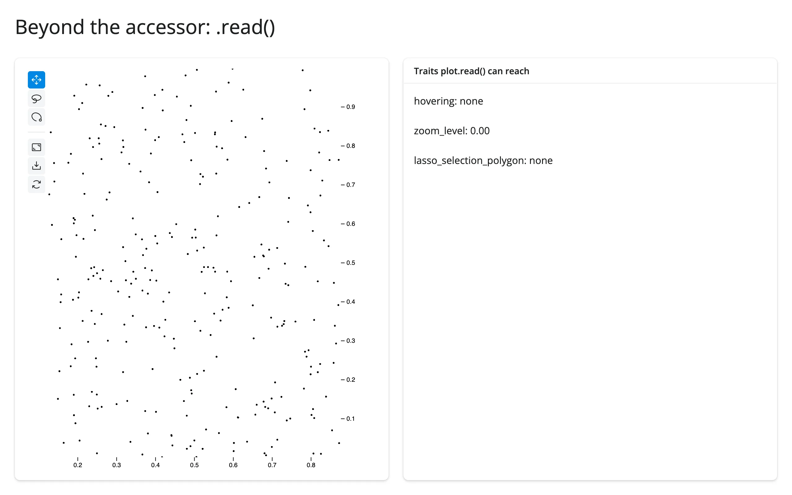
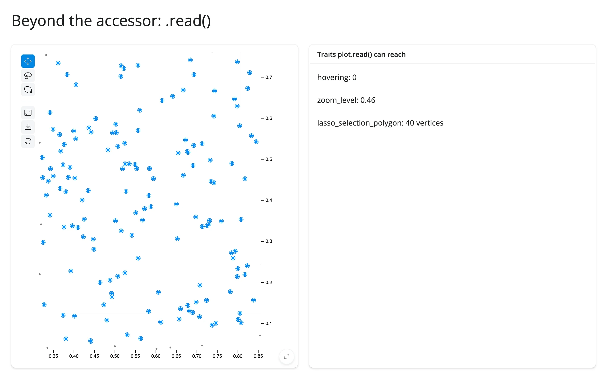

Three widget traits are worth reading this way beyond the `selected()` accessor:

- **`hovering`**: the row position under the cursor, or `None`. Updates on every mouse move over a point --
  don't feed it straight into an expensive computation without debouncing.
- **`zoom_level`**: a read-only float that tracks the camera's zoom factor, updated on every scroll/pan.
- **`lasso_selection_polygon`**: the lasso's own vertices in data coordinates (an `(n, 2)` array), `None` until
  the first lasso. Useful if you want the *shape* of the selection rather than just which points it contains
  (e.g., to draw the same region on a second, differently-scaled plot).

`filter` is also a synced trait, but nothing in jupyter-scatter's UI writes to it; it's Python-to-browser only
(see [Programmatic selection and filtering](#programmatic-selection-and-filtering-from-python)), so there's no
browser gesture to read it for.

### Rate limiting

jupyter-scatter reports `selection` once when a gesture ends, not continuously during the drag, so
`render_jscatter`'s `selected()` has no default rate policy -- there's nothing streaming to coalesce. If you
share one plot across many sessions (a process-global or `shared_lifetime()` widget) and several sessions react to
the same selection with expensive work, pass `rate_policy="debounce"` and `rate_delay=` to `@render_jscatter(...)`,
the same two keyword arguments every renderer in this roster accepts. There's no jscatter-specific tuning beyond
deciding whether you need this at all.

### Reading an accessor on demand

`selected_rows()` is seeded empty the moment a `Scatter(...)`-built plot renders, so it's safe to read from
somewhere that only runs occasionally -- a download handler, say -- with no prior interaction needed first:

```{.python file="examples/14_download_selection.py"}
import numpy as np
import pandas as pd
from jscatter import Scatter
from shiny.express import render, ui
from shinywidgets import render_jscatter

rng = np.random.default_rng(1)
n = 2000
points = pd.DataFrame({"x": rng.uniform(0, 1, n), "y": rng.uniform(0, 1, n)})

ui.page_opts(title="Reading selected_rows() on demand", fillable=True)

with ui.layout_columns():
    with ui.card(full_screen=True):
        ui.card_header("Lasso some points, then download -- no need to click anything first")

        @render_jscatter
        def plot():
            return Scatter(data=points, x="x", y="y").lasso(initiator=True)

    with ui.card():

        @render.download_button(
            filename="selected.csv", label="Download selected points as CSV"
        )
        def download():
            # selected_rows() is seeded empty the moment the plot renders, so
            # this reads whatever's currently selected, even on first run.
            yield plot.selected_rows().to_csv(index=False)
```

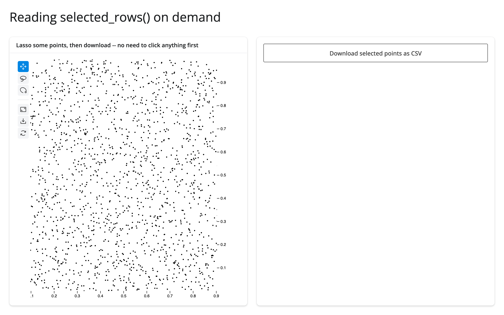
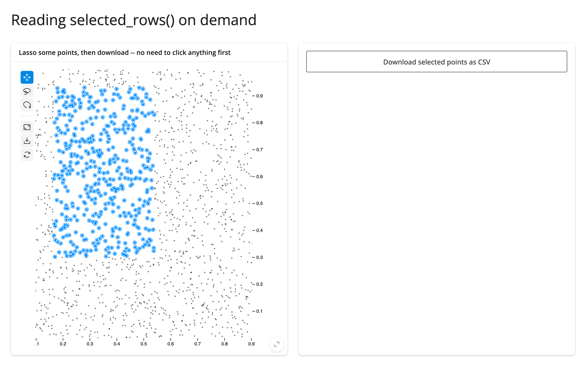

## Updating the widget from Python

Two ways to change an already-rendered plot, and when each is right:

- **Re-render** (have the render function return a new `Scatter`): simplest, but jupyter-scatter re-sends the
  full point data and the view resets -- camera, zoom, and selection are all lost. Fine for small data or when
  the whole plot is genuinely changing (e.g., a different data frame entirely).
- **Update in place**, from a `@reactive.effect`, reading the input that should drive the change and calling a
  method on `plot.value` (the `Scatter` builder) or setting a trait directly on `plot.widget`, both wrapped in
  `reactive.isolate()` so reading the *current* state of the plot doesn't create a reactive dependency that would
  re-run the effect in a loop. This is almost always what you want for anything short of swapping the dataset:
  the camera, zoom, and selection are preserved, and jupyter-scatter's ~2 MB JS bundle and the point data aren't
  re-sent.

[`examples/08_update_in_place.py`](examples/08_update_in_place.py) shows the `.value` form, recoloring a plot from
categorical to continuous on a button click without re-rendering or losing the current view:

```{.python file="examples/08_update_in_place.py"}
import numpy as np
import pandas as pd
from jscatter import Scatter
from shiny import reactive
from shiny.express import input, render, ui
from shinywidgets import render_jscatter

rng = np.random.default_rng(1)
n = 3000
origin = pd.Series(rng.choice(["USA", "Europe", "Japan"], n, p=[0.5, 0.25, 0.25]))
weight = origin.map({"USA": 3.4, "Europe": 2.6, "Japan": 2.4}) + rng.normal(0, 0.5, n)
cars = pd.DataFrame({"origin": origin.astype("category"), "weight": weight.round(2)})
cars["mpg"] = (45 - 6 * cars["weight"] + rng.normal(0, 2.5, n)).round(1)

ui.page_opts(title="Restyle in place, without re-sending data", fillable=True)
ui.input_action_button("toggle", "Color by weight instead", class_="mb-2")

with ui.card(full_screen=True):

    @render_jscatter
    def plot():
        return Scatter(data=cars, x="weight", y="mpg", color_by="origin")

    @reactive.effect
    @reactive.event(input.toggle)
    def _recolor():
        by_weight = input.toggle() % 2 == 1
        with reactive.isolate():
            if by_weight:
                plot.value.color(by="weight", map="viridis")
            else:
                plot.value.color(by="origin")
```

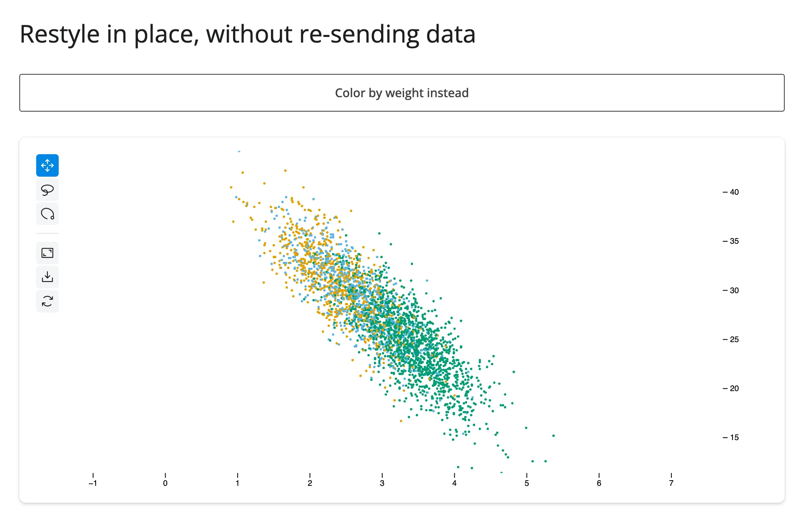
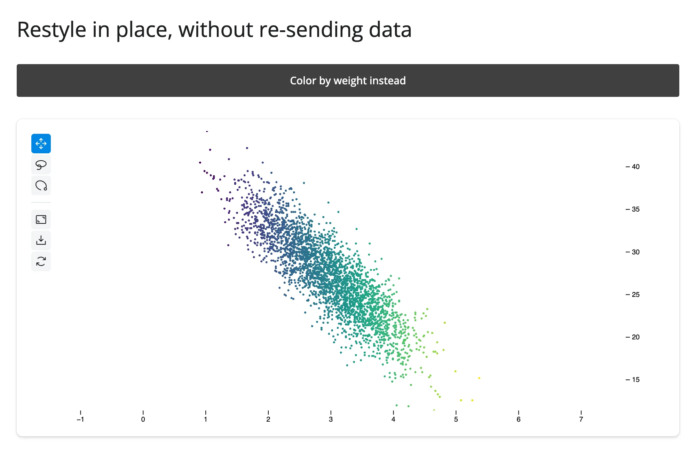

### Programmatic selection and filtering from Python

[`examples/09_python_selection_filter.py`](examples/09_python_selection_filter.py) drives both `selection` and
`filter` straight from Python, by assigning the widget's traits directly (the form the class docstring
recommends) rather than chaining `Scatter` methods:

```{.python file="examples/09_python_selection_filter.py"}
import numpy as np
import pandas as pd
from jscatter import Scatter
from shiny import reactive
from shiny.express import input, render, ui
from shinywidgets import render_jscatter

rng = np.random.default_rng(1)
n = 3000
origin = pd.Series(rng.choice(["USA", "Europe", "Japan"], n, p=[0.5, 0.25, 0.25]))
weight = origin.map({"USA": 3.4, "Europe": 2.6, "Japan": 2.4}) + rng.normal(0, 0.5, n)
cars = pd.DataFrame({"origin": origin.astype("category"), "weight": weight.round(2)})
cars["mpg"] = (45 - 6 * cars["weight"] + rng.normal(0, 2.5, n)).round(1)

ui.page_opts(title="Drive selection and filter from Python", fillable=True)
with ui.layout_columns(col_widths=[4, 4, 4]):
    ui.input_action_button("select_heavy", "Select heaviest 10%")
    ui.input_action_button("filter_usa", "Filter to USA only")
    ui.input_action_button("reset", "Reset")

with ui.card(full_screen=True):

    @render_jscatter
    def plot():
        return Scatter(data=cars, x="weight", y="mpg", color_by="origin")

    @reactive.effect
    @reactive.event(input.select_heavy)
    def _select():
        cutoff = cars["weight"].quantile(0.9)
        ids = np.flatnonzero(cars["weight"] >= cutoff).astype("uint32")
        with reactive.isolate():
            plot.widget.selection = ids

    @reactive.effect
    @reactive.event(input.filter_usa)
    def _filter():
        ids = np.flatnonzero(cars["origin"] == "USA").astype("uint32")
        with reactive.isolate():
            plot.widget.filter = ids

    @reactive.effect
    @reactive.event(input.reset)
    def _reset():
        with reactive.isolate():
            plot.widget.selection = np.array([], dtype="uint32")
            plot.widget.filter = None

    @render.text
    def n_selected():
        return f"{len(plot.selected()):,} selected"
```

After "Select heaviest 10%" (selection rings the selected points; the rest of the data stays visible), and after
"Filter to USA only" (filtering actually hides the other points, rather than just marking them):

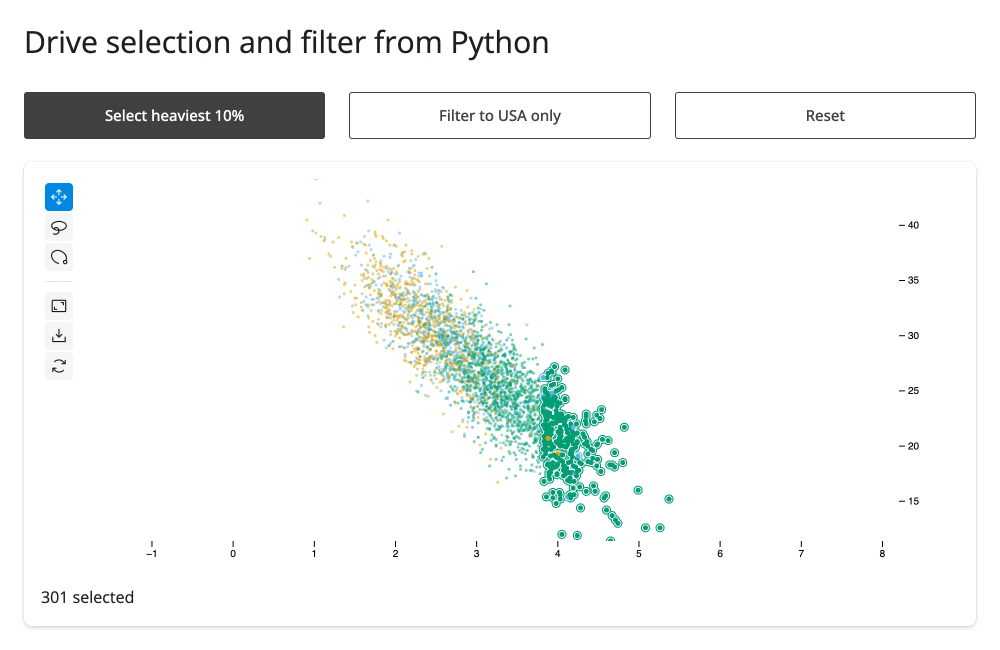
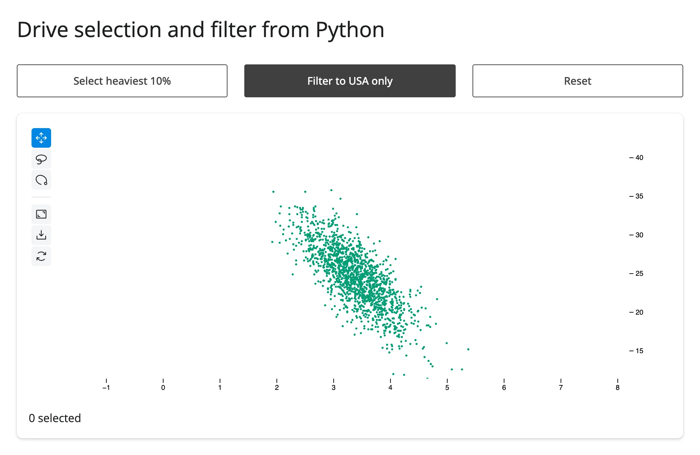

`selection` highlights points without hiding anything else; `filter` hides everything *not* in the given set of
positions. Both take `uint32` arrays of row positions (or index labels if the `Scatter` was built with
`data_use_index=True`); set either to `None` (`filter`) or an empty array (`selection`) to clear it. Both also
have chainable equivalents on the `Scatter` builder (`plot.value.selection(ids)`, `plot.value.filter(ids)`) if
you're already calling other builder methods in the same effect.

## Coordinating multiple views

### Linked brushing between two jscatter plots

[`examples/10_linked_brushing.py`](examples/10_linked_brushing.py) mirrors each plot's lasso selection onto the
other, so selecting the same underlying rows highlights consistently regardless of which plot the user dragged
on:

```{.python file="examples/10_linked_brushing.py"}
import numpy as np
import pandas as pd
from jscatter import Scatter
from shiny import reactive
from shiny.express import ui
from shinywidgets import render_jscatter

rng = np.random.default_rng(1)
n = 3000
origin = pd.Series(rng.choice(["USA", "Europe", "Japan"], n, p=[0.5, 0.25, 0.25]))
weight = origin.map({"USA": 3.4, "Europe": 2.6, "Japan": 2.4}) + rng.normal(0, 0.5, n)
cars = pd.DataFrame({"origin": origin.astype("category"), "weight": weight.round(2)})
cars["mpg"] = (45 - 6 * cars["weight"] + rng.normal(0, 2.5, n)).round(1)
cars["hp"] = (45 * cars["weight"] + rng.normal(0, 25, n)).round()

ui.page_opts(title="Linked brushing between two jscatter plots", fillable=True)

with ui.layout_columns():
    with ui.card(full_screen=True):
        ui.card_header("Weight vs. MPG")

        @render_jscatter
        def weight_mpg():
            return Scatter(data=cars, x="weight", y="mpg", color_by="origin").lasso(
                initiator=True
            )

    with ui.card(full_screen=True):
        ui.card_header("Horsepower vs. MPG")

        @render_jscatter
        def hp_mpg():
            return Scatter(data=cars, x="hp", y="mpg", color_by="origin").lasso(
                initiator=True
            )


def link(source, target):
    @reactive.effect
    def _():
        selection = source.selected()
        with reactive.isolate():
            if not np.array_equal(selection, target.widget.selection):
                target.widget.selection = selection


link(weight_mpg, hp_mpg)
link(hp_mpg, weight_mpg)
```

Before, and after lassoing the lighter half of the weight/MPG plot (the same cars light up in the horsepower
plot, which has its own, uncorrelated noise):

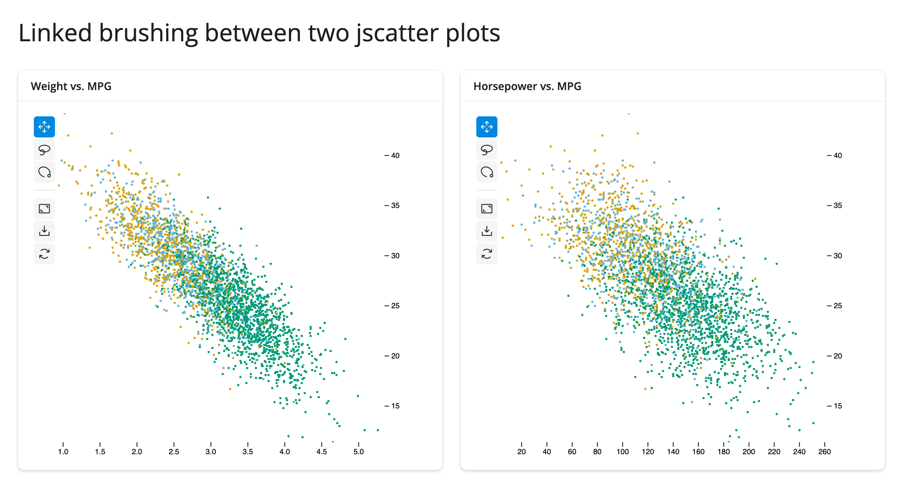
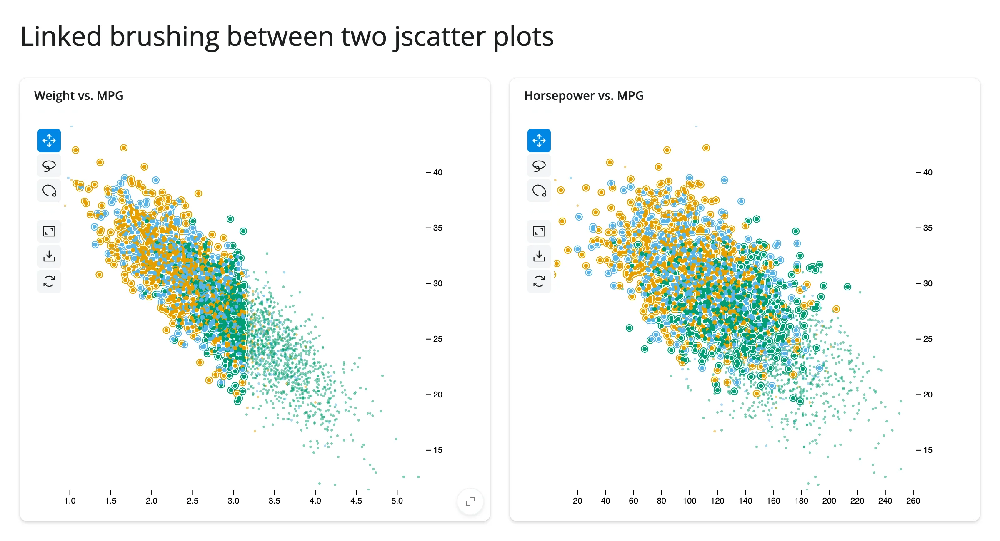

The `np.array_equal` guard is load-bearing: without it, each plot setting the other's `selection` would trigger
the other effect right back, which (even though it converges) does unnecessary work on every gesture.

### Lasso selection drives a table in another widget

[`examples/11_lasso_to_itables.py`](examples/11_lasso_to_itables.py) feeds `selected_rows()` into an
[itables](../itables/index.md) table, re-rendered to show only the lassoed rows -- a different widget library
entirely, linked with one line of Python:

```{.python file="examples/11_lasso_to_itables.py"}
import numpy as np
import pandas as pd
from jscatter import Scatter
from shiny.express import ui
from shinywidgets import render_itables, render_jscatter

rng = np.random.default_rng(1)
n = 1500
origin = pd.Series(rng.choice(["USA", "Europe", "Japan"], n, p=[0.5, 0.25, 0.25]))
weight = origin.map({"USA": 3.4, "Europe": 2.6, "Japan": 2.4}) + rng.normal(0, 0.5, n)
cars = pd.DataFrame({"origin": origin.astype("category"), "weight": weight.round(2)})
cars["mpg"] = (45 - 6 * cars["weight"] + rng.normal(0, 2.5, n)).round(1)

ui.page_opts(title="Lasso selection drives an itables table", fillable=True)

with ui.layout_columns():
    with ui.card(full_screen=True):

        @render_jscatter
        def plot():
            return Scatter(data=cars, x="weight", y="mpg", color_by="origin").lasso(
                initiator=True
            )

    with ui.card(full_screen=True):
        ui.card_header("Rows inside the lasso")

        @render_itables
        def table():
            return plot.selected_rows()
```

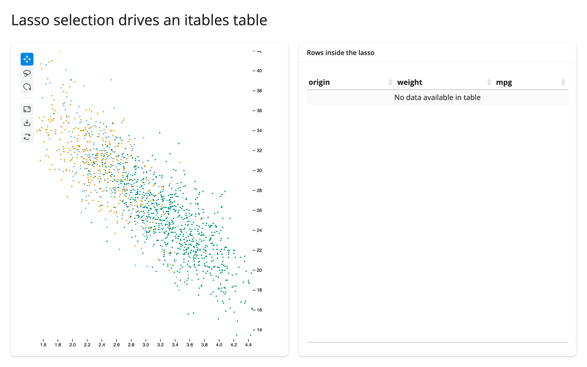
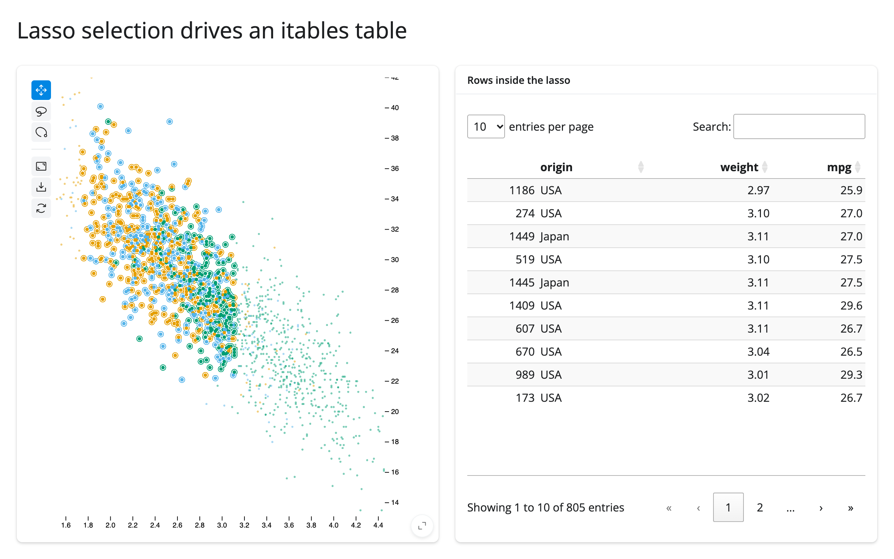

This re-renders the table on every selection change rather than updating it in place -- simple, and cheap enough
for tables up to a few tens of thousands of rows. For a table that's expensive to rebuild, read
`plot.selected_rows()` in an effect and call `.widget.update(...)` (see the
[itables guide](../itables/index.md)) instead.

### Table row selection highlights the plot

The same link, run the other way: [`examples/12_table_to_plot_highlight.py`](examples/12_table_to_plot_highlight.py)
uses Shiny's own `@render.data_frame` row selection to highlight matching points in a jscatter plot.

```{.python file="examples/12_table_to_plot_highlight.py"}
import numpy as np
import pandas as pd
from jscatter import Scatter
from shiny import reactive, req
from shiny.express import render, ui
from shinywidgets import render_jscatter

rng = np.random.default_rng(6)
cars = pd.DataFrame(
    {
        "model": [f"Car {i}" for i in range(60)],
        "weight": rng.uniform(1.8, 4.5, 60).round(2),
        "mpg": rng.uniform(14, 44, 60).round(1),
    }
)

ui.page_opts(title="Table row selection highlights the plot", fillable=True)

with ui.layout_columns():
    with ui.card(full_screen=True):

        @render.data_frame
        def table():
            return render.DataGrid(cars, selection_mode="rows")

    with ui.card(full_screen=True):

        @render_jscatter
        def plot():
            return Scatter(data=cars, x="weight", y="mpg")

        @reactive.effect
        def _highlight():
            rows = table.cell_selection()["rows"]
            w = plot.widget
            req(w)
            ids = np.array(rows, dtype="uint32")
            with reactive.isolate():
                w.selection = ids
```

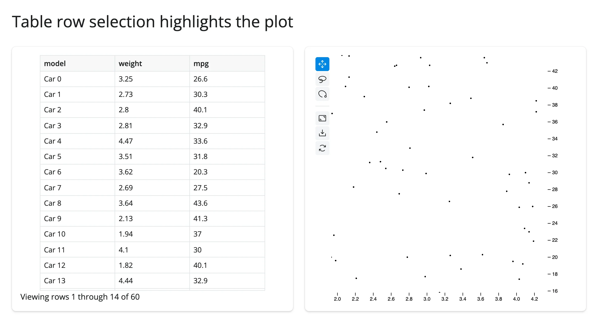
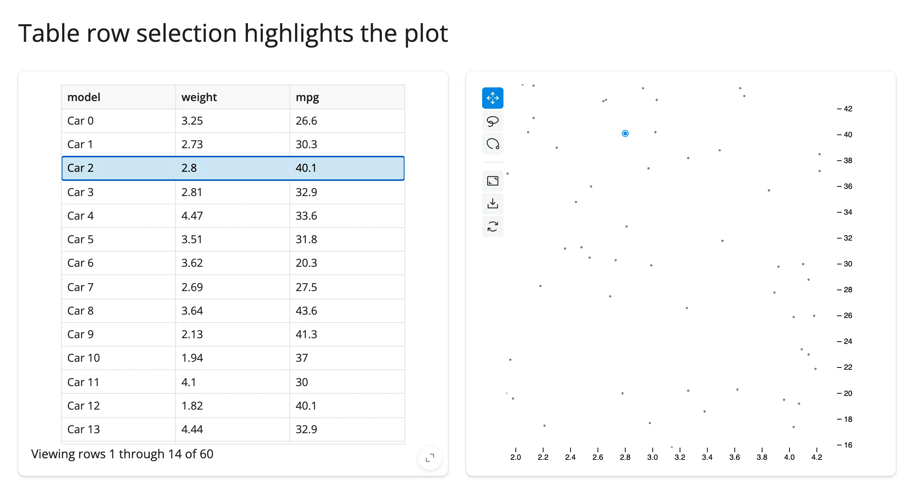

`table.cell_selection()["rows"]` gives row positions in the table's own display order; since this example builds
both the table and the plot from the identical, unsorted `cars` frame, those positions line up directly with
`plot.widget.selection`'s row positions. If your table can be sorted or filtered, map through the visible-row
positions first (see the [ipydatagrid](../ipydatagrid/index.md) or [itables](../itables/index.md) guides).

## Large data

jupyter-scatter's whole premise is scale: every point is drawn by the GPU (via
[regl-scatterplot](https://github.com/flekschas/regl-scatterplot)) instead of the DOM, so there's no separate
"large data mode" to opt into -- see [Millions of points, interactively](#millions-of-points-interactively)
above, which renders and stays responsive to pan, zoom, and lasso with 2,000,000 points. The practical ceiling
isn't rendering, it's getting a *selection* back to Python: a lasso over roughly 3 million points can exceed
Shiny's default 16 MiB websocket message limit (the selection array is base64-encoded JSON). Since
[#481](https://github.com/posit-dev/py-shinywidgets/pull/481) such an oversized message is dropped client-side
with a sticky error notification -- the app keeps running, but that selection never reaches Python. Raise the
limit with `shiny run --ws-max-size <bytes>` (and set `SHINYWIDGETS_WS_MAX_SIZE` to match) if you lasso at that
scale (see [Gotchas and limitations](#gotchas-and-limitations)). This is the "draw it with the GPU
in the browser" approach from
[Large data & performance](../../guide/performance/index.md#three-approaches-to-large-data).

## Layout and sizing

[`examples/13_layout.py`](examples/13_layout.py) shows the two sizing modes side by side:

```{.python file="examples/13_layout.py"}
import numpy as np
import pandas as pd
from jscatter import Scatter
from shiny.express import ui
from shinywidgets import render_jscatter

rng = np.random.default_rng(7)
points = pd.DataFrame({"x": rng.uniform(0, 1, 500), "y": rng.uniform(0, 1, 500)})

ui.page_opts(title="Fill vs. fixed height", fillable=True)

with ui.layout_columns():
    with ui.card(full_screen=True):
        ui.card_header("Fills the card")

        @render_jscatter
        def fills():
            return Scatter(data=points, x="x", y="y")

    with ui.card():
        ui.card_header("Fixed height (300px)")

        @render_jscatter
        def fixed():
            return Scatter(data=points, x="x", y="y", height=300)
```

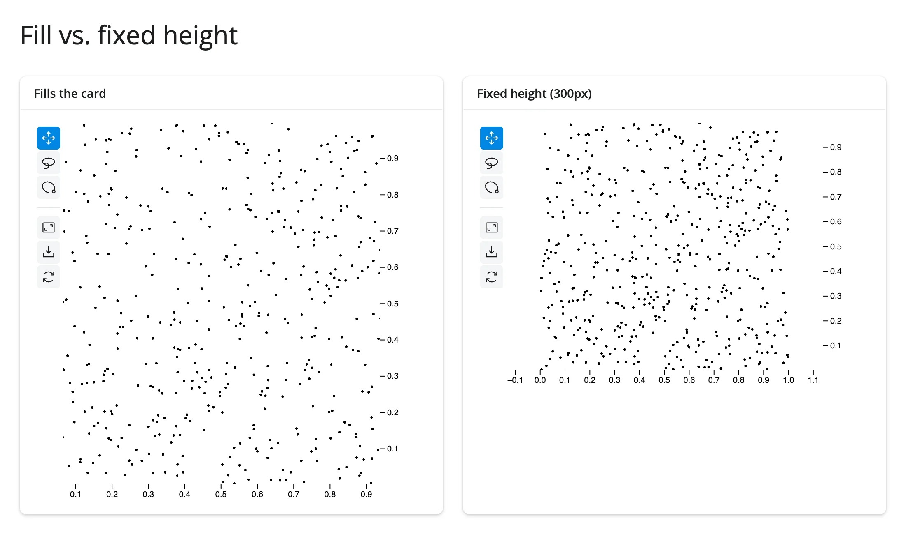

A plot fills its output (card or page) unless it has a height of its own. One quirk worth knowing: jupyter-scatter's
own default, `Scatter(..., height=240)`, is specifically treated as "no height" and still fills -- verified
against current main: a plot built with `height=240` fills a 372px card, while `height=241` is honored as a fixed
241px plot. If you want a genuinely fixed 240px plot, ask for 241 (or anything else) instead. Once a plot has
filled its output, Python can no longer resize it by setting `.widget.height` -- the browser's fit wins; choose
the height at construction if you need a specific, unchanging size.

## Gotchas and limitations

Verified on current `main` (shinywidgets, jupyter-scatter 1.0.1):

- **At most 2 distinct data dimensions can drive color/size/opacity at once.** A third distinct column raises
  `AssertionError: Only 2 data encodings are supported` at render time. Reuse a dimension across channels (as in
  [the encodings example](#color-size-and-opacity-encodings)) to combine more than two visual channels.
- **`height=240` is treated as "unspecified."** It's jupyter-scatter's own default, and shinywidgets can't tell
  it apart from a user not setting a height at all, so a plot built with `height=240` still fills its container.
  See [Layout and sizing](#layout-and-sizing).
- **`selection` holds row positions, not index labels**, unless the `Scatter` was built with
  `data_use_index=True`. Passing index labels from a non-default-indexed frame into `.widget.selection` selects
  the wrong rows silently (no error) and can make `.zoom(to=...)` raise out-of-range errors.
- **Selections over roughly 3 million points can exceed Shiny's default 16 MiB websocket message limit** (the
  selection array is base64-encoded JSON, not a binary frame). Since
  [#481](https://github.com/posit-dev/py-shinywidgets/pull/481) the oversized message is dropped client-side with
  a sticky error notification rather than disconnecting the session -- the app keeps running, but that selection
  never reaches Python. Raise the limit with `shiny run --ws-max-size <bytes>` and set
  `SHINYWIDGETS_WS_MAX_SIZE` to match if your app lassoes selections at that scale. Not independently
  re-triggered at that scale in this pass.
- **`jscatter.compose()` and `.link()` return a plain `ipywidgets.GridBox`**, not a `JupyterScatter`, so
  `@render_jscatter` can't render their result directly (it isn't a `Scatter`/`JupyterScatter`). Use
  `@render_widget` instead if you want `compose()`'s side-by-side layout (it won't get fill behavior or the
  `selected()` accessor), or render the plots as separate `@render_jscatter` outputs and link them in Python, as
  in [Coordinating multiple views](#coordinating-multiple-views) -- which also composes more flexibly with the
  rest of a Shiny layout.
- **Fixed, compared to the earlier PR-review report**: the jupyter-scatter toolbar's own "Full Screen" button
  used to leave a filling plot's canvas stuck at the wrong size after exiting fullscreen. Re-verified on current
  `main`: entering and exiting fullscreen now leaves the canvas correctly tracking its container
  (`tests/playwright/render_jscatter/test_render_jscatter.py::test_jscatter_fills_again_after_its_fullscreen_button`,
  and reproduced independently for this guide).

## Gallery candidates

### Template: linked scatter plots with a selection table

[`gallery/template_linked_scatter.py`](gallery/template_linked_scatter.py) -- two linked `jscatter` plots (weight
vs. MPG, horsepower vs. MPG) sharing a lasso selection, plus a table of the selected rows. A clean ~80-line
starting point for any "explore two views of the same rows" app; swap in your own data frame and column names.

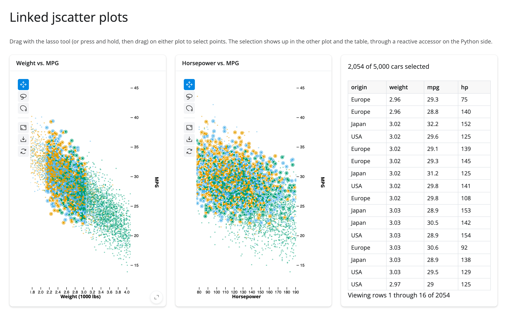

### Showcase: 300,000 cells, lasso to explore

[`gallery/showcase_single_cell_atlas.py`](gallery/showcase_single_cell_atlas.py) -- a synthetic single-cell "atlas"
explorer: two linked 300,000-point plots (a UMAP-like embedding and two marker genes), a live composition panel,
a "color by" switch that restyles both plots in place, and a button that finds the top 1% of a marker gene from
Python, selects those cells, and flies the camera to them.

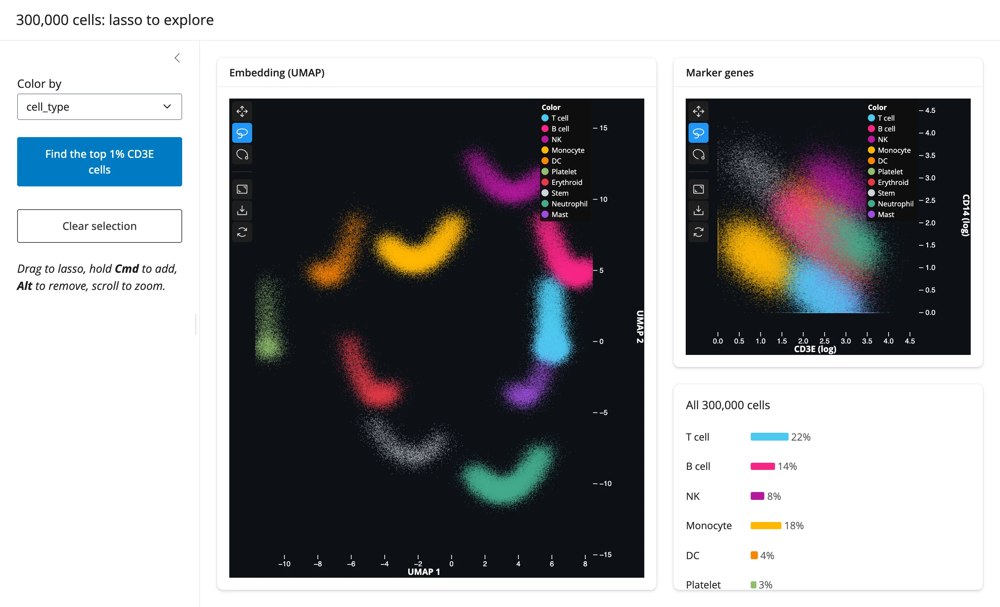
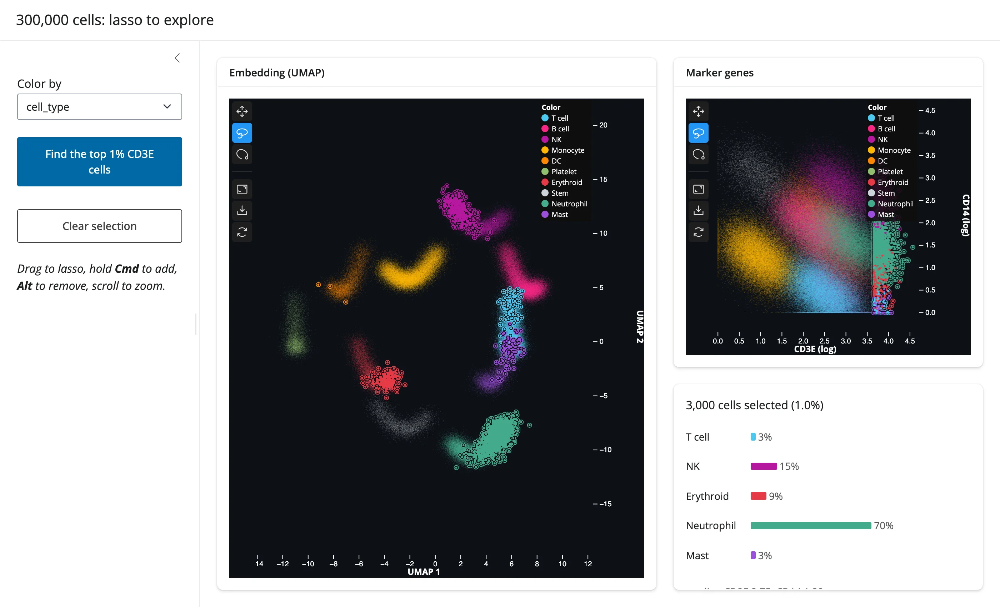

This exercises nearly everything in this guide at once: the `selected()` accessor, linked brushing across two
plots, in-place restyling, and Python-driven selection plus an animated `.zoom()`. The "color by" dropdown
restyles both plots without re-sending any of the 300,000 points' coordinates (below, colored by the `CD3E`
marker instead of cell type, selection preserved):

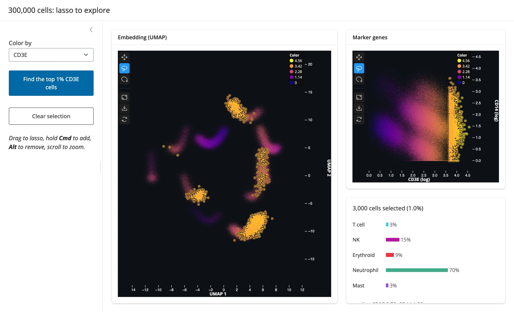

## Learn more

- [jupyter-scatter documentation](https://jupyter-scatter.dev) -- the full `Scatter` API, including connections
  (`connect_by`), annotations, and label placement, none of which are covered above.
- [regl-scatterplot](https://github.com/flekschas/regl-scatterplot), the WebGL renderer jupyter-scatter is built
  on, for the mechanics of how it stays fast at scale.
- [itables guide](../itables/index.md) and [ipydatagrid guide](../ipydatagrid/index.md), for the table side of the
  linked-view patterns above.
- [plotly guide](../plotly/index.md) and [altair guide](../altair/index.md), for scatter plots with more chart
  types and moderate data sizes.
- [embedding-atlas guide](../embedding-atlas/index.md), for SQL-backed cross-filtering across many linked charts
  rather than a single scatter plot.
