[K3D Jupyter](https://k3d-jupyter.org) is a 3D plotting library built on WebGL and three.js, maintained by the K3D-tools
project. It is the only widget in this roster built specifically for *scientific* 3D: point clouds, triangle meshes,
volumetric data, isosurfaces, vector fields, and voxel grids all share one `Plot` scene, one camera, and one GPU
renderer. Where [plotly](../plotly/index.md)'s `scatter_3d` or [pythreejs](../pythreejs/index.md)'s low-level scene
graph cover part of this space, K3D is built around a small set of high-level drawable factories
(`k3d.points`, `k3d.surface`, `k3d.volume`, `k3d.marching_cubes`, ...) that render fast at real data sizes -- a
million-point cloud orbits smoothly in the browser.

`@render_k3d` accepts a `k3d.Plot` (what `k3d.plot()` returns) or a bare drawable such as `k3d.points(...)`, which
it places on a new plot for you (mirroring what K3D's own Jupyter display does). It fills its container by default;
pass `height=` to `k3d.plot()` for a fixed pixel size instead. The one accessor, `camera()`, turns the user's
orbit/pan/zoom into a value you can read like an input -- feed it to another view, a caption, or a "what's visible"
computation. K3D has no click/select accessor (see "Beyond the accessors" below) -- you wire picking yourself with
K3D's own `click_callback`, which this guide also covers because it is how most interactive K3D apps actually work.

Choose K3D when the point is a real 3D scene -- spatial data, simulation output, a surface or a volume -- that users
should be able to fly through and inspect. For a quick 3D scatter next to 2D charts, plotly's `scatter_3d` is lighter
weight. For geographic point clouds and vector layers, see [lonboard](../lonboard/index.md); for medical imaging
volumes specifically, see [niivue](../niivue/index.md). For a lower-level three.js scene graph (custom geometries,
non-K3D materials), see [pythreejs](../pythreejs/index.md).

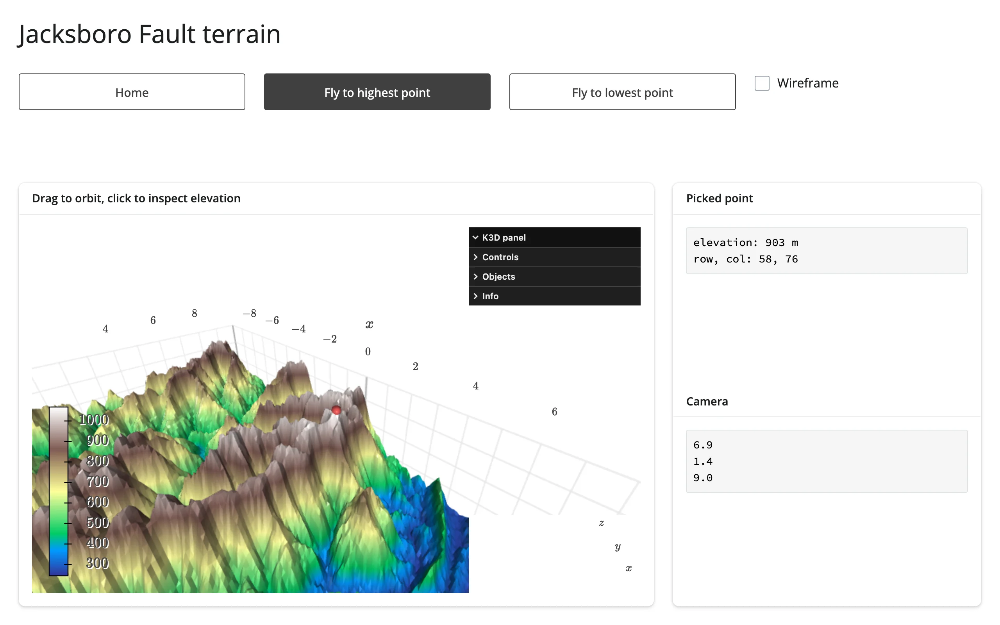

*A real DEM (Jacksboro Fault, Texas), clicked to read elevation, flown to its highest point -- in place, no
re-render. From `gallery/showcase_terrain_explorer.py`.*

## Installation

```
pip install 'shinywidgets[k3d]'
```

This installs `k3d` (tested against 3.2.0, the anywidget-based release). `shinywidgets` imports `k3d.plot.Plot` and
`k3d.factory.plot`, paths specific to K3D 3.x -- the older, ipywidgets-comm-based 2.x releases are not what this
guide (or the renderer) targets.

## Quick start

```{.python file="examples/01_quickstart.py"}
# Needs scikit-learn for the iris dataset:
#   uv run --with scikit-learn shiny run docs/widget-guides/k3d/examples/01_quickstart.py
from __future__ import annotations

import k3d
import numpy as np
from shiny.express import ui
from sklearn.datasets import load_iris
from shinywidgets import render_k3d

iris = load_iris(as_frame=True).frame
xyz = iris[["sepal length (cm)", "sepal width (cm)", "petal length (cm)"]].to_numpy(np.float32)
species_color = np.choose(iris["target"].to_numpy(), [0xE41A1C, 0x377EB8, 0x4DAF4A]).astype(np.uint32)

ui.page_opts(title="Iris in 3D", fillable=True)


@render_k3d
def plot():
    scene = k3d.plot()
    scene += k3d.points(xyz, colors=species_color, point_size=0.2, shader="3d")
    return scene
```

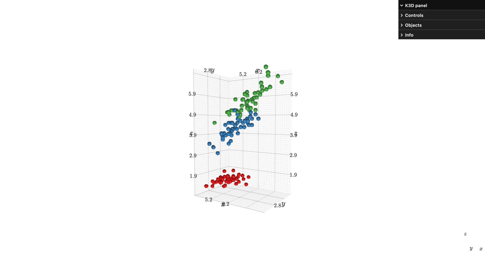

`k3d.plot()` makes an empty scene; `+=` adds drawables to it (it builds a `Group` under the hood, so `fig1 += fig2`
also works to combine two drawables). The plot fills its output with no extra sizing code, and the orbit/zoom/pan
you see is free -- K3D's own trackball camera, not something shinywidgets adds.

## What you can build

K3D's drawable factories (`k3d.points`, `k3d.surface`, `k3d.volume`, `k3d.marching_cubes`, `k3d.line`,
`k3d.vectors`, `k3d.text`) cover most of what a 3D scientific scene needs. Combine several in one `Plot` freely --
each is independently addressable afterward via `plot.objects[i]`.

**A million points, still orbitable.** `shader="flat"` (billboard sprites, no per-point lighting) is the fast path
at this scale; `attribute=`/`color_map=` map a value to color, same idea as a `c=`/`cmap=` scatter:

```{.python file="examples/02_point_cloud_scale.py"}
from __future__ import annotations

import k3d
import numpy as np
from shiny.express import ui
from shinywidgets import render_k3d

N = 1_000_000
rng = np.random.default_rng(0)
xyz = (rng.normal(size=(N, 3)) * 3).astype(np.float32)
dist = np.linalg.norm(xyz, axis=1)

ui.page_opts(title=f"{N:,} points", fillable=True)


@render_k3d
def cloud():
    # An explicit camera (rather than auto-fit's zoomed-out default) composes
    # a tighter, more legible shot of the cluster.
    scene = k3d.plot(camera_auto_fit=False)
    scene.camera = [24, 19, 14, 0, 0, 0, 0, 0, 1]
    scene += k3d.points(
        xyz,
        point_size=0.03,
        shader="flat",
        attribute=dist,
        color_map=k3d.matplotlib_color_maps.Viridis,
        opacity=0.6,
    )
    return scene
```

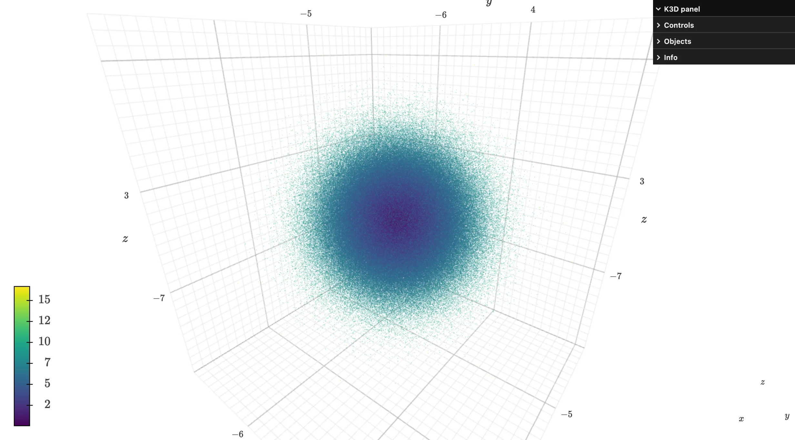

A million points render and stay orbitable at interactive frame rates (verified on current main; SwiftShader
software rendering, no GPU -- see Gotchas). `camera_auto_fit`'s default framing leaves generous margin around the
data (`camera_reset(factor=1.5)`'s default); setting `plot.camera` explicitly, as above, composes a tighter shot.

**A real terrain surface, colored by elevation.** `k3d.surface` turns a 2D height array into a 3D surface;
`bounds=[xmin, xmax, ymin, ymax]` sets its footprint (the default is a unit square centered on the origin):

```{.python file="examples/03_terrain_surface.py"}
# Uses a real DEM (elevation grid) that ships inside matplotlib's sample data.
from __future__ import annotations

import k3d
import matplotlib.cbook as cbook
import numpy as np
from shiny.express import ui
from shinywidgets import render_k3d

elevation = cbook.get_sample_data("jacksboro_fault_dem.npz")["elevation"][::2, ::2].astype(np.float32)
relief = (elevation - elevation.min()) / (elevation.max() - elevation.min()) * 4.0

peak_row, peak_col = np.unravel_index(np.argmax(elevation), elevation.shape)
nrows, ncols = elevation.shape
peak_xyz = (
    -10 + peak_col / (ncols - 1) * 20,
    -10 + peak_row / (nrows - 1) * 20,
    float(relief[peak_row, peak_col]) + 0.3,
)

ui.page_opts(title="Jacksboro Fault DEM", fillable=True)


@render_k3d
def terrain():
    scene = k3d.plot(camera_auto_fit=False)
    scene.camera = [16, -18, 14, 0, 0, 1, 0, 0, 1]
    scene += k3d.surface(
        relief,
        bounds=[-10, 10, -10, 10],
        attribute=elevation,
        color_map=k3d.matplotlib_color_maps.Terrain,
        color_range=[float(elevation.min()), float(elevation.max())],
    )
    # is_html=True avoids k3d.text's default LaTeX rendering, which drops spaces
    # (e.g. "Highest point" renders as "Highestpoint")
    scene += k3d.text(
        "Highest point (1068 m)",
        position=peak_xyz,
        color=0x000000,
        label_box=True,
        is_html=True,
    )
    return scene
```

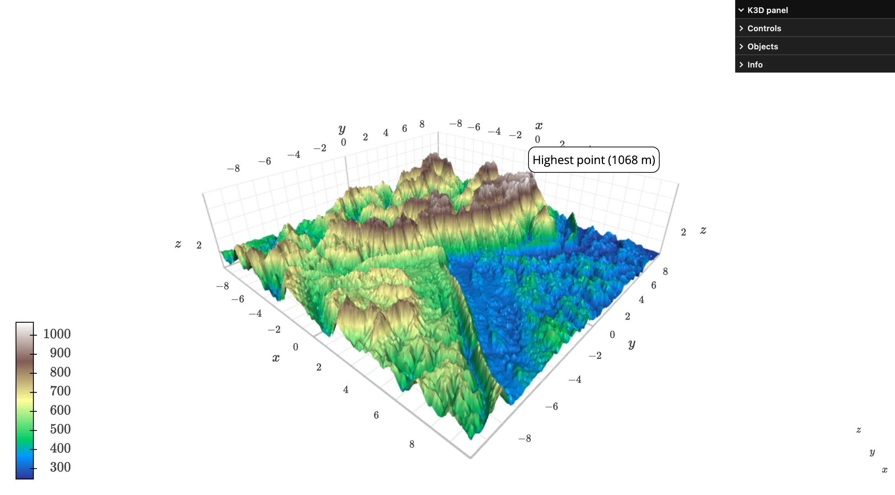

`relief` (the surface's z-height) is scaled for a pleasant vertical exaggeration; `attribute=elevation` keeps the
*color* mapped to the true elevation in meters, independent of that scaling -- a common pattern when the natural
x/y/z units would otherwise make the terrain look nearly flat.

**An isosurface from a scalar field.** `k3d.marching_cubes` extracts the surface where a 3D scalar field crosses
`level` -- here, the implicit equation of a torus:

```{.python file="examples/04_mesh_isosurface.py"}
from __future__ import annotations

import k3d
import numpy as np
from shiny.express import ui
from shinywidgets import render_k3d

n = 80
lin = np.linspace(-2, 2, n, dtype=np.float32)
x, y, z = np.meshgrid(lin, lin, lin, indexing="ij")
major_radius, minor_radius = 1.0, 0.4
field = (np.sqrt(x**2 + y**2) - major_radius) ** 2 + z**2 - minor_radius**2

ui.page_opts(title="An isosurface, from a scalar field", fillable=True)


@render_k3d
def torus():
    scene = k3d.plot()
    scene += k3d.marching_cubes(
        field, level=0.0, color=0x2E86AB, flat_shading=False
    )
    return scene
```

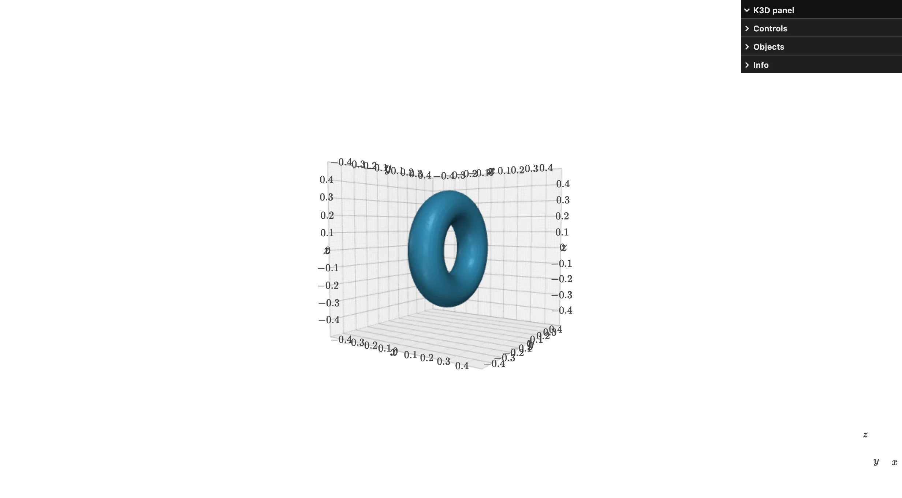

`marching_cubes` ignores the field's own coordinate range -- the mesh always comes out in a unit cube centered on
the origin (use `spacings_x`/`_y`/`_z` or a `model_matrix` to rescale it). A plain triangle mesh you already have
(e.g. loaded from an STL) works the same way through `k3d.mesh(vertices, indices)`.

**Volumetric rendering.** `k3d.volume` ray-marches a 3D scalar field directly -- no surface extraction, so it shows
density gradients an isosurface would hide:

```{.python file="examples/05_volume.py"}
from __future__ import annotations

import k3d
import numpy as np
from shiny.express import ui
from shinywidgets import render_k3d

n = 64
lin = np.linspace(-1, 1, n, dtype=np.float32)
x, y, z = np.meshgrid(lin, lin, lin, indexing="ij")
blobs = [(-0.3, -0.2, 0.1, 0.25), (0.3, 0.2, -0.1, 0.3), (0.0, 0.4, 0.3, 0.2)]
density = np.zeros((n, n, n), dtype=np.float32)
for cx, cy, cz, spread in blobs:
    density += np.exp(-((x - cx) ** 2 + (y - cy) ** 2 + (z - cz) ** 2) / (2 * spread**2))

ui.page_opts(title="Volumetric density field", fillable=True)


@render_k3d
def nebula():
    scene = k3d.plot()
    scene += k3d.volume(
        density,
        color_map=k3d.matplotlib_color_maps.Plasma,
        color_range=[0.1, density.max()],
        alpha_coef=25,
    )
    return scene
```

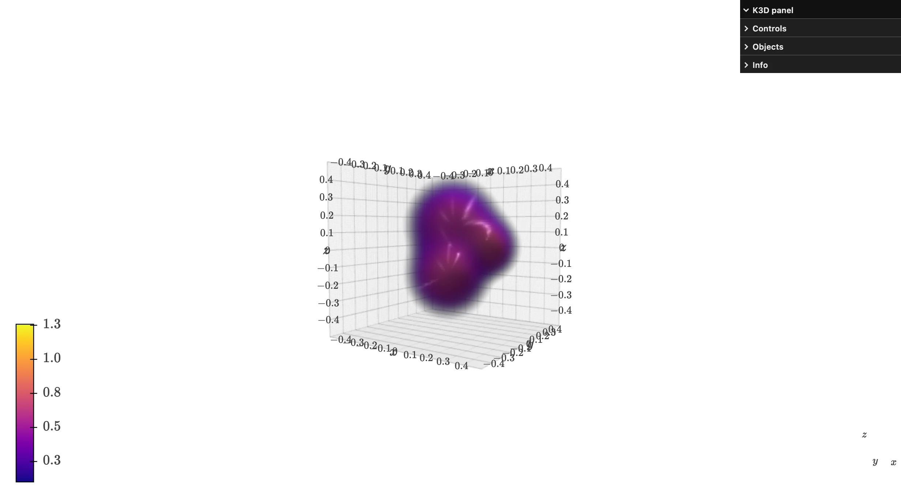

`alpha_coef` controls overall opacity (higher = more opaque, so thin wisps vanish before dense cores do); raise
`samples` (default 512) for a less noisy render at a frame-rate cost.

**Lines and vector fields.** `k3d.line` draws a polyline; `k3d.vectors` draws arrows from `origins` along `vectors`
-- here, a classic chaotic trajectory with local velocity vectors sampled along it:

```{.python file="examples/06_lines_vectors.py"}
from __future__ import annotations

import k3d
import numpy as np
from shiny.express import ui
from shinywidgets import render_k3d


def lorenz_step(xyz: np.ndarray, s: float = 10, r: float = 28, b: float = 8 / 3) -> np.ndarray:
    x, y, z = xyz
    return np.array([s * (y - x), x * (r - z) - y, x * y - b * z])


dt, n = 0.01, 4000
path = np.empty((n, 3), dtype=np.float32)
path[0] = [0.1, 0.0, 0.0]
for i in range(1, n):
    path[i] = path[i - 1] + lorenz_step(path[i - 1]) * dt

# Local velocity (the Lorenz system's own derivative) at a few points, scaled
# down for display -- vectors show direction/speed along the trajectory.
sample = path[::400]
velocity = np.array([lorenz_step(p) for p in sample], dtype=np.float32) * 0.12

ui.page_opts(title="Lorenz attractor", fillable=True)


@render_k3d
def attractor():
    scene = k3d.plot()
    scene += k3d.line(path, color=0x1F77B4, shader="thick", width=0.3)
    scene += k3d.vectors(sample, velocity, color=0xE45756, head_size=4.0, line_width=0.6)
    return scene
```

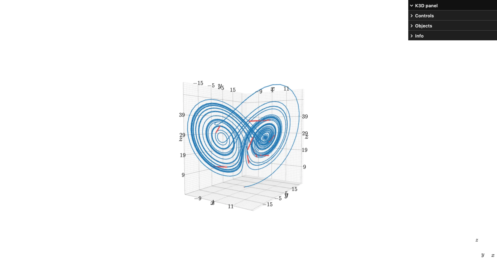

**Time-keyed animation.** Any synced trait accepts a `{time: value}` dict instead of a plain value; K3D
interpolates between keyframes as `plot.time` advances. `start_auto_play()`/`stop_auto_play()` drive `time`
automatically at `plot.fps` (default 25/s):

```{.python file="examples/07_animation.py"}
from __future__ import annotations

import k3d
import numpy as np
from shiny import reactive
from shiny.express import input, render, ui
from shinywidgets import render_k3d

N_STEPS = 60
t = np.linspace(0, 2 * np.pi, N_STEPS, endpoint=False)


def orbit(radius: float, speed: float) -> dict[float, np.ndarray]:
    xs, ys = radius * np.cos(speed * t), radius * np.sin(speed * t)
    pos = np.stack([xs, ys, np.zeros_like(xs)], axis=1).astype(np.float32)
    return {float(i) / N_STEPS: pos[i : i + 1] for i in range(N_STEPS)}


ui.page_opts(title="Orbits, driven by a time-keyed trait", fillable=True)
ui.input_action_button("play", "Play")
ui.input_action_button("pause", "Pause")


@render_k3d
def orbits():
    scene = k3d.plot(camera_auto_fit=False, grid_visible=False)
    scene.camera = [0, 0, 14, 0, 0, 0, 0, 1, 0]
    scene += k3d.points([[0, 0, 0]], point_size=0.8, color=0xFFC300, shader="3d")
    scene += k3d.points(orbit(3, 1), point_size=0.4, color=0x1F77B4, shader="3d")
    scene += k3d.points(orbit(5, 0.5), point_size=0.5, color=0xE45756, shader="3d")
    return scene


# start_auto_play()/stop_auto_play() now reach the browser even when called
# directly in the render function (the comm-not-open-yet case no longer drops
# the message) -- but a call made before the k3d view has connected in the
# browser is dropped silently by k3d's JS, and the render function is always
# that early. Calls from later effects work; buttons are the robust version
# of "later", so wire them to buttons.
@reactive.effect
@reactive.event(input.play)
def _play():
    orbits.widget.start_auto_play()


@reactive.effect
@reactive.event(input.pause)
def _pause():
    orbits.widget.stop_auto_play()


@render.text
def time():
    return f"plot.time = {orbits.read('time'):.2f}"
```

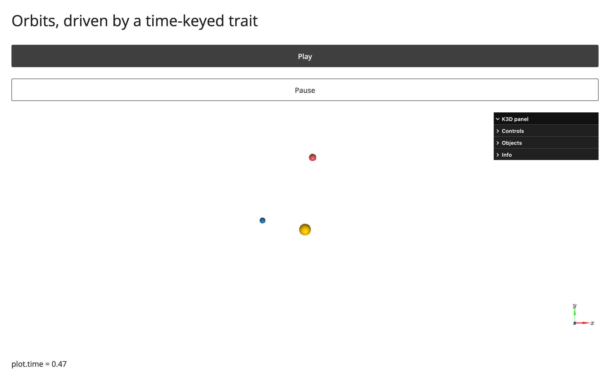

The comment above matters in practice: calling `scene.start_auto_play()` directly inside the render function (before
returning) used to send nothing at all, because the comm was still a placeholder at that point -- that's fixed.
Verified on current main: the message is now delivered to the browser even from the render function (confirmed with
a websocket capture), but k3d's JS registers its custom-message handler per view when the view connects, so a
message that arrives before then is dropped silently and playback never starts. The render function (and a bare
startup effect) is always that early. Once the view is up, any call works -- no user gesture needed; an effect
delayed a few seconds with `reactive.invalidate_later()` starts playback fine. Buttons are simply the most robust
form of "later". See Gotchas.

## Reacting to user interaction

### Accessor reference

| Accessor | Returns | Before any interaction | Across re-render | Default rate policy |
|---|---|---|---|---|
| `camera()` | `list[float]` of 9 (eye, target, up) | cancels until the browser's auto-fit reports | re-seeded from the new plot | none (K3D already throttles to ~200ms upstream) |

Call it from any reactive context (a `@render.*` function, `@reactive.calc`, or `@reactive.effect`); it invalidates
that context whenever the camera changes, the same way `input.x()` does. It can also be read by name --
`scene.read("camera")` -- which is equivalent but useful when reading accessors generically (e.g., logging every
accessor on an output).

### `camera()`

```{.python file="examples/08_camera_accessor.py"}
from __future__ import annotations

import k3d
import numpy as np
from shiny.express import render, ui
from shinywidgets import render_k3d

rng = np.random.default_rng(0)
xyz = (rng.normal(size=(4000, 3))).astype(np.float32)

ui.page_opts(title="camera() follows every orbit", fillable=True)

with ui.layout_columns(col_widths=[8, 4]):
    with ui.card(full_screen=True):
        ui.card_header("Drag to orbit, scroll to zoom")

        @render_k3d
        def scene():
            plot = k3d.plot()
            plot += k3d.points(xyz, point_size=0.08, color=0x4C78A8, shader="3d")
            return plot

    with ui.card():
        ui.card_header("scene.camera()")

        @render.code
        def camera_out():
            return "\n".join(f"{v:.2f}" for v in scene.camera())
```

Before orbiting, and after a drag:

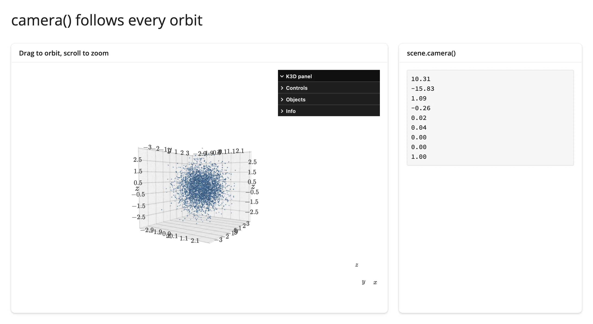


**Verified on current main:** `camera()` never returns `None`. Before the browser's auto-fit reports (which, with
the default `camera_auto_fit=True`, happens within the same render pass the user sees), reading it cancels the
calling context, the same way `req(False)` does; downstream outputs just wait, with no error. With
`camera_auto_fit=False` and no explicit `plot.camera` assigned, it cancels forever -- seed `plot.camera` yourself
(as every example above does once auto-fit isn't wanted). Reading the raw trait instead (`plot.read("camera")`,
or `reactive_read(plot.widget, "camera")`) shows the same thing as the sentinel: an empty list, `[]`, until
fitted.

**Across a re-render, `camera()` re-seeds from the new plot** rather than keeping the old orbit (verified: orbiting,
then re-rendering with wider data, reports the new plot's auto-fit framing, not the previous camera). It's inherent
widget state -- like a map's zoom or bounds -- not a one-off interaction to preserve across a scene that no longer
exists. If you want the *old* camera to carry over to a rebuilt scene, read it before the re-render and assign it
back explicitly (`new_plot.camera = old_camera`), as `examples/12_fly_to.py`'s "Home" button and
`examples/13_sync_cameras.py` both do.

### Beyond the accessors: picking, and `.read()`

**There is deliberately no `clicked()`.** K3D only reports clicks through `plot.mode = "callback"` plus a
`click_callback` on the clickable object -- a user-visible change to the plot's interaction mode (cursor behavior
changes for everyone), which this design's accessor model won't make on your behalf. Wire it yourself:

```{.python file="examples/09_picking_callback.py"}
# k3d has no clicked() accessor (picking needs mode="callback", a user-visible
# change to the plot's interaction mode) -- wire k3d's own click_callback to a
# reactive.value instead.
from __future__ import annotations

import k3d
import numpy as np
from shiny import reactive
from shiny.express import render, ui
from shinywidgets import render_k3d

rng = np.random.default_rng(0)
xyz = (rng.normal(size=(300, 3)) * 2).astype(np.float32)

clicked = reactive.value(None)

ui.page_opts(title="Click a point", fillable=True)

with ui.layout_columns(col_widths=[8, 4]):
    with ui.card(full_screen=True):
        ui.card_header("plot.mode = 'callback': click a point")

        @render_k3d
        def scene():
            plot = k3d.plot(mode="callback")
            plot += k3d.points(
                xyz,
                point_size=0.15,
                color=0x4C78A8,
                click_callback=lambda info: clicked.set(info),
            )
            plot += k3d.points(xyz[:1], point_size=0.3, color=0xE45756, visible=False)
            return plot

        @reactive.effect
        def _highlight():
            info = clicked()
            if info is None:
                return
            highlight = scene.widget.objects[1]
            highlight.positions = np.array([info["position"]], dtype=np.float32)
            highlight.visible = True

    with ui.card():
        ui.card_header("k3d's own click_callback, not an accessor")

        @render.code
        def out():
            info = clicked()
            if info is None:
                return "None (click a point)"
            position = [round(v, 2) for v in info["position"]]
            return f"index: {info['index']}\nposition: {position}"
```

Before and after clicking a point:

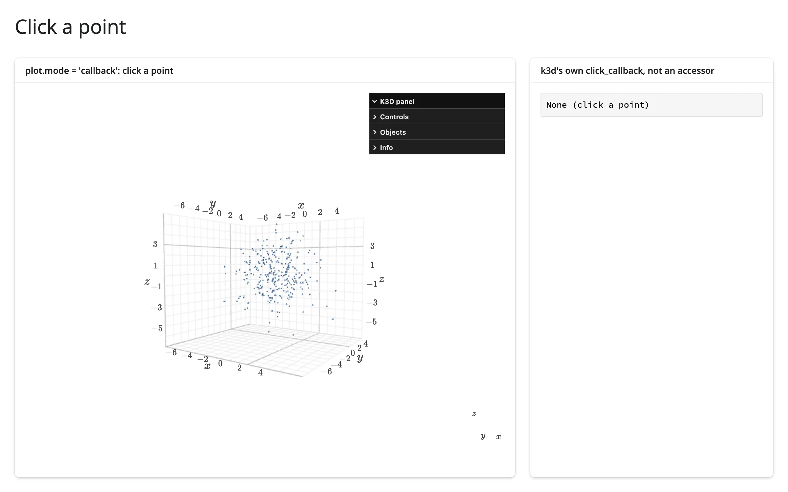
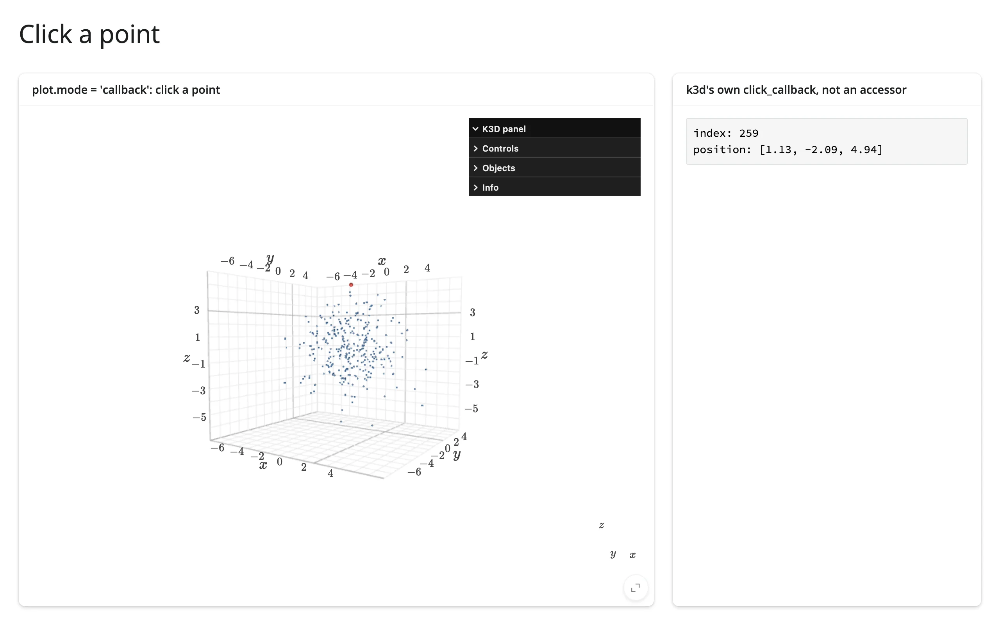

`click_callback` receives a dict: `points` give you `index`/`position`/`distance`/`K3DIdentifier`; `surface`/`mesh`
give you `position`/`normal`/`face_index`/`face`/`uv` instead (no `index` -- see the terrain showcase below for
reading a surface pick). `hover_callback` has the same payload shape and fires continuously while the cursor
moves, without a click. Picking needs a solid pixel: a click on a fully drawn `shader="3d"` ball lands reliably; a
`shader="flat"`/`"dot"` sprite's antialiased edge can miss (use bigger points, or `"3d"`, for click targets).

Beyond picking, a few traits are worth reading with `plot.read("trait")` directly rather than an accessor --
it's the same widget `camera()` reads from, just by name, with no post-processing:

- **`time`** -- during `start_auto_play()`, `plot.read("time")` updates continuously (K3D ticks it at
  `plot.fps`, default 25/s). See Rate limiting below for taming that.
- **`screenshot`** -- call `plot.widget.fetch_screenshot()`, then `plot.read("screenshot")` returns a base64
  PNG once the browser responds (verified: ~400KB for a simple scene, 2x `screenshot_scale` by default).
  There's no accessor for this because it's one-shot, not a stream.
- **Menu-panel edits** -- toggling `gridVisible`/`cameraAutoFit`/etc. in K3D's own on-canvas panel syncs back:
  `plot.read("grid_visible")` changes when a user toggles it there (verified on current main).

### Rate limiting

`camera()` has no default rate policy -- K3D already throttles camera updates to roughly once per 200ms upstream,
so there is nothing useful left for `rate_policy`/`rate_delay` to add to it. They matter for a plain
`.read("trait")` on a fast-changing trait instead, like `time` during autoplay:

```{.python file="examples/10_rate_limiting.py"}
# camera() has no default rate policy (k3d already throttles camera updates to
# ~200ms upstream), so `rate_policy`/`rate_delay` have nothing to add there.
# They do matter for a plain .read() on a fast-changing trait, like "time"
# during autoplay (k3d ticks it at its own `fps`, default 25/s).
from __future__ import annotations

import k3d
import numpy as np
from shiny import reactive
from shiny.express import input, render, ui
from shinywidgets import render_k3d


def make_scene() -> k3d.Plot:
    rng = np.random.default_rng(0)
    xyz = (rng.normal(size=(200, 3))).astype(np.float32)
    plot = k3d.plot(grid_visible=False, menu_visibility=False)
    plot += k3d.points(xyz, point_size=0.15, color=0x4C78A8)
    return plot


ui.page_opts(title="plot.read('time') during autoplay: live vs. throttled", fillable=True)
ui.input_action_button("play", "Play both")
live_n = reactive.value(0)
throttled_n = reactive.value(0)

with ui.layout_columns():
    with ui.card():
        "Default: every tick"

        @render_k3d
        def live():
            return make_scene()

        @reactive.effect
        @reactive.event(input.play)
        def _play_live():
            live.widget.start_auto_play()

        @reactive.effect
        def _count_live():
            live.read("time")
            with reactive.isolate():
                live_n.set(live_n() + 1)

        @render.text
        def n_live():
            return f"read() fired {live_n()} times"

    with ui.card():
        "rate_delay=0.5: throttled to 2/s"

        @render_k3d(rate_policy="throttle", rate_delay=0.5)
        def throttled():
            return make_scene()

        @reactive.effect
        @reactive.event(input.play)
        def _play_throttled():
            throttled.widget.start_auto_play()

        @reactive.effect
        def _count_throttled():
            throttled.read("time")
            with reactive.isolate():
                throttled_n.set(throttled_n() + 1)

        @render.text
        def n_throttled():
            return f"read() fired {throttled_n()} times"
```

The same 5 seconds of autoplay fires `.read("time")` about 200 times unthrottled vs. 11 times with
`rate_delay=0.5` (re-measured on current main; the exact counts vary run to run with system load, but the
~18x gap between unthrottled and throttled is the point):

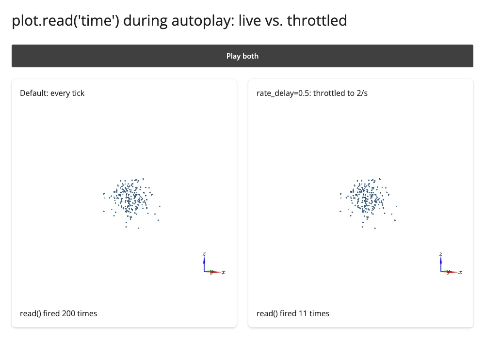

`rate_policy`/`rate_delay` on `@render_k3d` apply to *every* `.read()`/`reactive_read()` call on that widget (not
just one trait), since they're keyed by the widget instance, not the trait name -- keep a fast-changing trait like
`time` on its own widget if you need other traits read at full speed from the same scene.

## Updating the widget from Python

Re-rendering rebuilds the scene from scratch: the camera resets to its auto-fit default (or whatever you set in the
render function), and every object is recreated. Prefer it when the shape of the scene genuinely changes (a
different object count or type).

For everything else -- resizing points, recoloring, moving things -- read inputs under `reactive.isolate()` in the
render function and mutate `.widget.objects[i].<trait>` from a `@reactive.effect`. This preserves the camera and
never re-sends K3D's JS bundle:

```{.python file="examples/11_update_in_place.py"}
from __future__ import annotations

import k3d
import numpy as np
from shiny import reactive
from shiny.express import input, ui
from shinywidgets import render_k3d

rng = np.random.default_rng(0)
xyz = (rng.normal(size=(20_000, 3))).astype(np.float32)

ui.page_opts(title="Resize points without rebuilding the scene", fillable=True)
ui.input_slider("point_size", "Point size", min=0.02, max=0.3, value=0.08)


@render_k3d
def scene():
    # The render function never reads point_size, so this never re-runs:
    # orbit/zoom survive every slider move.
    plot = k3d.plot()
    plot += k3d.points(xyz, point_size=0.08, color=0x4C78A8, shader="3d")
    return plot


@reactive.effect
def _resize():
    scene.widget.objects[0].point_size = input.point_size()
```

Orbited, then the slider moved from 0.08 to 0.25 -- the camera is untouched:

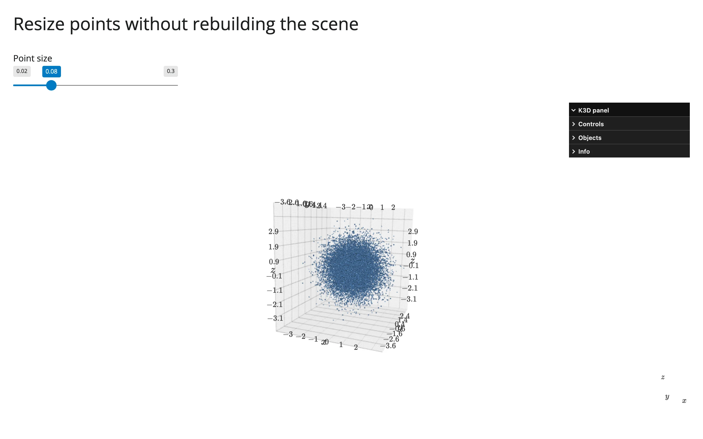
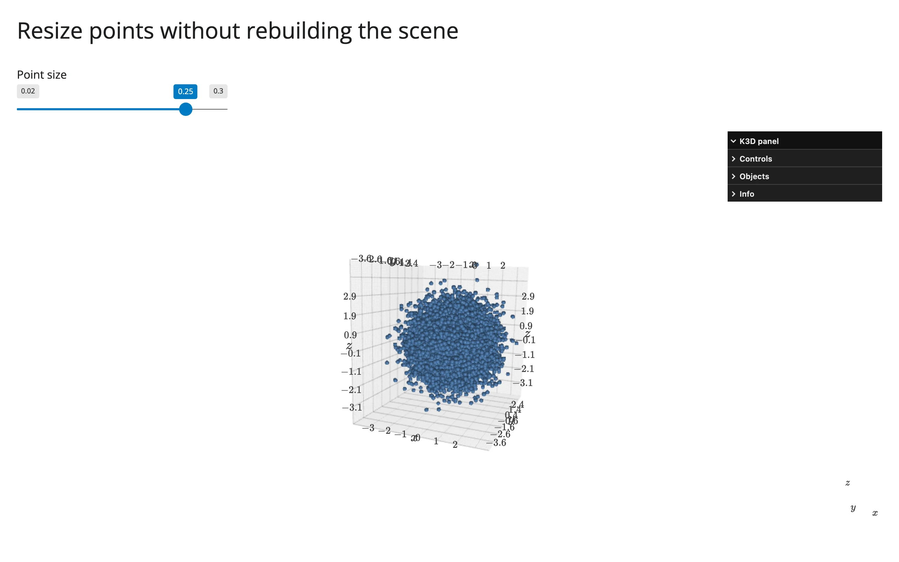

The camera is itself just a trait, so the same pattern flies the view to a new target without resetting anything
else -- set `plot.widget.camera = [eye_xyz, target_xyz, up_xyz]` (9 floats) from an effect:

```{.python file="examples/12_fly_to.py"}
# Needs scikit-learn for the iris dataset:
#   uv run --with scikit-learn shiny run docs/widget-guides/k3d/examples/12_fly_to.py
from __future__ import annotations

import k3d
import numpy as np
from shiny import reactive
from shiny.express import input, ui
from sklearn.datasets import load_iris
from shinywidgets import render_k3d

iris = load_iris(as_frame=True).frame
xyz = iris[["sepal length (cm)", "sepal width (cm)", "petal length (cm)"]].to_numpy(np.float32)
species_color = np.choose(iris["target"].to_numpy(), [0xE41A1C, 0x377EB8, 0x4DAF4A]).astype(np.uint32)
species_names = ["setosa", "versicolor", "virginica"]
centroids = {name: xyz[iris["target"] == i].mean(axis=0) for i, name in enumerate(species_names)}
HOME = [10, -6, 6, 5.8, 3.0, 3.8, 0, 0, 1]

ui.page_opts(title="Fly to a species", fillable=True)
with ui.layout_columns():
    ui.input_action_button("home", "Home")
    for name in species_names:
        ui.input_action_button(name, name.title())


with ui.card(full_screen=True):

    @render_k3d
    def scene():
        plot = k3d.plot(camera_auto_fit=False)
        plot.camera = HOME
        plot += k3d.points(xyz, colors=species_color, point_size=0.15, shader="3d")
        return plot


@reactive.effect
@reactive.event(input.home)
def _fly_home():
    scene.widget.camera = HOME


def make_fly_to(name: str):
    @reactive.effect
    @reactive.event(getattr(input, name))
    def _fly():
        cx, cy, cz = (float(v) for v in centroids[name])
        scene.widget.camera = [cx + 2, cy - 2, cz + 2, cx, cy, cz, 0, 0, 1]

    return _fly


_fly_effects = [make_fly_to(name) for name in species_names]
```

Home, then "Setosa" pressed -- the camera flies to that cluster's centroid (an instant cut here; see Gotchas for
smooth easing):

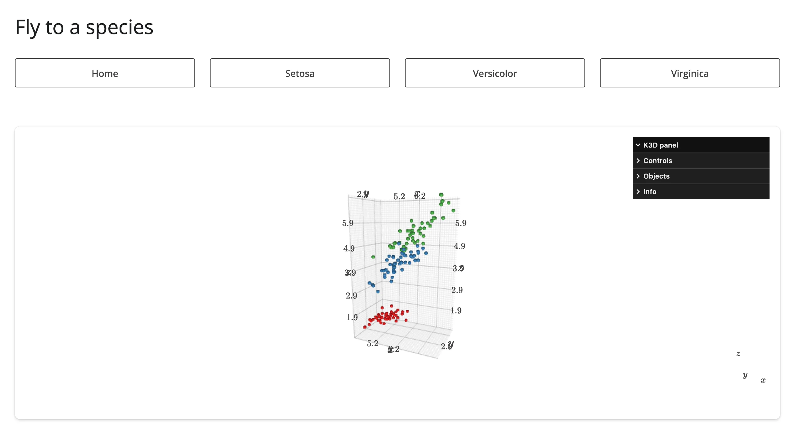
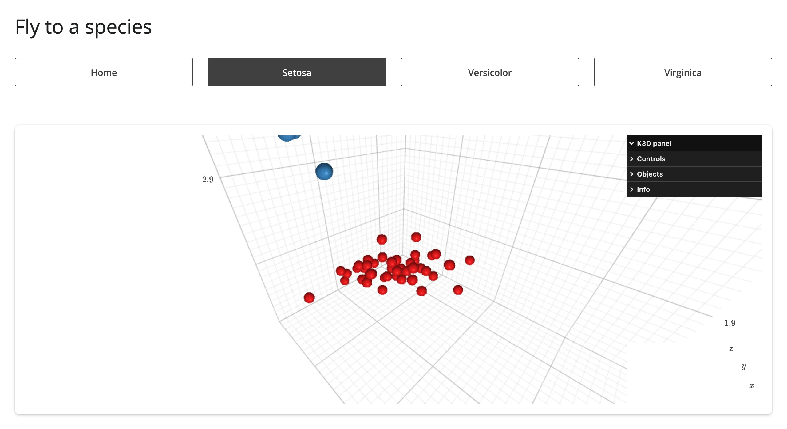

## Coordinating multiple views

### `camera()` drives a second view's camera

Two plots, one viewpoint: orbiting either side moves both, because the left plot's `camera()` is copied straight
into the right plot's `camera` trait.

```{.python file="examples/13_sync_cameras.py"}
# camera() isn't just for display -- it can drive a second view directly, so
# two k3d plots stay in lockstep as you orbit either one. Try panning the
# left plot and watch the right one (lit from the opposite side) follow.
from __future__ import annotations

import k3d
import numpy as np
from shiny import reactive
from shiny.express import ui
from shinywidgets import render_k3d

rng = np.random.default_rng(0)
xyz = (rng.normal(size=(4000, 3))).astype(np.float32)
dist = np.linalg.norm(xyz, axis=1)
# Give both plots the same starting camera explicitly, rather than relying on
# auto-fit: camera() seeds its first value very early (before either plot's
# comm has opened), so the very first copy from left to right can be dropped
# (see Gotchas). Starting both plots alike means that dropped first copy is
# never visible -- every copy after a real orbit lands normally.
START = [10, -8, 6, 0, 0, 0, 0, 0, 1]

ui.page_opts(title="Two views, one camera", fillable=True)

with ui.layout_columns():
    with ui.card(full_screen=True):
        ui.card_header("Drag to orbit")

        @render_k3d
        def left():
            plot = k3d.plot(camera_auto_fit=False)
            plot.camera = START
            plot += k3d.points(xyz, point_size=0.08, attribute=dist, color_map=k3d.matplotlib_color_maps.Viridis)
            return plot

    with ui.card(full_screen=True):
        ui.card_header("Follows the left plot's camera")

        @render_k3d
        def right():
            plot = k3d.plot(camera_auto_fit=False)
            plot.camera = START
            plot += k3d.points(xyz, point_size=0.08, attribute=dist, color_map=k3d.matplotlib_color_maps.Plasma)
            return plot


@reactive.effect
def _sync():
    camera = left.camera()
    with reactive.isolate():
        right.widget.camera = camera
```

Before and after orbiting the left plot:

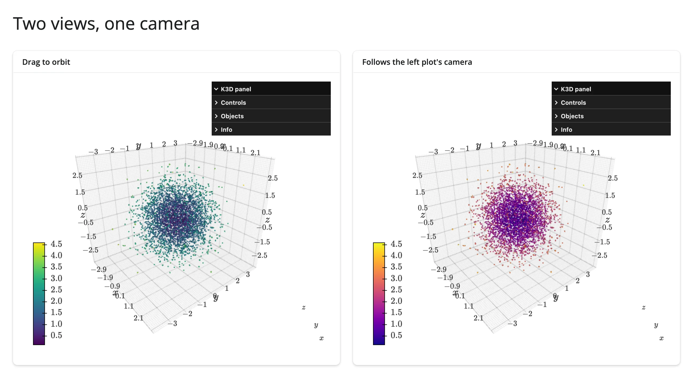
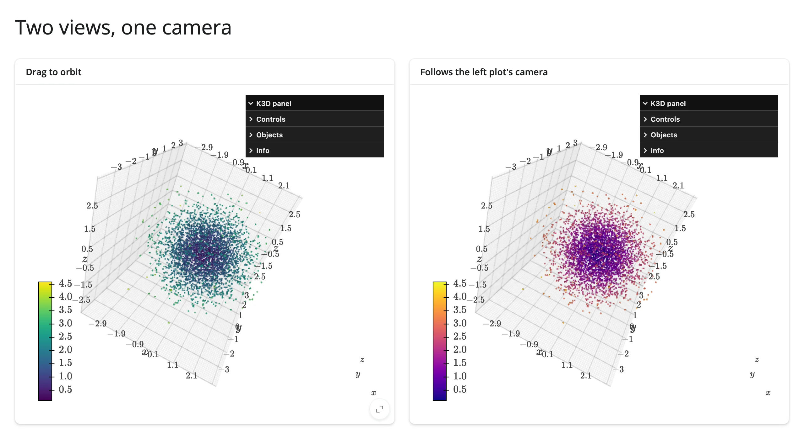

### Click a point, select its row in a table

Pairs with: itables, reactable (either renders the same `pd.DataFrame` directly). Picking a point calls K3D's own
`click_callback`, which sets the row selection on a core Shiny `render.data_frame`:

```{.python file="examples/14_click_to_table.py"}
# Pairs with: itables, reactable (swap render.data_frame for either).
from __future__ import annotations

import k3d
import numpy as np
import pandas as pd
from shiny import reactive
from shiny.express import render, ui
from shinywidgets import render_k3d

rng = np.random.default_rng(1)
xyz = (rng.normal(size=(20, 3))).astype(np.float32)
df = pd.DataFrame(xyz.astype(np.float64), columns=["x", "y", "z"]).round(2)

clicked_index = reactive.value(None)

ui.page_opts(title="Click a point, select its row", fillable=True)

with ui.layout_columns(col_widths=[7, 5]):
    with ui.card(full_screen=True):
        ui.card_header("plot.mode = 'callback'")

        @render_k3d
        def scene():
            plot = k3d.plot(mode="callback")
            plot += k3d.points(
                xyz,
                point_size=0.12,
                color=0x4C78A8,
                click_callback=lambda info: clicked_index.set(info["index"]),
            )
            return plot

    with ui.card(full_screen=True):
        ui.card_header("Matching row, selected")

        @render.data_frame
        def table():
            return render.DataGrid(df, selection_mode="row")


# A DataGrid's row selection is driven from the server with
# update_cell_selection() (async, so this effect must be too).
@reactive.effect
async def _select():
    idx = clicked_index()
    if idx is not None:
        await table.update_cell_selection({"type": "row", "rows": (idx,)})
```

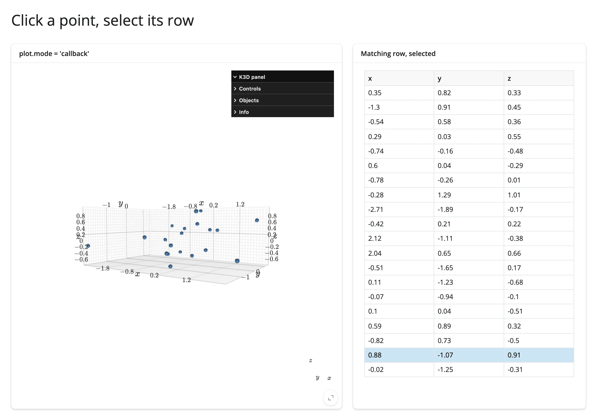

### A table drives the camera

The reverse pairing: selecting a row in a plain `render.DataGrid` flies the camera to that landmark and highlights
it -- this direction needs no workaround, because the browser's own row-click is what starts the reactive flow
(the effect below runs no differently than any other input-driven effect in this guide).

```{.python file="examples/15_table_to_fly_to.py"}
# Pairs with: itables, reactable (swap render.data_frame for either).
from __future__ import annotations

import k3d
import numpy as np
import pandas as pd
from shiny import reactive
from shiny.express import render, ui
from shinywidgets import render_k3d

landmarks = pd.DataFrame(
    {
        "name": ["Alpha", "Bravo", "Charlie", "Delta", "Echo"],
        "x": [3.0, -4.0, 1.0, -2.0, 4.0],
        "y": [2.0, 3.0, -4.0, -3.0, -1.0],
        "z": [1.0, -1.0, 2.0, -2.0, 3.0],
    }
)
xyz = landmarks[["x", "y", "z"]].to_numpy(np.float32)
HOME = [12, -10, 8, 0, 0, 0, 0, 0, 1]

ui.page_opts(title="Select a row, fly the camera there", fillable=True)

with ui.layout_columns(col_widths=[5, 7]):
    with ui.card():
        ui.card_header("Pick a landmark")

        @render.data_frame
        def table():
            return render.DataGrid(landmarks, selection_mode="row")

    with ui.card(full_screen=True):
        ui.card_header("Flies there, and highlights it")

        @render_k3d
        def scene():
            plot = k3d.plot(camera_auto_fit=False)
            plot.camera = HOME
            plot += k3d.points(xyz, point_size=0.3, color=0x4C78A8, shader="3d")
            plot += k3d.points(xyz[:1], point_size=0.45, color=0xE45756, visible=False)
            return plot


@reactive.effect
def _fly_to_selection():
    sel = table.cell_selection()["rows"]
    if not sel:
        return
    idx = sel[0]
    x, y, z = (float(v) for v in xyz[idx])
    scene.widget.camera = [x + 3, y - 3, z + 2, x, y, z, 0, 0, 1]
    highlight = scene.widget.objects[1]
    highlight.positions = xyz[idx : idx + 1]
    highlight.visible = True
```

"Charlie" selected -- the camera flew to it and the point lit up red:

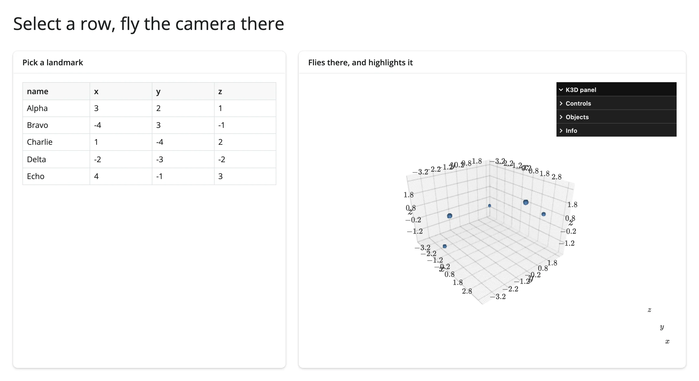
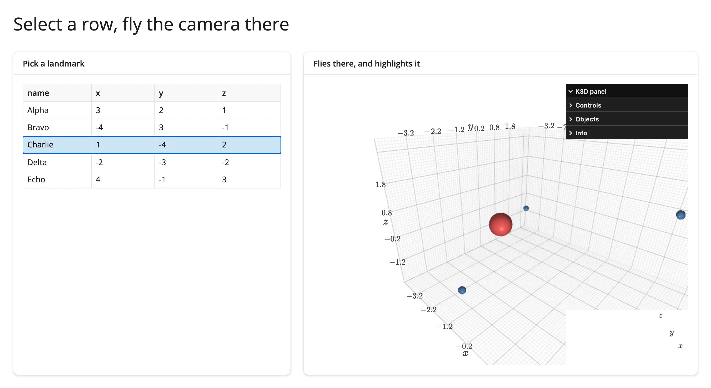

## Large data

K3D draws with the GPU (WebGL via three.js), so it's the "draw it with the GPU in the browser" entry in
[Large data & performance's three approaches](../../guide/performance/index.md#three-approaches-to-large-data).
`shader="flat"` billboard sprites (see [`examples/02_point_cloud_scale.py`](examples/02_point_cloud_scale.py) in
"What you can build" above) are the fast path at scale: a million points stayed orbitable at interactive frame
rates, verified on current `main` even under SwiftShader software rendering with no real GPU. K3D doesn't
decimate, chunk, or level-of-detail a cloud for you past that -- for tens of millions of points you'd thin the
data in Python before handing it to `k3d.points()`.

## Layout and sizing

A plot fills its output by default. `k3d.plot(height=N)` (any `N` other than K3D's own default of 512) opts out of
filling and renders at that fixed pixel height instead; so does an `ipywidgets.Layout(height="...")` assigned to
`plot.layout` -- both are honored without clipping or overflow (verified on current main; this was previously
broken -- see Gotchas for what changed).

```{.python file="examples/16_layout_sizing.py"}
from __future__ import annotations

import k3d
import numpy as np
from ipywidgets import Layout
from shiny.express import ui
from shinywidgets import render_k3d

rng = np.random.default_rng(0)
xyz = (rng.random((200, 3), dtype=np.float32))


def make_plot(**kwargs) -> k3d.Plot:
    plot = k3d.plot(**kwargs)
    plot += k3d.points(xyz, point_size=0.05, color=0x4C78A8)
    return plot


ui.page_opts(title="Sizing", fillable=True)

with ui.layout_columns():
    with ui.card(full_screen=True):
        "Fills its card (no explicit height) -- try full_screen"

        @render_k3d
        def fills():
            return make_plot()

    with ui.card():
        "Fixed height via k3d.plot(height=250)"

        @render_k3d
        def fixed_height():
            return make_plot(height=250)

    with ui.card():
        "Fixed height via ipywidgets Layout(height='250px')"

        @render_k3d
        def layout_height():
            plot = make_plot()
            plot.layout = Layout(height="250px")
            return plot
```

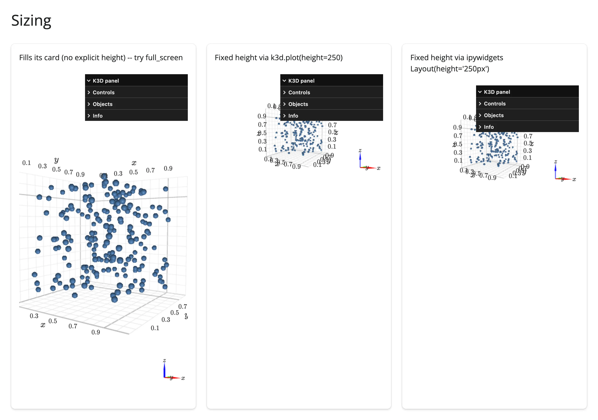

Measured: the fill card's canvas tracks its card exactly; both fixed-height variants render at exactly 250px, with
no clipped or overflowing content either way.

## Gotchas and limitations

Verified on current `main` (shinywidgets commit `32ca7035`, k3d 3.2.0, shiny 1.9.0):

- **`start_auto_play()` called before the k3d view connects is dropped silently.** A `.send()`-backed call (e.g.
  `scene.start_auto_play()`) made inside the render function is now delivered to the browser instead of being
  dropped by shinywidgets -- confirmed with a websocket capture. But k3d's own JS registers its custom-message
  handler per view, at view-connect time, so a message that arrives earlier (the render function, or a bare startup
  effect on a slow page) is lost for good: playback never starts, with no error anywhere. Once the view is
  connected, server-initiated calls work with no user gesture needed (verified: an effect delayed ~5 s via
  `reactive.invalidate_later()` starts playback). Even so, wire `start_auto_play()`/`stop_auto_play()` to buttons,
  as `examples/07_animation.py` does -- a click always lands after the view is up, however slow the page.
- **`k3d.text`'s default LaTeX rendering drops spaces.** `k3d.text("Highest point (1068 m)")` renders as
  "Highestpoint(1068m)" -- text is KaTeX by default, which strips plain spaces. Pass `is_html=True` (as the terrain
  example does) or escape spaces as `\ `.
- **There is no `clicked()` accessor, by design.** Picking requires `plot.mode = "callback"`, a visible change to
  the plot's interaction mode, which this design's accessor model won't make silently. See "Beyond the accessors."
- **`marching_cubes` ignores your field's coordinate range.** The isosurface always comes out in a unit cube
  centered on the origin, regardless of the `linspace` range used to build the field -- rescale with
  `spacings_x`/`_y`/`_z` or a `model_matrix` if you need it in your own coordinate system.
- **`fetch_screenshot()` 404s on KaTeX font files.** The screenshot path re-requests relative
  `fonts/KaTeX_*.woff`/`.ttf` URLs that resolve against the Shiny app's origin instead of k3d's bundled fonts. Live
  rendering is unaffected (the fonts are already loaded as inline data URLs); this only shows up as harmless 404s
  in the browser console during a screenshot capture. Upstream k3d behavior, not a shinywidgets bug.
- **`camera_auto_fit`'s margin is generous.** The default camera frames data with real whitespace around it
  (`camera_reset()`'s default `factor=1.5`); for a tighter, more deliberate composition (e.g. a hero screenshot or
  gallery app), set `camera_auto_fit=False` and an explicit `plot.camera` instead of relying on auto-fit.
- **Camera moves set this way are instant cuts, not smooth flights.** `plot.widget.camera = [...]` jumps directly
  to the new view. K3D has no built-in camera tween; if you want eased motion, interpolate the 9 numbers yourself
  across a few `reactive.invalidate_later()` ticks, or accept the cut (it still reads clearly as "flying to X" in
  context, per the fly-to example above).

What we deliberately didn't chase further: the old report's re-render comm/model leak (finding 3.1, k3d's
`Plot.close()` not calling `super().close()`) is fixed on current main with a shim (`close_comm_on_close()` in
`_shinywidgets.py`) -- confirmed by reading the code, not independently re-measured with the old report's exact
8-re-render repro. The old report's `Layout(height=)` clipping claim (finding 3.2) is also fixed, and *is*
re-verified here (see Layout and sizing above, `examples/16_layout_sizing.py`).

## Gallery candidates

### [`template_point_cloud_explorer.py`](gallery/template_point_cloud_explorer.py)

A small, adaptable starting point (bucket: template): orbit, resize points live, click a point for details, and
read the camera -- swap in your own `(n, 3)` array and labels. Uses the iris dataset in 3D, colored by species.

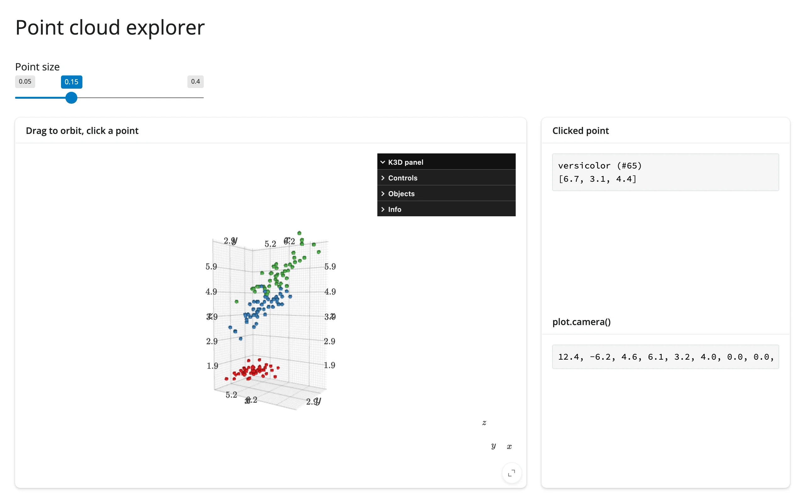

### [`showcase_terrain_explorer.py`](gallery/showcase_terrain_explorer.py)

A fuller demo (bucket: showcase): the same real Jacksboro Fault DEM from above, now with `plot.mode = "callback"`
picking (click anywhere to read elevation in meters, resolved from the nearest grid cell via the surface pick's
`position`), "fly to highest/lowest point" buttons, a live camera readout, and a wireframe toggle that restyles the
surface in place.

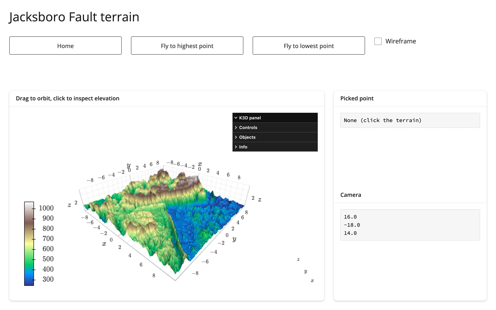

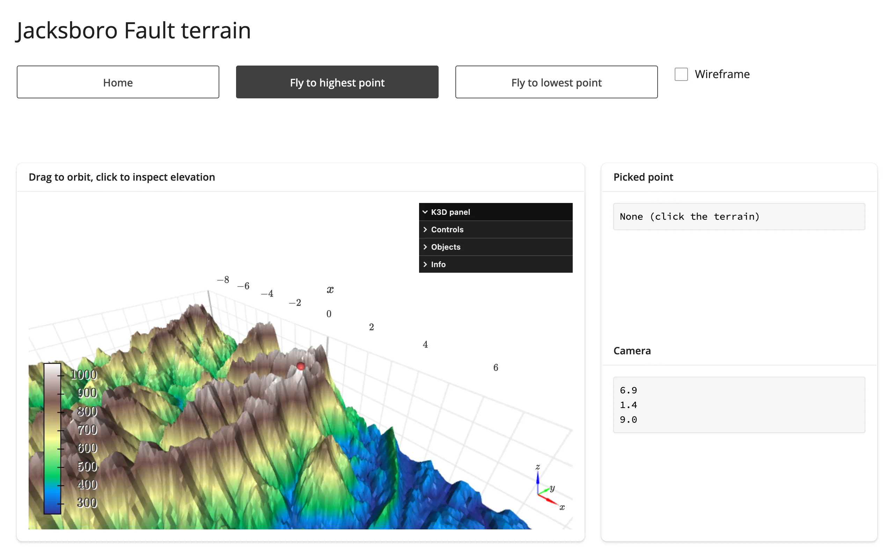
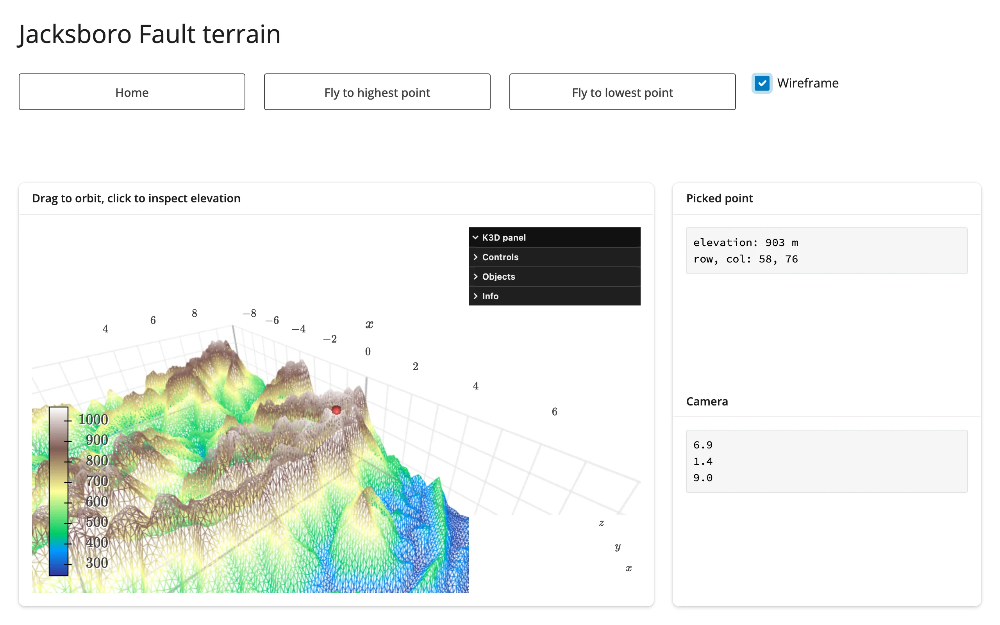

## Learn more

- [K3D Jupyter documentation](https://k3d-jupyter.org) and its
  [example gallery](https://github.com/K3D-tools/K3D-jupyter/tree/main/examples) (Jupyter notebooks; the API is
  identical in Shiny)
- [K3D factory function reference](https://k3d-jupyter.org/reference/index.html) (`k3d.points`, `k3d.surface`,
  `k3d.volume`, `k3d.marching_cubes`, `k3d.vectors`, `k3d.text`, and more)
- Related guides in this roster: [plotly](../plotly/index.md) (`scatter_3d`, lighter-weight 3D),
  [pythreejs](../pythreejs/index.md) (lower-level three.js scene graph), [lonboard](../lonboard/index.md) and
  [niivue](../niivue/index.md) (domain-specific 3D: geospatial, medical imaging), [itables](../itables/index.md) /
  [reactable](../reactable/index.md) (used above for the linked table patterns)
