[kepler.gl](https://kepler.gl) is the open-source geospatial analysis tool originally built at Uber
and now maintained by the [Urban Computing Foundation](https://www.urbancomputing.foundation/) (with
Foursquare as the lead maintainer). It is not a charting library you configure in code -- it's a
complete map-authoring application: drop in data and it auto-creates layers, then a side panel lets
anyone add more layers, switch a layer to 3D hexbins or arcs, build filters, scrub a time window and
play it back, and restyle the basemap, all without writing a line of code. It's the same tool behind
Uber's public movement and safety data visualizations.

`@render_keplergl` accepts a `pandas.DataFrame`, a `geopandas.GeoDataFrame`, or a `keplergl.KeplerGl`
widget (for multiple datasets or a starting `config`). A plain DataFrame becomes a single dataset named
`"data"` and is sent as compact, NaN-safe Arrow rather than kepler's default JSON. In a filling layout
the map resizes to its container the same way every other shinywidgets output does; see
[Layout and sizing](#layout-and-sizing) for the one kepler-specific wrinkle (the browser, not Python,
owns the widget's `height` trait once the output is sizing the map). kepler.gl has no per-gesture
accessors in this release -- its one synced-back trait is the whole map `config`, so the way to react to
it is `.read("config")`, with the `rate_policy`/`rate_delay` kwargs to tame how often that fires during
a drag or time-filter playback (see [Reacting to user interaction](#reacting-to-user-interaction)).

Choose kepler.gl when the map itself should be an end-user tool: let an analyst add layers, pick
colors, build a time filter, and hand you back a `config` you can store and reload. For GPU-scale
point/polygon rendering driven entirely from Python, prefer [lonboard](../lonboard/index.md). For a
styled vector-tile basemap with code-driven restyling and deck.gl layers, prefer
[maplibre](../maplibre/index.md). For per-feature click/hover callbacks and a simpler API, prefer
[ipyleaflet](../ipyleaflet/index.md) or [leafmap](../leafmap/index.md).

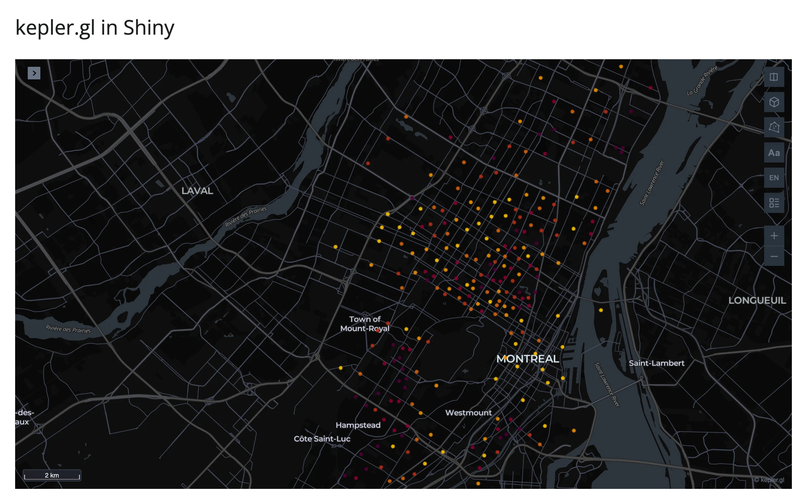

## Installation

```sh
pip install 'shinywidgets[keplergl]'
```

This installs `keplergl>=0.4.0` (0.4 is an [anywidget](https://anywidget.dev) rewrite; 0.3.x imports
`pkg_resources`, which setuptools >= 82 no longer ships, so `@render_keplergl` raises a clear
install-hint error rather than a confusing one on an older version). It also pulls in `geopandas`,
`pyarrow`, `shapely`, and `pyproj`, because kepler.gl's own serializer imports geopandas and pyarrow
even for plain-DataFrame input.

## Quick start

Return a DataFrame with recognizable latitude/longitude column names (`lat`/`latitude`,
`lon`/`lng`/`longitude`) and kepler.gl auto-creates a colored point layer:

```{.python file="examples/01_quickstart.py"}
import plotly.express as px
from shiny.express import ui
from shinywidgets import render_keplergl

# Montreal car-share station activity: average hours in use per car, and
# the most common peak hour, at 249 stations
carshare = px.data.carshare().rename(
    columns={"centroid_lat": "lat", "centroid_lon": "lon"}
)

ui.page_opts(title="kepler.gl in Shiny", fillable=True)


@render_keplergl
def map():
    return carshare
```


Open the side panel (the `>` arrow, top left) and every layer, filter, and basemap control is right
there -- no extra code.

## What you can build

### 3D hexbins, authored entirely from Python

Pass a `KeplerGl` widget with a `config` instead of a bare DataFrame to skip the side-panel authoring
step and open directly on a styled, aggregated view. A hexagon layer with `enable3d` turns point
density into a 3D bar chart on the map:

```{.python file="examples/02_hexbin.py"}
import plotly.express as px
from keplergl import KeplerGl
from shiny.express import ui
from shinywidgets import render_keplergl

carshare = px.data.carshare().rename(
    columns={"centroid_lat": "lat", "centroid_lon": "lon"}
)

# A hand-written kepler.gl config: one 3D hexbin layer, colored and sized by
# average car-share hours per hexagon. Writing config upfront, rather than
# setting `.widget.config` after render, avoids a duplicate auto-created
# layer (see Gotchas & limitations).
CONFIG = {
    "version": "v1",
    "config": {
        "visState": {
            "layers": [
                {
                    "id": "carshare-hex",
                    "type": "hexagon",
                    "config": {
                        "dataId": "data",
                        "label": "Car-share activity",
                        "columns": {"lat": "lat", "lng": "lon"},
                        "isVisible": True,
                        "visConfig": {
                            "worldUnitSize": 0.5,
                            "resolution": 8,
                            "colorRange": {
                                "name": "Global Warming",
                                "type": "sequential",
                                "category": "Uber",
                                "colors": [
                                    "#4C0035",
                                    "#880030",
                                    "#B72F15",
                                    "#D6610A",
                                    "#EF9100",
                                    "#FFC300",
                                ],
                            },
                            "coverage": 0.9,
                            "elevationScale": 15,
                            "enable3d": True,
                        },
                    },
                    "visualChannels": {
                        "colorField": {"name": "car_hours", "type": "real"},
                        "colorScale": "quantile",
                        "sizeField": {"name": "car_hours", "type": "real"},
                        "sizeScale": "linear",
                    },
                }
            ],
        },
        "mapState": {
            "latitude": 45.53,
            "longitude": -73.626,
            "zoom": 11.2,
            "pitch": 50,
            "bearing": -15,
        },
    },
}

ui.page_opts(title="3D hexbin via config", fillable=True)


@render_keplergl
def map():
    return KeplerGl(data={"data": carshare}, config=CONFIG)
```

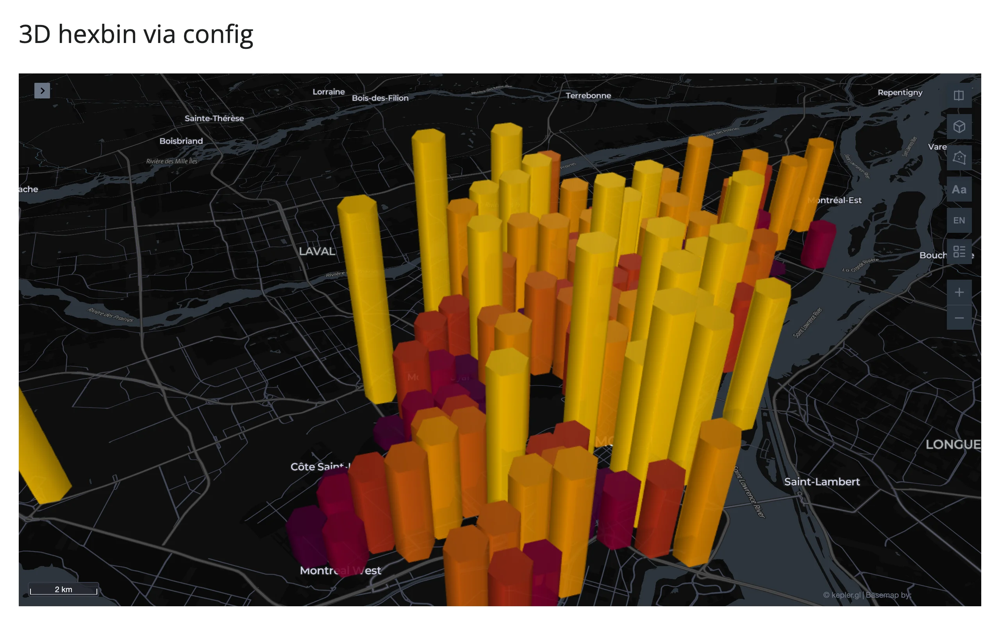

kepler.gl's config schema is large but mostly optional -- every key you omit falls back to a
sensible default. The easiest way to get a starting config is to build one in the UI once and read
it back with `.read("config")` (see [Coordinating multiple views](#coordinating-multiple-views)).

### GeoDataFrame input

A `GeoDataFrame` works exactly like a plain DataFrame, as long as it's in **EPSG:4326**
(longitude/latitude degrees) -- kepler.gl does not reproject, so a GeoDataFrame in any other CRS
renders silently in the wrong place.

```{.python file="examples/03_geodataframe.py"}
import geopandas as gpd
import plotly.express as px
from shiny.express import ui
from shinywidgets import render_keplergl

carshare = px.data.carshare().rename(
    columns={"centroid_lat": "lat", "centroid_lon": "lon"}
)

# A GeoDataFrame works the same way as a plain DataFrame, as long as it's in
# EPSG:4326 (longitude/latitude degrees). kepler.gl doesn't reproject: a
# GeoDataFrame in any other CRS renders in the wrong place with no error.
stations = gpd.GeoDataFrame(
    carshare,
    geometry=gpd.points_from_xy(carshare.lon, carshare.lat),
    crs="EPSG:4326",
)

ui.page_opts(title="GeoDataFrame input", fillable=True)


@render_keplergl
def map():
    return stations
```

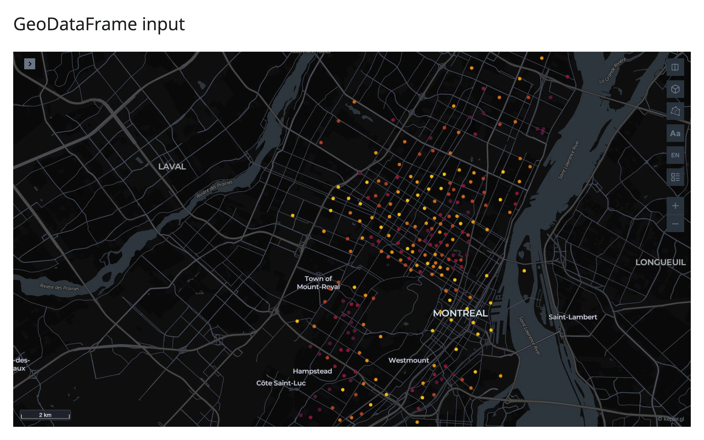

### Time filter and playback

Add a `timeRange` filter to the config and kepler.gl draws a histogram + draggable window + play
button at the bottom of the map. This is the single most distinctive kepler.gl feature: the window
(and its playback) lives entirely in the widget's `config`, so Python can read exactly what's visible
at any moment (see [Coordinating multiple views](#coordinating-multiple-views)).

```{.python file="examples/04_time_playback.py"}
import pandas as pd
from keplergl import KeplerGl
from shiny.express import ui
from shinywidgets import render_keplergl

# A full year (2015) of daily positions for ten tracked bird species migrating
# between South America and the Arctic (vega-datasets' "bird-migration", also
# one of kepler.gl's own demo datasets). kepler.gl needs a real timestamp dtype
# (not a date string) to offer a time filter.
birds = pd.read_csv("https://cdn.jsdelivr.net/gh/vega/vega-datasets@5448e25297c8f705be78e879d5423d55d04dc6f1/data/bird-migration.csv")
birds["date"] = pd.to_datetime(birds["date"])

# A timeRange filter adds the histogram + play button at the bottom of the
# map. The initial window (in epoch milliseconds) spotlights one week in
# April, mid-way through the northward spring migration.
CONFIG = {
    "version": "v1",
    "config": {
        "visState": {
            "filters": [
                {
                    "dataId": ["data"],
                    "id": "migration-date-window",
                    "name": ["date"],
                    "type": "timeRange",
                    "value": [1_427_846_400_000, 1_428_451_200_000],
                    "plotType": {"type": "histogram", "interval": "1-day"},
                    "animationWindow": "free",
                    "view": "enlarged",
                    "speed": 1,
                    "enabled": True,
                }
            ],
        },
        "mapState": {
            "latitude": 25.0,
            "longitude": -85.0,
            "zoom": 3.5,
        },
    },
}

ui.page_opts(title="Time filter and playback", fillable=True)


@render_keplergl
def map():
    return KeplerGl(data={"data": birds}, config=CONFIG)
```

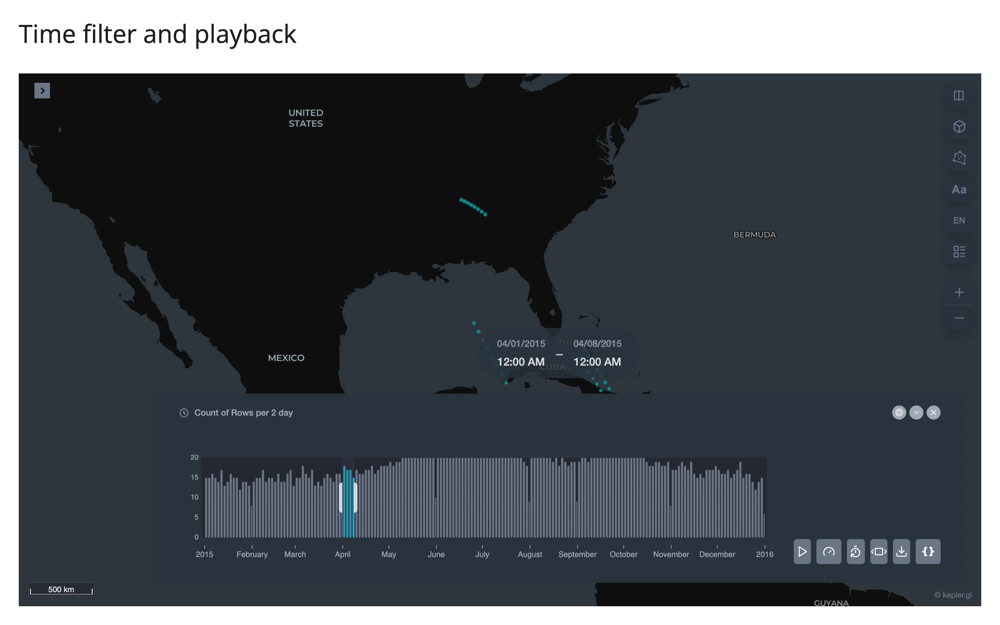

Timestamps need to be a real datetime dtype (not a date string): kepler.gl's field-type detection
only recognizes a `timeRange`-filterable column from an Arrow timestamp column, which `use_arrow=True`
sends for any `datetime64` column. A plain string column shows up as `string`, with no time filter
available.

## Reacting to user interaction

`@render_keplergl` declares no accessors: kepler.gl's one synced-back trait is the entire map
`config`, which the design deliberately leaves to `.read()` rather than wrapping in a
named accessor. Two reasons: there is no single "headline" interaction (config mixes layer edits,
filter drags, and camera moves in one blob), and during time-filter playback or a hexbin drag it can
rewrite dozens of times a second -- exactly the kind of noisy, undifferentiated stream that doesn't
suit a dedicated accessor but does suit a rate-limited `.read()`.

### Beyond the accessors: `.read()`

`config` is the trait worth reading. `height` also changes (the browser writes the measured size into
it; see [Layout and sizing](#layout-and-sizing)), but `data`, `mapbox_token`, `theme`, and `app_name`
are Python-to-browser only -- kepler.gl's bundled JS never writes them back.

`config` is `{}` until the map has loaded, so guard for that. Once populated, the useful parts are:

| Path | What it holds |
|---|---|
| `config["mapState"]` | `latitude`, `longitude`, `zoom`, `pitch`, `bearing` -- updates on every pan, zoom, tilt, or rotate |
| `config["visState"]["layers"]` | Every layer's type, columns, color/size encodings, and `isVisible` -- updates when the user adds, edits, or toggles a layer in the side panel |
| `config["visState"]["filters"]` | Each filter's current `value` (a `[start, end]` pair in epoch ms for a `timeRange` filter) -- updates on every drag and on every animation frame during playback |

```{.python file="examples/06_reading_config.py"}
import plotly.express as px
from shiny.express import render, ui
from shinywidgets import render_keplergl

carshare = px.data.carshare().rename(
    columns={"centroid_lat": "lat", "centroid_lon": "lon"}
)

ui.page_opts(title="Reading kepler.gl's config", fillable=True)

with ui.layout_columns(col_widths=[8, 4]):
    with ui.card(full_screen=True):

        @render_keplergl
        def map():
            return carshare

    with ui.card():
        ui.card_header("Map view (from config.mapState)")

        @render.code
        def view_state():
            config = map.read("config")
            state = config.get("config", {}).get("mapState", {})
            if not state:
                return "Waiting for the map to load..."
            return (
                f"lat:     {state['latitude']:.3f}\n"
                f"lon:     {state['longitude']:.3f}\n"
                f"zoom:    {state['zoom']:.2f}\n"
                f"pitch:   {state['pitch']:.0f}\n"
                f"bearing: {state['bearing']:.0f}"
            )
```

Before / after a drag on the map (verified: `lat`/`lon` update live, `zoom`/`pitch`/`bearing`
unchanged by a pan):

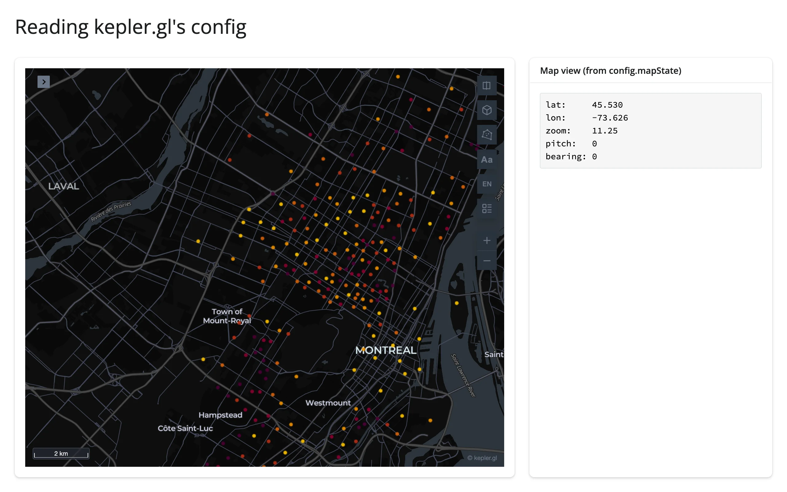
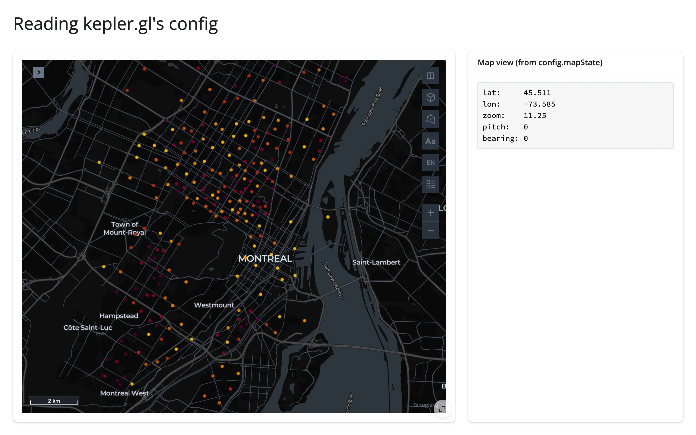

### Rate limiting

`config` rewrites on close to every animation frame during time-filter playback -- measured at over
200 `.read()` invalidations in 4 seconds of playback with no rate limit, against a widget
whose view only needs to update a couple of times a second. `render_keplergl`'s `rate_policy` and
`rate_delay` kwargs throttle (or debounce) every `.read()`/`reactive_read()` on that widget's instance, not just
one reader:

```{.python file="examples/07_rate_limiting.py"}
import pandas as pd
from keplergl import KeplerGl
from shiny import reactive
from shiny.express import render, ui
from shinywidgets import render_keplergl

birds = pd.read_csv("https://cdn.jsdelivr.net/gh/vega/vega-datasets@5448e25297c8f705be78e879d5423d55d04dc6f1/data/bird-migration.csv")
birds["date"] = pd.to_datetime(birds["date"])

CONFIG = {
    "version": "v1",
    "config": {
        "visState": {
            "filters": [
                {
                    "dataId": ["data"],
                    "id": "migration-date-window",
                    "name": ["date"],
                    "type": "timeRange",
                    "value": [1_427_846_400_000, 1_428_451_200_000],
                    "plotType": {"type": "histogram", "interval": "1-day"},
                    "animationWindow": "free",
                    "view": "enlarged",
                    "speed": 1,
                    "enabled": True,
                }
            ],
        },
        "mapState": {
            "latitude": 25.0,
            "longitude": -85.0,
            "zoom": 3.5,
        },
    },
}

ui.page_opts(title="Rate-limiting .read()", fillable=True)

with ui.layout_columns(col_widths=[8, 4]):
    with ui.card(full_screen=True):

        # `config` rewrites on almost every animation frame during playback.
        # Without a rate policy, every frame invalidates every reader.
        @render_keplergl(rate_policy="throttle", rate_delay=0.5)
        def map():
            return KeplerGl(data={"data": birds}, config=CONFIG)

    with ui.card():
        ui.card_header(".read() invocations (throttled to 2/s)")
        count = reactive.value(0)

        @reactive.effect
        def _():
            map.read("config")
            with reactive.isolate():
                count.set(count.get() + 1)

        @render.code
        def n():
            return f"reads so far: {count.get()}"
```

Driving the same playback gesture against this widget: throttled to at most one read per 0.5 s (2/s),
vs. dozens per second unthrottled.

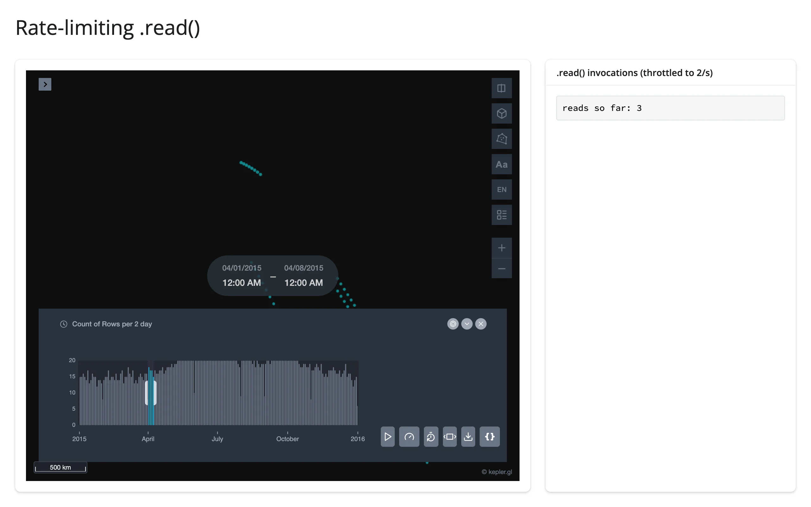
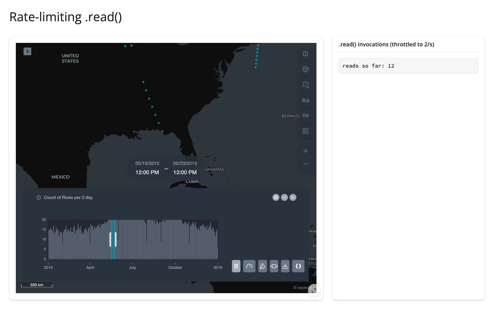

Reach for a rate policy whenever a downstream calculation driven by `map.read("config")` is non-trivial (a DataFrame filter, a database query, another render) and the map has a
time filter, or when users are likely to drag the map around a lot. For a cheap read like the
`mapState` printout above, the default (no limit) is fine.

## Updating the widget from Python

Every newly rendered `KeplerGl` widget ships kepler.gl's full JavaScript bundle again -- measured at
**12.9 MB** for the initial `comm_open` message. Re-returning a new value from the render function
(even an unchanged one) re-renders the widget and re-sends that bundle, and it also discards any
layers, colors, or filters the user built in kepler's side panel, since those live only in the old
(now-replaced) widget instance.

Updating `.widget.data` in place avoids both costs: it sends only the new rows (measured at **8.6 KB**
for a slider-driven update to the example below, about 1,500x smaller), keeps the same widget mounted
in the browser, and preserves the user's styling, layers, filters, and camera position.

```{.python file="examples/08_update_in_place.py"}
import plotly.express as px
from shiny import reactive
from shiny.express import input, ui
from shinywidgets import render_keplergl

carshare = px.data.carshare().rename(
    columns={"centroid_lat": "lat", "centroid_lon": "lon"}
)

ui.page_opts(title="Updating data in place", fillable=True)
ui.input_slider("min_hours", "Minimum car-share hours", 0, 3000, 0, step=100)


def filtered():
    return carshare[carshare["car_hours"] >= input.min_hours()]


@render_keplergl
def map():
    # Read the input under isolate(): this render function only runs once
    # (on first display). The effect below keeps the data current.
    with reactive.isolate():
        return filtered()


@reactive.effect
@reactive.event(input.min_hours)
def _():
    # Swapping `.widget.data` in place sends only the new rows (kilobytes),
    # keeps the map mounted, and preserves any layer/filter/camera changes
    # the user made in kepler's side panel. Re-returning a new value from
    # `map()` instead would re-send kepler's ~13 MB bundle and reset the UI.
    map.widget.data = {"data": filtered()}
```

Before / after moving the slider to 1,800 (same zoom, same basemap position -- only the points
change):

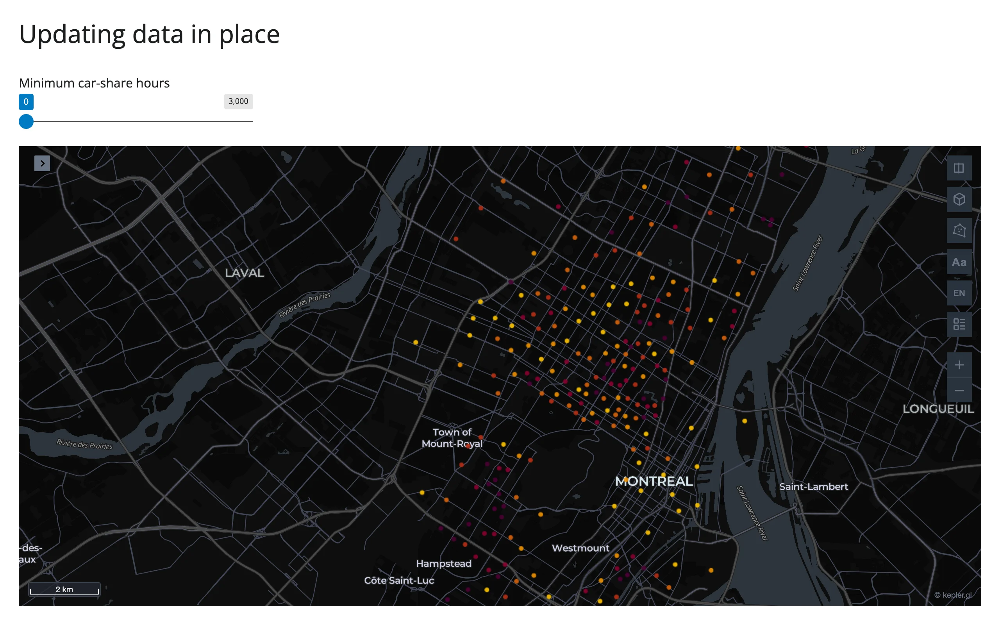
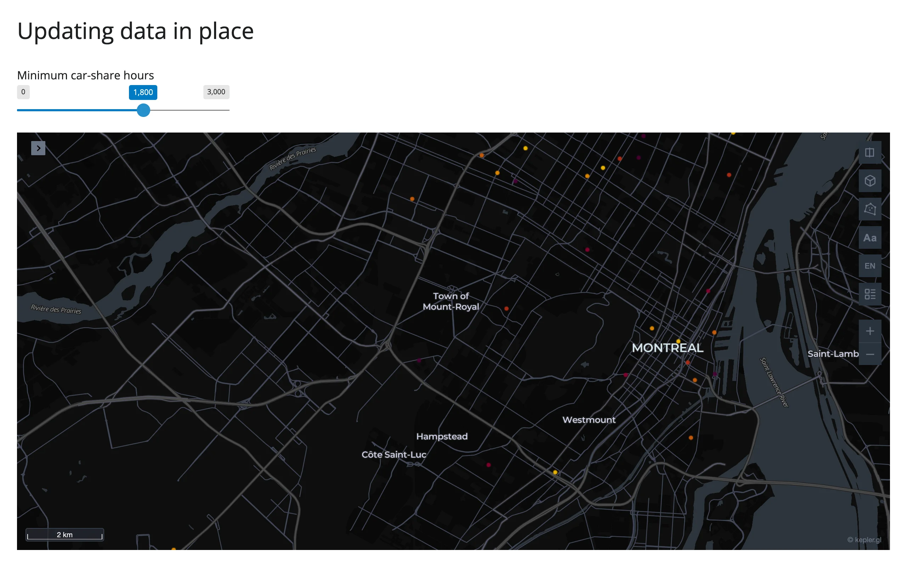

Use in-place updates for anything driven by a Shiny input (filters, a different dataset slice, a
live feed). Re-render only when the number or identity of *datasets* changes in a way that's easier
to express as a fresh `KeplerGl(...)` call than as a `.data =` / `.add_data()` update, or when you
want to deliberately reset the user's styling.

## Coordinating multiple views

### Save a styled view, restore it later

Because the *entire* authored state -- camera, layers, colors, filters -- lives in one `config` dict,
`map.read("config")` is a complete, serializable snapshot of whatever a user built.
Store it, and `.widget.config = saved` reproduces it exactly, including on a widget that has since
been reset or moved elsewhere:

```{.python file="examples/09_config_round_trip.py"}
import plotly.express as px
from keplergl import KeplerGl
from shiny import reactive
from shiny.express import input, render, ui
from shinywidgets import render_keplergl

carshare = px.data.carshare().rename(
    columns={"centroid_lat": "lat", "centroid_lon": "lon"}
)
DEFAULT_CONFIG = {
    "version": "v1",
    "config": {"mapState": {"latitude": 45.53, "longitude": -73.6, "zoom": 10}},
}

saved_config = reactive.value(None)

ui.page_opts(title="Saving and restoring a view", fillable=True)

with ui.layout_columns(col_widths=[8, 4]):
    with ui.card(full_screen=True):

        @render_keplergl
        def map():
            return KeplerGl(data={"data": carshare}, config=DEFAULT_CONFIG)

    with ui.card():
        ui.input_action_button("save", "Save current view")
        ui.input_action_button("reset", "Reset to default")
        ui.input_action_button("restore", "Restore saved view")

        @render.code
        def saved_view():
            cfg = saved_config.get()
            if cfg is None:
                return "No view saved yet."
            state = cfg.get("config", {}).get("mapState", {})
            return (
                f"saved zoom: {state.get('zoom', 0):.2f}, "
                f"lat: {state.get('latitude', 0):.3f}"
            )


# The whole config -- not just mapState -- round-trips, so this also
# preserves any layers, colors, or filters the user set up in kepler's UI.
@reactive.effect
@reactive.event(input.save)
def _():
    saved_config.set(map.read("config"))


@reactive.effect
@reactive.event(input.reset)
def _():
    map.widget.config = DEFAULT_CONFIG


@reactive.effect
@reactive.event(input.restore)
def _():
    if saved_config.get() is not None:
        map.widget.config = saved_config.get()
```

Verified end to end: pan the map, save, reset (camera returns to the default), restore (camera
returns to exactly the saved position):

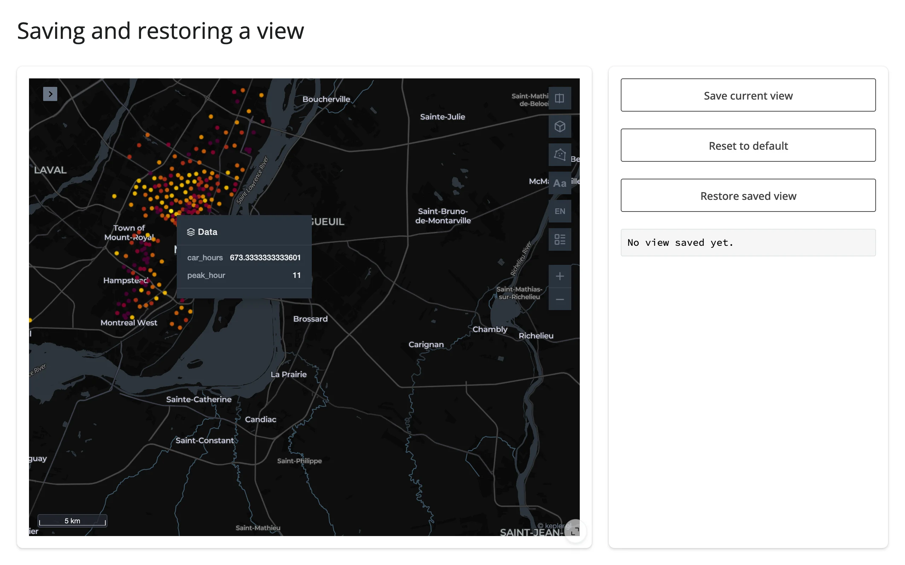
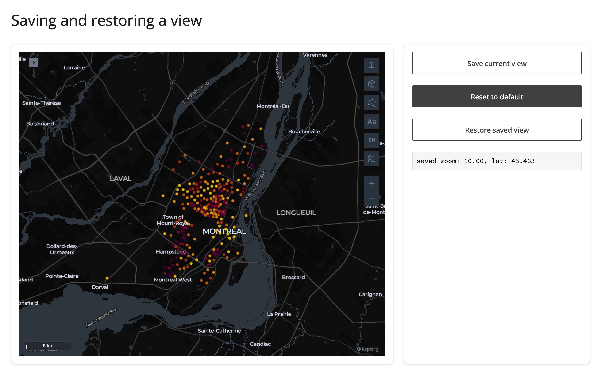
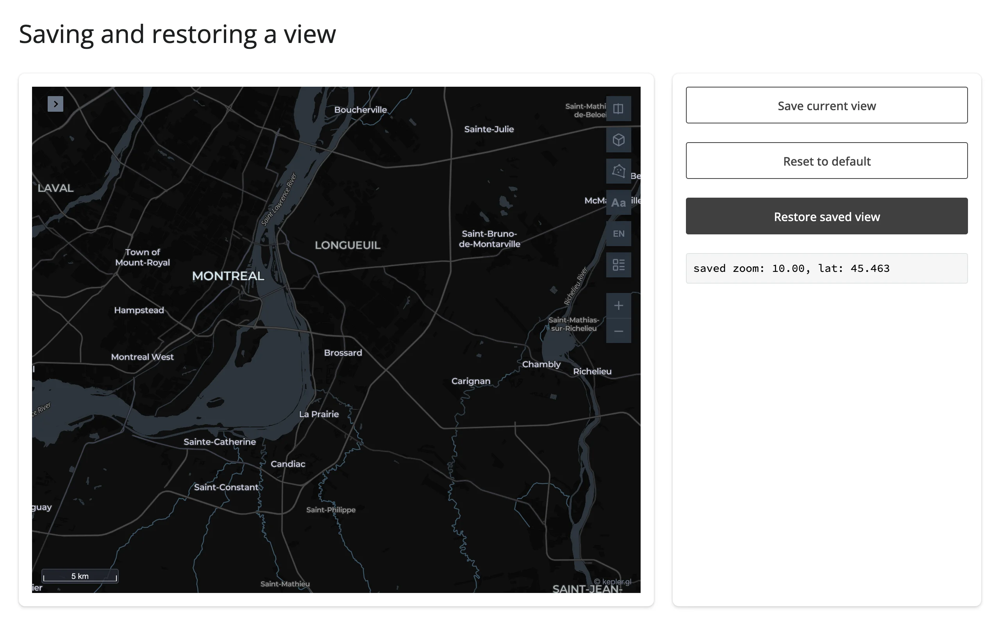

This is the pattern to reach for whenever a user should be able to "save this view" (a bookmark, a
report snapshot, a default for next time): persist the dict (it's plain JSON) anywhere Shiny can read
it back -- a database row, a file, another user's session.

### Time window drives a detail table

Read the active `timeRange` filter's `value` and filter your own copy of the data by it, for a table
(or any other output) that always matches exactly what the map is currently showing -- including live,
frame by frame, during playback.

```{.python file="examples/10_time_window_table.py"}
import pandas as pd
from keplergl import KeplerGl
from shiny.express import render, ui
from shinywidgets import render_keplergl

birds = pd.read_csv("https://cdn.jsdelivr.net/gh/vega/vega-datasets@5448e25297c8f705be78e879d5423d55d04dc6f1/data/bird-migration.csv")
birds["date"] = pd.to_datetime(birds["date"])

CONFIG = {
    "version": "v1",
    "config": {
        "visState": {
            "filters": [
                {
                    "dataId": ["data"],
                    "id": "migration-date-window",
                    "name": ["date"],
                    "type": "timeRange",
                    "value": [1_427_846_400_000, 1_428_451_200_000],
                    "plotType": {"type": "histogram", "interval": "1-day"},
                    "animationWindow": "free",
                    "view": "enlarged",
                    "speed": 1,
                    "enabled": True,
                }
            ],
        },
        "mapState": {
            "latitude": 25.0,
            "longitude": -85.0,
            "zoom": 3.5,
        },
    },
}

ui.page_opts(title="Time window drives a detail table", fillable=True)

with ui.layout_columns(col_widths=[7, 5]):
    with ui.card(full_screen=True):

        @render_keplergl(rate_policy="throttle", rate_delay=0.5)
        def map():
            return KeplerGl(data={"data": birds}, config=CONFIG)

    with ui.card(full_screen=True):
        ui.card_header("Birds in the current time window")

        @render.data_frame
        def visible_rows():
            config = map.read("config")
            filters = config.get("config", {}).get("visState", {}).get("filters", [])
            if not filters:
                return birds.iloc[0:0]
            start_ms, end_ms = filters[0]["value"]
            start, end = pd.to_datetime(start_ms, unit="ms"), pd.to_datetime(end_ms, unit="ms")
            window = birds[birds["date"].between(start, end)]
            return render.DataGrid(
                window[["species", "date", "lat", "lon"]],
                height="100%",
            )
```

Before pressing play (67 of 3,229 rows, matching the initial one-week window) and partway through
playback (the window has moved on to early September -- the plovers are flying south again -- and
the table now holds exactly the rows inside the new window):


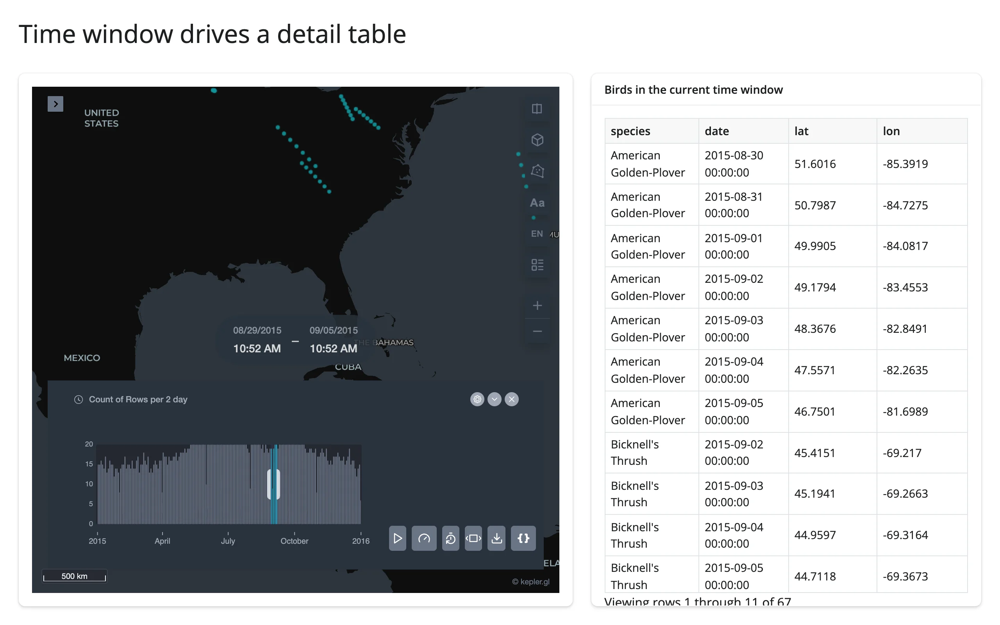

### One input, two linked views

A single Shiny input can drive the map (in place) and a companion chart from the same filtered data,
so they never disagree:

```{.python file="examples/11_linked_chart.py"}
import plotly.express as px
from shiny import reactive
from shiny.express import input, ui
from shinywidgets import render_keplergl, render_plotly

carshare = px.data.carshare().rename(
    columns={"centroid_lat": "lat", "centroid_lon": "lon"}
)

ui.page_opts(title="One input, two linked views", fillable=True)
ui.input_slider("min_hours", "Minimum car-share hours", 0, 3000, 0, step=100)


def filtered():
    return carshare[carshare["car_hours"] >= input.min_hours()]


with ui.layout_columns(col_widths=[7, 5]):
    with ui.card(full_screen=True):

        @render_keplergl
        def map():
            with reactive.isolate():
                return filtered()

    with ui.card(full_screen=True):

        @render_plotly
        def hist():
            fig = px.histogram(filtered(), x="car_hours", nbins=20)
            fig.update_layout(
                title=f"{len(filtered())} stations", margin=dict(t=40)
            )
            return fig


@reactive.effect
@reactive.event(input.min_hours)
def _():
    # Both views come from the same `filtered()` call: the map updates in
    # place (preserving its camera and any styling), and the histogram
    # re-renders -- cheap, since it's an ordinary plotly figure.
    map.widget.data = {"data": filtered()}
```

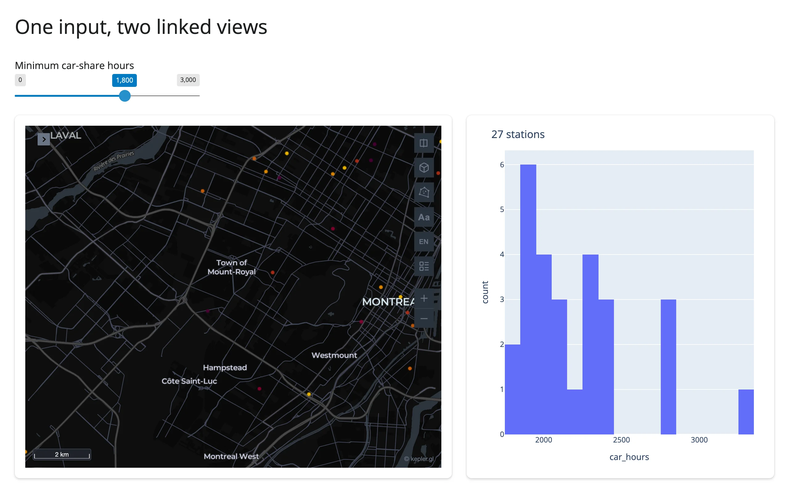

*Pairs with: [plotly](../plotly/index.md).*

## Large data

kepler.gl's own tagline describes it as built for large-scale geospatial datasets, using deck.gl's GPU
aggregation layers (hexbin, grid, cluster) -- the same engine lonboard uses, the GPU-in-browser approach. That
GPU rendering doesn't change what crosses the wire, though: the full dataset still goes to the browser as Arrow
(see [Updating the widget from Python](#updating-the-widget-from-python) for the measured cost of an initial
render), and only the aggregation happens client-side. This guide hasn't re-measured a specific row-count
ceiling; see [kepler.gl's own docs](https://docs.kepler.gl) for upstream guidance. For per-gesture accessors and
the lightest payload at real scale, prefer [lonboard](../lonboard/index.md#large-data) instead -- kepler.gl
trades that for its point-and-click authoring UI. See the
[Large data & performance article](../../guide/performance/index.md#three-approaches-to-large-data) for the
general comparison.

## Layout and sizing

In a filling layout (`ui.card(full_screen=True)`, a sidebar, `page_opts(fillable=True)`), the map
resizes to its container the same way every shinywidgets output does. The one kepler-specific wrinkle:
the browser (not Python) ends up owning the widget's `height` trait once the output is sizing the map,
because kepler.gl's own React state reads `height` from the model, so a ResizeObserver writes the
measured pixel height back into it. Don't set `.widget.height` from Python while the output is
filling or has an explicit height -- change the *output's* size (`output_widget(height=...)` in Core
mode, or the surrounding card/sidebar) instead. `KeplerGl(height=400)` is indistinguishable from the
library's own default and so still fills; pass a different height to opt out, or size the output
explicitly.

Fill, cards, `full_screen`, hidden tabs, and explicit pixel/vh/% heights are all covered by
`tests/playwright/render_keplergl/test_render_keplergl.py` and pass on current `main`.

## Gotchas and limitations

Verified on current `main` (shinywidgets at `00f90249`, keplergl 0.4.0, shiny 1.9.0):

- **No CRS reprojection.** kepler.gl assumes EPSG:4326 (WGS84 lon/lat) and does not reproject; a
  GeoDataFrame in a projected CRS (e.g. EPSG:3857) renders silently in the wrong place. Reproject with
  `.to_crs(4326)` first.
- **The dataset name is `"data"`.** A returned DataFrame/GeoDataFrame becomes a dataset named
  `"data"`; use that as the `dataId` in any hand-written `config`.
- **Auto-layers need recognizable column names.** `lat`/`latitude` plus `lon`/`lng`/`longitude` gets a
  layer; `x`/`y` does not. A column literally named `n` picks up an extra icon layer.
  (keplergl-side behavior, not shinywidgets.)
- **Time columns need a real datetime dtype.** A date *string* column (even an ISO one) is detected as
  a plain `string` field, with no time filter available; convert with `pd.to_datetime()` first so it's
  sent as an Arrow timestamp column.
- **Setting `.widget.config` after render, with a brand-new layer, used to duplicate the
  auto-created layer.** This is the one bug the previous (pre-0.4, release-candidate) evaluation of
  this renderer flagged as a blocker. It does **not** reproduce on keplergl 0.4.0 final for
  auto-created layers: repeatedly re-assigning `.widget.config` settles at the correct layer count
  every time in this pass's testing. Still prefer passing `config` at construction
  (`KeplerGl(data=..., config=CONFIG)`) when you can -- it avoids the question entirely and is one
  fewer round trip.
- **...but a config-set containing an explicit `layers` entry does break on keplergl 0.4.0** (an
  upstream keplergl-widget bug, not shinywidgets): the layer stops rendering, and with a fully
  materialized (synced-back) config it is also duplicated in kepler's layer panel. And because
  keplergl's config-set path hardcodes kepler.gl's `keepExistingConfig` merge, incoming `value`s
  for filters that already exist are ignored -- a saved time window can't be restored
  programmatically. Camera-only restore works around both: strip `visState.layers` from the saved
  config before assigning it, as the gallery showcase does.
- **Bundle size is real and by design.** Every freshly rendered `KeplerGl` widget ships kepler.gl's
  ~12.9 MB JavaScript bundle (anywidget inlines `_esm` in the comm payload; Jupyter pays the same
  cost per widget). This is why [Updating the widget from Python](#updating-the-widget-from-python)
  matters more here than for most widgets.
- **Console noise from kepler.gl itself**, harmless: a "Timeout waiting for instance registration"
  warning on every mount (an uncleared `setTimeout`), `[keplergl-data]` debug logging, and a "Mapbox
  Token not valid" warning even when using a token-free basemap (CARTO dark-matter/positron/voyager,
  no_map). Mapbox-hosted styles do need `mapbox_token=`.
- **0.4.0 is a young release** (an anywidget rewrite of what had been an ipywidgets-7 widget); expect
  the usual early-release rough edges upstream.

What's *not* a bug, verified this pass: a DataFrame with missing values renders and does not crash the
session (`use_arrow=True` is NaN-safe); a `pd.Series` or other non-DataFrame pandas object is rejected
with a clear `TypeError` rather than silently misbehaving; and the formerly-documented echo-replay
issue (stale browser-originated updates being re-applied, which previously caused blank maps and
runaway layer duplication during playback) is fixed on `main` -- `_comm.py` and `comm.ts` now tag
every message with a `msg_id`/`parent_header` pair.

## Gallery candidates

**[`gallery/template_station_explorer.py`](gallery/template_station_explorer.py)** (template, ~45
lines): a minimal, adaptable starting point -- a slider filters car-share stations, the map updates in
place, and a sidebar reads the live `config.mapState.zoom` back from the browser.

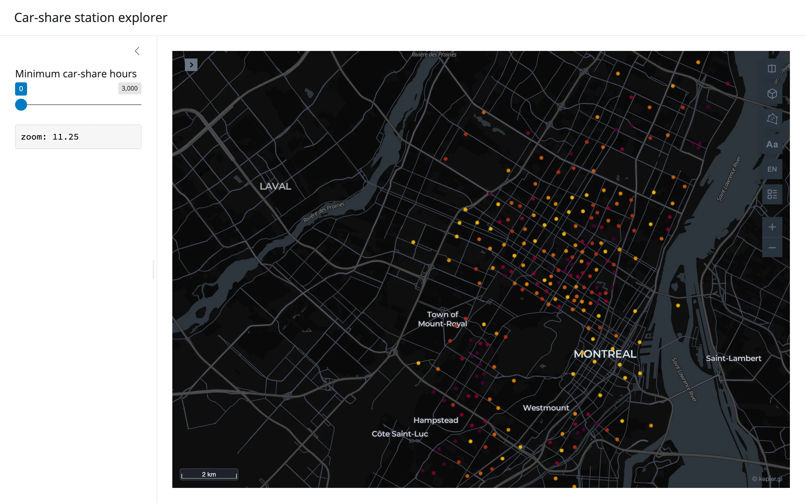

**[`gallery/showcase_bird_migration.py`](gallery/showcase_bird_migration.py)** (showcase, ~140 lines):
a 3D hexbin density map of a year of bird migration across the Americas, driven by kepler.gl's own
time filter and playback. A checkbox group filters by species (updating the map in place), and a
Shiny table tracks exactly what's inside the current time window, live. "Save current view" /
"Restore saved view" buttons save and restore the camera (position, zoom, pitch, bearing) --
restoring replaces only `mapState`, so the current layer styling and time window survive (see
the second-to-last gotcha below for why restoring the whole `config` is not the way to go).

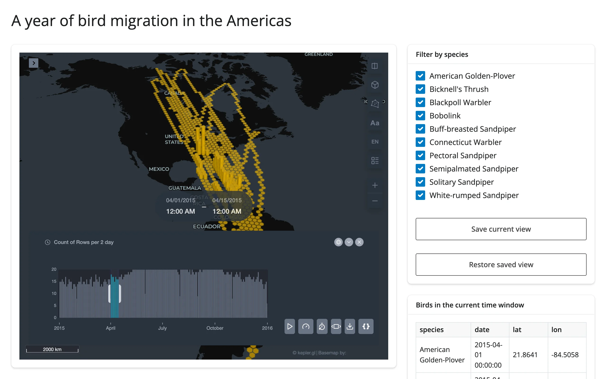
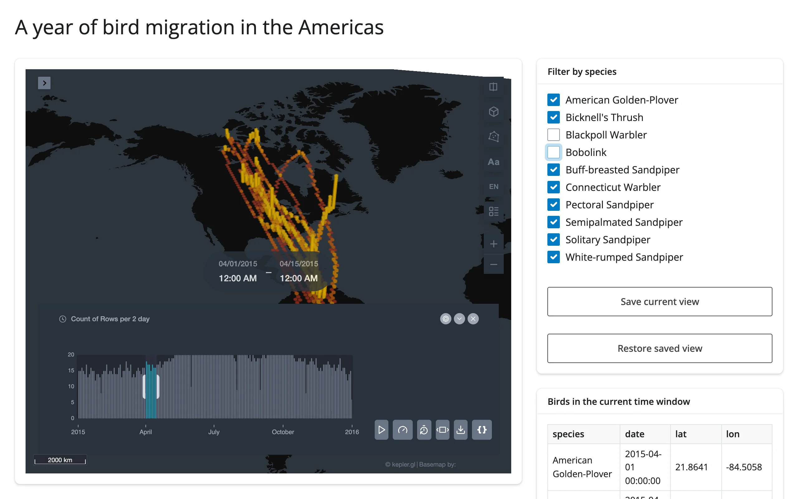

## Learn more

- [kepler.gl user guide](https://docs.kepler.gl) -- layers, filters, and the config schema
- [kepler.gl on GitHub](https://github.com/keplergl/kepler.gl)
- Related guides in this roster: [lonboard](../lonboard/index.md) (GPU-scale, code-driven styling),
  [maplibre](../maplibre/index.md) (vector-tile basemaps, code-driven restyling),
  [ipyleaflet](../ipyleaflet/index.md) / [leafmap](../leafmap/index.md) (per-feature click/hover
  callbacks), [plotly](../plotly/index.md) (linked chart pattern above)
