[leafmap](https://leafmap.org) is a high-level geospatial mapping API by Qiusheng Wu, built for doing real GIS work
with a few lines of code: one-liner basemaps from a 100+ provider catalog, vector and raster loaders that handle
reprojection and styling for you, split-panel comparisons, legends and colorbars, and a drawing toolbar on every
map by default. It is not a new rendering engine -- it is a friendlier front door onto several of them. Depending
on which `leafmap.*.Map` you construct, you get
[ipyleaflet](https://ipyleaflet.readthedocs.io) (the default), [MapLibre](https://eoda-dev.github.io/py-maplibregl/)
vector tiles, or a [kepler.gl](https://kepler.gl) authoring surface, all through the same `add_*` method vocabulary.

`@render_leafmap` accepts a map from any of leafmap's four widget-backed backends --
`leafmap.Map` (ipyleaflet), `leafmap.maplibregl.Map`, `leafmap.kepler.Map`, and `leafmap.plotlymap.Map` -- and
neutralizes the one thing all of them get wrong for a web app: every backend defaults to a fixed 600px height, which
overflows a Shiny card. `render_leafmap` treats that default as unset, so your map fills its container like any
other shinywidgets output, while an explicit height you asked for is still respected. leafmap's other two backends,
folium and pydeck, aren't ipywidgets at all; `render_leafmap` raises a `TypeError` that names the working
alternative instead of a confusing stack trace.

The headline feature in this release is **reactive accessors** on the default (ipyleaflet) backend: `bounds()`,
`zoom()`, `center()`, `clicked()`, and `drawn_features()` read the live map the same way `input.my_slider()` reads a
control, so panning, clicking, and drawing shapes become ordinary Shiny reactivity -- no manual callback wiring. On
the other three backends, read state with `.read()` instead (`render_leafmap` points you to the right trait
when you call an accessor on the wrong backend).

**Choosing leafmap vs. its backends directly:** reach for leafmap when you want its high-level loaders
(`add_gdf`, `add_data`, `add_cog_layer`, `split_map`, time sliders, legends) or you're not sure which mapping
engine you need yet. Drop to [`../ipyleaflet/guide.md`](../ipyleaflet/index.md) directly when you only need
ipyleaflet's own layer/control API with no leafmap convenience methods, or to [`../maplibre/guide.md`](../maplibre/index.md)
for vector tiles and globe projection without leafmap's wrapper. This guide focuses on what leafmap adds on top;
see those guides for the low-level APIs and their accessors in depth (the ipyleaflet accessors are literally the
same code leafmap's default backend uses).

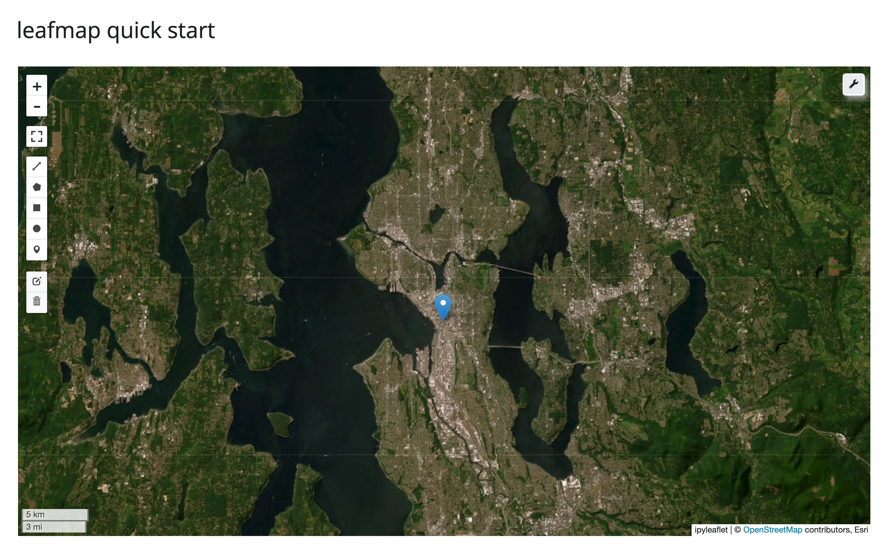

## Installation

```sh
pip install 'shinywidgets[leafmap]'
```

This installs leafmap and a plotly version compatible with its (optional) plotly backend. Two capabilities need
one more package each, installed separately because they pull in a fair number of transitive dependencies:

- **Local rasters / COGs** (`add_raster`, `add_cog_layer` on local files): `pip install 'leafmap[raster]'`, which
  adds [localtileserver](https://github.com/banesullivan/localtileserver) -- see
  [`../localtileserver/guide.md`](../localtileserver/index.md) for how shinywidgets serves its tiles in a deployed app.
- **kepler.gl backend**: `pip install keplergl`. The current stable release (0.3.7) additionally needs
  `pip install "setuptools<81"` (it imports `pkg_resources` without declaring the dependency).

## Quick start

A map, a satellite basemap, and a marker -- `leafmap.Map()` is an `ipyleaflet.Map` subclass, so it fills its card
like any other shinywidgets map output:

```{.python file="examples/01_quickstart.py"}
import leafmap
from shiny.express import ui
from shinywidgets import render_leafmap

ui.page_opts(title="leafmap quick start", fillable=True)


@render_leafmap
def map():
    m = leafmap.Map(center=(47.62, -122.33), zoom=11)
    m.add_basemap("Esri.WorldImagery")
    m.add_marker(location=(47.6062, -122.3321), tooltip="Seattle")
    return m
```

Notice the toolbar (wrench icon, top right) and the drawing controls (left side) -- leafmap adds these by default,
and they work out of the box: the wrench opens a basemap gallery and other tools, and the drawing toolbar is what
powers `drawn_features()` below.

## What you can build

### Basemaps from a 100+ provider catalog

`add_basemap(name)` looks up a tile provider by name from `leafmap.basemaps` (Esri, CartoDB, USGS, Stadia, NASA
GIBS, and more -- see `list(leafmap.basemaps)`) and swaps it in with one call; no XYZ URL or attribution string
to track down yourself.

```{.python file="examples/02_basemaps.py"}
import leafmap
from shiny.express import input, ui
from shinywidgets import render_leafmap

ui.page_opts(title="leafmap basemaps", fillable=True)

with ui.sidebar():
    # leafmap.basemaps has 100+ names from the xyzservices registry (Esri,
    # CartoDB, USGS, NASA GIBS, ...) -- add_basemap() looks one up by name
    ui.input_select(
        "basemap",
        "Basemap",
        [
            "Esri.WorldImagery",
            "OpenTopoMap",
            "Stadia.AlidadeSmoothDark",
            "USGS.USImageryTopo",
        ],
    )


@render_leafmap
def map():
    m = leafmap.Map(center=(36.1, -112.1), zoom=10)  # Grand Canyon
    m.add_basemap(input.basemap())
    return m
```

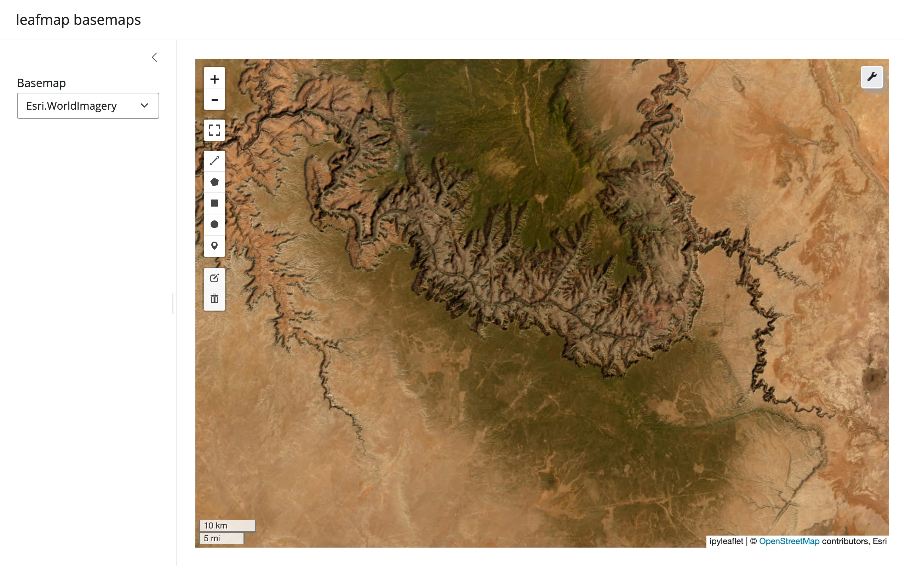

### Vector data with hover details, no manual GeoJSON wiring

`add_gdf()` (a GeoPandas `GeoDataFrame`) and `add_geojson()` (a dict or URL) both take a `style_callback` for
per-feature styling and `info_mode="on_hover"` for an automatic tooltip built from every property -- the feature
inspector you'd otherwise hand-build with an ipyleaflet `GeoJSON` layer and a popup callback.

```{.python file="examples/03_vector_data.py"}
import leafmap
from shiny.express import ui
from shinywidgets import render_leafmap

COUNTRIES = "https://raw.githubusercontent.com/opengeos/leafmap/master/examples/data/countries.geojson"

ui.page_opts(title="leafmap vector data", fillable=True)


@render_leafmap
def map():
    m = leafmap.Map(center=(20, 0), zoom=2)
    m.add_basemap("CartoDB.Positron")
    # add_geojson/add_gdf take a style dict, a per-feature style_callback, and a
    # hover tooltip built from every property -- no manual GeoJSON layer wiring
    m.add_geojson(
        COUNTRIES,
        layer_name="Countries",
        style_callback=lambda feat: {
            "fillColor": "#2a9d8f"
            if feat["properties"]["CONTINENT"] == "Africa"
            else "#264653",
            "color": "white",
            "weight": 0.5,
            "fillOpacity": 0.6,
        },
        hover_style={"fillOpacity": 0.9, "weight": 2},
        info_mode="on_hover",
    )
    return m
```

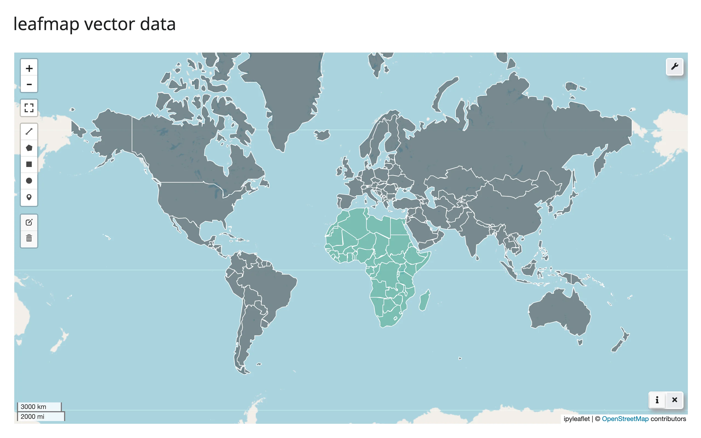

### Choropleths in one call

`add_data()` classifies a numeric column (Quantiles, Equal Interval, Natural Breaks, ...), colors the layer, and
adds the legend -- the one-liner version of a `geopandas.GeoDataFrame.plot(column=...)` choropleth. It needs
[`mapclassify`](https://pysal.org/mapclassify/) installed for the classification step.

```{.python file="examples/04_choropleth.py"}
# Needs mapclassify for the classification scheme: `uv run --with mapclassify shiny run
# 04_choropleth.py` (or pip install mapclassify).
import leafmap
from shiny.express import ui
from shinywidgets import render_leafmap

COUNTRIES = "https://raw.githubusercontent.com/opengeos/leafmap/master/examples/data/countries.geojson"

ui.page_opts(title="leafmap choropleth", fillable=True)


@render_leafmap
def map():
    m = leafmap.Map(center=(20, 0), zoom=2)
    # add_data classifies a numeric column (here, Natural Earth's estimated GDP),
    # colors the layer, and adds the legend -- the one-liner version of a
    # geopandas .plot(column=...) choropleth
    m.add_data(
        COUNTRIES,
        column="GDP_MD_EST",
        scheme="Quantiles",
        k=6,
        cmap="YlGnBu",
        legend_title="GDP (million USD)",
        layer_name="GDP",
    )
    return m
```

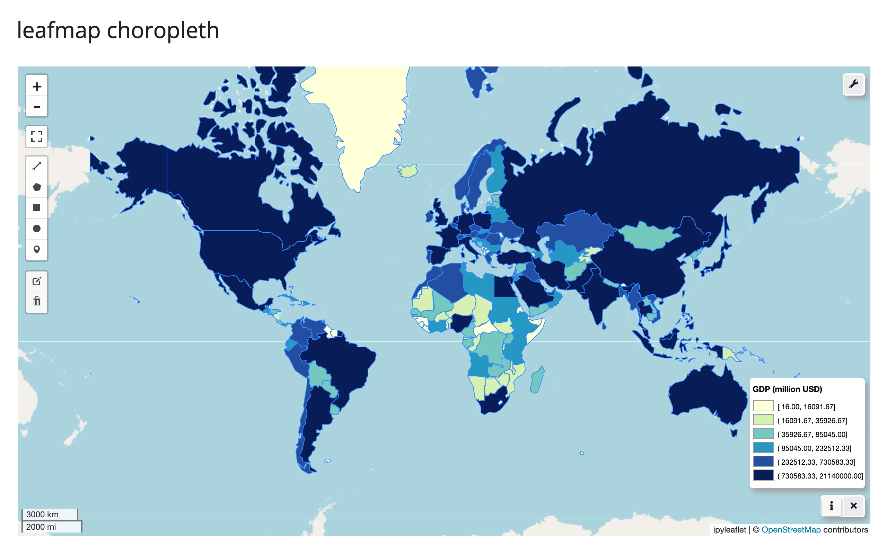

### Local rasters and COGs, deployment-safe

`add_raster()` serves a local GeoTIFF (ideally a Cloud-Optimized GeoTIFF) as slippy-map tiles via localtileserver,
with band selection, a colormap, and value rescaling, all without you running a tile server yourself. Pass a
`str` path -- a `pathlib.Path` raises (see Gotchas). shinywidgets automatically mounts a reverse proxy for
localtileserver's tiles, so this also works once the app is deployed; see
[`../localtileserver/guide.md`](../localtileserver/index.md) for that mechanism and `add_cog_layer()` for
remote, already-tiled COGs via a titiler endpoint instead of a local file.

```{.python file="examples/05_raster_cog.py"}
# A synthetic elevation raster is written to a local Cloud-Optimized GeoTIFF at
# startup; leafmap's add_raster() serves it with localtileserver, and
# shinywidgets' loopback proxy makes the tile requests work even when the app
# is deployed (see ../../localtileserver/guide.md). Needs leafmap's raster
# extra (pip install 'leafmap[raster]') plus rioxarray and scipy to generate
# the sample data: `uv run --with rioxarray,scipy shiny run 05_raster_cog.py`.
import tempfile
from pathlib import Path

import leafmap
import numpy as np
import rioxarray  # noqa: F401  (registers the .rio accessor)
import xarray as xr
from scipy.ndimage import zoom
from shiny.express import ui
from shinywidgets import render_leafmap


def make_terrain_cog(path: Path, n: int = 600) -> None:
    rng = np.random.default_rng(7)
    elev = np.zeros((n, n), dtype=np.float32)
    for octave in range(6):  # fBm: stack smoothed noise at doubling frequencies
        k = 3 * 2**octave
        elev += zoom(rng.normal(0, 1, (k, k)).astype(np.float32), n / k, order=3)[
            :n, :n
        ] * (400 / 2**octave)
    elev = np.clip(elev - elev.min(), 0, None)
    ys = np.linspace(47.75, 47.45, n)
    xs = np.linspace(-122.5, -122.15, n)
    da = xr.DataArray(elev, dims=("y", "x"), coords={"y": ys, "x": xs})
    da.rio.set_spatial_dims(x_dim="x", y_dim="y", inplace=True)
    da.rio.write_crs("EPSG:4326", inplace=True)
    da.rio.to_raster(path, driver="COG", compress="deflate")


COG = Path(tempfile.gettempdir()) / "shinywidgets_leafmap_terrain.tif"
if not COG.exists():
    make_terrain_cog(COG)

ui.page_opts(title="leafmap local raster", fillable=True)


@render_leafmap
def map():
    m = leafmap.Map(center=(47.6, -122.33), zoom=12)
    # zoom_to_layer=False keeps the view above; True (the default) refits to
    # the raster's bounds, which is usually what you want for a first render
    m.add_raster(
        str(COG), colormap="terrain", layer_name="Elevation", zoom_to_layer=False
    )
    return m
```

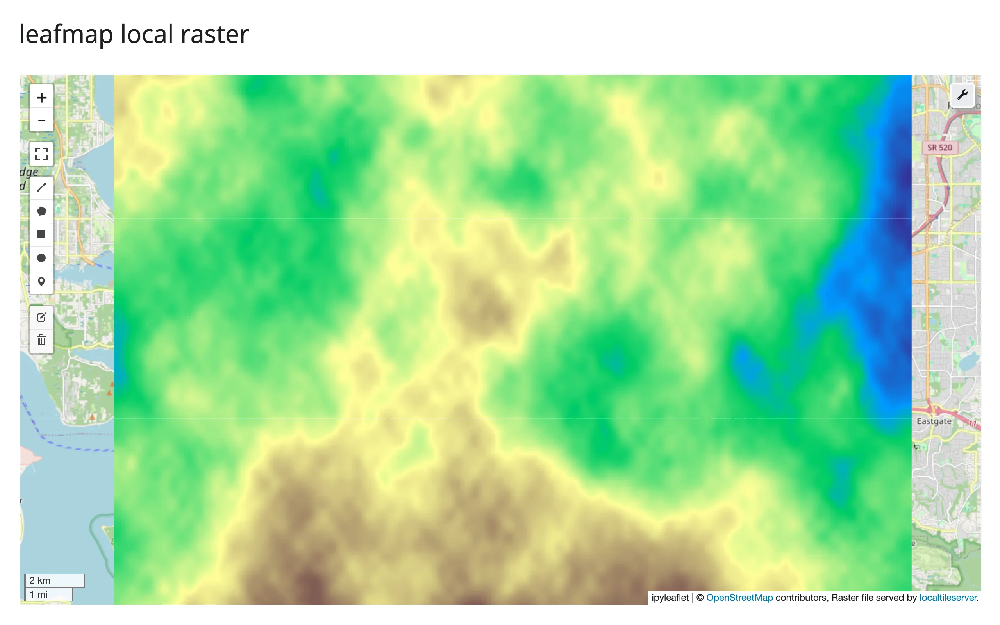

### Split-panel comparisons

`split_map()` divides the existing map into two synced, draggable panes -- before/after imagery, two basemaps, or
two time periods -- with no second widget to manage.

```{.python file="examples/06_split_map.py"}
import leafmap
from shiny.express import ui
from shinywidgets import render_leafmap

ui.page_opts(title="leafmap split map", fillable=True)


@render_leafmap
def map():
    m = leafmap.Map(center=(37.75, -119.58), zoom=11)  # Yosemite Valley
    # split_map() divides the existing map into two synced panes with a
    # draggable divider -- handy for before/after imagery or basemap compares
    m.split_map(
        left_layer="Esri.WorldImagery",
        right_layer="USGS.USTopo",
        left_label="Satellite",
        right_label="USGS Topo",
    )
    return m
```

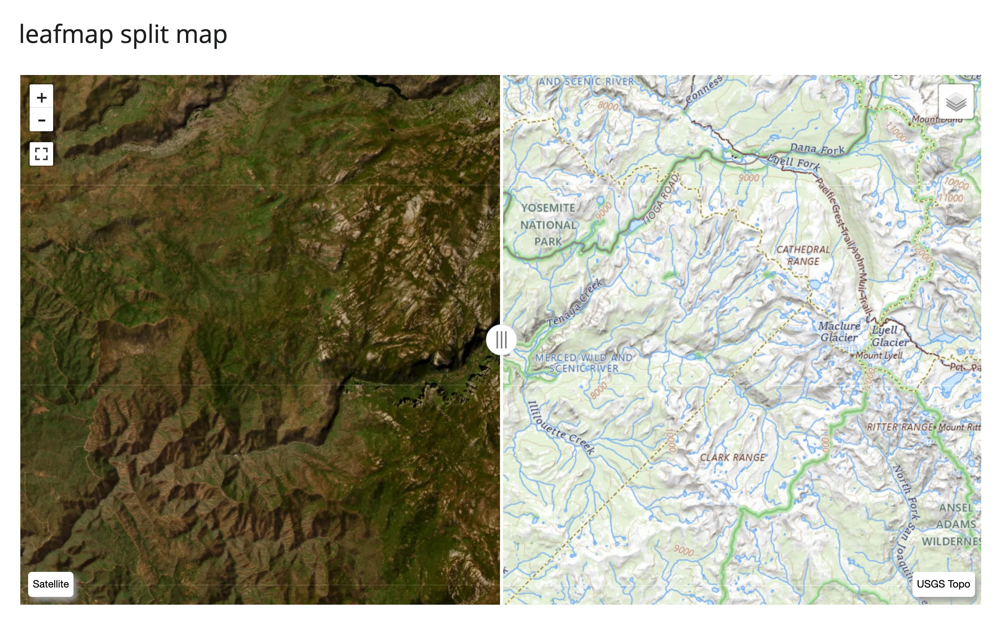

leafmap also has `add_legend()`/`add_colorbar()` for bespoke (non-choropleth) legends, `add_time_slider()` /
`add_gdf_time_slider()` for animating a sequence of layers, and the toolbar's basemap gallery and inspector tools
accessible from the map with zero app code -- see [Learn more](#learn-more) for the upstream docs on these; the
AOI workbench in [Gallery candidates](#gallery-candidates) below exercises `add_colorbar()` on a live raster.

## Reacting to user interaction

### Accessor reference

These five methods are available on the **ipyleaflet backend only** (`leafmap.Map()`, the default). They are the
exact same accessors documented in [`../ipyleaflet/guide.md`](../ipyleaflet/index.md), since leafmap's default
backend *is* an `ipyleaflet.Map`.

Every accessor attaches the moment the map renders and records what the user does whether or not anything has
read it yet -- a click, pan, or drawn shape that happens before the first read still shows up in it.

| Accessor | Returns | Before any interaction | Across re-render | Rate policy |
|---|---|---|---|---|
| `bounds()` | `((south, west), (north, east))` | Cancels (no output) until the browser's first report | Re-seeded; cancels again until the new map reports | Not rate-limited |
| `zoom()` | `float` | Seeded (the map's own `.zoom`) | Re-seeded from the new map | Not rate-limited |
| `center()` | `[lat, lng]` | Seeded (the map's own `.center`) | Re-seeded from the new map | Not rate-limited |
| `clicked()` | `{"coordinates": [lat, lng], ...}` or `None` | `None` until the first click | Kept until the user clicks the new map | Not rate-limited |
| `drawn_features()` | `list[GeoJSON Feature]` | `[]` until something is drawn | Re-seeded (`[]` for a fresh `DrawControl`) | Not rate-limited |

Coordinates are `[lat, lng]` throughout, matching ipyleaflet (lonboard and the maplibre backend below use
`(lng, lat)`). None of the five accessors are rate-limited by default, and none benefit from `rate_policy`/
`rate_delay` either -- each only fires once per completed gesture (confirmed in
[`../ipyleaflet/guide.md`](../ipyleaflet/index.md)'s rate-limiting section). You would still reach for
`rate_policy`/`rate_delay` on a `reactive_read()` of a trait that streams many updates per gesture, such as a
raw marker's `location` while it's being dragged -- see that guide's example. `bounds()`/`zoom()`/`center()`/
`drawn_features()` describe the map's own state, so a re-render re-seeds them from the fresh map; `clicked()` is
something the *user* did, not something the map owns, so it's kept until the user clicks the new map -- the same
behavior documented (and verified with a real re-render gesture) in
[`../ipyleaflet/guide.md`](../ipyleaflet/index.md#clicks-clicked), since this is the identical accessor code.

### `bounds()`: driving a chart from the viewport

The map's visible area is reactive state: pan or zoom, and anything reading `bounds()` recomputes. Here, a bar
chart tracks the most populous cities currently on screen.

```{.python file="examples/07_bounds_viewport_chart.py"}
# Needs: pip install 'shinywidgets[leafmap,plotly]' pandas, or
# `uv run --with pandas,plotly shiny run 07_bounds_viewport_chart.py`.
import leafmap
import pandas as pd
import plotly.express as px
from shiny.express import ui
from shinywidgets import render_leafmap, render_plotly

CITIES = pd.read_csv(
    "https://raw.githubusercontent.com/opengeos/leafmap/master/examples/data/world_cities.csv"
)

ui.page_opts(title="Map viewport drives a chart", fillable=True)

with ui.layout_columns(col_widths=(7, 5)):

    @render_leafmap
    def map():
        m = leafmap.Map(center=(20, 0), zoom=2)
        m.add_points_from_xy(
            CITIES,
            x="longitude",
            y="latitude",
            layer_name="Cities",
            max_cluster_radius=40,
        )
        return m

    @render_plotly
    def top_cities():
        # map.bounds() is ((south, west), (north, east)); it cancels (renders
        # nothing) until the browser first reports a viewport
        (south, west), (north, east) = map.bounds()
        in_view = CITIES[
            CITIES.latitude.between(south, north) & CITIES.longitude.between(west, east)
        ].nlargest(10, "pop_max")
        return px.bar(
            in_view.sort_values("pop_max"),
            x="pop_max",
            y="name",
            orientation="h",
            title=f"Largest cities in view ({len(in_view)} shown)",
        )
```

Zoomed out, the world's biggest cities lead the chart; zoom into a region and the chart narrows to what's visible:

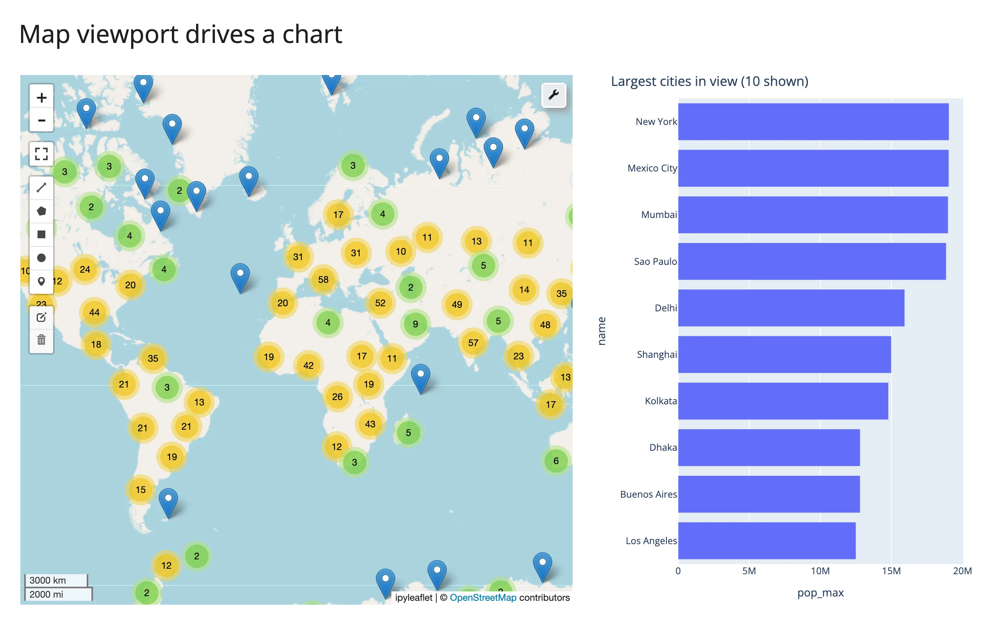
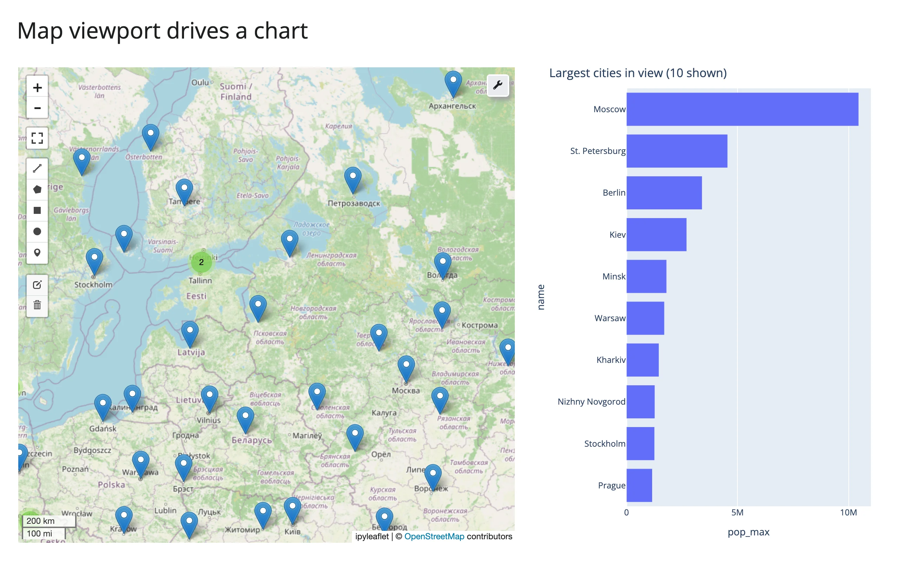

### `zoom()` and `center()`: the live camera

Both read instantly and update on every pan/zoom gesture, or whenever Python sets `.zoom`/`.center` on `.widget`:

```{.python file="examples/08_zoom_center.py"}
import leafmap
from shiny.express import render, ui
from shinywidgets import render_leafmap

ui.page_opts(title="leafmap zoom() and center()", fillable=True)

with ui.layout_columns(col_widths=(9, 3)):

    @render_leafmap
    def map():
        m = leafmap.Map(center=(47.62, -122.33), zoom=11)
        m.add_basemap("OpenTopoMap")
        return m

    with ui.card():
        ui.card_header("Live camera")

        @render.code
        def camera():
            # Both fire on every pan/zoom gesture and whenever Python sets
            # map.widget.zoom/center; neither is rate-limited
            lat, lng = map.center()
            return f"zoom:   {map.zoom():.1f}\ncenter: ({lat:.3f}, {lng:.3f})"
```

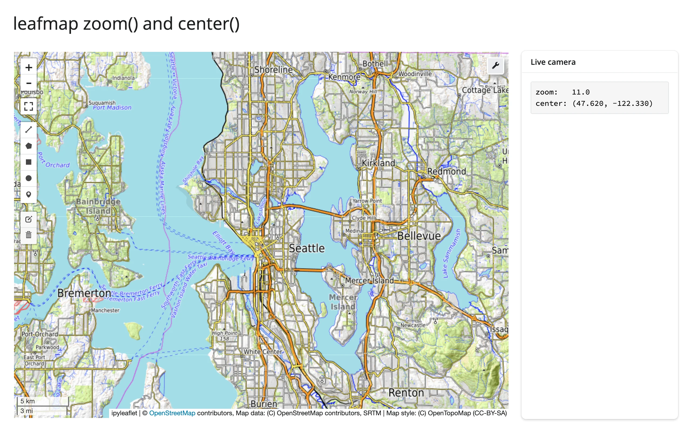

### `clicked()`: click-to-detail

A click anywhere on the map (not on a marker -- marker clicks don't bubble up) updates `clicked()`, and the value
is kept across a re-render until the user clicks the new map -- so a detail card like the one below doesn't flash
back to empty just because something else on the page re-rendered the map. Pair it with your own nearest-neighbor
lookup for a "click the map, see the nearest thing" pattern:

```{.python file="examples/09_clicked_detail.py"}
# Needs pandas: `uv run --with pandas shiny run 09_clicked_detail.py`.
import leafmap
import numpy as np
import pandas as pd
from shiny import req
from shiny.express import render, ui
from shinywidgets import render_leafmap

CITIES = pd.read_csv(
    "https://raw.githubusercontent.com/opengeos/leafmap/master/examples/data/world_cities.csv"
)

ui.page_opts(title="Click a city", fillable=True)

with ui.layout_columns(col_widths=(9, 3)):

    @render_leafmap
    def map():
        m = leafmap.Map(center=(20, 0), zoom=2)
        m.add_points_from_xy(CITIES, x="longitude", y="latitude", layer_name="Cities")
        return m

    with ui.card():
        ui.card_header("Nearest city to your last click")

        @render.express
        def detail():
            clicked = map.clicked()
            # req() returns its argument, and render.express treats every bare
            # top-level expression as UI, so assign it rather than leave it bare
            clicked = req(clicked)  # None until the first click
            lat, lng = clicked["coordinates"]
            d2 = (CITIES.latitude - lat) ** 2 + (CITIES.longitude - lng) ** 2
            city = CITIES.loc[np.argmin(d2)]
            ui.markdown(f"**{city['name']}**")
            ui.div(f"Population: {city['pop_max']:,}")
            ui.div(f"({lat:.2f}, {lng:.2f})")
```

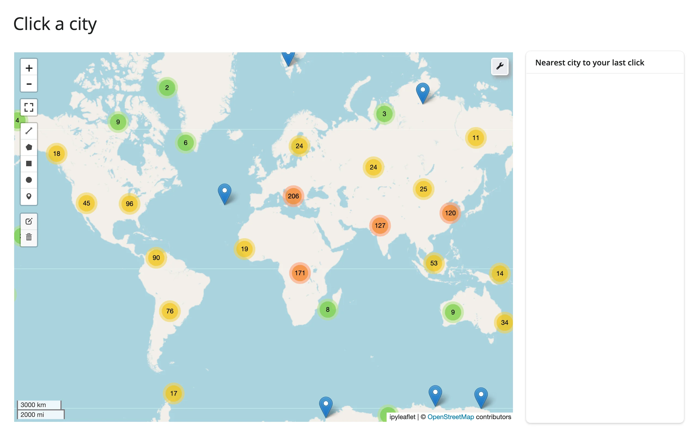
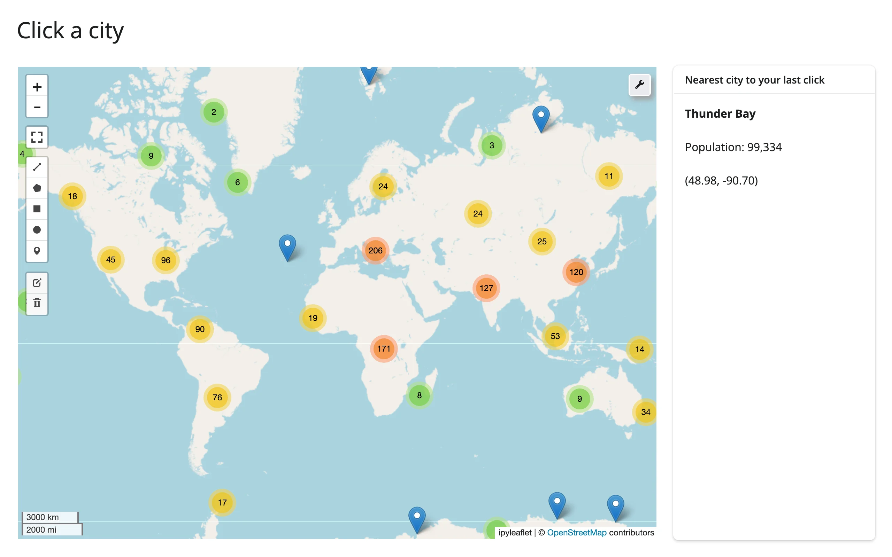

### `drawn_features()`: the GIS-analyst workflow

This is where leafmap's default `DrawControl` (on every map, no setup) becomes a real tool: draw an AOI, clip a
raster to it, and report zonal statistics -- the core loop of a lot of GIS analyst work, in well under 100 lines.

```{.python file="examples/10_drawn_features_zonal.py"}
# Needs leafmap's raster extra (pip install 'leafmap[raster]') plus rioxarray,
# scipy, and shapely for the synthetic raster and the AOI clip: `uv run --with
# rioxarray,scipy,shapely,plotly shiny run 10_drawn_features_zonal.py`.
import tempfile
from pathlib import Path

import leafmap
import numpy as np
import plotly.express as px
import rioxarray  # noqa: F401  (registers the .rio accessor)
import shapely.geometry
import xarray as xr
from scipy.ndimage import zoom
from shiny import reactive, req
from shiny.express import render, ui
from shinywidgets import render_leafmap, render_plotly


def make_terrain_cog(path: Path, n: int = 600) -> None:
    rng = np.random.default_rng(7)
    elev = np.zeros((n, n), dtype=np.float32)
    for octave in range(6):
        k = 3 * 2**octave
        elev += zoom(rng.normal(0, 1, (k, k)).astype(np.float32), n / k, order=3)[
            :n, :n
        ] * (400 / 2**octave)
    elev = np.clip(elev - elev.min(), 0, None)
    ys = np.linspace(47.75, 47.45, n)
    xs = np.linspace(-122.5, -122.15, n)
    da = xr.DataArray(elev, dims=("y", "x"), coords={"y": ys, "x": xs})
    da.rio.set_spatial_dims(x_dim="x", y_dim="y", inplace=True)
    da.rio.write_crs("EPSG:4326", inplace=True)
    da.rio.to_raster(path, driver="COG", compress="deflate")


COG = Path(tempfile.gettempdir()) / "shinywidgets_leafmap_terrain.tif"
if not COG.exists():
    make_terrain_cog(COG)
ELEVATION = rioxarray.open_rasterio(COG).squeeze("band", drop=True)

ui.page_opts(title="Draw an AOI, see zonal stats", fillable=True)

with ui.layout_columns(col_widths=(8, 4)):

    @render_leafmap
    def map():
        m = leafmap.Map(center=(47.6, -122.33), zoom=12)
        m.add_raster(
            str(COG), colormap="terrain", layer_name="Elevation", zoom_to_layer=False
        )
        return m

    with ui.card():
        ui.card_header("Elevation inside the drawn area")

        @reactive.calc
        def clipped():
            # drawn_features() is a list of GeoJSON Features: the AOI to clip to
            features = map.drawn_features()
            req(features)
            geom = shapely.geometry.shape(features[-1]["geometry"])
            return ELEVATION.rio.clip([geom.__geo_interface__], "EPSG:4326")

        @render.express
        def stats():
            data = clipped()
            ui.div(f"mean: {float(data.mean()):.0f} m")
            ui.div(f"min: {float(data.min()):.0f} m -- max: {float(data.max()):.0f} m")
            ui.div(f"{data.size} pixels in the drawn area")

        @render_plotly
        def hist():
            return px.histogram(
                clipped().values.ravel(), nbins=30, labels={"value": "elevation (m)"}
            )
```

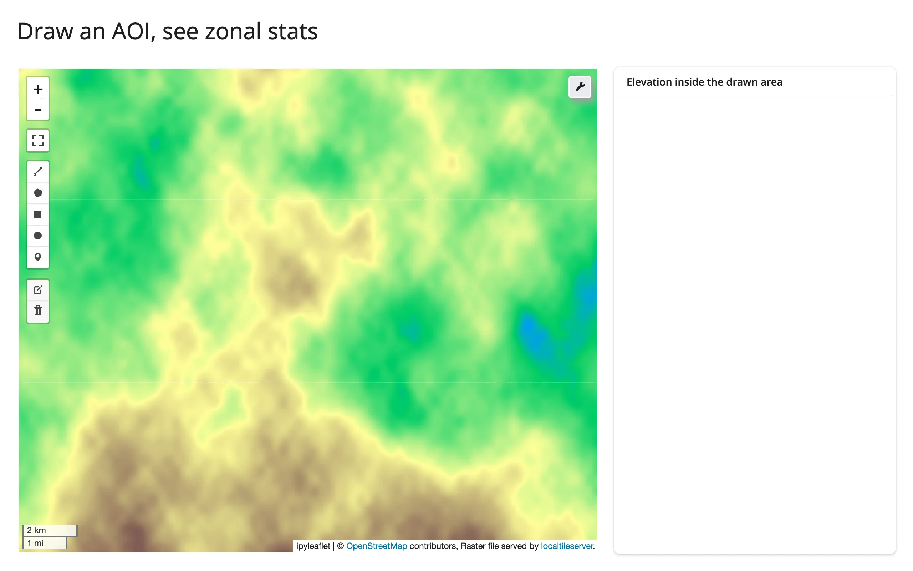
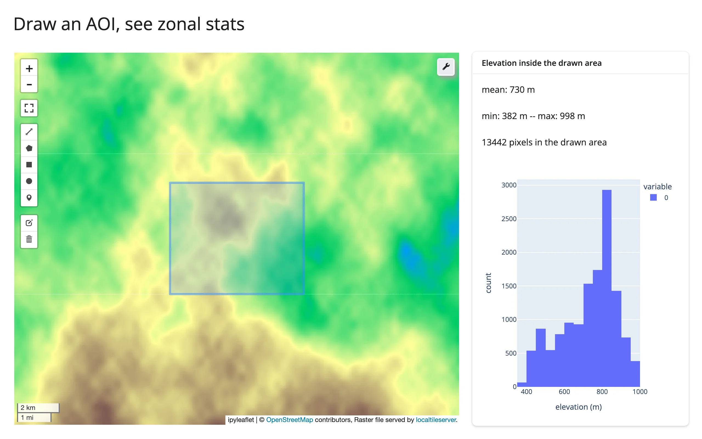

`drawn_features()` raises `TypeError` if the map has no `DrawControl` (not an issue with leafmap's default map,
which always has one) and reports `TypeError` on non-ipyleaflet backends, same as the other four accessors.

### Reading on demand

Because every accessor attaches at render, a button (or a download handler, or a chat/LLM tool callback) can
read `center()`/`zoom()`/`drawn_features()` with no warm-up -- nothing else in the app needs to keep reading them
to keep them live:

```{.python file="examples/14_read_on_demand.py"}
import leafmap
from shiny import reactive
from shiny.express import input, render, ui
from shinywidgets import render_leafmap

ui.page_opts(title="Save the current view on demand", fillable=True)

# Every accessor attaches when the map renders, so this button's reads see
# the user's latest pan or drawn shape with no warm-up read elsewhere in
# the app keeping bounds()/drawn_features() "live" first.
saved = reactive.value([])

with ui.layout_columns(col_widths=[8, 4]):
    with ui.card():
        ui.input_action_button("save", "Save current view", class_="mb-2")

        @render_leafmap
        def map():
            m = leafmap.Map(center=(47.62, -122.33), zoom=11)
            m.add_basemap("Esri.WorldImagery")
            return m

    with ui.card():
        ui.card_header("Saved views")

        @render.ui
        def views():
            if not saved():
                return "Pan the map, maybe draw a shape, then click Save."
            items = [
                ui.tags.li(f"center={c} zoom={z:.0f} shapes={n}") for c, z, n in saved()
            ]
            return ui.tags.ol(*items)


@reactive.effect
@reactive.event(input.save)
def _save_view():
    saved.set([*saved(), (map.center(), map.zoom(), len(map.drawn_features()))])
```

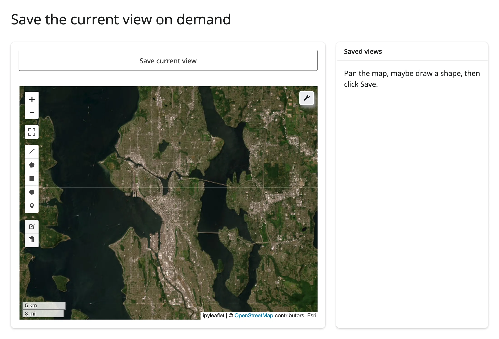
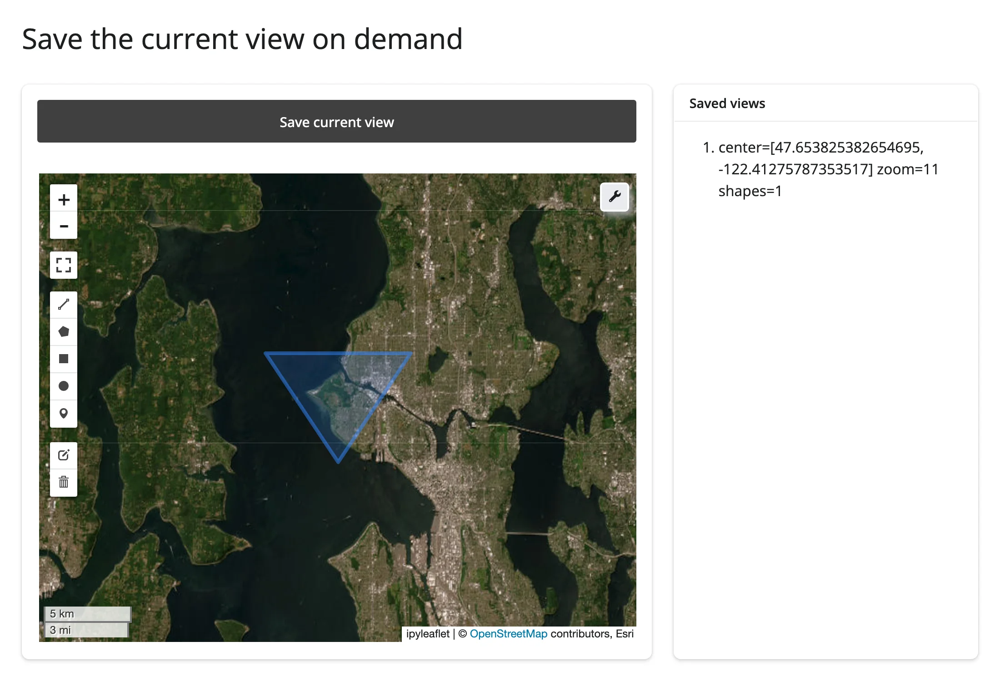

Verified: pan the map, draw a triangle with the default toolbar's polygon tool, click Save once -- the saved
entry has the panned-to center, the current zoom, and `shapes=1`, with nothing else in the app subscribed to
`center()`/`zoom()`/`drawn_features()`.

### Beyond the accessors: `reactive_read()` on other backends

The accessors above only exist on the ipyleaflet backend. On `leafmap.maplibregl.Map`, read `view_state`
(center/zoom/bounds/bearing/pitch) and `clicked` (`{"lng": ..., "lat": ...}`) with `map.read(...)` instead --
and calling an accessor method there raises a `TypeError` that says so. `map.read("view_state")` is preferred
over `reactive_read(map.widget, "view_state")` here: `map.widget` *is* this output's own rendered widget, so
`read()` applies the renderer's rate-limit kwargs the same way and needs no import of `reactive_read`:

```{.python file="examples/11_maplibre_reactive_read.py"}
import leafmap.maplibregl as lmgl
from shiny import req
from shiny.express import render, ui
from shinywidgets import render_leafmap

ui.page_opts(title="leafmap's maplibre backend", fillable=True)

with ui.layout_columns(col_widths=(9, 3)):

    @render_leafmap
    def map():
        return lmgl.Map(center=(-122.42, 37.77), zoom=11, style="positron")

    with ui.card():
        ui.card_header("map.read(), not accessors")

        @render.code
        def view_state():
            # This backend isn't an ipyleaflet.Map, so map.zoom()/map.bounds()/etc.
            # raise TypeError; read maplibre's own traits with map.read()
            vs = map.read("view_state")
            req(vs)  # {} until the browser's first moveend/zoomend
            c = vs["center"]
            return (
                f"center: ({c['lng']:.3f}, {c['lat']:.3f})\n"
                f"zoom:   {vs['zoom']:.1f}\n"
                f"bearing/pitch: {vs['bearing']:.0f}, {vs['pitch']:.0f}"
            )

        @render.code
        def accessor_error():
            try:
                map.zoom()
            except TypeError as e:
                return f"map.zoom() raises:\n{e}"
```

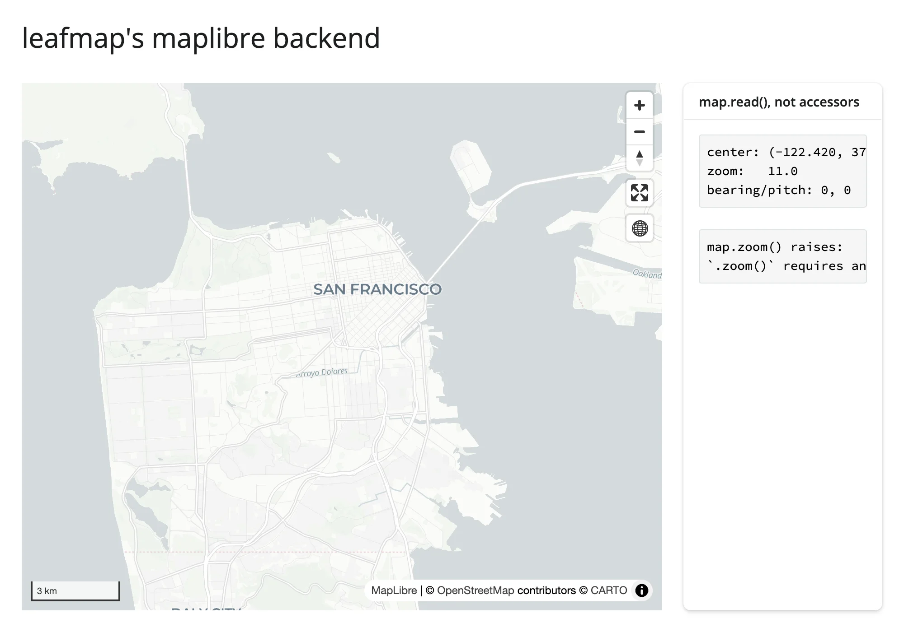

On the kepler.gl backend (`leafmap.kepler.Map`), read `map.read("config")` -- but note leafmap nests kepler's
own config one level down (`config["config"]["mapState"]`, not `config["mapState"]`). The plotly backend
(`leafmap.plotlymap.Map`) is already a `go.FigureWidget`; read its state the way
[`../plotly/guide.md`](../plotly/index.md) describes (e.g., `layout.mapbox.center`).

### Rate limiting

None of the five ipyleaflet-backend accessors need `rate_policy`/`rate_delay` -- each fires once per completed
gesture, not continuously during one. You would reach for them on a `reactive_read()` of a trait that streams
many updates per gesture instead (a dragged marker's `location`, for example); see
[`../ipyleaflet/guide.md`](../ipyleaflet/index.md#rate-limiting) for that pattern, which carries over unchanged
to leafmap's ipyleaflet backend.

## Updating the widget from Python

Setting traits on the live `.widget` -- rather than re-running the render function -- keeps the map's current
view, any shapes the user has drawn, and every other layer exactly as they were; a re-render builds a brand-new
JS map and resets all of that. Reach for in-place updates whenever an input should tweak the existing map rather
than replace it:

```{.python file="examples/12_in_place_updates.py"}
import leafmap
from shiny import reactive, req
from shiny.express import input, ui
from shinywidgets import render_leafmap

CITIES = {
    "Seattle": (47.6062, -122.3321),
    "Portland": (45.5152, -122.6784),
    "Vancouver": (49.2827, -123.1207),
}

ui.page_opts(title="Updating leafmap in place", fillable=True)

with ui.sidebar():
    ui.input_select("city", "Fly to", list(CITIES))
    ui.input_slider("opacity", "Basemap opacity", 0, 1, value=1, step=0.1)


@render_leafmap
def map():
    m = leafmap.Map(center=(47.6, -122.33), zoom=9)
    m.add_basemap("Esri.WorldImagery", show=True)
    return m


# Re-rendering here would rebuild the whole map (new JS widget, reset zoom and
# any user edits); setting traits on the live .widget instead keeps the
# camera, drawn shapes, and everything else the user already has on screen
@reactive.effect
def _fly_to():
    m = map.widget
    req(m)
    lat, lng = CITIES[input.city()]
    m.center = (lat, lng)
    m.zoom = 11


@reactive.effect
def _set_opacity():
    m = map.widget
    req(m)
    m.layers[-1].opacity = input.opacity()
```

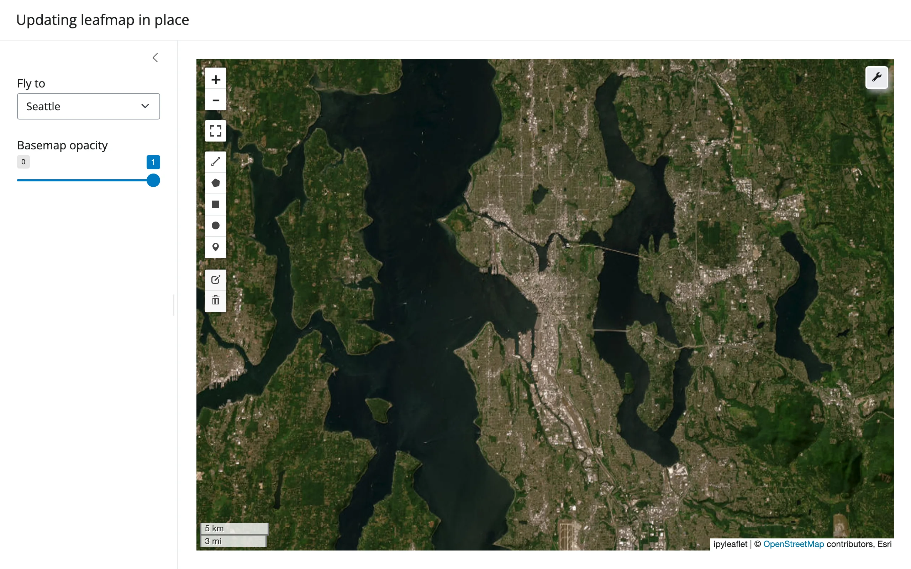
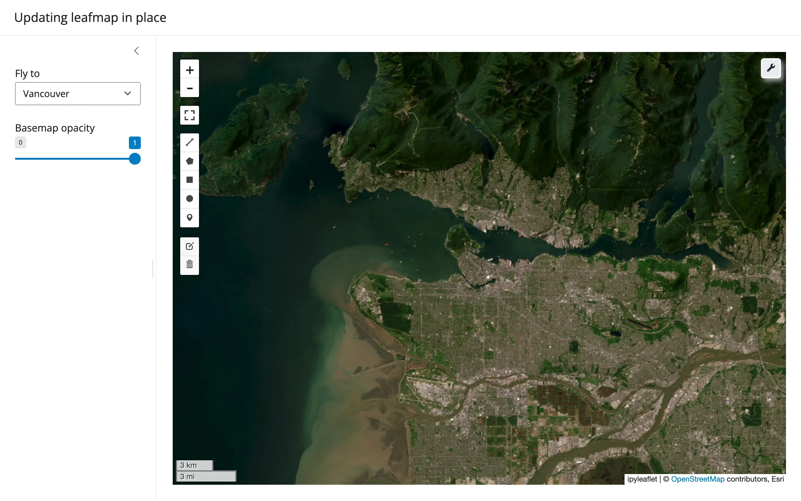

Selecting a different city flies the *same* map there -- the draw toolbar, any drawn shapes, and layers are all
untouched, unlike a re-render which would hand the browser a fresh widget.

## Coordinating multiple views

Three complete patterns from the examples above, in one place:

1. **Map viewport &rarr; chart of what's visible.** `bounds()` drives a `px.bar` of the most populous cities
   currently on screen ([`07_bounds_viewport_chart.py`](examples/07_bounds_viewport_chart.py)). Generalizes to
   any spatial join against the current bounding box -- filter a table, recompute a summary stat, refresh a list.
2. **Click &rarr; detail card.** `clicked()` plus a nearest-neighbor lookup renders a small detail panel for
   whatever's nearest the click ([`09_clicked_detail.py`](examples/09_clicked_detail.py)). Swap the nearest-point
   lookup for a spatial `.sjoin()` against polygons to get "click a region, see its attributes."
3. **Draw an AOI &rarr; clip and summarize.** `drawn_features()` feeds a `rioxarray` clip and zonal stats, shown
   as text and a histogram ([`10_drawn_features_zonal.py`](examples/10_drawn_features_zonal.py)). The
   [AOI workbench](#gallery-candidates) gallery app extends this to multiple AOIs and multiple raster bands.

All three follow the same shape: read an accessor in a `@reactive.calc` or a second `@render.*`/`@render_plotly`
function (never inside the map's own render function), and let Shiny's dependency graph do the rest.

## Large data

leafmap's large-data story depends entirely on which backend `Map()` builds, since leafmap itself adds no
rendering of its own on top. The default ipyleaflet backend inherits
[ipyleaflet's limits](../ipyleaflet/index.md#large-data) -- no large-data mode beyond marker clustering, full data
sent to the browser otherwise. Switching to `leafmap.maplibregl.Map` gets MapLibre's vector tiles and deck.gl
layers, the GPU-in-browser approach -- see [maplibre](../maplibre/index.md#large-data). For rasters,
[`add_raster()`/`add_cog_layer()`](#local-rasters-and-cogs-deployment-safe) (shown above) serve only the tiles
the viewport actually requests via localtileserver, the "only send what's visible" approach -- see
[localtileserver](../localtileserver/index.md#large-data) for how that's verified. See the
[Large data & performance article](../../guide/performance/index.md#three-approaches-to-large-data) for the
general picture.

## Layout and sizing

leafmap's 600px default height, on whichever backend sets it (`Layout.height` for ipyleaflet, `height` for
maplibre, `layout.height` for plotly), is treated as unset: the map fills its card by default, in both a
`fillable=True` page and inside a non-filling one. An explicit height -- `leafmap.Map(height=400)`,
`Layout(height="300px")`, or `render_leafmap(height="220px")` -- is respected instead.

```{.python file="examples/13_layout_sizing.py"}
import leafmap
from shiny.express import ui
from shinywidgets import render_leafmap

ui.page_opts(title="leafmap layout and sizing", fillable=True)

with ui.layout_columns(col_widths=(6, 6)):
    with ui.card(full_screen=True):
        ui.card_header("Default: fills the card")

        @render_leafmap
        def fills():
            # leafmap.Map() defaults to a 600px Layout.height; render_leafmap
            # treats that default as unset and fills the card instead
            return leafmap.Map(center=(47.6, -122.33), zoom=10)

    with ui.card():
        ui.card_header('render_leafmap(height="220px")')

        @render_leafmap(height="220px")
        def fixed():
            return leafmap.Map(center=(47.6, -122.33), zoom=10)
```

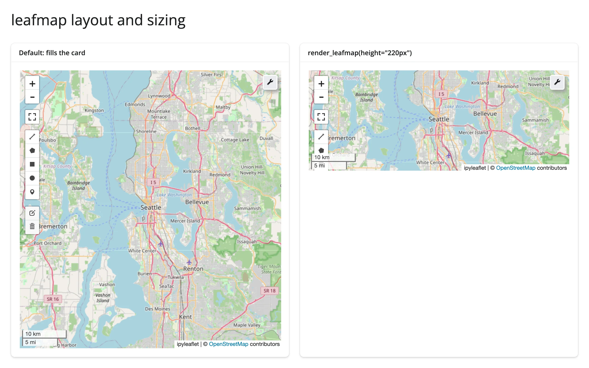

A short explicit height clips leafmap's own draw toolbar if it's shorter than the toolbar's full button stack
(visible on the right map above, which only shows a few tools) -- a tradeoff of a very small fixed height, not a
bug. This fill/explicit-height behavior is identical across all four widget backends and to
[`../ipyleaflet/guide.md`](../ipyleaflet/index.md)'s own layout section, since the same `_LAYOUT_DEFAULTS` logic
runs for leafmap's output before the backend's own handler.

## Gotchas and limitations

Verified on current main (leafmap 0.64.4, ipyleaflet 0.20.0, maplibre 0.3.6, shiny 1.9.0):

- **`add_raster(source)` wants a `str`, not a `pathlib.Path`.** Passing a `Path` raises
  `ValueError: The source must either be a string or TileClient` from inside localtileserver's layer builder.
  `str(path)` fixes it. Upstream (leafmap/localtileserver), not a shinywidgets issue.
- **`add_raster(indexes=...)` wants a list, even though its type hint says `Optional[int]`.** Passing a bare int
  (as the signature suggests) raises `TypeError: 'int' object is not iterable` -- the implementation does
  `for i in indexes`. Pass `indexes=[1]`, not `indexes=1`. Upstream (leafmap) type-hint bug.
- **`add_data()`/choropleth classification needs `mapclassify` installed separately** -- it's not pulled in by
  `shinywidgets[leafmap]` or leafmap's base install, and the error if it's missing
  (`ImportError: mapclassify is required for this function`) only appears at render time, not import time.
- **Stacking two "fill" outputs (e.g. a `@render.data_frame` and a `@render_plotly`/`@render_leafmap`) in one
  `ui.card()` without giving one an explicit height can leave the second permanently invisible** (its output div
  stays `visibility: hidden`, waiting for a size measurement that never resolves to nonzero). This is a general
  Shiny/bslib fillable-layout interaction, not specific to leafmap -- give the non-growing element
  (`render.DataGrid(..., height="200px")`, for example) a fixed height so the other one has room to fill. See the
  AOI workbench gallery app for a worked fix.
- **The plotly backend's old incompatibility with plotly &ge;6 is resolved.** An earlier evaluation found
  `leafmap.plotlymap.Map()` failing to construct under plotly&nbsp;&ge;6 (`add_scattermapbox`/`layout.mapbox`
  having been removed). Verified fixed on leafmap 0.63.1 with plotly 6.9.0 (within the
  `shinywidgets[leafmap]` extra's `plotly>=5.12,<7` pin) -- it constructs and renders normally.
- **Not independently re-verified this round:** an earlier evaluation found that the kepler.gl and maplibre
  backends can't share one page (`luma.gl - multiple VERSIONs detected`, from keplergl 0.3.7's older bundled
  deck.gl/luma.gl vs. maplibre's newer one), leaving the kepler map blank. If you need both widget families on
  one page, test this combination before relying on it; the leafmap-specific backends in this guide
  (ipyleaflet, maplibre) don't conflict with each other.
- **`drawn_features()` needs a `DrawControl`** -- always true for leafmap's default map (it adds one), but not for
  a plain `ipyleaflet.Map` you've stripped controls from; the accessor raises a clear `TypeError` in that case.

## Gallery candidates

### Template: choropleth explorer

A clean starting point: pick a column and classification scheme, see the map and a top-5 table update together.

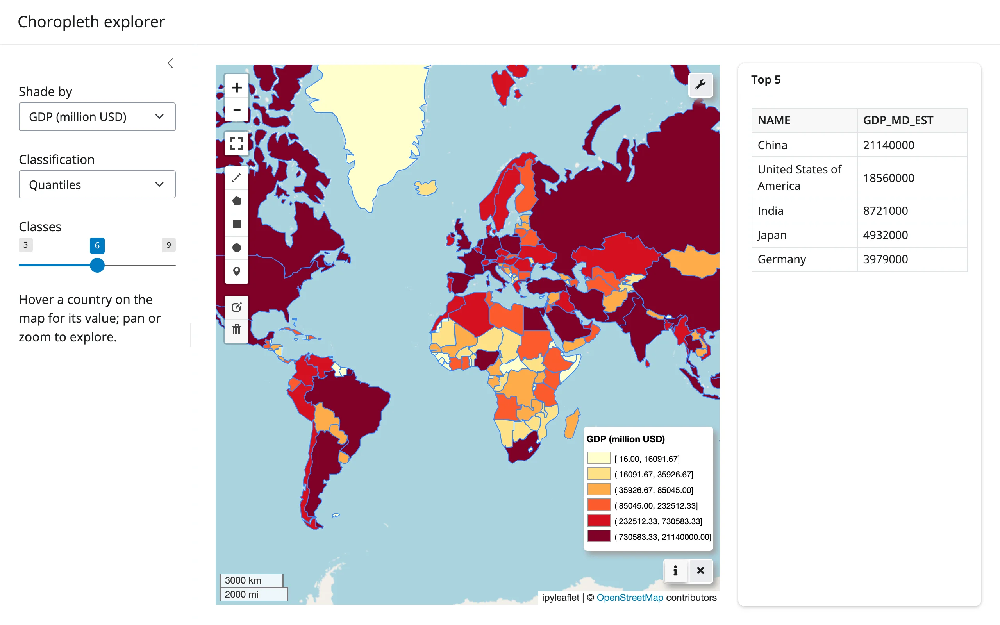

[`gallery/template_choropleth_explorer.py`](gallery/template_choropleth_explorer.py)

### Showcase: AOI workbench

Draw multiple areas of interest over a switchable multi-band raster (elevation/slope/moisture) and compare zonal
statistics across them live, with a colorbar legend and a per-AOI bar chart -- the GIS-analyst loop from
[`drawn_features()`](#drawn_features-the-gis-analyst-workflow) extended to multiple AOIs and bands.

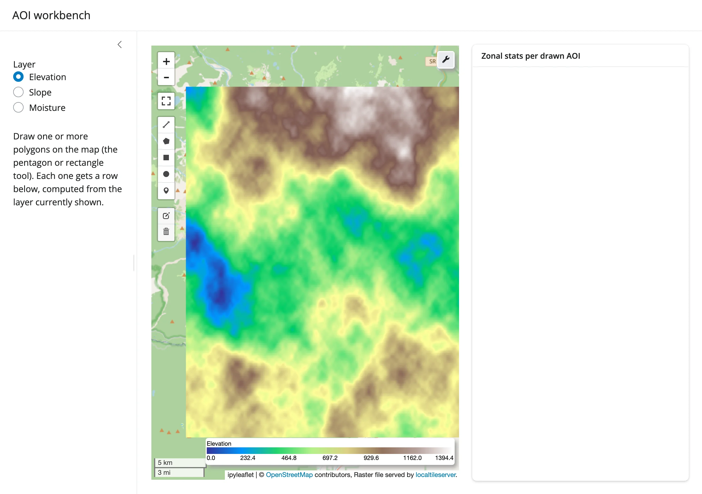
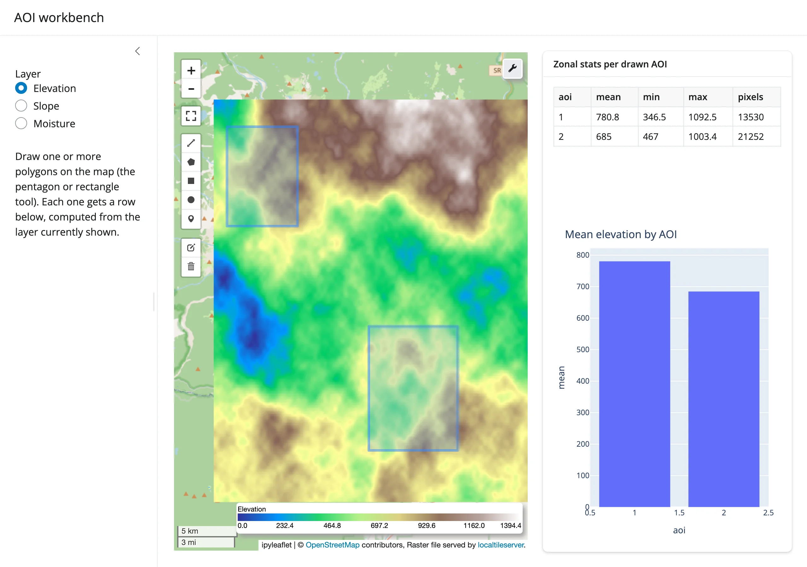

[`gallery/showcase_aoi_workbench.py`](gallery/showcase_aoi_workbench.py)

## Learn more

- [leafmap documentation](https://leafmap.org) and its [example notebooks](https://leafmap.org/notebooks/intro/)
- [leafmap API reference](https://leafmap.org/leafmap/) (per-backend method docs)
- [`../ipyleaflet/guide.md`](../ipyleaflet/index.md) -- the default backend's own API and accessors, in depth
- [`../maplibre/guide.md`](../maplibre/index.md) -- vector tiles, globe projection, and deck.gl layers via
  `leafmap.maplibregl.Map.add_deck_layers()`
- [`../localtileserver/guide.md`](../localtileserver/index.md) -- how local raster tiles reach a deployed app
- [`../plotly/guide.md`](../plotly/index.md) -- for the plotly backend's own accessors and `reactive_read()` traits
