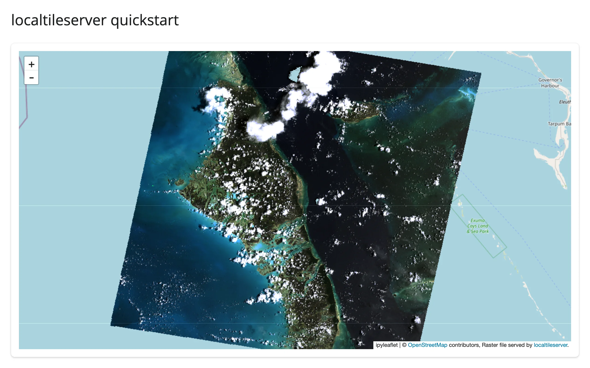
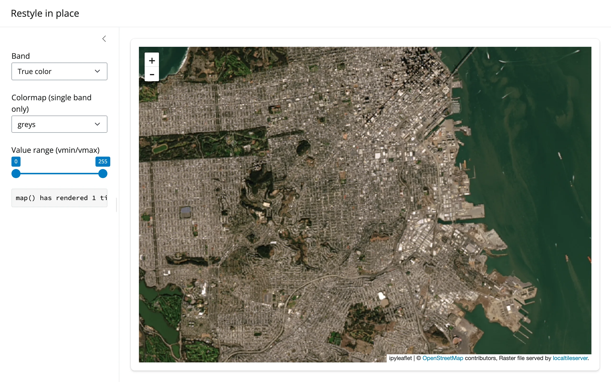
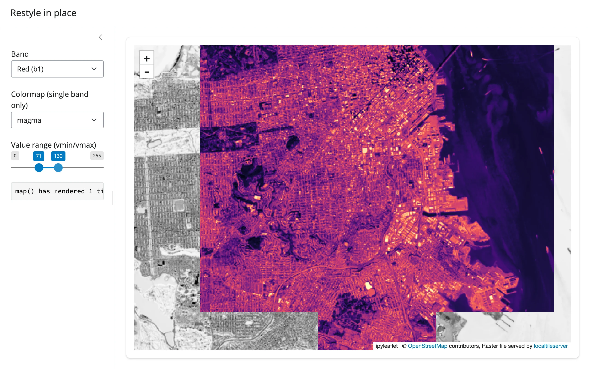
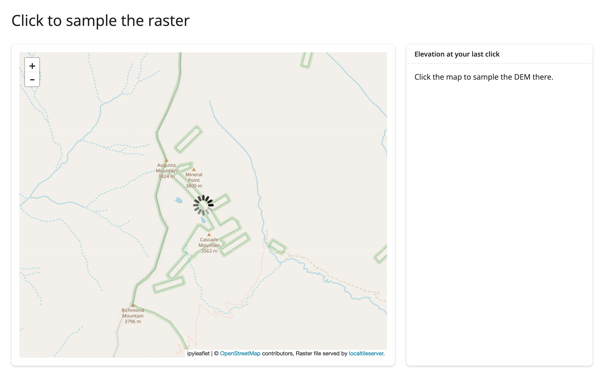
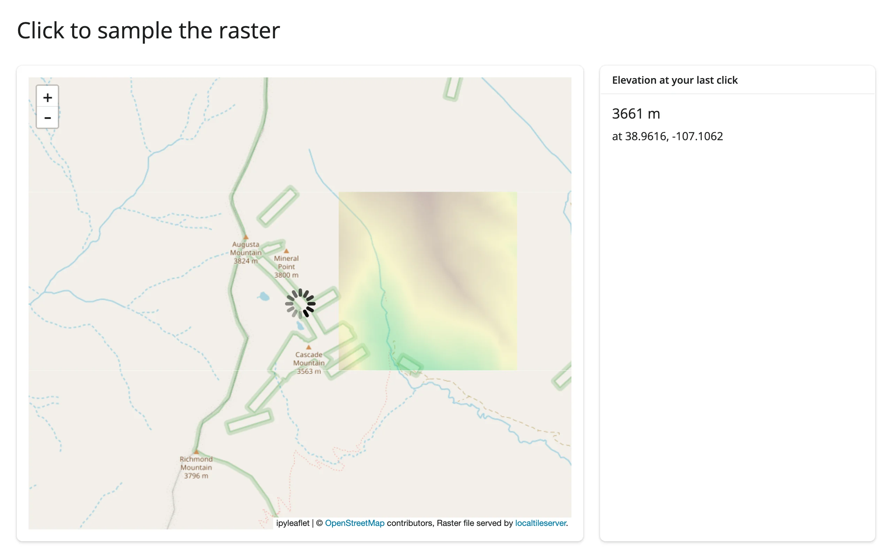
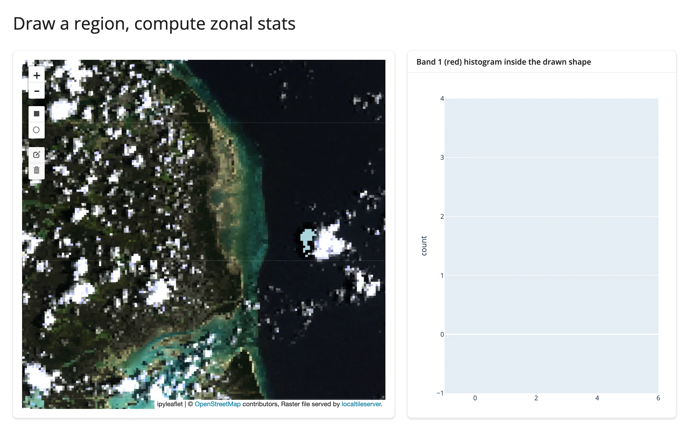
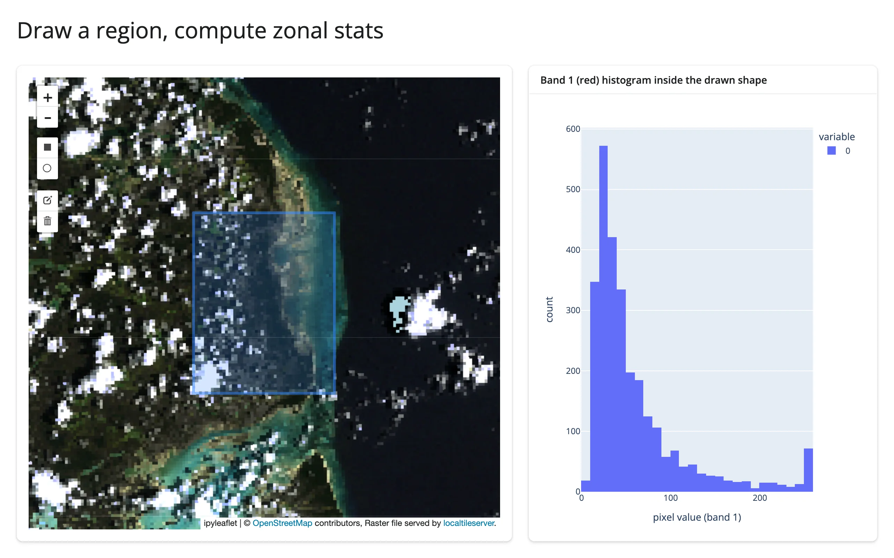
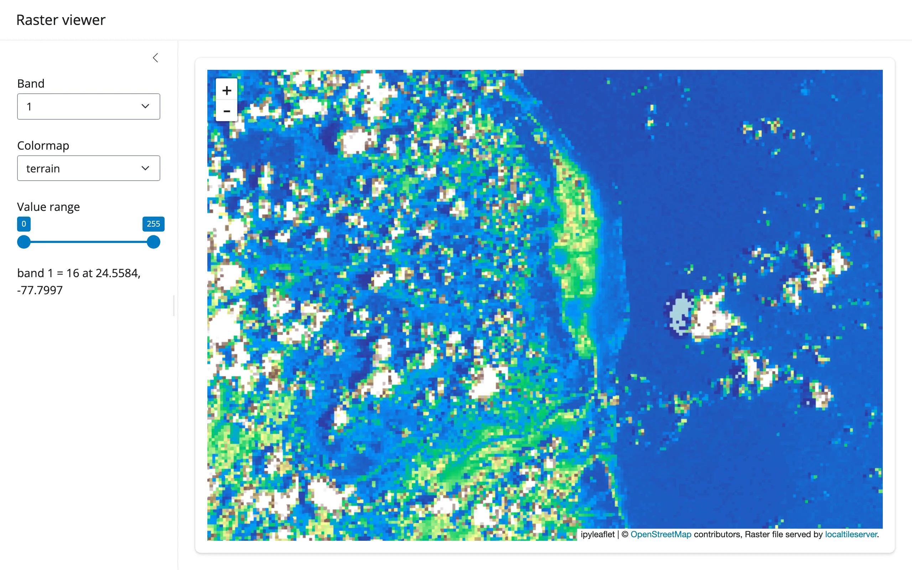
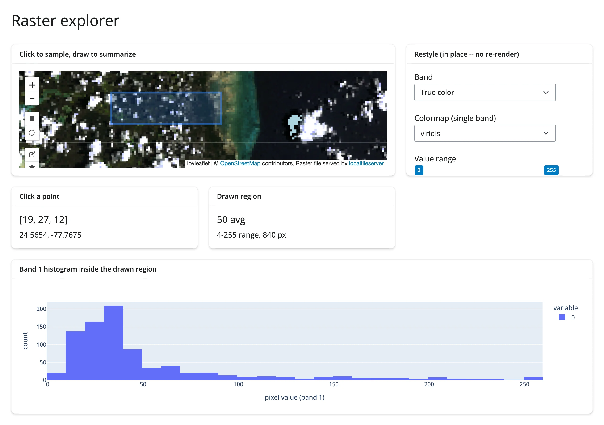

[localtileserver](https://localtileserver.banesullivan.com) is a small Python package (maintained by Bane
Sullivan) that turns a local raster -- a GeoTIFF, a Cloud-Optimized GeoTIFF (COG), or a remote one reachable by
URL -- into an XYZ tile server running in your own process. Give it a file, get back a `TileClient` that can hand
any Leaflet-style map a `{z}/{x}/{y}` tile URL, with band selection, colormaps, value rescaling, and band math
all expressed as query parameters. There is no dedicated `@render_localtileserver`: the client builds an ordinary
`ipyleaflet.TileLayer` (via `get_leaflet_tile_layer()`), so it rides on [`@render_ipyleaflet`](../ipyleaflet/index.md)
or [`@render_leafmap`](../leafmap/index.md) like any other layer.

What shinywidgets adds is the part that doesn't show up in the demo: localtileserver's tile server binds to
`127.0.0.1` in your Python process, so by default only a browser on the same machine can reach it -- fine in
Jupyter, broken the moment the app is deployed. The tile server's API also takes an unauthenticated `filename`
(or `url`, for remote rasters) query parameter, which is a problem the instant anything makes that port
reachable. shinywidgets auto-detects any ipyleaflet layer built from a `TileClient`, mounts a reverse proxy for
it under `/proxy/{port}/`, rewrites the layer's tile URLs onto that proxy, and guards the proxy so it only ever
serves rasters your app actually registered. None of this is API you call: it happens the moment you render a
localtileserver layer.

Reach for localtileserver when you have raster data -- elevation, imagery, a scientific grid -- sitting in a file
or at a URL, and you want it on a map without running a separate tile service or converting it to vector tiles.
For vector data (points, lines, polygons), plain [ipyleaflet](../ipyleaflet/index.md) or
[lonboard](../lonboard/index.md) are a better fit. [leafmap](../leafmap/index.md)'s `add_raster()` is
localtileserver under the hood with a friendlier one-line API; this guide covers the lower-level `TileClient`
calls that both it and the raw ipyleaflet path share.



## Installation

```sh
pip install 'shinywidgets[ipyleaflet]' 'localtileserver>=1.0.0'
```

Pin `>=1.0.0`: that's the first release where `get_leaflet_tile_layer()` always attaches the `tile_server`
attribute shinywidgets' auto-wiring looks for (earlier versions only set it in some construction paths). Also
install `rasterio` support for your raster format if it isn't already pulled in (GeoTIFF/COG support ships by
default).

## Quick start

A `TileClient` wraps a raster; `get_leaflet_tile_layer()` turns it into a layer you add to an ordinary
`ipyleaflet.Map`. This example uses `localtileserver.examples.get_bahamas()`, a 1999 aerial RGB survey of Exuma
shipped inside the package itself, so it needs no network and no sample data of your own:

```{.python file="examples/01_quickstart.py"}
# Bundled real RGB imagery (no network needed): a 1999 aerial survey of
# Exuma, Bahamas, shipped inside the localtileserver package itself.
import ipyleaflet as L
from localtileserver import TileClient, examples, get_leaflet_tile_layer
from shiny.express import ui
from shinywidgets import render_ipyleaflet

ui.page_opts(title="localtileserver quickstart", fillable=True)

# Create the TileClient at module scope, never inside a render: the first
# open takes a few seconds, later layers on the same server are fast.
client: TileClient = examples.get_bahamas()

with ui.card():

    @render_ipyleaflet
    def map():
        m = L.Map(center=client.center(), zoom=9)
        m.add(get_leaflet_tile_layer(client))
        return m
```


For your own data: `TileClient("path/to/raster.tif")` or `TileClient("https://.../raster.tif")` (the latter reads
over `/vsicurl/`, so only the tiles you actually view are fetched -- see "Using real data" below). Create the
client once at module scope; constructing it inside a render function re-opens the file on every re-render.

## What you can build

### Band selection, colormaps, and band math

`get_tile_url()` (and `get_leaflet_tile_layer()`, which calls it once up front) take `indexes` (1-based band
numbers), `colormap` (a lowercase [rio-tiler colormap](https://cogeotiff.github.io/rio-tiler/colormap/) name,
applied to a single band), `vmin`/`vmax` (value rescaling), and `expression` (band math, e.g.
`"(b2-b1)/(b2+b1)"` for an NDVI-style index). All of it is just URL query parameters -- the server renders the
PNG per tile on request. See "Restyling in place" below for wiring these to Shiny inputs.

### Reading the raster, not just displaying it

Beyond tiles, a `TileClient` can answer direct questions about the data: `client.statistics()` returns
min/max/mean/percentiles/histogram per band (handy for building slider ranges), `client.point(lon, lat)` samples
the exact pixel value at a coordinate, and `client.feature(geojson, ...)` crops and reads a GeoJSON region as an
array. The "Reacting to user interaction" section below builds both a click-to-sample and a draw-to-summarize
view on top of these.

## Reacting to user interaction

localtileserver itself has no accessors or reactive API -- a `TileClient` is a plain Python object, and the map
it feeds is an ordinary `ipyleaflet.Map`. All reactivity comes from
[ipyleaflet's five accessors](../ipyleaflet/index.md#accessor-reference) (`bounds()`, `zoom()`, `center()`,
`clicked()`, `drawn_features()`) on the renderer, combined with plain `TileClient` method calls to turn a
click or a drawn shape into a question about the raster.

### Restyling in place: band, colormap, value range

Style lives entirely in the tile URL, so a Shiny input just needs to reassign `layer.url` -- there is no
dedicated accessor for this, it's the same in-place-update pattern as any other ipyleaflet layer trait. This
example drives band, colormap, and a `vmin`/`vmax` range from sidebar inputs, over a public NAIP aerial COG of
San Francisco Bay served via `/vsicurl/`:

```{.python file="examples/02_restyle.py"}
# Public COG over the network: NAIP aerial imagery of San Francisco Bay,
# served from a public bucket via /vsicurl/ (first open takes a few seconds).
import ipyleaflet as L
from localtileserver import TileClient, examples, get_leaflet_tile_layer
from shiny import reactive
from shiny.express import input, render, ui
from shinywidgets import render_ipyleaflet

ui.page_opts(title="Restyle in place", fillable=True)

client: TileClient = examples.get_san_francisco()
BANDS = {"Red (b1)": [1], "Green (b2)": [2], "Blue (b3)": [3], "True color": [1, 2, 3]}
COLORMAPS = ["greys", "viridis", "magma", "terrain"]

render_count = reactive.value(0)

with ui.sidebar():
    ui.input_select("band", "Band", list(BANDS), selected="True color")
    ui.input_select("colormap", "Colormap (single band only)", COLORMAPS)
    ui.input_slider("range", "Value range (vmin/vmax)", 0, 255, value=[0, 255])

    @render.code
    def renders():
        return f"map() has rendered {render_count()} time(s)"

with ui.card():

    @render_ipyleaflet
    def map():
        with reactive.isolate():
            render_count.set(render_count() + 1)
        m = L.Map(center=client.center(), zoom=13)
        m.add(get_leaflet_tile_layer(client, indexes=[1, 2, 3]))
        return m


@reactive.effect
def _restyle():
    indexes = BANDS[input.band()]
    kwargs = {} if len(indexes) > 1 else {"colormap": input.colormap()}
    url = client.get_tile_url(
        indexes=indexes,
        vmin=input.range()[0],
        vmax=input.range()[1],
        client=True,
        **kwargs,
    )
    map.widget.layers[1].url = url
```




**Measured: restyling never re-renders.** The sidebar counts calls to `map()`; switching band, colormap, and
dragging both range handles all left it at 1 in a Playwright run that drove every control. Only the layer's
`url` trait changes, so the browser swaps the visible tiles for the new style without the server rebuilding the
map, re-sending the widget bundle, or losing pan/zoom. `client=True` is required on `get_tile_url()` here --
`client=False` (the default) returns a server-side URL, meaningless for a browser-rendered layer.

### Click to sample a point

`clicked()` gives you a coordinate; `client.point(lon, lat)` samples the raster there directly, server-side --
not the (possibly colormapped and rescaled) pixel the browser happens to be showing. This example samples a
USGS 1m elevation DEM over a slice of the Colorado Rockies:

```{.python file="examples/03_click_sample.py"}
# Public COG over the network: a USGS 1m DEM of a slice of the Colorado
# Rockies, served from a public bucket via /vsicurl/.
import ipyleaflet as L
from localtileserver import TileClient, examples, get_leaflet_tile_layer
from shiny.express import render, ui
from shinywidgets import render_ipyleaflet

ui.page_opts(title="Click to sample the raster", fillable=True)

client: TileClient = examples.get_co_elevation()
STATS = client.statistics()["b1"]

with ui.layout_columns(col_widths=[8, 4]):
    with ui.card():

        @render_ipyleaflet
        def map():
            m = L.Map(center=client.center(), zoom=14)
            m.add(get_leaflet_tile_layer(client, colormap="terrain", vmin=STATS["min"], vmax=STATS["max"]))
            return m

    with ui.card():
        ui.card_header("Elevation at your last click")

        @render.ui
        def elevation():
            c = map.clicked()
            if c is None:
                return "Click the map to sample the DEM there."
            lat, lng = c["coordinates"]
            # Sampled server-side, straight from the source raster -- not from
            # the (possibly rescaled/colormapped) tile the browser is showing
            value = client.point(lng, lat).array[0]
            return ui.div(
                ui.h5(f"{value:.0f} m"),
                f"at {lat:.4f}, {lng:.4f}",
            )
```




Verified with a real click in Chromium: the card reported 3661 m near Augusta Mountain (3824 m) and Cascade
Mountain (3563 m), consistent with the surrounding terrain. `client.point()` returns a `PointData` object;
`.array` is the per-band value at that coordinate (one entry per band -- index `[0]` for a single-band DEM, or
keep the whole array for an RGB raster).

### Draw a region, compute zonal stats

`drawn_features()` returns GeoJSON; `client.feature(geometry, indexes=..., encoding="npy")` crops the raster to
that geometry and returns a raw NumPy array -- the last band is always a 0/255 validity mask marking which
pixels actually fall inside the (possibly non-rectangular) shape, so mask it out before computing statistics:

```{.python file="examples/04_draw_zonal_stats.py"}
# Bundled real RGB imagery (no network needed): a 1999 aerial survey of
# Exuma, Bahamas, shipped inside the localtileserver package itself.
import io

import ipyleaflet as L
import numpy as np
import plotly.express as px
from localtileserver import TileClient, examples, get_leaflet_tile_layer
from shiny.express import render, ui
from shinywidgets import render_ipyleaflet, render_plotly

ui.page_opts(title="Draw a region, compute zonal stats", fillable=True)

client: TileClient = examples.get_bahamas()

with ui.layout_columns(col_widths=[7, 5]):
    with ui.card():

        @render_ipyleaflet
        def map():
            m = L.Map(center=client.center(), zoom=11)
            m.add(get_leaflet_tile_layer(client))
            m.add(L.DrawControl(rectangle={"shapeOptions": {}}, polygon={}, circle={}, polyline={}, marker={}))
            return m

    with ui.card(full_screen=True):
        ui.card_header("Band 1 (red) histogram inside the drawn shape")

        @render_plotly
        def hist():
            feats = map.drawn_features()  # [] until something is drawn
            if not feats:
                return px.histogram()
            # client.feature() takes GeoJSON straight from drawn_features() --
            # no CRS conversion needed, unlike client.part()'s bbox (see Gotchas)
            raw = client.feature(feats[-1]["geometry"], indexes=[1], encoding="npy")
            band, mask = np.load(io.BytesIO(raw))
            values = band[mask > 0]  # drop pixels outside the (non-rectangular) shape
            return px.histogram(values, nbins=40, labels={"value": "pixel value (band 1)"})
```




Verified by drawing a rectangle over the coastal transition with Playwright mouse events: the histogram
populated with the expected bimodal shape (dark water near 0, bright sand and cloud near 255). The same pattern
works for any `drawn_features()` shape (polygon, circle), not just rectangles -- `client.feature()` handles the
geometry, not just its bounding box.

### Beyond clicks and drawing: `bounds()`, `zoom()`, `center()`

The remaining three ipyleaflet accessors work exactly as documented in the [ipyleaflet
guide](../ipyleaflet/index.md#camera-state-bounds-zoom-center): `bounds()` makes "what's currently in the
viewport" a reactive value, useful for recomputing `client.statistics()` or a summary chart over only the
visible extent rather than the whole raster.

## Updating the widget from Python

Every example above already uses the right pattern: style changes go through a `@reactive.effect` that mutates
`map.widget.layers[...].url` (or `.opacity`), never a re-render. This is the normal
[ipyleaflet in-place update story](../ipyleaflet/index.md#updating-the-widget-from-python) applied to a
localtileserver layer specifically -- see that guide for when a full re-render is the better choice instead
(changing the number or structure of layers).

## Behind the scenes: the deployment story

In Jupyter, or running `shiny run` on your laptop, a localtileserver layer's tile URL defaults to
`http://127.0.0.1:{port}/...` and everything just works because the browser and the tile server share a host.
Deploy that same app to Posit Connect, shinyapps.io, or any other server, and the *browser's* loopback is not the
*server's* loopback -- the overlay silently vanishes with no error anywhere obvious. Separately, the tile API
reads its raster source from a plain `filename` (or `url`, for STAC/remote sources) query parameter with no
authentication, so the moment anything makes that port reachable, it's also readable by anyone who can reach the
app.

shinywidgets handles both problems automatically, with no API to call. The moment a layer built from a
`TileClient` renders (duck-typed on the `tile_server` attribute `get_leaflet_tile_layer()` attaches; never
imports localtileserver), shinywidgets:

- mounts a guarded reverse proxy at `/proxy/{port}/` on the Shiny app;
- registers that client's raster filename(s) behind an unguessable per-client capability token;
- rewrites the layer's tile URL to a **relative** `proxy/{port}/...` path carrying that token, and wraps
  `client.get_tile_url()` so every URL your own restyling code produces comes out the same way;
- keeps a backstop observer on the layer's `url` trait in case something reassigns it directly.

**Verified: the security guard actually blocks unauthorized reads.** Against a running app's mounted proxy
(same host and port the browser itself uses):

```
$ curl --get "http://127.0.0.1:9944/proxy/64772/api/tiles/11/581/879.webp" \
       --data-urlencode "filename=$REGISTERED_FILE" --data-urlencode "sw_token=$TOKEN"
200                                                              # legitimate request: works

$ curl --get "http://127.0.0.1:9944/proxy/64772/api/tiles/11/581/879.webp" \
       --data-urlencode "filename=$REGISTERED_FILE"
Forbidden: unregistered raster source                           # same file, no token: refused

$ curl --get "http://127.0.0.1:9944/proxy/64772/api/metadata" --data-urlencode "filename=/etc/passwd"
Forbidden: unregistered raster source                           # arbitrary path: refused

$ curl --get "http://127.0.0.1:9944/proxy/64772/api/stac/tiles/0/0/0.webp" \
       --data-urlencode "url=https://169.254.169.254/latest/meta-data/"
Forbidden: unregistered raster source                           # SSRF attempt via url=: refused
```

Knowing the registered filename is not enough without the token, and the guard covers every raster-source
selector the tile API reads (`filename`, `files`, `url`, `filenameA`/`filenameB`), not just the obvious one.

**Verified behind a path prefix.** Posit Connect and shinyapps.io serve an app under a sub-path of the public
URL (e.g. `https://connect.example.com/content/app1/`), not at the domain root. Mounting the same Shiny app
under `/app1/` with a Starlette wrapper and loading it in Chromium showed every tile request going to
`http://.../app1/proxy/{port}/api/tiles/...` -- the *relative* URL rewrite (`proxy/{port}/...`, not
`/proxy/{port}/...`) resolves correctly against whatever path the page itself is served from, which is exactly
why the rewrite is relative rather than root-relative.

None of this requires calling anything: `SHINYWIDGETS_LOOPBACK_PROXY_DISABLE=1` is the only knob, for the rare
case you want to opt out entirely.

## Using real data

The examples above intentionally mix two data sources so you can see both ends honestly:

- **`localtileserver.examples.get_bahamas()`** is bundled inside the package itself -- a real 1999 aerial RGB
  survey of Exuma, no network required, used for the quickstart and the draw/zonal-stats example.
- **`localtileserver.examples.get_san_francisco()`** and **`get_co_elevation()`** stream real public
  Cloud-Optimized GeoTIFFs (NAIP aerial imagery; a USGS 1m DEM) from a public bucket over `/vsicurl/`. These need
  network access; the first tile request against a fresh client takes a few seconds while GDAL opens the remote
  file and reads its overviews. For your own data, `TileClient("https://.../your.tif")` works the same way --
  only the tiles actually viewed are fetched, not the whole file.

`localtileserver.examples` has several more (`get_elevation()`, `get_landsat()`, `get_oam2()`, among others) if
you want other sample rasters to try locally.

## Large data

localtileserver's large-data mode is the only one it has: raster data never leaves the server. `TileClient`
serves `{z}/{x}/{y}` tiles on demand, so only the tiles the current viewport actually requests are read and
sent, however large the source GeoTIFF/COG is -- "only send what's visible." The section above measures this
qualitatively: `get_san_francisco()`'s COG streams over `/vsicurl/`, and only the viewed region's overviews are
fetched, not the whole file. There's no practical pixel-count ceiling the way there is for point data; the
limit is tile-generation latency per request (GDAL decode plus resample), and COG overviews keep that bounded
even at country-scale rasters. See the
[Large data & performance article](../../guide/performance/index.md#three-approaches-to-large-data) for the
other two approaches, used by widgets that render discrete points or polygons rather than a continuous raster.

## Gotchas and limitations

- **`client.part(bbox)`'s `bounds_crs` defaults to the dataset's native CRS, not WGS84 -- and failing silently
  is worse than it sounds.** `client.bounds()`/`center()` return WGS84 lon/lat by default, so it's natural to
  assume a bbox built from them (or from a drawn rectangle's corners) can go straight into `part()`. It can't:
  without `bounds_crs="EPSG:4326"`, `part()` interprets those numbers in the raster's own CRS (UTM, for the
  Bahamas sample) and returns a degenerate ~1x1-pixel crop instead of raising an error. `client.feature()` does
  not have this problem -- it takes GeoJSON, which is always WGS84 by spec, and reprojects internally -- which is
  why the draw/zonal-stats example above uses `feature()` rather than `part()` with `drawn_features()`'s
  geometry. Verified against localtileserver 1.0.0; the docstring is technically accurate about the default, it's
  just an easy trap when the two methods' coordinate conventions differ by default.
- **`client.point(...).array` holds NumPy scalar types, not native `int`/`float`.** Formatting one with an
  f-string format spec (`f"{value:.0f}"`) works fine, but under NumPy 2.x, dropping the raw value into a list or
  an f-string without a format spec shows as `np.uint8(19)` rather than `19`. Cast with `int(...)`/`float(...)`
  before displaying a collection of values.
- **Colormap names are rio-tiler's, lowercase** (`"terrain"`, `"magma"`, `"rdylbu"` -- not matplotlib's
  `"RdYlBu"`). An invalid name raises inside the restyling effect, which Shiny reports as an unhandled error and
  tears down the session. Validate any user-facing colormap choices against `rio_tiler.colormap.cmap.list()`.
  Carried over from the original evaluation report; not independently re-verified for this guide.
- **The first `TileClient` open on a given raster takes a few seconds** (longer for a remote `/vsicurl/` source,
  while GDAL reads overviews over the network). Always construct clients at module scope, never inside a render
  function -- otherwise every re-render re-opens the file.
- **No accessors of its own.** All reactivity comes from the host renderer (ipyleaflet's `clicked()`,
  `drawn_features()`, `bounds()`, `zoom()`, `center()`); localtileserver doesn't add any new reactive surface on
  top.

## Gallery candidates

**[`gallery/template_raster_viewer.py`](gallery/template_raster_viewer.py)** (template, ~65 lines) -- a clean
starting point for any local raster: band/colormap/value-range controls that restyle in place, plus
click-to-sample via `clicked()` in the sidebar.



**[`gallery/showcase_raster_explorer.py`](gallery/showcase_raster_explorer.py)** (showcase, ~100 lines) -- one
raster, three ways to read it at once: restyle band/colormap/range in place, click a point for its exact pixel
value, and draw a rectangle for a live histogram of everything inside it.



## Learn more

- [localtileserver documentation](https://localtileserver.banesullivan.com)
- [rio-tiler colormap reference](https://cogeotiff.github.io/rio-tiler/colormap/) (names, all lowercase)
- Related guides: [ipyleaflet](../ipyleaflet/index.md) (the accessors this guide builds on),
  [leafmap](../leafmap/index.md) (`add_raster()` -- the same machinery behind a higher-level API)
