[lonboard](https://developmentseed.org/lonboard/) is a GPU-accelerated map widget from
[Development Seed](https://developmentseed.org/), built on [deck.gl](https://deck.gl) and
[GeoArrow](https://geoarrow.org/). Where most Python map widgets serialize GeoJSON and render on the
CPU, lonboard moves Arrow-columnar geometry straight to the browser and draws it with WebGL -- so a
scatterplot of a few hundred thousand points pans and zooms as smoothly as a few hundred. It speaks
GeoPandas, GeoArrow tables, and raw Arrow arrays natively, and ships a small set of purpose-built
layers (scatter, path, polygon, arc, column, heatmap, point cloud, trips, H3, and a WebGL globe)
rather than a general-purpose rendering pipeline.

`@render_lonboard` accepts a `lonboard.Map`, a layer (or list of layers), or anything
`lonboard.viz()` understands -- most commonly a GeoPandas `GeoDataFrame` or a GeoArrow-compatible
Arrow table. It applies shinywidgets' usual layout defaults (the map fills its container unless you
give it an explicit pixel height) and gives every rendered map five reactive accessors --
`view_state()`, `selected()`, `selected_rows()`, `selected_bounds()`, and `clicked()` -- that turn
pan, pick, box select, and click into values you read like `input.x()`. Those accessors are what make lonboard a
genuine *input*, not just an output: a map can drive a chart, a table, or another map, the same way a
slider drives a plot.

Reach for lonboard when the story is **scale** (tens of thousands of points or more) or **GPU-native
styling** (data-driven color/radius via `apply_continuous_cmap`, extrusion, a WebGL globe). For
tile-based basemaps with a more traditional Leaflet-style API and drawing tools, see
[ipyleaflet](../ipyleaflet/index.md) or [leafmap](../leafmap/index.md); for vector-tile styling with a
Mapbox GL / MapLibre style spec, see [maplibre](../maplibre/index.md); for one-line "point in,
clustered dashboard out" exploration, see [keplergl](../keplergl/index.md).

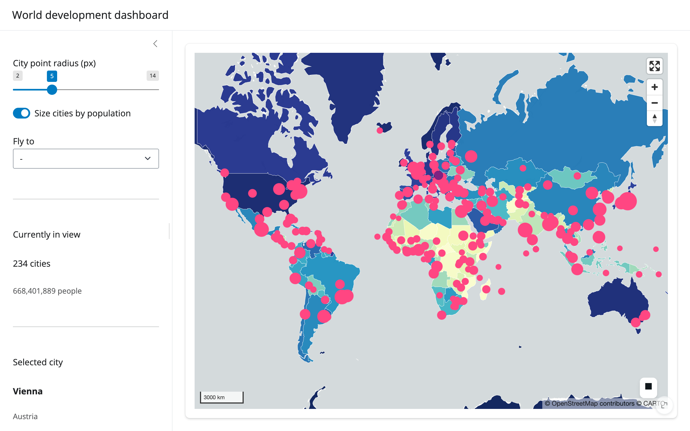

## Installation

```sh
pip install 'shinywidgets[lonboard]'
```

This installs `lonboard` itself. GeoDataFrame input additionally needs `geopandas` and `pyarrow`
(lonboard converts via `geopandas_to_geoarrow`); the examples below also use `matplotlib` for color
ramps.

## Quick start

A `GeoDataFrame` returned from a `@render_lonboard` function is converted with `lonboard.viz()`,
which picks a layer type (`ScatterplotLayer` for points) and fits the initial view to the data --
no `Map` or layer construction required.

```{.python file="examples/01_quickstart.py"}
import geopandas as gpd
from shiny.express import ui
from shinywidgets import render_lonboard

ui.page_opts(fillable=True)

# ~240 populated places from Natural Earth (110m scale), with longitude/
# latitude and population columns.
CITIES_URL = "https://raw.githubusercontent.com/nvkelso/natural-earth-vector/master/geojson/ne_110m_populated_places.geojson"


@render_lonboard
def map():
    cities = gpd.read_file(CITIES_URL)
    return cities  # lonboard.viz() picks a ScatterplotLayer and fits the view
```

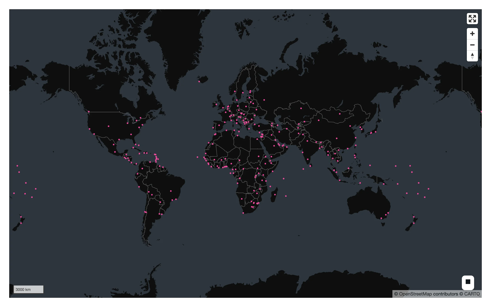

## What you can build

### Choropleths with `apply_continuous_cmap`

lonboard's `apply_continuous_cmap()` turns a 0-1 array into per-row RGB(A) in one call, using any
matplotlib colormap (or a [palettable](https://jiffyclub.github.io/palettable/) `Palette`). Pass
the result straight to a layer's `get_fill_color`.

```{.python file="examples/02_choropleth.py"}
import geopandas as gpd
import matplotlib.pyplot as plt
from lonboard import PolygonLayer
from lonboard.colormap import apply_continuous_cmap
from shiny.express import ui
from shinywidgets import render_lonboard

ui.page_opts(fillable=True)

COUNTRIES_URL = "https://raw.githubusercontent.com/nvkelso/natural-earth-vector/master/geojson/ne_110m_admin_0_countries.geojson"


@render_lonboard
def map():
    countries = gpd.read_file(COUNTRIES_URL)
    countries = countries[countries.GDP_MD > 0].copy()
    gdp_per_capita = countries.GDP_MD * 1e6 / countries.POP_EST
    # apply_continuous_cmap() takes values in [0, 1] and any matplotlib
    # colormap (or a palettable Palette), returning one uint8 RGB row per value
    colors = apply_continuous_cmap(gdp_per_capita.rank(pct=True), plt.get_cmap("YlOrRd"))
    return PolygonLayer.from_geopandas(
        countries, get_fill_color=colors, get_line_color=[80, 80, 80], opacity=0.85
    )
```

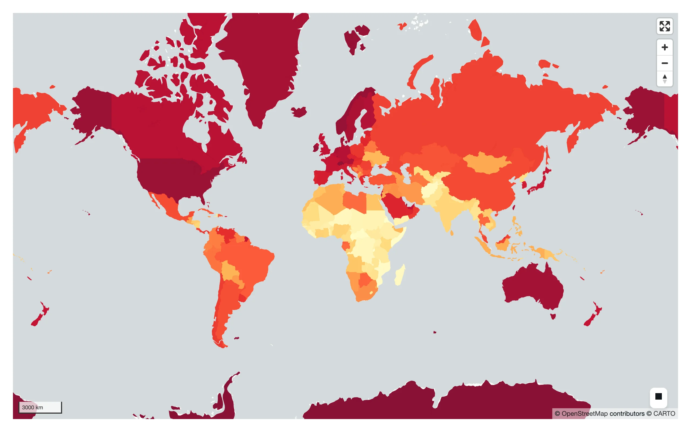

### Arcs, from plain arrays

Not every layer takes geometry. `ArcLayer` has no geometry column of its own -- give it a table
for the row count and plain float64 arrays for `get_source_position`/`get_target_position`. Because
there's no geometry, lonboard can't auto-fit the view, so set one explicitly.

```{.python file="examples/03_arcs.py"}
import geopandas as gpd
import numpy as np
import pyarrow as pa
from lonboard import ArcLayer, Map
from lonboard.view_state import MapViewState
from shiny.express import ui
from shinywidgets import render_lonboard

ui.page_opts(fillable=True)

CITIES_URL = "https://raw.githubusercontent.com/nvkelso/natural-earth-vector/master/geojson/ne_110m_populated_places.geojson"
HUB = "London"
DESTINATIONS = ["New York", "Dubai", "Singapore", "Johannesburg", "Sydney", "Lima"]


@render_lonboard
def map():
    cities = gpd.read_file(CITIES_URL).set_index("NAME")
    hub_lon, hub_lat = cities.loc[HUB, ["LONGITUDE", "LATITUDE"]]
    dest = cities.loc[DESTINATIONS]
    n = len(dest)

    # ArcLayer has no geometry column of its own: pass source/target
    # coordinates as plain float64 arrays, with a dummy table for the row
    # count. Without geometry, lonboard can't auto-fit the view, so set one.
    layer = ArcLayer(
        table=pa.table({"name": dest.index.tolist()}),
        get_source_position=np.column_stack(
            [np.full(n, hub_lon), np.full(n, hub_lat)]
        ),
        get_target_position=dest[["LONGITUDE", "LATITUDE"]].to_numpy(dtype="float64"),
        get_source_color=[0, 200, 255],
        get_target_color=[255, 80, 80],
        get_width=3,
    )
    return Map(layer, view_state=MapViewState(longitude=10, latitude=20, zoom=0.8))
```

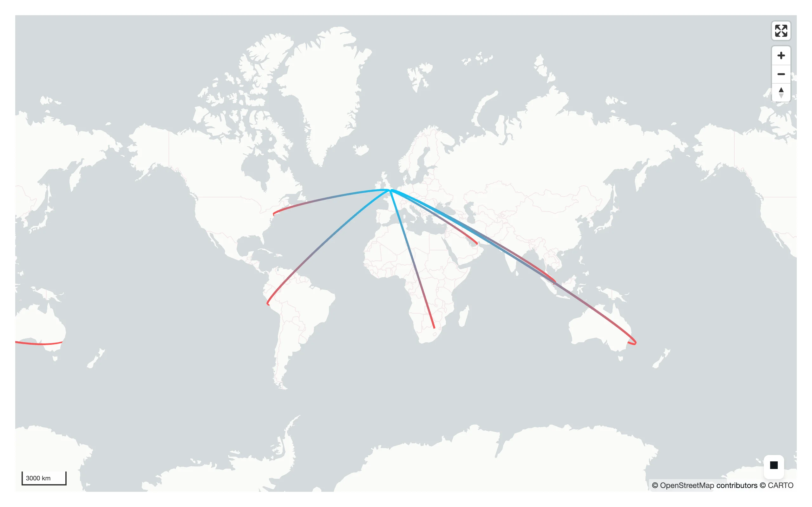

### GeoArrow tables, no GeoPandas required

lonboard's native format is GeoArrow. For data that's already Arrow -- a GeoParquet file, a DuckDB
spatial query, a [geoarrow-rust](https://geoarrow.org/geoarrow-rs/python/latest/) pipeline -- you
can build a layer directly from an Arrow table and skip GeoPandas/shapely entirely.

```{.python file="examples/04_geoarrow.py"}
import geoarrow.rust.core as gr
import numpy as np
from arro3.core import Table
from lonboard import ScatterplotLayer
from shiny.express import ui
from shinywidgets import render_lonboard

ui.page_opts(fillable=True)


# lonboard's native format is GeoArrow, not just GeoDataFrame: here a table is
# built directly from a GeoArrow point array, with no geopandas/shapely
# involved at all. This is the fastest path for data that's already Arrow
# (e.g., read from a GeoParquet file or a DuckDB spatial query).
@render_lonboard
def map():
    rng = np.random.default_rng(0)
    lon = rng.uniform(-74.05, -73.95, 2000)
    lat = rng.uniform(40.68, 40.78, 2000)
    points = gr.points((lon, lat), crs="EPSG:4326")
    table = Table.from_arrays([points], names=["geometry"])
    return ScatterplotLayer(table=table, get_fill_color=[0, 150, 255], radius_min_pixels=2)
```

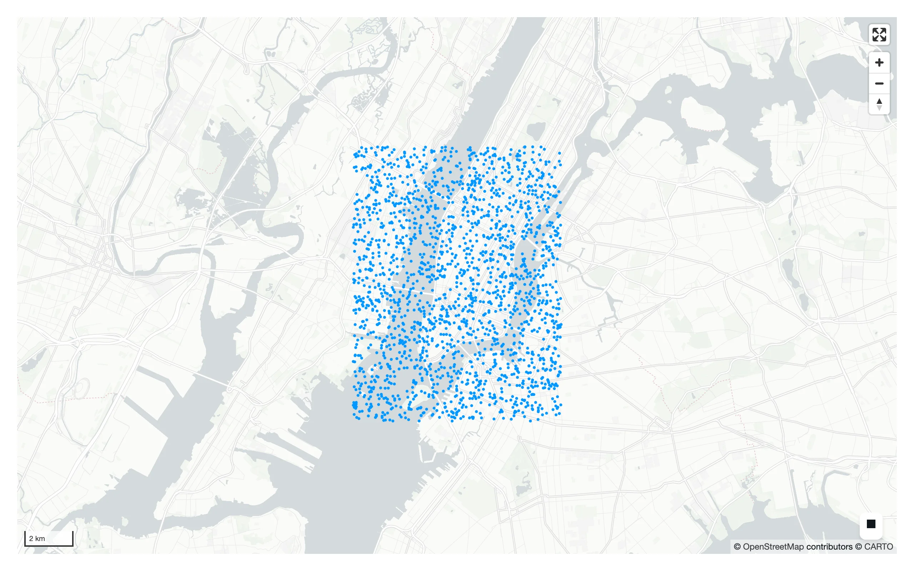

### Multiple layers on one map

A `Map` takes a list of layers, drawn in order (last on top). Combine a polygon basemap layer with
a point layer the same way you'd layer traces in a plotting library.

```{.python file="examples/05_multilayer.py"}
import geopandas as gpd
from lonboard import Map, PolygonLayer, ScatterplotLayer
from lonboard.basemap import CartoStyle, MaplibreBasemap
from shiny.express import ui
from shinywidgets import render_lonboard

ui.page_opts(fillable=True)

COUNTRIES_URL = "https://raw.githubusercontent.com/nvkelso/natural-earth-vector/master/geojson/ne_110m_admin_0_countries.geojson"
CITIES_URL = "https://raw.githubusercontent.com/nvkelso/natural-earth-vector/master/geojson/ne_110m_populated_places.geojson"


@render_lonboard
def map():
    countries = PolygonLayer.from_geopandas(
        gpd.read_file(COUNTRIES_URL),
        get_fill_color=[40, 40, 40],
        get_line_color=[90, 90, 90],
        opacity=0.6,
    )
    cities = ScatterplotLayer.from_geopandas(
        gpd.read_file(CITIES_URL),
        get_fill_color=[255, 210, 0],
        radius_min_pixels=2,
        pickable=True,
    )
    # A Map holds a list of layers; order determines draw order (last on top)
    return Map([countries, cities], basemap=MaplibreBasemap(style=CartoStyle.DarkMatter))
```

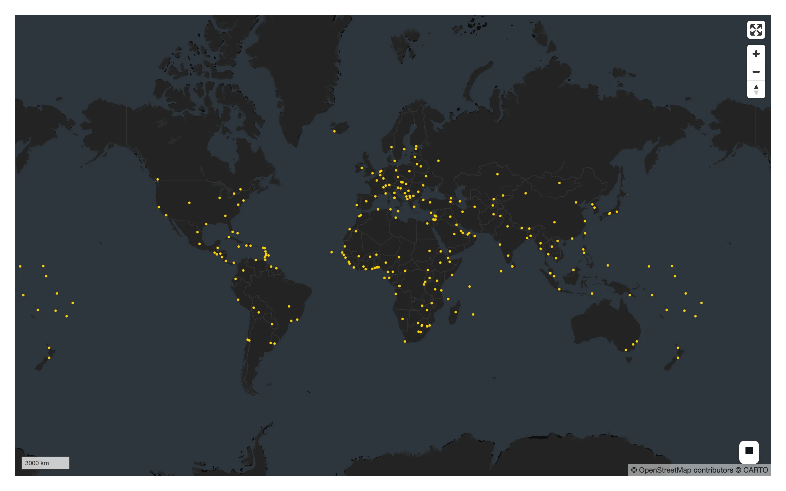

### A WebGL globe

Swapping `view=GlobeView()` (plus an interleaved basemap) turns the same layer into a rotatable
WebGL globe -- no other code changes.

```{.python file="examples/06_globe.py"}
import geopandas as gpd
from lonboard import Map, ScatterplotLayer
from lonboard._map import GlobeView
from lonboard.basemap import MaplibreBasemap
from shiny.express import ui
from shinywidgets import render_lonboard

ui.page_opts(fillable=True)

CITIES_URL = "https://raw.githubusercontent.com/nvkelso/natural-earth-vector/master/geojson/ne_110m_populated_places.geojson"


@render_lonboard
def map():
    cities = ScatterplotLayer.from_geopandas(
        gpd.read_file(CITIES_URL), get_fill_color=[255, 140, 0], radius_min_pixels=3
    )
    # Same layer, different view: GlobeView needs an interleaved basemap, and
    # lonboard raises a clear error if you forget it.
    return Map(cities, view=GlobeView(), basemap=MaplibreBasemap(mode="interleaved"))
```

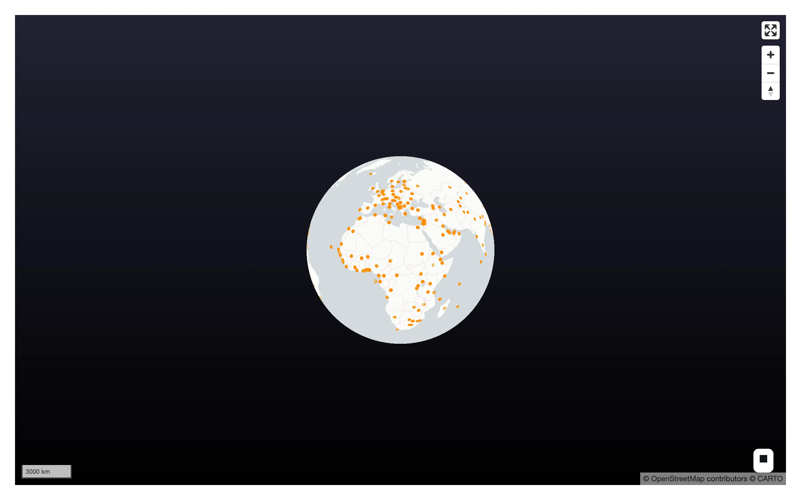

Note: `GlobeView` is importable only from the private `lonboard._map` module today; there's no
public top-level export. See [Gotchas](#gotchas-and-limitations) for a real limitation this view has
with the accessors below.

## Reacting to user interaction

### Accessor reference

Every accessor attaches the moment the map renders and records what the user does whether or not
anything has read it yet -- there's no warm-up read to remember, and a pick, box selection, or
click that happens before the first read still shows up in it.

| Accessor | Returns | Before any interaction | Across re-render | Default rate policy |
|---|---|---|---|---|
| `view_state()` | `MapViewState` / `GlobeViewState` (lng/lat order: `longitude`, `latitude`, `zoom`, `pitch`, `bearing`) | Seeded (computed from the layers) | Re-seeded from the new map | Debounced, 250 ms |
| `selected()` | `Optional[int]`, a positional row index | `None` | Re-seeded (a freshly built map starts with no pick) | None |
| `selected_rows(df=None)` | the picked row of `df` (default: a frame rebuilt from the pickable layer's own data), in `df`'s own type | empty frame | derived from `selected()` | None |
| `selected_bounds()` | `Optional[(minx, miny, maxx, maxy)]`, i.e. (west, south, east, north) | `None` | Re-seeded | None |
| `clicked()` | `Optional[(lng, lat)]` | `None` | Kept until the user clicks the new map | None |

`view_state()` and `selected()`/`selected_bounds()` describe the map's own state, so each
re-render starts over from the new map's state -- a fresh map has no pick or selection, so those
two are typically `None` again right after a re-render (immutable widget), while `view_state()`
always has a value (computed from the new map's layers). `clicked()` is different: a click is
something the *user* did, not something the map owns, so it survives a re-render and keeps
reporting the previous click until the user clicks the new map.

The four gesture accessors are exercised together below -- pan the map, click a city, and drag a
box with the Select BBox tool -- rendered as raw values so you can see exactly what each one
returns.

```{.python file="examples/07_accessors.py"}
import geopandas as gpd
from lonboard import Map, ScatterplotLayer
from lonboard.view_state import MapViewState
from shiny.express import render, ui
from shinywidgets import render_lonboard

ui.page_opts(fillable=True)

CITIES_URL = "https://raw.githubusercontent.com/nvkelso/natural-earth-vector/master/geojson/ne_110m_populated_places.geojson"
FOCUS = ["Paris", "London", "Berlin", "Madrid", "Rome"]

with ui.layout_columns(col_widths=[8, 4]):
    with ui.card(full_screen=True):

        @render_lonboard
        def map():
            cities = gpd.read_file(CITIES_URL)
            cities = cities[cities.NAME.isin(FOCUS)].reset_index(drop=True)
            layer = ScatterplotLayer.from_geopandas(
                cities, get_fill_color=[255, 60, 120], radius_min_pixels=12, pickable=True
            )
            return Map(
                layer,
                view_state=MapViewState(longitude=2.33, latitude=48.87, zoom=4.2),
                # Keep the canvas size stable; the "Accessors" card already
                # shows feature detail via selected()
                show_side_panel=False,
            )

    with ui.card():
        ui.card_header("Accessors")

        @render.code
        def view_state():
            vs = map.view_state()
            return f"view_state()\n  lon={vs.longitude:.2f} lat={vs.latitude:.2f} zoom={vs.zoom:.2f}"

        @render.code
        def selected():
            return f"selected()\n  {map.selected()}"

        @render.code
        def selected_bounds():
            return f"selected_bounds()\n  {map.selected_bounds()}"

        @render.code
        def clicked():
            return f"clicked()\n  {map.clicked()}"
```

Before any interaction, `view_state()` is already populated (computed from the layer's bounds);
the other three are `None`:

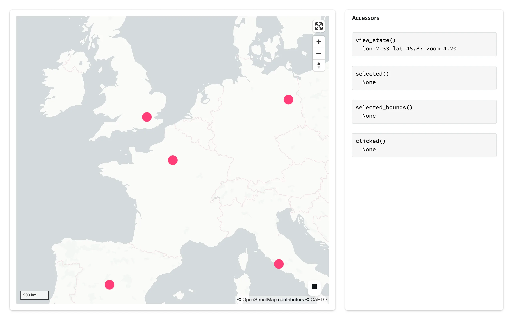

After panning, clicking Paris, and drawing a box over Western Europe, all four report their values
-- note `clicked()` and `selected_bounds()` are in `(lng, lat)` order, the opposite of ipyleaflet's
`[lat, lng]`:

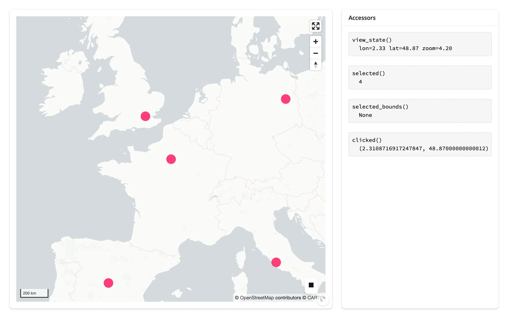

#### `view_state()`

Available immediately (it's computed from the layer bounds at construction, not only after a
gesture). The browser reports continuously through a pan, zoom, or rotate -- every frame of the
gesture -- so this accessor debounces its publication to Python by 250 ms by default; each new
report during an active gesture re-arms the debounce, so `view_state()` settles once the gesture
pauses rather than updating on every frame. Override the window (or switch to `"throttle"`) with
`render_lonboard`'s `rate_policy`/`rate_delay` kwargs -- see [Rate limiting](#rate-limiting). The
map itself is immutable per render, so a re-render always starts fresh from the new map's own
computed view state -- `view_state()` is never `None` once rendered.

#### `selected()`

The positional index of the most recently picked row, across
**all** pickable layers on the map -- it can't tell you which layer fired. When what you want is
the picked *row* rather than its position, that's [`selected_rows()`](#selected_rows) below.
Picking the same row of
the same layer twice in a row doesn't re-fire, and clicking empty space doesn't clear it. A layer
only reports picks when `pickable=True` (the default). Re-seeded on every re-render: a freshly
built map starts with no pick, so `selected()` goes back to `None` until the new map reports
one (the exception is a map that outlives its render, e.g. a `shared_lifetime()` map, which can
carry a retained pick forward). With several pickable layers, read each layer's own
`selected_index` trait directly instead -- see [Beyond the
accessors](#beyond-the-accessors-reactive_read) below.

#### `selected_rows()`

The picked row of a data frame -- what `selected()` means when what you want is the row itself,
for a detail card, a table, or a download. `map.selected_rows()` with no argument rebuilds the
frame from the pickable layer's own data
(`geopandas.GeoDataFrame.from_arrow(layer.table)`), which keeps the layer's rows and columns but
not your original frame's index: the result gets a fresh `RangeIndex`. Pass a frame explicitly --
`map.selected_rows(gdf)` -- when you need the original frame (or it isn't a GeoDataFrame); any
frame type works (pandas in, pandas out; polars in, polars out). It's an empty frame while
nothing is picked, so it can also be passed straight to `@render.data_frame`.

Two caveats:

- **The default needs exactly one pickable layer and geopandas.** Every lonboard layer can hold
  a pick, so a map with several layers (a choropleth under a city scatter, say) has no way to say
  which layer a pick came from -- the default raises, and you pass `df=` for the layer you mean
  (or read each layer's pick yourself, as in [Beyond the
  accessors](#beyond-the-accessors-reactive_read)). The default also needs `geopandas`
  installed to rebuild the frame (it's an optional dependency, not part of the
  `shinywidgets[lonboard]` extra); without it you get a clear `ImportError`, and `df=` works
  regardless.
- **The match is positional** (`df.iloc[map.selected()]`), so after a re-render or in-place data
  replacement (`layer.table = ...` on a long-lived map), a retained position can point at a
  different row -- carry an ID column and look rows up by it when the data can change.

#### `selected_bounds()`

The bounding box from lonboard's built-in Select BBox control, as `(minx, miny, maxx, maxy)` --
west, south, east, north. The gesture is **click, then click again** at the opposite corner, not a
drag; the button is always present in the map's default controls. `None` until the first completed
selection in this render, and re-seeded to `None` on every re-render -- a freshly built map has no
selection of its own. Setting `selected_bounds` from Python does not draw the overlay rectangle
(the trait and the overlay rendering aren't wired together upstream), so don't try to seed a
selection that way.

#### `clicked()`

The `(lng, lat)` of the most recent click anywhere on the map -- including open ocean, unlike
`selected()`, which only fires on a pickable feature. `clicked()` attaches the moment the map
renders, whether or not anything has read it yet, so a click that happens before the first read
still shows up in it. Clicking the same spot twice doesn't re-fire. Unlike the other three
accessors, a re-render doesn't reset it: `clicked()` keeps reporting the previous click until the
user clicks the new map (verified by clicking, forcing a re-render, and confirming the value
survives).

### Beyond the accessors: `reactive_read`

`selected()` tells you *that* something was picked, but not *which* layer, when a map has
several pickable layers. For that, skip the accessor and `reactive_read()` each layer's own
`selected_index` trait directly -- a layer is a child widget, not the rendered map itself, so
there's no `.read()` for it; `reactive_read()` is the tool for any widget that isn't an output's
own `.widget`:

```{.python file="examples/08_reactive_read_layer.py"}
import geopandas as gpd
from lonboard import Map, ScatterplotLayer
from lonboard.view_state import MapViewState
from shiny.express import render, ui
from shinywidgets import reactive_read, render_lonboard

ui.page_opts(fillable=True)

CITIES_URL = "https://raw.githubusercontent.com/nvkelso/natural-earth-vector/master/geojson/ne_110m_populated_places.geojson"

# map.selected() reports "whichever pickable layer was clicked most
# recently" -- it can't tell the two apart. With several pickable layers,
# read each layer's own `selected_index` trait instead.
CAPITALS = ["Paris", "Madrid", "Rome"]
OTHERS = ["Brussels", "Luxembourg", "Geneva", "Bern", "Andorra"]

with ui.layout_columns(col_widths=[8, 4]):
    with ui.card(full_screen=True):

        @render_lonboard
        def map():
            cities = gpd.read_file(CITIES_URL).set_index("NAME")
            capitals = ScatterplotLayer.from_geopandas(
                cities.loc[CAPITALS].reset_index(),
                get_fill_color=[255, 60, 120],
                radius_min_pixels=10,
                pickable=True,
            )
            others = ScatterplotLayer.from_geopandas(
                cities.loc[OTHERS].reset_index(),
                get_fill_color=[80, 160, 255],
                radius_min_pixels=7,
                pickable=True,
            )
            return Map(
                [capitals, others],
                view_state=MapViewState(longitude=2.33, latitude=48.87, zoom=4.5),
                show_side_panel=False,
            )

    with ui.card():
        ui.card_header("Per-layer picks")

        @render.code
        def capital_pick():
            layer = map.widget.layers[0] if map.widget else None
            index = reactive_read(layer, "selected_index") if layer else None
            name = CAPITALS[index] if index is not None else None
            return f"capitals layer: {name}"

        @render.code
        def other_pick():
            layer = map.widget.layers[1] if map.widget else None
            index = reactive_read(layer, "selected_index") if layer else None
            name = OTHERS[index] if index is not None else None
            return f"others layer: {name}"
```

Picking a point from each layer updates its own readout independently:

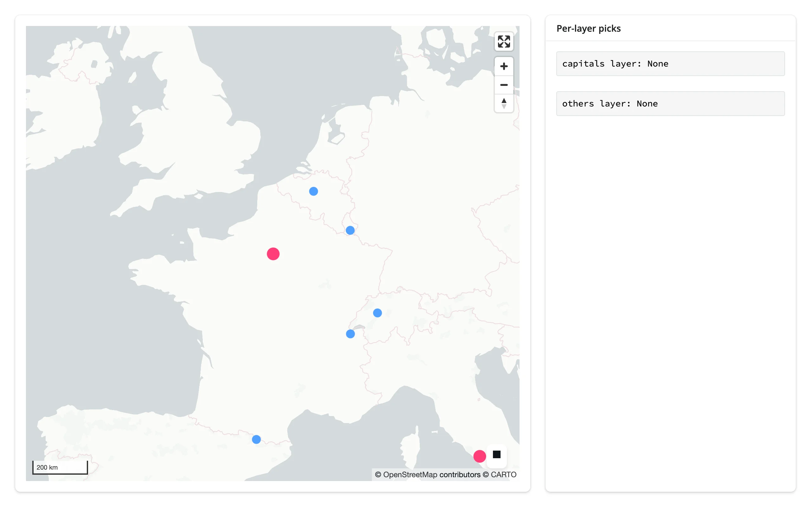


### Rate limiting

`view_state()` is the only accessor with a default rate policy -- debounced 250 ms
(see [`view_state()`](#view_state) above). `render_lonboard`'s `rate_policy`/`rate_delay` kwargs
adjust that default (and rate-limit `reactive_read()`/`.read()` on the map's other traits); they
have no effect on `selected()`, `selected_bounds()`, or `clicked()` (or `selected_rows()`, which
follows `selected()`), since none of those declares a default policy of its own (verified directly: constructing
`render_lonboard(rate_policy="throttle", rate_delay=1.0)` and inspecting its internal accessor
slots shows a limiter only on `view_state`'s).

Pass `rate_delay=0` to remove the debounce -- every tick the browser reports publishes right away,
useful when you want `view_state()` to drive something with no lag and can afford the extra
re-renders downstream. `map.read("view_state")` and `map.view_state()` are the same read either
way: `"view_state"` is a declared accessor name, so `read()` just calls the accessor.

```{.python file="examples/15_rate_limiting.py"}
import geopandas as gpd
from lonboard import ScatterplotLayer
from shiny.express import render, ui
from shinywidgets import render_lonboard

ui.page_opts(fillable=True)

CITIES_URL = "https://raw.githubusercontent.com/nvkelso/natural-earth-vector/master/geojson/ne_110m_populated_places.geojson"


# view_state() debounces by default (0.25 s). render_lonboard's rate_policy/
# rate_delay kwargs now adjust that default too, not just reactive_read() on
# the map's other traits: rate_delay=0 below removes the debounce entirely, so
# every tick the browser reports publishes right away.
@render_lonboard(rate_delay=0)
def map():
    cities = gpd.read_file(CITIES_URL)
    return ScatterplotLayer.from_geopandas(cities, get_fill_color=[255, 60, 120], radius_min_pixels=4)


@render.code
def coords():
    vs = map.view_state()
    # map.read("view_state") is the same read -- "view_state" is a declared
    # accessor name, so read() just calls the accessor method
    agree = map.read("view_state") == vs
    return f"lon={vs.longitude:.4f} lat={vs.latitude:.4f} zoom={vs.zoom:.2f}\nmap.read('view_state') agrees: {agree}"
```

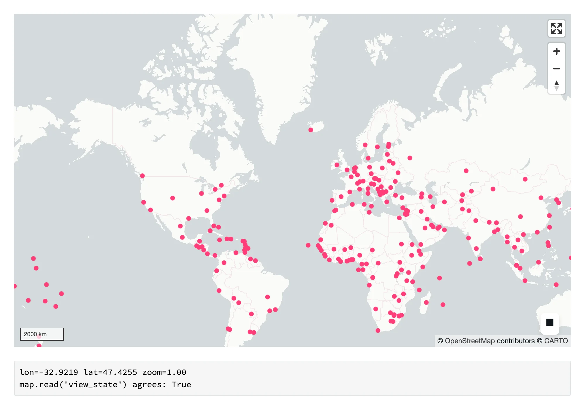

## Updating the widget from Python

Two different Python-side actions look similar but do very different things to the browser:

- **`map.widget.fly_to(...)`** animates the camera. Nothing about the data changes, so nothing is
  re-sent -- selection state, styling, and the 243-point (or 243,000-point) buffer already in the
  browser are untouched.
- **`layer.trait = ...` under `reactive.isolate()`** restyles in place: only the changed trait (a
  color array, a radius) crosses the wire, not the geometry.

Both beat re-rendering, which rebuilds the `Map` from scratch, re-sends every point, and resets the
camera to the new map's own fitted view -- losing whatever the user had panned or zoomed to.

### Restyling in place

Read styling inputs under `reactive.isolate()` inside the render function (so the render only
re-runs when the *data* changes), then push style updates from separate effects keyed to those
inputs:

```{.python file="examples/09_restyle_in_place.py"}
import geopandas as gpd
import matplotlib.pyplot as plt
from lonboard import ScatterplotLayer
from lonboard.colormap import apply_continuous_cmap
from shiny import reactive
from shiny.express import input, ui
from shinywidgets import render_lonboard

ui.page_opts(fillable=True)

CITIES_URL = "https://raw.githubusercontent.com/nvkelso/natural-earth-vector/master/geojson/ne_110m_populated_places.geojson"

with ui.sidebar():
    ui.input_slider("radius", "Point radius (px)", 2, 20, 6)
    ui.input_switch("by_pop", "Color by population", False)
    ui.p(
        "Moving the slider or flipping the switch restyles the layer in "
        "place -- the 243 points cross the wire once, at first render.",
        class_="text-muted small",
    )

with ui.card(full_screen=True):

    @render_lonboard
    def map():
        # Read styling inputs under isolate(): this render function should
        # only re-run when the data changes, not on every slider tick
        with reactive.isolate():
            style = {"get_fill_color": fill_color(), "radius_min_pixels": input.radius()}
        return ScatterplotLayer.from_geopandas(cities(), **style)


@reactive.calc
def cities() -> gpd.GeoDataFrame:
    return gpd.read_file(CITIES_URL)


def fill_color():
    if not input.by_pop():
        return [255, 60, 120]
    pct = cities()["POP_MAX"].rank(pct=True).to_numpy()
    return apply_continuous_cmap(pct, plt.get_cmap("plasma"))


@reactive.effect
@reactive.event(input.radius, ignore_init=True)
def _update_radius():
    layer = map.widget.layers[0]
    layer.radius_min_pixels = input.radius()


@reactive.effect
@reactive.event(input.by_pop, ignore_init=True)
def _update_color():
    layer = map.widget.layers[0]
    layer.get_fill_color = fill_color()
```

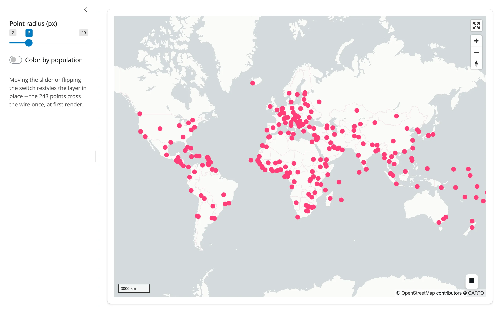
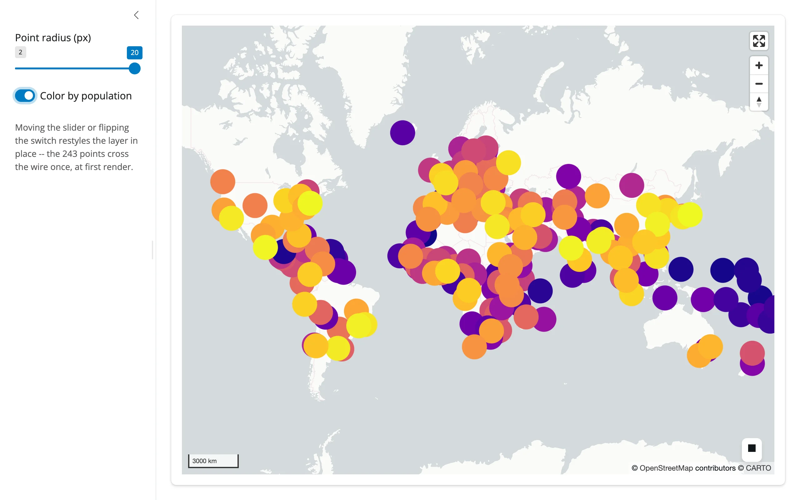

### Flying the camera

`Map.fly_to(longitude=, latitude=, zoom=, duration=)` animates the camera from Python -- a search
box, a "reset view" button, or (below) a table row selection:

```{.python file="examples/10_fly_to.py"}
import geopandas as gpd
from lonboard import ScatterplotLayer
from lonboard.view_state import MapViewState
from shiny import reactive
from shiny.express import input, ui
from shinywidgets import render_lonboard

ui.page_opts(fillable=True)

CITIES_URL = "https://raw.githubusercontent.com/nvkelso/natural-earth-vector/master/geojson/ne_110m_populated_places.geojson"
DESTINATIONS = {
    "Tokyo": (139.75, 35.68, 9),
    "Nairobi": (36.82, -1.29, 9),
    "Buenos Aires": (-58.38, -34.6, 9),
    "World": (10, 20, 1),
}

ui.input_select("city", "Fly to", list(DESTINATIONS))

with ui.card(full_screen=True):

    @render_lonboard
    def map():
        cities = gpd.read_file(CITIES_URL)
        layer = ScatterplotLayer.from_geopandas(
            cities, get_fill_color=[255, 60, 120], radius_min_pixels=4
        )
        return layer  # starts at the default world view


@reactive.effect
@reactive.event(input.city)
def _fly_to_city():
    lon, lat, zoom = DESTINATIONS[input.city()]
    # fly_to() animates the camera in the browser; it doesn't touch the
    # data, so nothing is re-sent and any selection/styling is preserved
    map.widget.fly_to(longitude=lon, latitude=lat, zoom=zoom, duration=1200)
```

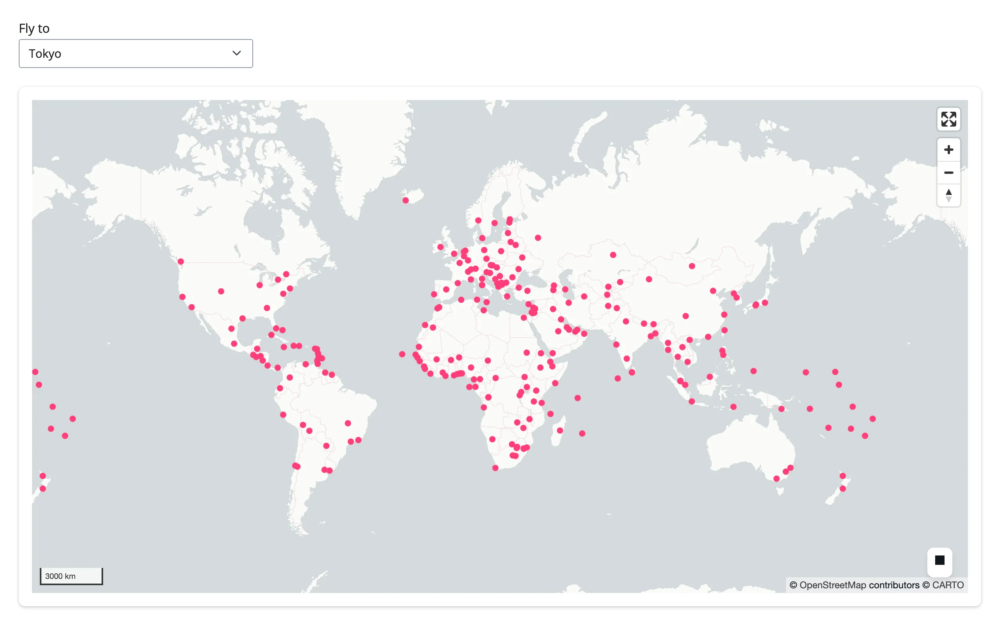
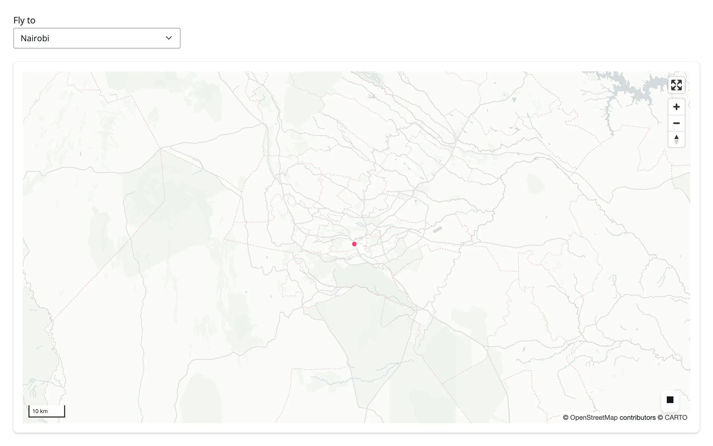

## Coordinating multiple views

These four patterns are the most useful thing in this guide: the map drives a chart, a card, and a
table, and a table drives the map back. Every one of them is driven entirely by the accessors above
-- no polling, no manual event wiring.

### Viewport as a filter: map pans a chart

lonboard's `view_state` has no bounds field (only center + zoom), so computing an exact lng/lat
viewport box takes one more ingredient: the output's on-screen pixel size, reported once (and on
resize) by a tiny `ResizeObserver` script. Combine that with standard Web Mercator math and
`view_state()` becomes an exact "what's on screen" filter -- here, driving a
[plotly](../plotly/index.md) bar chart of the largest cities currently in view.

```{.python file="examples/11_viewport_to_chart.py"}
import math

import geopandas as gpd
import plotly.express as px
from lonboard import ScatterplotLayer
from shapely.geometry import box
from shiny import req
from shiny.express import input, ui
from shinywidgets import render_lonboard, render_plotly

ui.page_opts(fillable=True)

CITIES_URL = "https://raw.githubusercontent.com/nvkelso/natural-earth-vector/master/geojson/ne_110m_populated_places.geojson"

# lonboard's view_state has no bounds field (only center + zoom), so compute
# the viewport's lng/lat box from Web Mercator math, using the output's
# on-screen pixel size (reported once and on every resize).
ui.head_content(
    ui.tags.script("""
    $(document).on("shiny:connected", function() {
      function send() {
        var el = document.querySelector("#map");
        if (el) Shiny.setInputValue("map_px", [el.clientWidth, el.clientHeight]);
      }
      new ResizeObserver(send).observe(document.body);
      setTimeout(send, 300);
    });
    """)
)

with ui.layout_columns(col_widths=[7, 5]):
    with ui.card(full_screen=True):

        @render_lonboard
        def map():
            cities = gpd.read_file(CITIES_URL)
            return ScatterplotLayer.from_geopandas(
                cities, get_fill_color=[255, 60, 120], radius_min_pixels=4
            )

    with ui.card():
        ui.card_header("Largest cities currently in view")

        @render_plotly
        def chart():
            vs = map.view_state()
            width, height = req(input.map_px())
            bounds = view_bounds(vs.longitude, vs.latitude, vs.zoom, width, height)
            cities = gpd.read_file(CITIES_URL)
            visible = cities[cities.geometry.within(box(*bounds))]
            top = visible.nlargest(12, "POP_MAX").sort_values("POP_MAX")
            fig = px.bar(top, x="POP_MAX", y="NAME", orientation="h")
            fig.update_layout(
                title=f"{len(visible)} cities in view", margin=dict(l=10, r=10, t=40, b=10)
            )
            return fig


def inv_merc(y: float) -> float:
    return math.degrees(2 * math.atan(math.exp(y)) - math.pi / 2)


def view_bounds(
    lon: float, lat: float, zoom: float, width: float, height: float
) -> tuple[float, float, float, float]:
    """(minx, miny, maxx, maxy) of a Web Mercator viewport (512px tiles)."""
    world_px = 512 * 2**zoom
    half_w = (width / 2) * 360 / world_px
    half_h = (height / 2) * (2 * math.pi) / world_px
    m = math.log(math.tan(math.pi / 4 + math.radians(lat) / 2))
    return (lon - half_w, inv_merc(m - half_h), lon + half_w, inv_merc(m + half_h))
```

Pan and zoom, and the chart recomputes: 221 cities worldwide on load, down to 39 (and a different
top-12) once the view is centered on North America.

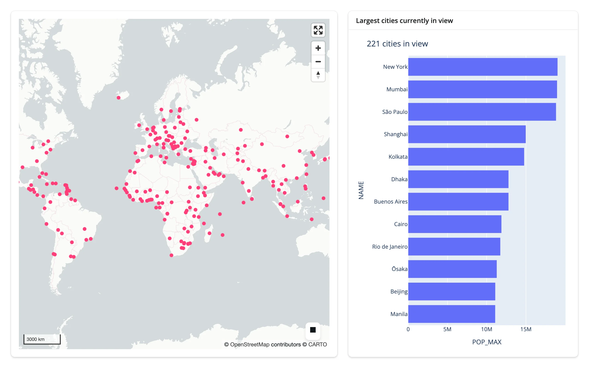
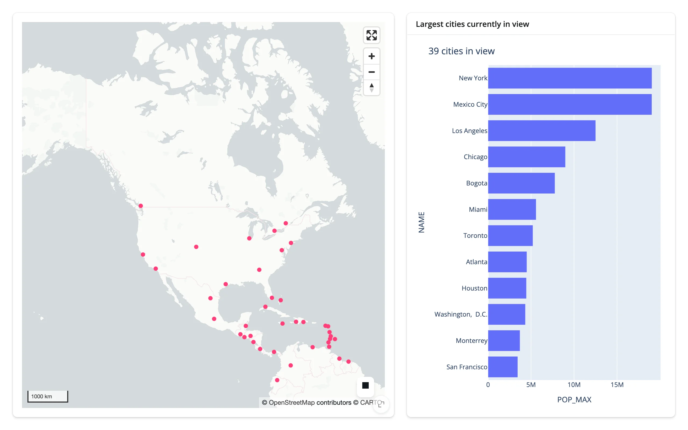

*pairs with: [plotly](../plotly/index.md)*

### Click a city, see a detail card

`selected_rows()` plus `req()` is the whole pattern: wait for the picked row, then show it. With
no `df` argument the row comes from the layer's own data, so the card doesn't even re-read the
file.

```{.python file="examples/12_click_to_detail_card.py"}
import geopandas as gpd
from lonboard import Map, ScatterplotLayer
from shiny import req
from shiny.express import render, ui
from shinywidgets import render_lonboard

ui.page_opts(fillable=True)

CITIES_URL = "https://raw.githubusercontent.com/nvkelso/natural-earth-vector/master/geojson/ne_110m_populated_places.geojson"


with ui.layout_columns(col_widths=[8, 4]):
    with ui.card(full_screen=True):

        @render_lonboard
        def map():
            cities = gpd.read_file(CITIES_URL)
            layer = ScatterplotLayer.from_geopandas(
                cities,
                get_fill_color=[255, 60, 120],
                radius_min_pixels=4,
                pickable=True,
                auto_highlight=True,
            )
            # The "Selected city" card already shows feature detail
            return Map(layer, show_side_panel=False)

    with ui.card():
        ui.card_header("Selected city")

        @render.ui
        def detail():
            # selected_rows() is the picked row itself, taken from the
            # layer's own data -- no second read of the file, no iloc. It's
            # an empty frame until the first pick; req() waits instead of
            # showing an empty card on load.
            rows = map.selected_rows()
            req(len(rows) > 0)
            row = rows.iloc[0]
            return ui.TagList(
                ui.h5(row["NAME"]),
                ui.p(row["ADM0NAME"]),
                ui.p(f"Population: {int(row['POP_MAX']):,}"),
            )
```

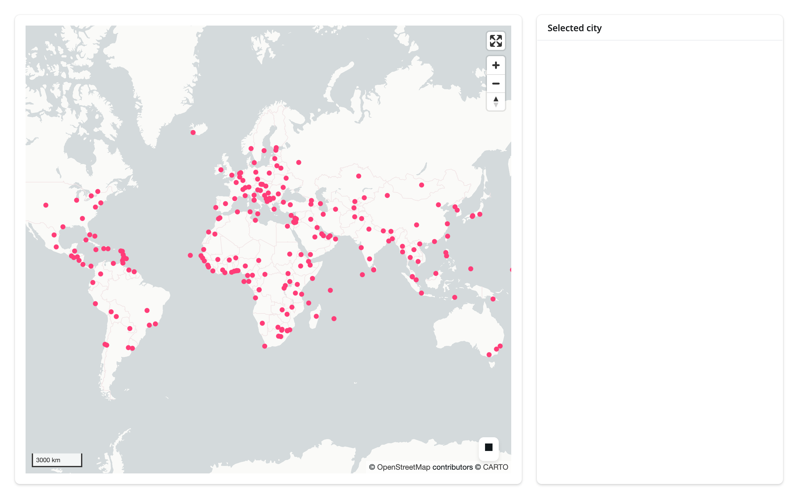
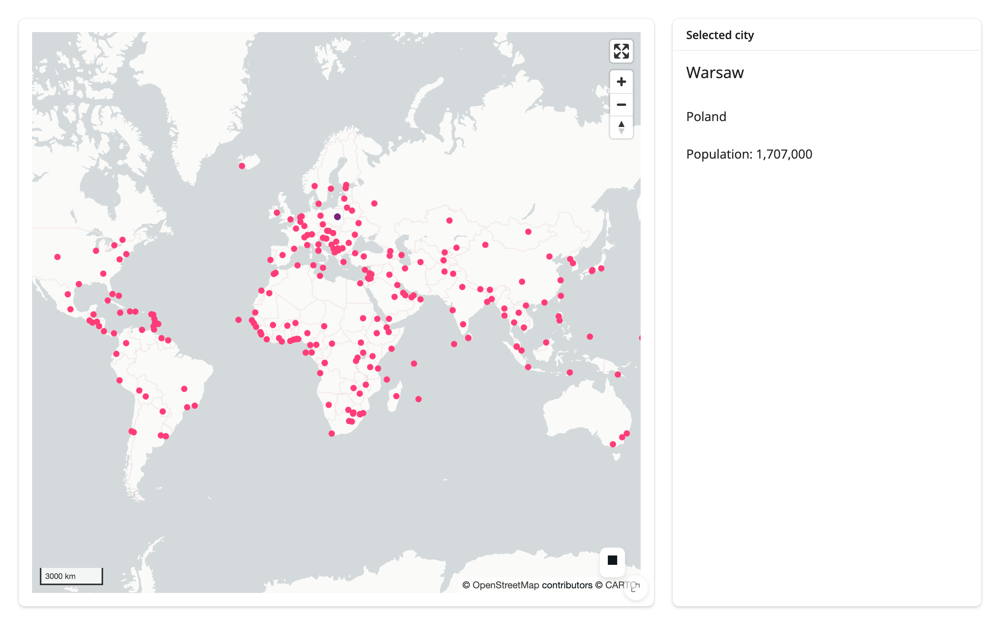

### Box-select, see a filtered table

The same `req()` pattern, with `selected_bounds()` instead -- and an
[itables](../itables/index.md) output instead of a card.

```{.python file="examples/13_bbox_to_table.py"}
import geopandas as gpd
from lonboard import Map, ScatterplotLayer
from shapely.geometry import box
from shiny import req
from shiny.express import ui
from shinywidgets import render_itables, render_lonboard

ui.page_opts(fillable=True)

CITIES_URL = "https://raw.githubusercontent.com/nvkelso/natural-earth-vector/master/geojson/ne_110m_populated_places.geojson"

with ui.layout_columns(col_widths=[7, 5]):
    with ui.card(full_screen=True):
        ui.card_header("Click the Select BBox button, then click two corners")

        @render_lonboard
        def map():
            cities = gpd.read_file(CITIES_URL)
            layer = ScatterplotLayer.from_geopandas(
                cities, get_fill_color=[255, 60, 120], radius_min_pixels=4
            )
            return Map(layer, show_side_panel=False)

    with ui.card():
        ui.card_header("Cities in the selected box")

        @render_itables
        def table():
            bounds = req(map.selected_bounds())
            cities = gpd.read_file(CITIES_URL)
            selected = cities[cities.geometry.within(box(*bounds))]
            return selected[["NAME", "ADM0NAME", "POP_MAX"]].sort_values(
                "POP_MAX", ascending=False
            )
```

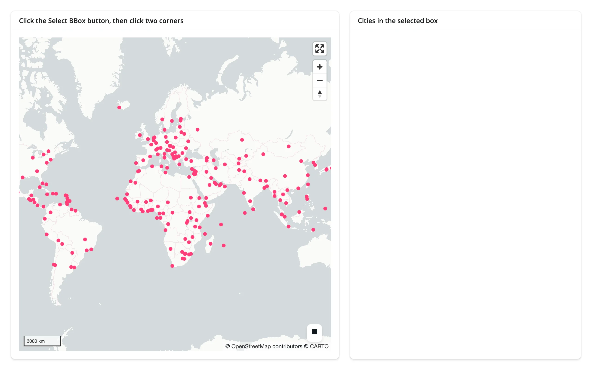
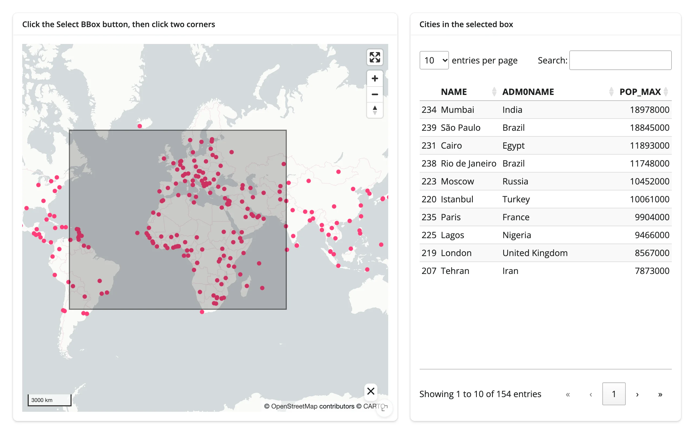

*pairs with: [itables](../itables/index.md)*

### The other direction: a table row flies the map

Interaction isn't one-way. An `itables` row selection (`table.selected_rows()`) drives
`map.widget.fly_to(...)` -- the map is the one being updated here, in place, with its existing
styling and the other table's selection state untouched.

```{.python file="examples/14_table_to_fly_to.py"}
import geopandas as gpd
from itables.widget import ITable
from lonboard import ScatterplotLayer
from shiny import reactive, req
from shiny.express import ui
from shinywidgets import render_itables, render_lonboard

ui.page_opts(fillable=True)

CITIES_URL = "https://raw.githubusercontent.com/nvkelso/natural-earth-vector/master/geojson/ne_110m_populated_places.geojson"


@reactive.calc
def cities() -> gpd.GeoDataFrame:
    return gpd.read_file(CITIES_URL).nlargest(20, "POP_MAX").reset_index(drop=True)


with ui.layout_columns(col_widths=[5, 7]):
    with ui.card():
        ui.card_header("Pick a city")

        @render_itables
        def table():
            df = cities()[["NAME", "ADM0NAME", "POP_MAX"]]
            return ITable(df, select=True, lengthMenu=[20])

    with ui.card(full_screen=True):

        @render_lonboard
        def map():
            return ScatterplotLayer.from_geopandas(
                cities(), get_fill_color=[255, 60, 120], radius_min_pixels=5
            )


@reactive.effect
def _fly_to_selected():
    rows = req(table.selected_rows())
    row = cities().iloc[rows[0]]
    # table drives the map: selecting a row flies the camera there, without
    # re-sending the 20 points or losing any in-place styling
    map.widget.fly_to(longitude=row.LONGITUDE, latitude=row.LATITUDE, zoom=8, duration=1200)
```

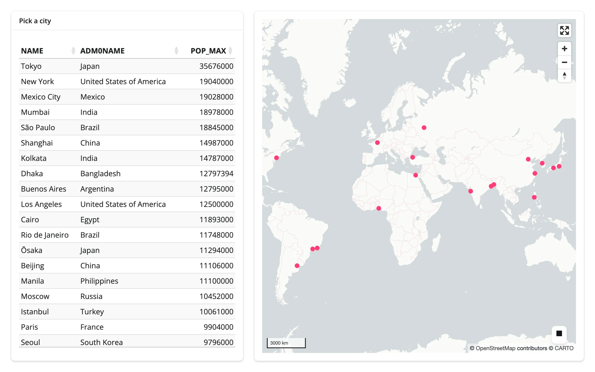
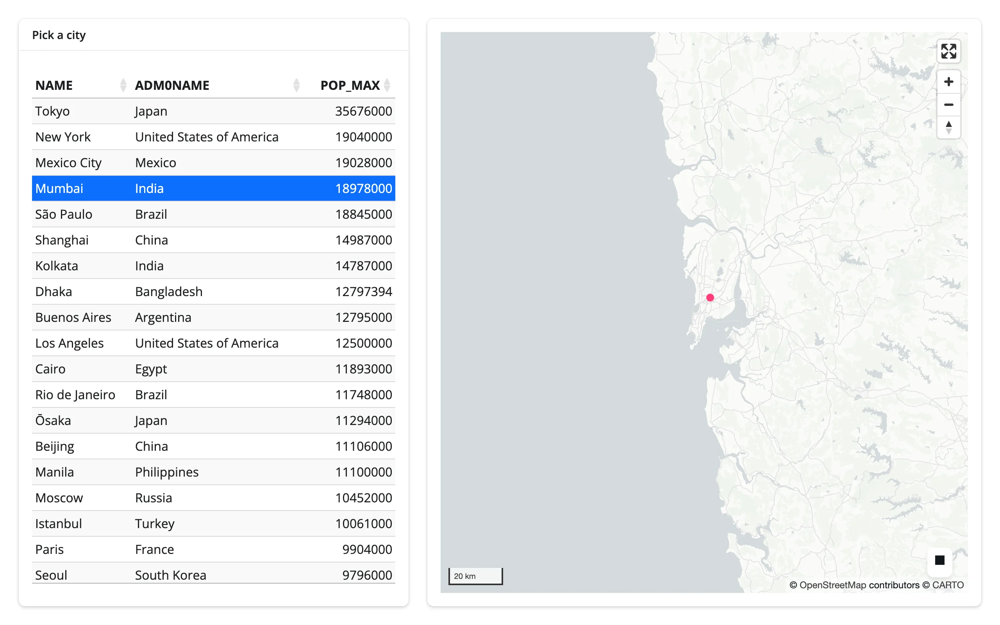

*pairs with: [itables](../itables/index.md)*

## Large data

lonboard's large-data mode is the renderer itself: GeoArrow-columnar data crosses the wire once and deck.gl
draws it with WebGL, so pan, zoom, and restyle stay smooth regardless of point count -- the GPU-in-browser
approach. The
[Large data & performance article](../../guide/performance/index.md#2-big-data-choosing-the-right-widget)
measured lonboard's own initial payload and render time at 10K/100K/1M points: 25.2 MB and 3.1 s at 1M, the
fastest of the three scatter renderers compared there (plotly 8.8 s, jscatter 3.7 s). lonboard doesn't publish a
hard ceiling beyond that; a few million points is where client-side GeoArrow decode and bundle cost are worth
profiling on your own data rather than assuming it will stay smooth. See
[the three approaches](../../guide/performance/index.md#three-approaches-to-large-data) for how this compares
to summarizing on the server or sending only what's visible.

## Layout and sizing

lonboard has the best-in-class fill behavior in the shinywidgets roster: in a filling layout (the
default), the map tracks its container's size, including through window resizes and `full_screen`
card enter/exit. The flip side is a trap worth knowing about:

- **Percentage heights silently produce a blank map.** `Map(height="50%")` renders a `0`-height
  canvas -- lonboard's CSS gives the root element `min-height: 100%`, which is meaningless once the
  container itself isn't a definite height. Use a pixel height (`Map(height=400)`), or leave
  `height` unset and let the output fill its container.
- An explicit pixel `height` that's taller than its fillable row can overflow by the difference; the
  card clips or scrolls it. Cosmetic, and easy to avoid by not combining a tall fixed height with a
  short fillable row.
- With no definite height to fill and no explicit `height`, the map keeps lonboard's own default
  (500 px) rather than collapsing.

## Gotchas and limitations

Verified on current `main` (lonboard 0.17.0):

- **`GlobeView` breaks `view_state()`.** The browser's view-state sync message always includes
  `pitch`/`bearing` (the same payload shape used for the regular Mercator view), but
  `GlobeViewState` has no `pitch` or `bearing` fields. The very first sync after a `GlobeView` map
  renders raises `TypeError: GlobeViewState.__init__() got an unexpected keyword argument 'pitch'`
  inside ipywidgets' message handler -- caught and logged, not fatal, but `view_state()` silently
  stops updating for globe maps from then on. This is an upstream lonboard bug, not something
  shinywidgets can paper over.
- **Percentage heights silently collapse the map** -- see [Layout and sizing](#layout-and-sizing).
- **`selected()` can't tell you which layer fired.** With several pickable layers, read each
  layer's own `selected_index` trait via `reactive_read()` instead (see [Beyond the
  accessors](#beyond-the-accessors-reactive_read)). For the same reason, `selected_rows()`'s
  `df` default raises on such a map -- pass `df=` for the layer you mean.
- **Select BBox is click-click, not drag.** Click the button, click one corner, click the opposite
  corner. Setting `selected_bounds` from Python doesn't draw the overlay rectangle.
- **`view_state()` can lag during an active zoom transition.** The browser reports a new value on
  every frame of a wheel-zoom or double-click-zoom animation, and each one re-arms the 250 ms
  debounce, so `view_state()` doesn't settle until the animation stops producing frames -- longer
  for a multi-frame zoom transition than for a simple drag-pan.
- **`GlobeView` is a private import** (`lonboard._map.GlobeView`) -- there's no public top-level
  export for it yet.
- An older review of this integration reported that changing `basemap` after a fly-to desynced
  `view_state` from the visible map. That does **not** reproduce on current `main`: toggling
  `basemap` leaves the pre-existing pan/zoom in place and `view_state()` stays accurate. It appears
  to have been fixed upstream since that review; dropped from this list.

## Gallery candidates

**[`template_city_explorer.py`](gallery/template_city_explorer.py)** (template) -- a clean,
~65-line starting point: click a city for a detail card, or box-select for a filtered table, in
tabs beside the map.

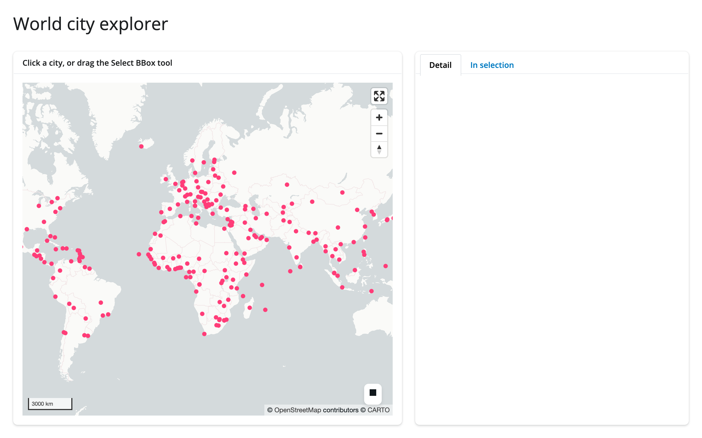
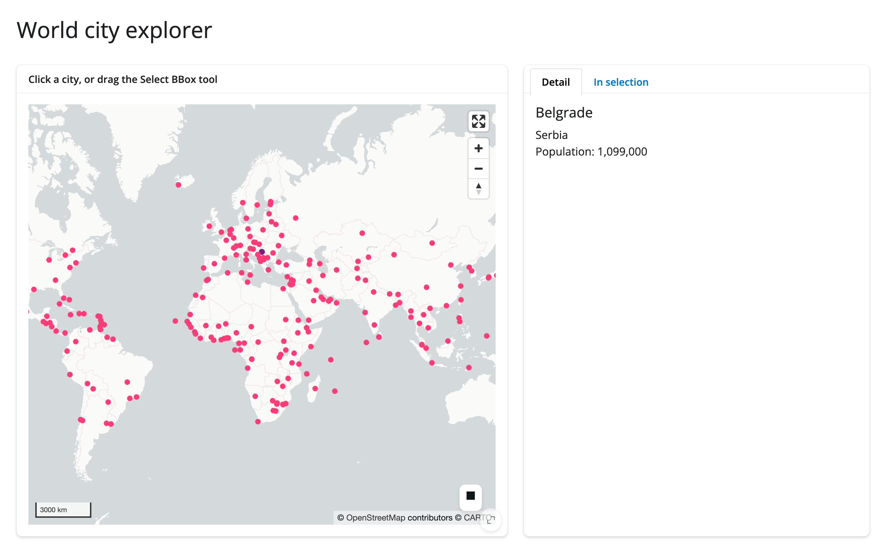

**[`showcase_world_dashboard.py`](gallery/showcase_world_dashboard.py)** (showcase) -- a GDP-per-
capita choropleth (`PolygonLayer` + `apply_continuous_cmap`) with a population-scaled city layer on
top. The sidebar's "currently in view" stat comes from `view_state()` plus the Web Mercator
viewport-bounds technique above; the detail card comes from `selected_rows(cities())` (two
pickable layers, so the frame is passed explicitly); the radius
slider and population-size toggle restyle in place; and a "fly to" dropdown animates the camera to
a handful of cities without touching the 420 rendered features.

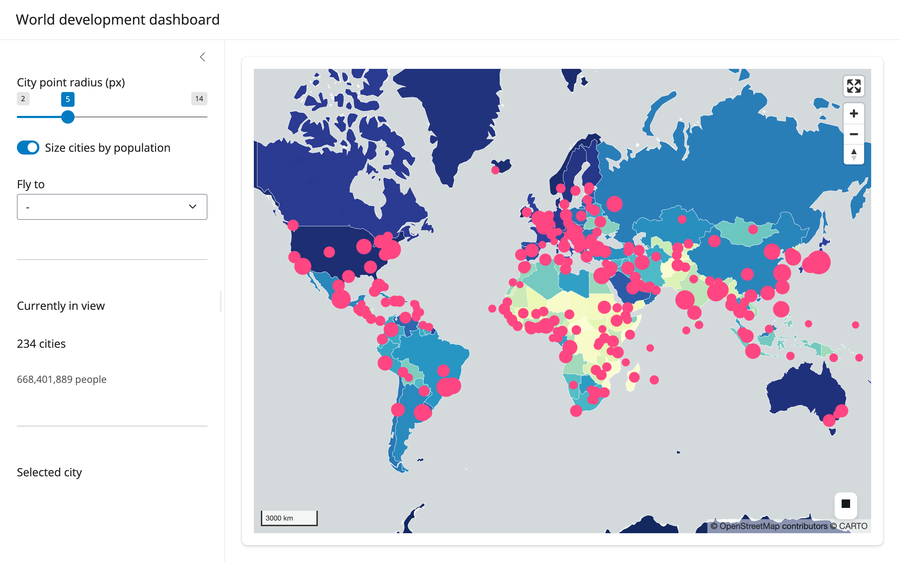

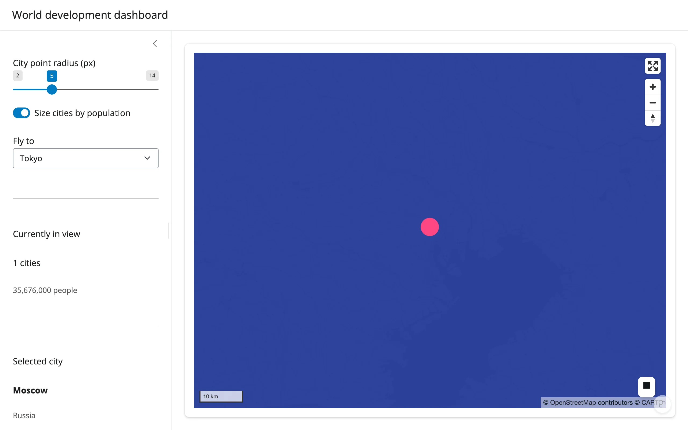
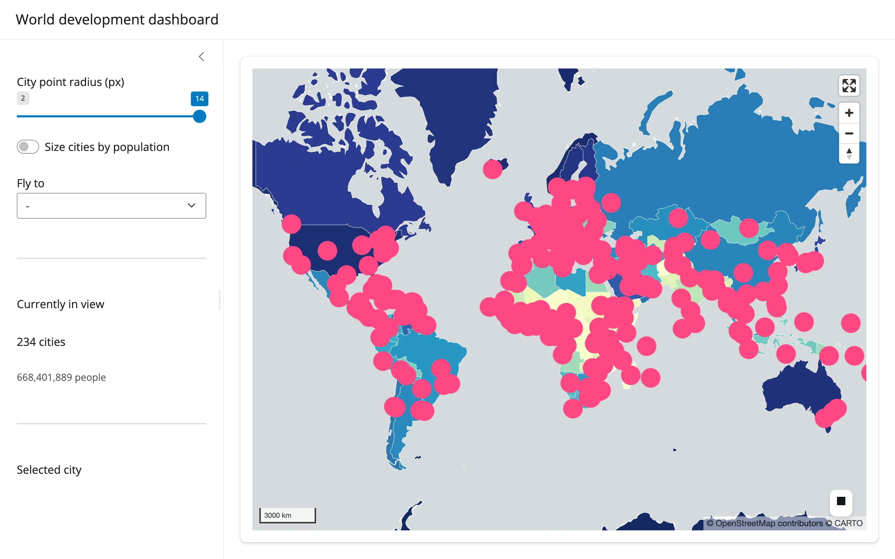

## Learn more

- [lonboard documentation](https://developmentseed.org/lonboard/) -- full layer API reference,
  colormap gallery, and examples
- [GeoArrow](https://geoarrow.org/) -- the Arrow-native geometry format lonboard is built on
- [deck.gl](https://deck.gl) -- the WebGL rendering engine underneath
- Related guides in this roster: [ipyleaflet](../ipyleaflet/index.md),
  [leafmap](../leafmap/index.md), [maplibre](../maplibre/index.md),
  [keplergl](../keplergl/index.md), [plotly](../plotly/index.md), [itables](../itables/index.md)
