[MapLibre GL JS](https://maplibre.org) is the open-source engine behind many of today's web maps: smooth vector-tile
rendering, a declarative style language, and native 3D (pitch, bearing, extrusions, globe projection). The
[`maplibre`](https://eoda-dev.github.io/py-maplibregl/) Python package (eoda-dev) wraps it with a `Map` builder and
an [anywidget](https://anywidget.dev)-based `MapWidget`, and `@render_maplibre` turns that widget into a two-way
Shiny output.

The decorated function can return a `maplibre.Map` or a `maplibre.ipywidget.MapWidget` directly. In a filling
layout the map grows to fill its container -- including a `full_screen` card -- unless the widget has an explicit
height. The decorated output also gains a `.widget` attribute: call `MapWidget`/`Map` methods on it from a
`@reactive.effect` (`set_paint_property()`, `set_filter()`, `set_data()`, `add_layer()`, `fit_bounds()`, or
`add_call()` for any MapLibre GL JS map method) to restyle, recenter, or fly the camera **without re-rendering** --
the data and the user's pan/zoom position both survive. And the output reads map state back with accessors:
`view_state()`, `clicked()`, and `drawn_features()`.

Choose MapLibre when you want control over basemap styling, labels, and vector-tile sources, or a 3D view
(`fill-extrusion`, pitch/bearing, globe projection) -- and you're working with up to a few hundred thousand
features. For **millions** of points or polygons, prefer [lonboard](../lonboard/index.md) (binary Arrow data,
GPU-rendered deck.gl layers, a richer selection model). For **per-feature click and hover callbacks** in Python
(not just a lng/lat), prefer [ipyleaflet](../ipyleaflet/index.md). If you already have `pydeck.Layer` objects
(the deck.gl Python API), this is also the renderer that replaces the now-deprecated `render_pydeck`: pass your
layers to a `Map`'s `add_deck_layers()`.

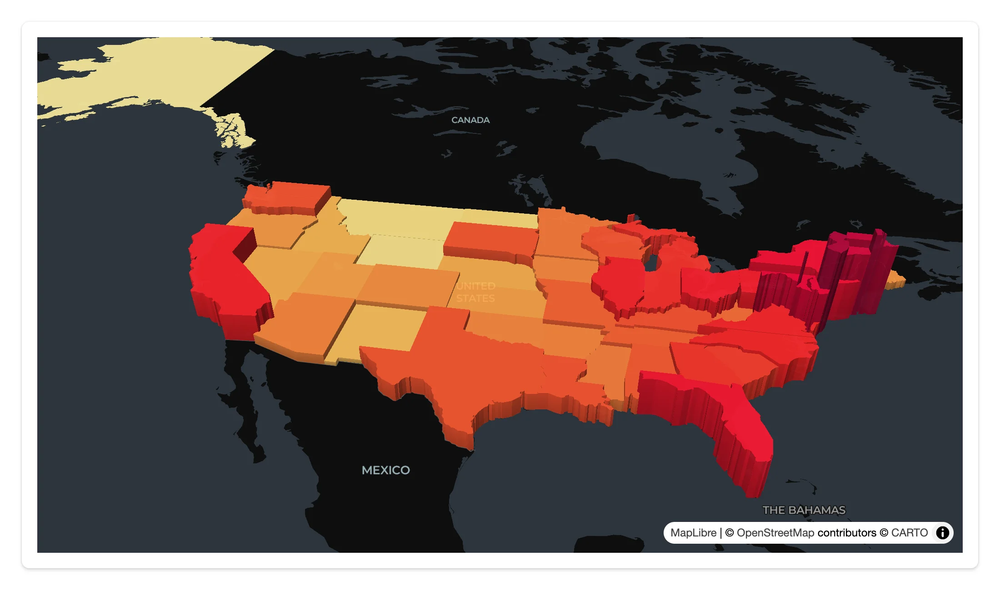

## Installation

```sh
pip install 'shinywidgets[maplibre]'
```

This installs `maplibre[anywidget]`. To render `pydeck.Layer` objects on a MapLibre map (see
[Deck.GL layers](#deckgl-layers-the-render_pydeck-migration-path)), also install `pydeck`.

## Quick start

A `Map` fills its card by default. The default style (`Carto.DARK_MATTER`) needs no API key.

```{.python file="examples/01_quickstart.py"}
from maplibre import Map, MapOptions
from maplibre.basemaps import Carto
from shiny.express import ui
from shinywidgets import render_maplibre

ui.page_opts(fillable=True)

with ui.card(full_screen=True):

    @render_maplibre
    def city():
        return Map(
            MapOptions(style=Carto.DARK_MATTER, center=(2.3522, 48.8566), zoom=11)
        )
```

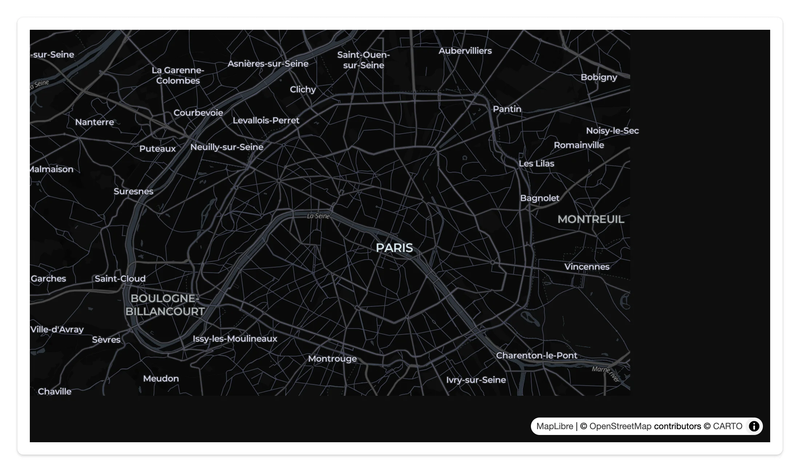

## What you can build

### Vector-tile basemaps, no API key

`maplibre.basemaps` ships ready-to-use style URLs for [Carto](https://carto.com/basemaps) (dark matter, positron,
voyager) and [OpenFreeMap](https://openfreemap.org) (liberty, positron, bright) -- all free, keyless vector tiles.
Switch styles in place with `add_call("setStyle", url)`; it's a MapLibre GL JS method with no dedicated Python
wrapper, so `add_call()` reaches it directly.

```{.python file="examples/02_basemap_styles.py"}
from maplibre import Map, MapOptions
from maplibre.basemaps import Basemap, Carto, OpenFreeMap
from shiny import reactive
from shiny.express import input, ui
from shinywidgets import render_maplibre

STYLES = {
    "Carto Dark Matter": Basemap.carto_url(Carto.DARK_MATTER),
    "Carto Positron": Basemap.carto_url(Carto.POSITRON),
    "OpenFreeMap Liberty": Basemap.openfreemap_url(OpenFreeMap.LIBERTY),
}

ui.page_opts(fillable=True)
ui.input_radio_buttons("style", "Basemap style", list(STYLES), inline=True)

with ui.card(full_screen=True):

    @render_maplibre
    def city():
        return Map(MapOptions(style=STYLES["Carto Dark Matter"], center=(2.3522, 48.8566), zoom=11))


@reactive.effect
def _set_style():
    # setStyle is a MapLibre GL JS method with no dedicated Python wrapper;
    # add_call() reaches it directly. It swaps the basemap without re-rendering
    # the widget, so the camera position is kept.
    city.widget.add_call("setStyle", STYLES[input.style()])
```

| Before | After |
|---|---|
| 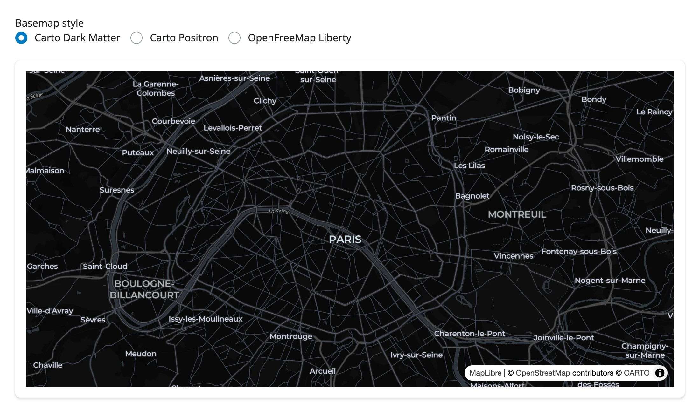 | 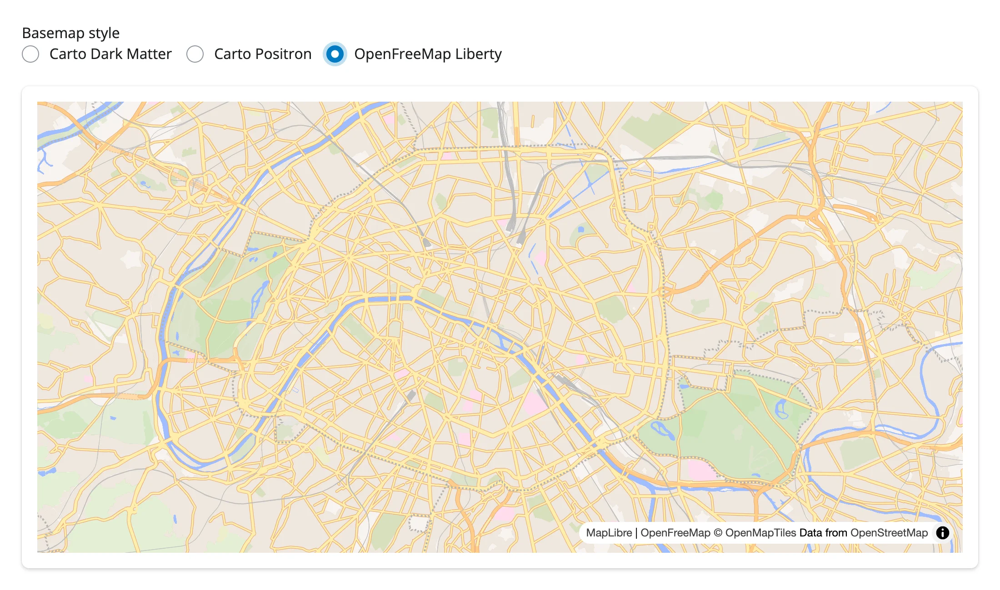 |

Note: `setStyle` replaces the whole style, including any custom sources and layers you've added -- re-add them
after switching if you need to keep them.

### GeoJSON choropleth with data-driven paint

Point a `GeoJSONSource` at the data (a dict, or a URL the browser fetches directly) and use a MapLibre **paint
expression** to color each feature from a property. The expression runs in the browser, so pan and zoom never
touch Python.

```{.python file="examples/03_geojson_choropleth.py"}
import requests
from maplibre import Layer, LayerType, Map, MapOptions
from maplibre.basemaps import Carto
from maplibre.sources import GeoJSONSource
from shiny.express import ui
from shinywidgets import render_maplibre

STATES = requests.get(
    "https://raw.githubusercontent.com/PublicaMundi/MappingAPI/master/data/geojson/us-states.json"
).json()

# A data-driven paint expression: color interpolates on each feature's
# `density` property (people per square mile), evaluated entirely in the
# browser -- no Python round trip as the map pans or zooms.
DENSITY_COLOR = [
    "interpolate", ["linear"], ["get", "density"],
    0, "#FFEDA0", 10, "#FED976", 20, "#FEB24C", 50, "#FD8D3C",
    100, "#FC4E2A", 200, "#E31A1C", 500, "#BD0026", 1000, "#800026",
]  # fmt: skip

ui.page_opts(fillable=True)

with ui.card(full_screen=True):

    @render_maplibre
    def choropleth():
        m = Map(MapOptions(style=Carto.POSITRON, center=(-98.5, 39.8), zoom=3.3))
        m.add_source("states", GeoJSONSource(data=STATES))
        m.add_layer(
            Layer(
                id="states-fill",
                type=LayerType.FILL,
                source="states",
                paint={"fill-color": DENSITY_COLOR, "fill-opacity": 0.8},
            )
        )
        m.add_layer(
            Layer(
                id="states-outline",
                type=LayerType.LINE,
                source="states",
                paint={"line-color": "#ffffff", "line-width": 0.5},
            )
        )
        return m
```

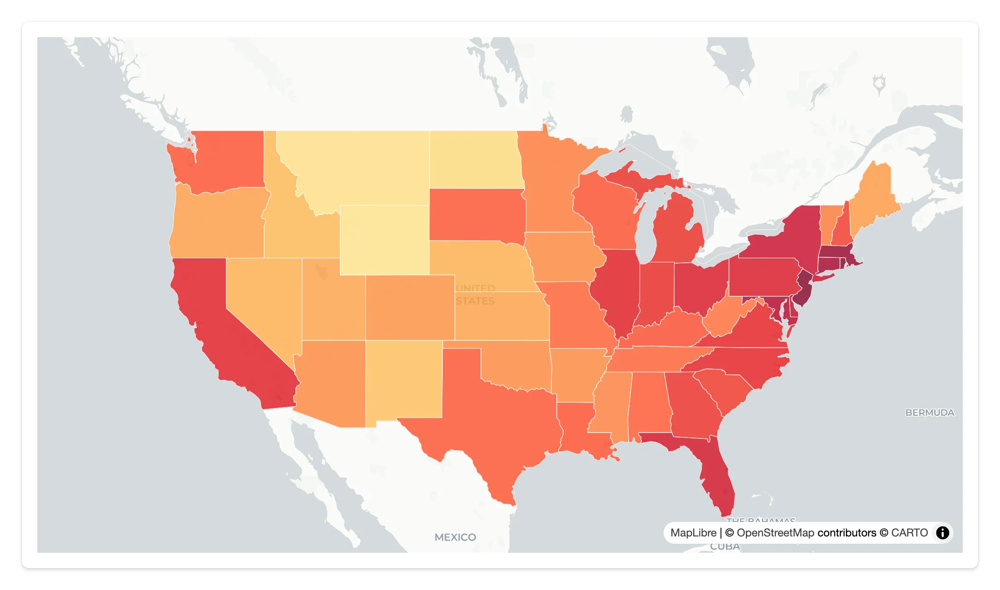

### 3D with `fill-extrusion`

The same `fill-extrusion` layer type and a `pitch`/`bearing` camera turn a GeoJSON polygon layer into a skyline --
no separate 3D library needed. `fill-extrusion-height` is just another paint expression.

Same data as the choropleth above, plus a height expression and a pitched camera -- see
[`examples/04_fill_extrusion_3d.py`](examples/04_fill_extrusion_3d.py):

```{.python file="examples/04_fill_extrusion_3d.py"}
import requests
from maplibre import Layer, LayerType, Map, MapOptions
from maplibre.basemaps import Carto
from maplibre.sources import GeoJSONSource
from shiny.express import ui
from shinywidgets import render_maplibre

STATES = requests.get(
    "https://raw.githubusercontent.com/PublicaMundi/MappingAPI/master/data/geojson/us-states.json"
).json()

DENSITY_COLOR = [
    "interpolate", ["linear"], ["get", "density"],
    0, "#FFEDA0", 10, "#FED976", 20, "#FEB24C", 50, "#FD8D3C",
    100, "#FC4E2A", 200, "#E31A1C", 500, "#BD0026", 1000, "#800026",
]  # fmt: skip
# Same property drives extrusion height (meters), exaggerated for visibility
DENSITY_HEIGHT = [
    "interpolate", ["linear"], ["get", "density"],
    0, 0, 10, 20000, 100, 120000, 1000, 600000,
]  # fmt: skip

ui.page_opts(fillable=True)

with ui.card(full_screen=True):

    @render_maplibre
    def extrusion():
        m = Map(
            MapOptions(
                style=Carto.DARK_MATTER,
                center=(-98.5, 39.8),
                zoom=3.3,
                pitch=55,
                bearing=-10,
            )
        )
        m.add_source("states", GeoJSONSource(data=STATES))
        m.add_layer(
            Layer(
                id="states-extrude",
                type=LayerType.FILL_EXTRUSION,
                source="states",
                paint={
                    "fill-extrusion-color": DENSITY_COLOR,
                    "fill-extrusion-height": DENSITY_HEIGHT,
                    "fill-extrusion-opacity": 0.9,
                },
            )
        )
        return m
```


### Heatmaps

A `type="heatmap"` layer renders density straight from point data, with weight, radius, and color all as
expressions (here, weighted and colored by earthquake magnitude).

```{.python file="examples/05_heatmap.py"}
import requests
from maplibre import Layer, LayerType, Map, MapOptions
from maplibre.basemaps import Carto
from maplibre.sources import GeoJSONSource
from shiny.express import ui
from shinywidgets import render_maplibre

# ~6,100 earthquakes (magnitude and location), maplibre's own heatmap-tutorial dataset
EARTHQUAKES = requests.get(
    "https://maplibre.org/maplibre-gl-js/docs/assets/earthquakes.geojson"
).json()

ui.page_opts(fillable=True)

with ui.card(full_screen=True):

    @render_maplibre
    def heatmap():
        m = Map(MapOptions(style=Carto.DARK_MATTER, center=(0, 20), zoom=1.3))
        m.add_source("quakes", GeoJSONSource(data=EARTHQUAKES))
        m.add_layer(
            Layer(
                id="quakes-heat",
                type=LayerType.HEATMAP,
                source="quakes",
                paint={
                    "heatmap-weight": ["interpolate", ["linear"], ["get", "mag"], 0, 0, 8, 1],
                    "heatmap-intensity": ["interpolate", ["linear"], ["zoom"], 0, 1, 9, 3],
                    "heatmap-color": [
                        "interpolate", ["linear"], ["heatmap-density"],
                        0, "rgba(33,102,172,0)", 0.2, "#67a9cf", 0.4, "#d1e5f0",
                        0.6, "#fddbc7", 0.8, "#ef8a62", 1, "#b2182b",
                    ],  # fmt: skip
                    "heatmap-radius": ["interpolate", ["linear"], ["zoom"], 0, 2, 9, 25],
                },
            )
        )
        return m
```

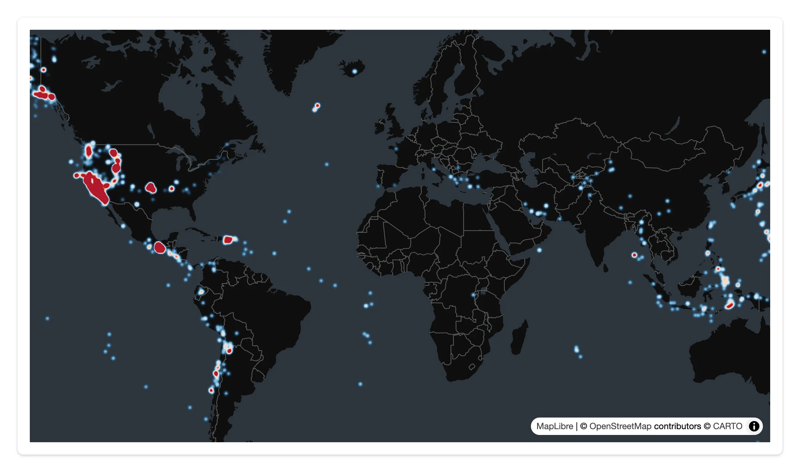

### Popups and tooltips (client-side)

`add_tooltip()` (hover) and `add_popup()` (click) render a mustache template -- or a single property, or every
property -- from the clicked/hovered feature, entirely in the browser.

```{.python file="examples/06_circle_popups.py"}
import requests
from maplibre import Layer, LayerType, Map, MapOptions
from maplibre.basemaps import Carto
from maplibre.sources import GeoJSONSource
from shiny.express import ui
from shinywidgets import render_maplibre

EARTHQUAKES = requests.get(
    "https://maplibre.org/maplibre-gl-js/docs/assets/earthquakes.geojson"
).json()

ui.page_opts(fillable=True)

with ui.card(full_screen=True):

    @render_maplibre
    def quakes():
        # Centered on the 2017 Chiapas (Mexico) M8.1 earthquake, so there's a
        # large circle right away to click and hover
        m = Map(MapOptions(style=Carto.DARK_MATTER, center=(-93.9067, 15.0356), zoom=5))
        m.add_source("quakes", GeoJSONSource(data=EARTHQUAKES))
        m.add_layer(
            Layer(
                id="quakes-circle",
                type=LayerType.CIRCLE,
                source="quakes",
                # Only the strongest quakes, to keep the map readable
                filter=[">=", ["get", "mag"], 5],
                paint={
                    "circle-radius": ["interpolate", ["linear"], ["get", "mag"], 5, 4, 8, 16],
                    "circle-color": ["interpolate", ["linear"], ["get", "mag"], 5, "#fed976", 8, "#b10026"],
                    "circle-stroke-color": "white",
                    "circle-stroke-width": 1,
                },
            )
        )
        # Hover: client-side tooltip, no Python round trip
        m.add_tooltip("quakes-circle", template="Magnitude {{mag}}")
        # Click: client-side popup with the clicked feature's properties
        m.add_popup("quakes-circle", template="<b>M{{mag}}</b> earthquake")
        return m
```

| Hover tooltip | Click popup |
|---|---|
| 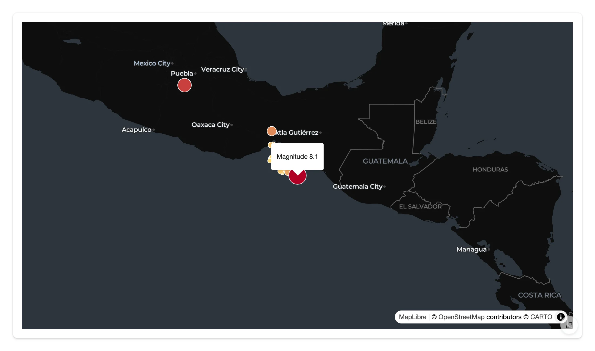 | 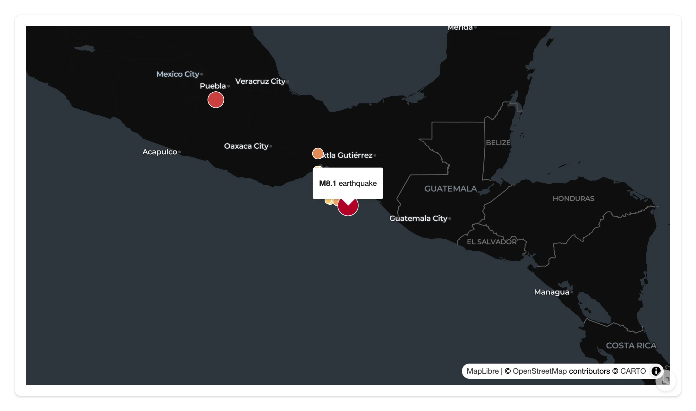 |

### Globe projection

`Map.set_projection("vertical-perspective")` switches to a 3D globe (MapLibre GL JS's name for it; see
[Gotchas](#gotchas-and-limitations) for why the string matters). Add a `GlobeControl()` to let users toggle it
themselves.

```{.python file="examples/07_globe.py"}
import requests
from maplibre import Layer, LayerType, Map, MapOptions
from maplibre.basemaps import Carto
from maplibre.controls import GlobeControl
from maplibre.sources import GeoJSONSource
from shiny.express import ui
from shinywidgets import render_maplibre

EARTHQUAKES = requests.get(
    "https://maplibre.org/maplibre-gl-js/docs/assets/earthquakes.geojson"
).json()

ui.page_opts(fillable=True)

with ui.card(full_screen=True):

    @render_maplibre
    def globe():
        m = Map(
            MapOptions(style=Carto.DARK_MATTER, center=(0, 20), zoom=1.2),
            controls=[GlobeControl()],  # lets the user toggle globe <-> flat map
        )
        # MapLibre's 3D globe projection is named "vertical-perspective"; pass
        # the string, not maplibre.projection.ProjectionType.GLOBE -- that
        # enum member isn't JSON-serializable and silently drops every other
        # queued call for this map (see the guide's Gotchas section)
        m.set_projection("vertical-perspective")
        m.add_source("quakes", GeoJSONSource(data=EARTHQUAKES))
        m.add_layer(
            Layer(
                id="quakes-circle",
                type=LayerType.CIRCLE,
                source="quakes",
                filter=[">=", ["get", "mag"], 5],
                paint={"circle-radius": 4, "circle-color": "#fd8d3c"},
            )
        )
        return m
```

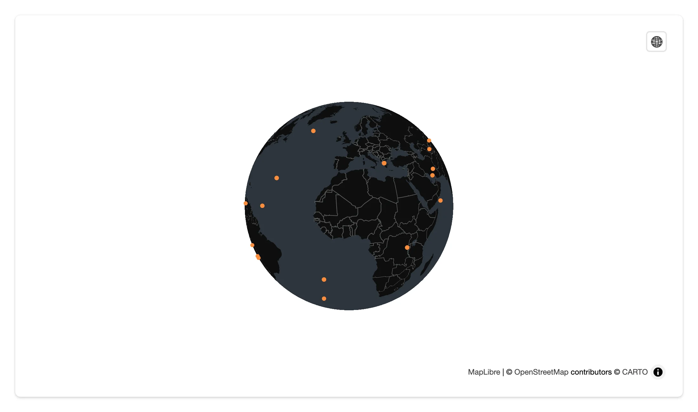

### Deck.GL layers (the `render_pydeck` migration path)

`pydeck.Layer` objects pass straight to `add_deck_layers()` / `set_deck_layers()`. This is the supported
replacement for `@render_pydeck`, which pydeck 0.9 broke (it removed pydeck's own Jupyter widget). Updating the
layer list restyles in place -- the 6,100-point dataset isn't re-sent, only the layer's style properties are.

```{.python file="examples/08_deck_layers.py"}
import pydeck as pdk
import requests
from maplibre import Map, MapOptions
from maplibre.basemaps import Carto
from shiny import reactive
from shiny.express import input, ui
from shinywidgets import render_maplibre

EARTHQUAKES = requests.get(
    "https://maplibre.org/maplibre-gl-js/docs/assets/earthquakes.geojson"
).json()
POINTS = [f["geometry"]["coordinates"][:2] for f in EARTHQUAKES["features"]]

ui.page_opts(fillable=True)
ui.input_slider("radius", "Hexagon radius (km)", 50, 500, 200, step=50)

with ui.card(full_screen=True):

    @render_maplibre
    def deck():
        m = Map(MapOptions(style=Carto.DARK_MATTER, center=(0, 20), zoom=1.2))
        # pydeck.Layer objects pass straight to a maplibre Map -- this is the
        # migration path for @render_pydeck, which pydeck 0.9 removed support for.
        m.add_deck_layers([hexagon_layer()])
        return m


@reactive.effect
def _restyle():
    # set_deck_layers() restyles in place: the camera position is kept, and the
    # 6,100 points aren't re-sent (only the layer's style properties are).
    deck.widget.set_deck_layers([hexagon_layer()])


def hexagon_layer() -> pdk.Layer:
    return pdk.Layer(
        "HexagonLayer",
        POINTS,
        id="quakes-hex",
        get_position="-",
        radius=input.radius() * 1000,
        extruded=True,
        elevation_scale=2000,
        pickable=True,
    )
```

| Radius 200 km | Radius 500 km |
|---|---|
| 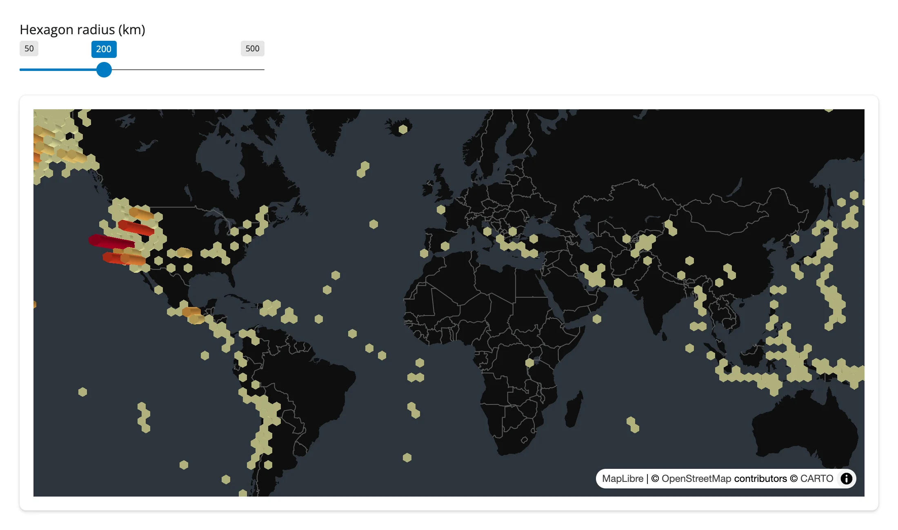 |  |

See [Gallery candidates](#gallery-candidates) for a more complete deck.gl example (140,000 points, click-to-probe,
viewport count) adapted from the package's own `examples/pydeck/app.py`.

## Reacting to user interaction

### Accessor reference

Read an accessor in a reactive function (a `@render.*` function, `@reactive.calc`, or `@reactive.effect`) and
the function re-runs whenever the user gestures, much like `input.my_slider()` reads an input:

| accessor | returns | before any interaction | across re-render | default rate policy |
|---|---|---|---|---|
| `view_state()` | `{center, zoom, bounds, bearing, pitch}` | cancels (`req(False)`) until the browser's first report (the map's `load` event) | kept until the new map's browser reports, then re-seeded from the new map | none (the browser reports once per completed gesture -- `load`/`moveend`/`zoomend` -- not per frame) |
| `clicked()` | `{lng, lat}` of the last click | `None` | kept until the user clicks the new map | none |
| `drawn_features()` | list of drawn GeoJSON features | `[]` | re-seeded to the new map's own (empty) set | none |

The remaining MapboxDraw event traits have no accessor; read them with `.read()` (see the [reacting to widgets
article](../../guide/reacting-to-widgets/index.md#beyond-the-accessors-read-and-reactive_read) for how `.read()`
reaches a bare trait):

| Trait | Returns | Fires when |
|---|---|---|
| `draw_features_selected` | list of selected GeoJSON features | MapboxDraw `draw.selectionchange` |
| `draw_features_created` / `_updated` / `_deleted` | list of GeoJSON features | the matching MapboxDraw event |

### `view_state()` and `clicked()`

[`examples/09_reactive_read.py`](examples/09_reactive_read.py) renders both accessors to a `@render.code` output.
Dragging, scroll-zooming, and clicking the map on the left all update the panel on the right in real time:

```{.python file="examples/09_reactive_read.py"}
import json

from maplibre import Map, MapOptions
from maplibre.basemaps import Carto
from shiny.express import render, ui
from shinywidgets import render_maplibre

ui.page_opts(fillable=True)

with ui.layout_columns(col_widths=[7, 5]):
    with ui.card(full_screen=True):

        @render_maplibre
        def city():
            return Map(MapOptions(style=Carto.DARK_MATTER, center=(2.3522, 48.8566), zoom=11))

    with ui.card():
        ui.card_header("Map state (accessors)")

        @render.code
        def state():
            vs = city.view_state()
            clicked = city.clicked()
            return (
                f"view_state:\n{json.dumps(vs, indent=2)}\n\n"
                f"clicked:\n{json.dumps(clicked) if clicked else '(nothing clicked yet)'}"
            )
```

Before any interaction, then after a drag, a scroll-zoom, and a click:

| Before | After drag + zoom + click |
|---|---|
| 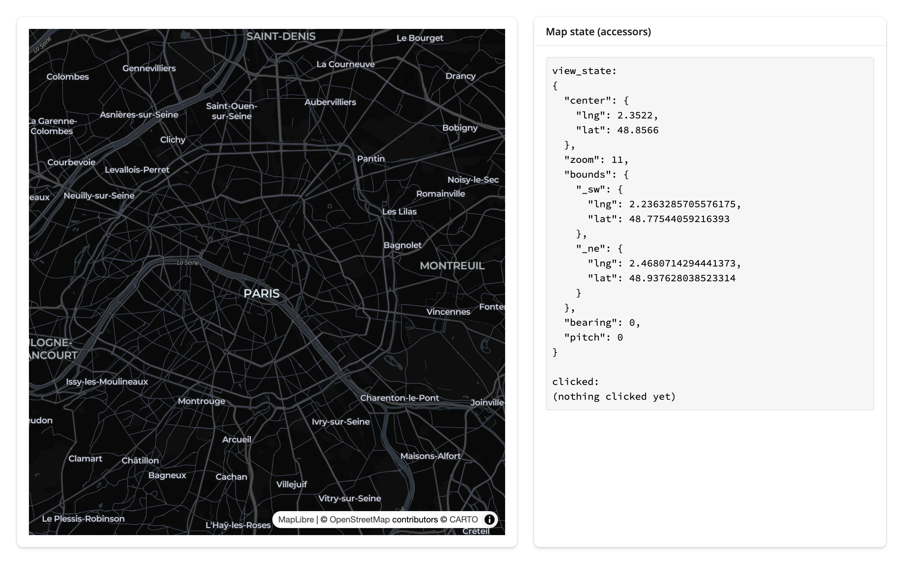 | 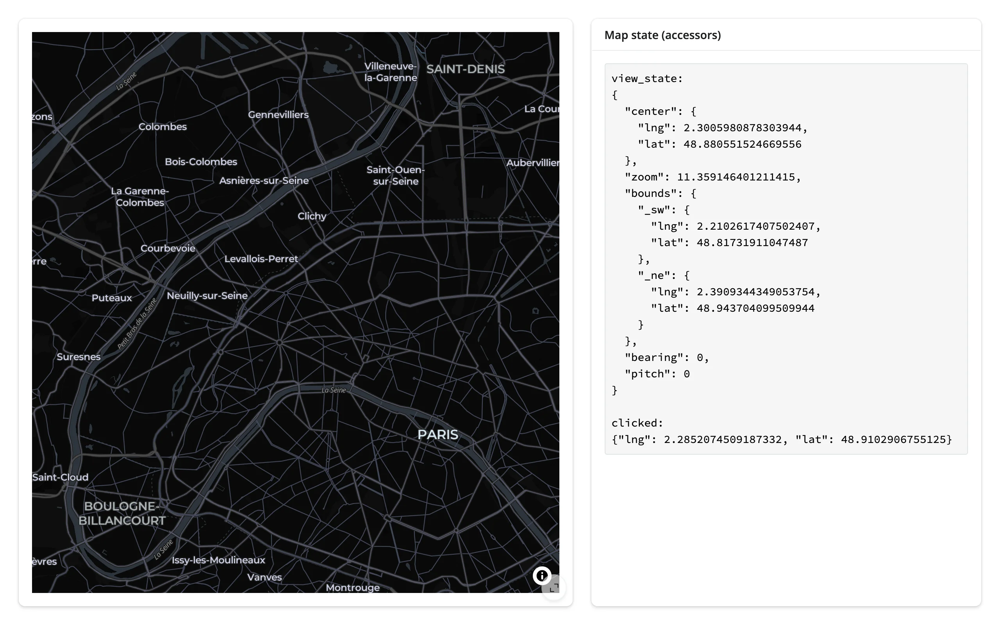 |

`view_state()["bounds"]` gives the visible viewport as `{_sw: {lng, lat}, _ne: {lng, lat}}` (note the underscores --
that's MapLibre GL JS's own `LngLatBounds` field naming). `clicked()` is a bare lng/lat: MapLibre doesn't tell you
*which* feature was clicked, only where. See [Click to feature detail](#click---detail-card) for the workaround.

### Beyond the basics: MapboxDraw

`m.add_mapbox_draw()` adds drawing controls (point, line, polygon, trash); `drawn_features()` reports the current
shapes on every create/update/delete. [`examples/10_mapbox_draw.py`](examples/10_mapbox_draw.py):

```{.python file="examples/10_mapbox_draw.py"}
from maplibre import Map, MapOptions
from maplibre.basemaps import Carto
from shiny.express import render, ui
from shinywidgets import render_maplibre

ui.page_opts(fillable=True)

with ui.layout_columns(col_widths=[8, 4]):
    with ui.card(full_screen=True):

        @render_maplibre
        def city():
            m = Map(MapOptions(style=Carto.POSITRON, center=(2.3522, 48.8566), zoom=11))
            m.add_mapbox_draw()
            return m

    with ui.card():
        ui.card_header("Drawn features")

        @render.code
        def drawn():
            feats = city.drawn_features()
            return f"{len(feats)} feature(s) drawn\n\n{feats}"
```

| Before drawing | After drawing a polygon |
|---|---|
| 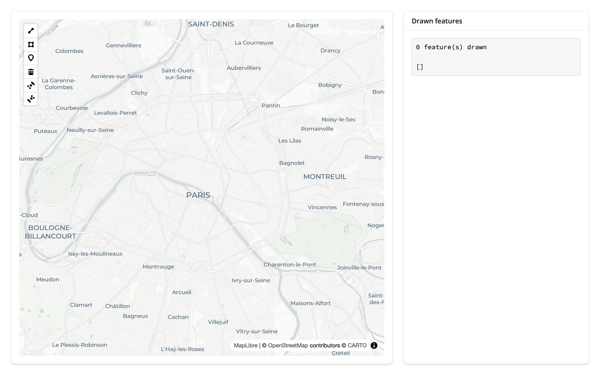 | 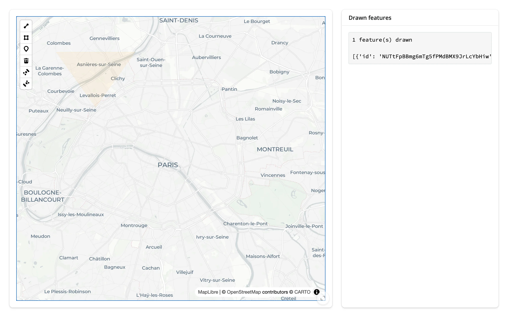 |

The drawn polygon's **fill** renders correctly; its outline doesn't -- see
[Gotchas](#gotchas-and-limitations).

### Rate limiting

Every `render_*` decorator accepts `rate_policy` (`"debounce"` or `"throttle"`) and `rate_delay` (seconds), which
rate-limit `.read()`/`reactive_read()` on that output's widget. The `view_state()` accessor itself declares no
default rate policy (the browser reports once per completed gesture, so there's nothing continuous to smooth),
and a renderer-level `rate_policy` doesn't apply to it -- but it does apply to `.read("view_state")`, which is
what to reach for when rapid programmatic camera moves (a burst of `flyTo`s) would otherwise invalidate a
reactive context faster than you need.

[`examples/11_rate_limiting.py`](examples/11_rate_limiting.py) counts how many times an effect depending on
`view_state` runs, with and without a 1-second debounce, while the same burst of ten rapid view changes is
applied to both maps:

```{.python file="examples/11_rate_limiting.py"}
from maplibre import Map, MapOptions
from maplibre.basemaps import Carto
from shiny import reactive
from shiny.express import render, ui
from shinywidgets import render_maplibre

ui.page_opts(fillable=True)

with ui.layout_columns():
    with ui.card():
        ui.card_header("Default: every view_state change")

        @render_maplibre
        def fast():
            return Map(MapOptions(style=Carto.DARK_MATTER, center=(2.3522, 48.8566), zoom=11))

        @render.text
        def fast_count():
            return f"{n_fast.get()} reads"

    with ui.card():
        ui.card_header("rate_delay=1 (debounced)")

        @render_maplibre(rate_policy="debounce", rate_delay=1)
        def slow():
            return Map(MapOptions(style=Carto.DARK_MATTER, center=(2.3522, 48.8566), zoom=11))

        @render.text
        def slow_count():
            return f"{n_slow.get()} reads"


n_fast = reactive.value(0)
n_slow = reactive.value(0)


@reactive.effect
def _count_fast():
    fast.read("view_state")
    # isolate(): reading n_fast here must not make this effect depend on
    # itself -- that would make .set() below re-trigger it forever
    with reactive.isolate():
        n_fast.set(n_fast.get() + 1)


@reactive.effect
def _count_slow():
    slow.read("view_state")
    with reactive.isolate():
        n_slow.set(n_slow.get() + 1)
```

| Before the burst | After |
|---|---|
|  | 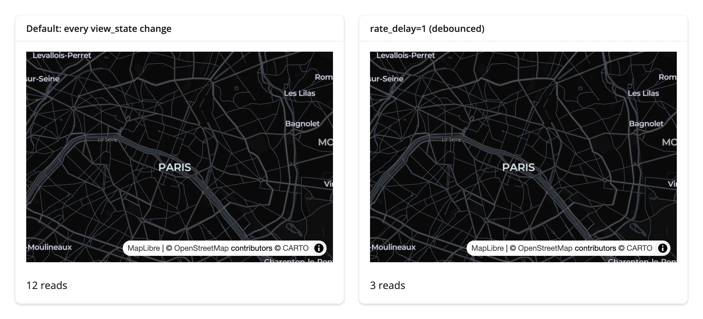 |

The default map's counter climbs with every change (12 reads); the debounced map collapses the whole burst into a
couple of publishes (3 reads). Reach for `rate_delay` when a `view_state`-driven computation (a viewport filter, a
network request) is too expensive to run on every report.

## Updating the widget from Python

Treat the render function as one-time setup and restyle the live map from effects. This matters because
**re-rendering rebuilds the map from scratch** -- the user's pan, zoom, and any selection state resets -- while
`.widget` method calls (`set_paint_property`, `set_filter`, `set_data`, `add_layer`, `fit_bounds`, `add_call`) are
sent as commands to the existing map and never touch the camera unless you ask them to.

[`examples/12_update_in_place.py`](examples/12_update_in_place.py) shows the pattern end to end: a color-ramp
dropdown and a density-filter slider both restyle the same rendered choropleth. The render function reads the
*initial* ramp under `reactive.isolate()`, so changing the dropdown later never re-triggers it:

```{.python file="examples/12_update_in_place.py"}
import requests
from maplibre import Layer, LayerType, Map, MapOptions
from maplibre.basemaps import Carto
from maplibre.sources import GeoJSONSource
from shiny import reactive
from shiny.express import input, ui
from shinywidgets import render_maplibre

STATES = requests.get(
    "https://raw.githubusercontent.com/PublicaMundi/MappingAPI/master/data/geojson/us-states.json"
).json()
RAMPS = {
    "Sequential (orange-red)": ["interpolate", ["linear"], ["get", "density"], 0, "#ffffb2", 200, "#fd8d3c", 1000, "#bd0026"],
    "Diverging (blue-red)": ["interpolate", ["linear"], ["get", "density"], 0, "#2166ac", 200, "#f7f7f7", 1000, "#b2182b"],
}  # fmt: skip

ui.page_opts(fillable=True)
ui.input_select("ramp", "Color ramp", list(RAMPS))
ui.input_slider("min_density", "Minimum density shown", 0, 500, 0, step=25)

with ui.card(full_screen=True):

    @render_maplibre
    def choropleth():
        # Read once: the slider and dropdown restyle the existing map below,
        # so this function never needs to run again as the user adjusts them --
        # which also means the camera (pan/zoom) is never reset.
        with reactive.isolate():
            ramp = RAMPS[input.ramp()]
        m = Map(MapOptions(style=Carto.POSITRON, center=(-98.5, 39.8), zoom=3.3))
        m.add_source("states", GeoJSONSource(data=STATES))
        m.add_layer(
            Layer(id="states-fill", type=LayerType.FILL, source="states", paint={"fill-color": ramp})
        )
        return m


@reactive.effect
def _recolor():
    choropleth.widget.set_paint_property("states-fill", "fill-color", RAMPS[input.ramp()])


@reactive.effect
def _refilter():
    choropleth.widget.set_filter("states-fill", [">=", ["get", "density"], input.min_density()])
```

The map was panned and zoomed to the Northeast before either control was touched. After switching the ramp and
raising the filter, the camera hasn't moved an inch:

| Panned, before restyling | After changing ramp + filter |
|---|---|
| 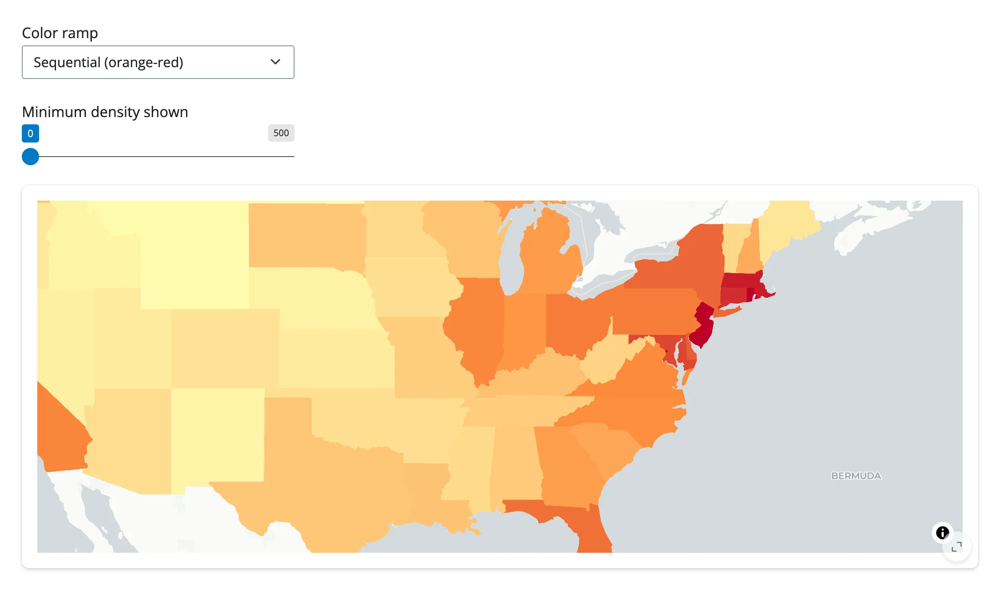 | 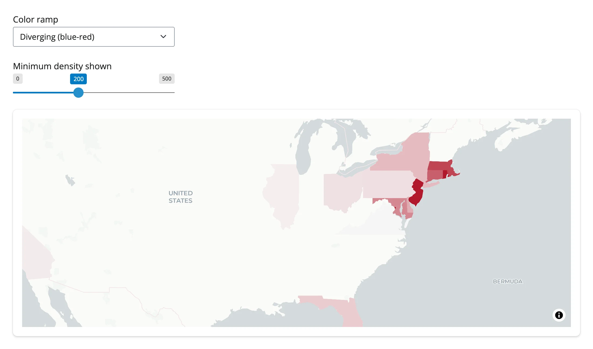 |

For camera moves you *do* want, `add_call("flyTo", {...})` (or `"easeTo"`, `"jumpTo"`) animates the view from
Python -- see [Table row to `flyTo`](#table-row---flyto) below.

## Coordinating multiple views

### Click -> detail card

`clicked` only gives a lng/lat, not a feature. Find the nearest feature in Python and render its details --
[`examples/13_click_to_detail.py`](examples/13_click_to_detail.py):

```{.python file="examples/13_click_to_detail.py"}
import numpy as np
import requests
from maplibre import Layer, LayerType, Map, MapOptions
from maplibre.basemaps import Carto
from maplibre.sources import GeoJSONSource
from shiny.express import render, ui
from shinywidgets import render_maplibre

EARTHQUAKES = requests.get(
    "https://maplibre.org/maplibre-gl-js/docs/assets/earthquakes.geojson"
).json()
QUAKES = [f for f in EARTHQUAKES["features"] if f["properties"]["mag"] >= 5]
LNG = np.array([f["geometry"]["coordinates"][0] for f in QUAKES])
LAT = np.array([f["geometry"]["coordinates"][1] for f in QUAKES])

ui.page_opts(fillable=True)

with ui.layout_columns(col_widths=[8, 4]):
    with ui.card(full_screen=True):

        @render_maplibre
        def quakes():
            # Centered on the 2017 Chiapas (Mexico) M8.1 earthquake
            m = Map(MapOptions(style=Carto.DARK_MATTER, center=(-93.9067, 15.0356), zoom=5))
            m.add_source("quakes", GeoJSONSource(data=EARTHQUAKES))
            m.add_layer(
                Layer(
                    id="quakes-circle",
                    type=LayerType.CIRCLE,
                    source="quakes",
                    filter=[">=", ["get", "mag"], 5],
                    paint={"circle-radius": 6, "circle-color": "#fd8d3c"},
                )
            )
            return m

    with ui.card():
        ui.card_header("Clicked earthquake")

        @render.ui
        def detail():
            # `clicked()` is a bare lng/lat -- maplibre doesn't report which
            # feature was clicked, so find the nearest one in Python.
            ll = quakes.clicked()
            if ll is None:
                return "Click a dot on the map."
            i = int(np.argmin((LNG - ll["lng"]) ** 2 + (LAT - ll["lat"]) ** 2))
            f = QUAKES[i]
            return ui.tags.ul(
                ui.tags.li(f"Magnitude: {f['properties']['mag']}"),
                ui.tags.li(f"Location: {LAT[i]:.2f}, {LNG[i]:.2f}"),
            )
```

| Before | After clicking the M8.1 dot |
|---|---|
| 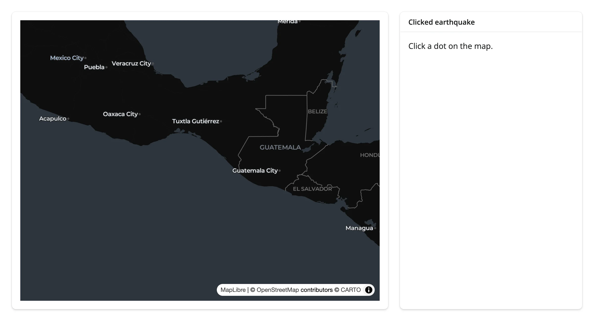 | 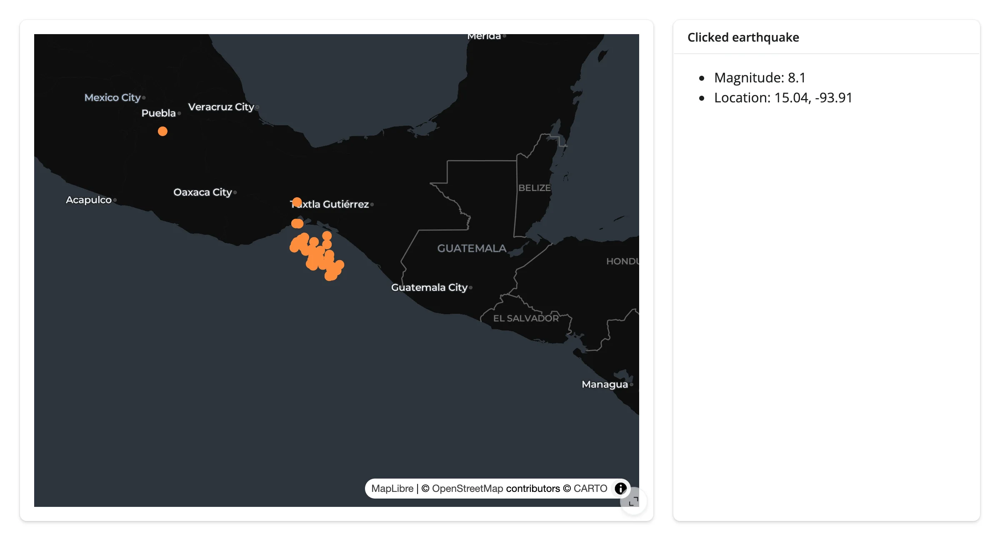 |

### Viewport -> chart of what's visible

`view_state["bounds"]` is a ready-made bounding box: mask your data against it and the rest is a normal chart.
[`examples/14_viewport_to_chart.py`](examples/14_viewport_to_chart.py) recomputes a magnitude histogram for
whatever's on screen (pairs with [matplotlib](../matplotlib/index.md), but any charting output works the same
way):

```{.python file="examples/14_viewport_to_chart.py"}
import matplotlib.pyplot as plt
import numpy as np
import requests
from maplibre import Layer, LayerType, Map, MapOptions
from maplibre.basemaps import Carto
from maplibre.sources import GeoJSONSource
from shiny.express import render, ui
from shinywidgets import render_maplibre

EARTHQUAKES = requests.get(
    "https://maplibre.org/maplibre-gl-js/docs/assets/earthquakes.geojson"
).json()
LNG = np.array([f["geometry"]["coordinates"][0] for f in EARTHQUAKES["features"]])
LAT = np.array([f["geometry"]["coordinates"][1] for f in EARTHQUAKES["features"]])
MAG = np.array([f["properties"]["mag"] for f in EARTHQUAKES["features"]])

ui.page_opts(fillable=True)

with ui.layout_columns(col_widths=[8, 4]):
    with ui.card(full_screen=True):

        @render_maplibre
        def quakes():
            m = Map(MapOptions(style=Carto.DARK_MATTER, center=(0, 20), zoom=1.2))
            m.add_source("quakes", GeoJSONSource(data=EARTHQUAKES))
            m.add_layer(
                Layer(
                    id="quakes-circle",
                    type=LayerType.CIRCLE,
                    source="quakes",
                    paint={"circle-radius": 2, "circle-color": "#fd8d3c", "circle-opacity": 0.6},
                )
            )
            return m

    with ui.card():
        ui.card_header("What's on screen")

        @render.plot
        def visible_mags():
            vs = quakes.view_state()
            sw, ne = vs["bounds"]["_sw"], vs["bounds"]["_ne"]
            mask = (LNG >= sw["lng"]) & (LNG <= ne["lng"]) & (LAT >= sw["lat"]) & (LAT <= ne["lat"])
            fig, ax = plt.subplots()
            ax.hist(MAG[mask], bins=np.arange(0, 9, 0.5))
            ax.set_title(f"{int(mask.sum())} earthquakes in view")
            ax.set_xlabel("Magnitude")
            return fig
```

Zooming into North America drops the count from 829 to 184 and reshapes the histogram:

| World view (829 in view) | Zoomed to the Americas (184 in view) |
|---|---|
| 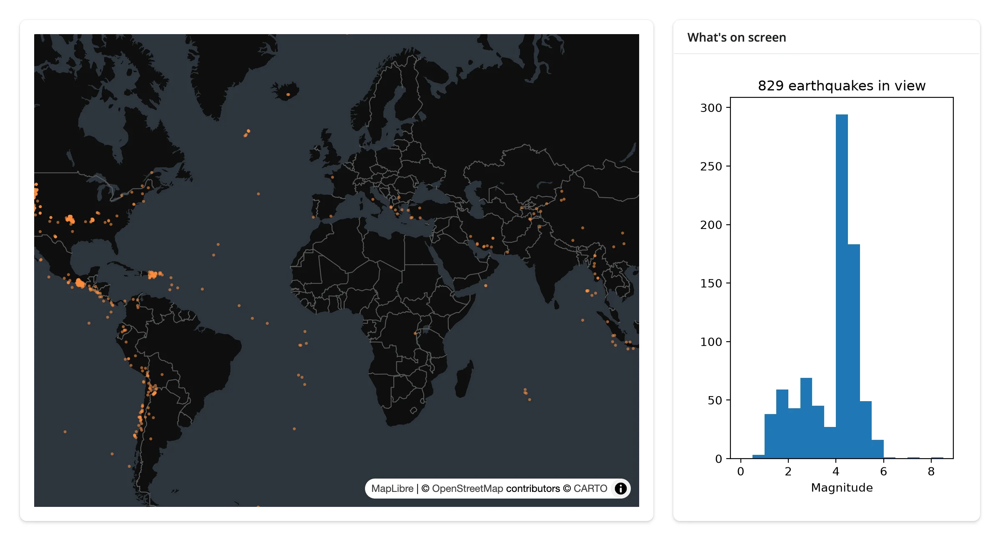 | 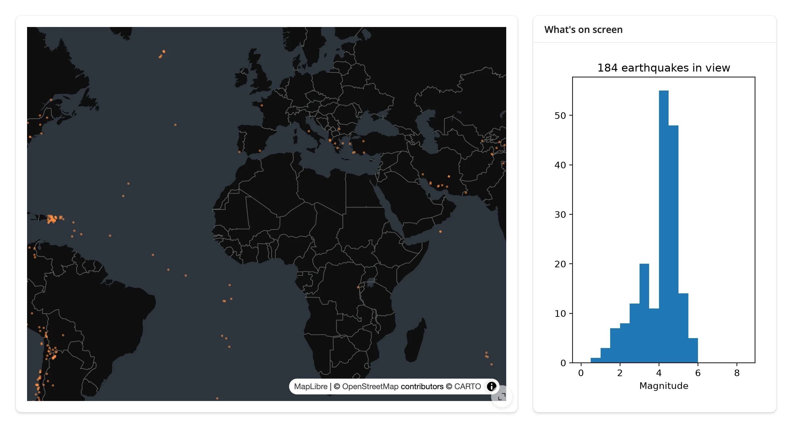 |

### Shiny input -> `set_filter` without losing the viewport

A magnitude-threshold slider drives `set_filter()` on an effect; because it's an in-place restyle, wherever the
user has panned stays put. [`examples/15_filter_keep_viewport.py`](examples/15_filter_keep_viewport.py):

```{.python file="examples/15_filter_keep_viewport.py"}
import requests
from maplibre import Layer, LayerType, Map, MapOptions
from maplibre.basemaps import Carto
from maplibre.sources import GeoJSONSource
from shiny import reactive
from shiny.express import input, ui
from shinywidgets import render_maplibre

EARTHQUAKES = requests.get(
    "https://maplibre.org/maplibre-gl-js/docs/assets/earthquakes.geojson"
).json()

ui.page_opts(fillable=True)
ui.input_slider("min_mag", "Minimum magnitude", 0, 8, 0, step=0.5)

with ui.card(full_screen=True):

    @render_maplibre
    def quakes():
        m = Map(MapOptions(style=Carto.DARK_MATTER, center=(0, 20), zoom=1.2))
        m.add_source("quakes", GeoJSONSource(data=EARTHQUAKES))
        m.add_layer(
            Layer(
                id="quakes-circle",
                type=LayerType.CIRCLE,
                source="quakes",
                paint={"circle-radius": 3, "circle-color": "#fd8d3c", "circle-opacity": 0.7},
            )
        )
        return m


@reactive.effect
def _filter():
    # set_filter() restyles the existing layer; it never rebuilds the map, so
    # wherever the user has panned and zoomed to stays exactly where it was.
    quakes.widget.set_filter("quakes-circle", [">=", ["get", "mag"], input.min_mag()])
```

Zoomed into California, then raising the minimum magnitude to 6 -- same camera, fewer dots:

| Zoomed in, unfiltered | Filtered to magnitude >= 6 |
|---|---|
| 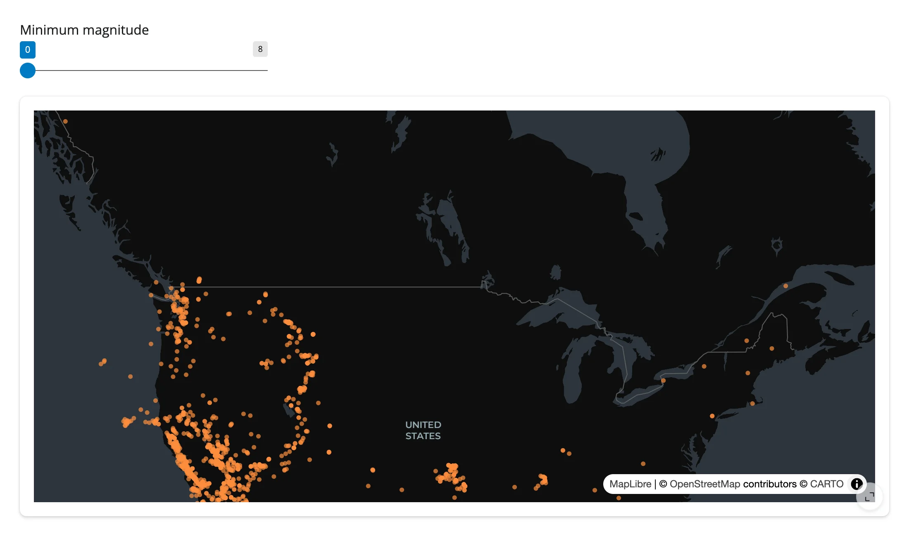 | 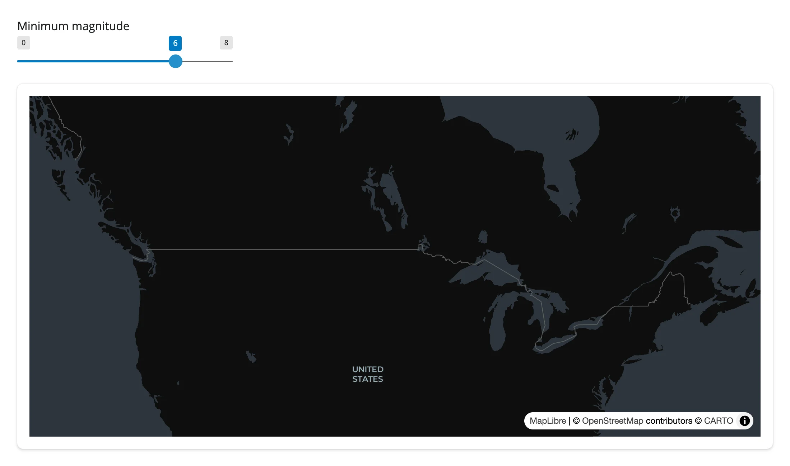 |

### Table row -> `flyTo`

A plain Shiny `@render.data_frame` (no accessor needed on that side either) drives the camera: clicking a row
flies the map to that earthquake. Pairs with [itables](../itables/index.md) or
[reactable](../reactable/index.md) just as well if you'd rather use one of those tables.
[`examples/16_table_to_fly_to.py`](examples/16_table_to_fly_to.py):

```{.python file="examples/16_table_to_fly_to.py"}
import pandas as pd
import requests
from maplibre import Map, MapOptions
from maplibre.basemaps import Carto
from shiny import reactive, render
from shiny.express import ui
from shinywidgets import render_maplibre

EARTHQUAKES = requests.get(
    "https://maplibre.org/maplibre-gl-js/docs/assets/earthquakes.geojson"
).json()
TOP10 = (
    pd.DataFrame(
        {
            "mag": [f["properties"]["mag"] for f in EARTHQUAKES["features"]],
            "lng": [f["geometry"]["coordinates"][0] for f in EARTHQUAKES["features"]],
            "lat": [f["geometry"]["coordinates"][1] for f in EARTHQUAKES["features"]],
        }
    )
    .nlargest(10, "mag")
    .reset_index(drop=True)
)

ui.page_opts(fillable=True)

with ui.layout_columns(col_widths=[5, 7]):
    with ui.card():
        ui.card_header("10 strongest earthquakes")

        @render.data_frame
        def table():
            return render.DataGrid(TOP10[["mag"]], selection_mode="row")

    with ui.card(full_screen=True):

        @render_maplibre
        def quakes():
            return Map(MapOptions(style=Carto.DARK_MATTER, center=(0, 20), zoom=1.2))


@reactive.effect
def _fly_to():
    rows = table.cell_selection()["rows"]
    if not rows:
        return
    row = TOP10.iloc[rows[0]]
    quakes.widget.add_call("flyTo", {"center": [row["lng"], row["lat"]], "zoom": 5})
```

| Table (unselected) | After clicking the M8.1 row (map mid-`flyTo`) |
|---|---|
| 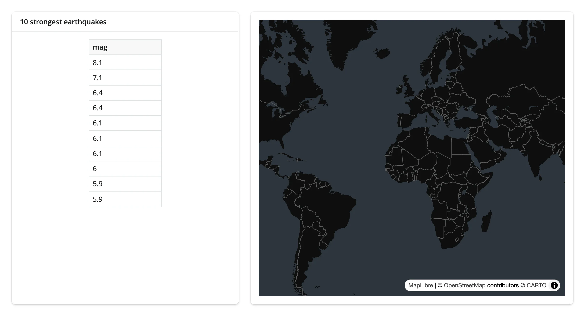 | 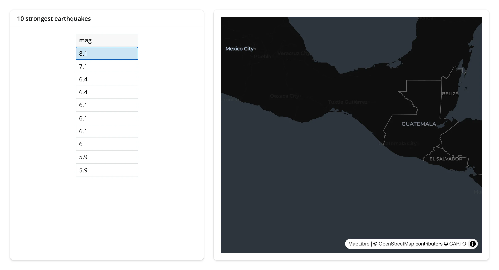 |

## Large data

MapLibre's basemap is already "only send what's visible": vector- and raster-tile sources page in only the
tiles the current viewport needs, however large the source data is. For your own point or polygon data at
scale, [`add_deck_layers()`](#deckgl-layers-the-render_pydeck-migration-path) hands rendering to deck.gl's WebGL
pipeline instead -- the GPU-in-browser approach. This guide's gallery app
[`showcase_uk_accidents.py`](gallery/showcase_uk_accidents.py) renders 140,000 points as an extruded hexagon
layer; it pans, zooms, and restyles smoothly, and restyling never re-sends the underlying point data (see
[Gallery candidates](#gallery-candidates)). GeoJSON sources added directly, not through deck.gl, have no
large-data mode of their own and ship the whole feature collection to the browser once, the same as ipyleaflet.
See the [Large data & performance article](../../guide/performance/index.md#three-approaches-to-large-data)
for how these approaches compare.

## Layout and sizing

A map fills its card by default (including following it into and out of `full_screen`). Give the renderer an
explicit height -- `@render_maplibre(height="250px")`, or `output_widget("id", height="250px")` in core Shiny --
and it keeps that height instead of growing. Both paths are exercised in
[`examples/17_layout_sizing.py`](examples/17_layout_sizing.py):

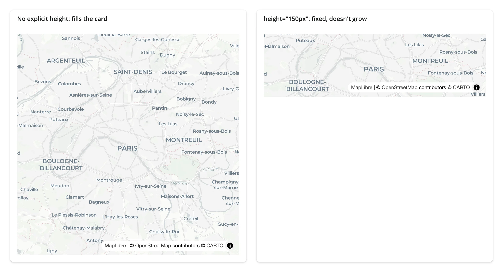

This matches `MapWidget(height=...)` semantics too: an explicit widget height is respected inside a filling card,
and the default (`400`) is treated as unset so the map still fills. (An earlier evaluation of this renderer found
explicit heights broken; that's fixed on current `main`.)

## Gotchas and limitations

- **`Map.set_projection()`'s default argument is not JSON-serializable and silently drops every other queued call
  for that map.** `ProjectionType.GLOBE` is an enum member, and `set_projection()` passes it raw into the queued
  `setProjection` call instead of its `.value`. The whole init message is one JSON blob, so the `TypeError` (logged
  server-side, not shown to the user) means `addSource`/`addLayer` calls queued around it are silently lost too --
  the map renders its basemap and nothing else. **Always pass the projection as a string**:
  `m.set_projection("vertical-perspective")` (MapLibre's current name for the 3D globe projection; `"mercator"`
  for flat). This is an upstream `maplibre` bug, verified on the version this guide was written against.
- **Clicks only report a location, not a feature.** `clicked` is `{lng, lat}`; there's no feature id or
  properties. Find the nearest (or `queryRenderedFeatures`-equivalent) feature yourself in Python, as in
  [Click to detail card](#click---detail-card).
- **Hover is client-only.** `add_tooltip()` works entirely in the browser; there's no `hovered` trait to read in
  Python.
- **`add_popup()`/`add_tooltip()` without a `template=` inject raw property values via `setHTML`, unescaped.**
  Passing `prop="some_field"` (or omitting both `prop` and `template`, which shows every property) puts the raw
  property string into the popup's HTML. A `template=` mustache string **is** escaped. If a layer's properties can
  contain untrusted or user-supplied text, use `template=`, not `prop=`.
  Low severity for typical use (most feature properties come from your own data pipeline, not end users), but
  worth knowing if you're joining in anything user-submitted.
- **MapboxDraw line styles don't render under this MapLibre GL JS version.** A drawn polygon's fill shows; its
  outline doesn't (`line-dasharray: Expression name must be a string` in the console). Upstream `maplibre` /
  `mapbox-gl-draw` incompatibility, not a shinywidgets issue.
- **Assigning traits after render does nothing.** `widget.map_options = ...` or `widget.height = ...` once the map
  has rendered has no effect -- the JS reads them once at construction. Use `.widget` methods for anything after
  that.
- **`setStyle` wipes custom sources and layers.** Re-add them after a style switch if your style-switching UI also
  carries user data layers (the [basemap styles example](#vector-tile-basemaps-no-api-key) above has none, so it
  doesn't need to).
- **Two maps on one page log a `luma.gl: already been initialized` console warning.** Cosmetic (seen in both the
  rate-limiting and deck.gl gallery examples here); it doesn't affect rendering or interaction.

### Already fixed on `main` (an earlier evaluation of this renderer found these broken)

- **Explicit heights were ignored or cropped the map.** `output_widget(height=...)` and `MapWidget(height=...)`
  both now size the map correctly, including inside a filling card and through `full_screen` -- see
  [Layout and sizing](#layout-and-sizing).
- **A module-level `Map` leaked queued calls across sessions.** `as_widget_maplibre()` now copies the `Map`'s
  options and call queue rather than aliasing them (still build your `Map` inside the render function, though --
  it's clearer, and nothing relies on the old aliasing bug being present).
- **A 2-second anywidget init timeout could permanently drop a map's messages under load** (slow GPU init, several
  maps on one page, or a busy first render). shinywidgets now serves a patched copy of anywidget's front end with a
  60-second budget.

## Gallery candidates

### `template_quake_explorer.py`

A small, adaptable starting point (about 70 lines): one map, a magnitude filter, a click-to-detail panel, and an
on-screen count -- the three patterns from [Coordinating multiple views](#coordinating-multiple-views) combined
into one app.

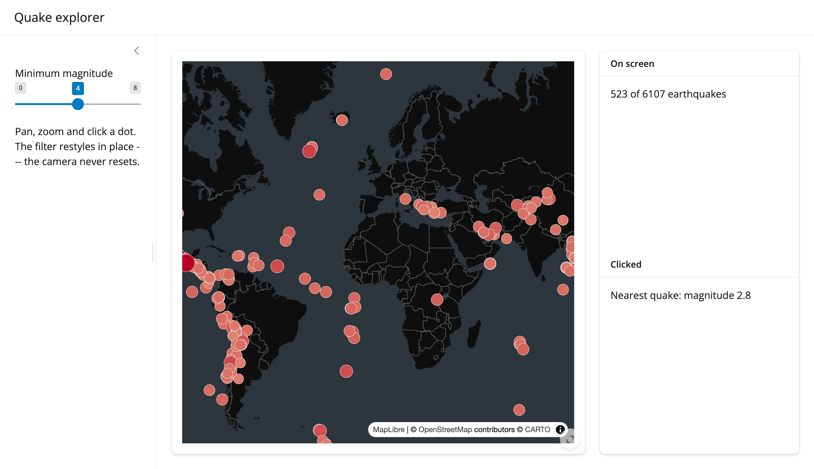

### `showcase_uk_accidents.py`

A more involved example adapted from the shinywidgets repository's own `examples/pydeck/app.py`: 140,000 UK road
accidents rendered as an extruded hexagon bin layer via `add_deck_layers()`. Three sliders restyle the bins in
place; panning counts what's visible; clicking probes a 5 km radius and draws it on the map, all without
re-sending the underlying point data.

| Initial | After clicking near Stoke |
|---|---|
|  | 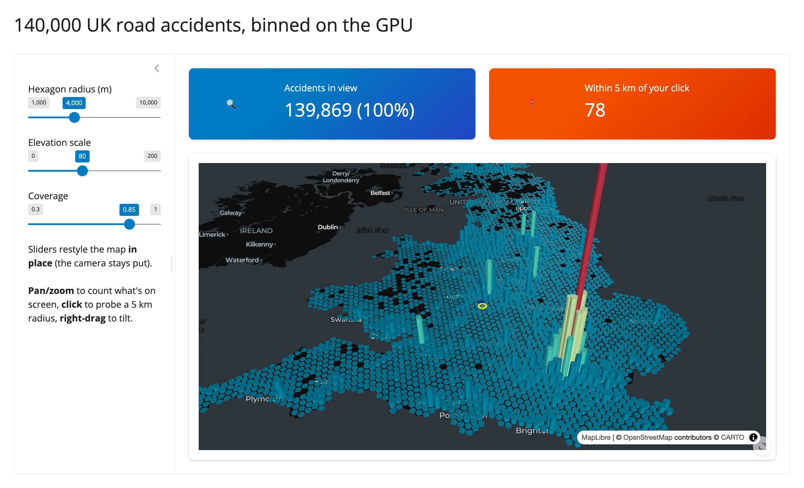 |

## Learn more

- [py-maplibregl documentation](https://eoda-dev.github.io/py-maplibregl/)
- [MapLibre GL JS style spec](https://maplibre.org/maplibre-style-spec/) (paint/layout properties and expressions)
- [MapLibre GL JS heatmap tutorial](https://maplibre.org/maplibre-gl-js/docs/examples/heatmap-layer/) (source of
  the earthquake dataset used throughout this guide)
- Related guides in this roster: [lonboard](../lonboard/index.md) (large-scale point/polygon data),
  [ipyleaflet](../ipyleaflet/index.md) (per-feature click/hover callbacks), [leafmap](../leafmap/index.md) (can
  also drive a MapLibre backend), [geolibre](../geolibre/index.md)
