[Matplotlib](https://matplotlib.org) is the foundation of the Python plotting ecosystem: pandas' `.plot()`,
seaborn, statsmodels, scikit-learn's `*Display` classes, mplfinance, and many others all draw onto a matplotlib
`Figure` under the hood. It's been developed by a large open-source community since 2003 and is uniquely good at
precise, static, publication-quality graphics with total control over every element.

`@render_matplotlib` renders a figure as a live [ipympl](https://matplotlib.org/ipympl/) widget instead of a
static image. The decorated function may return a `Figure`, an `Axes`, or an `ipympl.backend_nbagg.Canvas`
directly, which covers anything built on matplotlib. Shinywidgets fits the figure to its container (or keeps its
`figsize` with an explicit height), keeps re-renders from leaking pyplot figures across sessions, and surfaces
draw-time errors as a normal output error instead of killing the session. On top of that, three reactive accessors
-- `clicked()`, `picked()`, and `limits()` -- read what the user does with the figure, much like reading a Shiny
input.

Reach for `@render_matplotlib` when the plot should respond to the user: panning and zooming, clicking to inspect
a point, or updating a line in place without redrawing the whole figure. Reach for Shiny's own `@render.plot`
when a picture is enough -- it's cheaper (a PNG per render), the safest choice for many concurrent users, and it
applies tight layout and closes its figure automatically. If you draw with the grammar-of-graphics style instead
of matplotlib's imperative API, see the [plotnine guide](../plotnine/index.md), which renders through this same
ipympl engine and shares its `clicked()` and `limits()` accessors.

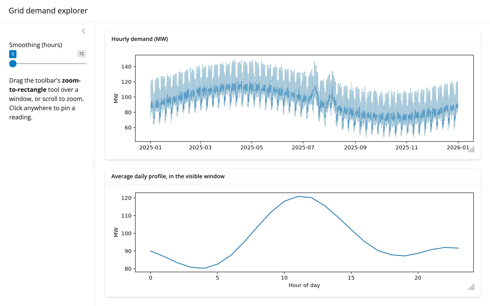

## Installation

```
pip install 'shinywidgets[matplotlib]'
```

This installs matplotlib and [ipympl](https://matplotlib.org/ipympl/), the widget backend that `@render_matplotlib`
renders through.

## Quick start

Decorate a function that builds and returns a `Figure`. Build it with `matplotlib.figure.Figure()` directly (or
`plt.subplots()`, closed automatically when rendered) rather than relying on pyplot's implicit current figure --
see [Gotchas](#gotchas-and-limitations).

```{.python file="examples/01_quickstart.py"}
from matplotlib.cbook import get_sample_data
from matplotlib.figure import Figure
from shiny.express import ui
from shinywidgets import render_matplotlib

ui.page_opts(fillable=True)

# Google's daily closing price from its 2004 IPO through the 2008 crash,
# bundled with matplotlib as sample data
goog = get_sample_data("goog.npz")["price_data"]


@render_matplotlib
def plot():
    fig = Figure(layout="constrained")
    ax = fig.subplots()
    ax.plot(goog["date"], goog["close"])
    ax.set_ylabel("Close ($)")
    return fig
```

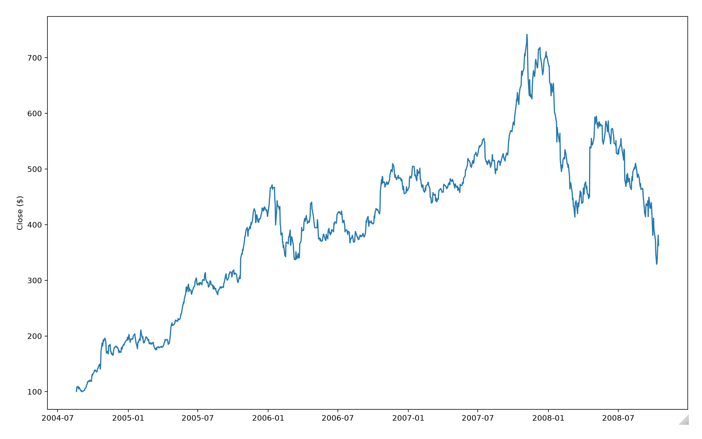

The figure renders with a toolbar (it fades in on hover): zoom-to-rectangle, pan, step back and forward through
views, home, and download as PNG. Drag a box over the 2007-2008 runup and crash to see it:

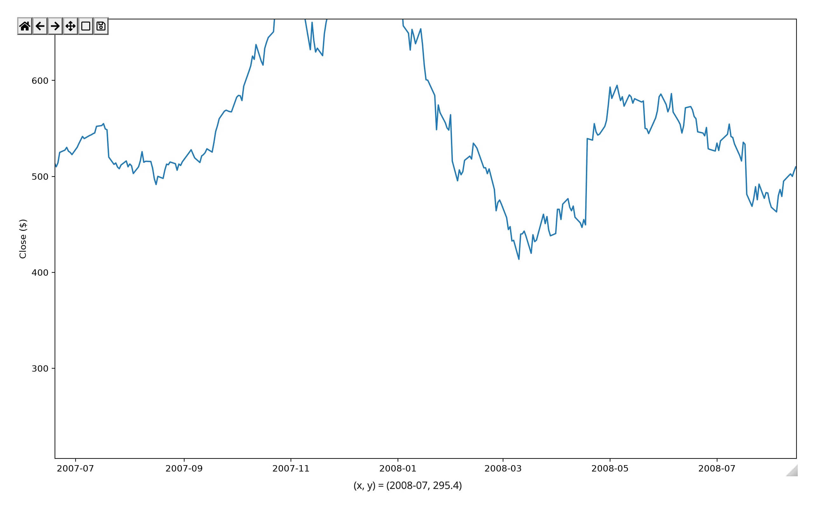

None of that -- or anything below -- is possible with a static `@render.plot` image.

## What you can build

**Anything built on matplotlib comes along for free.** pandas' `.plot()` accessor (and seaborn, statsmodels,
scikit-learn displays, mplfinance) all return a `Figure` or `Axes`, so they render the same way
([`examples/02_pandas_plot.py`](examples/02_pandas_plot.py)):

```{.python file="examples/02_pandas_plot.py"}
import pandas as pd
from matplotlib.cbook import get_sample_data
from matplotlib.figure import Figure
from shiny.express import ui
from shinywidgets import render_matplotlib

ui.page_opts(fillable=True)

# Anything that hands matplotlib a Figure or Axes comes along for free:
# pandas' own .plot() accessor, seaborn, statsmodels, scikit-learn displays, ...
# Monthly adjusted close, 1990-2020ish, bundled with matplotlib as sample data
with get_sample_data("Stocks.csv") as f:
    stocks = pd.read_csv(f, comment="#", skipinitialspace=True, parse_dates=["Date"])
stocks = stocks.set_index("Date")[["AAPL", "MSFT", "GOOGL"]].dropna()


@render_matplotlib
def plot():
    fig = Figure(layout="constrained", figsize=(7, 4))
    ax = fig.subplots()
    stocks.plot(ax=ax, logy=True)
    ax.set_ylabel("Adjusted close ($, log scale)")
    return fig
```

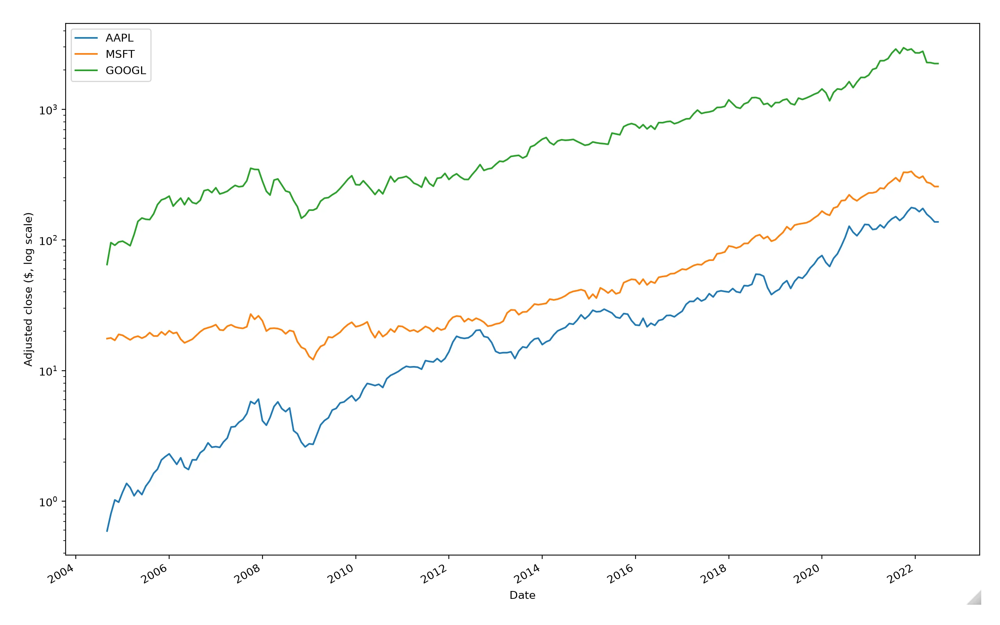

**3D axes rotate by dragging**, with no extra code -- matplotlib's own `mplot3d` toolkit handles the mouse events:

```{.python file="examples/03_rotate_3d.py"}
import numpy as np
from matplotlib.cbook import get_sample_data
from matplotlib.figure import Figure
from shiny.express import ui
from shinywidgets import render_matplotlib

ui.page_opts(fillable=True)

# A real elevation survey, bundled with matplotlib as sample data
dem = get_sample_data("jacksboro_fault_dem.npz")
z = dem["elevation"][::4, ::4]
x = np.linspace(dem["xmin"], dem["xmax"], z.shape[1])
y = np.linspace(dem["ymin"], dem["ymax"], z.shape[0])
X, Y = np.meshgrid(x, y)


@render_matplotlib
def plot():
    fig = Figure(layout="constrained")
    ax = fig.add_subplot(projection="3d")
    ax.plot_surface(X, Y, z, cmap="terrain")
    ax.set_zlabel("Elevation (ft)")
    return fig
```

| Before drag | After drag |
|---|---|
| 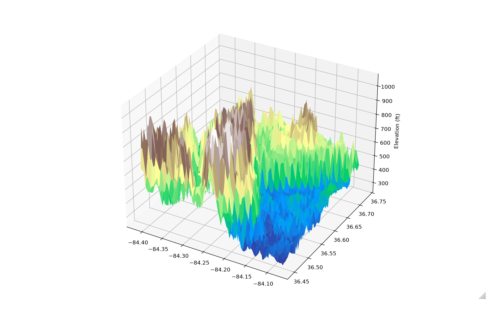 | 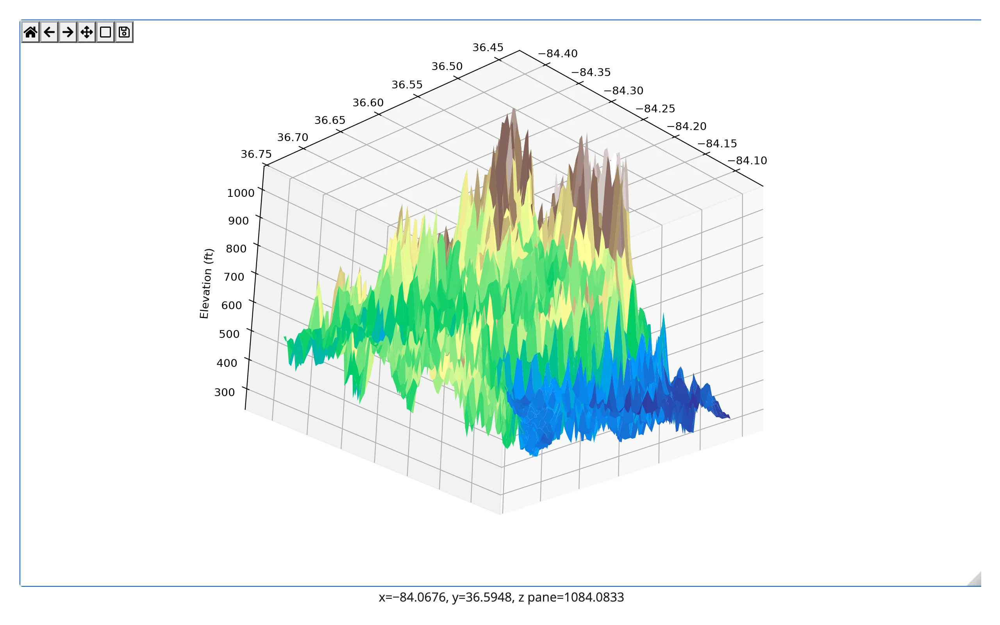 |

**Matplotlib's own interactive widgets** (`RectangleSelector`, `SpanSelector`, sliders, buttons, ...) work
unmodified, because their callbacks are plain Python functions -- which can set a `reactive.value` just like any
other matplotlib event:

```{.python file="examples/04_rectangle_selector.py"}
import numpy as np
from matplotlib.figure import Figure
from matplotlib.widgets import RectangleSelector
from shiny import reactive
from shiny.express import render, ui
from shinywidgets import render_matplotlib

ui.page_opts(fillable=True)

# matplotlib's own widgets (selectors, sliders, buttons, ...) work unmodified:
# their callbacks are plain Python functions, so they can set reactive values.
rng = np.random.default_rng(2)
weight = rng.uniform(1.5, 5.0, 150)
mpg = 45 - 6 * weight + rng.normal(0, 2.5, 150)
n_selected = reactive.value(0)


@render_matplotlib
def plot():
    fig = Figure(layout="constrained")
    ax = fig.subplots()
    points = ax.scatter(weight, mpg, alpha=0.7)
    ax.set_xlabel("Weight (1000 lbs)")
    ax.set_ylabel("Miles per gallon")

    def on_select(press, release):
        x0, x1 = sorted([press.xdata, release.xdata])
        y0, y1 = sorted([press.ydata, release.ydata])
        mask = (weight >= x0) & (weight <= x1) & (mpg >= y0) & (mpg <= y1)
        points.set_facecolors(np.where(mask, "tab:orange", "tab:blue"))
        fig.canvas.draw_idle()
        n_selected.set(int(mask.sum()))

    # Keep a reference: matplotlib selectors stop working once garbage collected
    fig._selector = RectangleSelector(ax, on_select, interactive=True)
    return fig


@render.text
def summary():
    return f"{n_selected()} cars in the box"
```

| Before | After dragging a box |
|---|---|
| 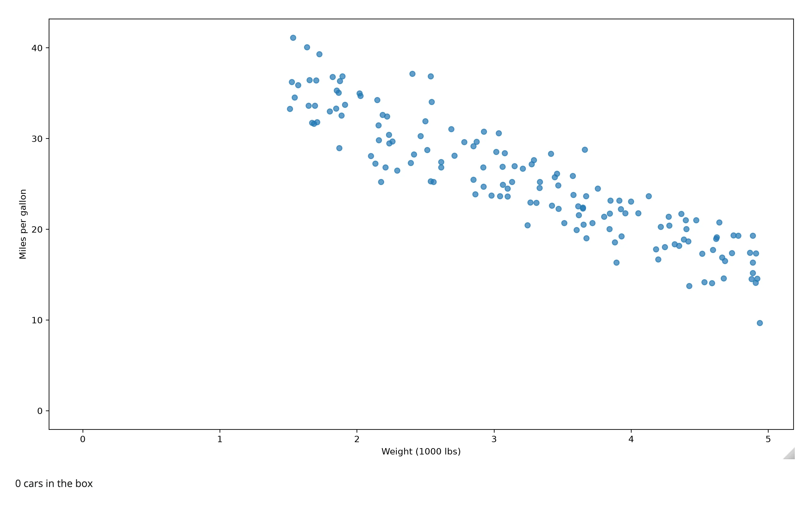 | 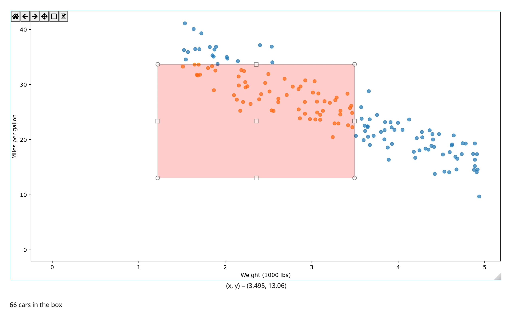 |

**Figures can match bslib's light/dark theme.** Build the figure under `plt.style.context()` and make its
background transparent so the card's own color shows through:

```{.python file="examples/05_dark_mode.py"}
import matplotlib.pyplot as plt
import numpy as np
from matplotlib.figure import Figure
from shiny.express import input, ui
from shinywidgets import render_matplotlib

ui.page_opts(fillable=True)
ui.input_dark_mode(id="mode")

t = np.linspace(0, 2 * np.pi, 200)


@render_matplotlib
def plot():
    style = "dark_background" if input.mode() == "dark" else "default"
    with plt.style.context(style):
        fig = Figure(layout="constrained")
        ax = fig.subplots()
        ax.plot(t, np.sin(t))
        ax.plot(t, np.cos(t))
    # Transparent background so the card's own color shows through instead of
    # matplotlib's opaque white/black
    fig.patch.set_alpha(0)
    ax.patch.set_alpha(0)
    return fig
```

| Light | Dark |
|---|---|
| 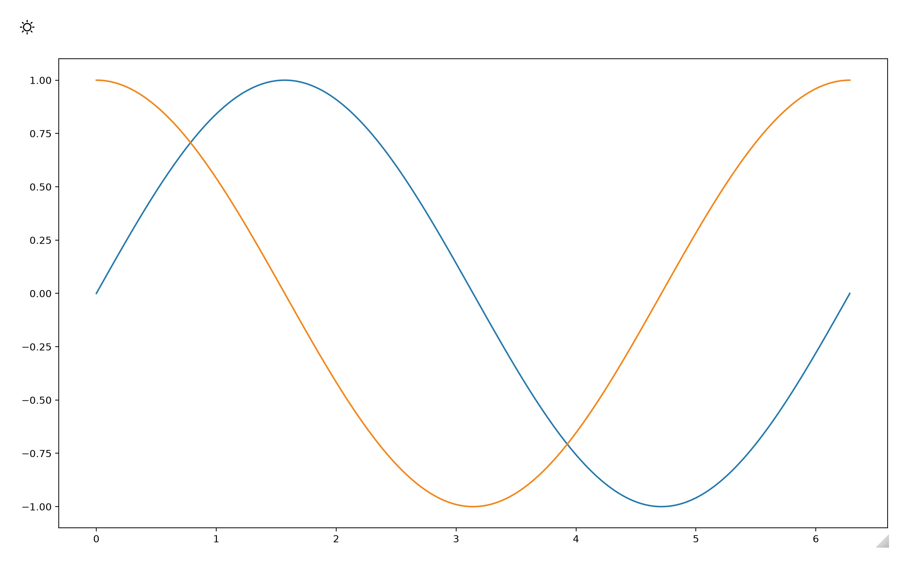 | 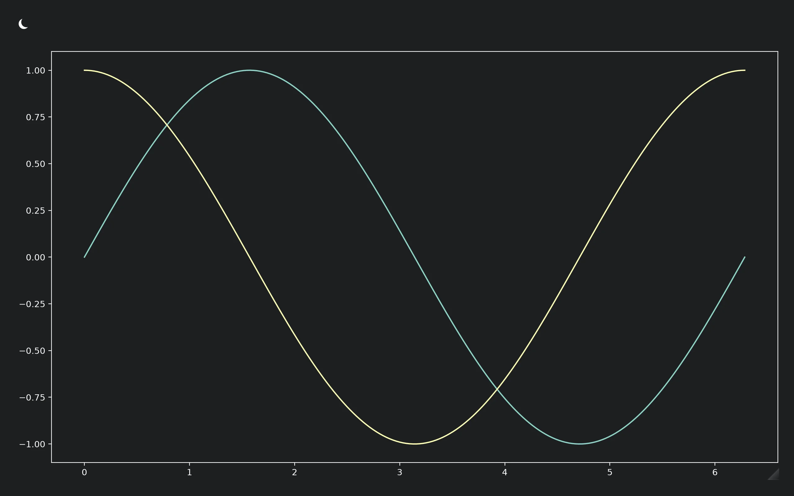 |

Re-rendering on a mode switch resets zoom, since it rebuilds the figure; see
[Updating the widget from Python](#updating-the-widget-from-python) to change styling without losing the user's
view.

## Reacting to user interaction

The output gains methods that read what the user does to the figure, much like `input.my_slider()` reads an
input. Call them in a reactive context (a `@render.*` function, `@reactive.calc`, or `@reactive.effect`), which
re-runs whenever the value changes.

### Accessor reference

| Accessor | Returns | Before any interaction | Across re-render | Default rate policy |
|---|---|---|---|---|
| `clicked()` | `matplotlib.backend_bases.MouseEvent` | `None` | kept (payload describes the previous render's figure) | not rate-limited |
| `picked()` | `matplotlib.backend_bases.PickEvent` | `None` | kept (payload describes the previous render's figure) | not rate-limited |
| `limits(ax=0)` | `((x0, x1), (y0, y1))` for axes `ax` | seeded value (the figure's rendered limits) | re-seeded from the new figure | debounced, 250 ms |

`clicked()` and `picked()` attach the moment the figure renders and record a press whether or not anything has
read them yet -- there's no warm-up to write. `limits()` behaves differently on re-render: because it's the
figure's own view state, not something the user did, it re-seeds from the new figure's limits rather than
carrying over the old zoom (verified by re-rendering a zoomed figure and reading `limits()` immediately after --
it reports the new figure's full extent, not the old window). `clicked()` and `picked()`, by contrast, keep
reporting the last press on the *previous* figure until the user interacts with the new one.

### `clicked()`: inspect a point

```{.python file="examples/06_accessor_clicked.py"}
import numpy as np
from matplotlib.figure import Figure
from shiny import req
from shiny.express import render, ui
from shinywidgets import render_matplotlib

ui.page_opts(fillable=True)

t = np.linspace(0, 10, 300)
signal = np.sin(t) + 0.15 * np.random.default_rng(0).standard_normal(300)


@render_matplotlib
def plot():
    fig = Figure(layout="constrained")
    ax = fig.subplots()
    ax.plot(t, signal, lw=1)
    return fig


@render.code
def reading():
    ev = req(plot.clicked())
    return f"x={ev.xdata:.2f}  y={ev.ydata:.2f}"
```

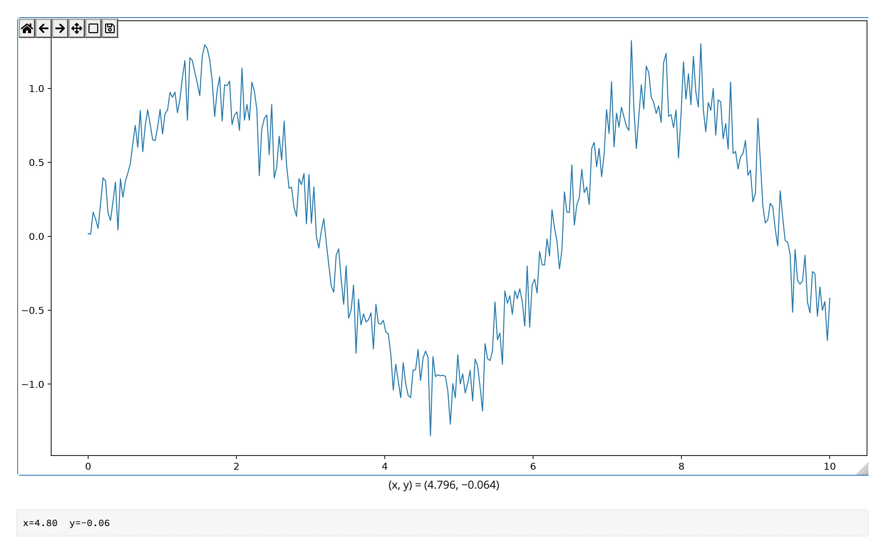

`.xdata`/`.ydata` are in the data coordinates of the axes under the press (`.inaxes`). Every press fires --
`clicked()` doesn't deduplicate, so a double-click arrives as three presses. A press that starts a toolbar
pan/zoom drag, or lands outside any axes, doesn't count: **if you've just used the zoom or pan tool, click it
again to turn it off before clicking a point**, or the press is ignored (verified -- see
[Gotchas](#gotchas-and-limitations)). `clicked()` attaches the moment the figure renders, so a press is recorded
even if nothing has read it yet, and it **keeps its value across a re-render** until the user clicks the new
figure -- the event then describes the previous render's figure, so prefer an ID-keyed lookup over a positional
index if your data can change shape between renders.

### `picked()`: identify an artist

Only artists created with `picker=` are pickable (e.g. `ax.scatter(..., picker=5)`, where `5` is the hit-test
tolerance in points):

```{.python file="examples/07_accessor_picked.py"}
import numpy as np
from matplotlib.figure import Figure
from shiny import req
from shiny.express import render, ui
from shinywidgets import render_matplotlib

ui.page_opts(fillable=True)

cities = ["Austin", "Boise", "Chicago", "Denver", "Eugene", "Fargo"]
pop = np.array([980, 235, 2700, 715, 175, 125])
growth = np.array([2.8, 3.1, 0.4, 2.2, 1.6, 0.9])


@render_matplotlib
def plot():
    fig = Figure(layout="constrained")
    ax = fig.subplots()
    ax.scatter(pop, growth, s=80, picker=5)
    ax.set_xlabel("Population (thousands)")
    ax.set_ylabel("Growth rate (%)")
    return fig


@render.code
def picked():
    ev = req(plot.picked())
    i = ev.ind[0]
    return f"{cities[i]}: {pop[i]}k people, {growth[i]}% growth"
```

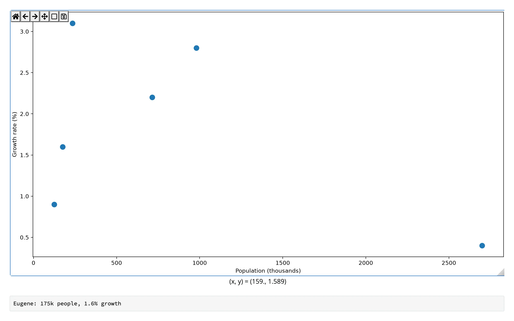

`.ind` is a tuple of indices into the picked artist's data arrays -- for an exact line, usually one index; for a
dense scatter, every point under the cursor. Like `clicked()`, `picked()` attaches at render and **keeps its
value across a re-render** until the user picks something on the new figure.

### `limits(ax=0)`: zoom is a query

```{.python file="examples/08_accessor_limits.py"}
import numpy as np
from matplotlib.figure import Figure
from shiny.express import render, ui
from shinywidgets import render_matplotlib

ui.page_opts(fillable=True)

t = np.linspace(0, 100, 5000)
y = np.sin(t) + 0.05 * t


@render_matplotlib
def plot():
    fig = Figure(layout="constrained")
    ax = fig.subplots()
    ax.plot(t, y, lw=0.8)
    return fig


@render.code
def window():
    (x0, x1), (y0, y1) = plot.limits()
    return f"x: {x0:.1f} to {x1:.1f}\ny: {y0:.2f} to {y1:.2f}"
```

| Before zoom | After zoom |
|---|---|
| 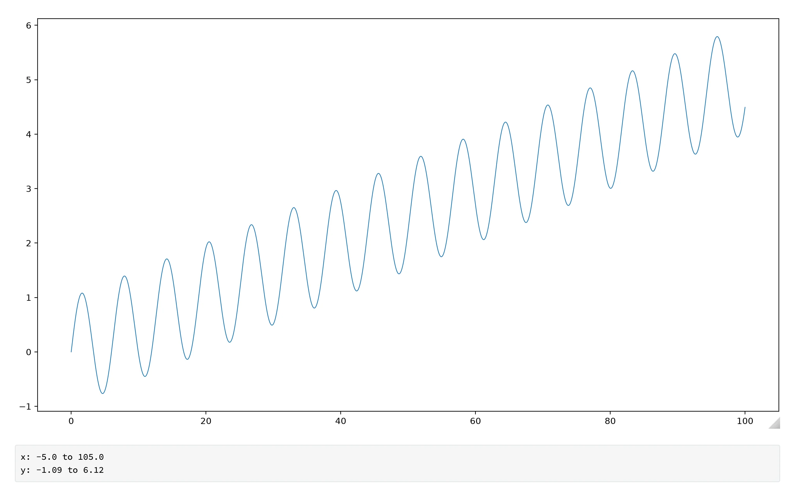 | 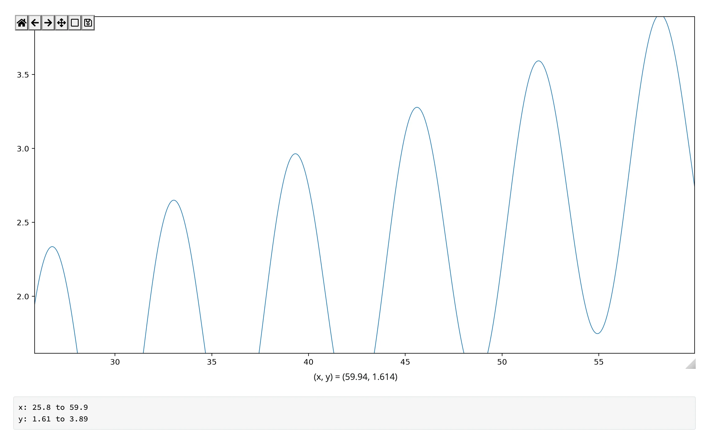 |

`limits()` is seeded from the figure's rendered limits, then updates after every zoom or pan step -- including
ones made from Python (e.g. `ax.set_xlim(...)` in an effect). `ax` indexes `.widget.figure.axes`, so
`limits(ax=1)` reads a second subplot; an out-of-range index raises `IndexError` naming how many axes the figure
has. It can't be read inside the plot's own render function (which builds a new figure every run) -- read it in
another output or an effect instead. Unlike `clicked()`/`picked()`, a re-render **re-seeds** `limits()` from the
new figure's own limits rather than carrying over the old zoom window -- it describes the figure's current view,
not a user action, so there's nothing to carry over.

### Reading an accessor on demand

Because every accessor is live from the moment the figure renders, it's safe to read one anywhere -- a button
handler, a download handler, a `@reactive.event` -- not just from an output that's always on screen. Here, a
"Save current view" button reads `plot.limits()` on click and appends it to a running list, with no warm-up
`@reactive.effect` needed to make the first read work:

```{.python file="examples/16_read_on_demand.py"}
import numpy as np
from matplotlib.figure import Figure
from shiny import reactive
from shiny.express import input, render, ui
from shinywidgets import render_matplotlib

ui.page_opts(fillable=True)
ui.input_action_button("save", "Save current view")

t = np.linspace(0, 50, 4000)
y = np.sin(t) + 0.3 * np.sin(5 * t) + 0.02 * t**1.2
bookmarks = reactive.value([])


@render_matplotlib
def plot():
    fig = Figure(layout="constrained")
    ax = fig.subplots()
    ax.plot(t, y, lw=0.8)
    return fig


@reactive.effect
@reactive.event(input.save)
def _save_view():
    (x0, x1), _ = plot.limits()
    bookmarks.set([*bookmarks(), f"{x0:.1f} to {x1:.1f}"])


@render.code
def saved():
    views = bookmarks()
    if not views:
        return "No views saved yet -- zoom in, then click Save."
    return "\n".join(f"{i + 1}. {v}" for i, v in enumerate(views))
```

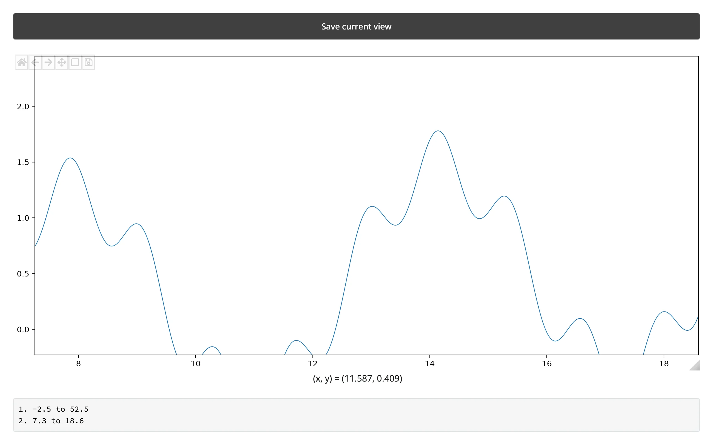

Verified: clicking **Save** before any zoom records the figure's full extent (`limits()` is already seeded, not
`None`); zooming in and clicking **Save** again appends the new window. Each click reads `plot.limits()` fresh --
it isn't a dependency of `saved()`, so saving a view doesn't by itself re-run anything except the effect that
records it.

### Beyond the accessors: `.read()` and reactive_read

ipympl's `Canvas` has no synced trait worth reading with `plot.read(...)` (which falls through to
`reactive_read()` for names that aren't accessors) -- its traits are chrome (`header_visible`,
`toolbar_position`, ...) or private. For anything the three accessors don't cover (hover, key presses, scroll,
custom selectors), connect matplotlib's own callbacks and set a `reactive.value` from them, same as the
`RectangleSelector` example above:

```{.python file="examples/09_beyond_accessors_hover.py"}
import numpy as np
from matplotlib.figure import Figure
from shiny import reactive
from shiny.express import render, ui
from shinywidgets import render_matplotlib

ui.page_opts(fillable=True)

t = np.linspace(0, 10, 300)
y = np.sin(t)
hover = reactive.value("move the mouse over the plot")


@render_matplotlib
def plot():
    fig = Figure(layout="constrained")
    ax = fig.subplots()
    ax.plot(t, y)

    def on_move(event):
        if event.inaxes is None:
            return
        hover.set(f"x={event.xdata:.2f}  y={event.ydata:.2f}")

    fig.canvas.mpl_connect("motion_notify_event", on_move)
    return fig


@render.code
def coords():
    return hover()
```

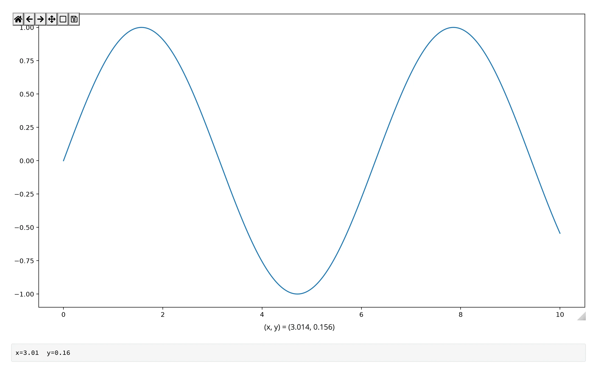

Other hooks worth knowing: `"key_press_event"` (the figure needs focus -- click it first), `"scroll_event"`
(disabled by default; set `canvas.capture_scroll = True`), and `ax.callbacks.connect("ylim_changed", ...)` if you
need the y-limits without the x (`limits()` returns both together).

### Rate limiting

`limits()` is debounced 250 ms by default -- a zoom-to-rectangle drag fires about a dozen `xlim_changed`/
`ylim_changed` events, and only the settled value after the pause reaches Python. Pass `rate_delay=0` to react to
every event instead (e.g. to drive a second plot smoothly while panning), or `rate_policy="throttle"` to get
evenly-spaced updates during a long drag rather than waiting for it to stop:

```{.python file="examples/10_rate_limiting.py"}
import numpy as np
from matplotlib.figure import Figure
from shiny.express import render, ui
from shinywidgets import as_widget, render_matplotlib

ui.page_opts(fillable=True)

t = np.linspace(0, 10, 2000)
y = np.sin(t)
counts = {"default": 0, "fast": 0}


def make_plot():
    fig = Figure(layout="constrained", figsize=(4, 3))
    ax = fig.subplots()
    ax.plot(t, y)
    canvas = as_widget(fig)
    canvas.toolbar_visible = "visible"  # skip the hover-to-reveal fade
    return canvas


with ui.layout_columns():
    with ui.card():
        ui.card_header("default: debounced 250ms")

        @render_matplotlib
        def default_out():
            return make_plot()

        @render.code
        def default_count():
            default_out.limits()
            counts["default"] += 1
            return f"limits() recomputed {counts['default']} times"

    with ui.card():
        ui.card_header("rate_delay=0: every event")

        @render_matplotlib(rate_delay=0)
        def fast_out():
            return make_plot()

        @render.code
        def fast_count():
            fast_out.limits()
            counts["fast"] += 1
            return f"limits() recomputed {counts['fast']} times"
```

Panning the same distance on both plots (verified with a scripted drag): the debounced plot recomputed twice (the
initial seed, then the settled value), the `rate_delay=0` plot recomputed 16 times.

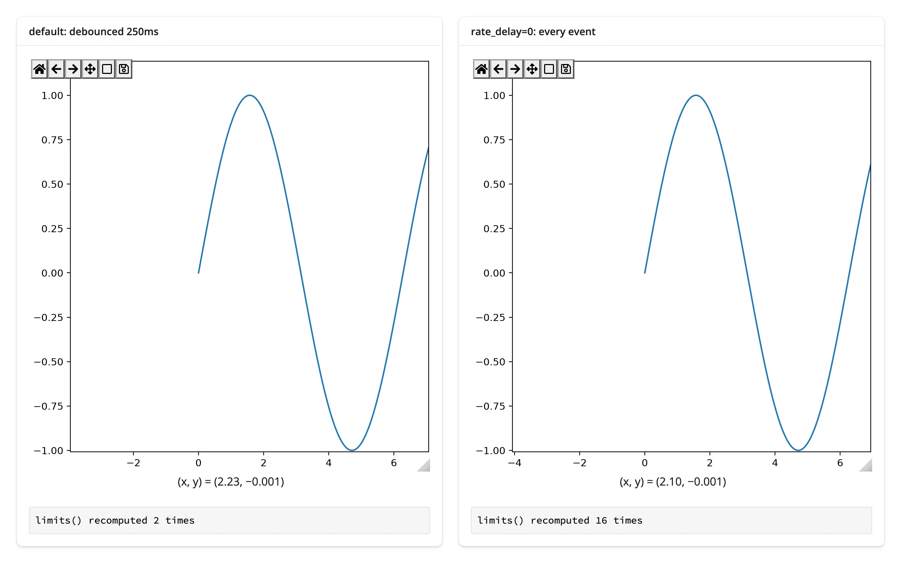

## Updating the widget from Python

The decorated function gains a read-only `.widget` attribute -- the rendered `Canvas` -- once it has rendered.
Editing its figure's artists and calling `.widget.draw_idle()` updates the picture **without re-rendering the
widget**: the user's zoom, pan position, and any pending selection survive, and no new comm handshake or JS
bundle has to ship to the browser. Re-rendering (returning a new figure from the decorated function) is simpler,
but rebuilds the `Canvas` from scratch, so the view resets.

Use in-place updates when the figure's zoom/pan state matters to the user (dashboards, exploratory tools);
re-render when the shape of the plot itself changes (different number of subplots, totally different data) or
when simplicity matters more than preserving view state.

```{.python file="examples/11_inplace_vs_rerender.py"}
import numpy as np
from matplotlib.figure import Figure
from shiny import reactive
from shiny.express import input, ui
from shinywidgets import render_matplotlib

ui.page_opts(fillable=True)
ui.input_slider("freq", "Frequency", 1, 10, 3)

x = np.linspace(0, 1, 400)


def base_plot():
    fig = Figure(layout="constrained", figsize=(4, 3))
    ax = fig.subplots()
    ax.plot(x, np.sin(2 * np.pi * 3 * x))
    ax.set_ylim(-1.1, 1.1)
    return fig


with ui.layout_columns():
    with ui.card(full_screen=True):
        ui.card_header("Re-render: rebuilds the figure, zoom resets")

        @render_matplotlib
        def rerendered():
            fig = Figure(layout="constrained", figsize=(4, 3))
            ax = fig.subplots()
            ax.plot(x, np.sin(2 * np.pi * input.freq() * x))
            ax.set_ylim(-1.1, 1.1)
            return fig

    with ui.card(full_screen=True):
        ui.card_header("In-place: edits the line, zoom survives")

        @render_matplotlib
        def inplace():
            # Doesn't depend on input.freq(): built once, edited afterward
            return base_plot()


@reactive.effect
def _():
    with reactive.isolate():
        canvas = inplace.widget
    if canvas is None:
        return
    line = canvas.figure.axes[0].lines[0]
    line.set_ydata(np.sin(2 * np.pi * input.freq() * x))
    canvas.draw_idle()
```

Both panels zoomed to the same region, then the frequency slider moved from 3 to 8:

| Both zoomed in | After moving the slider |
|---|---|
| 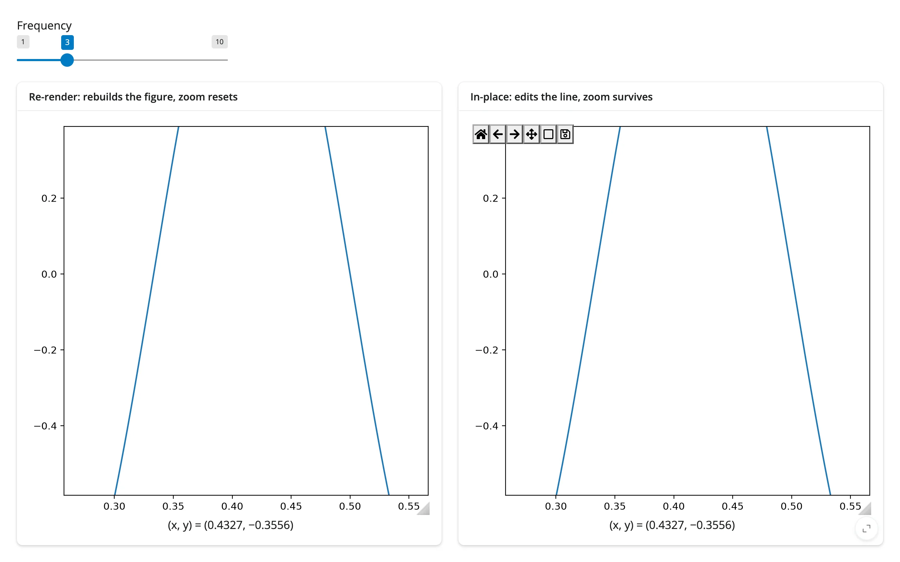 | 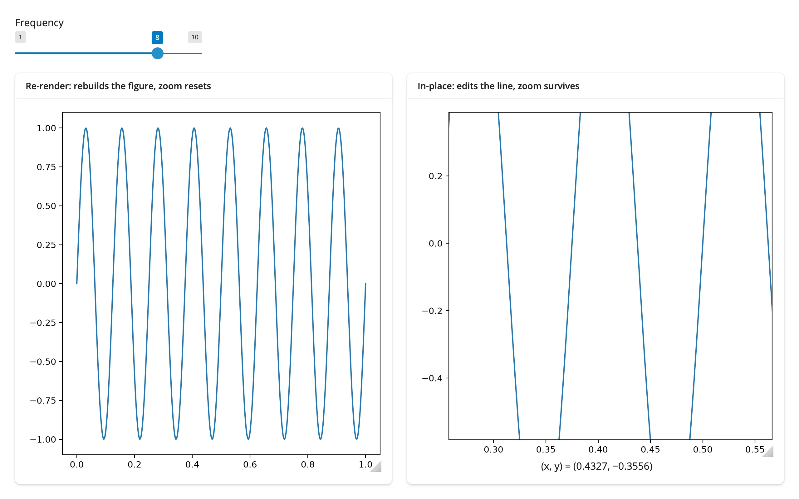 |

The left panel snaps back to the full x-axis range (a fresh `Figure`, fresh axes limits); the right panel keeps
the exact zoomed window while its line restyles underneath.

`reactive.isolate()` around the `.widget` read keeps the effect from depending on *every* render of `inplace`
(it would otherwise re-run whenever the widget identity changed, pointlessly). Read inputs normally outside the
isolate block so the effect still re-runs when they change. The same pattern drives animation and streaming:
a `reactive.effect` that calls `reactive.invalidate_later(dt)` and edits the figure on each tick delivers updates
to the browser immediately on current Shiny (>= 1.9, verified with four ticks over 2.4s with no client
interaction) -- call `relim()`/`autoscale_view()` first if the data range changes.

## Coordinating multiple views

### Zoom drives a summary panel

```{.python file="examples/12_coordinate_zoom_summary.py"}
import numpy as np
import pandas as pd
from matplotlib.dates import num2date
from matplotlib.figure import Figure
from shiny.express import render, ui
from shinywidgets import render_matplotlib

ui.page_opts(fillable=True)

# Two years of hourly demand with a seasonal cycle, a daily double-peak, and
# quiet weekends -- the kind of series where "what happened in this window?"
# only makes sense once you've zoomed into it.
hours = pd.date_range("2024-01-01", periods=24 * 365 * 2, freq="h")
hour_of_day = hours.hour.to_numpy()
rng = np.random.default_rng(3)
demand = (
    100
    + 20 * np.sin(2 * np.pi * hours.dayofyear.to_numpy() / 365)
    + 15 * np.sin(2 * np.pi * (hour_of_day - 6) / 24)
    + 10 * np.sin(4 * np.pi * (hour_of_day - 8) / 24)
    - 15 * (hours.dayofweek.to_numpy() >= 5)
    + rng.normal(0, 3, len(hours))
)


@render_matplotlib
def plot():
    fig = Figure(layout="constrained")
    ax = fig.subplots()
    ax.plot(hours, demand, lw=0.3)
    ax.set_ylabel("Demand (MW)")
    return fig


@render.code
def summary():
    (x0, x1), _ = plot.limits()
    start, end = num2date(x0).replace(tzinfo=None), num2date(x1).replace(tzinfo=None)
    mask = (hours >= pd.Timestamp(start)) & (hours <= pd.Timestamp(end))
    visible = demand[mask]
    if visible.size == 0:
        return "Zoom in to see a summary of the visible window"
    return (
        f"{visible.size} hours visible\n"
        f"mean {visible.mean():.1f} MW, peak {visible.max():.1f} MW"
    )
```

| Full range | Zoomed to 6 weeks |
|---|---|
| 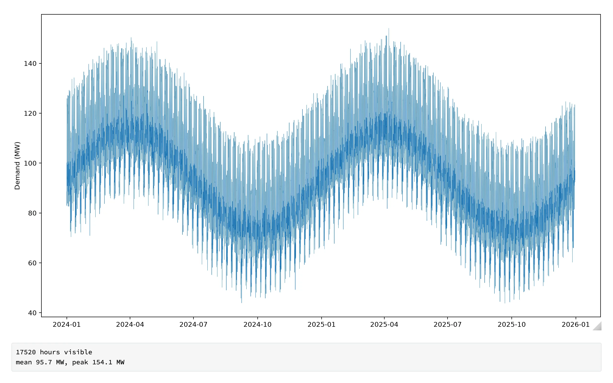 | 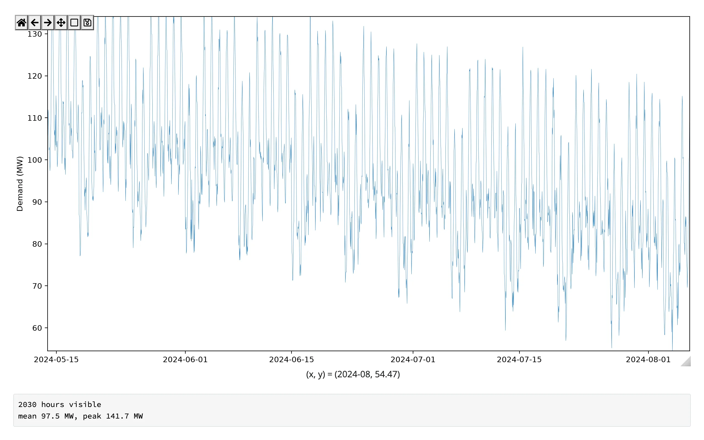 |

### Click drives a detail card

```{.python file="examples/13_coordinate_click_detail.py"}
import numpy as np
from matplotlib.cbook import get_sample_data
from matplotlib.dates import date2num
from matplotlib.figure import Figure
from shiny import req
from shiny import ui as core_ui
from shiny.express import render, ui
from shinywidgets import render_matplotlib

ui.page_opts(fillable=True)

goog = get_sample_data("goog.npz")["price_data"]


@render_matplotlib
def plot():
    fig = Figure(layout="constrained")
    ax = fig.subplots()
    ax.plot(goog["date"], goog["close"], lw=0.8)
    ax.set_ylabel("Close ($)")
    return fig


@render.ui
def detail():
    ev = req(plot.clicked())
    i = int(
        np.clip(np.searchsorted(date2num(goog["date"]), ev.xdata), 0, len(goog) - 1)
    )
    date = goog["date"][i]
    return core_ui.value_box(
        f"{date.item().strftime('%b %d, %Y')}", f"${goog['close'][i]:.2f}"
    )
```

Note the `from shiny import ui as core_ui` import: Shiny Express's own `ui.value_box` is a layout-time context
manager with no return value, so a `@render.ui` function that needs to build and return a `Tag` uses the plain
`shiny.ui` module instead.

| Before click | After click |
|---|---|
| 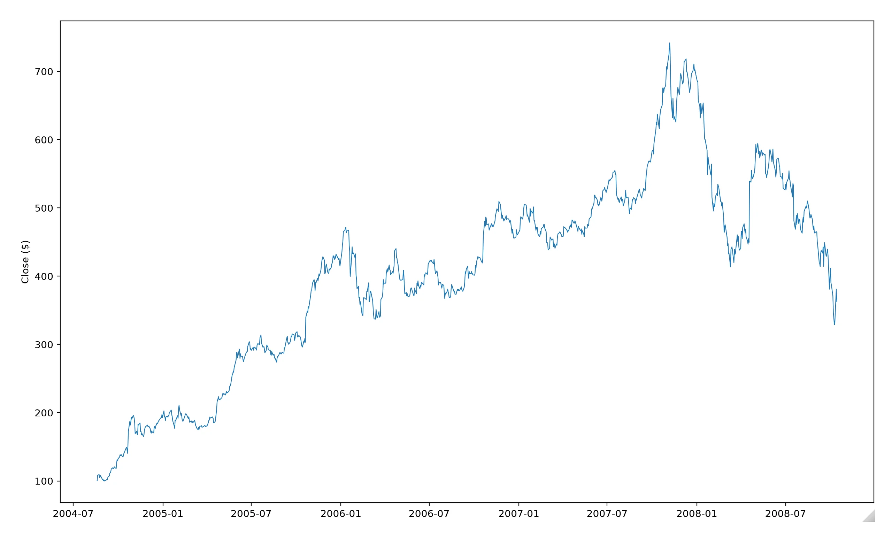 | 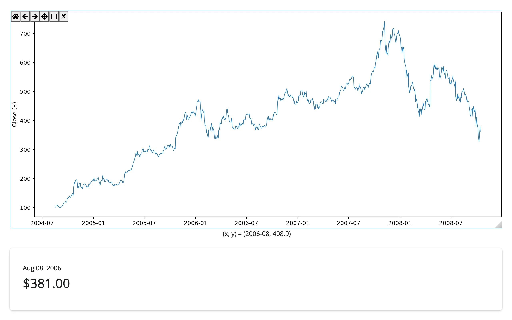 |

### Box-select drives a filtered table

```{.python file="examples/14_coordinate_select_table.py"}
import numpy as np
import pandas as pd
from matplotlib.figure import Figure
from matplotlib.widgets import RectangleSelector
from shiny import reactive
from shiny.express import render, ui
from shinywidgets import render_matplotlib

ui.page_opts(fillable=True)

rng = np.random.default_rng(5)
cars = pd.DataFrame(
    {
        "model": [f"Car {i + 1}" for i in range(120)],
        "weight": rng.uniform(1.5, 5.0, 120).round(2),
    }
)
cars["mpg"] = (45 - 6 * cars["weight"] + rng.normal(0, 2.5, 120)).round(1)
selected = reactive.value(np.zeros(len(cars), dtype=bool))

with ui.layout_columns(col_widths=(7, 5)):

    @render_matplotlib
    def plot():
        fig = Figure(layout="constrained")
        ax = fig.subplots()
        points = ax.scatter(cars["weight"], cars["mpg"], alpha=0.7)
        ax.set_xlabel("Weight (1000 lbs)")
        ax.set_ylabel("Miles per gallon")

        def on_select(press, release):
            x0, x1 = sorted([press.xdata, release.xdata])
            y0, y1 = sorted([press.ydata, release.ydata])
            mask = cars["weight"].between(x0, x1) & cars["mpg"].between(y0, y1)
            points.set_facecolors(np.where(mask, "tab:orange", "tab:blue"))
            fig.canvas.draw_idle()
            selected.set(mask.to_numpy())

        fig._selector = RectangleSelector(ax, on_select, interactive=True)
        return fig

    with ui.card():

        @render.data_frame
        def table():
            return cars[selected()]
```

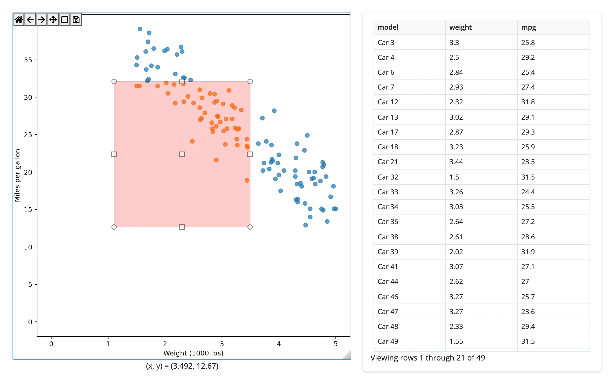

This pattern pairs well with [itables](../itables/index.md) or [reactable](../reactable/index.md) in place of the
plain `@render.data_frame` table, for sorting and paging in the selected subset.

## Large data

`@render_matplotlib` has no large-data mode of its own: ipympl redraws the whole figure to a bitmap on every
pan, zoom, or `draw_idle()` call, with no WebGL context and no server-side rasterization step. We didn't
re-measure a practical point-count ceiling this pass (the old evaluation's panning-frame-rate numbers were
dropped as stale). For a genuinely large series, either widget gets cheaper as data grows:
Shiny's own `@render.plot` (same matplotlib drawing underneath, a static PNG per render instead of a live
canvas -- see the introduction above), or a sibling built for scale, such as
[bokeh](../bokeh/index.md#large-data)'s `output_backend="webgl"`, [plotly](../plotly/index.md#large-data)'s
`Scattergl`, or [datashader](../datashader/index.md) if the shape you want is a density raster. See
[Large data & performance](../../guide/performance/index.md#three-approaches-to-large-data) for how those
approaches compare.

## Layout and sizing

```{.python file="examples/15_layout_sizing.py"}
import numpy as np
from matplotlib.figure import Figure
from shiny.express import ui
from shinywidgets import as_widget, render_matplotlib

ui.page_opts(fillable=True)

t = np.linspace(0, 10, 300)


def line_plot():
    fig = Figure(layout="constrained")
    ax = fig.subplots()
    ax.plot(t, np.sin(t))
    return fig


with ui.layout_columns():
    with ui.card(full_screen=True):
        ui.card_header("Fills its card (default)")

        @render_matplotlib
        def fills():
            return line_plot()

    with ui.card():
        ui.card_header("Explicit height, no footer")

        @render_matplotlib(height="220px", fillable=True)
        def fixed_height():
            canvas = as_widget(line_plot())
            canvas.footer_visible = False  # header is already hidden by default
            return canvas
```

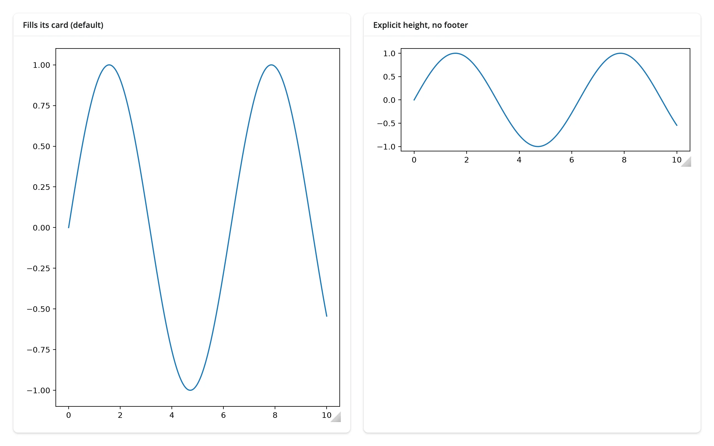

- With no `height` (the default), the figure fills and resizes with its container, ignoring `figsize`. This is
  what you want inside a `ui.card()` or a fillable page.
- With an explicit `height`, the figure keeps its `figsize` **unless** you also pass `fillable=True` -- verified:
  without it, the figure silently renders at its full `figsize` regardless of the requested height, rather than
  being constrained to it. Pass both together to get a specific box size.
- `full_screen=True` on the containing `ui.card()` works as expected; the figure re-fits when the card expands.
- A coerced canvas's "Figure N" header is hidden by default. If you want it back (e.g. to match a notebook
  screenshot), pass `header_visible=True` via `as_widget()`. The cursor-position footer stays visible by
  default; hide it the same way, with `canvas.footer_visible = False`, as above.

## Gotchas and limitations

Everything below was verified on current `main`.

- **A zoom or pan tool stays active until you toggle it off.** After dragging a zoom-to-rectangle or pan gesture,
  the toolbar button stays pressed; a plain click on the canvas is still treated as part of that gesture and
  `clicked()`/`picked()` don't fire. Click the tool again (or Home) to return to normal click behavior. This is
  documented and intentional, but it's an easy thing to trip over when testing your own app.
  Reading an `.xlim`/`.ylim` style accessor programmatically isn't affected.
- **`.read()`/`reactive_read()` have nothing useful to read on the `Canvas`.** Its synced traits are all chrome
  (`header_visible`, `toolbar_position`, `pan_zoom_throttle`, ...) or private. Use the three accessors, or connect
  matplotlib's own callbacks (`fig.canvas.mpl_connect(...)`, `ax.callbacks.connect(...)`) for anything else.
  Scroll-to-zoom is off by default; set `canvas.capture_scroll = True` to enable it.
  Keyboard events need the figure focused (click it first).
- **An explicit `height` without `fillable=True` doesn't constrain the figure.** It renders at its default (or
  specified) `figsize` and simply doesn't fit the requested box -- see [Layout and sizing](#layout-and-sizing).
- **Pyplot figures are closed automatically when rendered**, the same way `@render.plot` closes its figure --
  so `plt.subplots()` is safe to use across sessions. Prefer `Figure()` or an explicit `plt.subplots()` over
  implicit current-figure idioms (`plt.plot()`, `plt.gca()`, a seaborn call without `ax=`) anyway: those are
  shared process-wide state, and a second concurrent session's call can still interact with the first session's
  figure before it's closed.
- **A figure built under a GUI backend (Qt, Tk, the macOS backend) is supported, but warns.** Its window is
  destroyed and ipympl's canvas replaces it -- a path that depends on platform-specific behavior the maintainers
  can't test in CI. Build figures with `Figure()`, or select the `agg` backend before creating them
  (`matplotlib.use("agg")`), to avoid the warning entirely.
- **A draw-time error (e.g. invalid mathtext) shows as a normal output error**, not a session crash -- this
  includes both the first render and later in-place `draw_idle()` calls triggered from an effect.
- **No default layout engine.** Without `layout="constrained"` (or a tight-layout call), labels can get clipped
  when the figure resizes to fill a card. The examples above all use `Figure(layout="constrained")` for this
  reason.
- **plotnine's `clicked()` and `limits()` are the same underlying accessors as matplotlib's** (same
  `AccessorSpec` objects), but plotnine's coordinates are in its *transformed* space (e.g. log10 under
  `scale_x_log10()`) and `limits(ax)` indexes facet panels. plotnine has no `picked()` -- its geoms don't expose
  matplotlib's `picker=`. See the [plotnine guide](../plotnine/index.md).

## Gallery candidates

**Template** -- [`gallery/template_zoom_and_click.py`](gallery/template_zoom_and_click.py): a small, adaptable
starting point combining `limits()` (a summary of the visible window) and `clicked()` (a pinned reading) on one
synthetic signal. Swap in your own data and keep the two accessor-driven outputs.

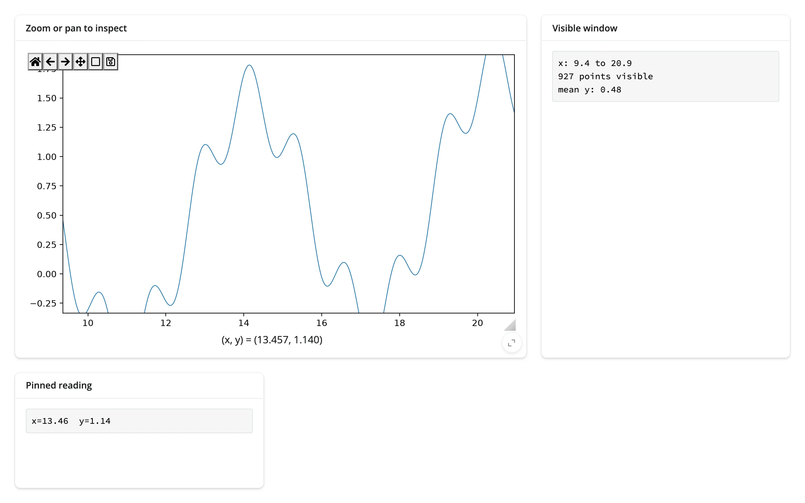

**Showcase** -- [`gallery/showcase_grid_demand_explorer.py`](gallery/showcase_grid_demand_explorer.py): a year of
synthetic hourly power demand (a seasonal cycle, a daily double-peak, quiet weekends, two heat waves). Zooming the
main chart redraws the daily-profile panel below it in place (`limits()` driving an effect that edits the
panel's line and rescales it); clicking pins the exact reading in the sidebar (`clicked()`); a smoothing slider
restyles the main line in place without losing the zoom. The footer (cursor readout) is hidden on both plots;
the header is already hidden by default.


Zoomed into a window, with a reading pinned:

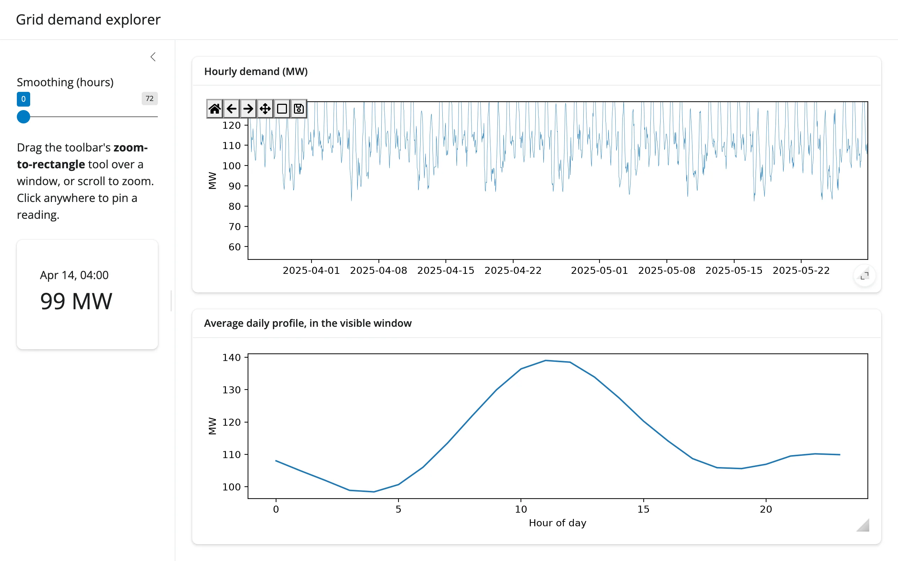

## Learn more

- [Matplotlib documentation](https://matplotlib.org/stable/)
- [ipympl documentation](https://matplotlib.org/ipympl/)
- [plotnine guide](../plotnine/index.md) -- grammar-of-graphics plots on the same ipympl engine, sharing
  `clicked()` and `limits()`
- Shiny's [`@render.plot`](https://shiny.posit.co/py/api/express/express.render.plot.html) -- the static
  alternative, for cheaper, simpler, higher-concurrency apps
