[mols2grid](https://github.com/cbouy/mols2grid) is a small, focused library by Cédric Bouysset for browsing a chemical
dataset as a grid of 2D structure depictions, drawn client-side by [RDKit](https://www.rdkit.org)'s JavaScript build.
Point it at a DataFrame with a SMILES column (or a column of RDKit molecules) and you get pagination, free-text and
substructure (SMARTS) search, column-based sorting, and a checkbox selection -- all without writing any JavaScript.
It already ships integrations for Jupyter, Colab, Streamlit, and marimo; `@render_mols2grid` is the Shiny one.

The integration is more involved than most renderers in this roster because a mols2grid grid isn't really one
widget. The part that bridges to Python (`MolGridWidget`) is an invisible, zero-size element whose only job is to
carry two traits back and forth; the part you actually see is a self-contained HTML document (its own copy of
jQuery, Bootstrap, list.js, and the RDKit WebAssembly build) that mols2grid renders into an `<iframe>`.
`@render_mols2grid` stacks the two for you, so you just return a DataFrame or a `mols2grid.MolGrid`. It also
generates a collision-free grid name per output (mols2grid's own selection state is a process-global registry
keyed by name, which is exactly the kind of thing that silently leaks between users in a multi-session Shiny app if
you don't handle it), splits your keyword arguments between the grid's constructor and its rendering the same way
mols2grid's own `display()` does, and exposes two accessors: `.selected()` for the checkbox set and `.clicked()`
for a click on a structure's image.

Reach for mols2grid when the data *is* chemical structures and a picture is worth a thousand SMILES strings --
virtual screening results, a compound library, SAR tables. If you just need a plain table (no depictions) over
general tabular data, see [itables](../itables/index.md) or [reactable](../reactable/index.md) instead; nothing
else in this roster draws molecules.

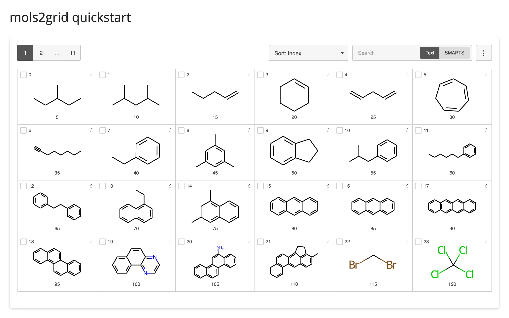

## Installation

```sh
pip install 'shinywidgets[mols2grid]'
```

This installs `mols2grid`, `rdkit` (the Python bindings used for SDF parsing and server-side descriptors; RDKit's
own JavaScript build is fetched separately, from a CDN, at render time -- see Gotchas), `pandas`, and `anywidget`.
`shinywidgets` currently pins `mols2grid>=2.2.0,<3`; see Gotchas for why.

## Quick start

Return any DataFrame with a `SMILES` column (the default `smiles_col`) and you get a full grid: pagination,
sorting, and both text and substructure search, with zero other code. This example uses the solubility dataset
mols2grid ships for its own examples (257 molecules from the Delaney/ESOL dataset).

```{.python file="examples/01_quickstart.py"}
from __future__ import annotations

import mols2grid
from shiny.express import ui
from shinywidgets import render_mols2grid

ui.page_opts(title="mols2grid quickstart", fillable=True)

mols = mols2grid.sdf_to_dataframe(mols2grid.datafiles.SOLUBILITY_SDF)

with ui.card(full_screen=True):

    @render_mols2grid(subset=["ID"], tooltip=["ID", "NAME", "SOL"])
    def grid():
        return mols
```


## What you can build

### Free text and substructure (SMARTS) search

Every grid gets a search box with no code: type a word and it matches against whatever's in `subset`/`tooltip`
(here, the molecule's common name); switch to **SMARTS** and it matches a structural pattern, computed by RDKit
*in the browser*, with the matched substructure highlighted in red on every result. This is the single most
chemistry-specific thing mols2grid does for you.

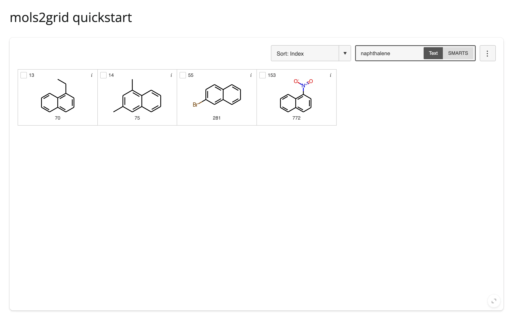

Typing "naphthalene" narrows 257 molecules to the 4 whose name contains it. Switching to SMARTS and searching
`[NX3;H2][c]` (a primary amine on an aromatic ring) finds 18 structural matches instead, each with the matching
atoms circled:

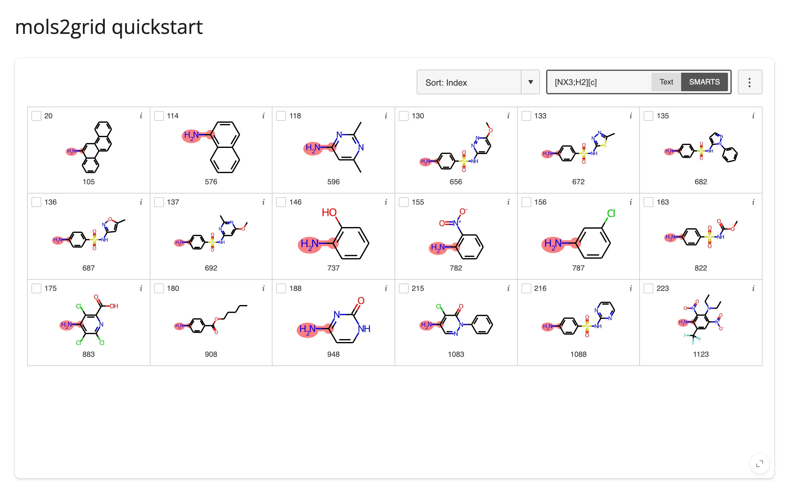

### Choosing, styling, and formatting the displayed fields

`subset` controls which columns appear under each structure (`"img"` is the depiction itself, so include it
explicitly once you customize `subset`); `tooltip` adds columns to the hover popover instead; `sort_by` picks the
initial sort column; and `transform` reformats a field's *displayed* text (not its underlying value, so sorting
and selection are unaffected) -- handy for adding units or rounding a float. `border`, `gap`, `background_color`,
and `hover_color` restyle the cells themselves.

```{.python file="examples/02_fields_style_transform.py"}
from __future__ import annotations

import mols2grid
from shiny.express import ui
from shinywidgets import render_mols2grid

ui.page_opts(title="mols2grid: fields, styling, and transform", fillable=True)

mols = mols2grid.sdf_to_dataframe(mols2grid.datafiles.SOLUBILITY_SDF)

with ui.card(full_screen=True):

    @render_mols2grid(
        subset=["NAME", "img", "SOL"],
        tooltip=["NAME", "SOL_classification"],
        sort_by="SOL",
        # transform only affects display text (in subset/tooltip fields), not
        # the underlying value used for sorting/selection
        transform={"SOL": lambda x: f"logS {x:.1f}"},
        border="2px solid #cfe2ff",
        background_color="#f8fbff",
        hover_color="#dbe9ff",
        gap=6,
        n_items_per_page=12,
    )
    def grid():
        return mols
```

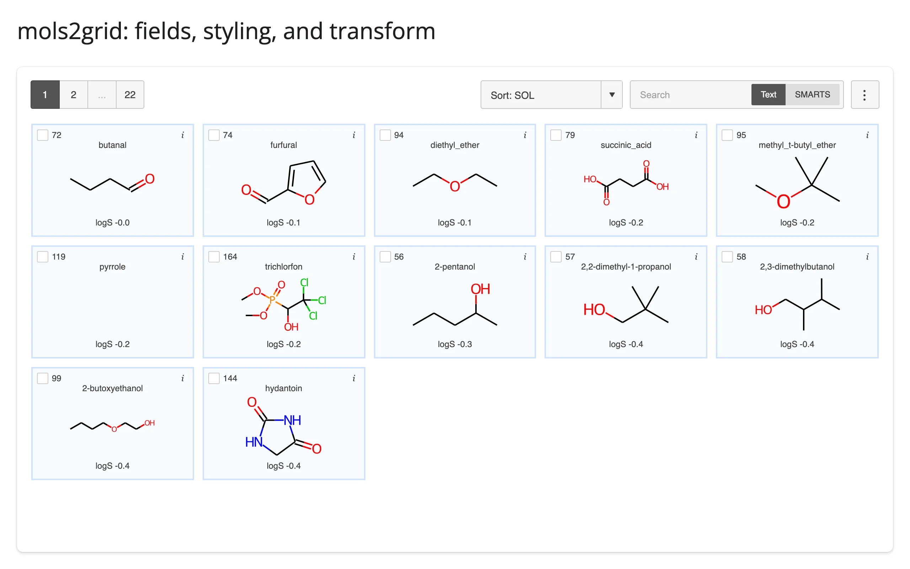

### Server-side depictions with `prerender=True`

By default each structure is drawn by RDKit's WebAssembly build running in the visitor's browser. Passing
`prerender=True` draws every depiction once, server-side, with the RDKit Python bindings, and embeds the images
directly -- useful if you'd rather spend CPU on your server than on each visitor's browser, especially for very
large grids. The grid looks identical either way (that's the point); what changes is where the drawing happens,
and that substructure highlighting in search results (above) stops working, since that needs a client-side
redraw. It does **not** remove the page's dependency on RDKit's WebAssembly build or the other three CDN-hosted
libraries -- RDKit still loads client-side to power the SMARTS search box itself. See Gotchas.

```{.python file="examples/03_prerender.py"}
from __future__ import annotations

import mols2grid
from shiny.express import ui
from shinywidgets import render_mols2grid

ui.page_opts(title="mols2grid with prerender=True", fillable=True)

mols = mols2grid.sdf_to_dataframe(mols2grid.datafiles.SOLUBILITY_SDF)

with ui.card(full_screen=True):

    # prerender=True draws every depiction server-side with RDKit and embeds
    # the images directly, so the browser never redraws them -- but the page
    # still loads RDKit MinimalLib (it powers the SMARTS search box) plus
    # jQuery, Bootstrap, and list.js from CDNs, so this does not make the grid
    # work offline, and substructure-match highlighting is unavailable (it
    # needs per-cell client-side redraws).
    @render_mols2grid(subset=["ID"], tooltip=["ID", "SOL"], prerender=True)
    def grid():
        return mols
```

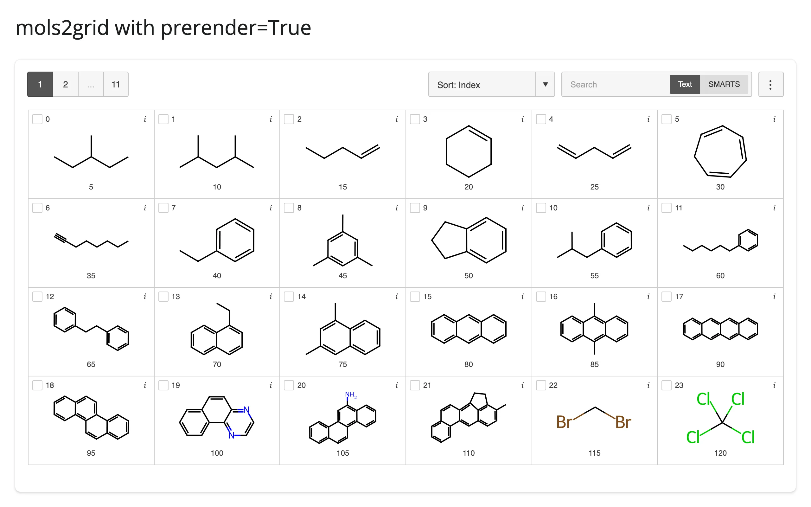

## Reacting to user interaction

### Accessor reference

| accessor | returns | before any interaction | across re-render | default rate policy |
|---|---|---|---|---|
| `grid.selected()` | `dict[int, str]` (`{row_index: SMILES}`) | seeded `{}` as soon as the grid renders | re-seeded from the new grid -- in practice usually unchanged, since the renderer's generated grid name is stable across re-renders and mols2grid's own `cache_selection=True` default restores the prior selection into it | none (no built-in limiter; see Rate limiting) |
| `grid.clicked()` | `dict[str, Any]` (the clicked row's data) or raises | `None` until the first click (only exists with `clicks=True` or a `callback`) | kept until the user clicks the new grid (the row data may then describe the *previous* render's grid) | none |

Both read naturally in a `@render.*` function, a `@reactive.calc`, or a `@reactive.effect`; outside a reactive
context (e.g. in a button handler) they return the current value without creating a dependency. Row indices and
the `mols2grid-id` field are **positional**, against the rows *as rendered* -- if the underlying data changes, the
same index can refer to a different molecule.

`clicked()` is the one deliberate exception to "every accessor attaches at render" in this roster: mols2grid only
adds a per-cell click target to the grid's document when asked (the opt-in bakes a channel into the document
itself, which can't be added after the fact without rebuilding it), so without `clicks=True` or a Python
`callback=`, `clicked()` raises `RuntimeError` naming the fix rather than silently returning `None`:

```
clicked() needs the grid's click channel, which the document only renders when asked: add
clicks=True (or a Python callback=) to the @render_mols2grid decorator.
```

### `selected()`: the checkbox set, as a dict

```{.python file="examples/04_accessor_selection.py"}
from __future__ import annotations

import mols2grid
from shiny.express import render, ui
from shinywidgets import render_mols2grid

ui.page_opts(title="mols2grid selected() accessor", fillable=True)

mols = mols2grid.sdf_to_dataframe(mols2grid.datafiles.SOLUBILITY_SDF)

with ui.layout_columns(col_widths=[8, 4]):
    with ui.card(full_screen=True):

        @render_mols2grid(subset=["ID"], tooltip=["ID", "SOL"], n_items_per_page=12)
        def grid():
            return mols

    with ui.card():
        ui.card_header("grid.selected()")

        @render.code
        def selected():
            # {} once the grid has rendered and nothing is checked yet; each
            # checkbox toggle re-runs this (positional row index -> SMILES)
            return str(grid.selected())
```

Before anything is checked, `selected()` is seeded with the empty dict (not `None` -- it reports the grid's own
checkbox state, so it has a value as soon as the grid exists):

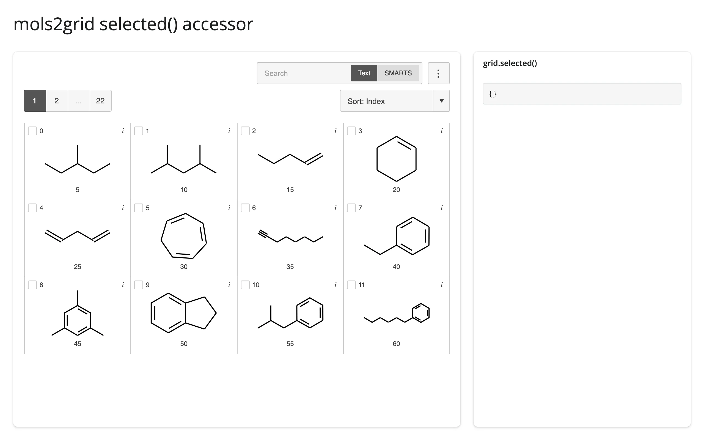

Checking two cells (click the cell, not just the tiny checkbox -- the whole cell is the click target) publishes
both rows, keyed by their position:

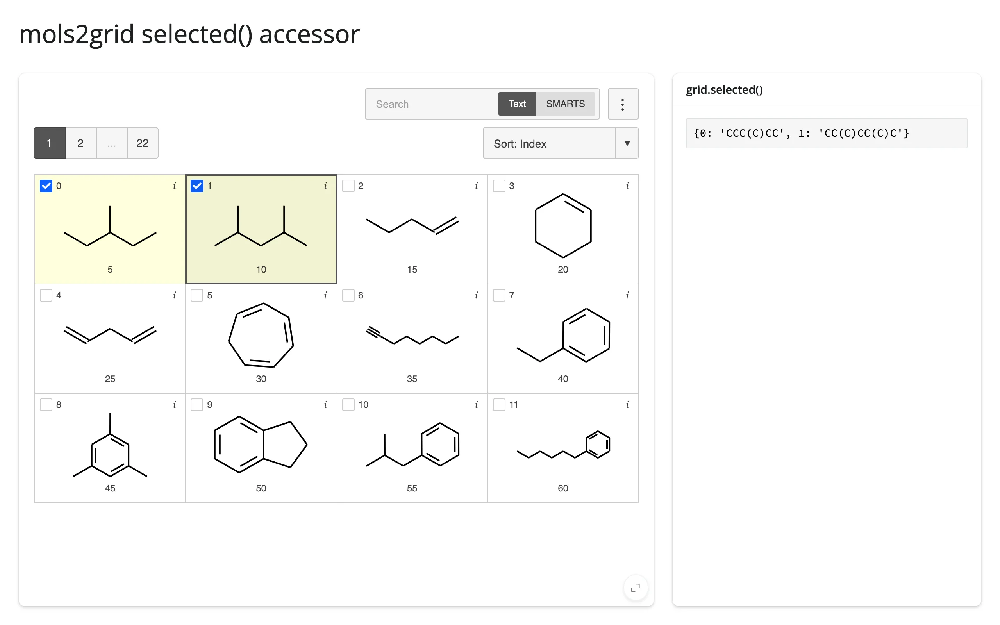

For the selected rows as a DataFrame instead of this dict, use `grid.grid.get_selection()`. A re-render re-seeds
`selected()` from the new grid rather than carrying the Python-side value forward -- in this app that seed
usually equals what was already selected, because the grid keeps the same generated name across re-renders and
mols2grid's own `cache_selection=True` default restores the prior selection into the new grid before it ever
reaches Python.

### `clicked()`: the most recently clicked row

Clicking a molecule's image is a distinct gesture from the selection checkbox: it's a one-off user action, not
state the widget already tracks, so `clicked()` keeps its last value across re-renders until the user clicks
the new grid (the row data may then describe the *previous* render's grid). It requires `clicks=True` (or an
explicit `callback=`, which mols2grid uses for the same click target) -- without one of those, `clicked()`
raises instead of quietly returning `None` (see the accessor reference above), since the grid's document never
gets a click target to report from.

```{.python file="examples/05_accessor_clicked.py"}
from __future__ import annotations

import mols2grid
from shiny.express import render, ui
from shinywidgets import render_mols2grid

ui.page_opts(title="mols2grid clicked() accessor", fillable=True)
ui.tags.style("pre { white-space: pre-wrap; overflow-wrap: anywhere; }")

mols = mols2grid.sdf_to_dataframe(mols2grid.datafiles.SOLUBILITY_SDF)

with ui.layout_columns(col_widths=[8, 4]):
    with ui.card(full_screen=True):

        @render_mols2grid(
            clicks=True, subset=["ID"], tooltip=["ID", "SOL"], n_items_per_page=12
        )
        def grid():
            return mols

    with ui.card():
        ui.card_header("grid.clicked()")

        @render.code
        def clicked():
            # None until a molecule's image is clicked (a distinct gesture
            # from the selection checkbox); keeps its value across re-renders
            # until the user clicks the new grid. The row also carries an
            # "img" key (the cell's raw SVG) -- drop it unless you actually
            # want the markup.
            row = grid.clicked()
            if row is None:
                return "No click yet"
            return str({k: v for k, v in row.items() if k != "img"})
```

`clicks=True` adds a small play-button overlay to every cell -- that's the click target, distinct from the
checkbox:

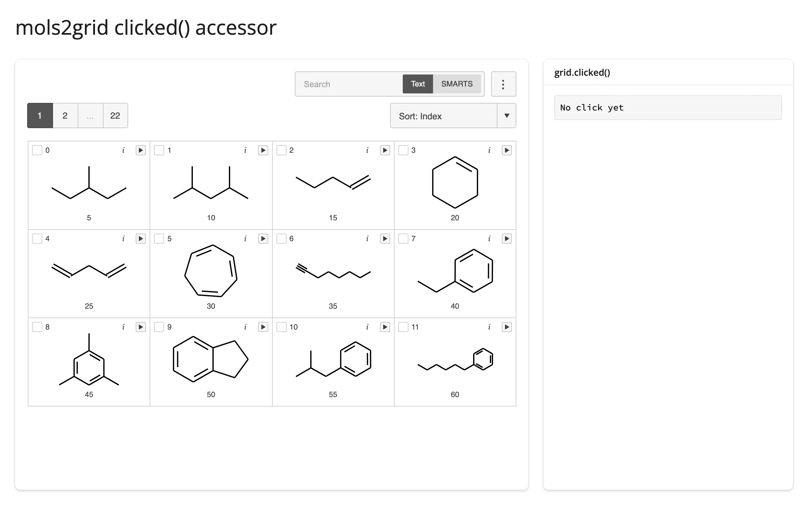

Clicking it publishes the row's full data -- every column mols2grid tracks for that row, which is **every
displayed column plus `mols2grid-id`, `SMILES`, and the raw `img` SVG**, regardless of what you passed to `subset`
or `tooltip`:

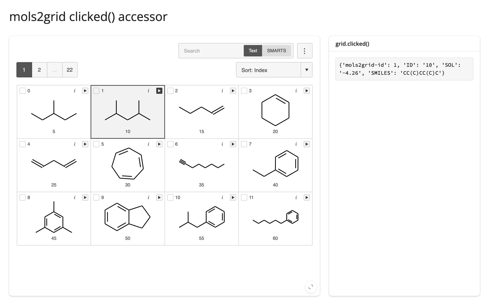

### Beyond the accessors: reactive_read

There isn't a third trait worth reading. `MolGridWidget` carries exactly two other traits: `grid_id` (an internal
name, not meant to change) and `filter_mask` (Python-to-browser only -- reading it back just reflects what Python
itself last set, never what's visible). `selected()` and `clicked()` already cover the grid's entire
browser-to-Python surface.

### Rate limiting

Neither accessor declares a default rate policy, and verified on current main, `rate_policy`/`rate_delay` on
`render_mols2grid()` don't actually change their behavior: a per-accessor limiter only exists if the accessor
itself opts into one (neither does here, since each already fires at most once per discrete user gesture -- a
checkbox toggle or a click -- so there's nothing to smooth). The two parameters do still rate-limit
`reactive_read()` generically, but on the *composite* `Box` that `.widget` resolves to, which carries no trait
worth reading -- the real state lives on `.grid.widget` instead, which isn't affected. In short: for this
renderer, `rate_policy`/`rate_delay` are accepted (for consistency with every other `@render_*`) but have no
observable effect today.

## Updating the widget from Python

`grid.grid.filter(mask)` hides non-matching rows in the grid that's already on screen, without rebuilding the
iframe or losing the user's scroll position, sort, or checkbox selection. This is almost always what you want for
"a Shiny input narrows the grid" -- the alternative, re-running the render function with a pre-filtered DataFrame,
re-sends the whole grid document (jQuery, Bootstrap, list.js boilerplate plus every molecule) on every change and
drops the in-progress selection.

```{.python file="examples/06_filter_from_python.py"}
from __future__ import annotations

import mols2grid
import pandas as pd
from rdkit import Chem
from rdkit.Chem import Descriptors
from shiny import reactive
from shiny.express import input, ui

from shinywidgets import render_mols2grid

ui.page_opts(title="mols2grid: filter from Python", fillable=True)


def load_molecules() -> pd.DataFrame:
    df = mols2grid.sdf_to_dataframe(mols2grid.datafiles.SOLUBILITY_SDF)
    df = df[["SMILES", "ID"]].reset_index(drop=True)
    mw, logp = [], []
    for smiles in df["SMILES"]:
        mol = Chem.MolFromSmiles(smiles)
        mw.append(round(Descriptors.MolWt(mol), 1) if mol else float("nan"))
        logp.append(round(Descriptors.MolLogP(mol), 2) if mol else float("nan"))
    df["MW"], df["LogP"] = mw, logp
    return df.dropna(subset=["MW"]).reset_index(drop=True)


MOLS = load_molecules()

mw_lo, mw_hi = float(MOLS["MW"].min()), float(MOLS["MW"].max())
logp_lo, logp_hi = float(MOLS["LogP"].min()), float(MOLS["LogP"].max())

with ui.sidebar():
    ui.input_slider("mw", "Molecular weight", min=mw_lo, max=mw_hi, value=(mw_lo, mw_hi))
    ui.input_slider("logp", "LogP", min=logp_lo, max=logp_hi, value=(logp_lo, logp_hi))

with ui.card(full_screen=True):

    @render_mols2grid(subset=["ID"], tooltip=["ID", "MW", "LogP"])
    def grid():
        # Runs once: the sliders filter the already-rendered grid below
        # instead of re-running this function, so the grid document (and its
        # ~50 KB+ of boilerplate HTML) isn't re-sent on every drag.
        return MOLS


@reactive.effect
def _filter():
    # grid.grid is None until the first render; filter() updates the
    # browser's list.js view in place without rebuilding the iframe, so
    # pagination/sort/search state (and any selection) survives.
    if grid.grid is None:
        return
    lo, hi = input.mw()
    plo, phi = input.logp()
    mask = MOLS["MW"].between(lo, hi) & MOLS["LogP"].between(plo, phi)
    grid.grid.filter(mask.tolist())
```

No `reactive.isolate()` is needed here: the effect reads two Shiny inputs and the read-only `.grid` property, and
writes to the grid's `filter_mask` trait -- nothing it reads is also something it writes, so there's no risk of
the effect re-triggering itself.

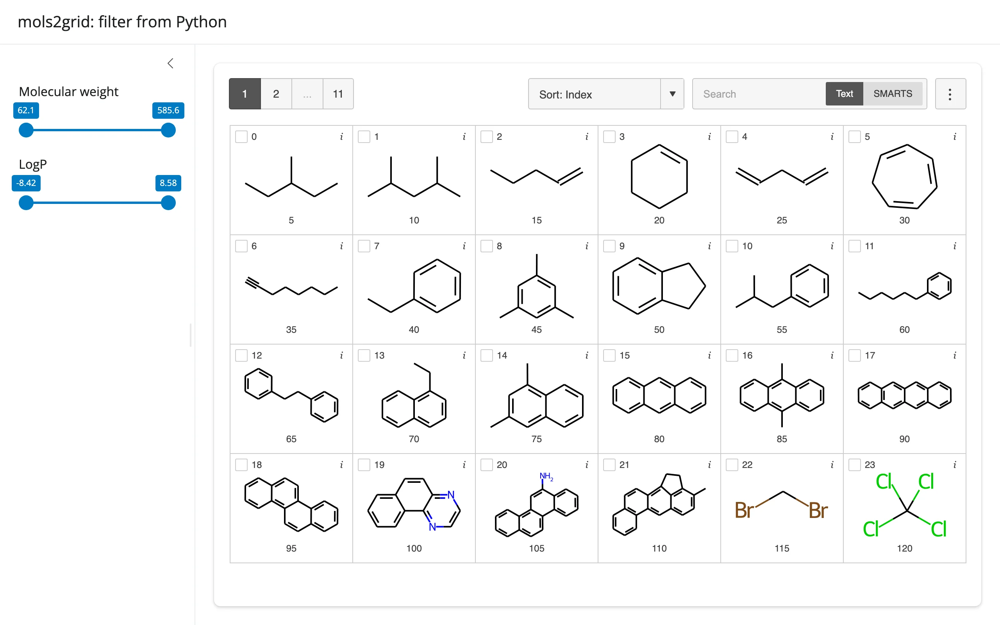
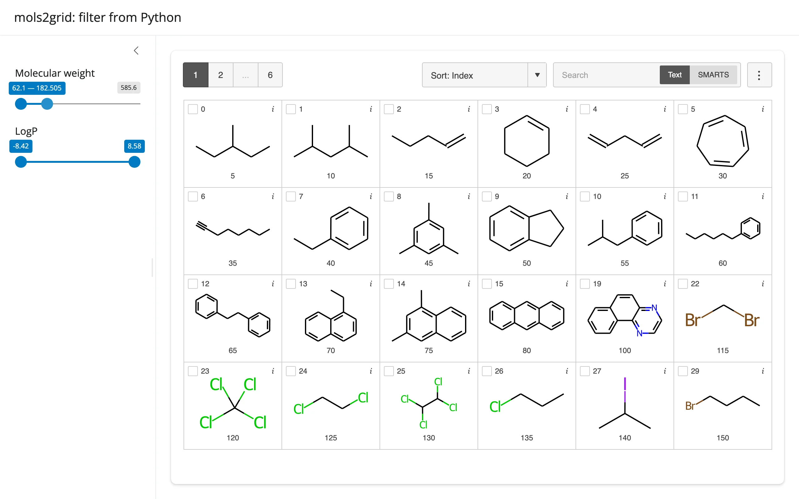

Dragging the molecular weight slider's upper handle down narrows 253 molecules to 133, instantly, with the grid's
pagination, sort order, and any existing selection untouched.

## Coordinating multiple views

### Shiny inputs -> filtered grid

Already shown above: two range sliders drive one `grid.grid.filter(mask)` call. See
[`examples/06_filter_from_python.py`](examples/06_filter_from_python.py) and the screenshots there.

### Selection -> property table, descriptor histogram, and SDF download

`grid.selected()` is just row indices -- look them up in your source DataFrame and feed the result to as many
downstream outputs as you want: a table, a chart, a file download. All three update together, from one shared
helper function.

```{.python file="examples/07_selection_to_views.py"}
from __future__ import annotations

import io

import mols2grid
import pandas as pd
import plotly.express as px
from rdkit import Chem
from rdkit.Chem import Descriptors
from shiny import render
from shiny.express import ui
from shinywidgets import render_mols2grid, render_plotly


def load_molecules() -> pd.DataFrame:
    df = mols2grid.sdf_to_dataframe(mols2grid.datafiles.SOLUBILITY_SDF)
    df = df[["SMILES", "ID", "SOL"]].rename(columns={"SOL": "LogS"})
    df["MW"] = [
        round(Descriptors.MolWt(m), 1) if (m := Chem.MolFromSmiles(s)) else None
        for s in df["SMILES"]
    ]
    return df.dropna(subset=["MW"]).reset_index(drop=True)


MOLS = load_molecules()

ui.page_opts(title="mols2grid: selection -> table, chart, download", fillable=True)

with ui.layout_columns(col_widths=[7, 5]):
    with ui.card(full_screen=True):
        ui.card_header("Pick some molecules")

        @render_mols2grid(subset=["ID"], tooltip=["ID", "MW", "LogS"])
        def grid():
            return MOLS

    with ui.layout_columns(col_widths=12):
        with ui.card():
            ui.card_header("Selected molecules")

            @render.data_frame
            def table():
                return render.DataGrid(selected_rows(), width="100%")

            @render.download_button(
                filename="selected_molecules.sdf", label="Download selection as SDF"
            )
            def download():
                writer_out = io.StringIO()
                writer = Chem.SDWriter(writer_out)
                for smiles, id_ in zip(selected_rows()["SMILES"], selected_rows()["ID"]):
                    mol = Chem.MolFromSmiles(smiles)
                    if mol is not None:
                        mol.SetProp("_Name", str(id_))
                        writer.write(mol)
                writer.close()
                yield writer_out.getvalue()

        with ui.card():
            ui.card_header("Molecular weight of the selection")

            @render_plotly
            def hist():
                return px.histogram(selected_rows(), x="MW", nbins=10)


def selected_rows() -> pd.DataFrame:
    # Positional row indices from the browser, looked up directly in MOLS
    # (the same frame and row order the grid was built from)
    idx = [int(k) for k in (grid.selected() or {})]
    return MOLS.loc[idx]
```

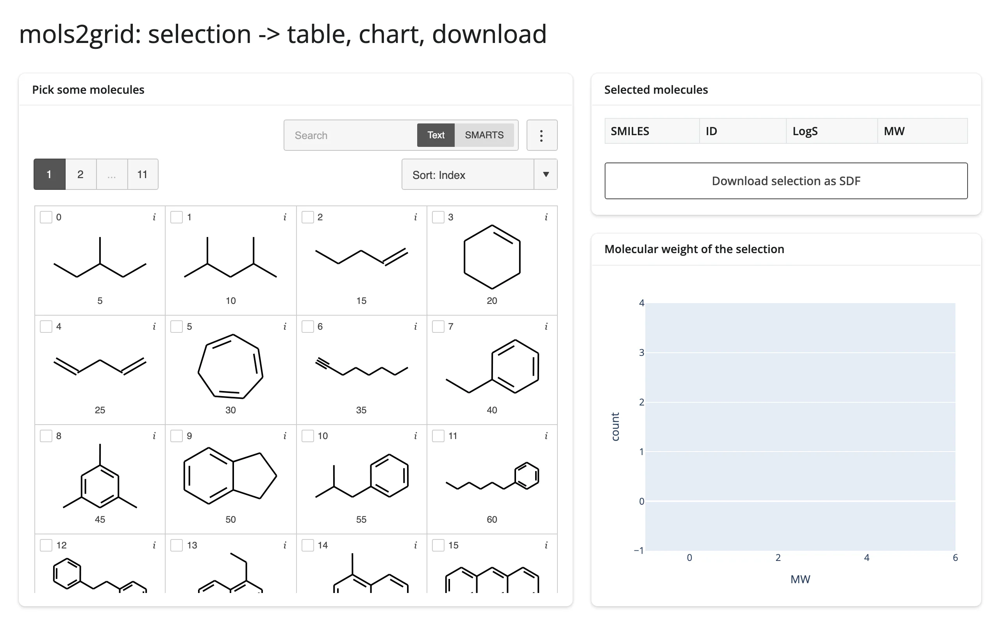
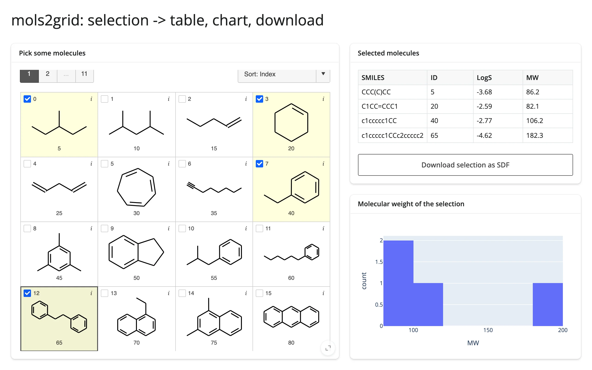

Checking 4 cells populates the table and the histogram together; clicking "Download selection as SDF" produces a
4-molecule SD file -- verified by counting `$$$$` record separators in the downloaded content.

### Click -> detail card with a larger depiction and computed descriptors

A click is for drilling into *one* molecule: render a bigger RDKit depiction and a few computed descriptors next
to the grid, driven entirely by `grid.clicked()`.

```{.python file="examples/08_click_detail_card.py"}
from __future__ import annotations

import matplotlib.pyplot as plt
import mols2grid
from rdkit import Chem
from rdkit.Chem import Descriptors, Draw
from shiny import render, req
from shiny.express import ui

from shinywidgets import render_mols2grid

ui.page_opts(title="mols2grid: click -> detail card", fillable=True)

mols = mols2grid.sdf_to_dataframe(mols2grid.datafiles.SOLUBILITY_SDF)

with ui.layout_columns(col_widths=[7, 5]):
    with ui.card(full_screen=True):
        ui.card_header("Click a molecule's image")

        @render_mols2grid(clicks=True, subset=["ID"], n_items_per_page=12)
        def grid():
            return mols

    with ui.card():
        ui.card_header("Detail card")

        @render.plot
        def depiction():
            row = grid.clicked()
            req(row is not None)
            mol = Chem.MolFromSmiles(row["SMILES"])
            fig, ax = plt.subplots(figsize=(4, 3))
            ax.imshow(Draw.MolToImage(mol, size=(400, 300)))
            ax.axis("off")
            return fig

        @render.ui
        def descriptors():
            row = grid.clicked()
            if row is None:
                return ui.p("Click a molecule to see its descriptors.")
            mol = Chem.MolFromSmiles(row["SMILES"])
            rows = {
                "ID": row["ID"],
                "MW": f"{Descriptors.MolWt(mol):.1f}",
                "LogP": f"{Descriptors.MolLogP(mol):.2f}",
                "TPSA": f"{Descriptors.TPSA(mol):.1f}",
                "H-bond donors": Descriptors.NumHDonors(mol),
                "H-bond acceptors": Descriptors.NumHAcceptors(mol),
                "Rotatable bonds": Descriptors.NumRotatableBonds(mol),
            }
            return ui.tags.table(
                *[ui.tags.tr(ui.tags.td(k), ui.tags.td(v)) for k, v in rows.items()]
            )
```

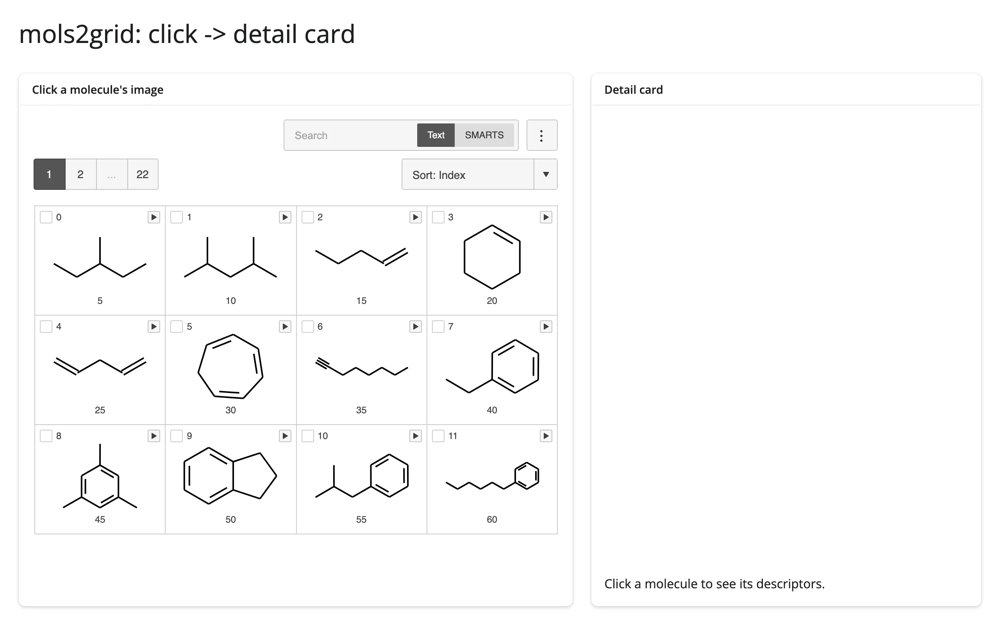
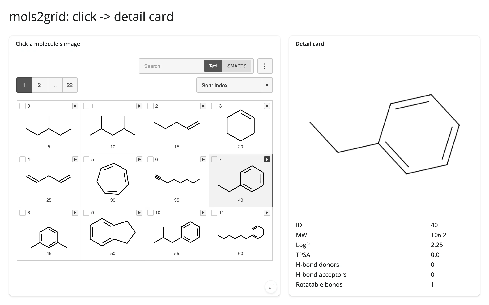

Note the detail card recomputes its descriptors with RDKit on the server, from the row's `SMILES` -- `clicked()`
gives you the data to look a molecule up, not a pre-computed descriptor set.

### A linked plotly scatter: lasso to filter the grid

Pair mols2grid with [plotly](../plotly/index.md)'s own `.selected_rows()` accessor for a classic
"chemical space" pattern: scatter two computed descriptors, lasso a region, and filter the grid to exactly those
molecules.

```{.python file="examples/09_plotly_scatter_link.py"}
from __future__ import annotations

import mols2grid
import pandas as pd
import plotly.express as px
from rdkit import Chem
from rdkit.Chem import Descriptors
from shiny import reactive
from shiny.express import ui
from shinywidgets import render_mols2grid, render_plotly


def load_molecules() -> pd.DataFrame:
    df = mols2grid.sdf_to_dataframe(mols2grid.datafiles.SOLUBILITY_SDF)
    df = df[["SMILES", "ID"]].reset_index(drop=True)
    mw, logp = [], []
    for smiles in df["SMILES"]:
        mol = Chem.MolFromSmiles(smiles)
        mw.append(round(Descriptors.MolWt(mol), 1) if mol else float("nan"))
        logp.append(round(Descriptors.MolLogP(mol), 2) if mol else float("nan"))
    df["MW"], df["LogP"] = mw, logp
    return df.dropna(subset=["MW"]).reset_index(drop=True)


MOLS = load_molecules()

ui.page_opts(title="mols2grid + plotly: lasso to filter the grid", fillable=True)

with ui.layout_columns(col_widths=[5, 7]):
    with ui.card(full_screen=True):
        ui.card_header("Lasso- or box-select points")

        @render_plotly
        def scatter():
            fig = px.scatter(MOLS, x="MW", y="LogP", custom_data=[MOLS.index])
            fig.update_layout(dragmode="lasso")
            return fig

    with ui.card(full_screen=True):
        ui.card_header("Grid filtered to the selection")

        @render_mols2grid(subset=["ID"], tooltip=["ID", "MW", "LogP"])
        def grid():
            return MOLS


@reactive.effect
def _link():
    if grid.grid is None or scatter.selected() is None:
        return  # nothing lassoed yet: leave every molecule visible
    selected = scatter.selected_rows(MOLS)
    mask = MOLS.index.isin(selected.index)
    grid.grid.filter(mask.tolist())
```

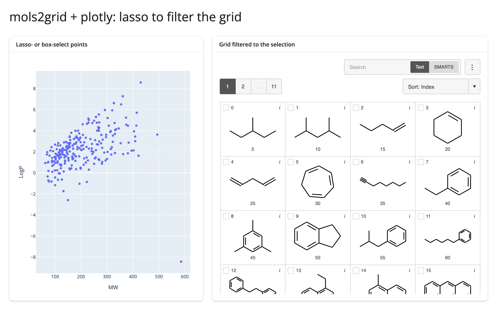
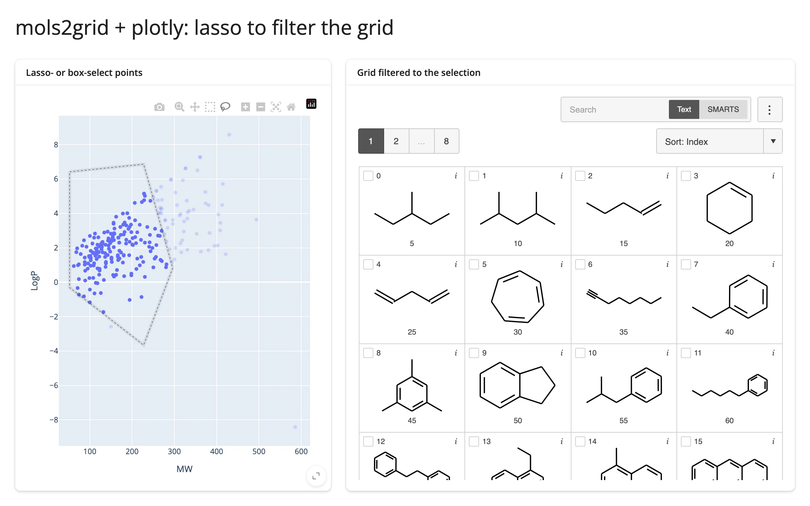

Lassoing the low-MW, low-LogP cluster narrows the grid from 253 molecules (11 pages) to 187 (8 pages). The
`scatter.selected() is None` check matters: `selected_rows()` alone returns an *empty* frame both before any lasso
and after one that catches nothing, so without it the grid would start out filtered to zero molecules.

(Pairs with: [plotly](../plotly/index.md).)

## Large data

mols2grid doesn't fit any of the three approaches in
[Large data & performance](../../guide/performance/index.md#three-approaches-to-large-data) cleanly: every
molecule's data is inlined into the grid's iframe up front, regardless of pagination -- the page UI only hides
rows client-side, it doesn't limit what's sent. Per the renderer's own docstring, that's roughly 0.5-1 KB per
molecule depending on how many columns are shown, so a grid of tens of thousands of molecules is tens of
megabytes pushed to the browser in one widget-state message. **`shiny run --ws-max-size` does not help here**:
it raises the limit on messages the server *receives* from the browser (uvicorn/`websockets`' `max_size`,
the same setting behind [#459](https://github.com/posit-dev/py-shinywidgets/issues/459)'s oversized
selection-event disconnects) -- it has no effect on how much the server can *send*. `prerender=True` (see
["Server-side depictions with `prerender=True`"](#server-side-depictions-with-prerendertrue) above) moves
*drawing* cost to the server; it doesn't reduce bytes sent either. For grids beyond a few thousand rows,
filter server-side in Python before constructing the grid rather than relying on the client to page through
everything -- that's the only real lever.

## Layout and sizing

mols2grid measures its own content and sizes the iframe to fit (`fitIframe()`), so by default a grid is a
content-sized block that the *page* scrolls past, not a canvas that stretches to fill a container. To cap the
grid's own height (independent of its container), pass `iframe_height` (also `iframe_width`, `iframe_allow`,
`iframe_sandbox`): this disables mols2grid's auto-fit, so the grid scrolls inside that fixed box instead.

```{.python file="examples/10_layout_sizing.py"}
from __future__ import annotations

import mols2grid
from shiny.express import ui
from shinywidgets import render_mols2grid

ui.page_opts(title="mols2grid: layout and sizing", fillable=True)

mols = mols2grid.sdf_to_dataframe(mols2grid.datafiles.SOLUBILITY_SDF)

ui.card_header("Default: the grid sizes itself to its content; the page scrolls")
with ui.card():

    @render_mols2grid(subset=["ID"], n_items_per_page=12)
    def fills():
        return mols


ui.card_header(
    'iframe_height="150px" alone: the iframe is bounded, but the filling '
    "output container still stretches to the card -- empty space below"
)
with ui.card():

    @render_mols2grid(subset=["ID"], n_items_per_page=24, iframe_height="150px")
    def bounded():
        return mols


ui.card_header('iframe_height="150px" + fill=False: the output hugs its content too')
with ui.card():

    @render_mols2grid(
        subset=["ID"], n_items_per_page=24, iframe_height="150px", fill=False
    )
    def bounded_no_fill():
        return mols
```

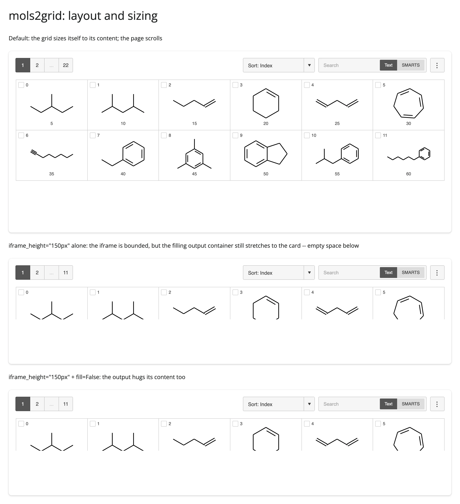

The middle card is a good demonstration of a real sizing gotcha: `render_mols2grid` defaults `fill=True`, so even
once `iframe_height` bounds the *iframe* to 150px, the surrounding output `<div>` is still a filling flex item and
stretches to match its card -- measured at 259px tall against a 150px iframe. Adding `fill=False` (third card)
makes the output div hug its content too (measured at 163px) -- pair the two whenever you want a genuinely compact
card rather than one with dead space below the grid.

## Gotchas and limitations

- **The grid needs an internet connection, and fails silently without one.** Every grid document loads list.js,
  jQuery, RDKit's WebAssembly build (~5 MB), and Bootstrap from CDNs (`cdnjs.cloudflare.com`, `code.jquery.com`,
  `unpkg.com`, `cdn.jsdelivr.net`). If any is unreachable, the grid renders its toolbar with zero molecules and no
  error -- there's no way for the Python side to detect this. `prerender=True` removes the per-cell client-side
  drawing work but does **not** remove this dependency: RDKit's WebAssembly build still loads, to power the SMARTS
  search box.
- **A `MolGrid` you construct yourself must have a unique `name`.** mols2grid keys selection state in a
  process-global registry; the default name (`"default"`) collides across sessions and across multiple grids on
  one page, so `@render_mols2grid` raises a `ValueError` for a passed-in `MolGrid` still using it. Return a plain
  DataFrame instead (the renderer generates a collision-free name for you) unless you specifically need to share
  one `MolGrid` across outputs.
- **`filter()` is positional and can't pre-filter the initial render.** A mask lines up against rows in the
  DataFrame's order, not any row identity -- compute it from the same (unfiltered, unsorted) frame the grid was
  built from. And the browser only applies a filter when the trait *changes*; it has no effect issued before the
  grid has finished its first paint, so there's no way to make a grid start out already filtered other than
  filtering the DataFrame itself before you return it.
- **A clicked row carries more than you asked for.** `grid.clicked()`'s dict always includes `mols2grid-id`,
  `SMILES`, and the cell's raw depiction under `img` (a multi-line SVG string), in addition to every column in
  `subset`/`tooltip` -- drop keys you don't need rather than displaying the dict as-is.
- **`rate_policy`/`rate_delay` have no observable effect on this renderer today** (see Rate limiting) -- they're
  accepted for interface consistency with every other `@render_*`, but neither accessor opts into a limiter, and
  the trait they'd otherwise rate-limit (`reactive_read()` on `.widget`) lives on a composite wrapper with nothing
  worth reading.
- **`iframe_height` alone doesn't make a card compact** -- pair it with `fill=False`, or the surrounding output
  div still stretches to its container (see Layout and sizing).
- **`MolGrid()` logs its own `repr()` to the server console on every construction** -- a leftover
  `IPython.display.display()` call in mols2grid's constructor, harmless but noisy; you'll see one
  `<mols2grid.widget.MolGridWidget object at 0x...>` line per render in your server logs.
- **shinywidgets supports mols2grid 2.x only** (`mols2grid>=2.2.0,<3`); a future shinywidgets release may add
  support for mols2grid 3.x, which changes several of the internals this integration depends on.

## Gallery candidates

### `template_grid_explorer.py`

A minimal, adaptable starting point: a searchable grid plus a selection readout as a DataFrame. Swap in your own
SMILES-bearing DataFrame and go.

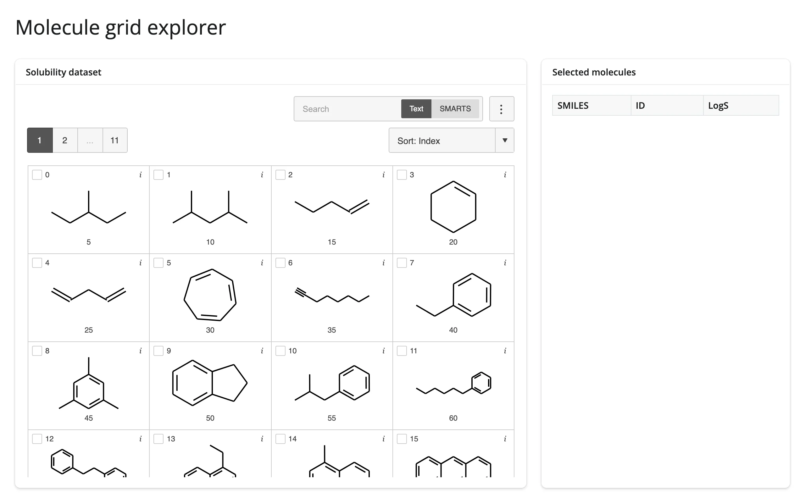
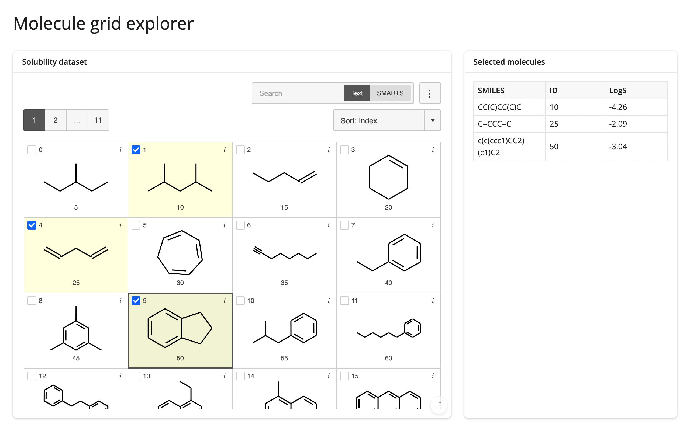

### `showcase_chem_explorer.py`

A fuller chemical dataset explorer: two range sliders and a lasso-able descriptor scatter jointly filter the grid
(by intersecting masks), a click opens a detail card with a larger depiction and computed descriptors, and the
checkbox selection drives an SDF download -- every pattern in this guide, combined in one app.

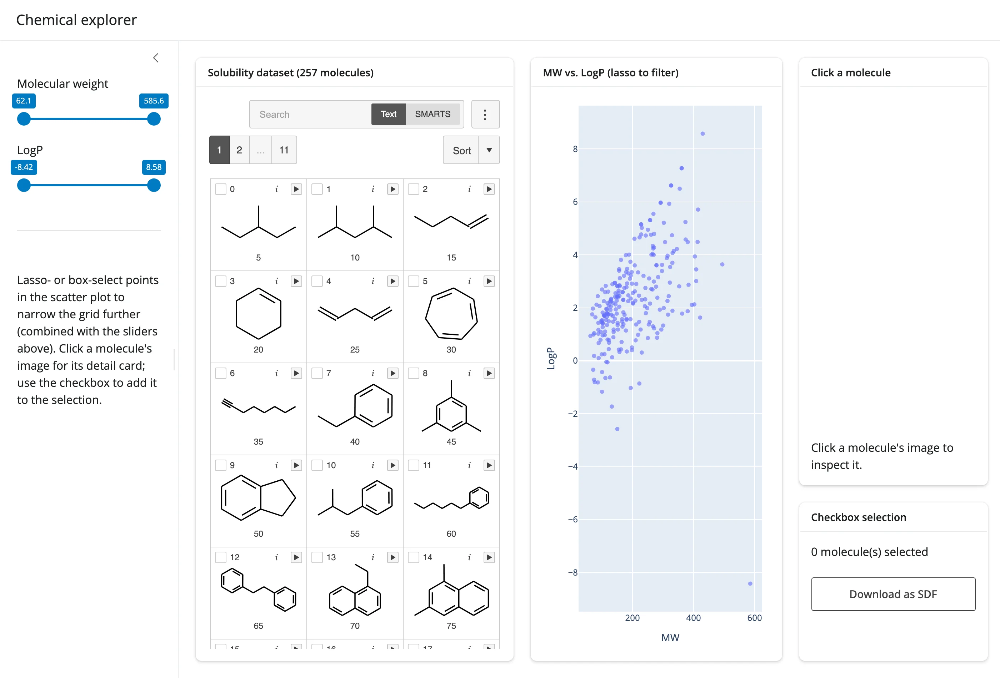
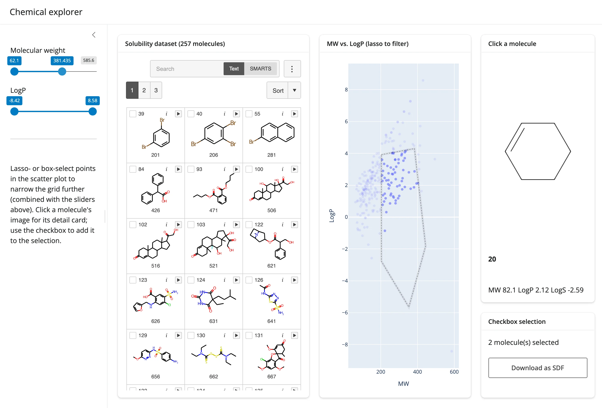

## Learn more

- [mols2grid documentation](https://mols2grid.readthedocs.io) and its
  [GitHub repository](https://github.com/cbouy/mols2grid)
- [RDKit](https://www.rdkit.org) -- the cheminformatics toolkit that draws every structure and computes descriptors
  in the examples above
- Related guides in this roster: [plotly](../plotly/index.md) (descriptor scatter pairing),
  [itables](../itables/index.md) and [reactable](../reactable/index.md) (general-purpose tables without
  structure depictions)
