[Mosaic](https://idl.uw.edu/mosaic/) is a framework from the University of Washington Interactive Data Lab for
building linked, data-driven views backed by a real database. Instead of shipping rows to the browser and filtering
them in JavaScript, Mosaic compiles your chart interactions into SQL and runs them against DuckDB. A dashboard spec
is a plain dict (or YAML, if you prefer): marks, selections, and inputs that all read from and write to shared
parameters. Brush one chart and every other chart that references the same selection re-queries the database and
redraws, no matter whether the backing table has a thousand rows or ten million.

`render_mosaic_widget` renders a `mosaic_widget.MosaicWidget` (built from a spec plus the data you want it to see) as
a Shiny output. It applies shinywidgets' usual layout fixes so the output fills its container, and it adds two
accessors, `params()` and `data()`, that turn the dashboard's current selection into ordinary Shiny reactive state:
read them in a `@render.*` function, `@reactive.calc`, or `@reactive.effect` and your code re-runs every time the
user brushes, exactly like reading `input.my_slider()`. The thing that makes this renderer different from the rest
of the roster is *where the data lives*: Mosaic's queries run in the DuckDB connection the widget holds, not in
your own `pd.DataFrame`, so `dashboard.data()` hands you a lazy relation you aggregate in SQL rather than a frame
you've already pulled into Python. The renderer also locks that connection down before display, so a visitor's
browser can query the data but can't reach the server's files -- see "Security" below before sharing a DuckDB
connection across more than one widget.

Choose Mosaic when your data is too large to filter comfortably in pandas, or when you want several charts,
tables, and native inputs (menus, search boxes, sliders) crossfiltering each other from one declarative spec. For
a single large dataset you just want to look at as points (no crossfilter, just pan/zoom/select), see
[jscatter](../jscatter/index.md) or [embedding-atlas](../embedding-atlas/index.md) instead. For a DuckDB-backed
*table* without Mosaic's chart grammar, see [quak](../quak/index.md).

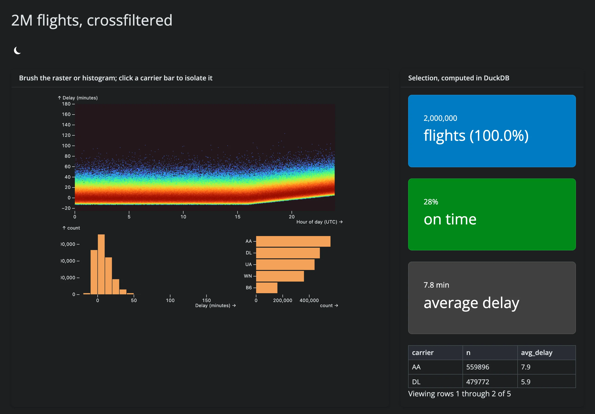

## Installation

```sh
pip install 'shinywidgets[mosaic_widget]'
```

This pulls in `mosaic-widget` and `duckdb`. One thing to know up front: mosaic-widget 0.34.0 (the current release)
declares `narwhals>=2.8`, but it actually needs 2.22 or later (`is_into_lazyframe`, added in 2.22) -- verified by
installing narwhals 2.21 and reproducing the `ImportError` on current main. If `import mosaic_widget` fails for you,
`pip install 'narwhals>=2.22'` fixes it. This is an upstream metadata bug, not a shinywidgets issue.

## Quick start

A spec is a dict. `params` declares the shared selection; marks reference it by name and get filtered by it.

```{.python file="examples/01_quickstart.py"}
# Quick start: a two-plot Mosaic crossfilter dashboard.

from __future__ import annotations

import pandas as pd
from mosaic_widget import MosaicWidget
from shiny.express import ui
from shinywidgets import render_mosaic_widget

# The Palmer Penguins dataset (Gorman, Williams & Fraser, 2014), via Allison
# Horst's palmerpenguins package.
PENGUINS_URL = "https://raw.githubusercontent.com/allisonhorst/palmerpenguins/main/inst/extdata/penguins.csv"
penguins = pd.read_csv(PENGUINS_URL).dropna(subset=["species", "flipper_length_mm", "body_mass_g"])

# Brushing either plot sets the "$brush" selection; every plot that reads
# from "penguins" filtered by "$brush" updates together.
spec = {
    "params": {"brush": {"select": "crossfilter"}},
    "vconcat": [
        {
            "plot": [
                {
                    "mark": "dot",
                    "data": {"from": "penguins", "filterBy": "$brush"},
                    "x": "flipper_length_mm",
                    "y": "body_mass_g",
                    "fill": "species",
                    "r": 2.5,
                },
                {"select": "intervalXY", "as": "$brush"},
            ],
            "xDomain": "Fixed",
            "yDomain": "Fixed",
            "width": 600,
            "height": 300,
        },
        {
            "plot": [
                {
                    "mark": "rectY",
                    "data": {"from": "penguins", "filterBy": "$brush"},
                    "x": {"bin": "flipper_length_mm"},
                    "y": {"count": ""},
                    "fill": "steelblue",
                    "inset": 0.5,
                },
                {"select": "intervalX", "as": "$brush"},
            ],
            "xDomain": "Fixed",
            "width": 600,
            "height": 150,
        },
    ],
}

ui.page_opts(title="Mosaic quick start", fillable=True)

with ui.card(full_screen=True):

    @render_mosaic_widget
    def dashboard():
        return MosaicWidget(spec, data={"penguins": penguins})
```

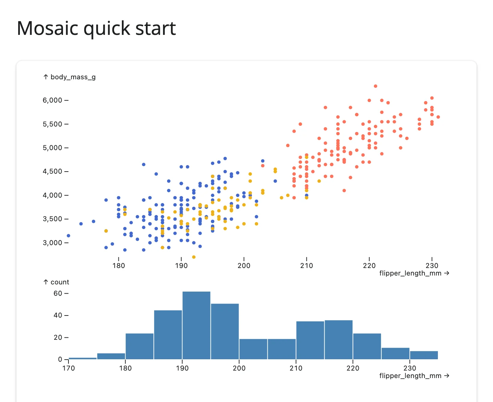

`MosaicWidget(spec, data={...})` registers each DataFrame as a table in an in-memory DuckDB connection the widget
creates for itself. Drag on either plot: the scatter and the histogram both filter, because both marks' `data`
reference `"$brush"`.

## What you can build

### Context: show the filtered rows against the whole distribution

Layer an unfiltered, gray `rectY` under a filtered, colored one. The brushed region narrows the foreground bars
while the background stays put, so the viewer always sees what fraction of the data survived the filter.

```{.python file="examples/02_context_layers.py"}
# A crossfiltered histogram with a gray "all rows" layer for context.

from __future__ import annotations

import pandas as pd
from mosaic_widget import MosaicWidget
from shiny.express import ui
from shinywidgets import render_mosaic_widget

PENGUINS_URL = "https://raw.githubusercontent.com/allisonhorst/palmerpenguins/main/inst/extdata/penguins.csv"
penguins = pd.read_csv(PENGUINS_URL).dropna(subset=["flipper_length_mm"])

spec = {
    "params": {"brush": {"select": "crossfilter"}},
    "plot": [
        # Background layer: every row, unfiltered, so the shape of the whole
        # dataset stays visible while brushing.
        {
            "mark": "rectY",
            "data": {"from": "penguins"},
            "x": {"bin": "flipper_length_mm"},
            "y": {"count": ""},
            "fill": "#ddd",
            "inset": 0.5,
        },
        # Foreground layer: only the brushed rows, drawn on top.
        {
            "mark": "rectY",
            "data": {"from": "penguins", "filterBy": "$brush"},
            "x": {"bin": "flipper_length_mm"},
            "y": {"count": ""},
            "fill": "steelblue",
            "inset": 0.5,
        },
        {"select": "intervalX", "as": "$brush"},
    ],
    "xDomain": "Fixed",
    "width": 600,
    "height": 300,
}

ui.page_opts(title="Context layers", fillable=True)

with ui.card(full_screen=True):

    @render_mosaic_widget
    def dashboard():
        return MosaicWidget(spec, data={"penguins": penguins})
```

| Before | After brushing |
|---|---|
| 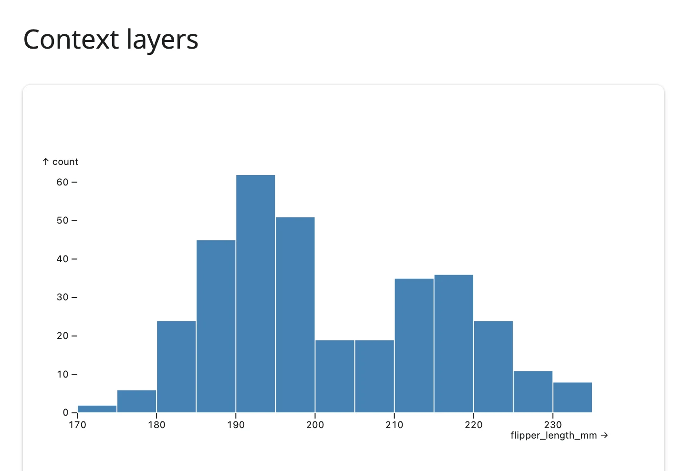 | 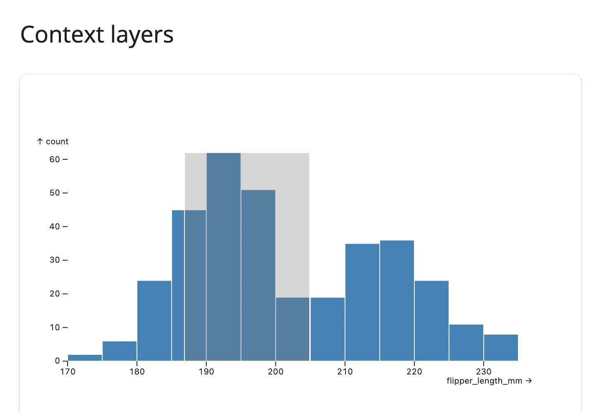 |

### Scale: a million rows, still instant

A `raster` mark never ships individual points. DuckDB bins every row into a pixel grid server-side and Mosaic draws
the result as an image, so the render cost and the message size are a function of plot resolution, not row count.
This is the mark to reach for once a `dot` mark would mean plotting tens of thousands of overlapping points.

```{.python file="examples/03_scale_raster.py"}
# A density raster over 1 million rows, crossfiltered with a histogram.
#
# Mosaic never ships raw rows to the browser for a `raster` mark: it asks
# DuckDB to pre-aggregate into pixel bins, so the plot renders and rebrushes
# in well under a second regardless of row count.
#
# 1M synthetic rows (a real dataset this large and this shape isn't readily
# available as a small download): carrier-free flight hour/delay pairs.

from __future__ import annotations

import numpy as np
import pandas as pd
from mosaic_widget import MosaicWidget
from shiny.express import ui
from shinywidgets import render_mosaic_widget

rng = np.random.default_rng(0)
n = 1_000_000
hour = rng.uniform(0, 24, n)
delay = rng.gamma(2.0, 8.0, n) - 10 + np.where(hour > 16, (hour - 16) * 2, 0)
flights = pd.DataFrame({"hour": hour, "delay": np.clip(delay, -20, 120)})

spec = {
    "params": {"brush": {"select": "crossfilter"}},
    "vconcat": [
        {
            "plot": [
                {
                    "mark": "raster",
                    "data": {"from": "flights"},
                    "x": "hour",
                    "y": "delay",
                    "fill": "density",
                },
                {"select": "intervalXY", "as": "$brush"},
            ],
            "xDomain": [0, 24],
            "yDomain": [-20, 120],
            "colorScale": "symlog",
            "colorScheme": "turbo",
            "width": 600,
            "height": 280,
        },
        {
            "plot": [
                {
                    "mark": "rectY",
                    "data": {"from": "flights", "filterBy": "$brush"},
                    "x": {"bin": "hour"},
                    "y": {"count": ""},
                    "fill": "steelblue",
                    "inset": 0.5,
                },
            ],
            "xDomain": [0, 24],
            "width": 600,
            "height": 120,
        },
    ],
}

ui.page_opts(title="Scale: 1M rows", fillable=True)

with ui.card(full_screen=True):

    @render_mosaic_widget
    def dashboard():
        return MosaicWidget(spec, data={"flights": flights})
```

| Before | After brushing |
|---|---|
| 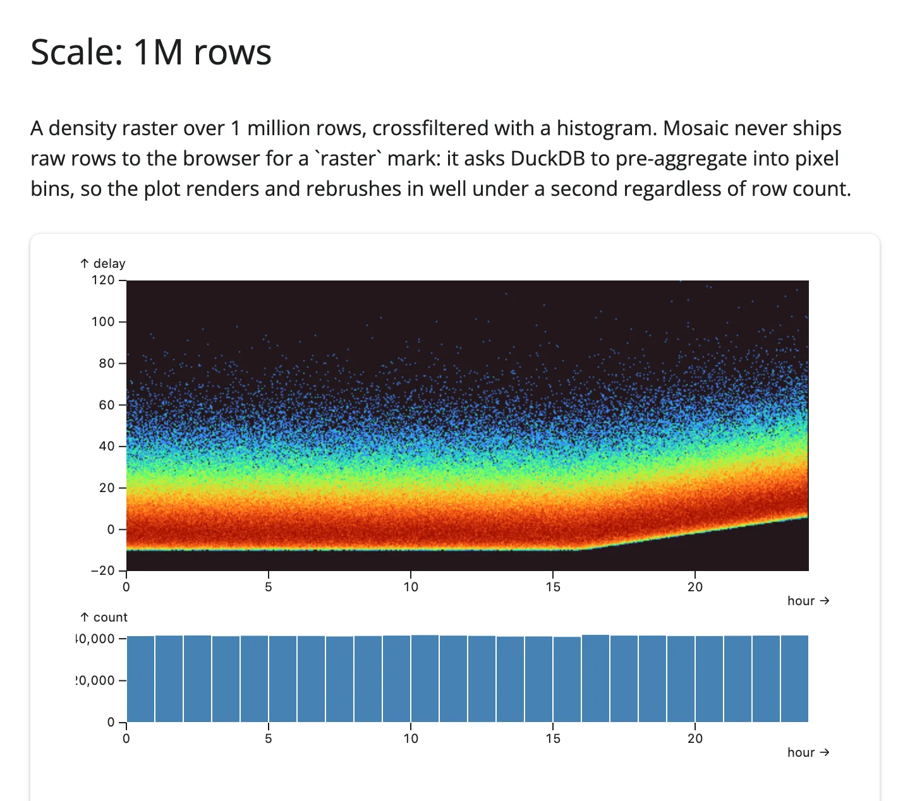 | 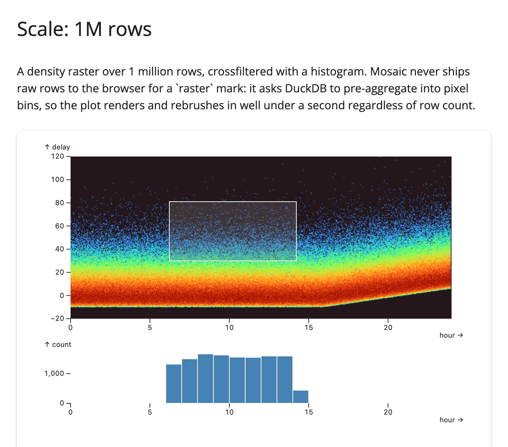 |

Dragging the box on the raster took the histogram from showing all 1M rows to the ~9,400 inside the box, with no
perceptible lag in either case.

### Declarative inputs: menu, search, table -- zero Python callbacks

Mosaic ships its own input widgets (`menu`, `search`, `slider`, `table`) that read and write selections the same
way marks do. Wire a menu's `as` to the same param a plot and a table both `filterBy`, and the three stay in sync
without a single `@reactive.effect` on the Python side.

```{.python file="examples/04_declarative_inputs.py"}
# Menu, histogram, and table, linked by one selection -- no Python callbacks.

from __future__ import annotations

import pandas as pd
from mosaic_widget import MosaicWidget
from shiny.express import ui
from shinywidgets import render_mosaic_widget

PENGUINS_URL = "https://raw.githubusercontent.com/allisonhorst/palmerpenguins/main/inst/extdata/penguins.csv"
penguins = pd.read_csv(PENGUINS_URL).dropna(subset=["species", "flipper_length_mm", "body_mass_g"])

spec = {
    "params": {"species": {"select": "intersect"}},
    "vconcat": [
        {
            "input": "menu",
            "label": "Species",
            "from": "penguins",
            "column": "species",
            "as": "$species",
        },
        {
            "plot": [
                {
                    "mark": "rectY",
                    "data": {"from": "penguins", "filterBy": "$species"},
                    "x": {"bin": "flipper_length_mm"},
                    "y": {"count": ""},
                    "fill": "steelblue",
                    "inset": 0.5,
                },
            ],
            "xDomain": "Fixed",
            "width": 600,
            "height": 220,
        },
        {
            "input": "table",
            "from": "penguins",
            "filterBy": "$species",
            "columns": ["species", "flipper_length_mm", "body_mass_g"],
        },
    ],
}

ui.page_opts(title="Declarative inputs", fillable=True)

with ui.card(full_screen=True):

    @render_mosaic_widget
    def dashboard():
        return MosaicWidget(spec, data={"penguins": penguins})
```

| Before | After choosing "Gentoo" |
|---|---|
| 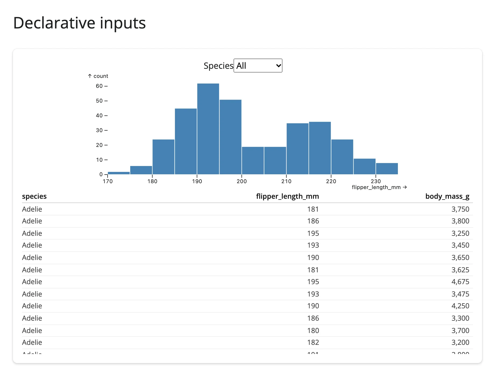 | 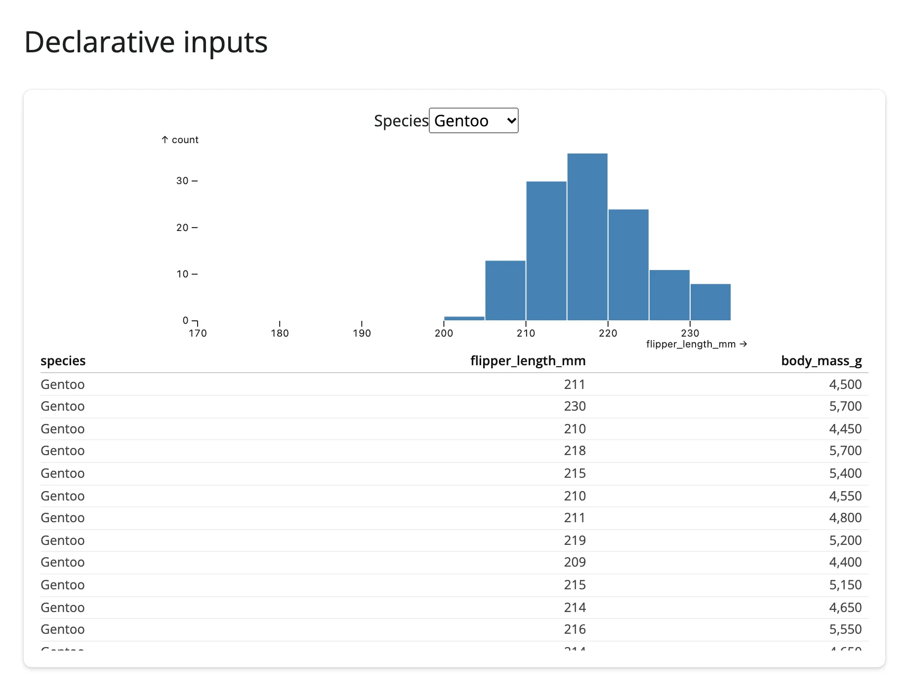 |

If you never need the selection in Python, this is the whole app. When you do (the rest of this guide), the same
spec keeps working -- `params()`/`data()` just read the same state these inputs write.

### Combining selection types

Selections aren't limited to one interactor. A `toggleY` click-to-select on a bar chart and an `intervalX` drag on
a histogram can both write into the crossfilter, each reading the other's table filtered by the opposite
selection.

```{.python file="examples/05_selection_types.py"}
# Two different selection types (toggle + interval) crossfiltering each other.

from __future__ import annotations

import pandas as pd
from mosaic_widget import MosaicWidget
from shiny.express import ui
from shinywidgets import render_mosaic_widget

PENGUINS_URL = "https://raw.githubusercontent.com/allisonhorst/palmerpenguins/main/inst/extdata/penguins.csv"
penguins = pd.read_csv(PENGUINS_URL).dropna(subset=["species", "flipper_length_mm"])

spec = {
    "params": {
        "species": {"select": "intersect"},
        "flipper": {"select": "intersect"},
    },
    "hconcat": [
        {
            "plot": [
                {
                    "mark": "barX",
                    "data": {"from": "penguins", "filterBy": "$flipper"},
                    "x": {"count": ""},
                    "y": "species",
                    "fill": "steelblue",
                    "sort": {"y": "-x"},
                },
                {"select": "toggleY", "as": "$species"},
            ],
            "yLabel": None,
            "marginLeft": 90,
            "width": 280,
            "height": 160,
        },
        {
            "plot": [
                {
                    "mark": "rectY",
                    "data": {"from": "penguins", "filterBy": "$species"},
                    "x": {"bin": "flipper_length_mm"},
                    "y": {"count": ""},
                    "fill": "steelblue",
                    "inset": 0.5,
                },
                {"select": "intervalX", "as": "$flipper"},
            ],
            "xDomain": "Fixed",
            "width": 340,
            "height": 160,
        },
    ],
}

ui.page_opts(title="Selection types", fillable=True)

with ui.card(full_screen=True):

    @render_mosaic_widget
    def dashboard():
        return MosaicWidget(spec, data={"penguins": penguins})
```

| Before | After brushing the histogram |
|---|---|
| 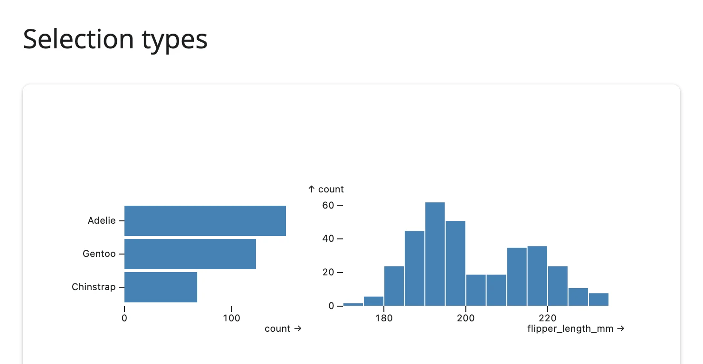 | 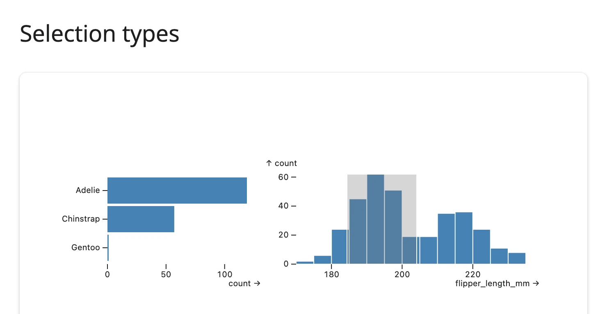 |

Each top-level entry in `"params"` declares its own `Selection`; `select: "intersect"` (AND together every clause
written into it) is the usual choice when more than one interactor can write to the same or different selections.

## Reacting to user interaction

### Accessor reference

| accessor | returns | before any interaction | across re-render | default rate policy |
|---|---|---|---|---|
| `params()` | `dict[str, Any]`: `{name: {"value": ..., "predicate": ...}}` per active selection | seeded `{}` (never cancels) | re-seeded from the new dashboard | debounce, 250ms |
| `data(table=None, *, filter_by=None)` | `duckdb.DuckDBPyRelation` (lazy) | re-reads `params()`, so it starts out matching `params()`'s seed (every row, unfiltered) | re-seeded, following `params()` | inherits `params()`'s |

Both are declared in `shinywidgets/_mosaic_widget.py`; `render_mosaic_widget` exposes them as the two methods
below. Both describe the dashboard's current selection, not a memory of past brushes -- a re-render always
re-seeds them from the new dashboard's own (empty) selection. There's nothing else worth reading reactively --
the synced trait both wrap is `params`, and `dashboard.widget.sql` (a plain Python property, not a synced
trait, so neither `reactive_read()` nor `.read()` applies to it) covers the one thing they don't: the SQL for
the dashboard's current state as a bare string, read non-reactively whenever you call it.

### `params()`: the current selection, as a dict

```{.python file="examples/06_params_accessor.py"}
# `dashboard.params()`: read the dashboard's current selection as a Python dict.

from __future__ import annotations

import pandas as pd
from mosaic_widget import MosaicWidget
from shiny.express import render, ui
from shinywidgets import render_mosaic_widget

PENGUINS_URL = "https://raw.githubusercontent.com/allisonhorst/palmerpenguins/main/inst/extdata/penguins.csv"
penguins = pd.read_csv(PENGUINS_URL).dropna(subset=["flipper_length_mm"])

spec = {
    "params": {"brush": {"select": "crossfilter"}},
    "plot": [
        {
            "mark": "rectY",
            "data": {"from": "penguins", "filterBy": "$brush"},
            "x": {"bin": "flipper_length_mm"},
            "y": {"count": ""},
            "fill": "steelblue",
            "inset": 0.5,
        },
        {"select": "intervalX", "as": "$brush"},
    ],
    "xDomain": "Fixed",
    "width": 600,
    "height": 220,
}

ui.page_opts(title="params() accessor", fillable=True)

with ui.card(full_screen=True):

    @render_mosaic_widget
    def dashboard():
        return MosaicWidget(spec, data={"penguins": penguins})


with ui.card():
    ui.card_header("dashboard.params()")

    @render.code
    def raw_params():
        return str(dashboard.params())
```

| Before brushing | After brushing |
|---|---|
| 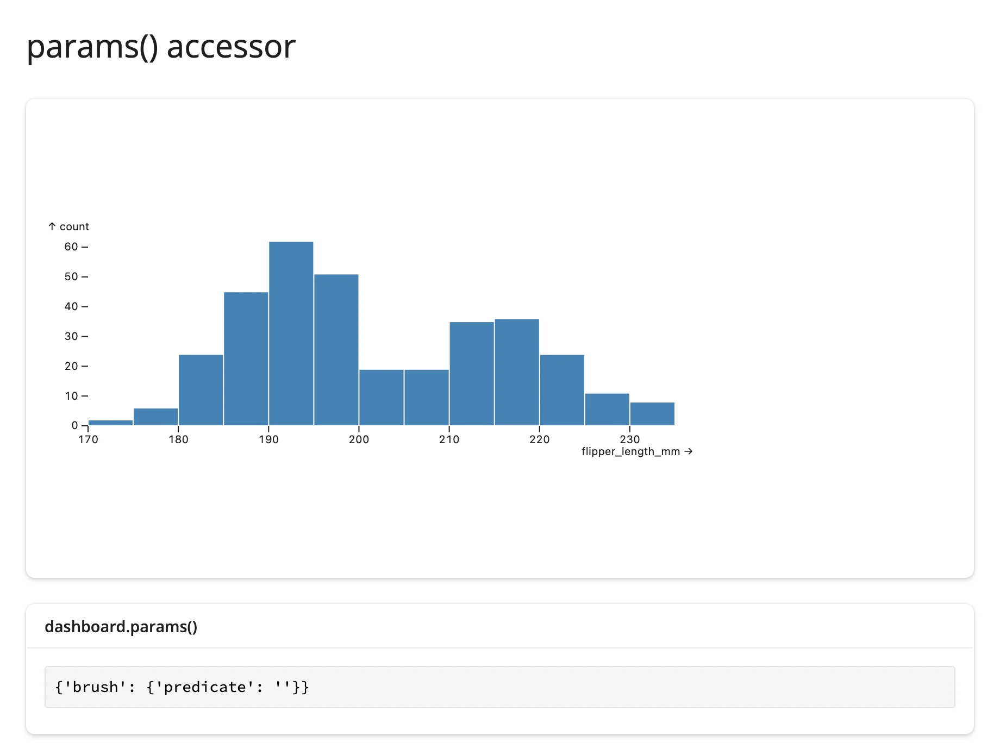 | 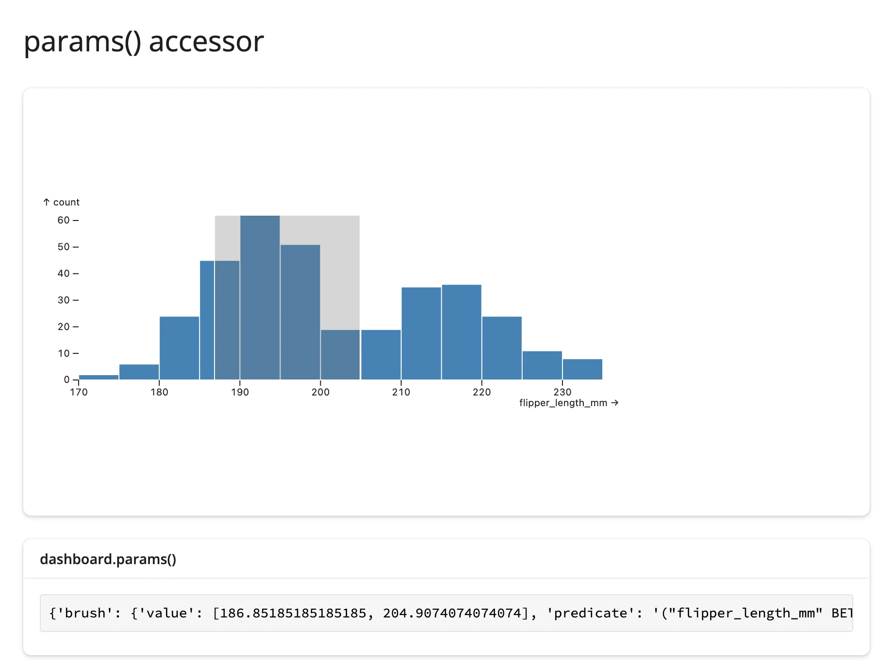 |

`predicate` is the selection's clauses already ANDed together and ready to drop into a `WHERE` clause; `value` is
the latest raw value only (here, the two x bounds of the drag). Before any interaction this is `{}`, not `None`:
there's no not-ready state to guard with `req()`, so you can read it immediately. (The very first browser sync can
briefly report `{"brush": {"predicate": ""}}` instead of `{}` -- both mean "nothing filtered," and the Playwright
tests treat them as equivalent.)

### `data()`: the selected rows, as a lazy relation

```{.python file="examples/07_data_accessor.py"}
# `dashboard.data()`: the selected rows as a lazy DuckDB relation.

from __future__ import annotations

import pandas as pd
from mosaic_widget import MosaicWidget
from shiny import reactive
from shiny.express import render, ui
from shinywidgets import render_mosaic_widget

PENGUINS_URL = "https://raw.githubusercontent.com/allisonhorst/palmerpenguins/main/inst/extdata/penguins.csv"
penguins = pd.read_csv(PENGUINS_URL).dropna(subset=["species", "flipper_length_mm", "body_mass_g"])

spec = {
    "params": {"brush": {"select": "crossfilter"}},
    "plot": [
        {
            "mark": "rectY",
            "data": {"from": "penguins", "filterBy": "$brush"},
            "x": {"bin": "flipper_length_mm"},
            "y": {"count": ""},
            "fill": "steelblue",
            "inset": 0.5,
        },
        {"select": "intervalX", "as": "$brush"},
    ],
    "xDomain": "Fixed",
    "width": 600,
    "height": 220,
}

ui.page_opts(title="data() accessor", fillable=True)

with ui.card(full_screen=True):

    @render_mosaic_widget
    def dashboard():
        return MosaicWidget(spec, data={"penguins": penguins})


# Take the (debounced) params() dependency once, then run one DuckDB query
# and share the result across outputs.
@reactive.calc
def selected():
    dashboard.params()
    return dashboard.data()


with ui.card():
    ui.card_header("Selected rows, aggregated in DuckDB")

    @render.code
    def summary():
        row = selected().aggregate(
            "count(*), round(avg(body_mass_g)) AS avg_mass"
        ).fetchall()[0]
        n, avg_mass = row
        return f"{n} penguins selected, average body mass {avg_mass} g"
```

| Before brushing | After brushing |
|---|---|
| 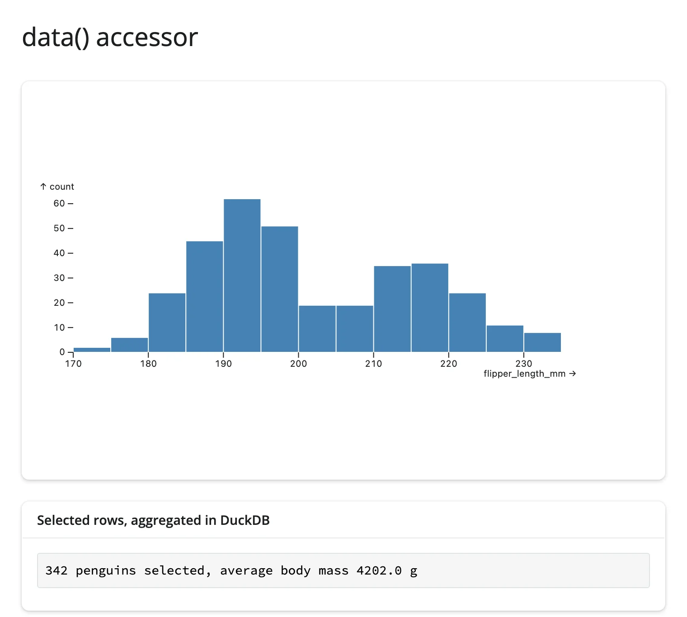 | 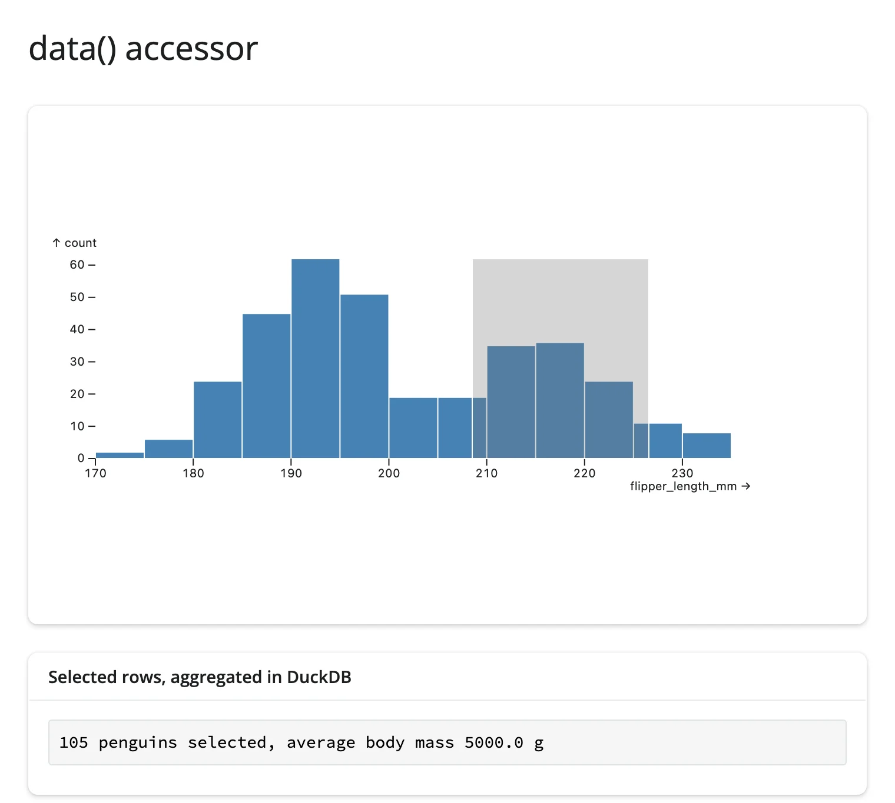 |

`table=` can be omitted when the spec's `data` entries plus the frames you passed to `data=` name exactly one
table, as here; with more than one source table, pass the one you want (`dashboard.data("penguins")`), or the
widget raises a clear `ValueError`. `data()` always runs its query against the *live* trait, which can be up to
`rate_delay` ahead of the debounced value `params()` returns while a brush is still settling -- they reconverge
once it does, so this only matters if you're comparing the two values directly.

By default `dashboard.data()` filters by *every* active selection. Pass `filter_by=` to narrow that to one
selection (or a list of them) instead -- useful any time a view should reflect only part of what's selected, for
example a value box that keeps tracking a `species` filter even while the user is also dragging a `flipper`
brush. `filter_by="species"` and `filter_by="$species"` are equivalent (the leading `"$"` is optional);
`filter_by=["species", "flipper"]` behaves like the default of filtering by both. See "Export filtered rows" in
Coordinating multiple views for a worked example.

### Rate limiting

```{.python file="examples/08_rate_limiting.py"}
# `rate_delay=0`: see every raw params() update a brush drag sends.
#
# Left: default debounce (250ms) -- the counter settles once after each drag.
# Right: `rate_delay=0` -- the counter climbs during the drag itself, one tick
# per message the browser sends.

from __future__ import annotations

import pandas as pd
from mosaic_widget import MosaicWidget
from shiny import reactive
from shiny.express import render, ui
from shinywidgets import render_mosaic_widget

PENGUINS_URL = "https://raw.githubusercontent.com/allisonhorst/palmerpenguins/main/inst/extdata/penguins.csv"
penguins = pd.read_csv(PENGUINS_URL).dropna(subset=["flipper_length_mm"])

spec = {
    "params": {"brush": {"select": "crossfilter"}},
    "plot": [
        {
            "mark": "rectY",
            "data": {"from": "penguins", "filterBy": "$brush"},
            "x": {"bin": "flipper_length_mm"},
            "y": {"count": ""},
            "fill": "steelblue",
            "inset": 0.5,
        },
        {"select": "intervalX", "as": "$brush"},
    ],
    "xDomain": "Fixed",
    "width": 400,
    "height": 220,
}

ui.page_opts(title="Rate limiting", fillable=True)

with ui.layout_columns():
    with ui.card(full_screen=True):
        ui.card_header("Default: debounce 250ms")

        @render_mosaic_widget
        def debounced():
            return MosaicWidget(spec, data={"penguins": penguins})

        update_count_debounced = reactive.value(0)

        @reactive.effect
        def _count_debounced():
            debounced.params()
            with reactive.isolate():
                update_count_debounced.set(update_count_debounced() + 1)

        @render.text
        def n_debounced():
            return f"params() fired {update_count_debounced()} times"

    with ui.card(full_screen=True):
        ui.card_header("rate_delay=0: every raw update")

        @render_mosaic_widget(rate_delay=0)
        def live():
            return MosaicWidget(spec, data={"penguins": penguins})

        update_count_live = reactive.value(0)

        @reactive.effect
        def _count_live():
            live.params()
            with reactive.isolate():
                update_count_live.set(update_count_live() + 1)

        @render.text
        def n_live():
            return f"params() fired {update_count_live()} times"
```

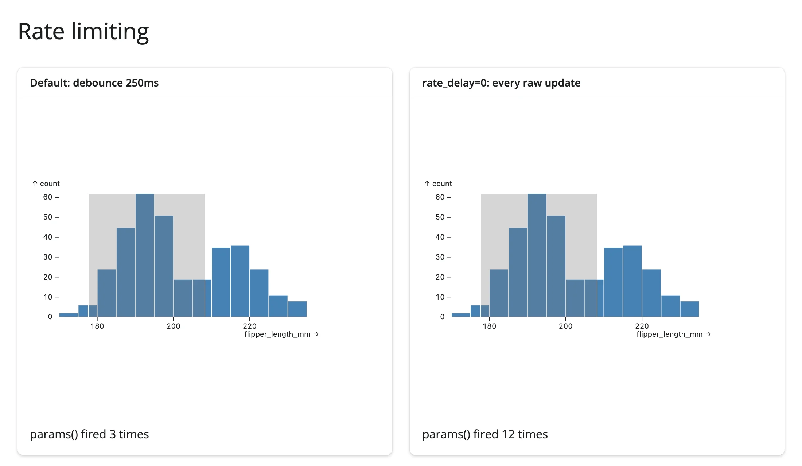

The same drag fired `params()` 3 times on the left (debounced) and 12 times on the right (`rate_delay=0`). Keep
the default for anything that triggers a DuckDB aggregate or updates another widget -- a drag can otherwise mean a
query per mouse-move message. Pass `rate_policy="throttle"` to the renderer if you want updates *during* the drag
without going fully unlimited, and `rate_delay=0` only when you're debugging the raw stream, as here.

## Updating the widget from Python

A `MosaicWidget`'s `spec` is a regular synced trait: assigning `.widget.spec = new_spec` re-renders the dashboard
in the browser without creating a new widget, a new DuckDB connection, or sending another copy of Mosaic's
JavaScript bundle (worth avoiding -- see Gotchas below). The tradeoff is that Mosaic rebuilds the whole dashboard
from the new spec, so the current selection resets.

```{.python file="examples/09_update_spec_in_place.py"}
# Restyle the dashboard in place by assigning a new `.widget.spec`.
#
# Changing an existing MosaicWidget's `spec` trait re-renders it in the
# browser without creating a new widget, a new DuckDB connection, or sending
# another copy of Mosaic's JavaScript bundle. The tradeoff: Mosaic rebuilds
# the whole dashboard from the new spec, so the current selection resets.

from __future__ import annotations

import pandas as pd
from mosaic_widget import MosaicWidget
from shiny import reactive
from shiny.express import input, ui
from shinywidgets import render_mosaic_widget

PENGUINS_URL = "https://raw.githubusercontent.com/allisonhorst/palmerpenguins/main/inst/extdata/penguins.csv"
penguins = pd.read_csv(PENGUINS_URL).dropna(subset=["flipper_length_mm"])


def make_spec(fill: str) -> dict:
    return {
        "params": {"brush": {"select": "crossfilter"}},
        "plot": [
            {
                "mark": "rectY",
                "data": {"from": "penguins", "filterBy": "$brush"},
                "x": {"bin": "flipper_length_mm"},
                "y": {"count": ""},
                "fill": fill,
                "inset": 0.5,
            },
            {"select": "intervalX", "as": "$brush"},
        ],
        "xDomain": "Fixed",
        "width": 600,
        "height": 260,
    }


ui.page_opts(title="Restyle in place", fillable=True)

ui.input_radio_buttons(
    "color", "Bar color", choices=["steelblue", "darkorange", "seagreen"]
)

with ui.card(full_screen=True):

    @render_mosaic_widget
    def dashboard():
        # The render function must not depend on input.color(): that would
        # rebuild the whole widget on every color change, which is exactly
        # what the in-place update below avoids.
        with reactive.isolate():
            color = input.color()
        return MosaicWidget(make_spec(color), data={"penguins": penguins})

    @reactive.effect
    def _restyle():
        color = input.color()
        with reactive.isolate():
            w = dashboard.widget
            if w is not None:
                w.spec = make_spec(color)
```

| Brushed, steelblue | After switching to darkorange |
|---|---|
| 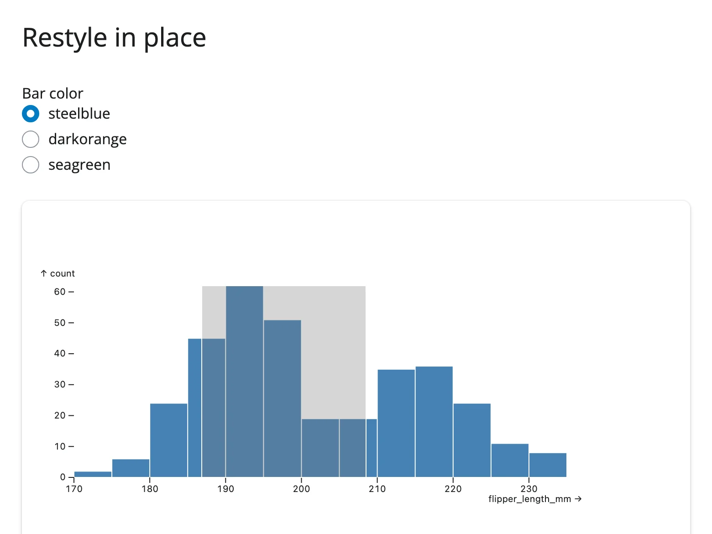 | 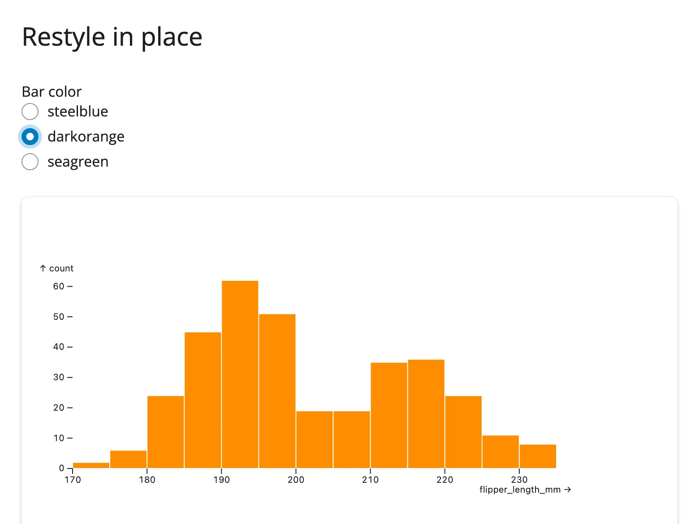 |

Notice the brush (the gray selection rectangle) is present on the left and gone on the right: restyling really
does reset the selection, confirmed here, not just a theoretical caveat. If your styling change doesn't need to
survive a reset-free brush, this is still almost always the right tool -- re-rendering the whole output recreates
the widget, its DuckDB connection, and reloads the JS bundle (see Gotchas).

`params` itself is a synced trait too, but it's effectively read-only from Python: there's no listener on the
JavaScript side for changes to it, so setting `dashboard.widget.params = {...}` updates the Python-side value
without filtering anything in the browser (verified: the chart doesn't change). To change what's selected, send a
new spec (which clears the selection) or wait for the user to brush again.

## Coordinating multiple views

### Selection drives a stat line and an aggregated table

The simplest consumer: no other widget library, just `@render.text` and `@render.data_frame` fed by one
`@reactive.calc` that reads `params()` once and shares the resulting relation.

```{.python file="examples/10_linked_stats_table.py"}
# Linked view: a brush drives a stat line and an aggregated table.
#
# Pairs with: render-widget (plain Shiny outputs, no other widget library
# needed) -- the simplest possible consumer of a Mosaic selection.

from __future__ import annotations

import pandas as pd
from mosaic_widget import MosaicWidget
from shiny import reactive
from shiny.express import render, ui
from shinywidgets import render_mosaic_widget

PENGUINS_URL = "https://raw.githubusercontent.com/allisonhorst/palmerpenguins/main/inst/extdata/penguins.csv"
penguins = pd.read_csv(PENGUINS_URL).dropna(subset=["species", "flipper_length_mm", "body_mass_g"])

spec = {
    "params": {"brush": {"select": "crossfilter"}},
    "plot": [
        {
            "mark": "dot",
            "data": {"from": "penguins", "filterBy": "$brush"},
            "x": "flipper_length_mm",
            "y": "body_mass_g",
            "fill": "species",
            "r": 2.5,
        },
        {"select": "intervalXY", "as": "$brush"},
    ],
    "xDomain": "Fixed",
    "yDomain": "Fixed",
    "width": 600,
    "height": 320,
}

ui.page_opts(title="Linked stats + table", fillable=True)

with ui.layout_columns(col_widths=[7, 5]):
    with ui.card(full_screen=True):

        @render_mosaic_widget
        def dashboard():
            return MosaicWidget(spec, data={"penguins": penguins})

    with ui.card():
        ui.card_header("Selected penguins")

        @reactive.calc
        def selected():
            dashboard.params()
            return dashboard.data()

        @render.text
        def n_selected():
            (n,) = selected().aggregate("count(*)").fetchall()[0]
            return f"{n} of {len(penguins)} selected"

        @render.data_frame
        def by_species():
            cols = "species, count(*) AS n, round(avg(body_mass_g)) AS mean_mass"
            df = selected().aggregate(cols, "species").order("species").df()
            return render.DataGrid(df)
```

| Before | After brushing the Gentoo cluster |
|---|---|
| 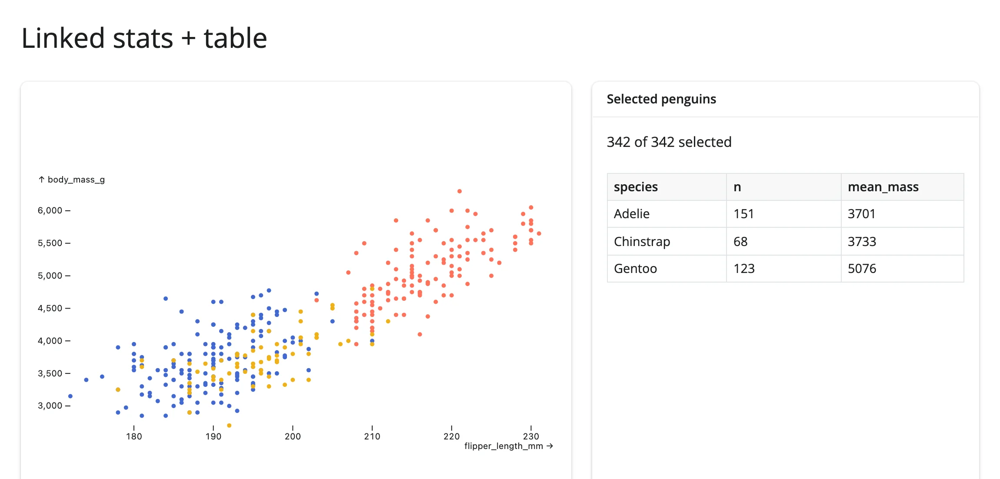 | 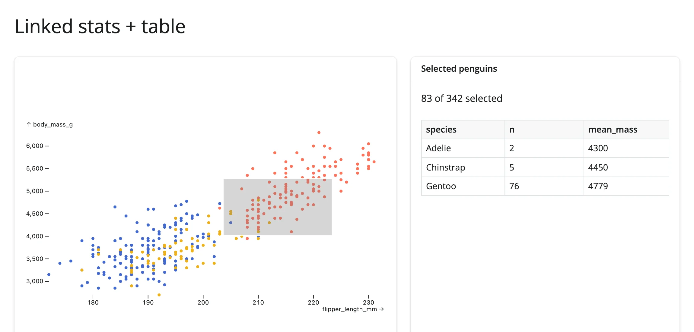 |

### Selection highlights points on a lonboard map (pairs with: lonboard)

The map isn't re-rendered on every brush move: its layer's `get_fill_color` is reassigned in place inside a
`@reactive.effect`, wrapped in `reactive.isolate()` so reading `geo_map.widget` doesn't itself create a
dependency. That keeps the map's pan/zoom state untouched and avoids rebuilding its (much heavier) WebGL layer on
every brush update.

```{.python file="examples/11_linked_map.py"}
# Linked view: a Mosaic brush highlights matching points on a lonboard map.
#
# Pairs with: lonboard. The map isn't re-rendered on every brush move -- its
# layer's colors are updated in place (`reactive.isolate()` + assignment),
# which keeps the map's pan/zoom state untouched.
#
# Synthetic store locations (a small bundled dataset with this lon/lat/revenue
# shape isn't readily available) spread across the continental US.

from __future__ import annotations

import geopandas as gpd
import numpy as np
import pandas as pd
from lonboard import Map, ScatterplotLayer
from mosaic_widget import MosaicWidget
from shiny import reactive
from shiny.express import ui
from shinywidgets import render_lonboard, render_mosaic_widget

rng = np.random.default_rng(3)
n = 1500
stores = pd.DataFrame(
    {
        "id": np.arange(n),
        "lon": rng.uniform(-124, -70, n),
        "lat": rng.uniform(26, 48, n),
        "revenue": rng.gamma(2.0, 4000, n),
    }
)
GDF = gpd.GeoDataFrame(geometry=gpd.points_from_xy(stores.lon, stores.lat), crs="EPSG:4326")
DIM, BRIGHT = (120, 140, 200, 140), (255, 140, 0, 255)

spec = {
    "params": {"brush": {"select": "crossfilter"}},
    "plot": [
        {
            "mark": "rectY",
            "data": {"from": "stores"},
            "x": {"bin": "revenue"},
            "y": {"count": ""},
            "fill": "steelblue",
            "inset": 0.5,
        },
        {"select": "intervalX", "as": "$brush"},
    ],
    "xDomain": "Fixed",
    "width": 600,
    "height": 220,
}

ui.page_opts(title="Mosaic + lonboard", fillable=True)

with ui.layout_columns(col_widths=[6, 6]):
    with ui.card(full_screen=True):

        @render_mosaic_widget
        def dashboard():
            return MosaicWidget(spec, data={"stores": stores})

    with ui.card(full_screen=True):

        @render_lonboard
        def geo_map():
            colors = np.array([DIM] * n, dtype=np.uint8)
            layer = ScatterplotLayer.from_geopandas(
                GDF, get_fill_color=colors, radius_units="pixels", get_radius=4
            )
            return Map(layer)

        @reactive.effect
        def _highlight():
            params = dashboard.params()
            active = params.get("brush", {}).get("predicate", "").strip() != ""
            if active:
                selected_ids = {row[0] for row in dashboard.data().select("id").fetchall()}
                colors = np.array(
                    [BRIGHT if i in selected_ids else DIM for i in stores.id], dtype=np.uint8
                )
            else:
                colors = np.array([DIM] * n, dtype=np.uint8)
            with reactive.isolate():
                w = geo_map.widget
                if w is not None:
                    w.layers[0].get_fill_color = colors
```

| Before | After brushing low-revenue stores |
|---|---|
| 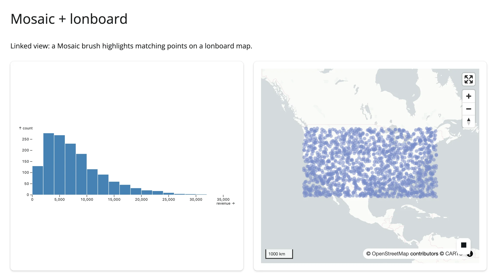 | 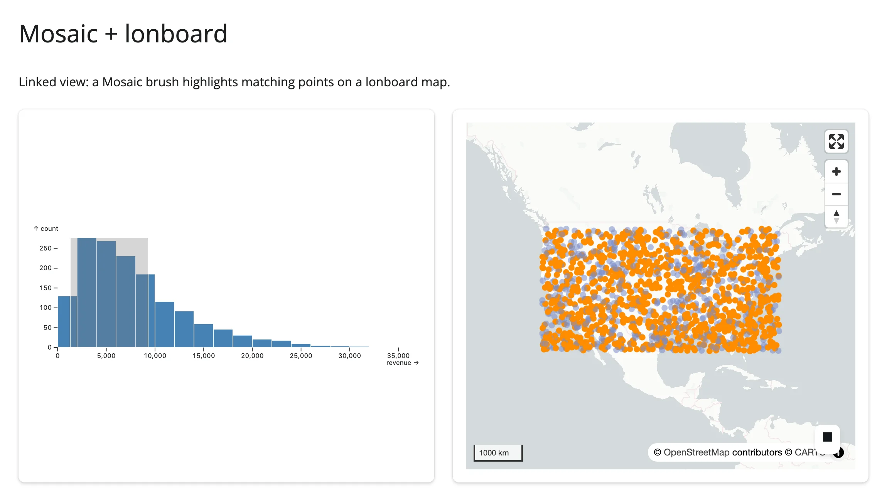 |

Guard against the trivial case: `params()` is `{}` before any brush, and an unfiltered `data()` then returns every
row, which would otherwise paint the whole map bright on load. Checking the predicate's truthiness first (as
`active` does here) keeps "nothing selected" and "everything selected" visually distinct.

### Selection feeds a plotly bar chart (pairs with: plotly)

Unlike the lonboard pairing, a small plotly figure is cheap enough to just re-render on every brush move --
`render_plotly` only needs a `Figure` object back, built fresh each time from `dashboard.data()`.

```{.python file="examples/12_linked_barchart.py"}
# Linked view: a Mosaic brush feeds a small plotly bar chart.
#
# Pairs with: plotly. Unlike the lonboard example, this chart is cheap enough
# to re-render on every brush move -- `render_plotly` just needs a Figure
# object, built here from `dashboard.data()`.

from __future__ import annotations

import pandas as pd
import plotly.express as px
from mosaic_widget import MosaicWidget
from shiny import reactive
from shiny.express import ui
from shinywidgets import render_mosaic_widget, render_plotly

PENGUINS_URL = "https://raw.githubusercontent.com/allisonhorst/palmerpenguins/main/inst/extdata/penguins.csv"
penguins = pd.read_csv(PENGUINS_URL).dropna(subset=["species", "flipper_length_mm"])

spec = {
    "params": {"brush": {"select": "crossfilter"}},
    "plot": [
        {
            "mark": "rectY",
            "data": {"from": "penguins", "filterBy": "$brush"},
            "x": {"bin": "flipper_length_mm"},
            "y": {"count": ""},
            "fill": "steelblue",
            "inset": 0.5,
        },
        {"select": "intervalX", "as": "$brush"},
    ],
    "xDomain": "Fixed",
    "width": 500,
    "height": 220,
}

ui.page_opts(title="Mosaic + plotly", fillable=True)

with ui.layout_columns(col_widths=[7, 5]):
    with ui.card(full_screen=True):

        @render_mosaic_widget
        def dashboard():
            return MosaicWidget(spec, data={"penguins": penguins})

    with ui.card(full_screen=True):

        @render_plotly
        def species_counts():
            dashboard.params()
            counts = dashboard.data().aggregate("species, count(*) AS n", "species").df()
            return px.bar(counts, x="species", y="n", color="species", title="Selected, by species")
```

| Before | After brushing long flippers |
|---|---|
| 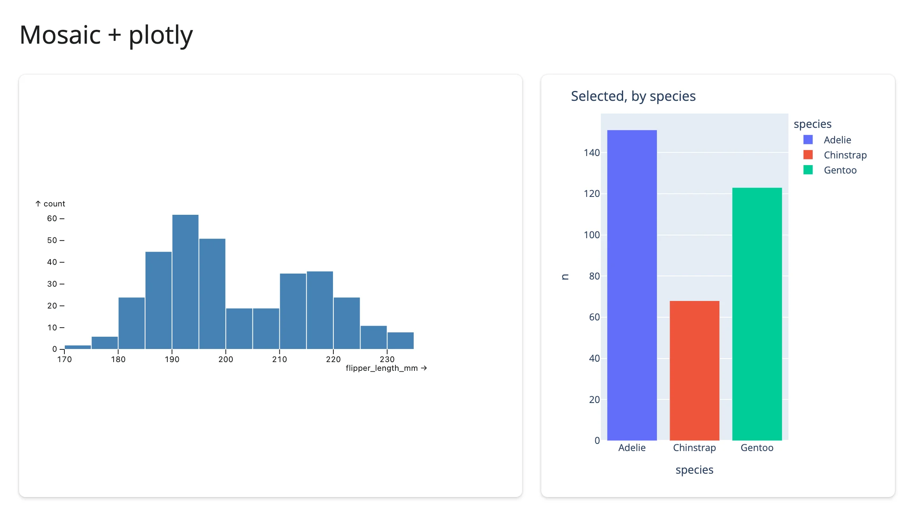 | 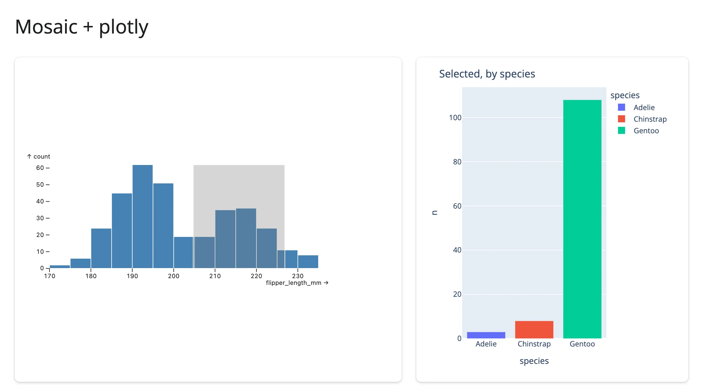 |

### Export filtered rows, read on demand (pairs with: quak)

`data()` is live the instant the dashboard renders, so a download handler can read it the moment the user
clicks -- no warm-up, no earlier read needed to "arm" it. This also puts `filter_by=` to work: the dashboard
below has two independent selections (a species toggle and a flipper-length brush), and the download exports
rows matching only the flipper brush, deliberately ignoring whichever species bar is clicked.

```{.python file="examples/13_export_filtered.py"}
# Linked view + read on demand: export rows matching one selection, picked
# with filter_by=, from a two-selection crossfilter dashboard.
#
# Pairs with: quak (same read-on-demand export pattern, there on
# table.data()). The download handler reads dashboard.data() only when the
# user clicks Download -- no warm-up needed, since the accessor is live from
# the moment the dashboard renders.

from __future__ import annotations

import pandas as pd
from mosaic_widget import MosaicWidget
from shiny import render
from shiny.express import ui
from shinywidgets import render_mosaic_widget

PENGUINS_URL = "https://raw.githubusercontent.com/allisonhorst/palmerpenguins/main/inst/extdata/penguins.csv"
penguins = pd.read_csv(PENGUINS_URL).dropna(subset=["species", "flipper_length_mm"])

spec = {
    "params": {
        "species": {"select": "intersect"},
        "flipper": {"select": "intersect"},
    },
    "hconcat": [
        {
            "plot": [
                {
                    "mark": "barX",
                    "data": {"from": "penguins", "filterBy": "$flipper"},
                    "x": {"count": ""},
                    "y": "species",
                    "fill": "steelblue",
                    "sort": {"y": "-x"},
                },
                {"select": "toggleY", "as": "$species"},
            ],
            "yLabel": None,
            "marginLeft": 90,
            "width": 280,
            "height": 160,
        },
        {
            "plot": [
                {
                    "mark": "rectY",
                    "data": {"from": "penguins", "filterBy": "$species"},
                    "x": {"bin": "flipper_length_mm"},
                    "y": {"count": ""},
                    "fill": "steelblue",
                    "inset": 0.5,
                },
                {"select": "intervalX", "as": "$flipper"},
            ],
            "xDomain": "Fixed",
            "width": 340,
            "height": 160,
        },
    ],
}

ui.page_opts(title="Export filtered rows (filter_by=)", fillable=True)

with ui.layout_columns(col_widths=[8, 4]):
    with ui.card(full_screen=True):

        @render_mosaic_widget
        def dashboard():
            return MosaicWidget(spec, data={"penguins": penguins})

    with ui.card():
        ui.card_header("Export")
        "Rows matching the flipper-length brush only -- filter_by picks that one selection, ignoring any species clicked above."

        @render.download_button(filename="flipper_selected.csv", label="Download CSV")
        def download():
            yield dashboard.data(filter_by="flipper").df().to_csv(index=False)
```

Before any interaction, and after clicking the "Gentoo" bar away (toggling Adelie/Chinstrap on) and brushing a
narrow flipper-length window:

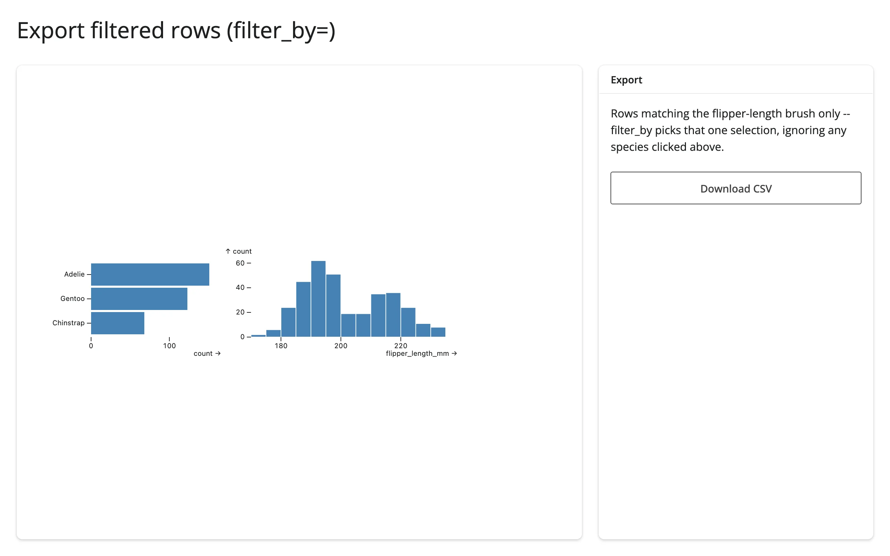
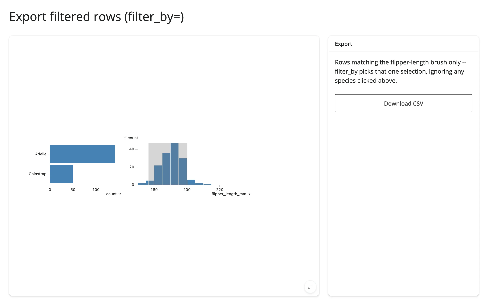

The species bar chart visibly narrows to two species after the click, and the flipper histogram shows the
brushed range -- both selections are genuinely active. The downloaded CSV still has both species in it (191
rows, 141 Adelie and 50 Chinstrap, flipper lengths 178-200mm): `filter_by="flipper"` picked only the brush,
exactly as documented, confirmed by inspecting the downloaded file's `species` column directly rather than
trusting the chart alone.

## Large data

A `raster` mark (see [Scale: a million rows, still instant](#scale-a-million-rows-still-instant) above) never
ships individual points -- DuckDB bins every row into a pixel grid server-side, so message size and render cost
are set by plot resolution, not row count. That's the "summarize on the server" approach from
[Large data & performance](../../guide/performance/index.md#three-approaches-to-large-data). It doesn't make
every query free, though: every other mark here (bar, line, point) crosses the Shiny websocket as the query
*result*, and on a 5-million-row dataset that result was measured at about 3 MB per brush step (an Arrow
buffer), because `MosaicWidget(spec, data={...})` registers your DataFrame in a DuckDB connection that lives in
this Python process, not in the browser's own WASM DuckDB -- see
[Linking widgets, pattern 7: brushing large data](../../guide/linked-views/index.md#7-brushing-large-data-push-summaries-not-points)
for the full measurement, which contrasts this guide's own raster + crossfilter idiom (example 20 there) against
a datashader/holoviews raster and a raw-point `Scattergl` anti-pattern.

## Layout and sizing

Mosaic plots carry their own pixel `width`/`height` in the spec; the output itself still fills its container the
way every shinywidgets output does. The two don't automatically agree: in every screenshot above, the card is as
wide as its column, but the plot inside stays at the size the spec gave it, leaving empty space when the card is
bigger (clearly visible, for example, above and to the right of the single histogram in the context-layers
example). There's no `fill`-style auto-sizing for the plots themselves -- size them for the column width you
expect.

Two things do adapt automatically, verified on current main:

- **Narrow columns shrink plots.** Observable Plot applies `max-width: 100%`, so a 600px-wide plot in a 300px
  column measures 218x109 -- scaled down, not clipped. Plots never grow past their spec'd size, only shrink.
- **`full_screen=True` cards work, and the brush survives.** Entering and leaving full screen on a card re-flows
  the layout without touching the widget; a brush made before entering full screen is still there after leaving
  it (verified above with the `params()` accessor example).

An explicit `height` smaller than the plots causes them to overflow visibly below the output (they aren't
clipped) -- give explicit heights room for what the spec actually draws.

## Gotchas and limitations

Verified on current main (mosaic-widget 0.34.0, duckdb 1.5.6, shiny 1.9.0) unless noted.

### Security: the DuckDB connection is locked down by default

Mosaic computes every plot by sending compiled SQL from the browser to the widget's DuckDB connection, and
without restrictions any visitor can send SQL that reads or writes files on the server. `render_mosaic_widget`
locks the connection down before display (`SET enable_external_access = false`; `SET lock_configuration =
true`), the same mechanism [quak](../quak/index.md) and [embedding-atlas](../embedding-atlas/index.md) use --
pass `allow_unrestricted_connection=True` to opt out (a local, single-user app, or a connection you've already
locked yourself, which the renderer then leaves untouched).

**The one case this guide's own patterns don't hit, but worth knowing before you pass `con=` yourself:** the
lockdown is permanent for the connection it's applied to (DuckDB can't undo it) and database-wide (it locks
every other cursor on the same database, not just the one `render_mosaic_widget` set it on). That interacts
with connection sharing, below -- if you share a `con=` or a `duckdb.DuckDBPyRelation` across more than one
widget or piece of app code, the *first* dashboard render locks it for everything else in the process that
touches that connection. Do any server-side file reads (`read_parquet()`, etc.) on a shared connection before
the first render, or pass `allow_unrestricted_connection=True` for it. Every example in this guide passes
`data={"t": df}` (a fresh, private connection per widget -- see below), so none of them are affected.

Even locked down, a visitor can still send expensive queries, which block the Python process while they run --
there's no statement timeout.

### Other gotchas

- **Which connection you pass decides session isolation.** Passing `data={"t": df}` (the default throughout this
  guide) registers each DataFrame in a fresh, private in-memory DuckDB connection per widget -- sessions can't see
  each other's data. Passing a `con=` you share across sessions, or a `duckdb.DuckDBPyRelation` in `data=`, changes
  that: mosaic-widget's connection-resolution code (`mosaic_widget._db.connect`) falls back to
  `duckdb.default_connection()`, DuckDB's *process-global* default, whenever a relation is given with no explicit
  `con=`. Two sessions registering different data under the same table name then collide. Only share a connection
  for data that's genuinely the same for every user -- and see Security above for what sharing it also means for
  the lockdown. This is now spelled out in the `render_mosaic_widget` docstring; see it for the exact mechanics.
- **Mosaic's own pre-aggregation cache is shared too.** Mosaic materializes `mosaic.preagg_<hash>` tables (not
  `TEMP`) directly in the connection's database. Two sessions whose cube SQL hashes the same (same table name,
  columns, and bin edges) reuse each other's cached cube, which compounds the connection-sharing trap above.
- **Re-renders don't free the old widget (upstream anywidget).** `render_mosaic_widget`'s docstring now says this
  plainly: each re-render builds a new `MosaicWidget`, a new DuckDB connection, and loads another copy of the JS
  bundle, and anywidget currently keeps all of it alive for the life of the process. Prefer assigning a new spec
  to `.widget.spec` (see "Updating the widget from Python") for anything that re-renders often; it reuses the
  existing widget and connection.
- **`params` is read-only in practice.** It's a synced trait, so Python *can* assign to `dashboard.widget.params`,
  but nothing on the JavaScript side listens for that change -- verified: assigning a predicate from Python left
  the chart showing the unfiltered data. Sending a new spec is the only way to reset a selection from Python.
- **Bad specs fail silently in the UI.** An unknown mark name, column, or table produces a blank output with no
  error styling -- the only signal is a browser console error (e.g. `Unrecognized mark type: dott`). Verified
  still true on current main. Python-side exceptions in your render function still show up normally.
- **The native `table` input has low contrast in dark mode.** Its header row is hard-coded white-on-black
  regardless of theme, and body text renders faint against a dark card background (visible if you flip the
  declarative-inputs example into dark mode). Mosaic `menu`/`search` inputs are also unstyled native HTML controls
  that don't pick up Bootstrap theming.
- **`narwhals` version mismatch at import time.** See Installation -- mosaic-widget 0.34.0 still under-declares
  its narwhals requirement.

## Gallery candidates

### Template: crossfilter starter

A clean, two-chart crossfilter with a linked summary table, meant to be copied and adapted: fixed domains on both
axes, a background context layer, and one shared `@reactive.calc` for the selected data.

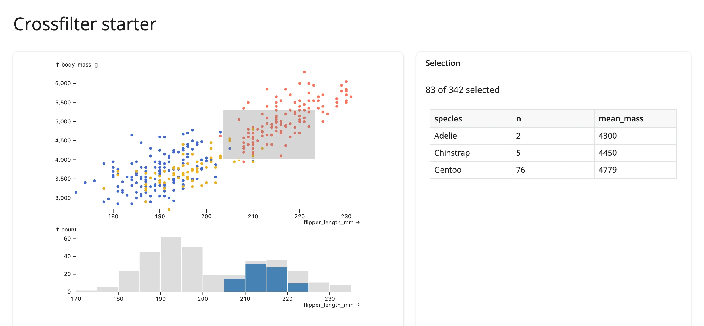

[`gallery/template_crossfilter_starter.py`](gallery/template_crossfilter_starter.py) --
`uv run --no-sync shiny run docs/widget-guides/mosaic/gallery/template_crossfilter_starter.py`

### Showcase: 2 million flights, crossfiltered live

A raster density plot, a histogram, and a carrier toggle all crossfilter each other over 2 million synthetic
rows, with value boxes and a per-carrier table recomputed in DuckDB on every brush. Demonstrates that Mosaic's
query-per-brush design keeps scale off the browser's plate -- the brush below took the selection from 2,000,000
rows (28% on time, 7.8 min average delay) to 1,627 rows in a specific hour/delay window, with no perceptible lag.

| Unfiltered | Brushed |
|---|---|
|  | 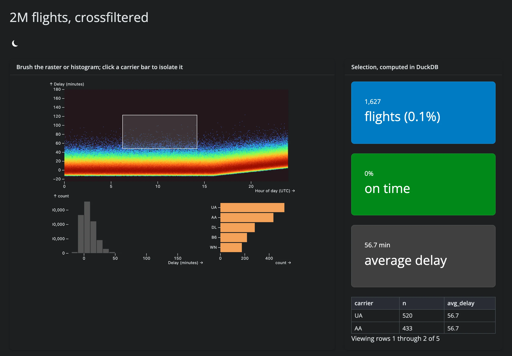 |

[`gallery/showcase_flight_delays.py`](gallery/showcase_flight_delays.py) --
`uv run --no-sync shiny run docs/widget-guides/mosaic/gallery/showcase_flight_delays.py`

## Learn more

- [Mosaic documentation](https://idl.uw.edu/mosaic/) -- the specification format, the full mark and input
  catalog, and the selection/param model this guide only summarizes.
- [Mosaic vgplot](https://idl.uw.edu/mosaic/vgplot/) -- a higher-level, grammar-of-graphics API that compiles to
  the same spec dicts used here (`MosaicWidget(view)` accepts a vgplot `View` directly).
- `shinywidgets/_mosaic_widget.py` and `shinywidgets/_render_widget.py` (`render_mosaic_widget`) -- the renderer
  and accessor source, including the full connection-sharing docstring.
- [quak](../quak/index.md) -- a DuckDB-backed data table without Mosaic's chart grammar.
- [lonboard](../lonboard/index.md) -- the map library paired with Mosaic above.
