[NGLView](https://nglviewer.org/nglview/latest/) is a Python wrapper around [NGL](https://nglviewer.org/ngl/),
a WebGL viewer for macromolecular structures built and maintained by Alexander Rose and the NGL/nglview
community. It's the viewer behind a large share of structural-biology notebooks: it renders cartoons, surfaces,
ball-and-stick and space-filling representations of proteins, nucleic acids and small molecules, colors them by
any of NGL's built-in or custom schemes, and -- uniquely among the widgets in this roster -- plays back
molecular-dynamics trajectories frame by frame, streaming only the changed atom coordinates to the browser.

`@render_nglview` accepts an `nglview.NGLWidget`, most often built with `nglview.show_file()`, `show_text()`,
`show_url()`, or a trajectory loader like `show_mdtraj()`. It applies shinywidgets' layout defaults (the
viewer fills its container unless the widget has its own height), and it quietly works around two upstream
rough edges so the integration is safe to use inside Shiny's render-per-session model: every `NGLWidget` starts
background threads that poll forever in a notebook, and shinywidgets stops them when the widget closes instead
of leaking a pair per re-render; and nglview constructs a process-global color-scheme registry at import time,
which shinywidgets exempts from Shiny's "no widgets outside a session" rule the same way it does for lonboard.

NGLView has no curated reactive accessors -- the single most useful piece of interaction, clicking an atom, is
a synced widget trait you read with `structure.read("picked")` (the generic trait-reading primitive every
output has), exactly like reading `"zoom"` on an `ipyleaflet.Map` output that also has no accessor for it.
That's enough to build real linked views: a click gives you a full atom record (residue, chain, element,
coordinates, B-factor) to drive a detail card or highlight, and setting `.widget.frame` streams a trajectory
into any plot you build alongside it. Choose NGLView when the subject is a real molecular structure or
trajectory; for generic
3D scenes (meshes, point clouds, custom geometry) see [k3d](../k3d/index.md), [ipyvolume](../ipyvolume/index.md),
or [pythreejs](../pythreejs/index.md), and for 2D chemistry (molecule grids, substructure search) see
[mols2grid](../mols2grid/index.md).

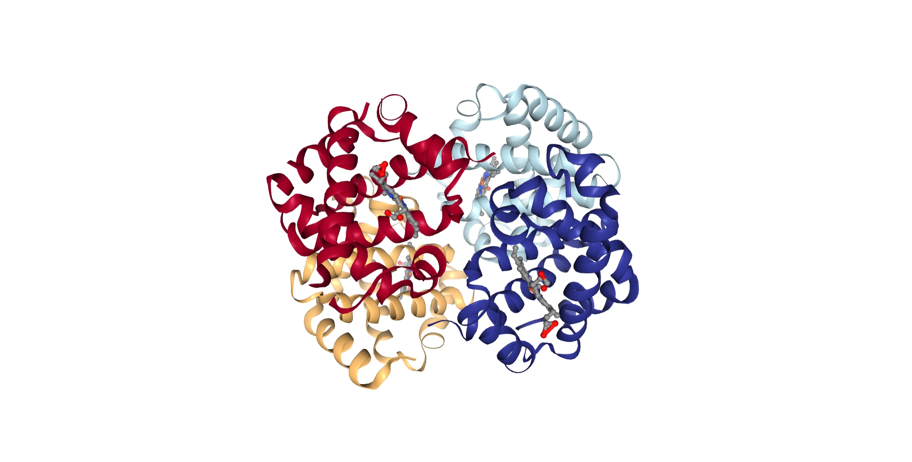

## Installation

```sh
pip install 'shinywidgets[nglview]'
```

This installs nglview itself (an sdist that builds from source; it also pulls in `notebook`/`jupyterlab` as
dependencies, which only matters for install time, not for a Shiny app). Loading a trajectory additionally needs
a structure/trajectory backend such as [MDTraj](https://www.mdtraj.org) (`pip install mdtraj`) or
[MDAnalysis](https://www.mdanalysis.org); the trajectory examples below use MDTraj.

## Quick start

`nglview.show_file()` (or `show_text()`, `show_url()`, `show_structure_file()`) builds an `NGLWidget` with a
default cartoon representation. Nothing else is required -- the viewer fills its card like any other
shinywidgets output.

```{.python file="examples/01_quickstart.py"}
import nglview
from shiny.express import ui
from shinywidgets import render_nglview

ui.page_opts(fillable=True)

with ui.card(full_screen=True):
    ui.card_header("Rhodopsin (PDB 1U19)")

    @render_nglview
    def structure():
        # nglview ships a few structures for examples/tests; no network needed
        view = nglview.show_file(nglview.datafiles.PDB)
        view.center()
        view.control.zoom(0.3)
        return view
```

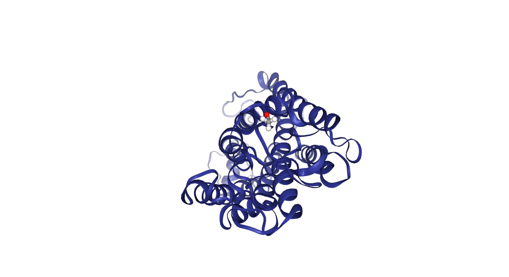

## What you can build

### Any structure source, local or remote

`show_file()`/`show_text()`/`show_structure_file()` read on the server. `show_url()` instead queues a `loadFile`
call that the *browser* fetches directly -- the server never downloads the structure, which matters for a
multi-user Shiny app. Avoid `nglview.show_pdbid()`: it calls `urlopen()` synchronously inside the render
function, blocking that worker's event loop (every session) until the download finishes.

```{.python file="examples/02_sources.py"}
import nglview
from shiny.express import input, ui
from shinywidgets import render_nglview

ui.page_opts(fillable=True)

ui.input_select(
    "source",
    "Structure source",
    {
        "bundled": "Bundled file (nglview.datafiles.PDB, no network)",
        "rcsb": "Fetched by the browser from RCSB (4HHB, hemoglobin)",
    },
)

with ui.card(full_screen=True):

    @render_nglview
    def structure():
        if input.source() == "bundled":
            # Read on the server; good for files you already have locally
            return nglview.show_file(nglview.datafiles.PDB)
        # show_url() queues a loadFile the *browser* fetches directly, so the
        # server never downloads the structure. Prefer this (or show_file/
        # show_text) over show_pdbid(), which blocks the server on urlopen().
        return nglview.show_url("https://files.rcsb.org/download/4HHB.cif")
```

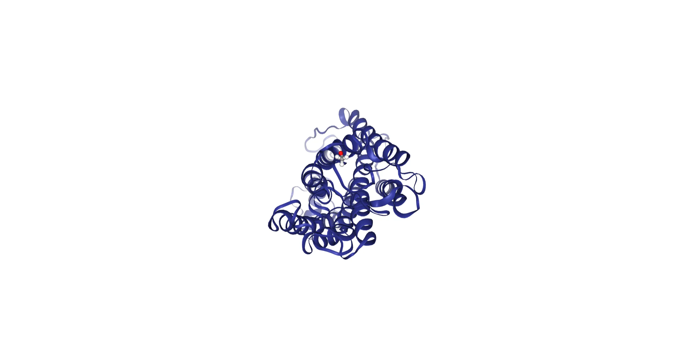

Switching to the RCSB-hosted option fetches live from `files.rcsb.org` and renders hemoglobin's four chains:


### Representations and coloring, restyled in place

NGL separates *what's drawn* (representation: cartoon, licorice, spacefill, surface, ...) from *how it's
colored* (scheme: by residue index, chain, B-factor, hydrophobicity, a custom scheme, ...). Changing either from
a `@reactive.effect` that mutates `.widget` restyles the live viewer -- no re-render, so the user's camera
position survives (see [Updating the widget from Python](#updating-the-widget-from-python)).

```{.python file="examples/03_representations.py"}
import nglview
from shiny import reactive
from shiny.express import input, ui
from shinywidgets import render_nglview

ui.page_opts(fillable=True)

REPRESENTATIONS = ["cartoon", "licorice", "spacefill", "surface"]
COLOR_SCHEMES = ["residueindex", "chainindex", "bfactor", "hydrophobicity"]

with ui.sidebar():
    ui.input_select("representation", "Representation", REPRESENTATIONS)
    ui.input_select("color_scheme", "Color scheme", COLOR_SCHEMES)

with ui.card(full_screen=True):

    @render_nglview
    def structure():
        view = nglview.show_file(
            nglview.datafiles.PDB, default_representation=False
        )
        view.add_representation("cartoon", color_scheme="residueindex")
        view.center()
        return view

    # Restyle the already-rendered viewer in place instead of re-rendering:
    # the camera position and zoom survive, and the structure file isn't
    # re-sent to the browser
    @reactive.effect
    def _restyle():
        view = structure.widget
        if view is None:
            return
        view.clear_representations()
        view.add_representation(
            input.representation(), color_scheme=input.color_scheme()
        )
```

| Cartoon, by residue index | Surface, by hydrophobicity |
|---|---|
| 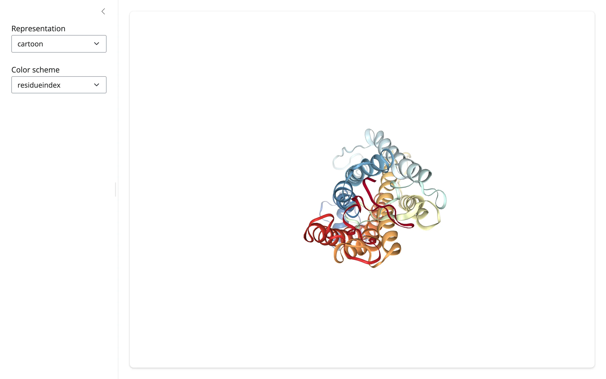 | 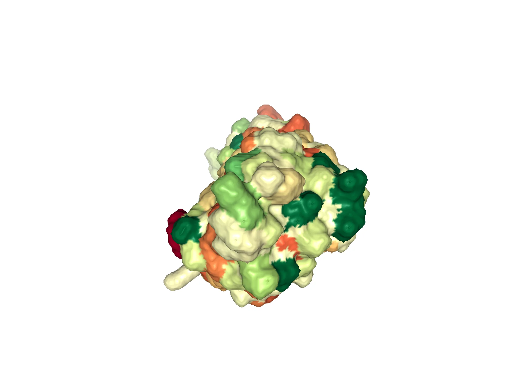 |

### Selection language: highlight what you choose in Shiny

NGL's [selection language](https://nglviewer.org/ngl/api/manual/selection-language.html) picks out atoms by
residue number (`"262"`), range (`"260-265"`), residue name (`"LRT"`), or keyword (`"protein"`, `"hetero"`).
Giving a highlight its own representation type (here, `spacefill`, distinct from the base `cartoon`) means
`remove_spacefill()` clears only the highlight.

```{.python file="examples/04_selection_highlight.py"}
import nglview
from shiny import reactive
from shiny.express import input, ui
from shinywidgets import render_nglview

ui.page_opts(fillable=True)

ui.input_slider("residues", "Highlight residues", min=1, max=348, value=(260, 265))

with ui.card(full_screen=True):
    ui.card_header("Rhodopsin (1U19): highlight a residue range")

    @render_nglview
    def structure():
        view = nglview.show_file(
            nglview.datafiles.PDB, default_representation=False
        )
        view.add_representation("cartoon", color="lightgrey")
        view.center()
        return view

    # NGL's selection language ("262", "260-265", "LRT", "protein", ...) picks
    # out atoms by residue number, name, or keyword. A distinct representation
    # type (spacefill) for the highlight means remove_spacefill() only clears
    # it, leaving the cartoon representation untouched.
    @reactive.effect
    def _highlight():
        view = structure.widget
        if view is None:
            return
        lo, hi = input.residues()
        view.remove_spacefill()
        view.add_representation("spacefill", selection=f"{lo}-{hi}", color="red")
```

| Residues 260-265 | Residues ~35-45 |
|---|---|
| 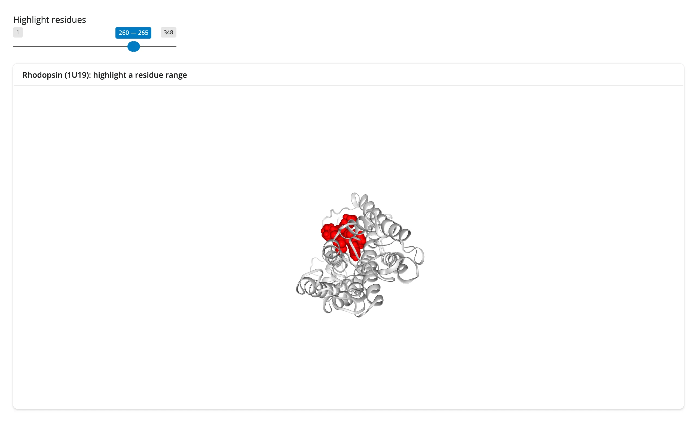 | 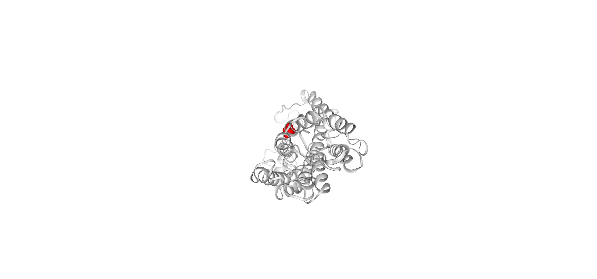 |

### Trajectory playback

`show_mdtraj()` (or `show_mdanalysis()`, `show_simpletraj()`) loads every frame's coordinates once; after that,
setting `.widget.frame` streams just the new positions, so a Shiny slider with `animate=True` turns into a
scrubbable molecular-dynamics movie.

```{.python file="examples/05_trajectory_playback.py"}
# Needs mdtraj to load the bundled trajectory: `uv run --with mdtraj shiny run ...`
# (or `pip install mdtraj`; MDAnalysis works too, via nglview.show_mdanalysis()).
import mdtraj
import nglview
from shiny import reactive
from shiny.express import input, ui
from shinywidgets import render_nglview

ui.page_opts(fillable=True)

# A bundled 1 ns rhodopsin trajectory, 51 frames, 20 ps apart
traj = mdtraj.load(nglview.datafiles.XTC, top=nglview.datafiles.PDB)

ui.input_slider("frame", "Frame", min=0, max=traj.n_frames - 1, value=0, animate=True)

with ui.card(full_screen=True):

    @render_nglview
    def structure():
        return nglview.show_mdtraj(traj)

    # `frame` is a synced trait: setting it in place sends only the new
    # coordinates, not the whole structure again
    @reactive.effect
    def _scrub():
        view = structure.widget
        if view is not None:
            view.frame = input.frame()
```

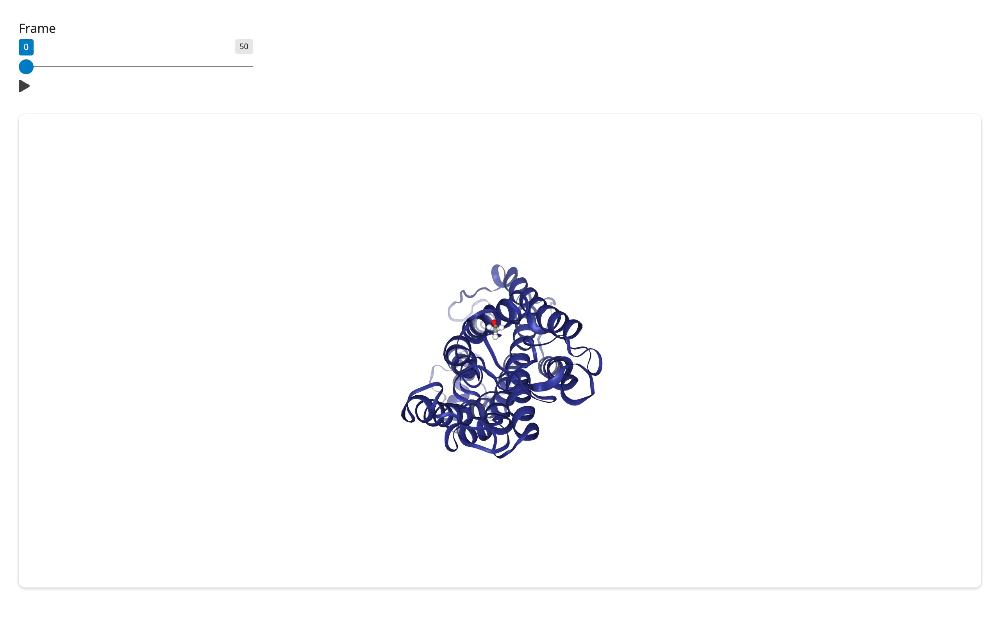

## Reacting to user interaction

### Accessor reference

`render_nglview` declares no curated accessors (confirmed by reading `_render_widget.py`: unlike `render_plotly`
or `render_lonboard`, its class body is just a docstring). The traits below live on the rendered `NGLWidget`
itself, so read them with `structure.read("trait")` -- every output's generic trait-by-name reader, which falls
through to `reactive_read()` on `.widget` under the hood. It's the same tier used for any renderer's
un-curated traits; reach for plain `reactive_read(obj, "trait")` instead only when the trait lives on a
*different* widget than the one the renderer returns (there's no such case in this guide -- nglview has no
child widgets with traits worth reading).

| trait | returns | fires when | starting value | notes |
|---|---|---|---|---|
| `"picked"` | `dict` | the user clicks the viewer | `{}` | `{}` on every click too, briefly, before the atom record (see below); `{}` again if nothing is hit |
| `"frame"` | `int` | `.widget.frame` is set, from Python *or* synced back from a displayed `_iplayer`/GUI player | the render function's initial value (usually `0`) | also settable from Python to drive playback |
| `"_camera_orientation"` | `list[float]` (16, a 4x4 matrix) | the user drags/scrolls/pans, debounced ~100 ms by NGL's own JS | `[]` until first move | private (leading underscore) but stable; used internally for multi-view camera sync |

### `picked`: click an atom

A click fires `picked` twice: once with `{}` immediately (NGL clears the previous pick before raising the new
one), then with the real record. Verified by logging every change server-side: a single click on an atom
produced `PICKED_EVENT: {}` followed by `PICKED_EVENT: {'atom1': {...}, 'component': 0}`. Code that reads
`picked` should treat `{}` as "nothing (yet)", which `picked.get("atom1")` does naturally. The atom record has
`resname`, `resno`, `chainname`, `atomname`, `element`, `bfactor`, `x`/`y`/`z`, `index`, `serial`, and `name` (a
composed label like `"[ASN]302:B.CA"`). Clicking empty space resets `picked` to `{}` too, so there's no separate
"deselect" case to handle.

This example also highlights the clicked residue in place, combining the click-driven read with an in-place
representation change:

```{.python file="examples/06_click_atom_highlight.py"}
import nglview
from shiny import reactive
from shiny.express import render, ui
from shinywidgets import render_nglview

ui.page_opts(fillable=True)

with ui.layout_columns(col_widths=[8, 4]):
    with ui.card(full_screen=True):

        @render_nglview
        def structure():
            view = nglview.show_file(
                nglview.datafiles.PDB, default_representation=False
            )
            view.add_representation("cartoon", color="lightgrey")
            view.add_representation("ball+stick", selection="hetero")
            view.center()
            return view

    with ui.card():
        ui.card_header("Picked atom")

        @render.text
        def atom_info():
            picked = structure.read("picked")
            atom = picked.get("atom1") if picked else None
            if atom is None:
                return "Click an atom in the structure."
            return (
                f"{atom['resname']} {atom['resno']} chain {atom['chainname']}\n"
                f"atom: {atom['atomname']} (element {atom['element']})\n"
                f"b-factor: {atom['bfactor']:.1f}"
            )

    # Highlight the clicked residue in place, on top of the cartoon
    @reactive.effect
    def _highlight_picked():
        view = structure.widget
        if view is None:
            return
        picked = structure.read("picked")
        atom = picked.get("atom1") if picked else None
        view.remove_spacefill()
        if atom is not None:
            view.add_representation(
                "spacefill", selection=str(atom["resno"]), color="orange"
            )
```

| Before clicking | After clicking an atom |
|---|---|
| 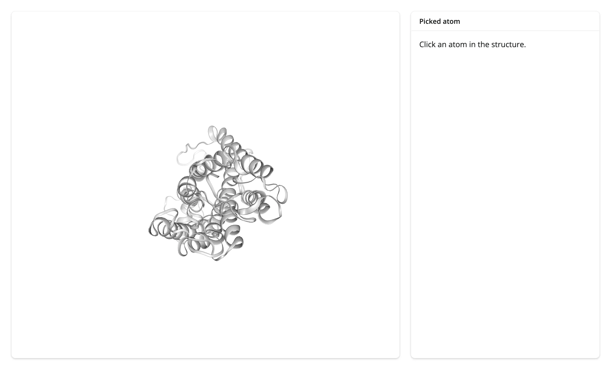 | 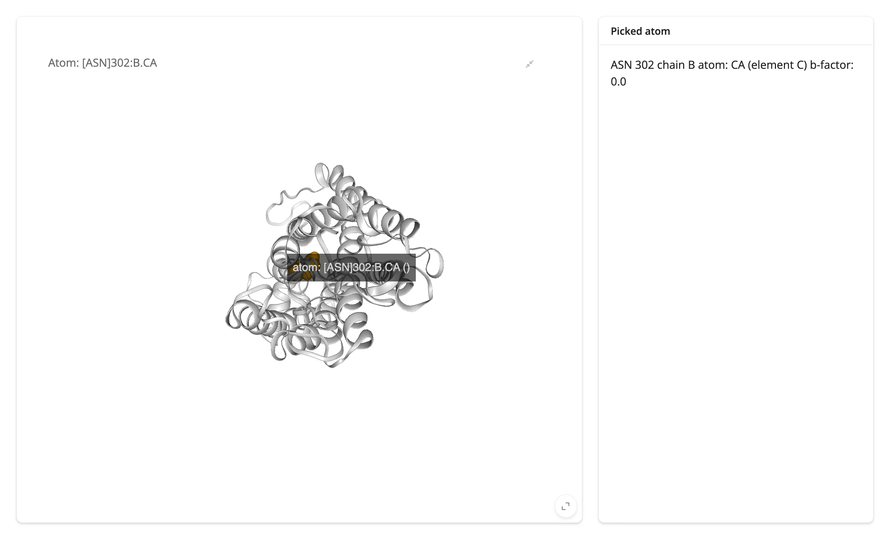 |

### `frame`: scrub or stream a trajectory

Setting `.widget.frame` from Python (as in the playback example above) is the common direction. It's also
readable with `structure.read("frame")`, which matters when something *other* than your own code might move it
-- nglview's constructor always builds a `Play`/`IntSlider` pair (`.widget._iplayer`) linked to `frame` via
`ipywidgets.jslink`; if an app displays that player, dragging it updates `frame` in the browser, and
`structure.read("frame")` sees it exactly like any other synced trait. The
[trajectory + RMSD example](#coordinating-multiple-views) below reads `frame` indirectly, through a shared
`reactive.value` that both a Shiny slider and a plot click can set.

### `_camera_orientation`: camera state after a drag

Dragging to rotate, scrolling to zoom, and right-click-dragging to pan all update `_camera_orientation` -- a
flattened 4x4 matrix -- after NGL's own ~100 ms debounce. It's private API (and nglview's docs call camera
control "unstable"), but it's been stable across versions and is what nglview itself uses to sync cameras
between multiple linked views. Reach for it if you want to save/restore a view, or log what orientation a user
settled on.

```{.python file="examples/08_camera_orientation.py"}
import nglview
from shiny.express import render, ui
from shinywidgets import render_nglview

ui.page_opts(fillable=True)

with ui.layout_columns(col_widths=[8, 4]):
    with ui.card(full_screen=True):

        @render_nglview
        def structure():
            view = nglview.show_file(nglview.datafiles.PDB)
            view.center()
            return view

    with ui.card():
        ui.card_header("Camera orientation (drag to rotate)")

        @render.code
        def orientation():
            # A 4x4 matrix (16 floats), updated ~100ms after the user stops
            # dragging/scrolling/panning the view
            matrix = structure.read("_camera_orientation")
            return "\n".join(
                " ".join(f"{v: .2f}" for v in matrix[i : i + 4])
                for i in range(0, len(matrix), 4)
            )
```

| Before dragging | After dragging |
|---|---|
| 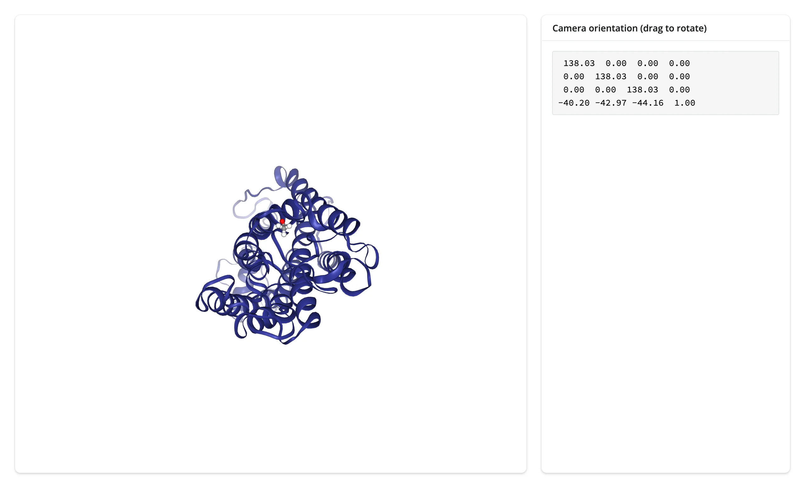 | 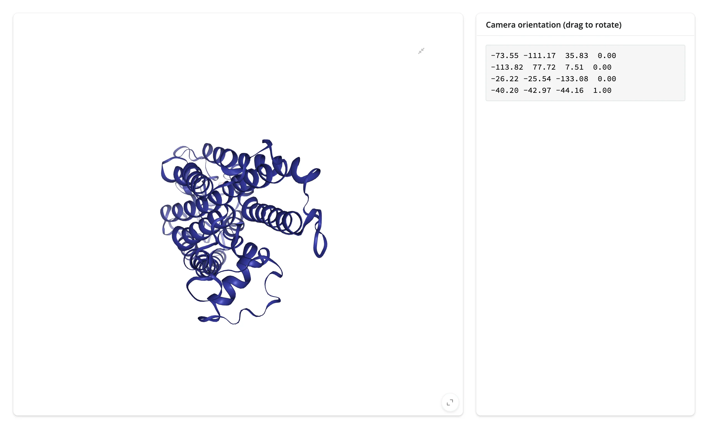 |

### Rate limiting

Neither `structure.read("trait")` nor plain `reactive_read()` is rate-limited on its own -- every change to the
trait invalidates your reactive context immediately, as many times as the browser reports a change
(`@render_nglview`'s own `rate_policy`/`rate_delay` kwargs apply here too, since `.read()` falls through to
`reactive_read()` under the hood). In practice this rarely matters
for NGLView: `picked` only changes on discrete clicks (twice per click, as noted above, not a stream); `frame`
changes once per slider step or trajectory tick; and the one truly continuous interaction, camera dragging,
already arrives pre-throttled from NGL's own JS at roughly 10 updates/second, not on every mouse-move event. If
you still want to throttle further (e.g. to avoid redrawing an expensive downstream plot on every camera
update), wrap the read in your own `@reactive.calc` and poll it, or debounce the *consuming* output rather than
the trait itself.

## Updating the widget from Python

Every example above restyles or scrubs `.widget` from a `@reactive.effect` rather than returning a new widget
from the render function. This matters more for NGLView than most widgets: a full re-render resets the camera
to NGL's default view, discarding any zoom, rotation, or pan the user has made, and re-sends the structure file
to the browser. An in-place change (`.widget.add_representation(...)`, `.widget.frame = ...`,
`.widget.clear_representations()`) keeps the camera exactly where the user left it and sends only the small
message the change requires -- even though nglview makes many of these calls from its own background thread
rather than the main one (confirmed working on current `main`; this needs `shiny>=1.9`, which is
shinywidgets' own minimum pinned version, so it's automatic, not something to configure).

```{.python file="examples/09_inplace_vs_rerender.py"}
import nglview
from shiny import reactive
from shiny.express import input, ui
from shinywidgets import render_nglview

ui.page_opts(fillable=True)

ui.input_action_button("restyle", "Restyle in place (keeps camera)")
ui.input_action_button("rerender", "Rerender (resets camera)")

rerender_count = reactive.value(0)

with ui.card(full_screen=True):

    @render_nglview
    def structure():
        rerender_count()  # a dependency here forces a full rebuild on "Rerender"
        view = nglview.show_file(nglview.datafiles.PDB, default_representation=False)
        view.add_representation("cartoon", color="lightgrey")
        view.center()
        return view

    @reactive.effect
    @reactive.event(input.rerender)
    def _force_rerender():
        rerender_count.set(rerender_count.get() + 1)

    # Changes representation without touching the render function, so the
    # camera (position, rotation, zoom) the user set by dragging is untouched
    @reactive.effect
    @reactive.event(input.restyle)
    def _restyle_in_place():
        view = structure.widget
        if view is not None:
            view.clear_representations()
            view.add_representation("surface", color="skyblue", opacity=0.6)
```

Drag to rotate, then restyle in place -- the camera holds:

| After dragging | After "Restyle in place" | After "Rerender" |
|---|---|---|
| 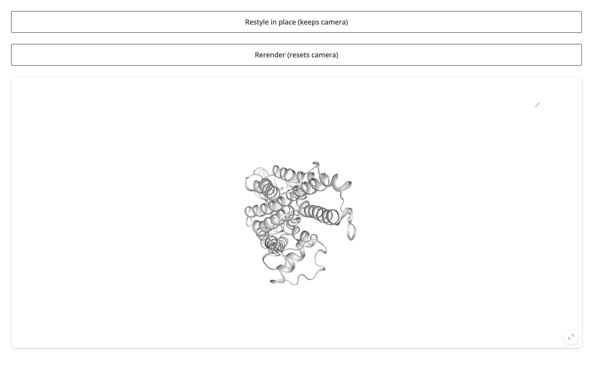 | 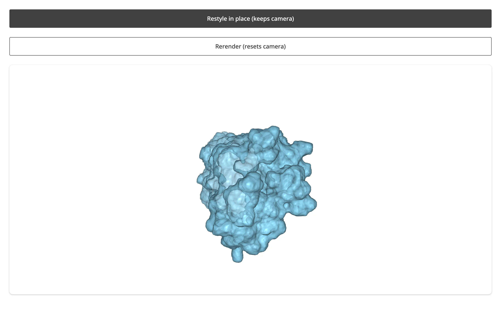 | 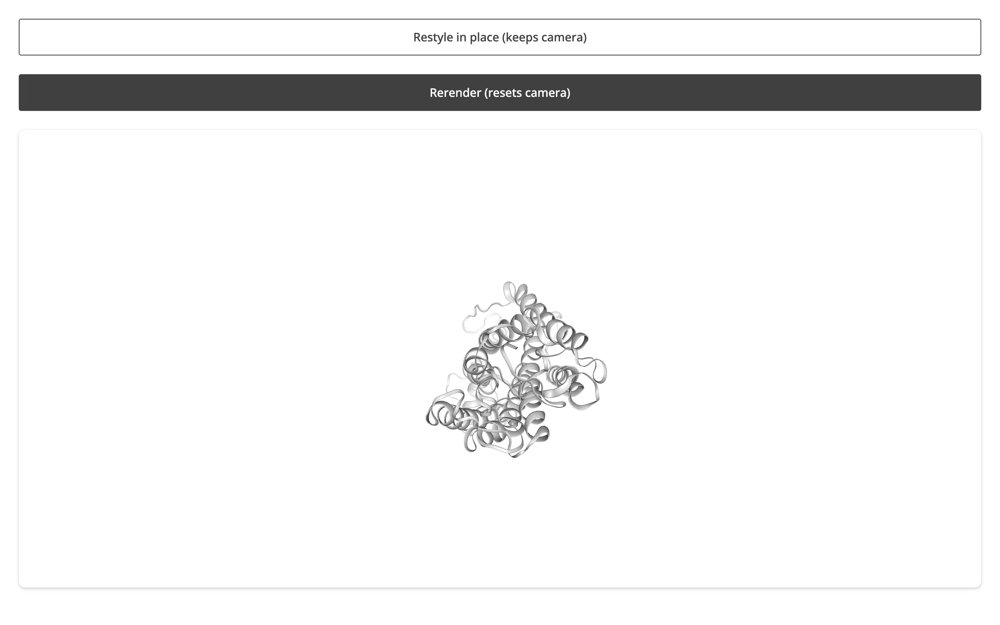 |

The rerender screenshot shows the camera snapped back to NGL's default centered view, and the representation
reset to the render function's own cartoon -- exactly the two things an in-place update preserves.

### Read on demand: log picks from a button

`structure.read("picked")` is live from the moment the viewer renders, not just from the moment something first
reads it -- so a button handler that fires long after the last click still sees it correctly, with no warm-up
read needed first. That makes "build a list as you go" patterns simple: click a few atoms, then log the ones
worth keeping.

```{.python file="examples/10_read_on_demand.py"}
import nglview
import pandas as pd
from shiny import reactive
from shiny.express import input, render, ui
from shinywidgets import render_nglview

ui.page_opts(fillable=True)

log = reactive.value(pd.DataFrame(columns=["resname", "resno", "chain"]))

with ui.layout_columns(col_widths=[7, 5]):
    with ui.card(full_screen=True):
        ui.card_header("Click an atom, then log it")

        @render_nglview
        def structure():
            view = nglview.show_file(
                nglview.datafiles.PDB, default_representation=False
            )
            view.add_representation("cartoon", color="lightgrey")
            view.add_representation("ball+stick", selection="hetero")
            view.center()
            return view

        ui.input_action_button("log", "Log current pick")

    with ui.card():
        ui.card_header("Logged residues")

        @render.data_frame
        def logged():
            return log.get()


# `picked` is live from the moment the viewer renders -- reading it here, in
# a button handler that may fire minutes after the last click, needs no
# warm-up read and never misses an interaction that happened before this
# ran.
@reactive.effect
@reactive.event(input.log)
def _log_pick():
    picked = structure.read("picked")
    atom = picked.get("atom1") if picked else None
    if atom is None:
        return
    row = {"resname": atom["resname"], "resno": atom["resno"], "chain": atom["chainname"]}
    with reactive.isolate():
        log.set(pd.concat([log.get(), pd.DataFrame([row])], ignore_index=True))
```

Click an atom, then click "Log current pick" -- the residue is appended to the table on the right:

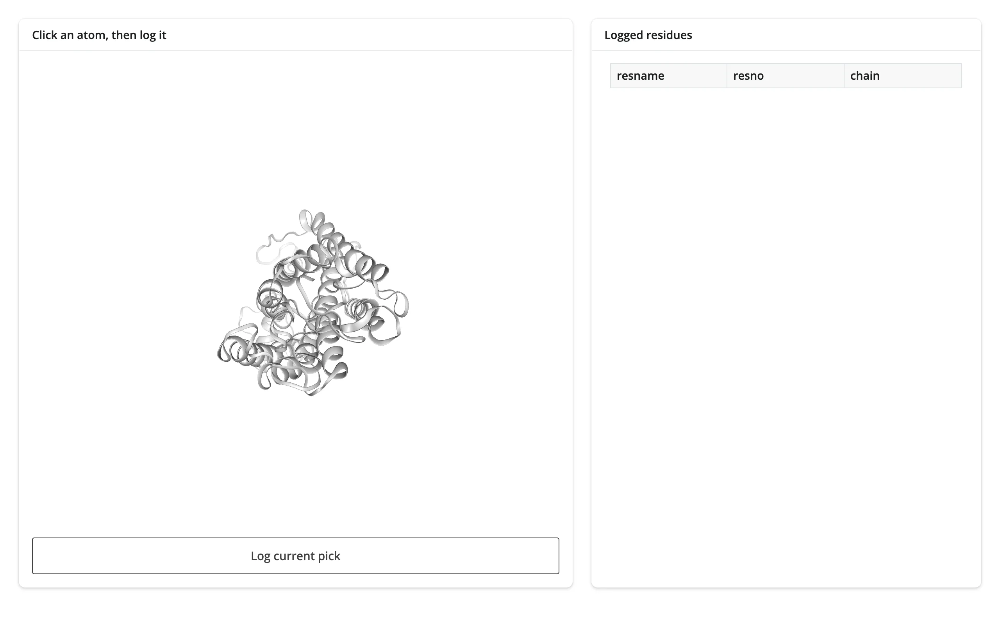
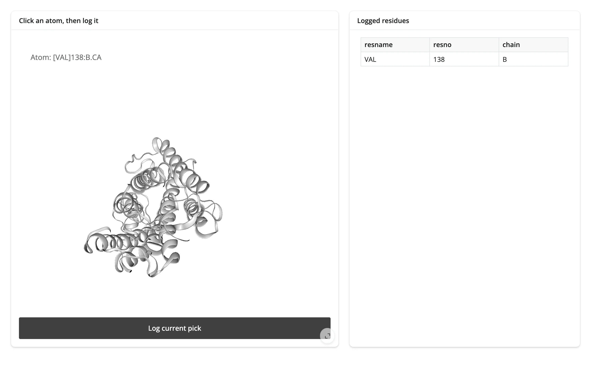

## Coordinating multiple views

**Click an atom, see it highlighted and described.** The [`picked` example](#picked-click-an-atom) above is
already a complete linked-view pattern: a click on the 3D viewer updates both a text card and a highlight
representation on the same widget, with no re-render.

**Scrub or click to move through a trajectory, with an RMSD chart along for the ride.** This is the richest
pattern NGLView supports: a Shiny slider and a [plotly](../plotly/index.md) chart's `clicked()` accessor both
drive one shared `reactive.value`, and three separate effects keep the viewer's frame, the chart's marker, and
the slider all in sync -- each one updating in place.

```{.python file="examples/07_trajectory_rmsd_linked.py"}
# Needs mdtraj to load the bundled trajectory: `uv run --with mdtraj shiny run ...`
import mdtraj
import nglview
import plotly.express as px
from shiny import reactive, req
from shiny.express import input, ui
from shinywidgets import render_nglview, render_plotly

ui.page_opts(fillable=True)

# A bundled 1 ns rhodopsin trajectory, 51 frames, 20 ps apart
traj = mdtraj.load(nglview.datafiles.XTC, top=nglview.datafiles.PDB)
ca = traj.topology.select("name CA")
rmsd = mdtraj.rmsd(traj, traj, 0, atom_indices=ca)

current_frame = reactive.value(0)

with ui.layout_columns():
    with ui.card(full_screen=True):
        ui.card_header("Trajectory")

        @render_nglview
        def structure():
            return nglview.show_mdtraj(traj)

    with ui.card(full_screen=True):
        ui.card_header("RMSD to frame 0 (click a point to jump there)")

        @render_plotly
        def rmsd_plot():
            with reactive.isolate():
                start = current_frame.get()
            fig = px.line(
                x=list(range(len(rmsd))), y=rmsd, markers=True,
                labels={"x": "Frame", "y": "C-alpha RMSD (nm)"},
            )
            fig.add_vline(x=start, line_dash="dash", line_color="orange")
            return fig

ui.input_slider("frame", "Frame", min=0, max=traj.n_frames - 1, value=0, animate=True)


# The slider drives the shared frame value ...
@reactive.effect
def _slider_to_frame():
    current_frame.set(input.frame())


# ... and so does clicking a point on the RMSD plot, via plotly's clicked()
# accessor, keeping the slider in sync
@reactive.effect
def _chart_to_frame():
    pts = rmsd_plot.clicked()
    req(pts is not None)
    frame = int(pts["x"].iloc[0])
    current_frame.set(frame)
    ui.update_slider("frame", value=frame)


# Both the viewer and the plot's marker update in place: no re-render, so
# zoom/selection on the plot and the camera on the viewer are preserved
@reactive.effect
def _move_viewer():
    view = structure.widget
    if view is not None:
        view.frame = current_frame()


@reactive.effect
def _move_marker():
    fig = rmsd_plot.widget
    if fig is not None:
        frame = current_frame()
        with fig.batch_update():
            fig.layout.shapes[0].x0 = frame
            fig.layout.shapes[0].x1 = frame
```

Starting state, then after clicking the RMSD peak near frame 40 -- the marker, the slider, and the 3D
conformation all moved together:

| Initial (frame 0) | After clicking frame 40 on the chart |
|---|---|
| 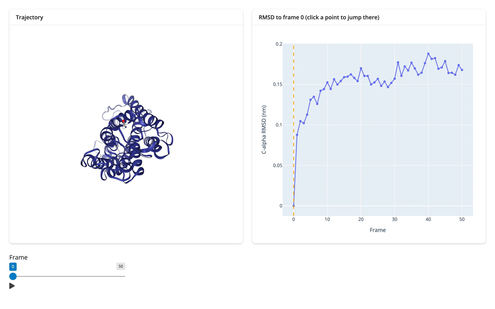 | 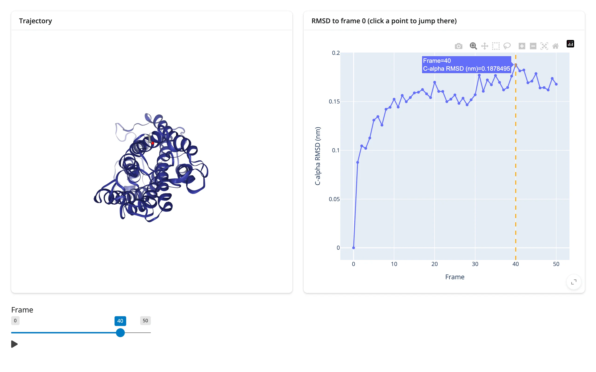 |

*Pairs with: [plotly](../plotly/index.md) (`clicked()` drives the frame; see also the
[matplotlib](../matplotlib/index.md) guide's similar `clicked()` accessor if you'd rather plot with ipympl).*

## Large data

NGL draws with the GPU (WebGL), the "draw it with the GPU in the browser" approach -- see
[Large data & performance's three approaches](../../guide/performance/index.md#three-approaches-to-large-data)
-- so a single large assembly's rendering cost is NGL's own (see the
[upstream NGL docs](https://nglviewer.org/ngl/) for per-representation scale guidance; not re-measured here).
The scale question this guide actually verified is trajectories: `show_mdtraj()` loads every frame's coordinates
once, and after that, scrubbing with `.widget.frame` (see ["Trajectory playback"](#trajectory-playback) above)
streams only the new frame's positions -- not the whole structure again -- so long trajectories stay cheap to
scrub once loaded.

## Layout and sizing

The viewer fills its container by default -- a `ui.card(full_screen=True)`, a sidebar, a column -- and tracks
width (and height, if nothing claims it) as the container resizes, including on `full_screen` enter/exit and
sidebar collapse. Three constructor-level overrides opt a viewer out of parts of that tracking, and shinywidgets
honors all of them, verified against the shipped `tests/playwright/render_nglview` suite plus this guide's own
examples:

- `NGLWidget(height=...)` (or `show_file(..., height=...)`): the viewer keeps that height and stops filling,
  but its width still tracks the container.
- `NGLWidget(width=...)`: the viewer keeps that width regardless of the container's size.
- `widget.layout = Layout(width=..., height=...)`: both dimensions are pinned to the `Layout`, applied once
  ipywidgets attaches the styles to the view (which happens slightly after display, so the stage resizes a
  moment later).

For an explicit pixel size on the *output* instead of the widget, use `output_widget("id", height="400px")` as
with any shinywidgets renderer.

## Gotchas and limitations

Verified on current `main` (shiny 1.9.0, nglview 4.0.1):

- **The NGL GUI (`view.gui_style = "ngl"`) renders unstyled.** Its theme CSS ships as a separate file
  (`nglview/theme/{light,main}.css`) that a notebook loads implicitly; Shiny never does, so the panel shows as
  stacked, unstyled HTML (verified with a screenshot). You can inject the CSS yourself with
  `ui.head_content(ui.tags.style(...))`, but `main.css` restyles page-wide elements (links, range inputs), so
  shinywidgets doesn't do this for you automatically. For an in-app GUI, build your own Shiny inputs instead (as
  every example in this guide does).
- **`show_file(..., gui=True)` does nothing.** The stored flag is read nowhere in nglview; set
  `view.gui_style = "ngl"` instead.
- **`nglview.show_pdbid()` blocks the server.** It calls `urlopen()` synchronously inside widget construction,
  stalling every session's event loop for the download. Use `show_url()` (browser-side fetch) or `show_file()`/
  `show_text()` (server-side, but local/fast) instead.
- **A click on empty space, or on a representation with no underlying atoms (e.g. an undecorated surface
  patch), resets `picked` to `{}` rather than leaving the previous pick in place.** Code reading `picked` across
  multiple clicks should not assume monotonic state.
- **Two prior releases' issues are now fixed on `main` and don't need workarounds**: nglview's background
  "remote call" threads (two per `NGLWidget`, polling forever) are stopped when shinywidgets retires or closes
  the widget, so repeated re-renders don't leak threads; and in-place method calls made from nglview's
  background thread (e.g. `add_representation()` right after construction) are delivered promptly rather than
  waiting for an unrelated input, because shinywidgets requires `shiny>=1.9`.

## Gallery candidates

**`template_structure_explorer.py`** -- a compact starting point: pick a representation and color scheme,
click an atom for its residue/chain/element, all on nglview's bundled rhodopsin structure (no network).

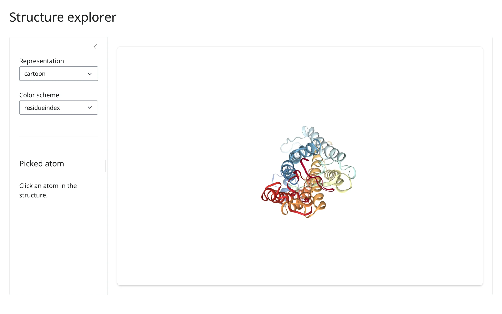

**`showcase_md_explorer.py`** -- "Rhodopsin in motion": the full trajectory + RMSD linked-view pattern from
above, plus representation switching and a residue-range highlight, combined into one MD trajectory explorer.

| Initial | After scrubbing to frame 30 and clicking an atom |
|---|---|
| 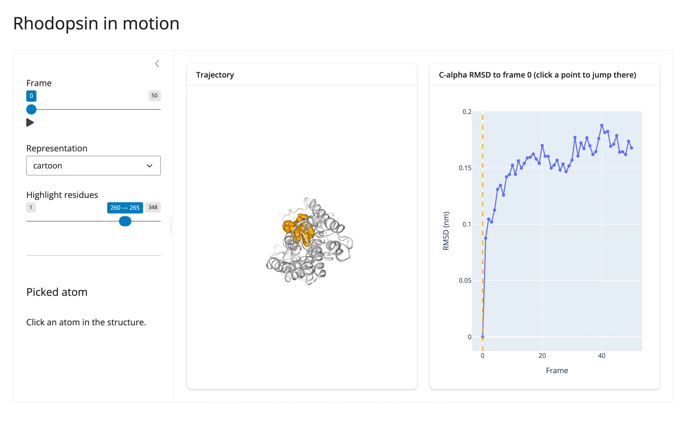 | 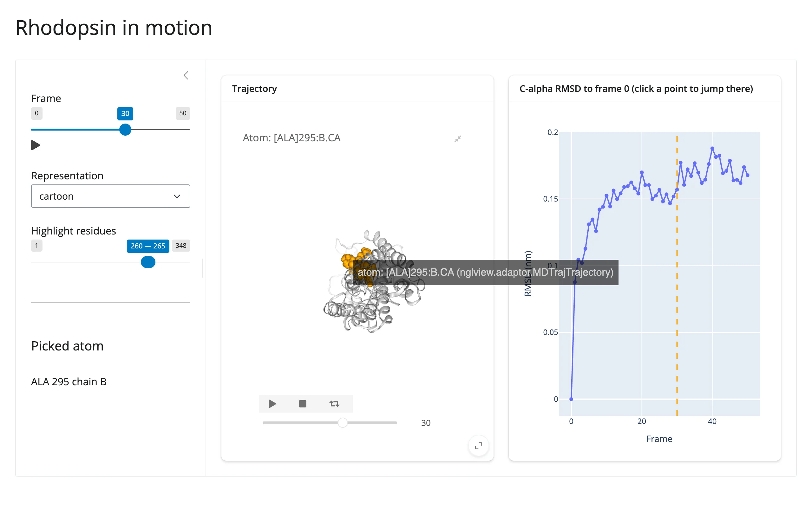 |

## Learn more

- [nglview documentation](https://nglviewer.org/nglview/latest/) and its
  [API reference](https://nglviewer.org/nglview/latest/api.html)
- [NGL selection language](https://nglviewer.org/ngl/api/manual/selection-language.html)
- [NGL molecular representations](https://nglviewer.org/ngl/api/manual/usage/molecular-representations.html)
- Related guides in this roster: [plotly](../plotly/index.md) (used here for the RMSD chart),
  [mols2grid](../mols2grid/index.md) (2D chemistry), [k3d](../k3d/index.md) /
  [ipyvolume](../ipyvolume/index.md) / [pythreejs](../pythreejs/index.md) (general-purpose 3D)
