[NiiVue](https://niivue.com) is a WebGL2 viewer for medical and neuroimaging data, built and maintained by Chris
Rorden's lab (University of South Carolina) and used across the neuroimaging community for displaying NIfTI and
DICOM volumes, statistical overlays, and cortical surface meshes. It renders axial/coronal/sagittal slices, a
multiplanar grid, and a full 3D volume render from the same data, all in the browser with no server-side image
processing. [ipyniivue](https://github.com/niivue/ipyniivue) is the official Python/anywidget wrapper that
shinywidgets builds on.

`render_niivue` takes a function that returns a configured `ipyniivue.NiiVue` instance (volumes and/or meshes
already loaded) and handles the Shiny-specific plumbing: the canvas tracks its container's size, including
`full_screen` and fill layouts, so you don't hand-tune pixel heights. The headline feature is `location()`, a
reactive accessor that reports the crosshair's position -- voxel indices, millimeter coordinates, and the
intensity under the cursor -- every time the user clicks or drags, so you can drive a readout, a linked plot, or
a table from wherever someone is looking in the scan.

Reach for NiiVue when your data is volumetric (NIfTI, DICOM, or a mesh) and you want slice/3D viewing with
real anatomical coordinates. For 3D scenes built from arbitrary geometry (points, meshes you construct yourself),
see [k3d](../k3d/index.md), [ipyvolume](../ipyvolume/index.md), or [pythreejs](../pythreejs/index.md) instead.

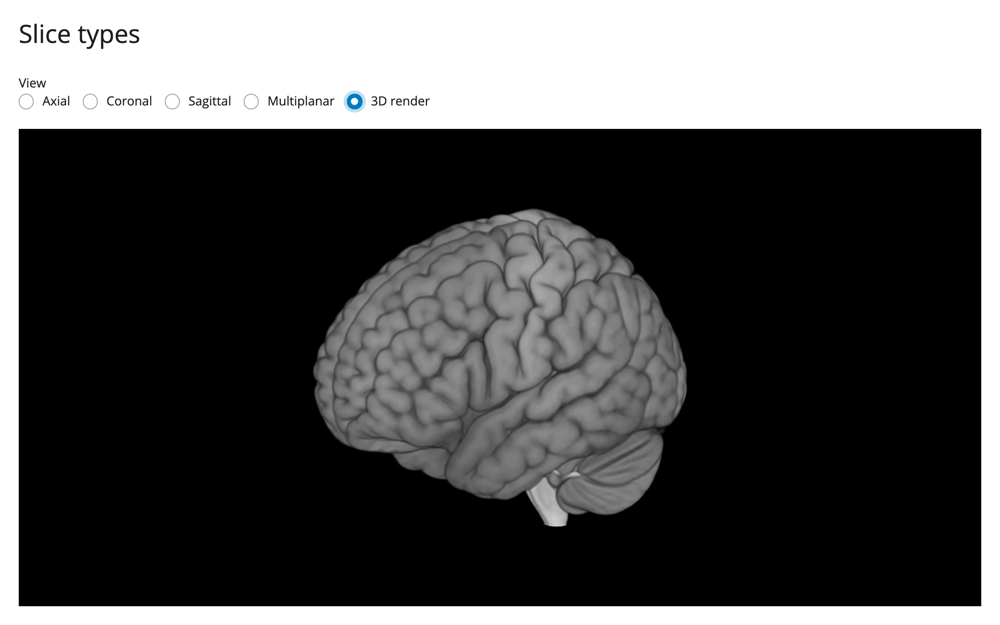

## Installation

```sh
pip install 'shinywidgets[niivue]'
```

This installs `ipyniivue`. A few recipes below also use
[`nibabel`](https://nipy.org/nibabel/) (`pip install nibabel`) to read or build NIfTI files on the Python side --
it's not required for `render_niivue` itself.

## Quick start

A minimal viewer of a public MNI152 template scan. NiiVue's demo images are plain HTTPS files; passing a URL means
the *browser* fetches the volume directly, so nothing is downloaded to your machine or re-encoded by Python.

```{.python file="examples/01_quickstart.py"}
from ipyniivue import NiiVue, Volume
from shiny.express import ui
from shinywidgets import render_niivue

ui.page_opts(title="NiiVue quickstart", fillable=True)


@render_niivue
def brain():
    nv = NiiVue()
    nv.load_volumes([Volume(url="https://niivue.com/demos/images/mni152.nii.gz")])
    return nv
```

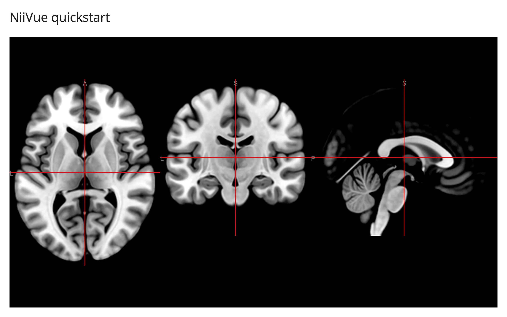

With no explicit height, NiiVue's default multiplanar layout picks axial/coronal/sagittal panes (or adds a 3D
render pane too, if the container is roomy enough) and adapts to the container's aspect ratio automatically.

## What you can build

### Every slice type, switched live

`set_slice_type` changes the view -- 2D axial/coronal/sagittal, a multiplanar grid, or a ray-cast 3D render --
without re-sending the volume.

```{.python file="examples/02_slice_types.py"}
from ipyniivue import NiiVue, SliceType, Volume
from shiny import reactive
from shiny.express import input, ui
from shinywidgets import render_niivue

SLICES = {
    "Axial": SliceType.AXIAL,
    "Coronal": SliceType.CORONAL,
    "Sagittal": SliceType.SAGITTAL,
    "Multiplanar": SliceType.MULTIPLANAR,
    "3D render": SliceType.RENDER,
}

ui.page_opts(title="Slice types", fillable=True)
ui.input_radio_buttons("view", "View", list(SLICES), selected="Multiplanar", inline=True)


@render_niivue
def brain():
    nv = NiiVue()
    nv.load_volumes([Volume(url="https://niivue.com/demos/images/mni152.nii.gz")])
    return nv


@reactive.effect
def _():
    brain.widget.set_slice_type(SLICES[input.view()])
```

| Multiplanar | 3D render |
|---|---|
| 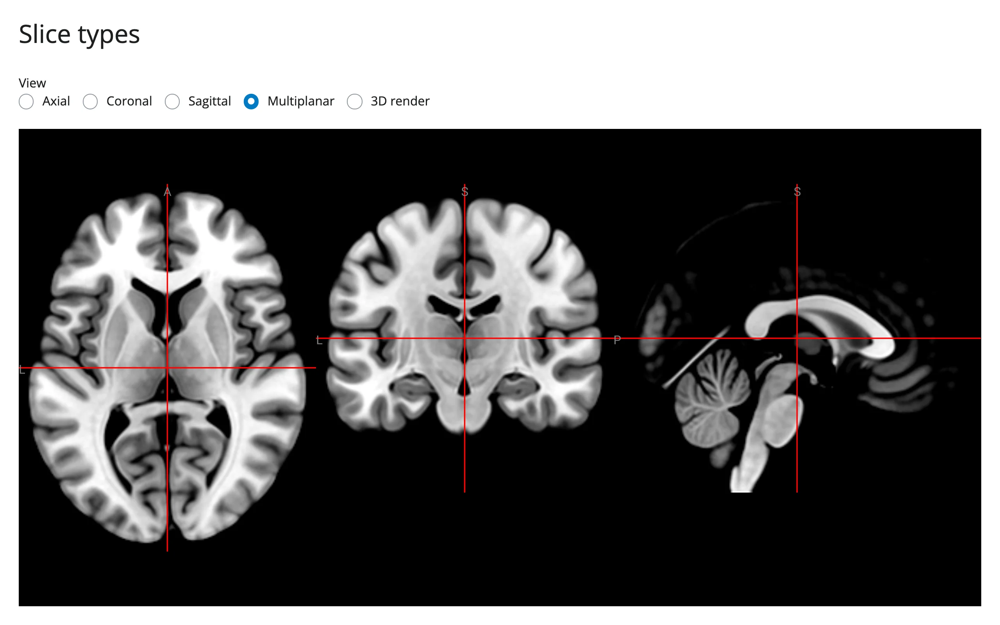 |  |

### Statistical overlays with live thresholds

A second `Volume` layered on top of the structural scan becomes a statistical overlay. `cal_min`/`cal_max` are the
display thresholds (the classic "only show `|z| > 2.3`" slider); setting them on the `Volume` object re-maps the
color scale instantly, with no re-render. The data here is an unthresholded group-level z-map from the
[NARPS](https://www.narps.info/) reproducibility study.

```{.python file="examples/03_stat_overlay.py"}
from ipyniivue import NiiVue, Volume
from shiny import reactive
from shiny.express import input, ui
from shinywidgets import render_niivue

ui.page_opts(title="Statistical overlay", fillable=True)
with ui.sidebar():
    ui.input_select("cmap", "Colormap", ["warm", "redyell", "winter", "actc"])
    ui.input_slider("thresh", "Threshold |z|", 0.0, 6.0, value=2.3, step=0.1)
    ui.input_slider("opacity", "Opacity", 0.0, 1.0, value=0.8, step=0.05)


@render_niivue
def brain():
    nv = NiiVue()
    nv.load_volumes(
        [
            Volume(url="https://niivue.com/demos/images/mni152.nii.gz"),
            Volume(
                url="https://niivue.com/demos/images/narps-4735_50GV-hypo1_unthresh.nii.gz",
                colormap="warm",
                cal_min=2.3,
                cal_max=6.0,
                opacity=0.8,
            ),
        ]
    )
    return nv


@reactive.effect
def _():
    overlay = brain.widget.volumes[1]
    brain.widget.set_colormap(overlay.id, input.cmap())
    overlay.cal_min = input.thresh()
    brain.widget.set_opacity(1, input.opacity())
```

| Threshold \|z\| = 2.3 | Threshold \|z\| = 4.0 |
|---|---|
| 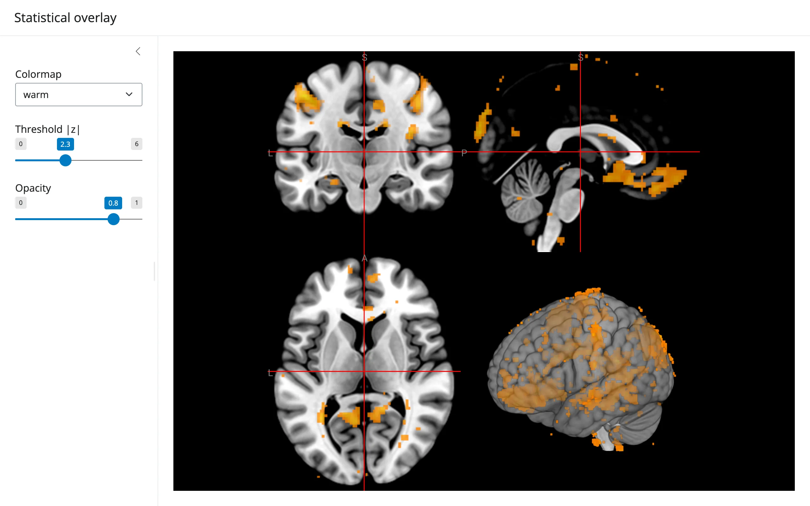 | 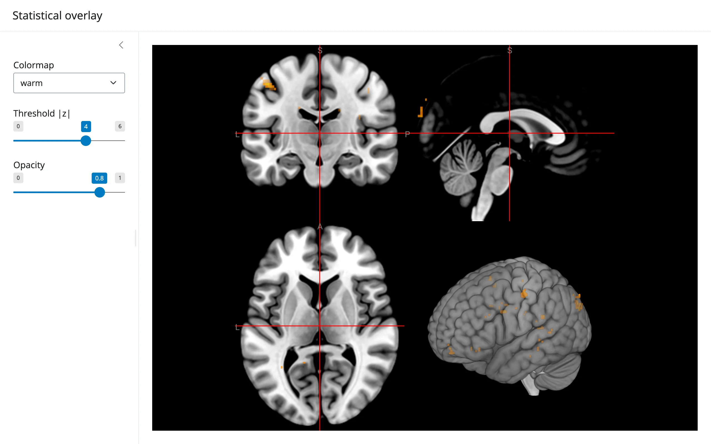 |

### Cortical surface meshes with a functional overlay

Meshes (`.mz3`, `.gii`, `.obj`, and more) render alongside or instead of volumes. A `MeshLayer` drapes a scalar
map (here, a motor-task activation map) on top of the surface.

```{.python file="examples/04_mesh.py"}
from ipyniivue import Mesh, MeshLayer, NiiVue
from shiny.express import ui
from shinywidgets import render_niivue

ui.page_opts(title="Cortical surface mesh", fillable=True)


@render_niivue
def brain():
    nv = NiiVue()
    nv.load_meshes(
        [
            Mesh(
                url="https://niivue.com/demos/images/BrainMesh_ICBM152.lh.mz3",
                rgba255=[200, 200, 200, 255],
                layers=[
                    MeshLayer(
                        url="https://niivue.com/demos/images/BrainMesh_ICBM152.lh.motor.mz3",
                        colormap="warm",
                        opacity=0.7,
                    )
                ],
            )
        ]
    )
    return nv
```

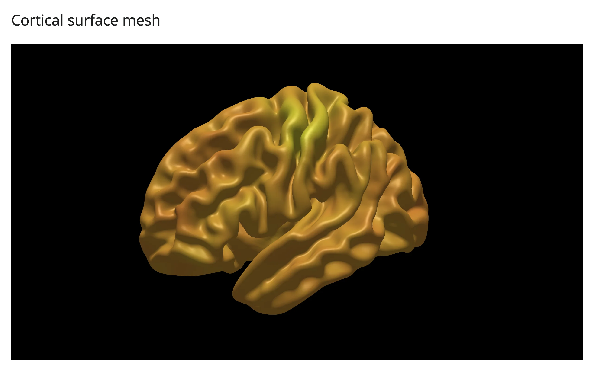

### Your own numpy array, three lines

Any 3D numpy array can become a volume: wrap it with `nibabel`, write it to an in-memory buffer, and hand the
bytes to `Volume(data=...)`. No file on disk, no server round trip beyond the initial render. `name=` is required
when using `data=` (NiiVue uses it to label the volume; there's no file path to infer one from).

```{.python file="examples/05_numpy_volume.py"}
from io import BytesIO

import nibabel as nib
import numpy as np
from ipyniivue import NiiVue, Volume
from shiny.express import ui
from shinywidgets import render_niivue

ui.page_opts(title="Volume from a numpy array", fillable=True)

# A smooth synthetic blob: a Gaussian bump off-center in a 64^3 volume.
grid = np.linspace(-1, 1, 64)
x, y, z = np.meshgrid(grid, grid, grid, indexing="ij")
data = np.exp(-(((x - 0.3) ** 2 + y**2 + (z + 0.2) ** 2) / 0.15)).astype(np.float32)

img = nib.Nifti1Image(data, affine=np.eye(4))
buffer = BytesIO()
img.to_file_map({"image": nib.FileHolder(fileobj=buffer)})


@render_niivue
def brain():
    nv = NiiVue()
    nv.load_volumes(
        [Volume(data=buffer.getvalue(), name="blob.nii", colormap="viridis")]
    )
    return nv
```

[`examples/05_numpy_volume.py`](examples/05_numpy_volume.py) (needs `nibabel`)

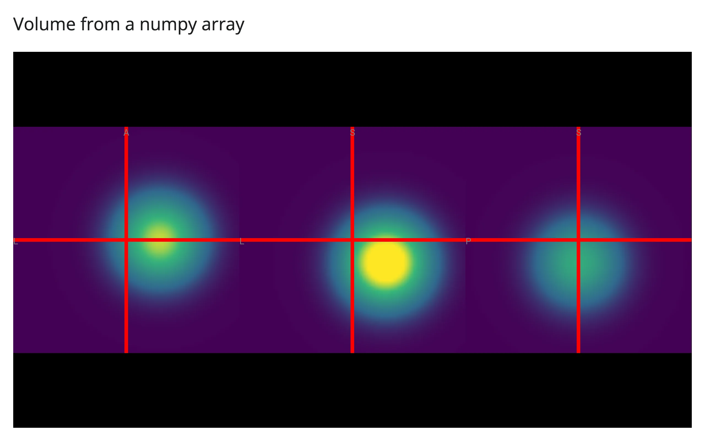

### 4D volumes

A 4D NIfTI (here, a perfusion MRI time series) carries a `frame_4d` trait on its `Volume`: set it to scrub through
frames in place.

```{.python file="examples/06_frame4d.py"}
from ipyniivue import NiiVue, Volume
from shiny import reactive
from shiny.express import input, ui
from shinywidgets import render_niivue

ui.page_opts(title="4D volume frames", fillable=True)
ui.input_slider("frame", "Frame", 0, 9, value=0)


@render_niivue
def brain():
    nv = NiiVue()
    nv.load_volumes([Volume(url="https://niivue.com/demos/images/pcasl.nii.gz")])
    return nv


@reactive.effect
def _():
    brain.widget.volumes[0].frame_4d = input.frame()
```

| Frame 0 | Frame 8 |
|---|---|
| 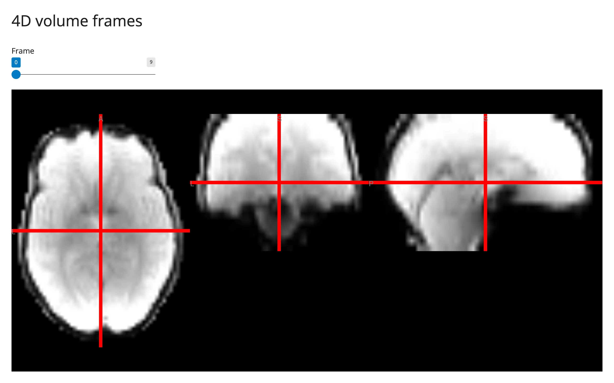 | 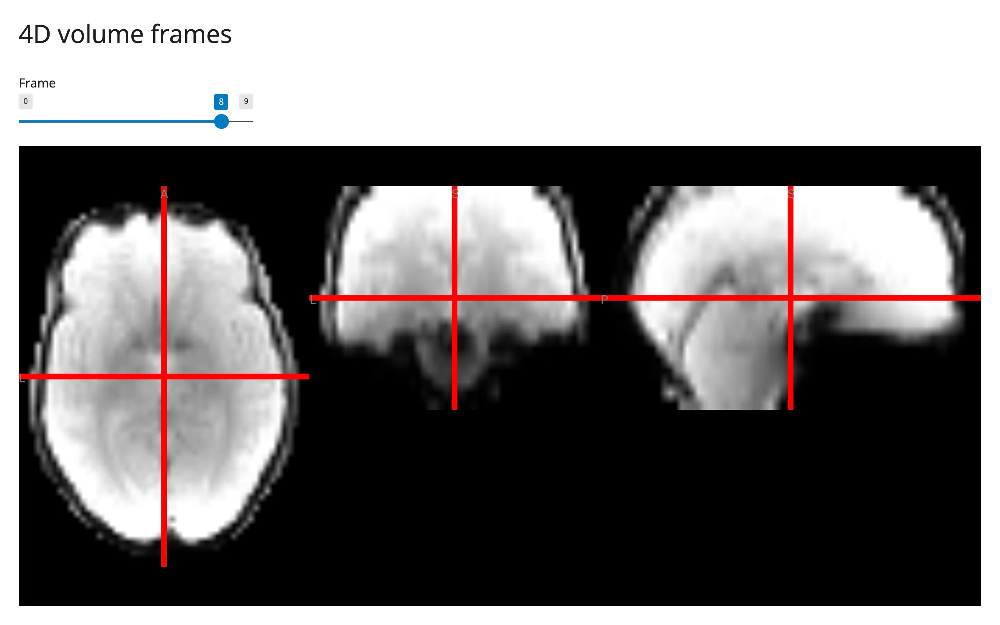 |

This particular scan (arterial spin labeling perfusion) has subtle frame-to-frame differences by design; the
pattern is the point, not the drama of this dataset.

## Reacting to user interaction

### Accessor reference

| accessor | returns | before any interaction | across re-render | default rate policy |
|---|---|---|---|---|
| `location()` | `dict` (`ax_cor_sag`, `frac`, `mm`, `vox`, `values`, `string`, `xy`) | seeded value: `{"frac": [0.5, 0.5, 0.5], "seeded": True}` (the volume center) | re-seeded from the new viewer | debounce, 250 ms |

### `location()`: the crosshair as an input

`location()` reads like a Shiny input: call it inside a reactive function and that function re-runs on every
crosshair move. It never returns `None` -- it's seeded at render with the volume center (`{"frac": [0.5, 0.5,
0.5], "seeded": True}`), before the user has clicked anything, and a click or drag replaces it with the full
payload. Check `loc.get("seeded")` to tell "showing the center, nothing clicked yet" from a real crosshair
report; a re-render builds a new viewer and re-seeds back to the center, so a dashboard reset or a tab switch
that re-renders the output clears any prior click the same way.

```{.python file="examples/07_location_accessor.py"}
from ipyniivue import NiiVue, Volume
from shiny.express import render, ui
from shinywidgets import render_niivue

ui.page_opts(title="Crosshair location", fillable=True)


@render_niivue
def brain():
    nv = NiiVue()
    nv.load_volumes([Volume(url="https://niivue.com/demos/images/mni152.nii.gz")])
    return nv


@render.code
def readout():
    loc = brain.location()
    if loc.get("seeded"):
        return "Click the brain to inspect a voxel"
    mm = loc["mm"][:3]
    value = loc["values"][0]["value"]
    return f"mm: ({mm[0]:.1f}, {mm[1]:.1f}, {mm[2]:.1f})\nintensity: {value:.1f}"
```

| Before | After clicking |
|---|---|
| 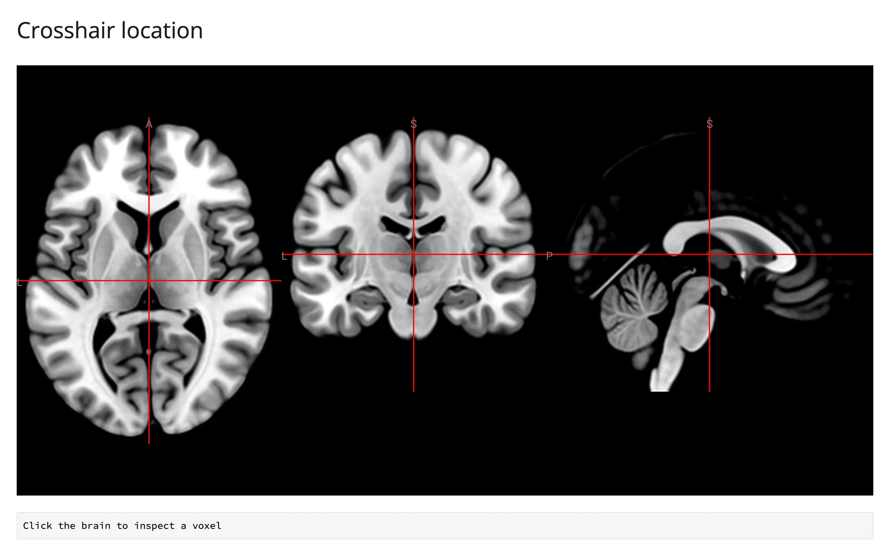 | 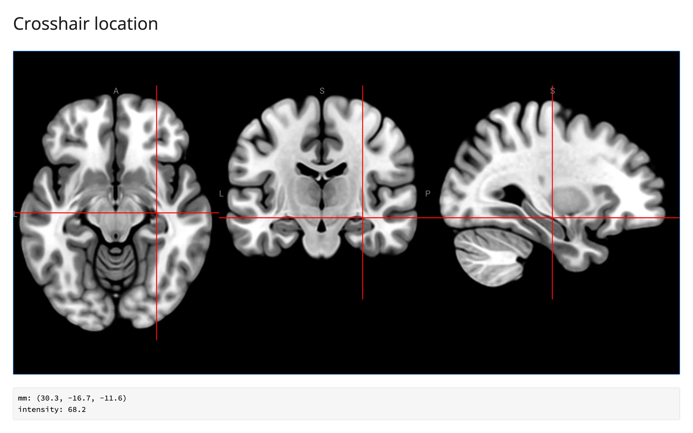 |

The payload, verified live:

- **`mm`**: a 4-vector `[x, y, z, 1]` (the trailing `1` is a homogeneous-coordinate artifact; slice to `[:3]`).
- **`vox`**: integer voxel indices `[i, j, k]` into the *first* loaded volume's array.
- **`frac`**: the first volume's voxel position as a fraction of its dimensions (`0.0`-`1.0` per axis) -- this is
  the coordinate space `scene.crosshair_pos` uses (see "Jumping the crosshair" below).
- **`values`**: a list with one entry **per loaded volume**, in load order -- `{"name", "value", "id", "mm",
  "vox"}` -- each with its own `vox`/`mm`, since different volumes can have different voxel grids. `values[i]`
  does *not* round or format `value`; it's a raw float.
- **`string`**: NiiVue's own formatted summary (`"-46×-17×11×0 = 34.844   "`), handy for a quick label.
- **`ax_cor_sag`**: which of the three 2D views the event came from (`0` axial, `1` coronal, `2` sagittal).

### Reading on demand: bookmark the crosshair

Because `location()` is live from the moment the viewer renders and keeps reporting whether or not anything has
read it yet, it's safe to read from a button handler that doesn't run until well after the user clicked --
no warm-up read needed first. This button appends the crosshair's current position to a running list of
bookmarks each time it's pressed.

```{.python file="examples/12_save_location.py"}
from ipyniivue import NiiVue, Volume
from shiny import reactive
from shiny.express import input, render, ui
from shinywidgets import render_niivue

ui.page_opts(title="Bookmark the crosshair", fillable=True)
ui.input_action_button("bookmark", "Bookmark this spot")

bookmarks = reactive.Value([])


@render_niivue
def brain():
    nv = NiiVue()
    nv.load_volumes([Volume(url="https://niivue.com/demos/images/mni152.nii.gz")])
    return nv


@reactive.effect
@reactive.event(input.bookmark)
def _():
    loc = brain.location()
    if loc.get("seeded"):
        return  # nothing clicked yet -- don't bookmark the volume center
    mm = loc["mm"][:3]
    bookmarks.set([*bookmarks(), f"({mm[0]:.0f}, {mm[1]:.0f}, {mm[2]:.0f}) mm"])


@render.ui
def saved():
    if not bookmarks():
        return ui.p("No bookmarks yet.")
    return ui.tags.ul(*[ui.tags.li(b) for b in bookmarks()])
```

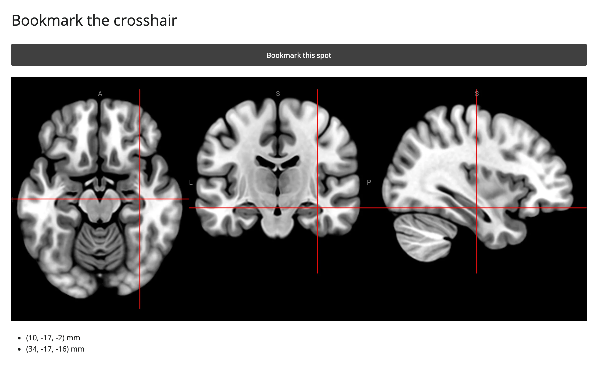

### Voxel value to atlas label (click -> detail card)

Loading a label atlas (here, [AAL](https://www.gin.cnrs.fr/en/tools/aal/)) as a second volume turns
`location()["values"][1]["value"]` into a region index -- no coordinate math needed, since NiiVue already looked
up the intensity at the crosshair for *that* volume's own voxel grid. Match it against the atlas's label list
(fetched once from the same JSON NiiVue itself uses) for a human-readable name. This indexes the same way
`ipyniivue.LUT.labels` does -- both treat the label array as directly indexed by the intensity/palette value, with
index `0` reserved for background (`"Air"` in this LUT) -- so reading the plain JSON here gives the same mapping
you'd get by constructing a `LUT` from it and reading `.labels[region_index]`.

```{.python file="examples/09_atlas_label.py"}
import json
import urllib.request

from ipyniivue import NiiVue, Volume
from shiny import ui as core_ui
from shiny.express import render, ui
from shinywidgets import render_niivue

ui.page_opts(title="Atlas region lookup", fillable=True)

with urllib.request.urlopen("https://niivue.com/demos/images/aal.json") as resp:
    AAL_LABELS = json.load(resp)["labels"]


@render_niivue
def brain():
    nv = NiiVue()
    nv.load_volumes(
        [
            Volume(url="https://niivue.com/demos/images/mni152.nii.gz"),
            Volume(
                url="https://niivue.com/demos/images/aal.nii.gz",
                colormap="actc",
                opacity=0.5,
            ),
        ]
    )
    return nv


@render.ui
def region_card():
    loc = brain.location()
    if loc.get("seeded"):
        return ui.p("Click a region to identify it.")
    region_index = round(loc["values"][1]["value"])
    region = AAL_LABELS[region_index] if region_index else "none (background)"
    mm = loc["mm"][:3]
    return core_ui.card(
        ui.h5(region.replace("_", " ")),
        f"MNI (x, y, z): {mm[0]:.0f}, {mm[1]:.0f}, {mm[2]:.0f} mm",
    )
```

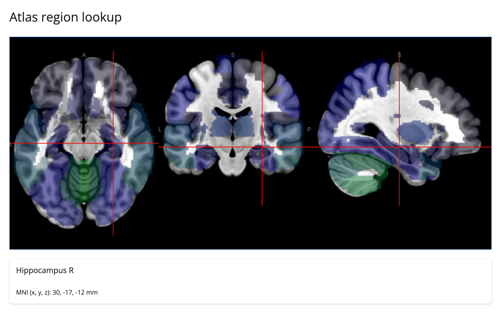

Note the `shiny.ui.card`/`shiny.express.ui` split: inside a `@render.ui` function you build and *return* a value,
so you need the core `shiny.ui` constructors (which take children as positional arguments); `shiny.express.ui`'s
layout components like `card` are context managers for the page body, not value-returning functions.

### Crosshair to a 4D time series (click -> plot)

`location()` reports the voxel under the crosshair, but only its intensity in whatever frame is currently
displayed. For the full time course, index into the same 4D array locally with `nibabel`, using `location()["vox"]`
to pick the voxel -- both the viewer and the local array come from the same file, so the indices line up.

```{.python file="examples/10_timeseries_4d.py"}
from pathlib import Path

import matplotlib.pyplot as plt
import nibabel as nib
from ipyniivue import NiiVue, Volume, download_dataset
from shiny.express import render, ui
from shinywidgets import render_niivue

ui.page_opts(title="4D intensity profile", fillable=True)

CACHE = Path.home() / ".cache" / "niivue-guide"
if not (CACHE / "pcasl.nii.gz").exists():
    download_dataset(dest_folder=CACHE, files=["pcasl.nii.gz"])
TIMESERIES = nib.load(CACHE / "pcasl.nii.gz").get_fdata()  # shape: (x, y, z, time)


@render_niivue
def brain():
    nv = NiiVue()
    nv.load_volumes([Volume(path=CACHE / "pcasl.nii.gz")])
    return nv


@render.plot
def profile():
    loc = brain.location()
    fig, ax = plt.subplots()
    if loc.get("seeded"):
        ax.set_title("Click the scan to plot a voxel's time course")
        return fig
    i, j, k = loc["vox"]
    ax.plot(TIMESERIES[i, j, k, :], marker="o")
    ax.set(xlabel="frame", ylabel="signal", title=f"Voxel {(i, j, k)}")
    return fig
```

[`examples/10_timeseries_4d.py`](examples/10_timeseries_4d.py) (needs `nibabel`; downloads the ~0.6 MB demo scan
on first run)

| Before | After clicking |
|---|---|
| 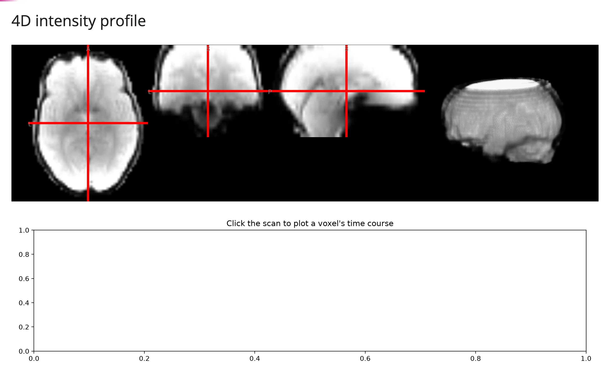 | 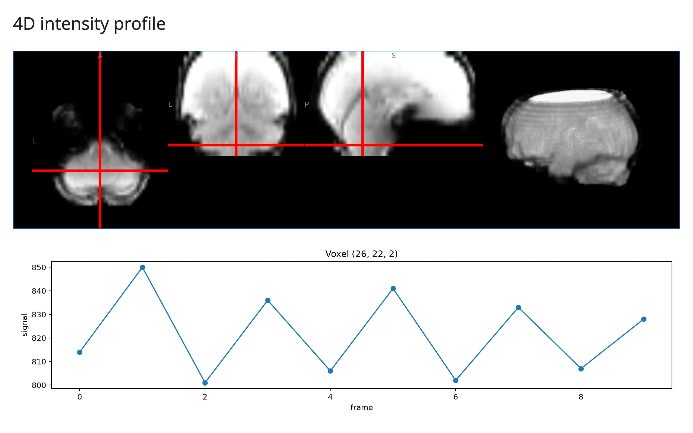 |

### Beyond the accessor: `reactive_read`

There's nothing to reach for here. The crosshair position lives on `nv.widget.scene.crosshair_pos`, and it looks
like an ordinary synced trait -- but it's write-only from Python. Verified directly: clicking and dragging the
crosshair in the browser never changes it server-side (`reactive_read(nv.widget.scene, "crosshair_pos")` reads
`[0.5, 0.5, 0.5]` before, during, and after a real drag). `location()`/`on_location_change` are the only paths
from browser interaction to Python for this widget.

### Rate limiting

`location()` debounces at 250 ms by default, because a crosshair drag fires roughly 20-25 events per second --
without debouncing, every pixel of mouse movement would trigger a re-render of anything downstream. Pass
`rate_delay=0` to the decorator to see every event immediately (reasonable if your app only cares about discrete
clicks, not continuous dragging), or `rate_policy="throttle"` for a steady trickle of updates during a drag
instead of one value at the end.

```{.python file="examples/08_rate_limiting.py"}
from ipyniivue import NiiVue, Volume
from shiny.express import render, ui
from shinywidgets import render_niivue

ui.page_opts(title="No debounce", fillable=True)


@render_niivue(rate_delay=0)
def brain():
    nv = NiiVue()
    nv.load_volumes([Volume(url="https://niivue.com/demos/images/mni152.nii.gz")])
    return nv


@render.code
def readout():
    loc = brain.location()
    return "Click the brain to inspect a voxel" if loc.get("seeded") else loc["string"]
```

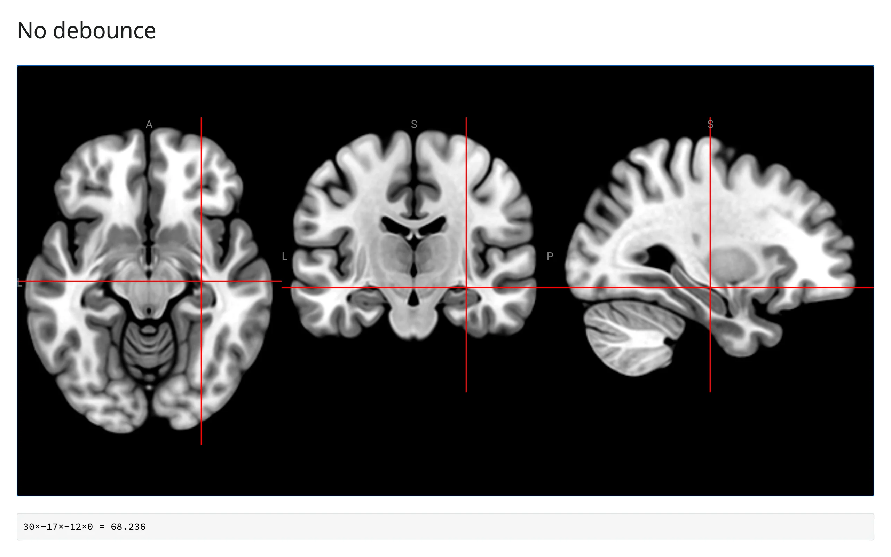

## Updating the widget from Python

Every `set_*` method on `.widget` (`set_colormap`, `set_opacity`, `set_gamma`, `set_slice_type`, and so on) and
every writable trait (`volumes[i].cal_min`, `volumes[i].frame_4d`, `scene.crosshair_pos`) applies live, in the
browser, without re-rendering the output. This matters more for NiiVue than most widgets: a re-render resends the
viewer's ~5 MB JavaScript bundle plus every volume (base64-encoded) over the websocket, and the browser re-uploads
the decoded voxels back to Python afterward -- expensive on every re-render, free for an in-place update. The
"Statistical overlay" and "Every slice type" examples above are both this pattern: a `@reactive.effect` reading an
input and calling a `set_*` method or assigning a trait on `brain.widget`.

One wrinkle this widget *doesn't* have: most in-place-update patterns need `reactive.isolate()` to avoid a loop
when the effect also depends on the widget's own reported state. NiiVue never needs it, because programmatic
writes (like setting `scene.crosshair_pos`) don't echo back through `location()` -- only genuine browser clicks
and drags do (verified above). An effect that sets the crosshair from an input can't re-trigger itself.

### Jumping the crosshair from Python

`nv.frac2mm()`/`nv.mm2frac()` don't work server-side (verified: calling `frac2mm` after loading a volume raises
`RuntimeError: Volume coordinate transformation matrices are not available` -- those matrices exist only in the
browser). To jump to a known millimeter coordinate, load the same file with `nibabel` locally and use its affine
to compute a voxel index, then divide by the volume's shape to get the `[0, 1]` fraction `scene.crosshair_pos`
expects.

```{.python file="examples/11_jump_crosshair.py"}
from pathlib import Path

import nibabel as nib
import numpy as np
from ipyniivue import NiiVue, Volume, download_dataset
from shiny import reactive
from shiny.express import input, ui
from shinywidgets import render_niivue

ui.page_opts(title="Jump to a landmark", fillable=True)

LANDMARKS_MM = {
    "Left amygdala": (-23, -5, -18),
    "Right amygdala": (23, -5, -18),
    "Anterior cingulate": (0, 30, 20),
    "Left motor cortex (hand knob)": (-38, -22, 52),
}
ui.input_select("landmark", "Jump to", list(LANDMARKS_MM))

CACHE = Path.home() / ".cache" / "niivue-guide"
if not (CACHE / "mni152.nii.gz").exists():
    download_dataset(dest_folder=CACHE, files=["mni152.nii.gz"])
MNI = nib.load(CACHE / "mni152.nii.gz")
TO_VOX = np.linalg.inv(MNI.affine)


@render_niivue
def brain():
    nv = NiiVue()
    nv.load_volumes([Volume(path=CACHE / "mni152.nii.gz")])
    return nv


@reactive.effect
def _():
    mm = LANDMARKS_MM[input.landmark()]
    vox = (TO_VOX @ np.array([*mm, 1.0]))[:3]
    brain.widget.scene.crosshair_pos = list(vox / np.array(MNI.shape))
```

[`examples/11_jump_crosshair.py`](examples/11_jump_crosshair.py) (needs `nibabel`)

| Left amygdala | Left motor cortex (hand knob) |
|---|---|
| 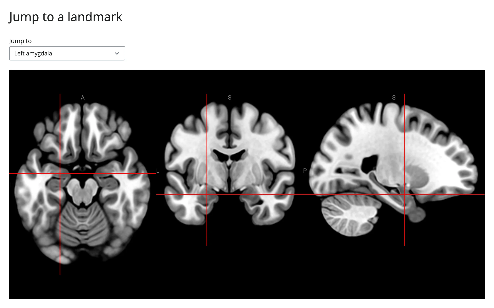 | 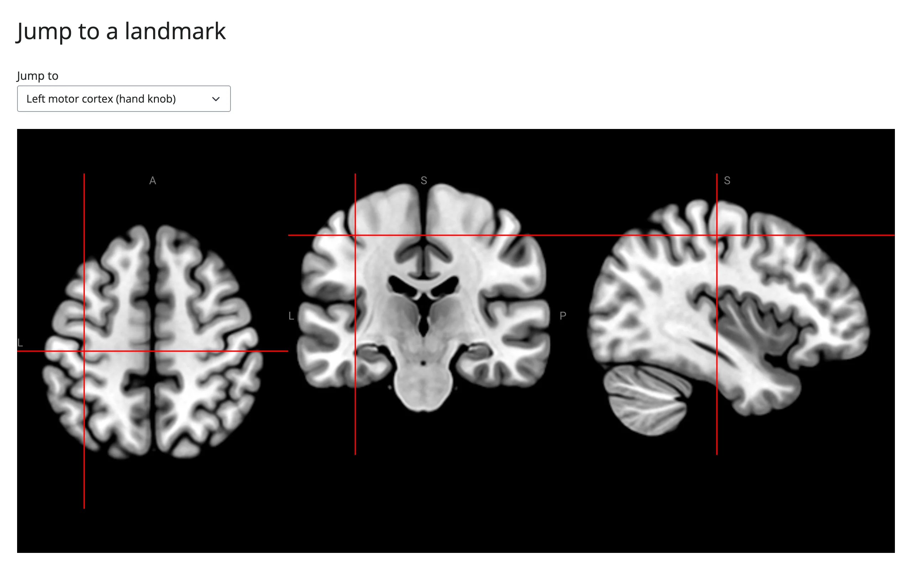 |

Setting `scene.crosshair_pos` moves the crosshair in the browser immediately; it does **not** trigger
`location()` or `on_location_change` (those only fire for events the browser itself originates), so a jump like
this won't show up in a `location()`-driven readout until the user clicks again.

## Coordinating multiple views

Three complete, verified patterns -- combine them as needed.

**1. Click -> atlas label + MNI coordinate card.** Load a label atlas as a second volume; read its intensity
directly out of `location()["values"][1]`, no coordinate math required. See "Voxel value to atlas label" above.

**2. Click -> linked time-series plot.** For data richer than a single intensity (a 4D scan, or any per-voxel
array you have in Python), use `location()["vox"]` to index into your own copy of the data and plot it with
matplotlib, plotly, or any other renderer. See "Crosshair to a 4D time series" above.

**3. Dropdown -> jump the crosshair (Python drives the widget).** A `@reactive.effect` reading a `ui.input_select`
and writing `scene.crosshair_pos` turns any list of named coordinates -- anatomical landmarks, a table of
previous findings, output from an analysis pipeline -- into a one-click navigation aid. See "Jumping the
crosshair from Python" above.

All three compose: the showcase gallery app below combines the atlas-label card with the landmark dropdown in one
page.

*Pairs with*: a table of coordinates (`render.data_frame`) could drive pattern 3 directly from row selection
instead of a dropdown -- see the [itables](../itables/index.md) or [reactable](../reactable/index.md) guides for
the `selected_rows()`-style accessor on the table side.

## Large data

NiiVue draws volumes with WebGL2 (the "draw it with the GPU in the browser" approach -- see
[Large data & performance's three approaches](../../guide/performance/index.md#three-approaches-to-large-data)),
but every *re-render* sends the ~5 MB JavaScript bundle plus every loaded volume base64-encoded, and the browser
uploads the decoded voxels back to Python afterward -- see
["Re-renders are expensive for large volumes"](#gotchas-and-limitations) in Gotchas, where this is measured. Two
things keep that cheap: `Volume(url=...)` for remote data skips the base64 down-leg entirely (the closest thing
here to "only send what's visible"), and in-place `.widget` updates -- like the [4D volumes](#4d-volumes) and
crosshair examples above -- send only the changed trait instead of re-exporting the whole scene.

## Layout and sizing

- Leave `height=` off of `NiiVue()` itself. It sets the **canvas's** pixel height, which then disagrees with the
  **output's** height (set via fill layout or `output_widget(height=...)`), causing clipping or dead space. Don't
  pass it in Shiny.
- With no explicit height, the canvas fills its container exactly, including through `full_screen` toggles and
  hidden-tab-then-shown sequences.
- An explicit `output_widget(height="400px")` is respected normally; just don't *also* set `NiiVue(height=...)`.
- NiiVue's `MultiplanarType.AUTO` (the default) picks the pane arrangement based on the container's aspect ratio
  -- a wide, short container gets three panes side by side; a more square one can fit a fourth (3D render) pane
  too. This is automatic and not something you need to configure for ordinary layouts.

## Gotchas and limitations

Verified against current `main`:

- **The crosshair position is not a two-way trait.** `scene.crosshair_pos` syncs Python-to-browser only;
  `reactive_read()` on it never reflects a browser-originated click or drag. Use `location()` (or
  `@nv.on_location_change` plus a session-scoped `reactive.Value`, if you need every event un-debounced and don't
  want to use the `rate_delay=0` kwarg).
- **`frac2mm()`/`mm2frac()` don't work in Shiny.** The coordinate transformation matrices are built in the
  browser and never sync back; calling them from Python raises `RuntimeError` once a volume is loaded (and
  silently returns a meaningless identity-based answer before any volume loads -- don't rely on either). Load the
  same file with `nibabel` and use its affine instead.
- **Exceptions inside `@nv.on_location_change` callbacks are swallowed silently** by ipywidgets' callback
  dispatcher -- a bug in your callback just looks like "nothing updates." This only matters if you bypass
  `location()` and register your own callback directly.
- **Re-renders are expensive for large volumes.** Every render sends the ~5 MB JavaScript bundle plus every
  volume (base64-encoded); the browser also uploads the decoded voxels back to Python afterward. Prefer
  `Volume(url=...)` for remote data (skips the base64 down-leg) and prefer in-place `.widget` updates over
  re-rendering whenever the data itself hasn't changed.
- **`Volume(data=...)` requires `name=`.** There's no file path to infer a name from; omitting it raises
  `ValueError: Must provide 'name' when 'data' is provided.`
- **Headless browser testing needs software WebGL.** Plain headless Chromium renders a blank canvas for this
  widget; launch with `--use-angle=swiftshader --enable-unsafe-swiftshader --ignore-gpu-blocklist` if you're
  writing your own Playwright tests against a NiiVue-based app.

## Gallery candidates

**[`gallery/template_mri_viewer.py`](gallery/template_mri_viewer.py)** (template) -- a clean ~55-line starting
point: slice-type, colormap, and gamma controls plus a `location()`-driven crosshair readout.

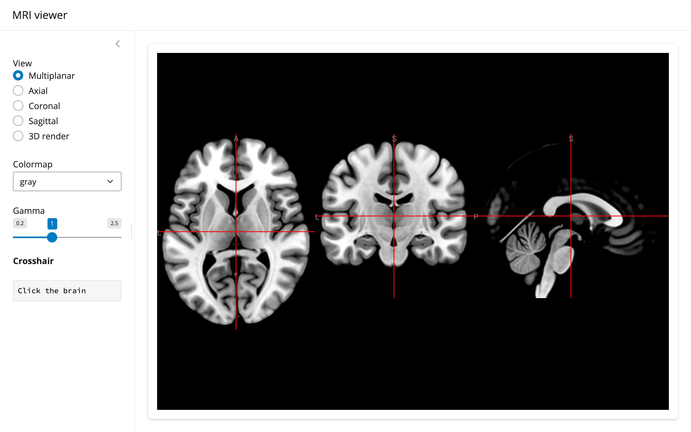

**[`gallery/showcase_atlas_explorer.py`](gallery/showcase_atlas_explorer.py)** (showcase) -- combines all three
linked-view patterns above: an AAL atlas overlay with adjustable colormap/opacity, a crosshair-driven region-ID
card, and a landmark dropdown that jumps the crosshair via `scene.crosshair_pos`.

| Left amygdala | Left motor cortex (hand knob) |
|---|---|
| 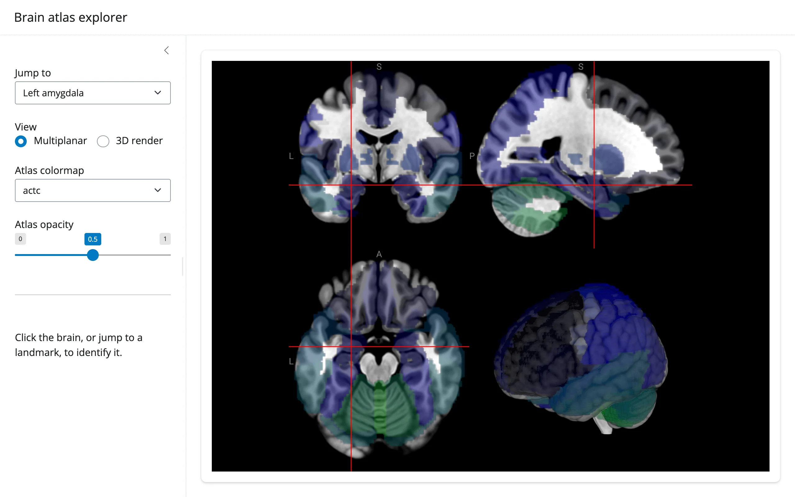 | 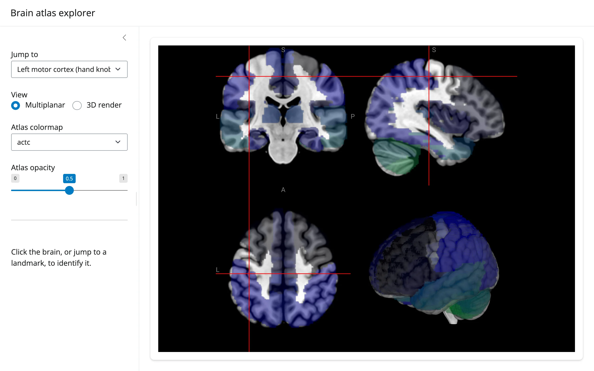 |

## Learn more

- [NiiVue documentation](https://niivue.com) and [live demos](https://niivue.com/demos/features/) (the source of
  every URL used in this guide)
- [ipyniivue on GitHub](https://github.com/niivue/ipyniivue)
- [AAL atlas](https://www.gin.cnrs.fr/en/tools/aal/) and the [NARPS](https://www.narps.info/) reproducibility
  dataset, used in the examples above
- Related guides in this roster: [k3d](../k3d/index.md), [ipyvolume](../ipyvolume/index.md),
  [pythreejs](../pythreejs/index.md) for non-medical 3D scenes; [itables](../itables/index.md) and
  [reactable](../reactable/index.md) for table-driven linked views
