[Observable Plot](https://observablehq.com/plot/) is a free, open-source JavaScript charting library from
[Observable](https://observablehq.com), the same team behind D3 (Plot is built on top of D3, by D3's original
author Mike Bostock). Its pitch is a concise grammar: you declare **marks** (dot, line, bar, area, rect, ...) and
**transforms** (`binX`, `groupY`, `dodge`, `hexbin`, and more) over your raw rows, and Plot infers scales, axes,
legends, and margins for you. The result is terser than hand-rolled D3 and more composable than a fixed chart-type
API -- closer in spirit to ggplot2's layered grammar than to a typical JavaScript charting library.

[pyobsplot](https://juba.github.io/pyobsplot/) is a Python wrapper that mirrors Plot's JavaScript API one-to-one:
`Plot.dot(...)`, `Plot.binX(...)`, and friends are Python functions that build a JSON-serializable specification,
which pyobsplot then renders in the browser with the real Observable Plot library (not a reimplementation). The
`@render_obsplot` decorator takes whatever `Plot.plot({...})` returns -- an `ObsplotWidget` -- and displays it as a
Shiny output: it handles layout sizing (the chart fills its container unless the spec sets an explicit width), and
it makes `.widget.spec` assignable so you can redraw the chart from a `@reactive.effect` without a full Shiny
re-render. Choose obsplot when you want Plot's exact look and the breadth of its mark/transform vocabulary (facets,
hexbin, dodge, regression, density -- see "What you can build" below); choose [altair](../altair/index.md) for a
more Pythonic, chainable spec-building API with the same grammar-of-graphics lineage, or
[plotnine](../plotnine/index.md) if your team already thinks in ggplot2.


## Installation

```sh
pip install 'shinywidgets[obsplot]'
```

This installs `pyobsplot`. The decorated function returns an `ObsplotWidget`, produced by calling `Plot.plot({...})`
(or an `Obsplot()` creator) -- the `Plot`/`Obsplot` objects themselves are plot *creators*, not charts, so calling
`Plot.plot` directly (rather than, say, returning `Plot` itself) is required. Only the default `format="widget"`
produces a chart `@render_obsplot` can display; the other formats (`"html"`, `"svg"`, `"png"`) return `None`.

## Quick start

A scatter plot of the Palmer penguins, colored by species, with a tooltip on hover (`"tip": True` on the mark):

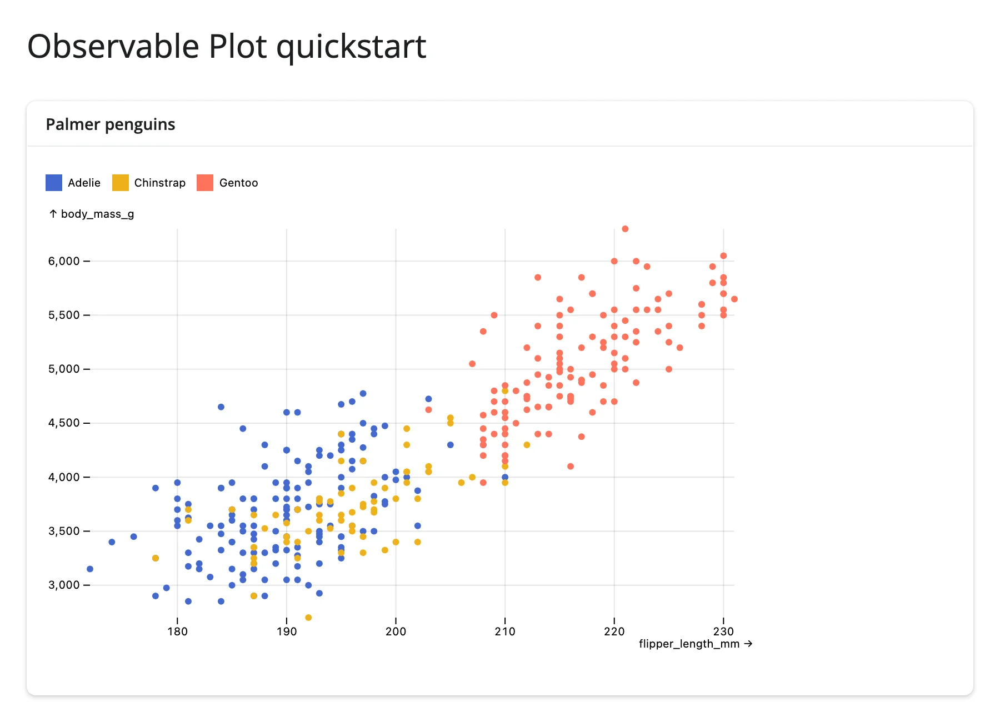

```{.python file="examples/01_quickstart.py"}
from __future__ import annotations

import polars as pl
from pyobsplot import Plot
from shiny.express import ui

from shinywidgets import render_obsplot

ui.page_opts(title="Observable Plot quickstart", fillable=True)

penguins = pl.read_csv(
    "https://github.com/juba/pyobsplot/raw/main/doc/data/penguins.csv"
)

with ui.card(full_screen=True):
    ui.card_header("Palmer penguins")

    @render_obsplot
    def plot():
        return Plot.plot(
            {
                "grid": True,
                "color": {"legend": True},
                "marks": [
                    Plot.dot(
                        penguins,
                        {
                            "x": "flipper_length_mm",
                            "y": "body_mass_g",
                            "fill": "species",
                            "tip": True,
                        },
                    ),
                ],
            }
        )
```

## What you can build

Plot's transforms do real statistical and layout work in the browser, so you hand it raw rows rather than
pre-aggregated summaries. These six snippets are the library's core vocabulary; all use real gapminder or penguins
data.

### A histogram without pre-binning (`binX` + `rectY`)

`Plot.binX` groups continuous values into bins and `Plot.rectY` draws the bars; `fill: "continent"` stacks each bin
by group automatically.

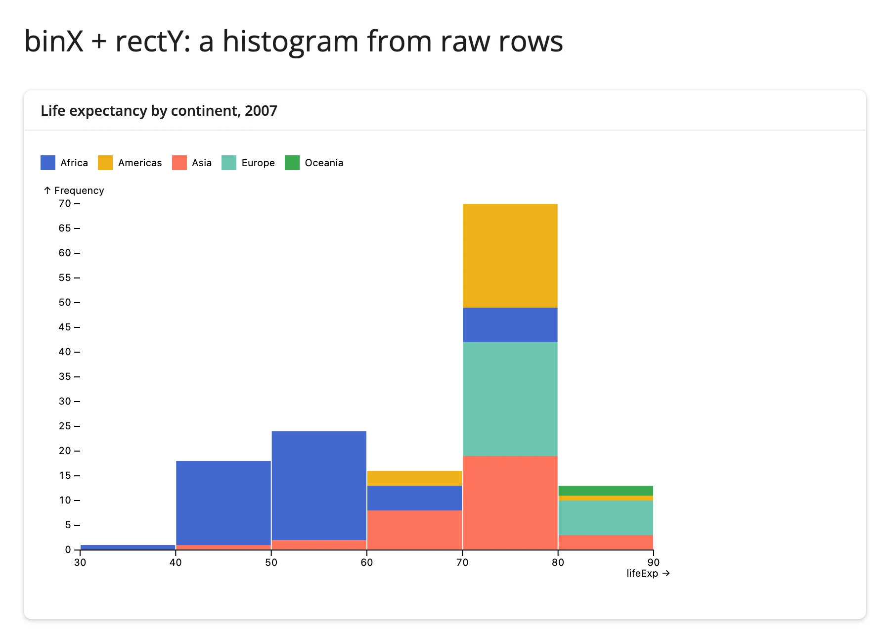

```{.python file="examples/02_histogram.py"}
from __future__ import annotations

import plotly.express as px
from pyobsplot import Plot
from shiny.express import ui

from shinywidgets import render_obsplot

ui.page_opts(title="binX + rectY: a histogram from raw rows", fillable=True)

gapminder = px.data.gapminder()
# Filtering a pandas DataFrame leaves a non-contiguous index; pyobsplot 0.5.4
# chokes on that (see the Gotchas section), so reset it before plotting.
gapminder_2007 = gapminder[gapminder["year"] == 2007].reset_index(drop=True)

with ui.card(full_screen=True):
    ui.card_header("Life expectancy by continent, 2007")

    @render_obsplot
    def hist():
        return Plot.plot(
            {
                "color": {"legend": True},
                "marks": [
                    Plot.rectY(
                        gapminder_2007,
                        Plot.binX(
                            {"y": "count"},
                            {"x": "lifeExp", "fill": "continent"},
                        ),
                    ),
                    Plot.ruleY([0]),
                ],
            }
        )
```

### Small multiples for free (facets)

Add an `"fx"` (or `"fy"`) channel to any mark and Plot facets automatically -- no separate `facet()` call, no
manual subplot loop.

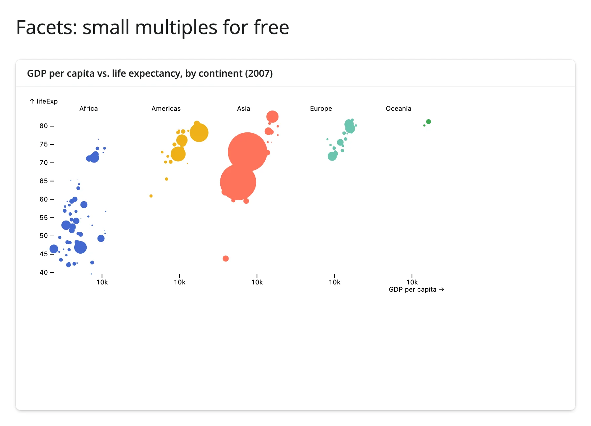

```{.python file="examples/03_facets.py"}
from __future__ import annotations

import plotly.express as px
from pyobsplot import Plot
from shiny.express import ui

from shinywidgets import render_obsplot

ui.page_opts(title="Facets: small multiples for free", fillable=True)

gapminder = px.data.gapminder()
gapminder_2007 = gapminder[gapminder["year"] == 2007].reset_index(drop=True)

with ui.card(full_screen=True):
    ui.card_header("GDP per capita vs. life expectancy, by continent (2007)")

    @render_obsplot
    def faceted():
        return Plot.plot(
            {
                "height": 300,
                "x": {"type": "log", "label": "GDP per capita"},
                "fx": {"label": None},
                "marks": [
                    # Adding an "fx"/"fy" channel to a mark is enough: Plot
                    # facets automatically, no separate facet() call needed.
                    Plot.dot(
                        gapminder_2007,
                        {
                            "x": "gdpPercap",
                            "y": "lifeExp",
                            "fx": "continent",
                            "r": "pop",
                            "fill": "continent",
                        },
                    ),
                ],
            }
        )
```

### Aggregate without leaving Python (`groupY` + `barX`)

`Plot.groupY` computes the mean (or count, median, ...) per category in the browser; you still only ship the raw
rows.

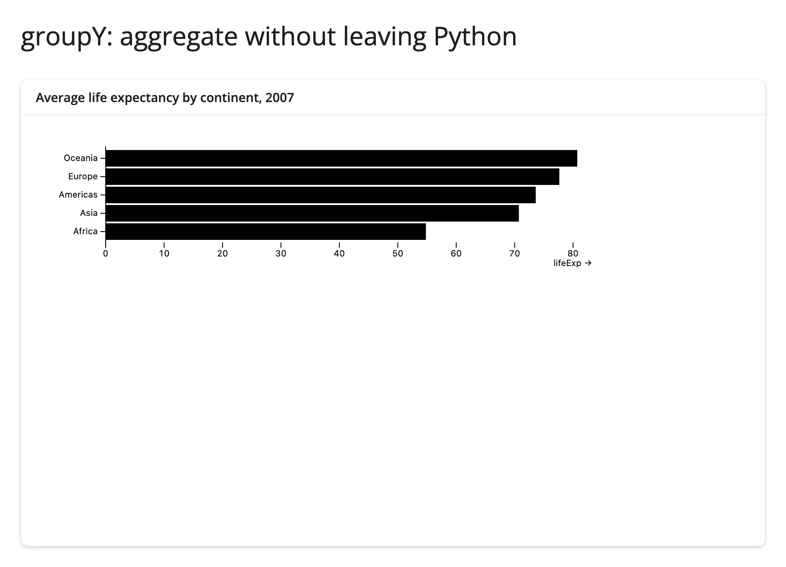

```{.python file="examples/04_groupY_bars.py"}
from __future__ import annotations

import plotly.express as px
from pyobsplot import Plot
from shiny.express import ui

from shinywidgets import render_obsplot

ui.page_opts(title="groupY: aggregate without leaving Python", fillable=True)

gapminder = px.data.gapminder()
gapminder_2007 = gapminder[gapminder["year"] == 2007].reset_index(drop=True)

with ui.card(full_screen=True):
    ui.card_header("Average life expectancy by continent, 2007")

    @render_obsplot
    def bars():
        return Plot.plot(
            {
                # Plot under-sizes the left margin for a categorical axis
                # with an axis title, clipping the tick labels; widen it and
                # drop the title ("continent" is obvious from the labels).
                "marginLeft": 80,
                "y": {"label": None},
                "marks": [
                    # groupY computes the mean per continent in the browser;
                    # the rows go over the wire as-is.
                    Plot.barX(
                        gapminder_2007,
                        Plot.groupY(
                            {"x": "mean"},
                            {"y": "continent", "x": "lifeExp", "sort": {"y": "-x"}},
                        ),
                    ),
                    Plot.ruleX([0]),
                ],
            }
        )
```

### A beeswarm with no overlap (`dodge`)

`Plot.dodgeY` nudges overlapping dots apart along y so every data point stays visible -- the classic beeswarm, with
no manual jitter.

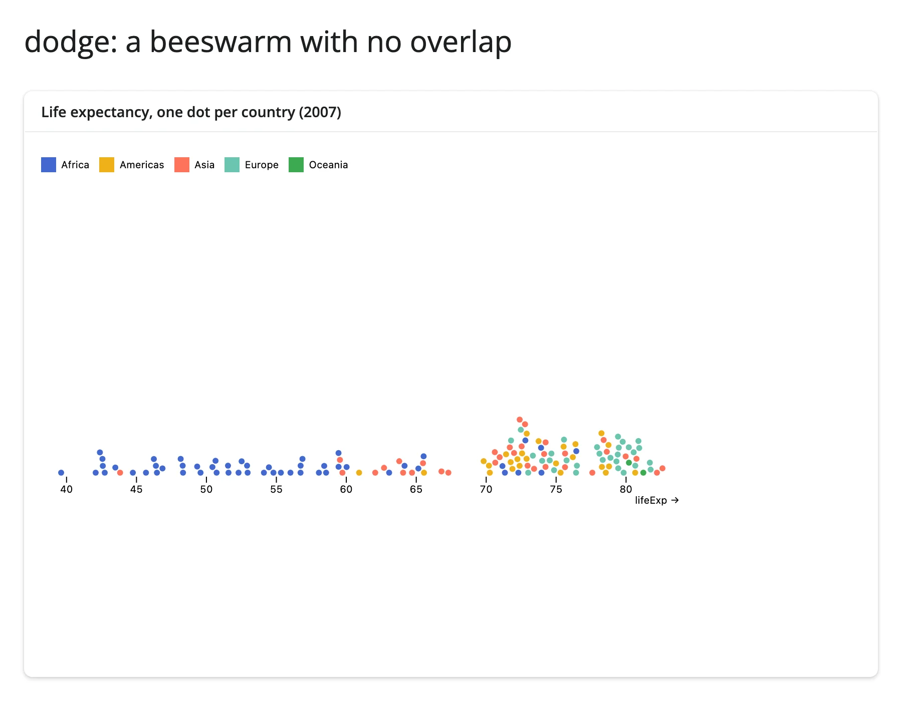

```{.python file="examples/05_dodge_beeswarm.py"}
from __future__ import annotations

import plotly.express as px
from pyobsplot import Plot
from shiny.express import ui

from shinywidgets import render_obsplot

ui.page_opts(title="dodge: a beeswarm with no overlap", fillable=True)

gapminder = px.data.gapminder()
gapminder_2007 = gapminder[gapminder["year"] == 2007].reset_index(drop=True)

with ui.card(full_screen=True):
    ui.card_header("Life expectancy, one dot per country (2007)")

    @render_obsplot
    def beeswarm():
        return Plot.plot(
            {
                "height": 320,
                "color": {"legend": True},
                "marks": [
                    # dodge nudges overlapping dots apart along y, so every
                    # country gets its own visible dot instead of a blob.
                    Plot.dotX(
                        gapminder_2007,
                        Plot.dodgeY(
                            {"x": "lifeExp", "fill": "continent", "r": 3}
                        ),
                    ),
                ],
            }
        )
```

### 2D density for overplotted scatters (`hexbin`)

Plotting every country-year at once would be an unreadable blob of overlapping dots; `Plot.hexbin` aggregates into
hexagonal cells colored by count.

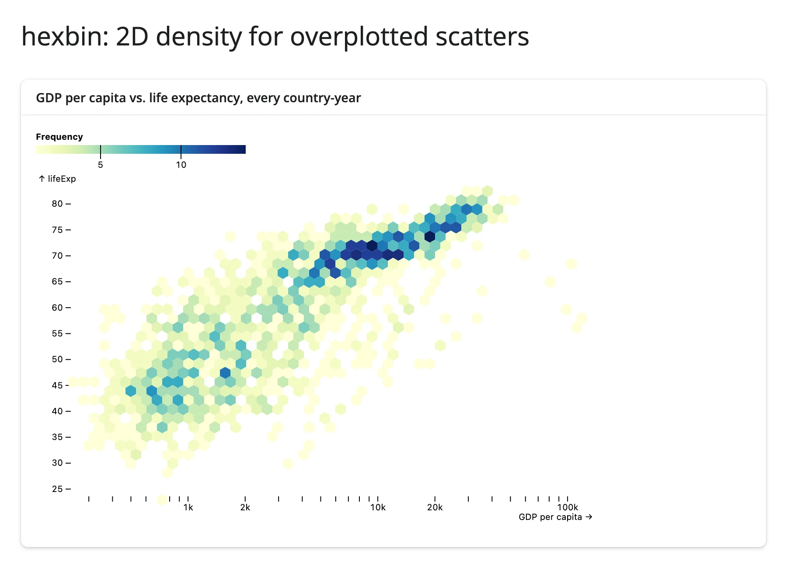

```{.python file="examples/06_hexbin.py"}
from __future__ import annotations

import plotly.express as px
from pyobsplot import Plot
from shiny.express import ui

from shinywidgets import render_obsplot

ui.page_opts(title="hexbin: 2D density for overplotted scatters", fillable=True)

gapminder = px.data.gapminder()

with ui.card(full_screen=True):
    ui.card_header("GDP per capita vs. life expectancy, every country-year")

    @render_obsplot
    def hexplot():
        return Plot.plot(
            {
                "x": {"type": "log", "label": "GDP per capita"},
                "color": {"scheme": "YlGnBu", "legend": True},
                "marks": [
                    Plot.dot(
                        gapminder,
                        Plot.hexbin(
                            {"fill": "count"},
                            {"x": "gdpPercap", "y": "lifeExp", "binWidth": 12},
                        ),
                    ),
                ],
            }
        )
```

### A rich hover card, not just an (x, y) (`tip` + `pointer`)

The quick start used the `"tip": True` shorthand on a mark. For full control, pair an explicit `Plot.tip` mark with
`Plot.pointer` (which finds the nearest data point to the cursor) and a `"channels"` dict naming exactly which
fields to show -- useful when the tooltip should surface columns that aren't otherwise plotted.

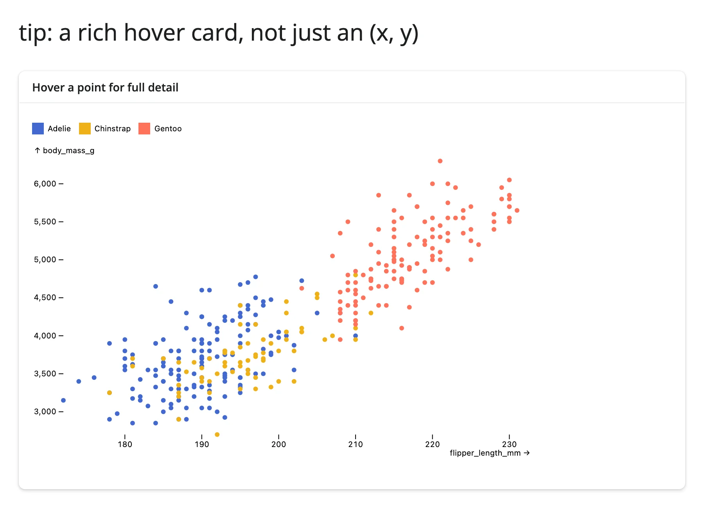
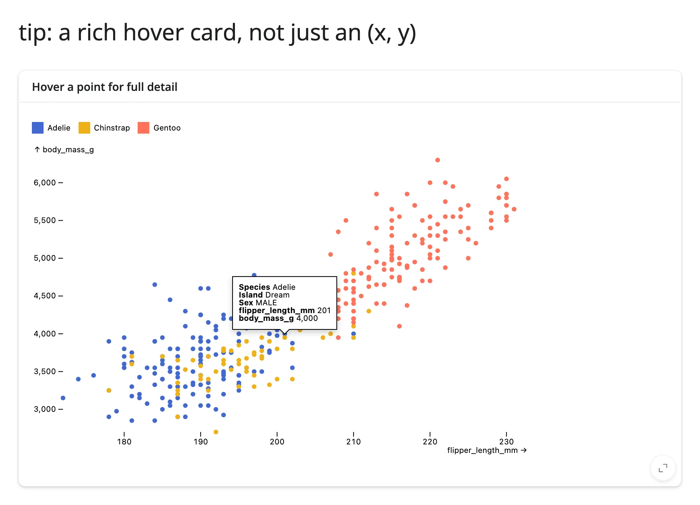

```{.python file="examples/07_tip.py"}
from __future__ import annotations

import polars as pl
from pyobsplot import Plot
from shiny.express import ui

from shinywidgets import render_obsplot

ui.page_opts(title="tip: a rich hover card, not just an (x, y)", fillable=True)

penguins = pl.read_csv(
    "https://github.com/juba/pyobsplot/raw/main/doc/data/penguins.csv"
)

with ui.card(full_screen=True):
    ui.card_header("Hover a point for full detail")

    @render_obsplot
    def tipped():
        return Plot.plot(
            {
                "color": {"legend": True},
                "marks": [
                    Plot.dot(
                        penguins,
                        {
                            "x": "flipper_length_mm",
                            "y": "body_mass_g",
                            "fill": "species",
                        },
                    ),
                    # tip + pointer: find the nearest point and show a
                    # custom set of fields, not just the plotted channels.
                    Plot.tip(
                        penguins,
                        Plot.pointer(
                            {
                                "x": "flipper_length_mm",
                                "y": "body_mass_g",
                                "channels": {
                                    "Species": "species",
                                    "Island": "island",
                                    "Sex": "sex",
                                },
                            }
                        ),
                    ),
                ],
            }
        )
```

Two authoring styles are worth knowing about as you go beyond these examples: most of the time you build a spec
entirely from Python dicts and `Plot.xyz(...)` calls (as above), but pyobsplot also exports `js("...")` to drop down
to a raw JavaScript expression (e.g., a custom scale function or color interpolator) when something isn't exposed
as a Python-friendly option. `d3` and `Math` are available the same way (`d3.interpolateViridis`, etc.) for
referencing D3/JS functions by name inside a spec.

## Reacting to user interaction

**There are no accessors for obsplot, and nothing to `.read()` or `reactive_read()`.** This is a deliberate, verified
consequence of how pyobsplot is built, not a gap shinywidgets could close: `ObsplotWidget` (in pyobsplot's
`widget.py`) declares exactly one synced trait, `spec`, and it only flows Python -> browser. Grepping pyobsplot's
~1.4 MB client bundle for `model.save_changes` or `model.set(` -- the calls an anywidget would use to push state
back to Python -- turns up zero matches. Tooltips, crosshairs, and legend hover all run as transient browser-side
DOM/SVG state with nothing behind them in the widget model. If you need the chart itself to report clicks or
selections back to Python, obsplot isn't the right tool; reach for a plotting library with accessors instead (see
"When to choose obsplot" above).

That reframes this section: instead of an accessor reference, here's how to make an obsplot chart *respond* to the
rest of your app, and how to let *other* widgets' interactivity drive an obsplot chart.

### Driving the spec from Shiny inputs

The simplest way to make a chart interactive is to let it read `input.*()` and rebuild its spec -- a normal Shiny
re-render, no different from any other output:

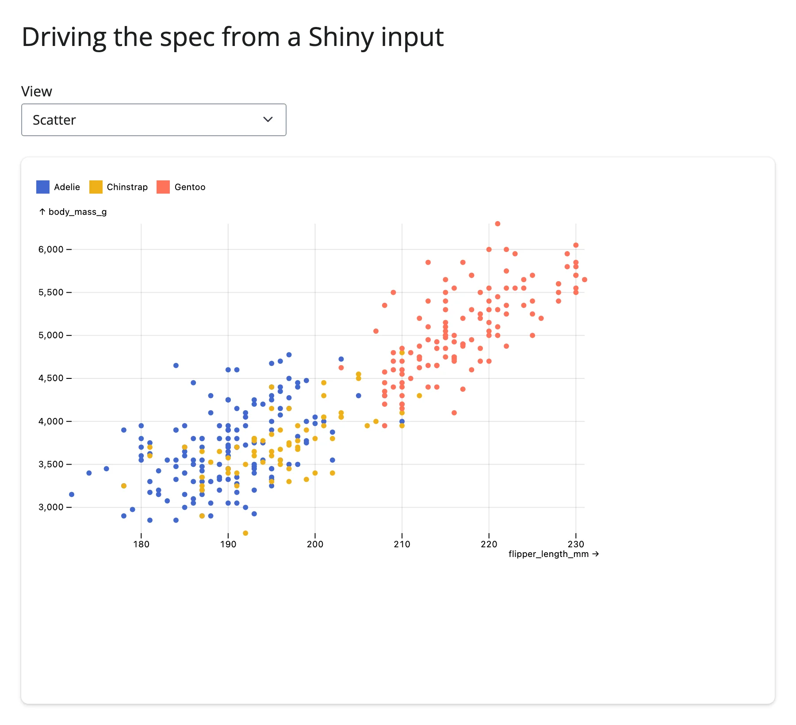
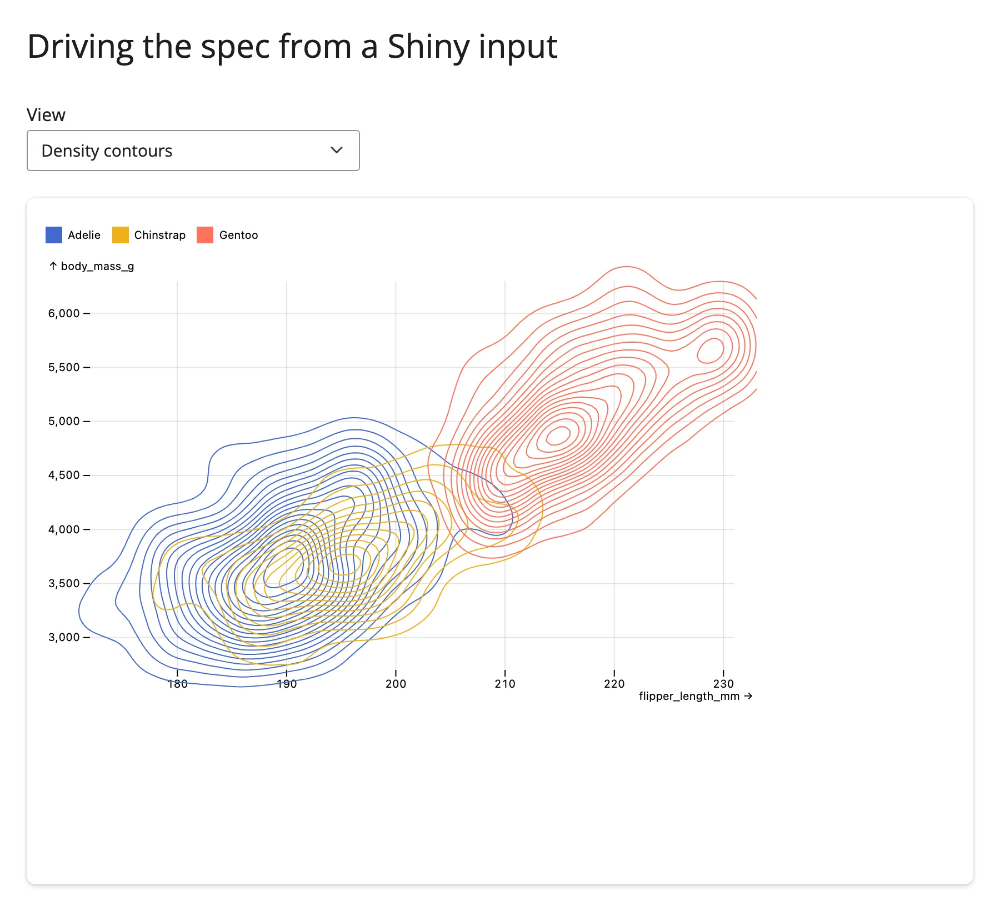

```{.python file="examples/08_select_input_spec.py"}
from __future__ import annotations

import polars as pl
from pyobsplot import Plot
from shiny.express import input, ui

from shinywidgets import render_obsplot

ui.page_opts(title="Driving the spec from a Shiny input", fillable=True)

penguins = pl.read_csv(
    "https://github.com/juba/pyobsplot/raw/main/doc/data/penguins.csv"
)

VIEWS = {
    "Scatter": lambda: [
        Plot.dot(
            penguins,
            {"x": "flipper_length_mm", "y": "body_mass_g", "fill": "species"},
        ),
    ],
    "Scatter + regression": lambda: [
        Plot.dot(
            penguins,
            {"x": "flipper_length_mm", "y": "body_mass_g", "fill": "species"},
        ),
        Plot.linearRegressionY(
            penguins,
            {"x": "flipper_length_mm", "y": "body_mass_g", "stroke": "species"},
        ),
    ],
    "Density contours": lambda: [
        Plot.density(
            penguins,
            {"x": "flipper_length_mm", "y": "body_mass_g", "stroke": "species"},
        ),
    ],
}

ui.input_select("view", "View", choices=list(VIEWS))

with ui.card(full_screen=True):

    @render_obsplot
    def plot():
        return Plot.plot(
            {
                "grid": True,
                "color": {"legend": True},
                "marks": VIEWS[input.view()](),
            }
        )
```

### Pairing Plot with an interactive widget

Since obsplot itself can't report a selection, pair it with a widget that can. A common pattern: another renderer's
accessor (e.g., `render_plotly`'s `.selected_rows()`, or `render_itables`'s `.selected_rows()`) picks out a subset
of rows, and a `@reactive.effect` redraws the obsplot chart from that subset by assigning `.widget.spec`. The full,
runnable versions of this pattern -- plotly lasso selection filtering a histogram, and table row selection
highlighting a point -- are in "Coordinating multiple views" below, since they're really the same technique as
"Updating the widget from Python" applied across two widgets.

### Beyond the accessors: `.read()`

Not applicable here -- see the explanation above. There's exactly one trait (`spec`), it's write-only from Python's
perspective, and reading it back (with `.read("spec")` or `reactive_read(plot.widget, "spec")`) would just echo
whatever Python last set.

### Rate limiting

Not applicable: `rate_policy`/`rate_delay` govern accessor and `.read()`/`reactive_read()` rate limiting, and
obsplot has neither.

## Updating the widget from Python

Every example above but the first two re-renders (the whole output rebuilds when an input changes). The decorated
function also exposes `.widget`, the live `ObsplotWidget` instance, with a writable `.spec` trait: assigning a new
spec to `my_plot.widget.spec` redraws the chart in place, without re-running the render function or involving
Shiny's output machinery at all.

This matters more for obsplot than for most widgets because of how the anywidget comm protocol works: pyobsplot
bundles about 1.4 MB of JavaScript, and *a normal re-render resends that whole bundle to the browser* (anywidget
doesn't cache it per-output across renders). An in-place `.widget.spec =` assignment skips that entirely -- it's a
small JSON message, not a multi-megabyte asset -- and it also means the output never flashes Shiny's
"recalculating" (dimmed/spinner) state. There's no camera, zoom, or selection state to preserve in a static SVG
chart (that's the usual reason to prefer in-place updates for other widgets), so here the benefit is purely
performance and visual smoothness, not state preservation.

The clearest way to see the difference is to compare a button that re-renders against one that doesn't, with a
visible render counter:

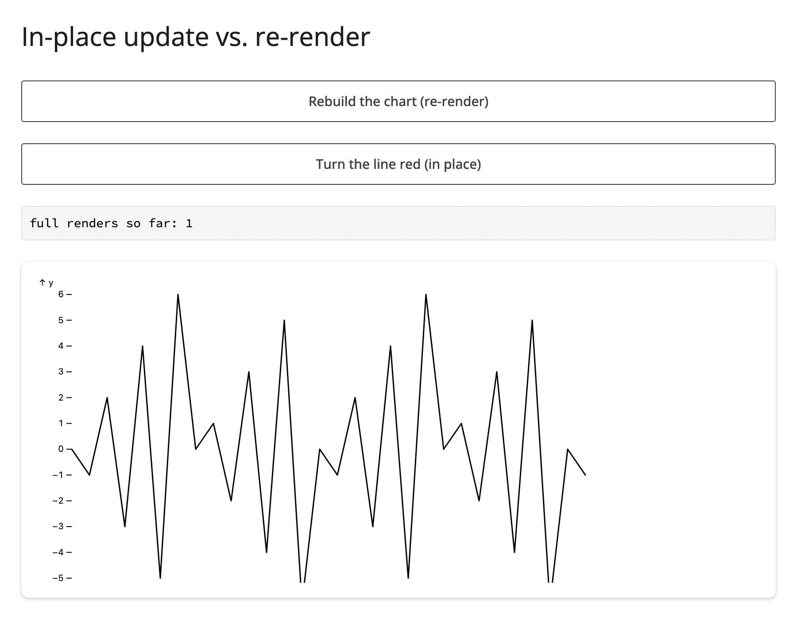
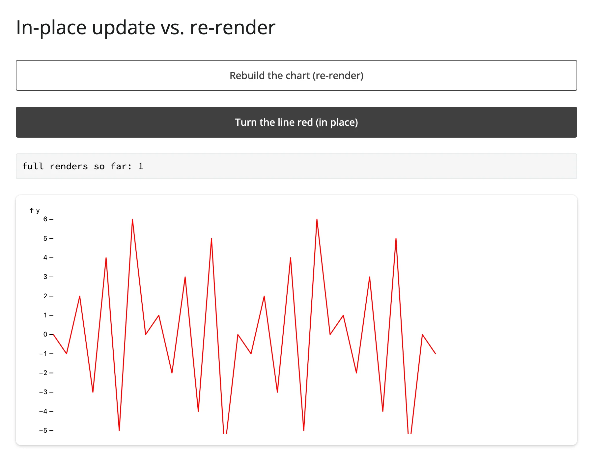
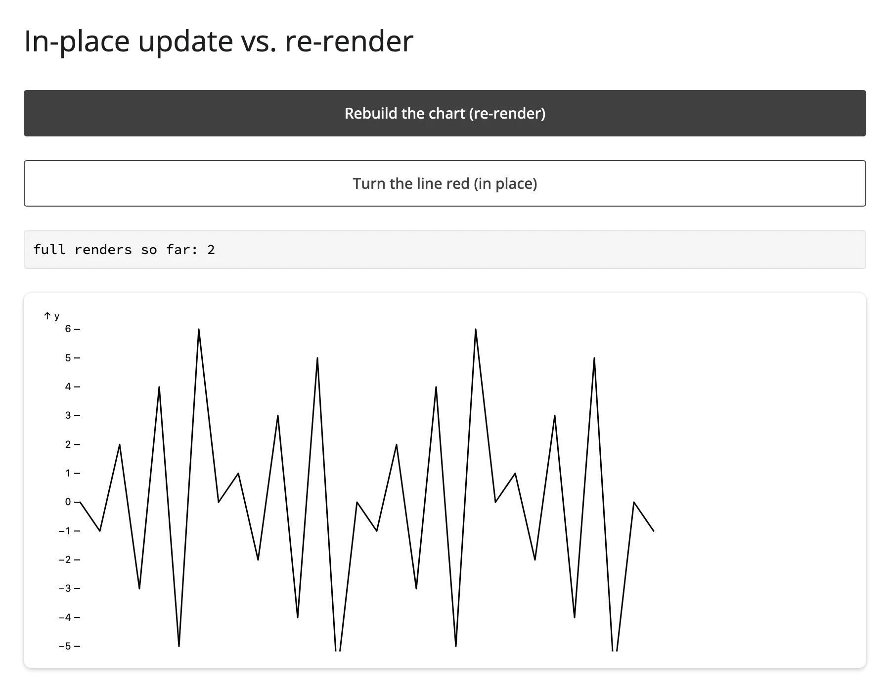

```{.python file="examples/09_inplace_vs_rerender.py"}
from __future__ import annotations

import pandas as pd
from pyobsplot import Plot
from shiny import reactive
from shiny.express import input, render, ui

from shinywidgets import render_obsplot

ui.page_opts(title="In-place update vs. re-render", fillable=True)

data = pd.DataFrame({"x": range(30), "y": [((-1) ** i) * (i % 7) for i in range(30)]})


def spec(color: str = "black") -> dict:
    return {"marks": [Plot.line(data, {"x": "x", "y": "y", "stroke": color})]}


ui.input_action_button("rerender", "Rebuild the chart (re-render)")
ui.input_action_button("recolor", "Turn the line red (in place)")

render_count = reactive.value(0)


@render.code
def count():
    return f"full renders so far: {render_count.get()}"


with ui.card(full_screen=True):

    @render_obsplot
    def chart():
        input.rerender()
        with reactive.isolate():
            render_count.set(render_count.get() + 1)
        return Plot.plot(spec())


@reactive.effect
@reactive.event(input.recolor)
def _():
    # No re-render: pyobsplot redraws the same widget instance with the new
    # spec, so the ~1.4 MB anywidget JS bundle isn't resent and the output
    # never flashes its "recalculating" state.
    chart.widget.spec = spec("red")
```

Note the `reactive.isolate()` around the counter read-then-set inside `chart()`: without it, `render_count.get()`
would register a dependency on its own output, and `render_count.set()` would immediately invalidate it again --
an infinite re-render loop. This is a generic Shiny counter-pattern gotcha, not specific to obsplot, but it's easy
to trip over the first time you wire up a render counter like this.

A more realistic use of in-place updates: a year slider that redraws a gapminder bubble chart on every tick,
instead of re-rendering (and re-sending the JS bundle) each time:

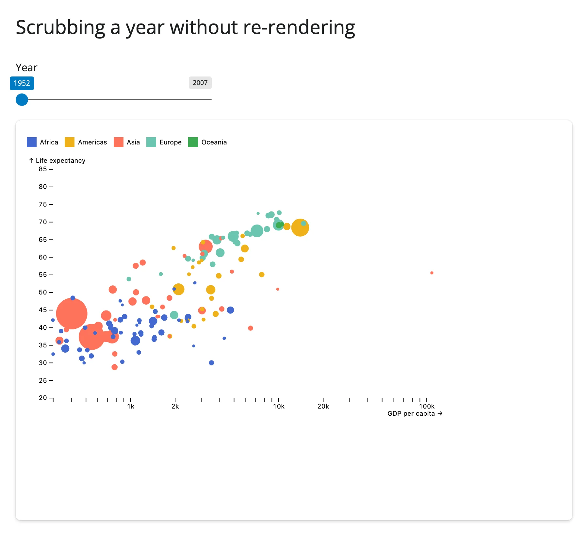
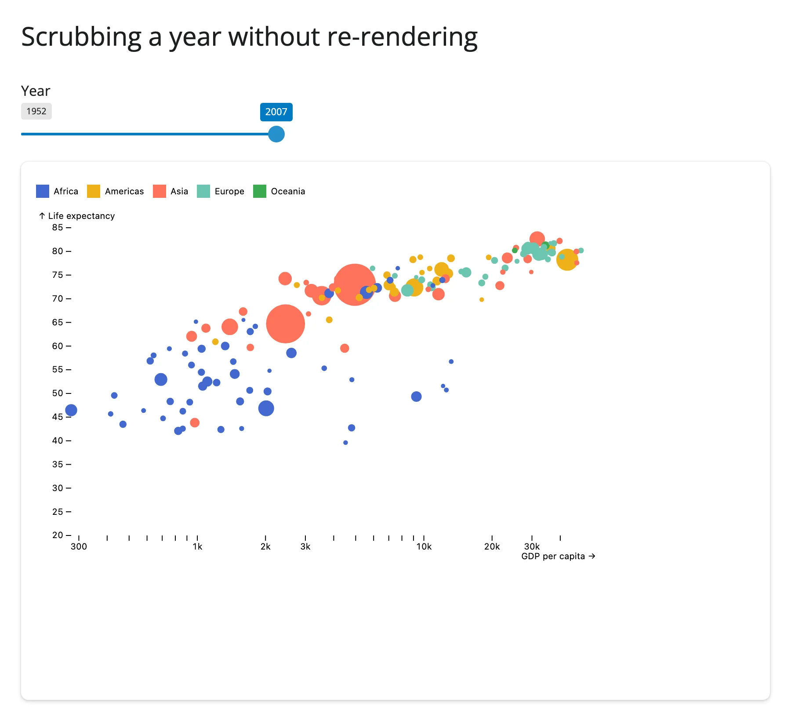

```{.python file="examples/10_year_slider_bubble.py"}
from __future__ import annotations

import plotly.express as px
from pyobsplot import Plot
from shiny import reactive
from shiny.express import input, ui

from shinywidgets import render_obsplot

ui.page_opts(title="Scrubbing a year without re-rendering", fillable=True)

gapminder = px.data.gapminder()
years = sorted(gapminder["year"].unique().tolist())

ui.input_slider(
    "year", "Year", min=years[0], max=years[-1], value=years[0], step=5, sep=""
)


def spec_for_year(year: int) -> dict:
    year_rows = gapminder[gapminder["year"] == year].reset_index(drop=True)
    return {
        "x": {"type": "log", "label": "GDP per capita"},
        "y": {"domain": [20, 85], "label": "Life expectancy"},
        "r": {"range": [2, 24]},
        "color": {"legend": True},
        "marks": [
            Plot.dot(
                year_rows,
                {"x": "gdpPercap", "y": "lifeExp", "r": "pop", "fill": "continent"},
            ),
        ],
    }


with ui.card(full_screen=True):

    @render_obsplot
    def bubble():
        return Plot.plot(spec_for_year(years[0]))


@reactive.effect
def _():
    # Every slider tick replaces the spec in place; the output never shows
    # Shiny's "recalculating" overlay and the JS bundle is sent only once.
    bubble.widget.spec = spec_for_year(input.year())
```

## Coordinating multiple views

These two patterns pair obsplot with a widget that *does* have accessors, so a gesture in one view updates an
obsplot chart in place.

### Lasso-select in Plotly, filter an Observable Plot histogram

`render_plotly`'s `.selected_rows(df)` accessor returns the rows behind a box or lasso selection (see the
[plotly guide](../plotly/index.md) for the accessor's full semantics). A `@reactive.effect` reads it and reassigns
the obsplot histogram's spec to the filtered data -- no re-render on either side.

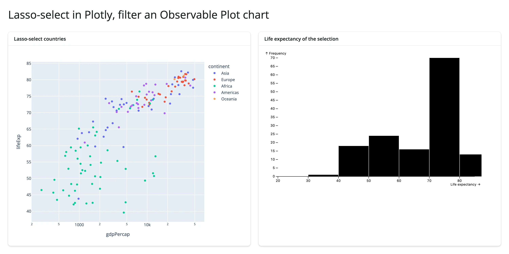
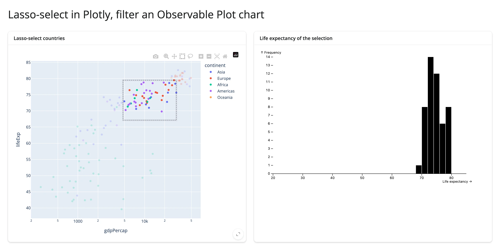

```{.python file="examples/11_lasso_filter_linked.py"}
from __future__ import annotations

import plotly.express as px
from pyobsplot import Plot
from shiny import reactive
from shiny.express import ui

from shinywidgets import render_obsplot, render_plotly

ui.page_opts(title="Lasso-select in Plotly, filter an Observable Plot chart", fillable=True)

gapminder_2007 = px.data.gapminder().query("year == 2007").reset_index(drop=True)


def hist_spec(data) -> dict:
    return {
        "x": {"domain": [20, 85], "label": "Life expectancy"},
        "marks": [
            Plot.rectY(data, Plot.binX({"y": "count"}, {"x": "lifeExp"})),
            Plot.ruleY([0]),
        ],
    }


with ui.layout_columns():
    with ui.card(full_screen=True):
        ui.card_header("Lasso-select countries")

        @render_plotly
        def scatter():
            fig = px.scatter(
                gapminder_2007,
                x="gdpPercap",
                y="lifeExp",
                color="continent",
                log_x=True,
                custom_data=[gapminder_2007.index],
            )
            return fig.update_layout(dragmode="select")

    with ui.card(full_screen=True):
        ui.card_header("Life expectancy of the selection")

        @render_obsplot
        def hist():
            return Plot.plot(hist_spec(gapminder_2007))


@reactive.effect
def _():
    rows = scatter.selected_rows(gapminder_2007)
    # selected_rows() keeps the original pandas index of the selected rows,
    # which pyobsplot 0.5.4 can't serialize unless it starts at 0 (see the
    # Gotchas section) -- reset it before handing the frame to Plot.
    data = rows.reset_index(drop=True) if len(rows) else gapminder_2007
    hist.widget.spec = hist_spec(data)
```

(Pairs with: [plotly](../plotly/index.md).)

### Table row selection highlights a point

`render_itables`'s `.selected_rows()` returns the positions of selected rows (see the
[itables guide](../itables/index.md)). Here, selecting a country in the table draws a second, ringed `Plot.dot`
mark on top of the matching bubble.

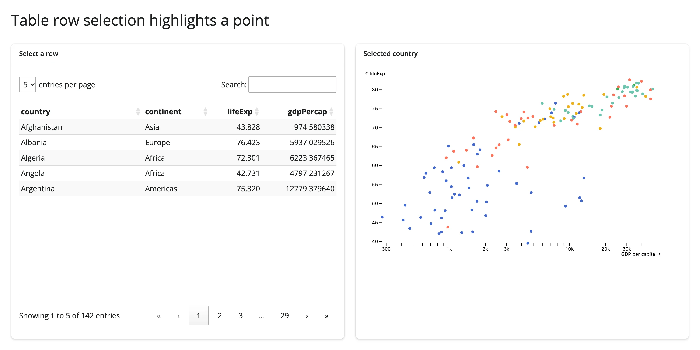
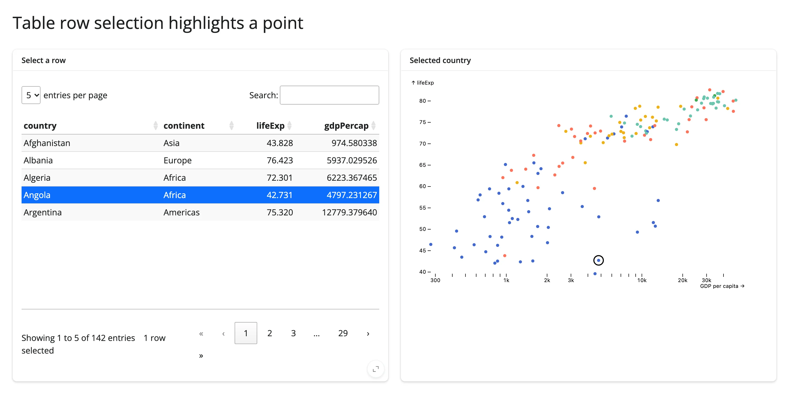

```{.python file="examples/12_table_row_highlight.py"}
from __future__ import annotations

import plotly.express as px
from itables.widget import ITable
from pyobsplot import Plot
from shiny import reactive
from shiny.express import ui

from shinywidgets import render_itables, render_obsplot

ui.page_opts(title="Table row selection highlights a point", fillable=True)

gapminder_2007 = px.data.gapminder().query("year == 2007").reset_index(drop=True)
cols = ["country", "continent", "lifeExp", "gdpPercap"]


def spec(country: str | None) -> dict:
    marks = [
        Plot.dot(
            gapminder_2007,
            {"x": "gdpPercap", "y": "lifeExp", "fill": "continent", "r": 3},
        ),
    ]
    if country is not None:
        row = gapminder_2007[gapminder_2007["country"] == country].reset_index(
            drop=True
        )
        marks.append(
            Plot.dot(
                row,
                {
                    "x": "gdpPercap",
                    "y": "lifeExp",
                    "r": 9,
                    "stroke": "black",
                    "strokeWidth": 2,
                },
            )
        )
    return {"x": {"type": "log", "label": "GDP per capita"}, "marks": marks}


with ui.layout_columns():
    with ui.card(full_screen=True):
        ui.card_header("Select a row")

        @render_itables
        def table():
            return ITable(gapminder_2007[cols], select=True, lengthMenu=[5])

    with ui.card(full_screen=True):
        ui.card_header("Selected country")

        @render_obsplot
        def plot():
            return Plot.plot(spec(None))


@reactive.effect
def _():
    rows = table.selected_rows()
    country = gapminder_2007.iloc[rows[0]]["country"] if rows else None
    plot.widget.spec = spec(country)
```

(Pairs with: [itables](../itables/index.md).)

Both patterns follow the same recipe: read another widget's accessor inside a `@reactive.effect`, compute a new
spec, and assign it to `my_chart.widget.spec`. Never read an accessor inside the obsplot render function itself if
you want in-place updates -- that would make the function depend on the accessor and re-render (rebuilding the
whole widget) every time it changes, which is the one thing this pattern is designed to avoid.

## Large data

obsplot has no large-data mode: pandas/polars DataFrames in the spec are serialized to Arrow IPC and sent with
the widget state in full, not lazily (see [Gotchas and limitations](#gotchas-and-limitations)) -- so the payload
grows with your row count. Aggregate in Python first (a `groupby`, a `head`), or let Observable Plot's own
`binX`/`groupY` transforms aggregate in the browser from a frame you've already trimmed, rather than shipping
millions of raw rows. For data that genuinely needs to stay in the millions, a widget built for scale is a
better fit for the dense view: [datashader](../datashader/index.md) for a density raster or
[jscatter](../jscatter/index.md#large-data) for a GPU scatter, each driving obsplot (or vice versa) through the
same [Coordinating multiple views](#coordinating-multiple-views) pattern above. See
[Large data & performance](../../guide/performance/index.md#three-approaches-to-large-data) for how the
three approaches compare.

## Layout and sizing

Observable Plot charts have a **fixed pixel width** (640px by default, set via the spec's `"width"` key): the SVG
shrinks proportionally, preserving aspect ratio, to fit a narrower container, but it never grows past the spec's
width. Verified directly: in a 700px-wide container the chart's SVG shrinks to fit (and the output's width matches
it almost exactly); widen the browser to 1600px and the SVG stays pinned at 640px, leaving blank space in the
card. If you want a wider chart in a wide layout, set `"width"` explicitly in the spec rather than relying on the
container.

Height follows the normal shinywidgets rules: `output_widget()`'s `fill`/`height` apply as usual, and if the
returned widget has an explicit `ipywidgets.Layout(height=...)`, filling is disabled for that output (this was
verified with a unit test: `fill` is `True` unless a non-`"auto"` layout height is present). In a `fillable=True`
card taller than the chart's own (fixed) height, the chart aligns to the top and leaves the rest of the card
blank -- seen directly in the facets example's screenshot. If you want the chart to look intentional rather than
stranded in a tall card, give the card a `height=` that roughly matches the chart's own height (as the gallery
showcase does), or wrap it with other content below.

## Gotchas and limitations

- **Filtered pandas DataFrames need `reset_index(drop=True)`.** This is the single most important thing to know.
  pyobsplot 0.5.4's pandas serializer checks every column for datetime values with `col.dropna()[0]` --
  unconditionally indexing position `0` by *label*. Any DataFrame whose index doesn't include label `0` (the
  universal result of `df[mask]`, `.query()`, `.iloc[...]` slicing, or passing a lasso/table selection straight
  through) raises `KeyError: 0` the moment it reaches `Plot.dot()`/`Plot.rectY()`/etc. Verified directly: filtering
  `gapminder` to `year == 2007` and passing it to `Plot.dot()` without resetting the index reproduces the error
  every time. The fix is always the same: call `.reset_index(drop=True)` right after filtering. **polars
  DataFrames are unaffected** (no index concept), so polars is the safer default if your app filters data
  reactively and you'd rather not think about this. This is an upstream pyobsplot bug (confirmed in its `data.py`),
  not a shinywidgets one, but it's extremely easy to hit in a Shiny app, since reactively filtering a DataFrame by
  an input is one of the most common patterns there is.
- **No accessors, no `.read()`/`reactive_read()` traits, ever.** Covered above, repeated here because it's the first thing
  users will look for. Verified by inspecting both `ObsplotWidget` (one trait, `spec`, Python -> browser only) and
  the compiled JS bundle (zero references to `model.save_changes`/`model.set(` anywhere in ~1.4 MB of code).
- **Rendering two `render_obsplot` outputs on the same page can cross-contaminate their scales on first paint.**
  Verified repeatedly with a two-chart dashboard (a bubble chart with an explicit `y` domain next to a histogram
  with none): on some page loads the histogram's y-axis would adopt the bubble chart's `y` domain (its axis started
  at 20 instead of 0), or the bubble chart would lose rows at the low end of its own range. A single obsplot chart
  on a page never showed this; it only appeared with two (or more) `ObsplotWidget` instances mounting at roughly
  the same time, and it was flaky rather than deterministic (sometimes both charts rendered correctly). This points
  to a concurrency bug in pyobsplot or Observable Plot's client-side rendering (possibly shared scale/module state
  across simultaneously-initializing instances), not in shinywidgets' widget management. If your app needs more
  than one obsplot chart on the same page, test it under load before shipping, and consider staggering their
  appearance (e.g., behind a tab or an `@render.ui` that mounts the second chart slightly after the first) if you
  see this. The gallery showcase below was simplified to a single obsplot output specifically to sidestep this.
  Filed upstream as [juba/pyobsplot#58](https://github.com/juba/pyobsplot/issues/58).
- **The JS bundle is large and resent on every re-render.** pyobsplot ships about 1.4 MB of JavaScript, and a
  normal Shiny re-render causes anywidget to resend it to the browser -- there's no per-session caching across
  renders. For a chart that updates frequently (a slider, a live feed), use `.widget.spec =` in-place updates (see
  above) instead of making the render function depend on the changing input.
- **Large datasets mean large messages.** pandas/polars DataFrames in the spec are serialized to Arrow IPC and sent
  with the widget state (not lazily). Aggregate in Python (or let `binX`/`groupY`/etc. aggregate in the browser)
  rather than shipping millions of raw rows.
- **A default-width chart in a tall `fillable=True` card leaves blank space below it** (see Layout and sizing).
  This is inherent to Plot's fixed-height SVGs, not a bug, but it's easy to not notice until you look at the
  rendered page.

## Gallery candidates

### Template: penguin view switcher

A small, adaptable starting point: a dropdown rebuilds the plot spec (scatter, scatter + tip, density contours,
beeswarm), and a button changes the fill color in place without a re-render.

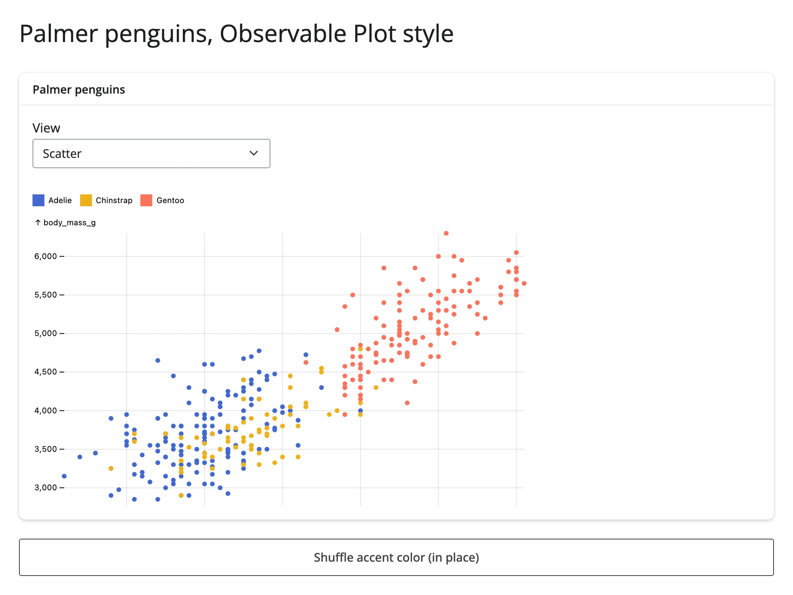
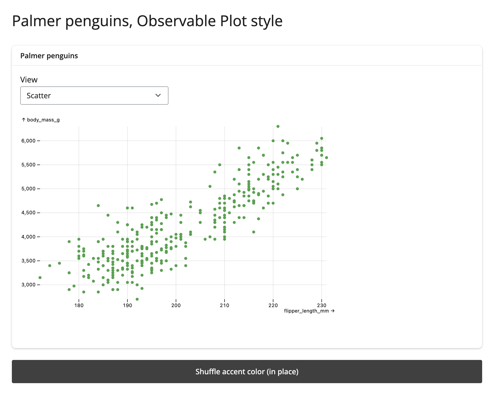

[`gallery/template_penguins_explorer.py`](gallery/template_penguins_explorer.py)

### Showcase: gapminder explorer

A year slider drives a bubble chart (GDP per capita vs. life expectancy, bubble size = population) in place, and
selecting a row in the linked table rings the matching country's bubble. This combines three techniques from the
guide: input-driven in-place updates, `reset_index(drop=True)` on the filtered highlight row (the exact gotcha
above, hit and fixed during verification), and itables-driven highlighting.

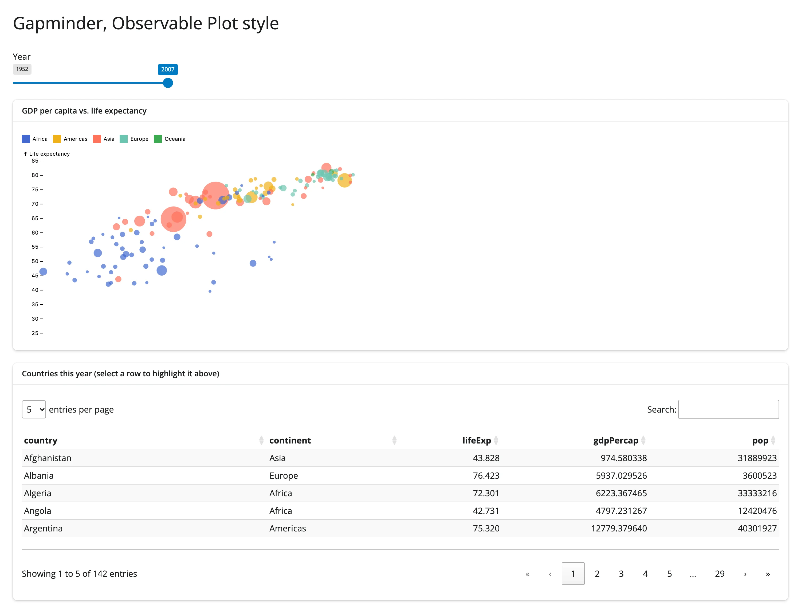
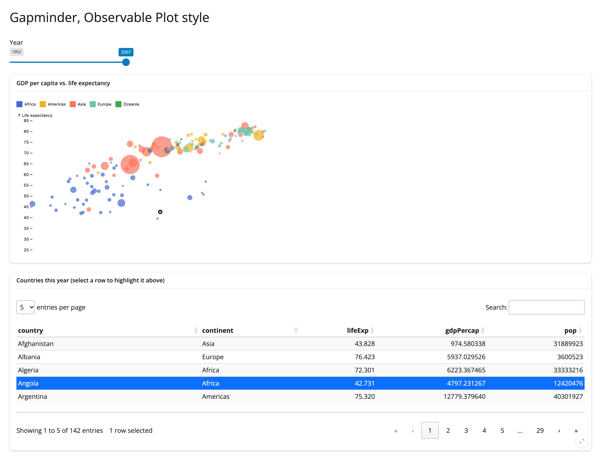

[`gallery/showcase_gapminder_dashboard.py`](gallery/showcase_gapminder_dashboard.py)

An earlier version of this showcase also had a second obsplot chart (a histogram) beside the bubble chart; it was
removed after triggering the two-obsplot concurrency bug described in Gotchas.

## Learn more

- [Observable Plot documentation](https://observablehq.com/plot/) -- the full mark and transform reference.
- [pyobsplot documentation](https://juba.github.io/pyobsplot/) -- the Python API, installation, and
  format/export options (`html`, `svg`, `png`).
- [Observable Plot "what is Plot"](https://observablehq.com/plot/what-is-plot) -- the library's design philosophy.
- Related guides in this roster: [altair](../altair/index.md), [plotnine](../plotnine/index.md),
  [plotly](../plotly/index.md), [itables](../itables/index.md).
