[Panel](https://panel.holoviz.org) is HoloViz's app-and-dashboard framework, built on [Bokeh](https://bokeh.org) and
maintained by Anaconda/HoloViz. Panel is itself a complete alternative to Shiny: it has its own reactive model
(`param`), its own layouts, and its own page templates. That overlap is exactly why `shinywidgets` doesn't try to
run a Panel *app* inside Shiny. Instead, `@render_panel` lets you reuse Panel's **component library** --
`pn.widgets.Tabulator`, `pn.chat.ChatInterface`, `pn.indicators.*`, custom `pn.custom.JSComponent`s, and any pane
Panel knows how to draw (`pn.pane.Vega`, `pn.pane.Plotly`, `pn.pane.Markdown`, ...) -- as one output in a Shiny app
whose reactivity, layout, and page chrome stay entirely Shiny's.

The decorated function may return anything `pn.panel()` accepts: a widget, a pane, a layout, a string, a
DataFrame, a figure, or your own `pn.viewable.Viewer`/`pn.custom.JSComponent` subclass. Panel renders it through
Bokeh, via `jupyter_bokeh`, the same library Jupyter uses to show Panel objects in a notebook without a Panel
server -- `shinywidgets` reuses that mechanism so Panel's own Python callbacks (`pn.bind()`, `.param.watch()`,
`on_click()`, even periodic callbacks) run for real, synchronously inside the Shiny server, whenever the user
interacts with the component in the browser.

`render_panel` has one accessor, `param(name)`, but it's a general one: it reads *any* parameter of the rendered
object reactively -- `slider.param("value")`, `table.param("selection")`, `chat.param("objects")`, whatever
`param.Parameterized` attribute the object you returned happens to have. A reactive function that calls it
re-runs whenever that parameter changes, from browser interaction or from Python, the same way `input.my_slider()`
reads an ordinary Shiny input -- and because it's seeded at render and kept live from then on, you can read it at
any time: in a button handler, a download handler, an LLM tool, not just a dedicated watcher. Panel's state lives
in `param` objects, not ipywidget traits, so `reactive_read()` doesn't apply to it; `param(name)` is the
accessor-shaped replacement. It only reaches parameters on the object you returned directly, though -- a widget
nested one level down (e.g. inside a `pn.Row` or `pn.Column` you assembled and returned) needs a plain
`obj.param.watch(...)` instead (see [Reacting to user interaction](#reacting-to-user-interaction)).

Reach for `render_panel` when you want a specific Panel-only component (Tabulator's formatters and theming,
`pn.chat`, an indicator, a small custom `JSComponent`) inside an otherwise-ordinary Shiny app. Don't reach for it
to rebuild a Panel *app* inside Shiny -- you'd be running two reactive systems and a page-layout system you don't
need; use Shiny's own inputs, layouts, and [`render_plotly`](../plotly/index.md) /
[`render_bokeh`](../bokeh/index.md) / [`render_itables`](../itables/index.md) instead, and save `render_panel` for
the handful of components below that have no equivalent elsewhere in the roster.


## Installation

```
pip install 'shinywidgets[panel]'
```

That installs `panel` and `jupyter_bokeh`. Panel's own JavaScript and CSS (including per-extension bundles like
Tabulator's and ECharts') are served locally from the installed `panel` package -- no CDN round trip, no extra
setup, including the lazily-fetched resources some panes request after the initial bundle (e.g. the ECharts-GL
sub-bundle `pn.indicators.Gauge` needs). shinywidgets mounts the `/static/extensions/panel/...` path those
requests hit, matching what a real Panel/Bokeh server serves.

## Quick start

A `pn.widgets.Tabulator` with no server of its own:

```{.python file="examples/01_quickstart.py"}
import panel as pn
import plotly.express as px
from shiny.express import ui
from shinywidgets import render_panel

pn.extension("tabulator")

tips = px.data.tips()

ui.page_opts(title="Panel quickstart", fillable=True)

with ui.card(full_screen=True):
    ui.card_header("A Panel Tabulator, with no Panel server")

    @render_panel
    def table():
        return pn.widgets.Tabulator(
            tips,
            selectable=True,
            disabled=True,
            theme="bootstrap5",
            layout="fit_columns",
            sizing_mode="stretch_both",
        )
```

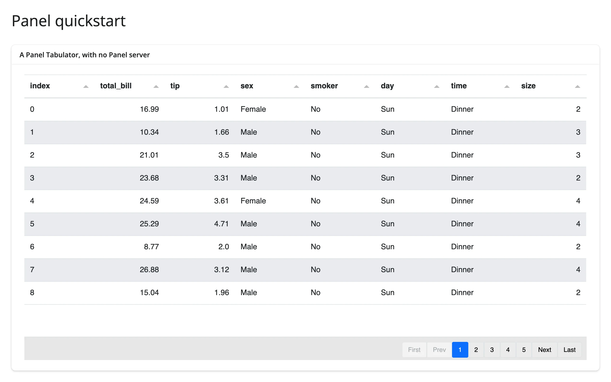

`pn.extension("tabulator")` loads Tabulator's JavaScript up front (see
[Gotchas](#gotchas-and-limitations) for what happens if you skip it for a component that appears later).
`disabled=True` matters too: Tabulator's cells are editable by default, so without it, clicking a cell starts
editing instead of selecting the row. `sizing_mode="stretch_both"` is what makes the table fill the card -- see
[Layout and sizing](#layout-and-sizing).

## What you can build

### A themed, formatted data table

Tabulator is Panel's standout component: sortable, filterable, with per-column formatters (progress bars,
currency, dates) and built-in themes. None of this requires a line of custom CSS:

```{.python file="examples/02_tabulator_formatters.py"}
import panel as pn
import plotly.express as px
from shiny.express import ui
from shinywidgets import render_panel

pn.extension("tabulator")

gapminder_2007 = px.data.gapminder().query("year == 2007")

ui.page_opts(title="Tabulator formatters", fillable=True)

with ui.card(full_screen=True):
    ui.card_header("Life expectancy by country, 2007")

    @render_panel
    def table():
        return pn.widgets.Tabulator(
            gapminder_2007[["country", "continent", "lifeExp", "gdpPercap"]],
            selectable=True,
            disabled=True,
            theme="bootstrap5",
            layout="fit_columns",
            sizing_mode="stretch_both",
            formatters={
                "lifeExp": {
                    "type": "progress",
                    "min": 40,
                    "max": 85,
                    "color": ["#d7301f", "#fdae61", "#a6d96a", "#1a9850"],
                },
                "gdpPercap": {"type": "money", "symbol": "$", "precision": 0},
            },
        )
```

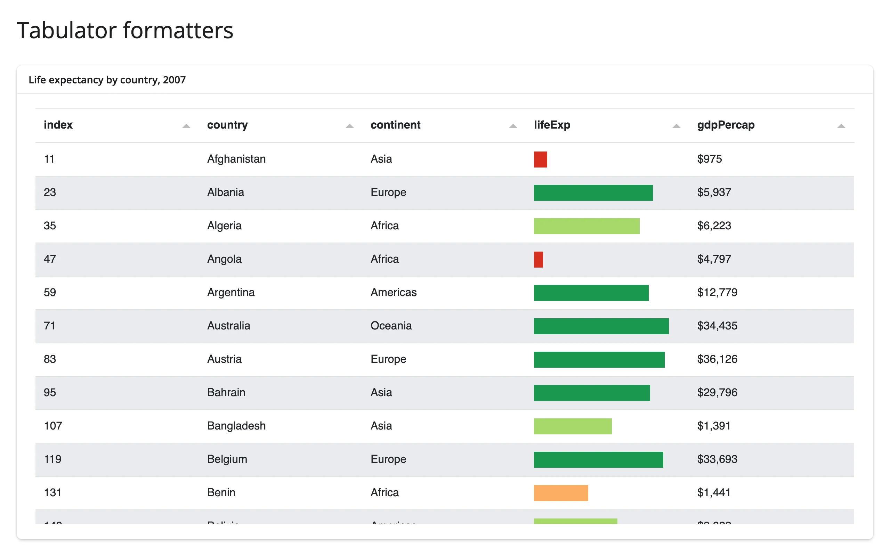

For a table with Shiny's own selection/edit/pagination model (and an accessor for selected rows), see
[itables](../itables/index.md) or [reactable](../reactable/index.md) instead -- Tabulator is worth it specifically
for its formatters, theming, and client-side filtering.

### Dashboard indicators

`pn.indicators` gives you gauges, big-number tiles, and progress bars with no charting library of your own to
wire up:

```{.python file="examples/03_indicators.py"}
import panel as pn
from shiny.express import ui
from shinywidgets import render_panel

# Gauge is ECharts-backed; its JS loads through pn.extension() like any
# other extension-bundled pane.
pn.extension("echarts")

ui.page_opts(title="Panel indicators", fillable=True)

with ui.layout_columns(col_widths=[3, 3, 3, 3]):
    with ui.card():
        ui.card_header("Dial")

        @render_panel
        def dial():
            return pn.indicators.Dial(
                name="CPU", value=72, bounds=(0, 100), format="{value}%",
                colors=[(0.6, "green"), (0.85, "gold"), (1, "red")],
                sizing_mode="stretch_both",
            )

    with ui.card():
        ui.card_header("Gauge (ECharts)")

        @render_panel
        def gauge():
            return pn.indicators.Gauge(
                name="Load", value=64, bounds=(0, 100), sizing_mode="stretch_both",
            )

    with ui.card():
        ui.card_header("Number")

        @render_panel
        def number():
            return pn.indicators.Number(
                name="Monthly revenue", value=4239, format="${value:,.0f}",
                colors=[(5000, "red"), (10000, "green")],
                sizing_mode="stretch_both",
            )

    with ui.card():
        ui.card_header("Progress")

        @render_panel
        def progress():
            return pn.indicators.Progress(
                name="Deploy progress", value=64, sizing_mode="stretch_width",
                bar_color="success",
            )
```

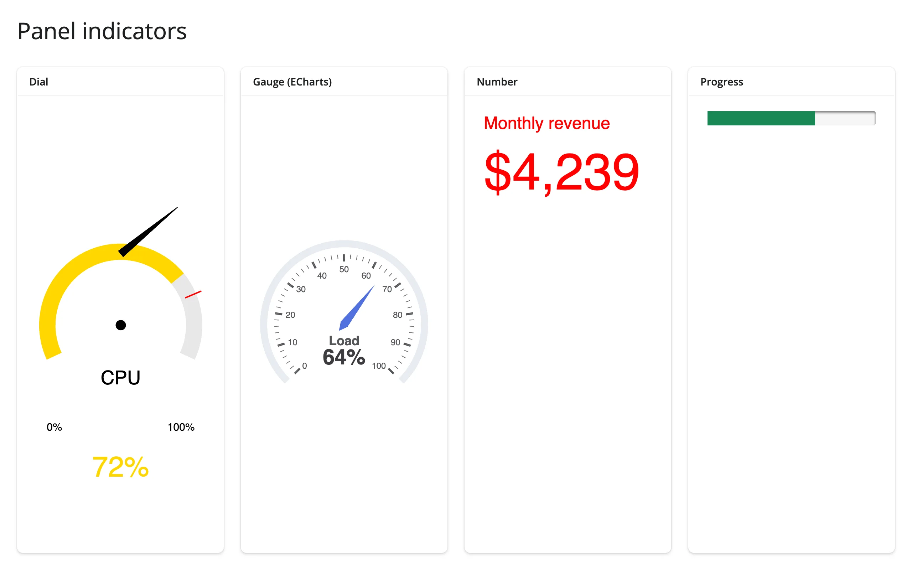

`Dial`, `Number`, and `Progress` all stretch to fill their card with `sizing_mode="stretch_both"`/`"stretch_width"`.
`Gauge` is ECharts-backed, so it needs `pn.extension("echarts")` up front; without it the gauge renders blank with
a console error. A few other indicators (`LinearGauge`, `Trend`, `BooleanStatus`) are SVG-based and don't size
responsively -- give them explicit `width=`/`height=` instead (see [Gotchas](#gotchas-and-limitations)).

### A chat interface, no LLM required

`pn.chat.ChatInterface` is a full chat UI -- message history, avatars, timestamps -- driven by a plain Python
callback. It doesn't need a language model to be useful: the callback can be anything, including a rules engine
over your app's own data (see the [fleet dashboard](#gallery-candidates) in the gallery):

```{.python file="examples/04_chat.py"}
import panel as pn
from shiny.express import ui
from shinywidgets import render_panel

ui.page_opts(title="Panel chat", fillable=True)


def canned_reply(contents: str, user: str, instance: pn.chat.ChatInterface):
    words = len(contents.split())
    return f"You said {words} word{'s' if words != 1 else ''}: \"{contents}\""


with ui.card(full_screen=True):
    ui.card_header("pn.chat.ChatInterface -- no LLM, no Panel server")

    @render_panel
    def chat():
        return pn.chat.ChatInterface(
            callback=canned_reply,
            show_rerun=False,
            show_undo=False,
            sizing_mode="stretch_both",
        )
```

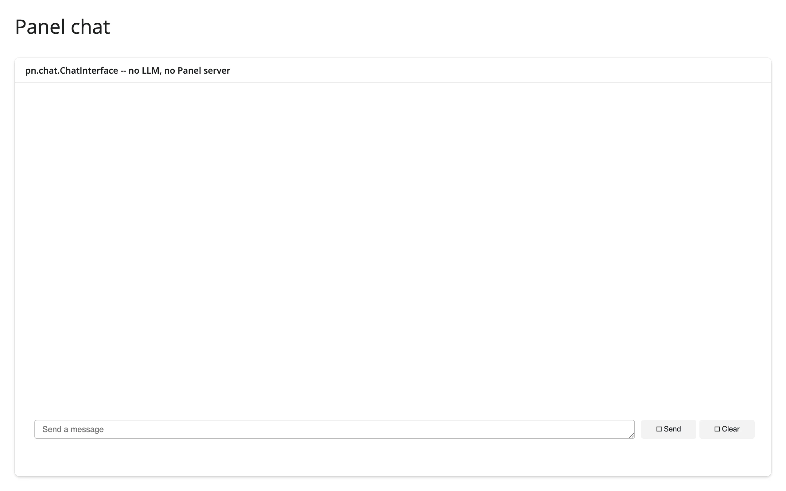
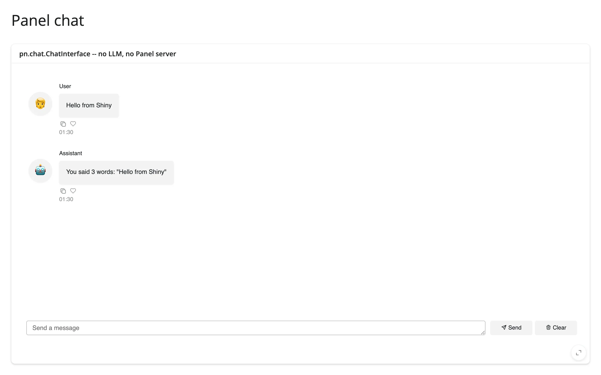

Typing a message and pressing send runs `canned_reply` inside the Shiny server and streams the reply back --
verified with a real Playwright keystroke-and-click.

### Bring your own JavaScript component

`pn.custom.JSComponent` turns a few lines of ESM into a two-way-synced component. `model.<param>` reads/writes
the Python side; `model.on(<param>, cb)` reacts to Python-side changes:

```{.python file="examples/05_jscomponent.py"}
import panel as pn
import param
from shiny.express import ui
from shinywidgets import render_panel


class Counter(pn.custom.JSComponent):
    count = param.Integer(default=0)

    _esm = """
    export function render({ model, el }) {
      const button = document.createElement("button");
      const render = () => button.innerText = `Count is ${model.count}`;
      render();
      button.onclick = () => model.count += 1;
      model.on("count", render);
      el.append(button);
    }
    """


ui.page_opts(title="Custom JSComponent", fillable=True)

with ui.card():
    ui.card_header("10 lines of ESM, two-way synced with Python")

    @render_panel
    def counter():
        return Counter()
```


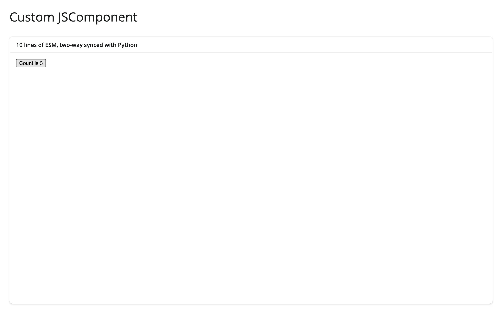

Three clicks took `model.count` from 0 to 3 -- a real Playwright click, not a simulated event. `JSComponent` (and
`pn.viewable.Viewer`) subclasses defined in your own app module now coerce correctly when returned directly;
earlier shinywidgets releases required wrapping them in `pn.Column(...)` (see
[Gotchas](#gotchas-and-limitations)).

### Compose your own reusable component

`pn.viewable.Viewer` lets you package several widgets and some glue logic into one class with a single
`__panel__()` method -- a lightweight alternative to a Shiny module when the logic is Panel-only:

```{.python file="examples/06_viewer.py"}
import panel as pn
import param
from shiny.express import ui
from shinywidgets import render_panel


class TemperatureConverter(pn.viewable.Viewer):
    """A reusable component: one widget, one computed display, no Shiny code."""

    celsius = param.Number(default=20, bounds=(-40, 120))

    def __panel__(self):
        slider = pn.widgets.FloatSlider.from_param(self.param.celsius, name="Celsius")
        fahrenheit = pn.bind(lambda c: f"**{c * 9 / 5 + 32:.1f} F**", self.param.celsius)
        return pn.Column(slider, pn.pane.Markdown(fahrenheit))


ui.page_opts(title="pn.viewable.Viewer", fillable=True)

with ui.card():
    ui.card_header("A Viewer bundles widgets + logic into one reusable component")

    @render_panel
    def converter():
        return TemperatureConverter()
```

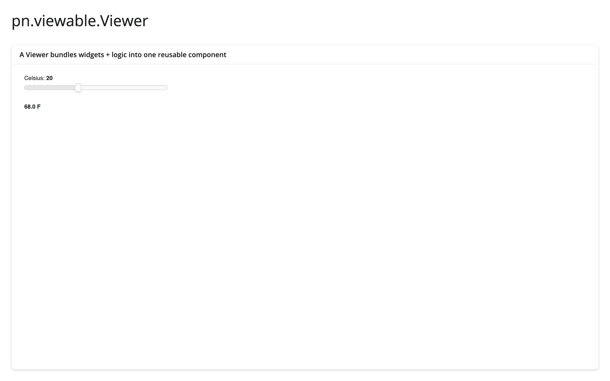
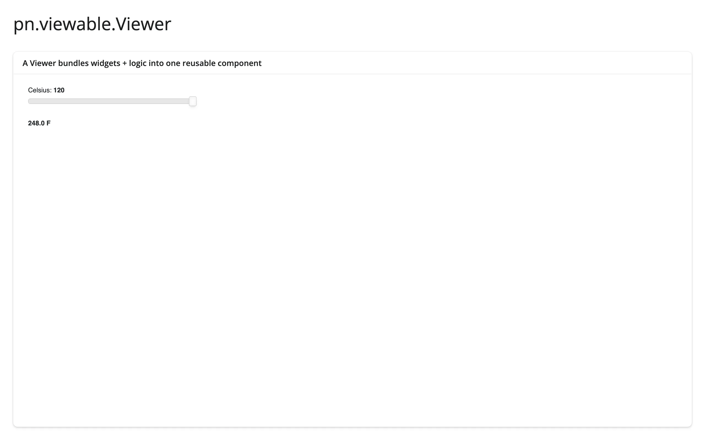

Dragging the slider to 120 C updated the Fahrenheit readout to 248.0 F entirely through Panel's own `pn.bind()` --
no Shiny code involved. `render_panel.value` is the live `TemperatureConverter` instance, so you can still reach
into it from Shiny reactively with `converter.param("celsius")` (see
[Reacting to user interaction](#reacting-to-user-interaction)).

## Reacting to user interaction

### Accessor reference

| accessor | returns | before any interaction | across re-render | default rate policy |
|---|---|---|---|---|
| `param(name)` | the current value of the rendered object's `name` parameter | seeded value (the parameter's value at render, not `None`) | re-seeded (follows the new `.value` object) | none -- every change publishes immediately; read the parameter's own throttled variant (e.g. `value_throttled`) if the library provides one |

### `param(name)`: read any Panel parameter like an input

Call `param(name)` in a reactive function and it re-runs whenever that parameter changes -- from a browser
gesture or from a plain Python assignment, both handled the same way. [`examples/07_param_accessor.py`](examples/07_param_accessor.py)
drives the same slider both ways:

```{.python file="examples/07_param_accessor.py"}
import panel as pn
from shiny import reactive
from shiny.express import input, render, ui
from shinywidgets import render_panel

ui.page_opts(title="param(name): read a Panel parameter like an input", fillable=True)

with ui.layout_columns(col_widths=[6, 6]):
    with ui.card():
        ui.card_header("Drag the slider, or bump it from Python")
        ui.input_action_button("bump", "+2 from Python")

        @render_panel
        def slider():
            return pn.widgets.IntSlider(name="Quantity", value=5, start=0, end=20)

    with ui.card():
        ui.card_header("slider.param('value') -- reads both kinds of change")

        @render.text
        def value():
            return f"quantity = {slider.param('value')}"


@reactive.effect
@reactive.event(input.bump)
def _():
    slider.value.value += 2
```

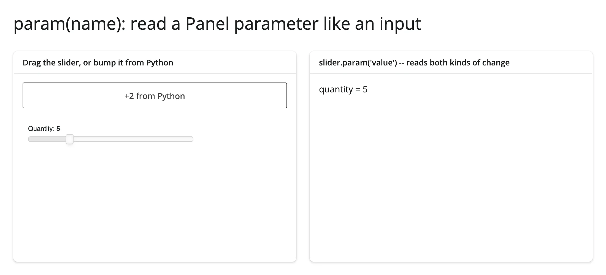
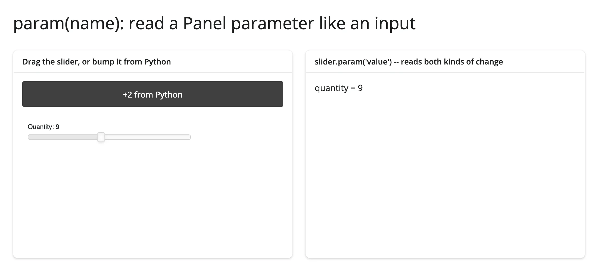

Two arrow-key steps in the browser took the readout from 5 to 7; one click of "+2 from Python" took it from 7 to
9 -- the same accessor, the same readout, no branching code for which side changed. A few things to know:

- **It's seeded at render** with the parameter's current value, and **re-seeded on every re-render**, following
  the new `.value` object -- there's no `None` to guard against before the first interaction, and no warm-up step
  needed before a reader can see a value.
- **It's live from any reactive context, read at any time**: a `@render.*` function, `@reactive.calc`,
  `@reactive.effect`, a download handler, an LLM tool callback. You don't need to have wired up a dedicated
  watcher ahead of time -- any reader that calls `slider.param("value")` gets the current value and re-runs on the
  next change, the same as reading a Shiny input.
- **It raises** if `.value` isn't a `param.Parameterized` object (e.g., the render function returned a raw
  DataFrame or string -- "needs the rendered object to be a param.Parameterized") or has no parameter by that
  name ("`ExampleWidget` has no parameter 'nope' (its parameters are: ...)").
- **It can't be read inside this output's own render function**, same restriction as every accessor -- the render
  function builds a new object each time it runs, so there's nothing stable to watch yet.
- **In-place mutation of a mutable parameter** (e.g., appending to a `param.List`) needs an explicit
  `obj.param.trigger(name)` afterwards, same as Panel itself requires -- `param`'s own change detection only
  catches reassignment, not mutation.
- **To throttle a continuously-changing parameter** (a dragged slider firing on every pixel), read Panel's own
  throttled variant instead of adding rate limiting yourself: `slider.param("value_throttled")` for an
  `IntSlider`/`FloatSlider`.

### When `param(name)` can't reach it: a nested widget

`param(name)` only looks at parameters on the object you returned directly (`render_panel.value`) -- not at
anything nested inside it. Wrap a widget in a layout and the picture changes:
[`examples/08_param_watch_nested.py`](examples/08_param_watch_nested.py) returns a `pn.Row(slider, button)`, so
`controls.param("value")` raises (`Row has no parameter 'value'` -- `pn.Row` is a layout, not a slider). Watch the
nested widget directly instead, the same `.param.watch()` call Panel itself uses internally:

```{.python file="examples/08_param_watch_nested.py"}
import panel as pn
from shiny import reactive
from shiny.express import render, ui
from shinywidgets import render_panel

ui.page_opts(title="A nested widget: param(name) can't reach it", fillable=True)

quantity = reactive.value(10)

with ui.layout_columns(col_widths=[6, 6]):
    with ui.card():
        ui.card_header("A slider + reset button, returned as one pn.Row")

        @render_panel
        def controls():
            slider = pn.widgets.IntSlider(name="Quantity", value=10, start=0, end=100)
            reset = pn.widgets.Button(name="Reset to 10")
            # controls.param("value") can't reach the slider: the rendered
            # object is the Row, which has no "value" of its own. Watch the
            # nested widget directly instead.
            slider.param.watch(lambda e: quantity.set(e.new), "value")
            reset.on_click(lambda _: setattr(slider, "value", 10))
            return pn.Row(slider, reset)

    with ui.card():
        ui.card_header("quantity (a Shiny reactive.value, set by the watcher)")

        @render.text
        def readout():
            return f"quantity = {quantity()}"
```

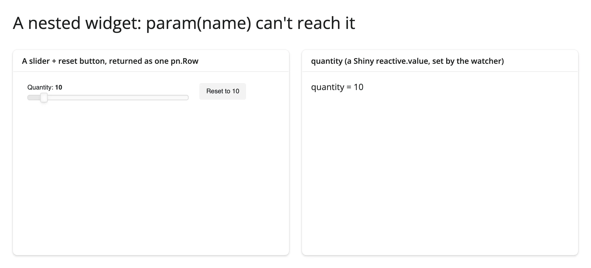
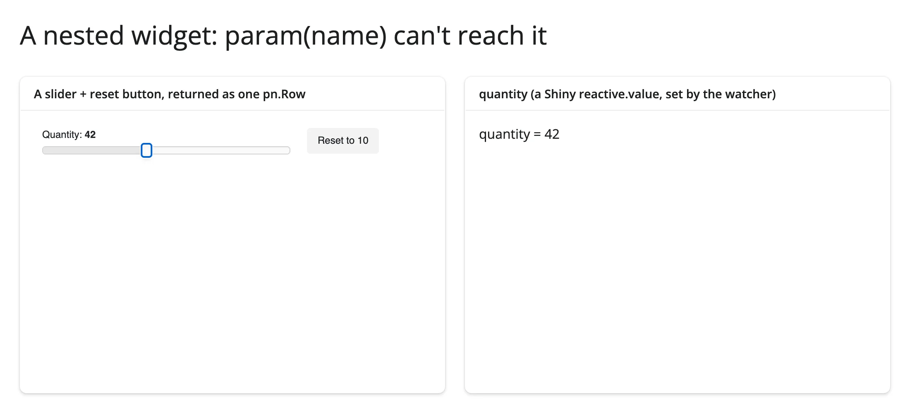

Dragging the slider to 42, then clicking "Reset to 10", both came through the watcher into `quantity`. This is
the one place in this guide where the pre-`param(name)` pattern -- a Panel watcher feeding a `reactive.value` --
is still the right tool, specifically because the state you want lives on an object one level below the one
`render_panel` tracks.

### Beyond `param()`: `reactive_read()` and `.read()`

`reactive_read()` is built for ipywidget traits (it calls `.has_trait()` and `.observe()`); a Panel object has
neither -- `reactive_read(table.value, "selection")` raises `AttributeError: 'Tabulator' object has no attribute
'has_trait'`, verified directly on current `main`. `render_panel` also gets the generic `.read(name)` every
renderer has, but it isn't useful here: `.read(name)` falls through to `reactive_read()` on `.widget`, the
internal `jupyter_bokeh.BokehModel`, whose handful of traits don't reflect anything happening in the Panel object
(see [Gotchas](#gotchas-and-limitations)) -- and it doesn't
reach `param(name)` either, since a dynamically-named accessor like `param("value")` is stored internally as
`"param:value"`, not `"value"` (verified: `table.read("value")` raises `AttributeError`, with a "did you mean
'param:value'?" hint that isn't itself a valid call). Always call `.param(name)` directly.

### Rate limiting

`render_panel(rate_policy=..., rate_delay=...)` exist on the decorator (inherited from the same base class every
`render_*` decorator shares) but have nothing to act on: `param(name)`'s default rate policy is fixed at "none"
regardless of these kwargs (verified by reading `shinywidgets/_panel.py`'s `dynamic_accessor_spec()`, which
doesn't set `rate_policy`). Use the parameter's own throttled variant where the library provides one (see above),
or a plain `time`-based guard in a manual `.param.watch()` callback for anything else.

## Updating the widget from Python

Because `render_panel.value` is the live Panel object you returned, you can mutate it from a `@reactive.effect`
instead of re-rendering. This matters for the same reason it matters for Bokeh: re-rendering gives the user a
brand new table, resetting sort order and selection; mutating `.value` in place keeps both, and sends only a
small patch over the comm instead of rebuilding and resending the whole table:

```{.python file="examples/09_update_in_place.py"}
import pandas as pd
import panel as pn
import plotly.express as px
from shiny import reactive
from shiny.express import input, ui
from shinywidgets import render_panel

pn.extension("tabulator")

gapminder = px.data.gapminder()
years = sorted(gapminder["year"].unique().tolist())

ui.page_opts(title="Updating a Panel table in place", fillable=True)

with ui.card(full_screen=True):
    ui.input_slider("year", "Year", min=years[0], max=years[-1], value=years[0], step=5)

    @render_panel
    def table():
        with reactive.isolate():
            df = gapminder[gapminder["year"] == input.year()]
        return pn.widgets.Tabulator(
            df[["country", "continent", "lifeExp", "pop"]],
            selectable=True, disabled=True, theme="bootstrap5",
            layout="fit_columns", sizing_mode="stretch_both",
        )


@reactive.effect
def _():
    # Mutating `.value` in place (instead of returning a new Tabulator from
    # the render function) keeps the table's current client-side sort, and
    # re-points the row selection at the same countries by name.
    tab = table.value
    kept = set(tab.value.iloc[tab.selection]["country"])
    df = gapminder[gapminder["year"] == input.year()][
        ["country", "continent", "lifeExp", "pop"]
    ]
    tab.value = df
    tab.selection = [i for i, c in enumerate(df["country"]) if c in kept]
```

Sorted ascending by life expectancy, with Afghanistan and Gambia selected at 1952:

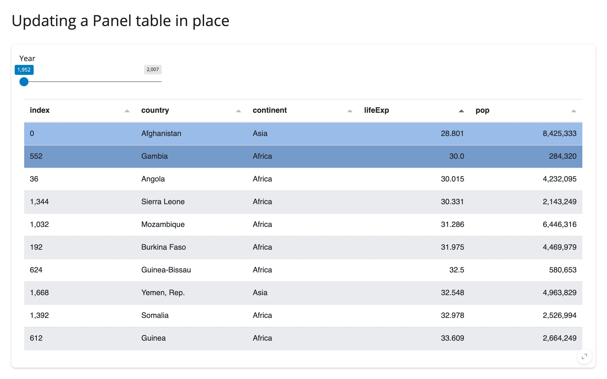

After moving the year slider to 1972: the sort order is still ascending by life expectancy, and the *same two
countries* are still selected -- at new row positions, since their relative rank changed:

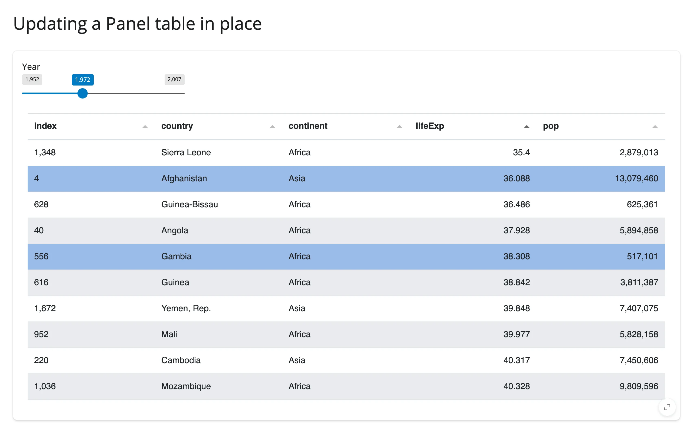

`Tabulator.selection` holds row **positions** in the current `.value`, not stable row identifiers -- replacing
`.value` without re-pointing `.selection` leaves the old integer positions pointing at whatever rows happen to be
there now, which is why the snippet re-maps positions by country name after each update.

## Coordinating multiple views

### Table selection drives a chart

`table.param("selection")` reads a Tabulator's current row selection directly -- no separate bridge to wire up --
which plugs into any other renderer, here a Shiny-native `render_plotly` chart with no Panel involvement:

```{.python file="examples/10_selection_to_chart.py"}
import panel as pn
import plotly.express as px
from shiny.express import ui
from shinywidgets import render_panel, render_plotly

pn.extension("tabulator")

gapminder = px.data.gapminder()
latest = gapminder[gapminder["year"] == 2007].sort_values("pop", ascending=False).head(15)

ui.page_opts(title="Table selection drives a plotly chart", fillable=True)

with ui.layout_columns(col_widths=[7, 5]):
    with ui.card(full_screen=True):
        ui.card_header("The 15 most populous countries, 2007 (select some rows)")

        @render_panel
        def table():
            return pn.widgets.Tabulator(
                latest[["country", "continent", "pop"]],
                selectable=True, disabled=True, theme="bootstrap5",
                layout="fit_columns", sizing_mode="stretch_both",
            )

    with ui.card(full_screen=True):
        ui.card_header("Life expectancy trend of the selected countries")

        @render_plotly
        def trend():
            idx = table.param("selection")
            countries = table.value.value.iloc[idx]["country"].tolist() if idx else []
            df = gapminder[gapminder["country"].isin(countries)] if countries else gapminder.iloc[:0]
            return px.line(df, x="year", y="lifeExp", color="country", markers=True)
```

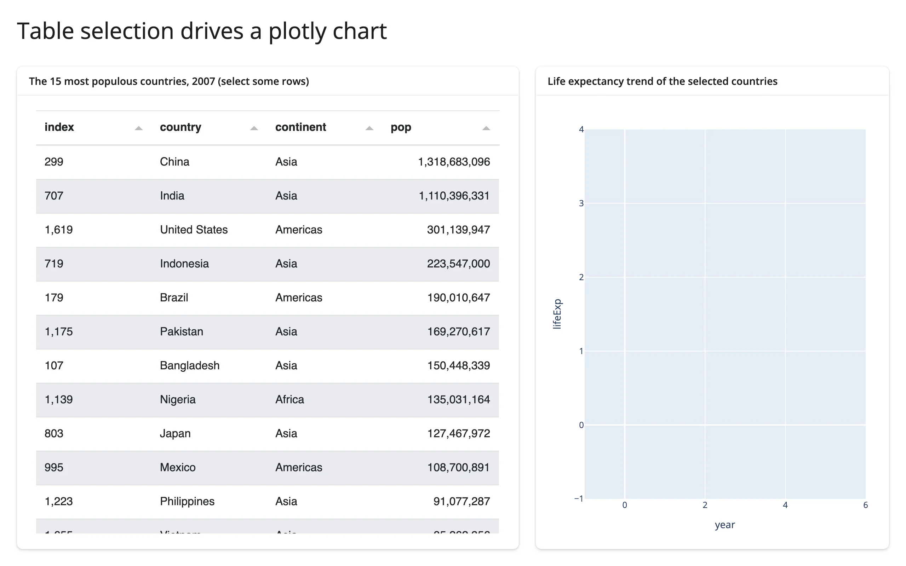
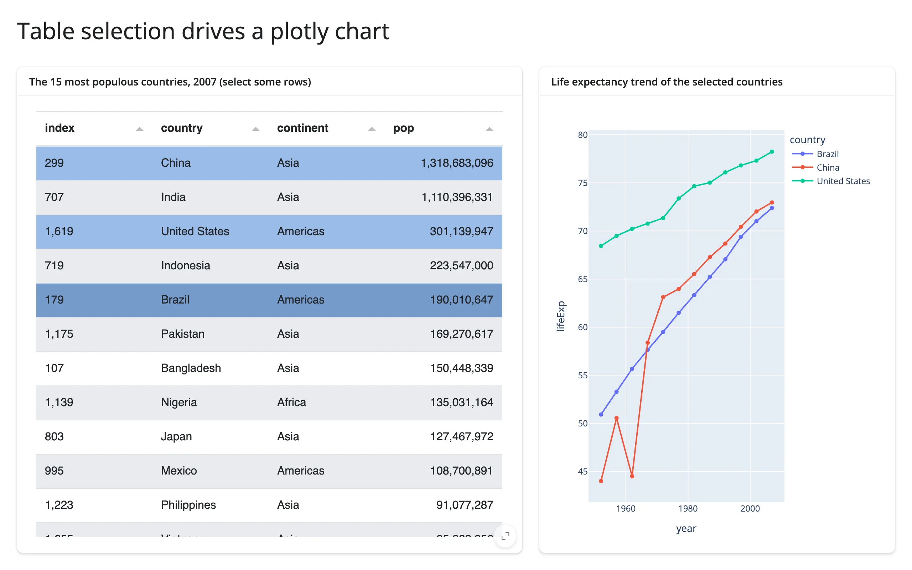

Cmd-clicking China, the United States, and Brazil populates the `render_plotly` trend chart with exactly those
three countries' life-expectancy history. `table.value` is read here too (outside `table`'s own render function,
where it's fine) to turn the selected positions back into rows -- `param("selection")` gives you the indices,
`.value` gives you the frame they index into.

### Click a row, update a detail card in place

A single-row click can drive a focused detail view -- here a `pn.indicators.Number` in a separate card, mutated
in place rather than re-rendered, so it never flickers:

```{.python file="examples/11_click_to_detail.py"}
import panel as pn
import plotly.express as px
from shiny import reactive
from shiny.express import ui
from shinywidgets import render_panel

pn.extension("tabulator")

latest = px.data.gapminder().query("year == 2007").sort_values("pop", ascending=False).head(15)

ui.page_opts(title="Click a row to update a detail card in place", fillable=True)

with ui.layout_columns(col_widths=[7, 5]):
    with ui.card(full_screen=True):
        ui.card_header("Click a country")

        @render_panel
        def table():
            return pn.widgets.Tabulator(
                latest[["country", "continent", "lifeExp", "pop"]],
                selectable=1, disabled=True, theme="bootstrap5",
                layout="fit_columns", sizing_mode="stretch_both",
            )

    with ui.card():
        ui.card_header("Selected country (updated in place, not re-rendered)")

        @render_panel
        def detail():
            # Built once with a placeholder; the effect below mutates it.
            return pn.indicators.Number(
                name="Select a row", value=0, format="{value:.1f} yrs",
                sizing_mode="stretch_width",
            )


@reactive.effect
def _():
    idx = table.param("selection")
    ind = detail.value
    if not idx:
        ind.name, ind.value = "Select a row", 0
    else:
        row = table.value.value.iloc[idx[0]]
        ind.name = f"{row['country']} -- life expectancy"
        ind.value = row["lifeExp"]
```

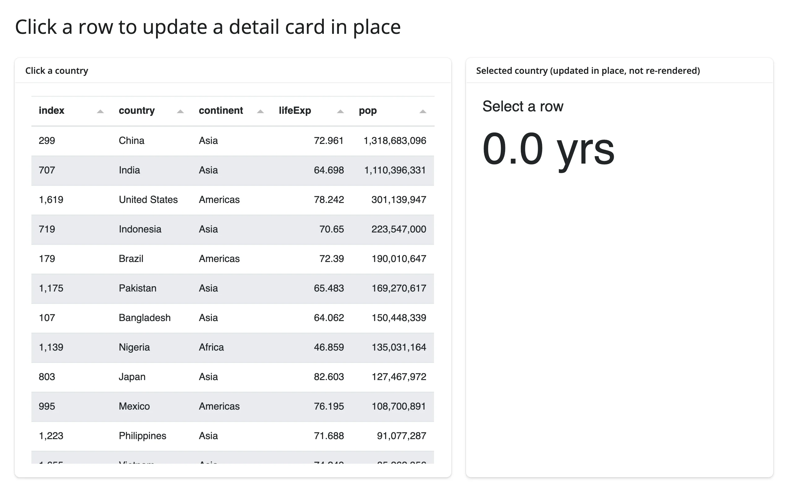
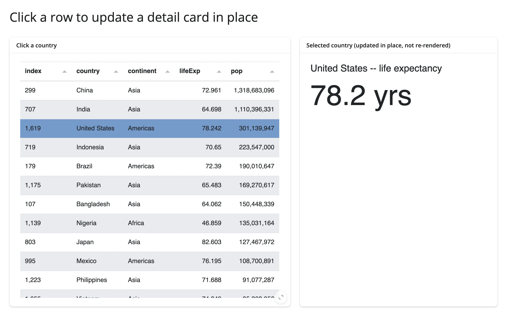

`selectable=1` (an integer, not `True`) caps the Tabulator at a single selected row -- useful whenever "click one
row for detail" is the interaction you want, rather than multi-select.

### A different widget family drives an indicator

`param(name)` works the same way regardless of which Panel component produces the state. Here, the number of
messages in a `pn.chat.ChatInterface` (its `objects` parameter) drives a `pn.indicators.Number` in a sibling card
-- proving the accessor generalizes past tables:

```{.python file="examples/12_chat_to_indicator.py"}
import panel as pn
from shiny import reactive
from shiny.express import ui
from shinywidgets import render_panel


def canned_reply(contents: str, user: str, instance: pn.chat.ChatInterface):
    return f"Got it: \"{contents}\""


ui.page_opts(title="Chat activity drives an indicator", fillable=True)

with ui.layout_columns(col_widths=[8, 4]):
    with ui.card(full_screen=True):
        ui.card_header("Chat")

        @render_panel
        def chat():
            return pn.chat.ChatInterface(
                callback=canned_reply, show_rerun=False, show_undo=False,
                sizing_mode="stretch_both",
            )

    with ui.card():
        ui.card_header("Messages so far (a different Panel widget, updated in place)")

        @render_panel
        def counter():
            return pn.indicators.Number(
                name="Messages", value=0, sizing_mode="stretch_width",
            )


@reactive.effect
def _():
    counter.value.value = len(chat.param("objects"))
```

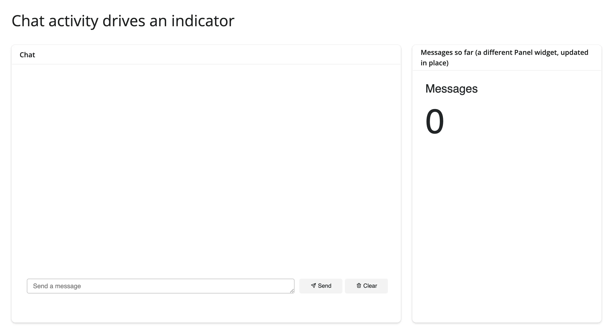
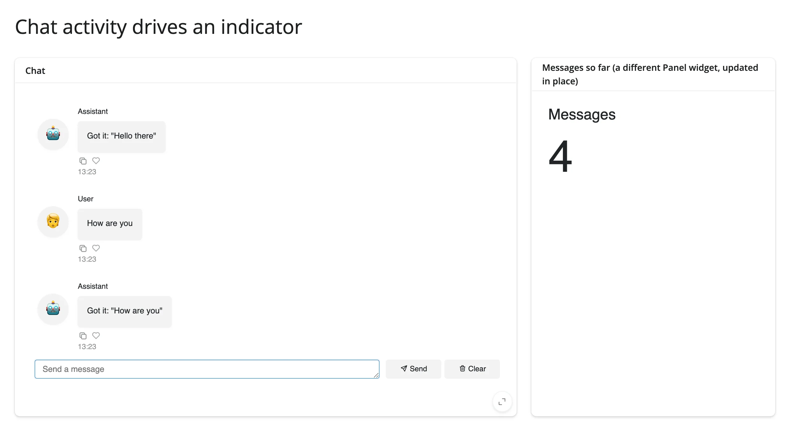

Two round trips (four messages total) moved the counter from 0 to 4.

## Large data

Panel has no large-data story of its own -- `render_panel` is a thin wrapper around whichever component you
hand it, so scale depends entirely on that component's own guide: [itables](../itables/index.md#large-data) or
[reactable](../reactable/index.md#large-data) for a large table, [bokeh](../bokeh/index.md#large-data) or
[holoviews](../holoviews/index.md#large-data) for a large chart (Panel's own panes render through Bokeh via
`jupyter_bokeh`, the same engine as the HoloViews guide). Build the large-data version of the component directly
and pass it to `render_panel`, or render it with that component's own `@render_*` decorator alongside a
`render_panel` output for anything Panel-specific -- see
[Large data & performance](../../guide/performance/index.md#three-approaches-to-large-data) for how the
underlying approaches compare.

## Layout and sizing

- **`sizing_mode="stretch_both"` (or `"stretch_width"`/`"scale_both"`/`"scale_height"`) is what lets a Panel
  object fill its card.** Verified directly: `render_panel`'s fill behavior checks the rendered root's actual
  `sizing_mode` (the same logic `render_bokeh` uses, since both produce a `jupyter_bokeh.BokehModel`) -- a plain
  `pn.widgets.Tabulator(df)` with no `sizing_mode` keeps its intrinsic (~1150px) width even inside a
  `full_screen=True` card, while the same table with `sizing_mode="stretch_both"` fills exactly the available
  space.
- **Not every indicator sizes responsively.** `Dial`, `Number`, and `Progress` accept `sizing_mode`. `LinearGauge`,
  `Trend`, and `BooleanStatus` render blank with `sizing_mode="stretch_both"` and no explicit size in a plain
  `ui.card()` (verified); give them explicit `width=`/`height=` instead. This is a Panel sizing quirk specific to
  those SVG-based indicators, not a shinywidgets bug.
- **Stacking more than one `ui.layout_columns()` under `ui.page_opts(fillable=True)`** needs the same care as any
  Shiny fill layout: give exactly one block (usually the tallest, most important one) room to grow, and pass
  `fill=False` (or an explicit `height=`) to the others -- otherwise they compete for the same vertical space and
  overlap. The [fleet dashboard](#gallery-candidates) gallery app does this with a fixed-height indicator row
  above a filling table-and-chat row.
- `output_widget()` (Shiny Core) or a bare `@render_panel` function under `ui.card()` (Express) is the same for
  Panel as for every other renderer.

## Gotchas and limitations

- **Panel templates aren't supported, with a cryptic error.** `pn.template.FastListTemplate(...)` (or any
  `BaseTemplate` subclass) raises `AttributeError: 'FastListTemplate' object has no attribute 'get_root'`,
  verified on current `main`. This matches the `render_panel` docstring's advice ("Panel templates are full
  pages... use Shiny's page layouts instead"), but the implementation doesn't yet give a friendlier error for it
  -- a long-standing rough edge, not a new regression.
- **`reactive_read()` doesn't work on Panel objects, and `.widget` isn't useful either.** See
  [Beyond `param()`: `reactive_read()` and `.read()`](#beyond-param-reactive_read-and-read) in Reacting to user
  interaction.
- **Call `pn.extension(...)` for components that might first appear after the initial render** (e.g., inside a
  `pn.bind()`-driven conditional). `shinywidgets` computes a render's extension bundle once per comm-open based on
  what's referenced at that point; a component introduced later (without having been imported/declared via
  `pn.extension`) can render blank with only a browser console error and a server-log warning to go on. Declaring
  `pn.extension("tabulator", "plotly", ...)` for everything you might use, at import time, avoids this.
- **Build Panel objects inside your render function (or `server()`), not at the top level of a Shiny Core app.**
  A module-level widget is constructed once and shared by every visitor under Shiny Core (Shiny Express already
  re-runs top-level code per session, so this is automatic there). Testing this directly with two concurrent
  browser sessions against a module-level `pn.widgets.IntSlider` on current `main` did **not** reproduce the
  cross-session leak an earlier evaluation of this integration reported (dragging the slider in one session's
  browser left the other session's browser unaffected) -- but build Panel objects per session anyway, since
  that's the supported, tested pattern and the exact mechanism behind the old report's finding wasn't re-traced
  here.
- **Tabulator's multi-select modifier key follows the browser's reported platform**, not your deployment server's
  OS: Ctrl-click on Windows/Linux, Cmd-click on macOS. This is standard Tabulator behavior, not specific to
  Shiny.
- **`render_panel.widget` is an internal `jupyter_bokeh.BokehModel`; don't use it.** Use `.value`, the Panel
  object exactly as you returned it, for everything -- reading state, mutating it in place, and passing it to
  `.param.watch()`.

## Gallery candidates

[`gallery/template_tabulator_filter.py`](gallery/template_tabulator_filter.py) -- a clean starting point: Shiny
checkboxes filter a formatted Tabulator in place, and its row selection drives a `render_plotly` trend chart.
Good base for any Panel-table-plus-chart dashboard.

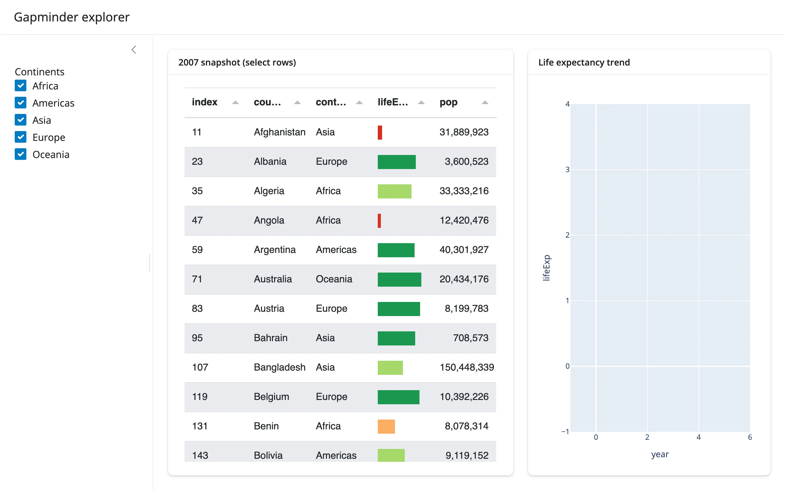
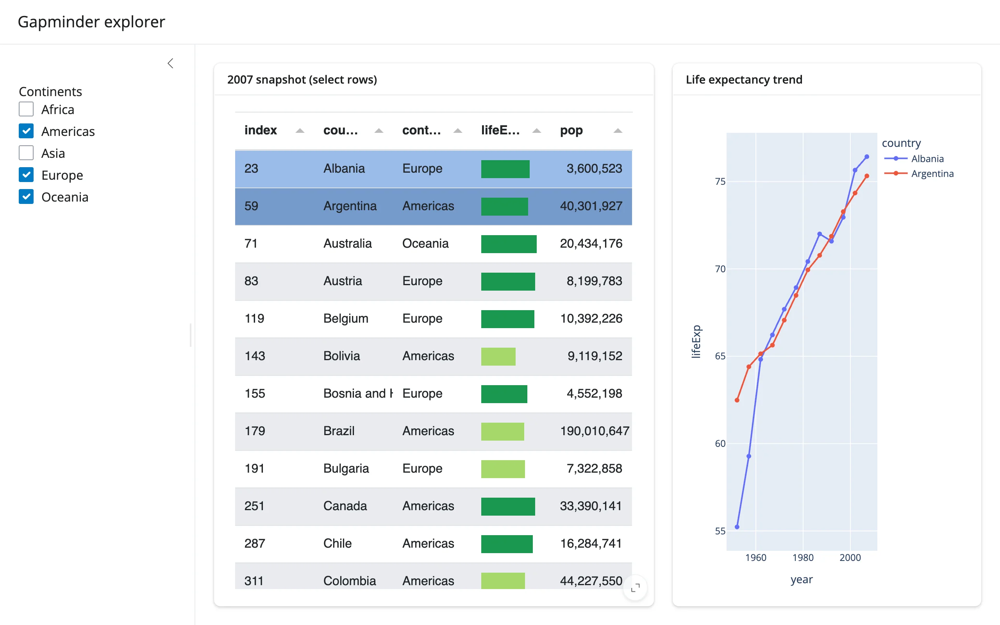

[`gallery/showcase_fleet_dashboard.py`](gallery/showcase_fleet_dashboard.py) -- a small ops dashboard combining
three different Panel component families: a formatted Tabulator of (synthetic) servers, `Dial`/`Number`
indicators that update in place when you click a row, and a `pn.chat.ChatInterface` that answers canned questions
about the live data (critical-server count, average CPU, per-region counts).

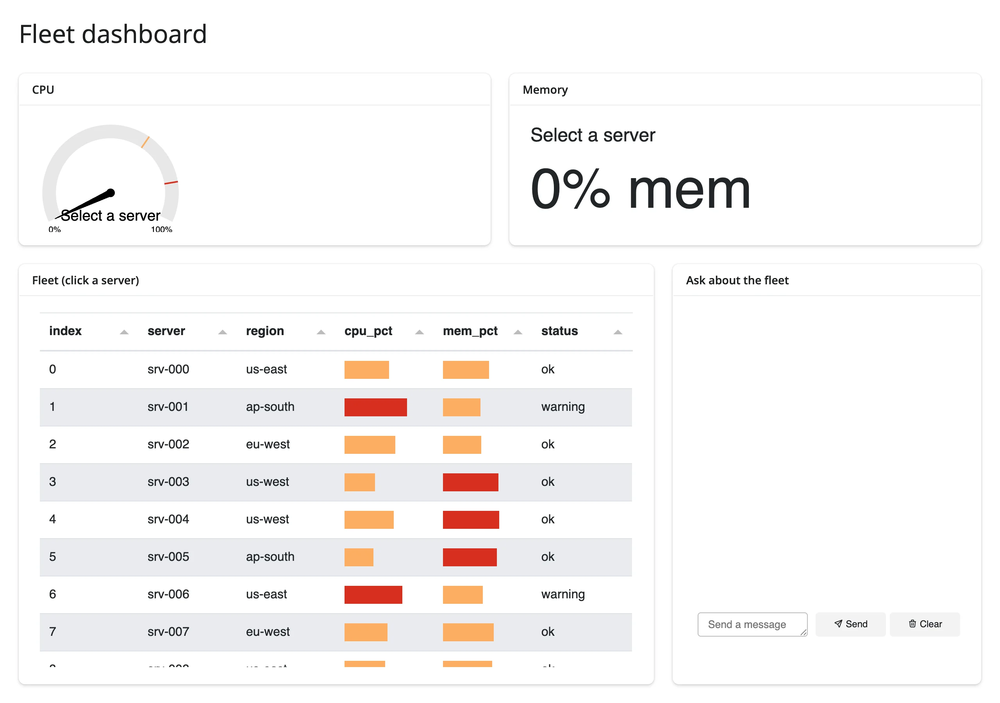
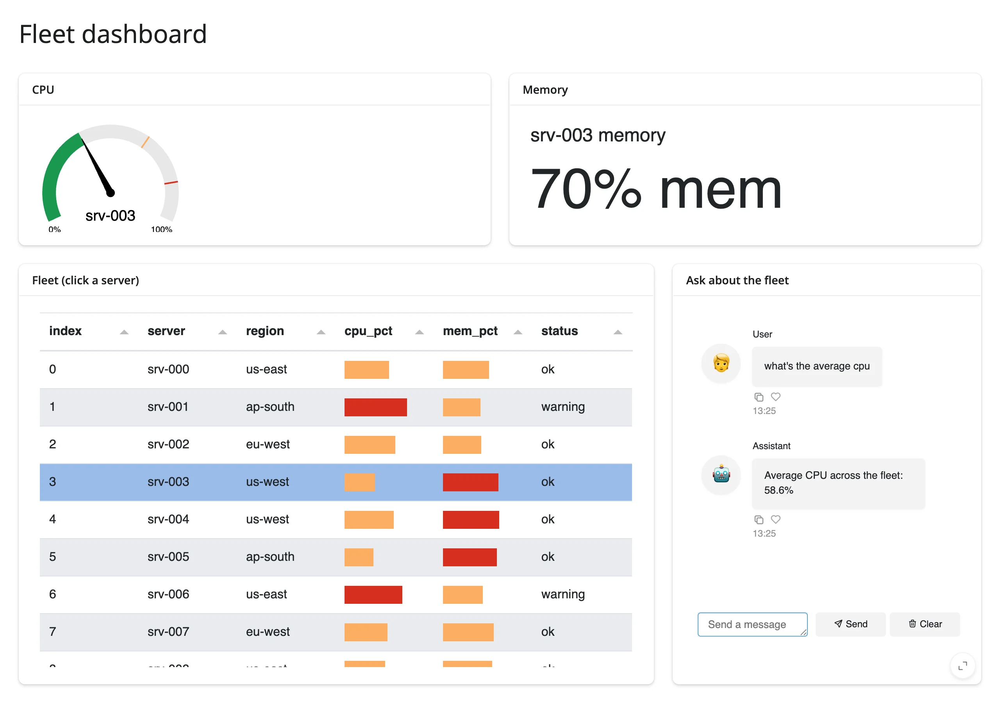

## Learn more

- [Panel documentation](https://panel.holoviz.org) and the
  [component gallery](https://panel.holoviz.org/reference/index.html)
- [`pn.chat`](https://panel.holoviz.org/reference/chat/ChatInterface.html),
  [`pn.indicators`](https://panel.holoviz.org/reference/indicators/Dial.html), and
  [`pn.custom.JSComponent`](https://panel.holoviz.org/how_to/custom_components/esm/custom_layout.html) reference
  pages
- Related guides in this roster: [bokeh](../bokeh/index.md), which renders through `jupyter_bokeh` too and has
  its own four accessors; [holoviews](../holoviews/index.md), which also renders through Panel but has none
  (its interaction model is HoloViews' own streams, not `param` parameters on the rendered object);
  [plotly](../plotly/index.md), [altair](../altair/index.md), and [itables](../itables/index.md)/
  [reactable](../reactable/index.md) for Shiny-native alternatives to Panel's charting panes and Tabulator.
