[Perspective](https://perspective-dev.github.io/guide/) is a streaming data-visualization engine built by the
FINOS open-source foundation, originally for trading desks that need to pivot, filter, and chart large, fast-moving
datasets without round-tripping to a server. Its WebAssembly query engine runs in the browser, so once your data is
loaded, re-aggregating by a different `group_by` or applying a new filter happens instantly client-side.

`@render_perspective` accepts a pandas or polars `DataFrame`, a `perspective.Table`, or a configured
`perspective.widget.PerspectiveWidget`, and hands back a full pivot-table UI: drag-and-drop grouping, a dozen
chart plugins, computed columns, and an editable grid. The renderer builds each DataFrame's table on a private
Perspective server, so two sessions' data never mix even though Perspective itself has no concept of per-user
isolation (see "Gotchas" below).

The two accessors, `filter()` and `view_config()`, read back the *query* a user built in the viewer -- not just
the widget's cosmetic state. That's the headline feature: whatever pivot, group, or filter someone sets up in the
browser is available in Python as a plain dict, ready to replay against the same table for a server-side
computation, a linked chart, or an export.

Reach for Perspective when the user needs to explore a dataset themselves -- pivot it, chart it a different way,
filter it down -- rather than just view a fixed table. For a plain sortable/filterable table without pivoting, see
[itables](../itables/index.md) or [reactable](../reactable/index.md); for a table where Python supplies the exact
rows and row selection matters more than client-side pivoting, see [ipydatagrid](../ipydatagrid/index.md).

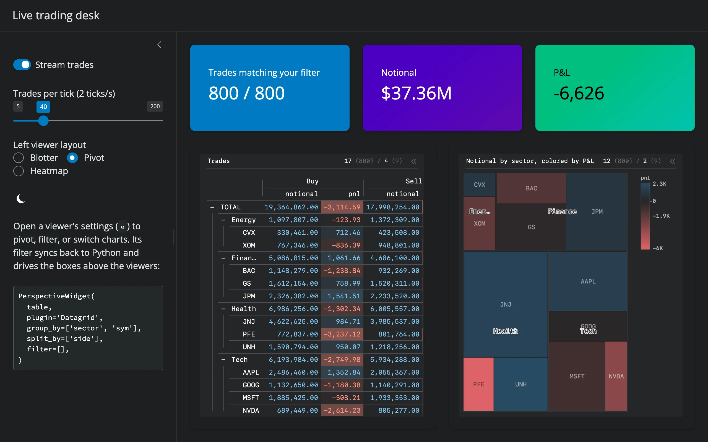

## Installation

```sh
pip install 'shinywidgets[perspective]'
```

This installs `perspective-python`, which bundles the WebAssembly engine and every chart plugin -- no separate JS
build step.

## Quick start

A bare DataFrame becomes a full datagrid viewer. This guide's examples use `plotly.express`'s bundled gapminder
dataset (country-level population, life expectancy, and GDP for every five years, 1952-2007) since it's real,
well known, and ships with a package already in the dependency tree. The settings panel (the `»` toggle, top
right) is open by default, since that's how a user discovers pivoting.

```{.python file="examples/01_quickstart.py"}
from __future__ import annotations

import plotly.express as px
from shiny.express import ui
from shinywidgets import render_perspective

ui.page_opts(title="Perspective quickstart", fillable=True)

countries = px.data.gapminder().query("year == 2007").drop(columns=["year", "iso_num"])


@render_perspective
def grid():
    return countries
```

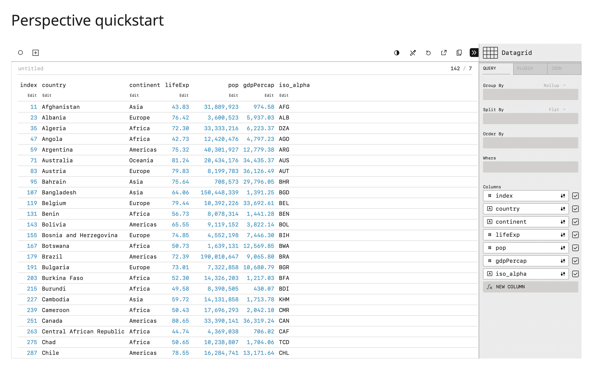

## What you can build

### Pivoting with group_by, split_by, and aggregates

Group rows into a hierarchy (`group_by`), split columns into side-by-side series (`split_by`), and choose how
numeric columns roll up (`aggregates`). A bare DataFrame return has nowhere to put this config, so build the
table yourself and pass it to `PerspectiveWidget`. Two gapminder snapshots 55 years apart, pivoted by continent
and split by year, turn into a world-population-growth table for free:

```{.python file="examples/02_pivoting.py"}
from __future__ import annotations

import plotly.express as px
from perspective import Server
from perspective.widget import PerspectiveWidget
from shiny.express import ui
from shinywidgets import render_perspective

ui.page_opts(title="Pivoting", fillable=True)

# Two snapshots 55 years apart, so a continent x year pivot tells a story
countries = px.data.gapminder().query("year in [1952, 2007]")


@render_perspective
def grid():
    # A bare DataFrame return gets a private per-session table for you, but
    # there's nowhere to pass pivot config -- build the table yourself so it
    # can go to the PerspectiveWidget constructor.
    table = Server().new_local_client().table(countries)
    return PerspectiveWidget(
        table,
        columns=["pop"],
        group_by=["continent"],
        split_by=["year"],
        aggregates={"pop": "sum"},
    )
```

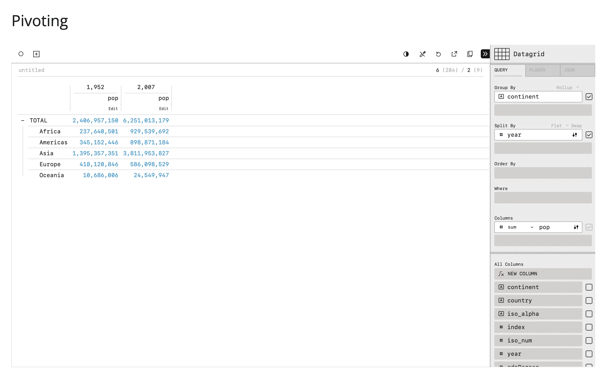

### A dozen plugins, one API

`plugin=` switches the whole visualization: `"Datagrid"` (default), `"X Bar"`/`"Y Bar"`, `"X/Y Line"`,
`"X/Y Scatter"`, `"Treemap"`, `"Sunburst"`, `"Heatmap"`, `"Candlestick"`, `"OHLC"`. Every plugin reads the same
`group_by`/`split_by`/`aggregates`/`columns` config, so switching charts is a one-line change -- the textbook
"world population treemap" is one `plugin="Treemap"` away from the pivot above.

```{.python file="examples/03_plugins.py"}
from __future__ import annotations

import plotly.express as px
from perspective import Server
from perspective.widget import PerspectiveWidget
from shiny.express import ui
from shinywidgets import render_perspective

ui.page_opts(title="Plugins", fillable=True)

countries = px.data.gapminder().query("year == 2007").drop(columns=["year", "iso_num"])


@render_perspective
def grid():
    # Same data, same aggregation -- just a different plugin. Perspective
    # also ships X/Y Bar, X/Y Line, X/Y Scatter, Sunburst, Heatmap,
    # Candlestick, and OHLC; switch `plugin` to try any of them.
    table = Server().new_local_client().table(countries)
    return PerspectiveWidget(
        table,
        plugin="Treemap",
        # Without "columns", the Treemap sizes rectangles by the first
        # numeric column -- the auto-added pandas "index" -- instead of pop
        columns=["pop"],
        group_by=["continent", "country"],
        aggregates={"pop": "sum"},
    )
```

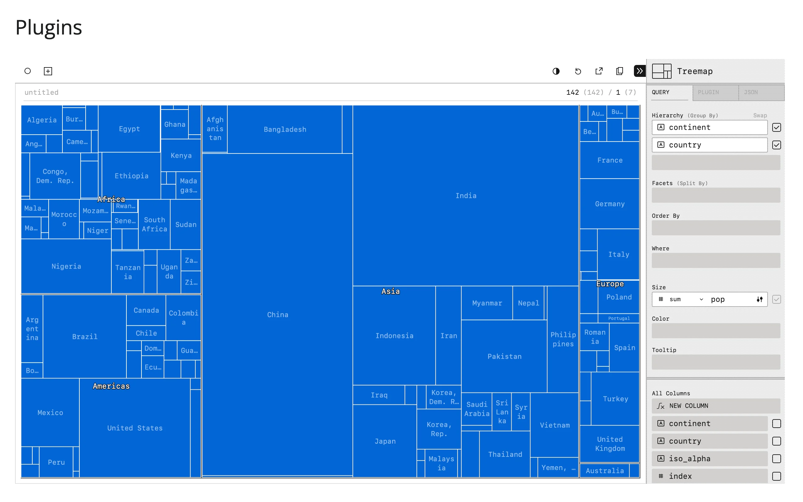

### Computed columns with expressions

`expressions` adds columns computed in Perspective's own expression language (ExprTK-based; column names are
double-quoted). They stay live across pivots, filters, and streamed updates, since they're evaluated by the
table's query engine, not in Python.

```{.python file="examples/04_expressions.py"}
from __future__ import annotations

import plotly.express as px
from perspective import Server
from perspective.widget import PerspectiveWidget
from shiny.express import ui
from shinywidgets import render_perspective

ui.page_opts(title="Expressions", fillable=True)

countries = px.data.gapminder().query("year == 2007").drop(columns=["year", "iso_num"])


@render_perspective
def grid():
    # Expressions add a computed column, written in Perspective's own
    # expression language (column names are double-quoted). It's evaluated
    # in the table's engine, so it stays live across pivots and updates.
    table = Server().new_local_client().table(countries)
    return PerspectiveWidget(
        table,
        columns=["country", "pop", "gdpPercap", "gdp_billions"],
        expressions={"gdp_billions": '("gdpPercap" * "pop") / 1000000000'},
    )
```

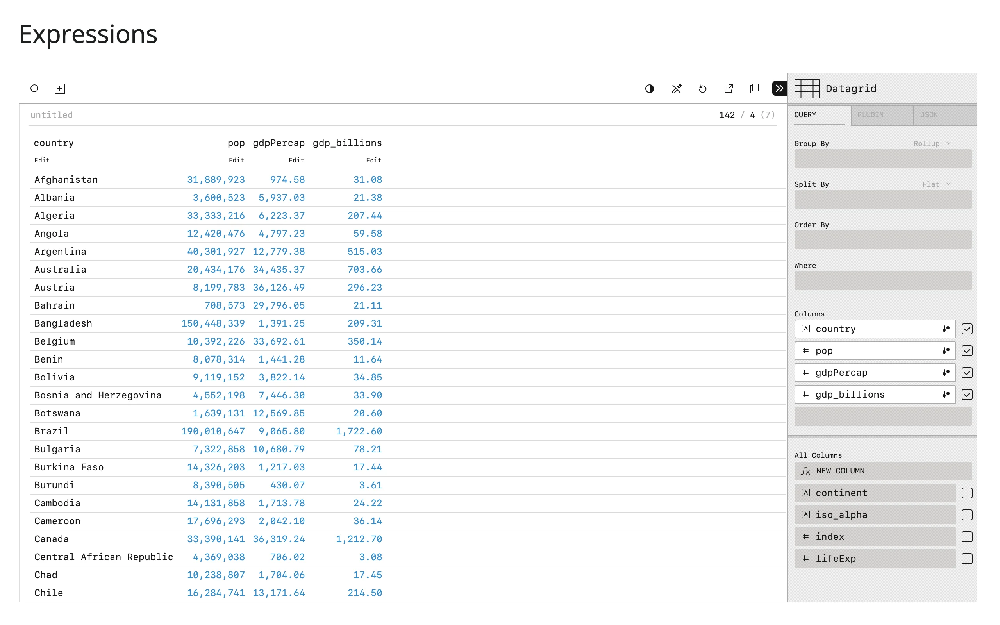

### Streaming updates with table.update()

`table.update()` pushes new rows to every viewer attached to that table over the comm -- no re-render, no lost
pivot/sort/filter state. Pair it with `limit=` to cap the table at a rolling window so a long-running stream
doesn't grow without bound. (There's no live public market-data feed to pull from without an API key, so this
one synthesizes notional for a few real stock tickers -- the kind of thing that's genuinely a stream in
production.)

```{.python file="examples/05_streaming.py"}
from __future__ import annotations

import random

import pandas as pd
from perspective import Server
from perspective.widget import PerspectiveWidget
from shiny import reactive
from shiny.express import ui
from shinywidgets import render_perspective

ui.page_opts(title="Streaming", fillable=True)

SYMBOLS = ["AAPL", "MSFT", "GOOG"]


def make_rows(n: int, start: int) -> list[dict]:
    return [
        {
            "id": start + i,
            "symbol": random.choice(SYMBOLS),
            "notional": round(random.uniform(1_000, 50_000), 2),
        }
        for i in range(n)
    ]


@render_perspective
def grid():
    # `limit` keeps only the most recent 500 rows, so the table is a rolling
    # window no matter how long the stream runs.
    table = Server().new_local_client().table(pd.DataFrame(make_rows(20, 0)), limit=500)
    return PerspectiveWidget(
        table,
        plugin="Y Bar",
        columns=["notional"],  # otherwise the auto "index"/"id" columns plot too
        group_by=["symbol"],
        aggregates={"notional": "avg"},
    )


next_id = reactive.value(20)


@reactive.effect
def _stream():
    reactive.invalidate_later(0.5)
    with reactive.isolate():
        start = next_id.get()
    next_id.set(start + 5)
    # update() streams straight into every viewer attached to this table over
    # its comm -- no re-render, so any pivot/sort/filter the user set stays.
    grid.widget.update(make_rows(5, start))
```

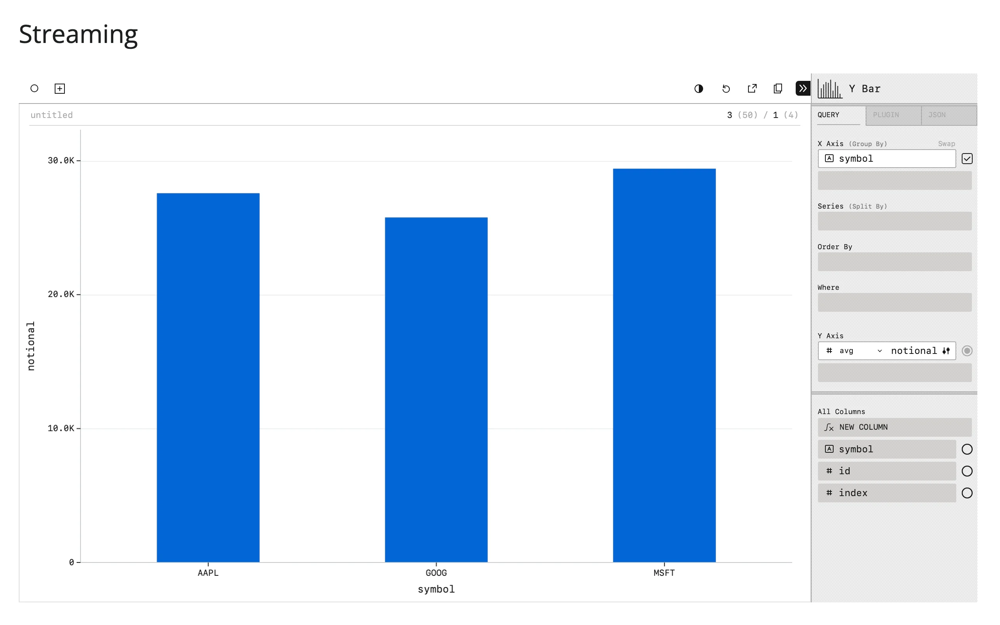

## Reacting to user interaction

### Accessor reference

| accessor | returns | before any interaction | across re-render | default rate policy |
|---|---|---|---|---|
| `filter()` | `List[list]`, e.g. `[["continent", "==", "Africa"]]` | seeded `[]` (never `None`) | re-seeded from the new viewer (starts `[]` unless the new widget is constructed with a filter) | none |
| `view_config()` | `Dict[str, Any]` with keys `plugin`, `columns`, `group_by`, `split_by`, `aggregates`, `sort`, `filter`, `expressions` | seeded at render (always a dict) | re-seeded from the new viewer's config | none |

Both are `kind="state"`: they hold the viewer's *current* configuration rather than reporting a one-off event, so
reading them never needs `req()` -- there's always a value, even before the user has touched anything. Both
describe the viewer's *own* current configuration (not a record of a past edit), so a re-render re-seeds each
one from the new viewer rather than carrying over the old viewer's values. Neither declares a default rate
limit, because settings-panel edits are discrete clicks and drags, not continuous streams like a map pan.

### filter()

`filter()` mirrors the viewer's **Where** clause as a plain list, exactly as `PerspectiveWidget.save()["filter"]`
would report it. Build the same filter server-side with `table.view(filter=grid.filter())`.

```{.python file="examples/06_filter_accessor.py"}
from __future__ import annotations

import plotly.express as px
from shiny.express import render, ui
from shinywidgets import render_perspective

ui.page_opts(title="filter() accessor", fillable=True)

countries = px.data.gapminder().query("year == 2007").drop(columns=["year", "iso_num"])


@render_perspective
def grid():
    return countries


@render.code
def filter_state():
    # filter() seeds at [] and never goes None, so "no filter set" and
    # "nothing reported yet" are the same value -- no req()/not-ready
    # handling needed.
    return str(grid.filter())
```

Dragging the `continent` column into the viewer's **Where** field and picking a value updates `filter()`:

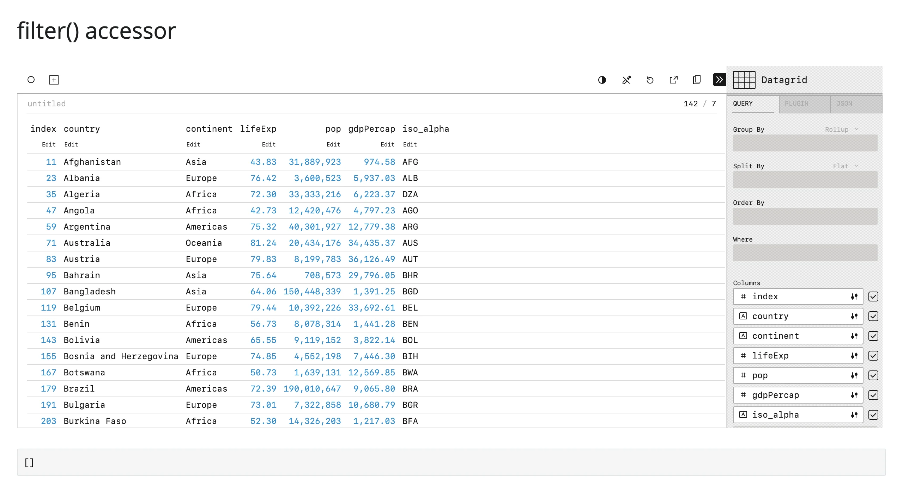
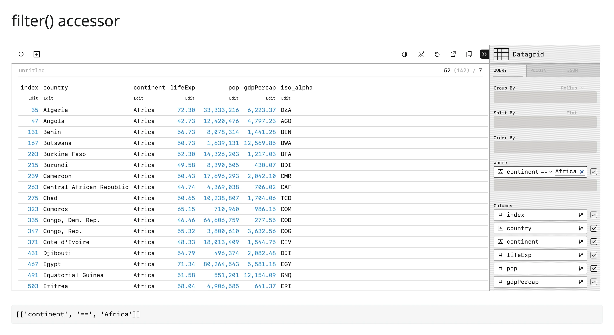

### Read on demand: export filtered rows

Because `filter()` is live from the moment the viewer renders, you can read it the instant you need the value --
in a download handler, a button click, a chat tool call -- with no reader warming it up first.
[`examples/15_export_filtered.py`](examples/15_export_filtered.py):

```{.python file="examples/15_export_filtered.py"}
from __future__ import annotations

import io

import pandas as pd
import plotly.express as px
from shiny.express import render, ui
from shinywidgets import render_perspective

ui.page_opts(title="Read on demand: export filtered rows", fillable=True)

countries = px.data.gapminder().query("year == 2007").drop(columns=["year", "iso_num"])

with ui.layout_columns(col_widths=[9, 3]):
    with ui.card(full_screen=True):

        @render_perspective
        def grid():
            return countries

    with ui.card():
        ui.card_header("Export")
        ui.p("Filter the grid (drag a column into Where), then download -- no need to read filter() anywhere else first.")

        # filter() is live from the moment the viewer renders, whether or not
        # anything has read it yet, so this handler can read it cold, the
        # instant the user clicks download: no warm-up reader required.
        @render.download_button(filename="filtered_countries.csv", label="Download filtered rows as CSV")
        def download_csv():
            view = grid.widget.table.view(filter=grid.filter())
            cols = view.to_columns()
            view.delete()
            df = pd.DataFrame(cols).drop(columns=["index"], errors="ignore")
            buf = io.StringIO()
            df.to_csv(buf, index=False)
            yield buf.getvalue()
```

Filtering to `continent == "Africa"` (142 rows down to 52), then downloading -- the exported CSV contains
exactly those 52 rows, read cold at click time:

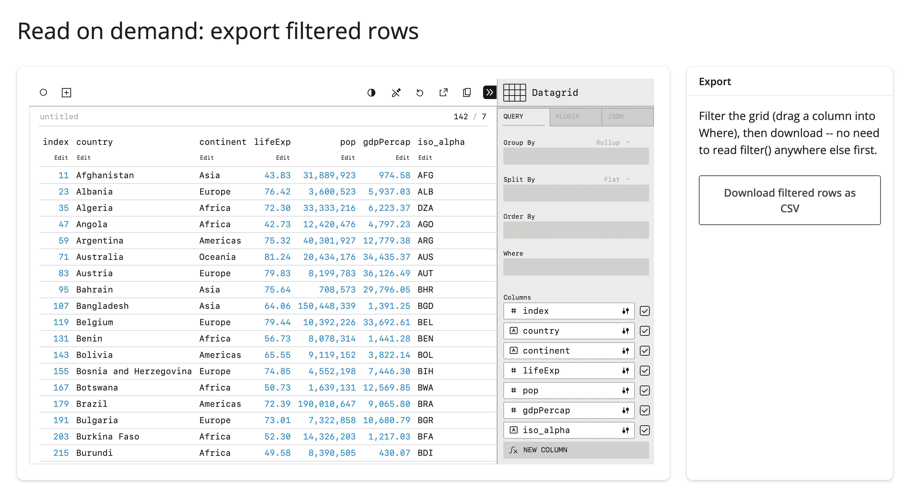
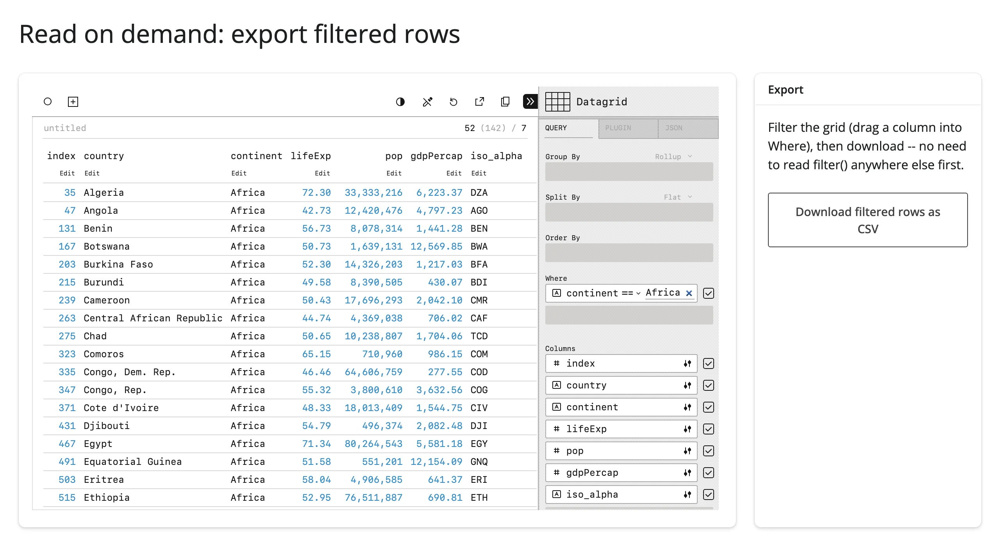

### view_config()

`view_config()` is the subset of `PerspectiveWidget.save()` that determines *which rows are shown*: pivoting,
splitting, aggregation, sort, filter, and expressions, plus `plugin` (which affects how they're drawn, not which
rows). Cosmetic state -- `theme`, `title`, `settings`, `plugin_config`, `columns_config` -- is deliberately
excluded, so opening the settings panel or switching themes doesn't invalidate anything that depends on it.

```{.python file="examples/07_view_config_accessor.py"}
from __future__ import annotations

import plotly.express as px
from shiny.express import render, ui
from shinywidgets import render_perspective

ui.page_opts(title="view_config() accessor", fillable=True)

countries = px.data.gapminder().query("year == 2007").drop(columns=["year", "iso_num"])


@render_perspective
def grid():
    return countries


@render.code
def config_state():
    # The structural subset of the viewer's config: plugin, columns,
    # group_by, split_by, aggregates, sort, filter, expressions. Cosmetic
    # changes (opening settings, switching themes) don't fire this.
    cfg = grid.view_config()
    return "\n".join(f"{k}: {v}" for k, v in cfg.items())
```

Clicking the `gdpPercap` column header to sort by it updates `view_config()["sort"]` (Norway, Kuwait, and
Singapore top the 2007 ranking):

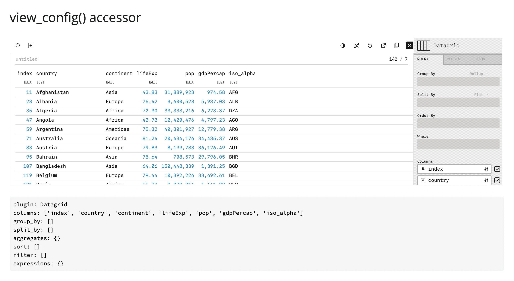
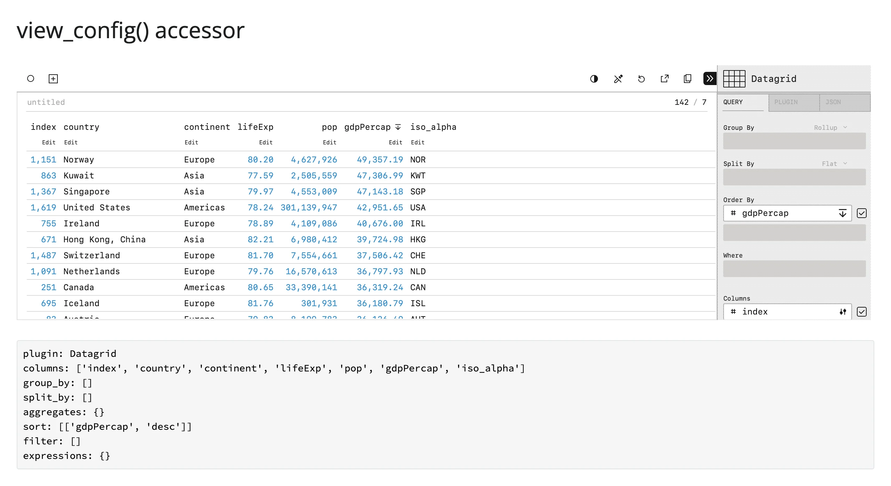

To reproduce the exact rows a `view_config()` represents, replay it against the table, dropping `plugin` (which
`Table.view()` doesn't accept) ([`examples/10_linked_filtered_summary.py`](examples/10_linked_filtered_summary.py)):

```{.python file="examples/10_linked_filtered_summary.py"}
cfg = {k: v for k, v in grid.view_config().items() if k != "plugin"}
view = grid.widget.table.view(**cfg)
```

### Beyond the accessors: read()

Cosmetic traits aren't part of `view_config()`, but they're still ordinary ipywidgets traits: `theme`, `title`,
and `settings` (whether the settings panel is open) are the ones worth reading. `grid.read("theme")` is the
preferred way to read them -- it falls through to `reactive_read()` on the rendered widget for any name that
isn't a declared accessor, so there's one method to reach for regardless of which tier a given name falls into.

```{.python file="examples/08_reactive_read_theme.py"}
from __future__ import annotations

import plotly.express as px
from shiny.express import render, ui
from shinywidgets import render_perspective

ui.page_opts(title="Beyond the accessors: read()", fillable=True)

countries = px.data.gapminder().query("year == 2007 and continent == 'Europe'")


@render_perspective
def grid():
    return countries


@render.code
def cosmetic_state():
    # theme/title/settings don't change which rows are shown, so they're
    # outside view_config() -- read() falls through to reactive_read() on
    # the widget for any trait that isn't a declared accessor.
    return f"theme: {grid.read('theme')!r}\nsettings panel open: {grid.read('settings')}"
```

Closing the settings panel flips the `settings` trait:

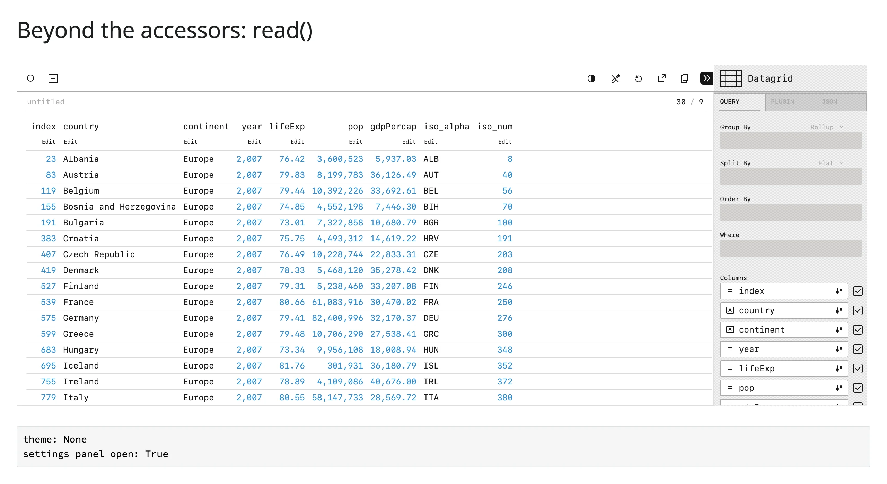
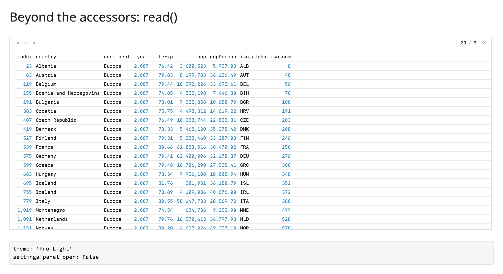

One quirk: right after a render, `grid.read("theme")` (equivalently, `reactive_read(grid.widget, "theme")`) can
briefly read `None`, before the browser's first sync sets it (verified -- see NOTES.md). The two named accessors
don't have this problem -- they seed with a real value (`[]` or the config dict) the moment they're attached. If
you read `theme` at startup, handle `None`.

### Rate limiting

Neither accessor declares a default rate policy, so reading `filter()` or `view_config()` is never debounced or
throttled out of the box -- appropriate, since settings-panel edits are discrete actions, not a continuous
stream of events like a map drag. The renderer still accepts `rate_policy=`/`rate_delay=` kwargs (e.g.
`@render_perspective(rate_policy="debounce", rate_delay=0.5)`), which apply uniformly to any `reactive_read()` on
the widget -- useful if your app reads a trait that *does* fire rapidly, but not needed for the two accessors
themselves.

## Updating the widget from Python

Two ways to change what a viewer shows: re-run the render function (a full rebuild) or mutate `.widget` in place
(`.widget.update()`, `.widget.theme = ...`, etc.) from an effect. Prefer in-place updates whenever the user has
set up a pivot, filter, or sort they'd be annoyed to lose -- a re-render discards all of it and rebuilds the
viewer from scratch, re-sending Perspective's multi-megabyte JS bundle over the comm in the process.

```{.python file="examples/09_update_in_place.py"}
from __future__ import annotations

import plotly.express as px
from shiny import reactive
from shiny.express import input, ui
from shinywidgets import render_perspective

ui.page_opts(title="Update in place", fillable=True)
ui.input_dark_mode(id="mode")

countries = px.data.gapminder().query("year == 2007").drop(columns=["year", "iso_num"])


@render_perspective
def grid():
    return countries


@reactive.effect
def _sync_theme():
    # Setting a trait on .widget pushes it to the live viewer over its comm:
    # whatever pivot/sort/filter the user already set stays, and Perspective's
    # multi-megabyte ESM bundle isn't re-sent. Re-running grid() instead would
    # rebuild the viewer from scratch and lose both.
    grid.widget.theme = "Pro Dark" if input.mode() == "dark" else "Pro Light"
```

Dark mode toggled in place -- a sort by `gdpPercap` (set by hand before the toggle) survives:

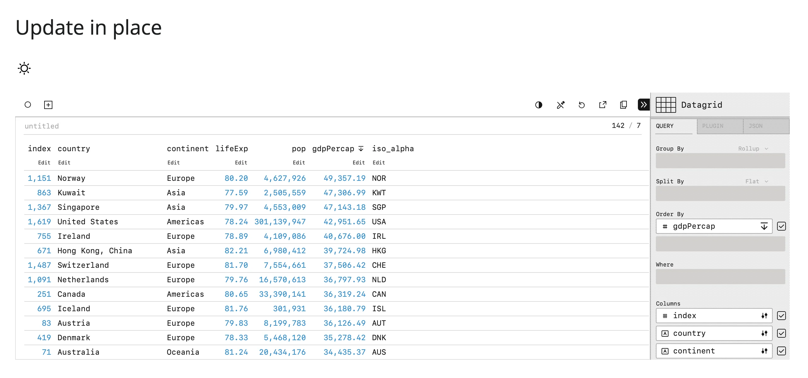
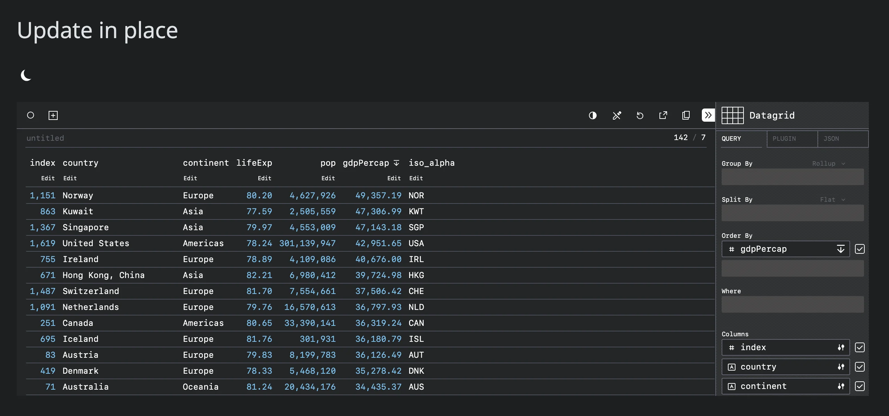

The same rule applies to data changes: `.widget.update(df)` appends or upserts rows into the existing table in
place; re-running the render function to "refresh the data" instead rebuilds the table (and viewer) from
scratch, discarding the user's pivot along with it.

## Coordinating multiple views

### Filter-driven server-side summary

The most useful pattern for Perspective specifically: let the user pivot and filter in the browser, then replay
their `view_config()` against the table in Python to compute something the viewer itself can't show -- here, an
exact row/population count for whatever's currently visible.

```{.python file="examples/10_linked_filtered_summary.py"}
from __future__ import annotations

import plotly.express as px
from shiny.express import render, ui
from shinywidgets import render_perspective

ui.page_opts(title="Filtered summary", fillable=True)

countries = px.data.gapminder().query("year == 2007").drop(columns=["year", "iso_num"])

with ui.layout_columns(col_widths=[9, 3]):
    with ui.card(full_screen=True):

        @render_perspective
        def grid():
            return countries

    with ui.card():
        ui.card_header("Exactly what's visible")

        @render.text
        def total():
            # view_config() carries the pivot/group/filter the user set in
            # the browser; replay it server-side so the total always matches
            # the rows on screen. Drop "plugin": it's how rows are drawn,
            # not which ones.
            cfg = {k: v for k, v in grid.view_config().items() if k != "plugin"}
            view = grid.widget.table.view(**cfg)
            cols = view.to_columns()
            view.delete()
            if "__ROW_PATH__" in cols:
                # Grouped views put a grand total in the first row (its
                # __ROW_PATH__ is []); summing every row would double-count it.
                pop = cols["pop"][0]
                rows = len(cols["__ROW_PATH__"]) - 1
            else:
                pop = sum(cols.get("pop", []))
                rows = len(cols.get("country", cols.get("pop", [])))
            return f"{rows} rows\n{pop:,.0f} people"
```

Grouping by continent in the browser collapses the grid to 5 rows; the summary card still reports the correct
2007 world population (6.25 billion) by reading the grouped view's total row instead of summing every displayed
row:

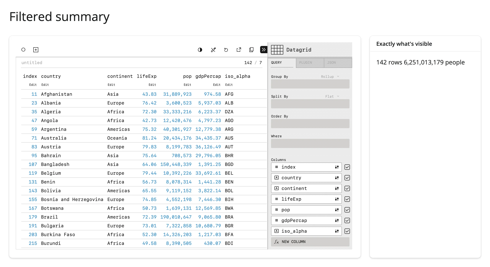
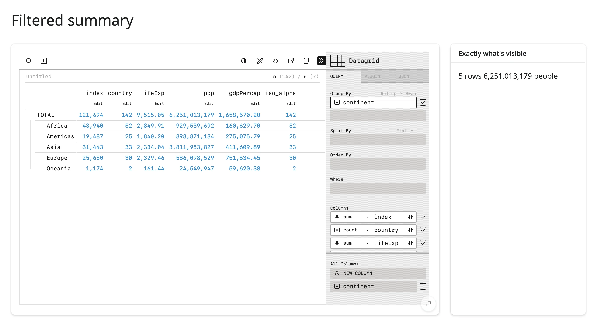

### One table, two synced viewers

Perspective tables aren't tied to a single viewer. Build one table and hand it to two `PerspectiveWidget`s -- a
detail grid and a summary chart -- and both repaint whenever the table changes, with no extra wiring. Since Shiny
Express re-runs the whole script once per session, a table built at the top level (not inside a render function)
is already private to that session. Building the table with `index="country"` makes `update()` an upsert: rows
matching an existing key are revised in place instead of appended, which is the right shape for "a few countries'
estimates got revised," not just "new rows arrived."

```{.python file="examples/11_linked_shared_table.py"}
from __future__ import annotations

import plotly.express as px
from perspective import Server
from perspective.widget import PerspectiveWidget
from shiny import reactive
from shiny.express import input, ui
from shinywidgets import render_perspective

ui.page_opts(title="One table, two views", fillable=True)
ui.input_action_button("revise", "Apply revised population estimates")

countries = px.data.gapminder().query("year == 2007").drop(columns=["year", "iso_num"])

# Express re-runs this whole script once per session, so a table built here
# at the top level is already private to this session -- no extra bookkeeping
# needed to share it between the two viewers below. `index="country"` makes
# update() upsert: matching rows are revised in place instead of appended.
table = Server().new_local_client().table(countries, index="country")


@reactive.effect
@reactive.event(input.revise)
def _():
    # A real-world update: a few countries get revised population figures.
    # Streams to both viewers below at once -- they share one table.
    table.update(
        [
            {"country": "China", "pop": 1_360_000_000},
            {"country": "India", "pop": 1_200_000_000},
            {"country": "Nigeria", "pop": 150_000_000},
        ]
    )


with ui.layout_columns():

    @render_perspective
    def datagrid():
        return PerspectiveWidget(table, plugin="Datagrid")

    @render_perspective
    def treemap():
        return PerspectiveWidget(
            table,
            plugin="Treemap",
            columns=["pop"],  # otherwise sizes by the auto "index" column
            group_by=["continent", "country"],
            aggregates={"pop": "sum"},
        )
```

Clicking "Apply revised population estimates" updates China/India/Nigeria's figures once; reading the table
*through the treemap's own connection* immediately shows China's revised number, confirming the two viewers
share one table, not just the same starting data:

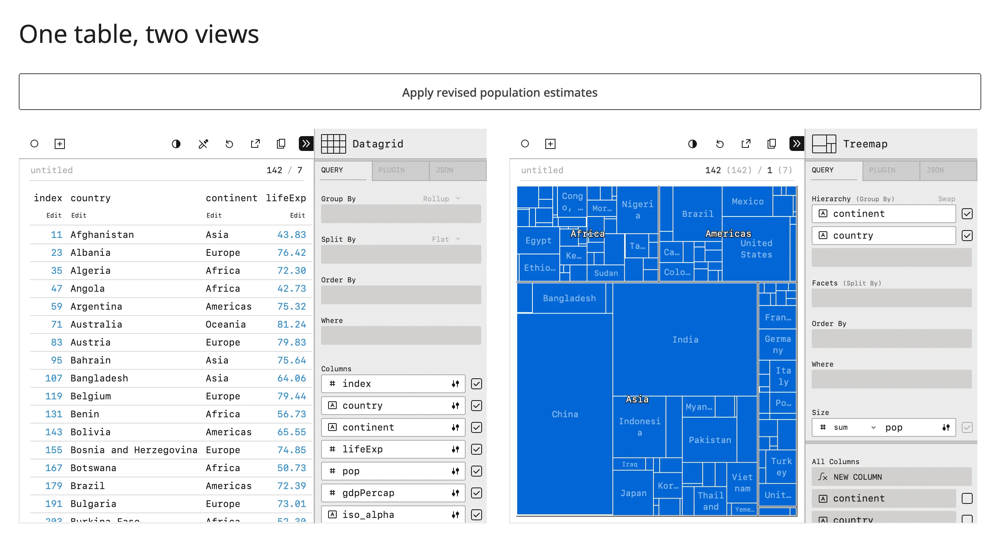
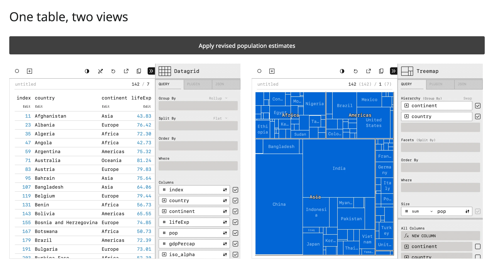

### Saving and restoring a view

`PerspectiveWidget.save()` captures the *entire* config -- pivot, sort, filter, plugin, theme, `columns_config`,
everything -- as a plain dict; `restore(**cfg)` puts it back. Unlike `view_config()`, this round-trip includes
the cosmetic keys, so it's the right tool for a "save my view" / "load my view" feature rather than for driving a
computation.

```{.python file="examples/12_linked_save_restore.py"}
from __future__ import annotations

from typing import Any, Dict, Optional

import plotly.express as px
from shiny import reactive
from shiny.express import input, ui
from shinywidgets import render_perspective

ui.page_opts(title="Save and restore a view", fillable=True)
ui.input_action_button("save", "Save this view")
ui.input_action_button("restore", "Restore saved view")

countries = px.data.gapminder().query("year == 2007").drop(columns=["year", "iso_num"])

saved_view: reactive.Value[Optional[Dict[str, Any]]] = reactive.value(None)


@render_perspective
def grid():
    return countries


@reactive.effect
@reactive.event(input.save)
def _():
    # .widget.save() captures the full viewer config -- pivot, sort, filter,
    # plugin, theme, columns_config, everything -- as a plain dict. Store it
    # anywhere: a reactive.value, a file, a database row.
    saved_view.set(grid.widget.save())


@reactive.effect
@reactive.event(input.restore)
def _():
    cfg = saved_view.get()
    if cfg is not None:
        grid.widget.restore(**cfg)
```

Pivoting by continent, saving, resetting back to a flat grid, then clicking "Restore saved view" returns exactly
the saved pivot:

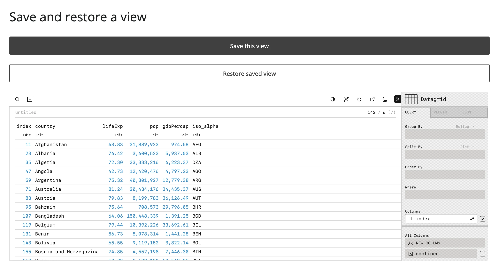
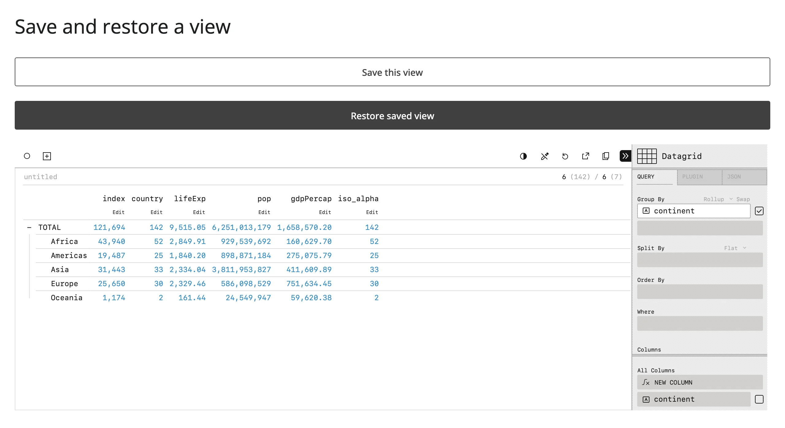

### A Perspective filter driving a plotly chart (pairs with: plotly)

`view_config()`/`filter()` aren't limited to driving other Perspective views -- replay them against the table
from any other output. Here a [plotly](../plotly/index.md) bar chart re-aggregates exactly the rows the user's
filter leaves visible in the grid.

```{.python file="examples/13_linked_crosswidget_chart.py"}
from __future__ import annotations

import pandas as pd
import plotly.express as px
from shiny.express import ui
from shinywidgets import render_perspective, render_plotly

ui.page_opts(title="Perspective filter -> plotly chart", fillable=True)

countries = px.data.gapminder().query("year == 2007").drop(columns=["year", "iso_num"])

with ui.layout_columns():

    @render_perspective
    def grid():
        return countries

    @render_plotly
    def chart():
        # Replay the user's filter (set in the viewer's settings panel)
        # server-side and chart exactly those rows by continent. Drop
        # "group_by": the raw rows are re-aggregated here in pandas instead.
        cfg = {
            k: v
            for k, v in grid.view_config().items()
            if k not in ("plugin", "group_by")
        }
        view = grid.widget.table.view(**cfg)
        cols = view.to_columns()
        view.delete()
        df = pd.DataFrame({"continent": cols["continent"], "pop": cols["pop"]})
        totals = df.groupby("continent", as_index=False)["pop"].sum()
        return px.bar(
            totals, x="continent", y="pop", title="Population by continent (filtered)"
        )
```

Filtering the grid to Asia updates the plotly chart to a single bar at Asia's 2007 population (~3.8 billion):

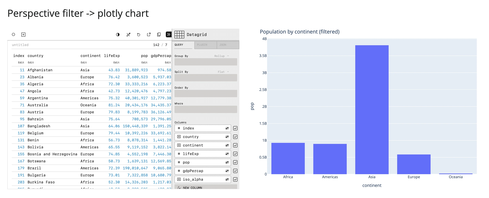
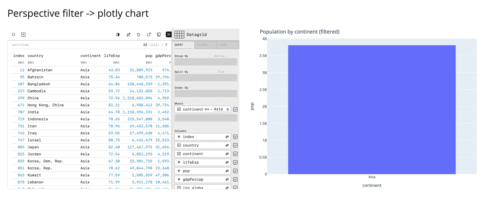

## Large data

Perspective's whole design is built for this: your DataFrame crosses the wire once, as Arrow (not JSON), into
the browser's own WebAssembly query engine; every pivot, filter, and group-by after that runs instantly
client-side with no further round trip. `table.update()` (see
["Streaming updates"](#streaming-updates-with-tableupdate) above) pushes only new rows for a live feed, not a
full resend. We didn't measure a specific row ceiling this pass; Perspective's own docs describe multi-million
row datasets as the normal case for its WASM engine. It's a loose fit for "only send what's visible" (the
*view* you interact with is cheap because it's local, not because less data was shipped) -- see
[Large data & performance](../../guide/performance/index.md#three-approaches-to-large-data) for the three
approaches this roster uses.

## Layout and sizing

Perspective fills its container out of the box; a `ui.card(full_screen=True, height=...)` or an explicit
`output_widget(height=...)` both work with no extra configuration. The viewer sits a few pixels inside its
container (Perspective's own padding), which is visible at small sizes but not worth fighting.

```{.python file="examples/14_layout_sizing.py"}
from __future__ import annotations

import plotly.express as px
from shiny.express import ui
from shinywidgets import render_perspective

ui.page_opts(title="Layout and sizing", fillable=True)

countries = px.data.gapminder().query("year == 2007").drop(columns=["year", "iso_num"])

with ui.card(full_screen=True, height="400px"):

    @render_perspective
    def grid():
        return countries
```

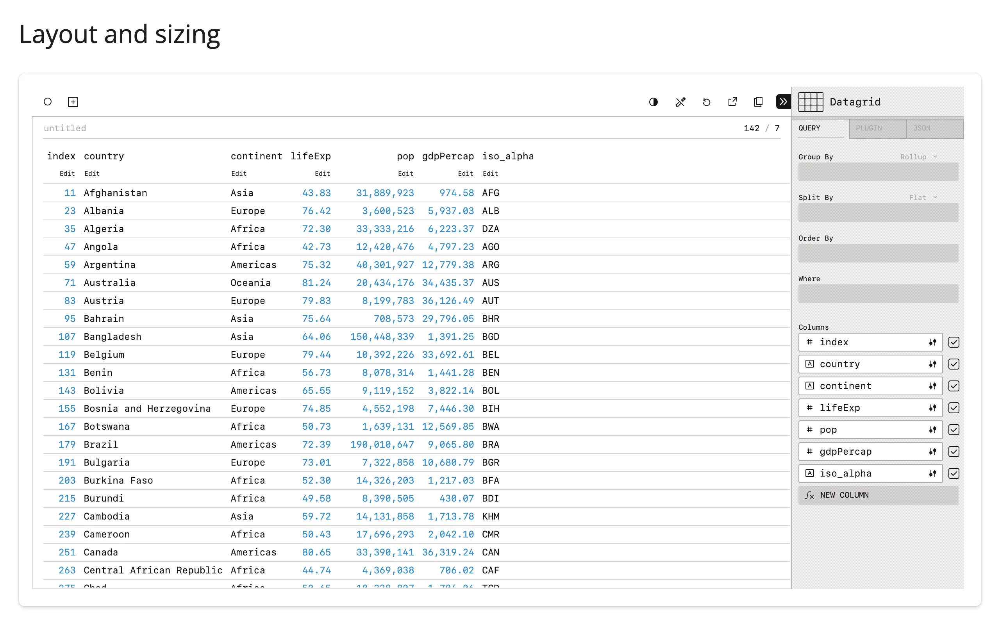

## Gotchas and limitations

- **A pandas index becomes a visible `"index"` column.** Every DataFrame coerced to a table gets an `index`
  column (even for a default `RangeIndex`), and it shows up in the grid and, if you don't restrict `columns=`,
  as a spurious numeric series in bar/treemap/etc. plugins (its sum or size has no meaning). Pass `columns=[...]`
  naming only the columns you want, or build the table from a DataFrame with `preserve_index=False` via pyarrow.
  Polars DataFrames don't have this problem.
- **Grouped views include a grand-total row.** `table.view(group_by=[...])` returns a first row with
  `__ROW_PATH__ == []` holding the total across every group. Summing every row in `to_columns()` double-counts
  it -- read that first row directly for a grand total, or skip it when you want per-group values only. See
  [`examples/10_linked_filtered_summary.py`](examples/10_linked_filtered_summary.py) for the check
  (`"__ROW_PATH__" in cols`).
- **`.widget.replace()` doesn't accept a DataFrame (upstream, perspective-python 5.6, reproduced on current
  main).** `table.replace(df)` raises `ValueError: Unknown input type ...` for pandas, polars, *and* pyarrow;
  only records, a dict of columns, or Arrow IPC bytes work. Use `.widget.clear()` followed by `.widget.update(df)`
  to swap out all rows instead.
- **`grid.read("theme")` (or `reactive_read(widget, "theme")`) can read `None` immediately after render
  (verified).** The trait has no value until the browser's first sync; the two accessors don't have this
  problem because they seed synchronously at attach. If you read a cosmetic trait at startup (rather than
  through an accessor), handle `None`.
- **Setting `columns_config` from Python replaces it outright; restoring it from the browser merges per column
  (verified).** `widget.columns_config = {...}` overwrites the whole dict. But a user editing column formatting
  through the settings panel merges their change into the existing dict column-by-column, and there's no way to
  *remove* a column's config that way -- `restore(columns_config={})` does nothing if a column already has
  settings. Reset a column's styling by setting it to an explicit new value, not an empty dict.
- **The settings panel's filter value field is a combobox, not a free-text field.** Typing a value that matches
  an existing category and pressing Enter commits whichever option the combobox highlights, which may not be the
  text you typed; typing something that matches nothing commits that literal text (and matches zero rows). If
  you're scripting a filter from the browser (tests, demos), setting it via `el.restore({filter: [...]})` is more
  predictable than typing into the UI.
- **The settings panel opens by default.** DataFrame- and Table-coerced widgets both default to
  `settings=True`, which can cover most of a small card. Pass `settings=False` to the `PerspectiveWidget`
  constructor if you want it to start closed.
- **Perspective's own memory/leak behavior is unchanged by shinywidgets and out of scope here.** Hosting tables
  and views for the life of a process is an upstream characteristic, not something the current renderer changed.
  If your app renders many large per-session tables over a long-running server process, budget for it
  independently of anything in this guide.

## Gallery candidates

### `template_live_feed.py` (template)

A streaming grid of five recognizable tickers with two one-click presets (pivot / reset) and a live
`filter()` readout -- a minimal starting point for a "rows arrive continuously, the user pivots or filters them"
app.

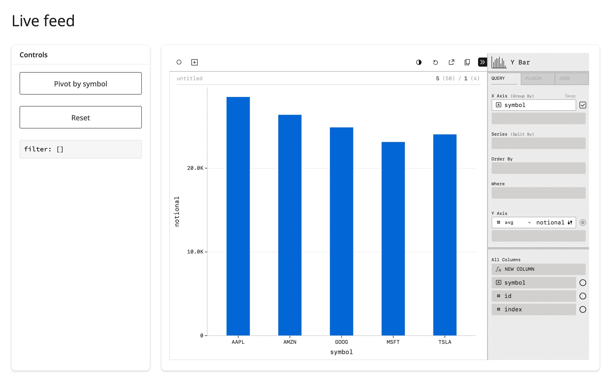

### `showcase_trading_desk.py` (showcase)

A live trading desk, streaming real tickers (AAPL, MSFT, NVDA, JPM, XOM, JNJ, and more) across four sectors: one
table feeds a blotter grid and a P&L-colored treemap at once; three value boxes recompute server-side from
exactly the blotter's current `filter()`; a radio group swaps three `hold_sync()` viewer presets; dark mode
updates both viewers' themes in place.

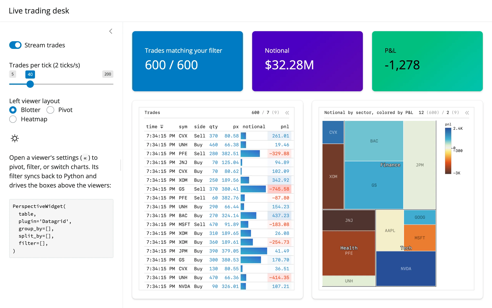
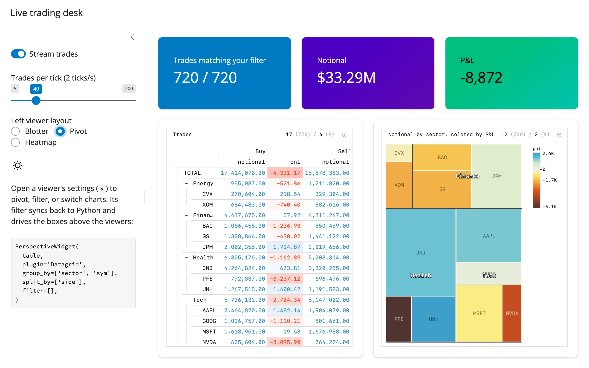


## Learn more

- [Perspective user guide](https://perspective-dev.github.io/guide/)
- [Perspective Python API reference](https://perspective-dev.github.io/guide/python/)
- [Perspective viewer attributes (plugins, `columns_config`, themes)](https://perspective-dev.github.io/guide/viewer/)
- Related guides in this roster: [itables](../itables/index.md), [reactable](../reactable/index.md),
  [ipydatagrid](../ipydatagrid/index.md), [mosaic](../mosaic/index.md), [quak](../quak/index.md),
  [plotly](../plotly/index.md)
