[Plotly](https://plotly.com/python/) is an open-source charting library (Plotly Technologies Inc.) built on
plotly.js, with first-class support for scatter, line, bar, 3D, maps, and statistical charts through its
high-level `plotly.express` API, plus a lower-level `graph_objects` API for full control. It's the chart
library most Shiny for Python users reach for first: it fills a layout well, exports cleanly, and ships a
widget form (`FigureWidget`) that round-trips user interaction back to Python.

`@render_plotly` accepts a `plotly.graph_objects.Figure` (coerced to a `FigureWidget`), a `FigureWidget` you
built yourself, or a Dash-style `(figure, config)` tuple. It applies layout defaults so the figure fills its
card without plotly's default 80px margins, and it installs a small event bridge (see "Reacting to user
interaction" below) so clicks, hovers, selections, zooms, and legend toggles are available as accessors --
ordinary methods you call from any reactive context, the same way you'd call `input.my_slider()`. Every
accessor attaches the moment the figure renders and remembers the last thing the user did, so it's safe to
read from anywhere -- a button handler, a download handler, a chat callback -- even if nothing read it
before.

Choose plotly when you want rich interactivity (click-to-detail, lasso-to-filter, zoom-to-explore) and don't
need a declarative grammar-of-graphics selection model (that's [altair](../altair/index.md)), a bigger-than-browser
point budget (that's [jscatter](../jscatter/index.md) or [embedding-atlas](../embedding-atlas/index.md)), or
geographic projections (see the maps roster, e.g. [lonboard](../lonboard/index.md)). For static charts with
no interactivity, [plotnine](../plotnine/index.md) or [matplotlib](../matplotlib/index.md) are lighter-weight.

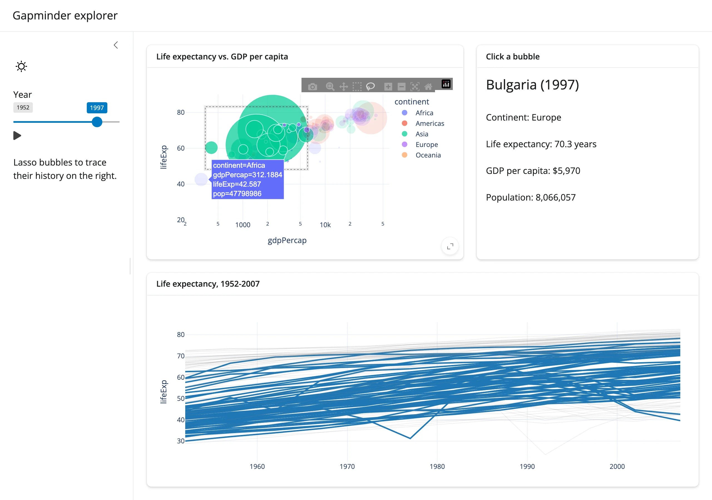

*A lasso selection on the left highlights 26 countries' full history on the right -- the bubbles moved there by
`batch_animate()`, not a re-render. From `gallery/showcase_gapminder_explorer.py`.*

## Installation

```
pip install 'shinywidgets[plotly]'
```

This installs `plotly` and `pandas` (the accessors' points frames are pandas) along with `narwhals`, which
`selected_rows()` uses to support polars data frames too.

## Quick start

```{.python file="examples/01_quickstart.py"}
import plotly.express as px
from shiny.express import ui
from shinywidgets import render_plotly

df = px.data.iris()

ui.page_opts(title="Iris", fillable=True)


@render_plotly
def plot():
    return px.scatter(
        df, x="sepal_width", y="sepal_length", color="species", title="Iris"
    )
```

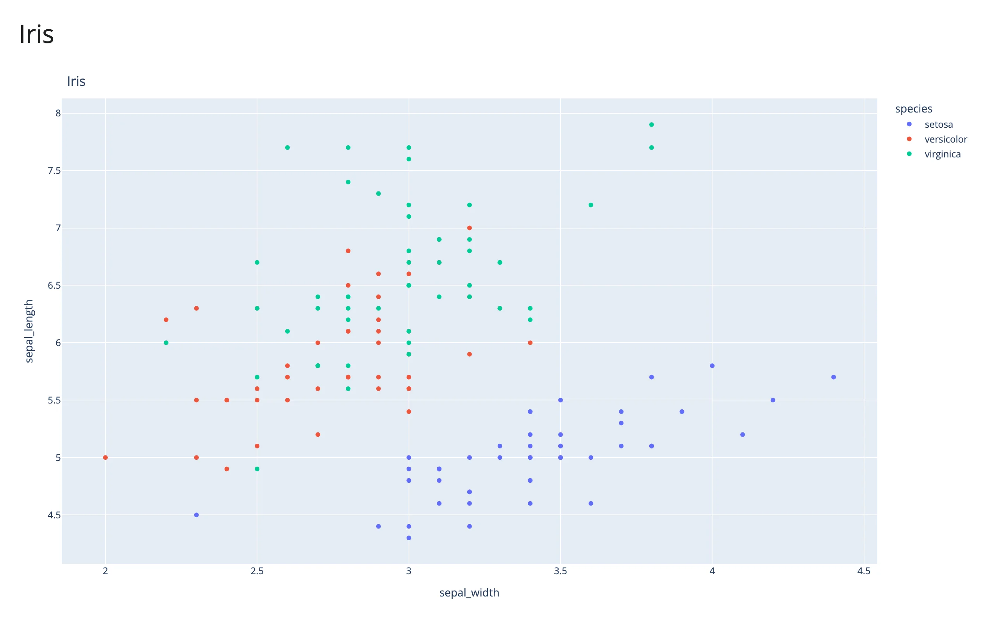

Returning a `plotly.express` figure (a `go.Figure`) is enough -- `@render_plotly` coerces it to a `FigureWidget`
for you. The figure fills its output; no `layout.height` or `output_widget(height=...)` needed.

## What you can build

Plotly's high-level `plotly.express` (`px`) builds whole figures -- including subplots, facets, trendlines, and
3D -- in one call from a tidy data frame; `graph_objects` (`go`) builds or edits a figure trace by trace. Both
produce the same `Figure`/`FigureWidget` objects, so you can mix them (e.g., `px.scatter(...)` then
`fig.add_scatter(...)`).

**Small multiples from one line.** `facet_col`/`facet_row` split a figure by a column, each panel still a
first-class plot (here with a per-panel OLS trendline):

```{.python file="examples/02_facets.py"}
import plotly.express as px
from shiny.express import ui
from shinywidgets import render_plotly

df = px.data.tips()

ui.page_opts(title="Tips by day", fillable=True)


@render_plotly
def facets():
    fig = px.scatter(
        df,
        x="total_bill",
        y="tip",
        color="sex",
        facet_col="day",
        trendline="ols",
    )
    fig.update_layout(showlegend=False)
    return fig
```

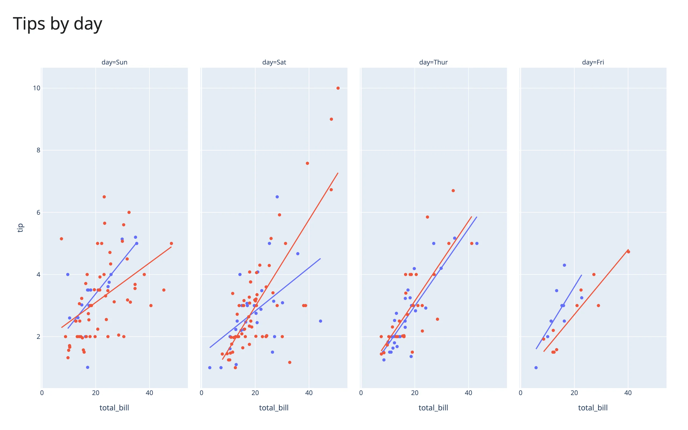

**3D scatter, for free.** `px.scatter_3d` gets you an orbitable 3D view with the same API as 2D:

```{.python file="examples/03_scatter3d.py"}
import plotly.express as px
from shiny.express import ui
from shinywidgets import render_plotly

df = px.data.iris()

ui.page_opts(title="Iris in 3D", fillable=True)


@render_plotly
def plot3d():
    return px.scatter_3d(
        df,
        x="sepal_length",
        y="sepal_width",
        z="petal_width",
        color="species",
        size="petal_length",
        size_max=18,
    )
```

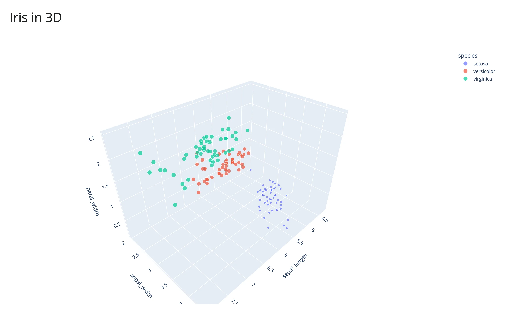

**Mixed chart types and dual axes.** `graph_objects.make_subplots` builds layouts px can't -- here a line and a
bar sharing an x-axis with independent y-axes:

```{.python file="examples/04_subplots.py"}
import plotly.express as px
from plotly.subplots import make_subplots
from shiny.express import ui
from shinywidgets import render_plotly

df = px.data.stocks()

ui.page_opts(title="Stocks", fillable=True)


@render_plotly
def combo():
    fig = make_subplots(specs=[[{"secondary_y": True}]])
    fig.add_scatter(x=df["date"], y=df["GOOG"], name="GOOG", secondary_y=False)
    fig.add_bar(
        x=df["date"],
        y=df["GOOG"].diff(),
        name="day/day change",
        secondary_y=True,
        opacity=0.3,
    )
    fig.update_yaxes(title_text="price (normalized)", secondary_y=False)
    fig.update_yaxes(title_text="change", secondary_y=True)
    return fig
```

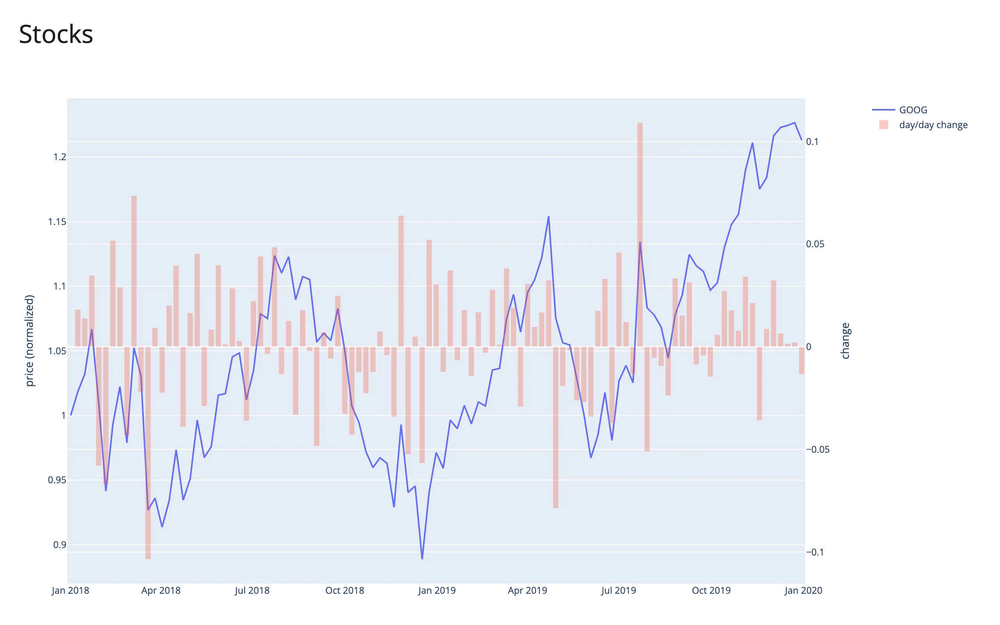

For the rest of plotly.express's chart types (choropleths, Sankey, violin, treemap, and more), see the
[plotly.express API reference](https://plotly.com/python-api-reference/plotly.express.html).

## Reacting to user interaction

Return a figure and shinywidgets' event bridge listens to plotly.js directly (plotly.py's own widget drops
some events and strips `customdata`), so every accessor below works on a plain `px`/`go` figure -- no callback
registration needed. Call an accessor from any reactive context (a `@render.*` function, `@reactive.calc`, or
`@reactive.effect`); it invalidates that context whenever the interaction changes, the same way `input.x()`
does.

Accessors are inputs that remember. Each one attaches the moment the figure renders and records what the user
does whether or not anything has read it yet -- there's no "warm-up" read needed to arm it. A re-render gives
the user a new figure, but the last interaction isn't thrown away: `clicked()`, `hover()`, `selecting()`,
`brushing()`, `relayout()`, `double_clicked()`, and `legend_clicked()` keep their value until the user
interacts with the *new* figure, so a payload can briefly describe the previous render's plot (positional
`point_index`/`trace_index` can point at a different point after a re-render with new data -- key lookups off
`customdata` instead, as `selected_rows()` does). `selected()`, `brushed()`, and `visible_traces()` instead
re-seed from the new figure at every render, since plotly.js tracks selection and trace visibility as state on
the graph div, not just as events -- they report what the new figure actually shows (initially nothing
selected, so they go back to `None`/empty once it reports).

### Accessor reference

| Accessor | Returns | Before any interaction | Across a re-render | Default rate policy |
|---|---|---|---|---|
| `clicked()` | points `DataFrame` | `None` | kept | none |
| `hover()` | points `DataFrame` | `None` | kept | debounce 250 ms |
| `selected()` | points `DataFrame` | `None` | re-seeded | none |
| `selecting()` | points `DataFrame` | `None` | kept | debounce 250 ms |
| `brushed()` | region `dict` (`range` or `lassoPoints`) | `None` | re-seeded | none |
| `brushing()` | region `dict` | `None` | kept | debounce 250 ms |
| `relayout()` | axis-range `dict` | `None` | kept | none |
| `double_clicked()` | `True` (a pulse) | `None` | kept | none |
| `legend_clicked()` | traces `DataFrame` | `None` | kept | none |
| `visible_traces()` | traces `DataFrame` | seeded from the figure | re-seeded | none |
| `selected_rows(df, key=None)` | rows of `df` | empty frame | re-seeded (follows `selected()`) | follows `selected()` |

Points frames have columns `trace_index`, `point_index`, `x`, `y`, and `z`/`customdata` when the figure has
them. `point_index` is a point's position within its trace, not a row of your data -- for px figures with
`color=`, each color group is its own trace, so match rows via `customdata` (see `selected_rows()` below), not
`point_index`.

**Clearing semantics**, verified on current main: a double-click clears `clicked()`, but only when the second
click of the double-click lands on empty plot background. If it lands on a marker, that click's own
`plotly_click` event fires *after* the clear and repopulates `clicked()` with that point -- so double-clicking a
point leaves `clicked()` unchanged, not `None`. A **deselect** (double-click after a box/lasso selection) does
reliably clear `selected()`/`selecting()`/`brushed()`/`brushing()` to `None`. Separately: a plain **click**, when
`dragmode` is `"select"` or `"lasso"`, is itself a (zero-area) selection gesture, so it also resets
`selected()`/`brushed()` to `None` -- clicking and lassoing on the same figure will interact (see the gallery
template below, which calls this out in its UI).

Since a double-click on the background both clears `clicked()` *and* pulses `double_clicked()`, reading
`clicked()` alone can't tell a double-click-reset apart from a deselect -- read `double_clicked()` when you
need to know specifically that the user double-clicked. One exception, verified on current main: with
`dragmode="select"`/`"lasso"`, a background double-click deselects *without* pulsing `double_clicked()` --
plotly.js only emits the reset event where it means resetting the view (see `double_clicked()` below for which
subplot types that covers).

### `clicked()`

```{.python file="examples/06_clicked.py"}
import plotly.express as px
from shiny.express import render, ui
from shinywidgets import render_plotly

df = px.data.gapminder().query("year == 2007").reset_index(drop=True)

ui.page_opts(title="Click a bubble", fillable=True)

with ui.layout_columns(col_widths=[7, 5]):
    with ui.card(full_screen=True):

        @render_plotly
        def plot():
            fig = px.scatter(
                df,
                x="gdpPercap",
                y="lifeExp",
                color="continent",
                log_x=True,
                custom_data=[df.index],
            )
            return fig

    with ui.card():
        ui.card_header("plot.clicked()")

        @render.code
        def clicked_out():
            pts = plot.clicked()
            if pts is None:
                return "None (click a bubble)"
            return pts.round(1).to_string(index=False)
```

Before (no click yet) and after clicking a bubble:

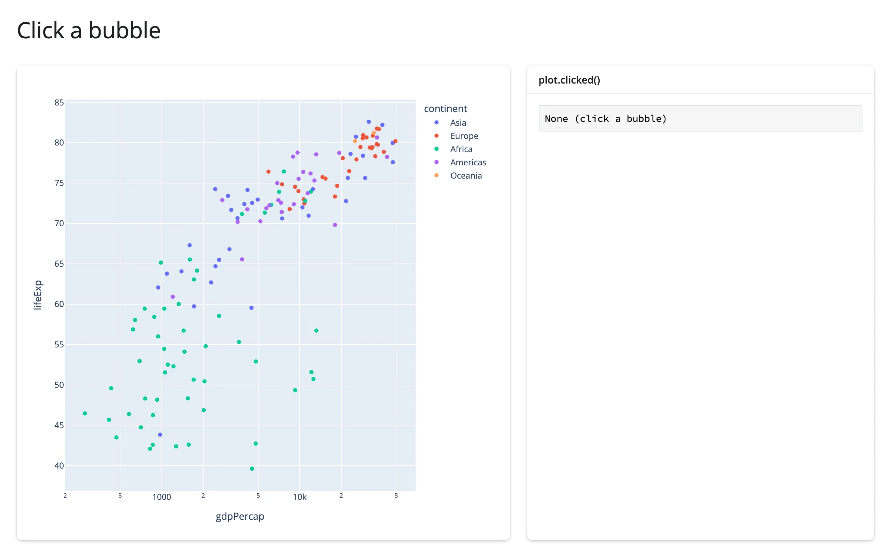
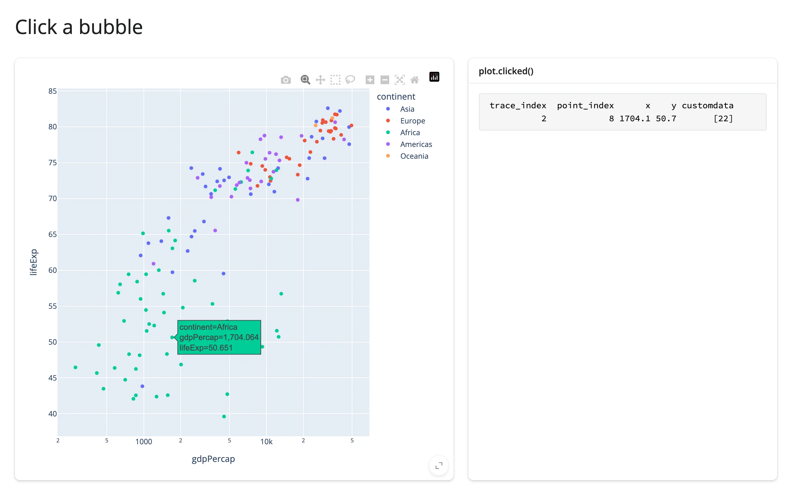

`clicked()` is kept across a re-render -- the click still happened -- so a reader can describe the *previous*
render's figure until the user clicks the new one. That's safe here because `selected_rows()`/`customdata`
keys off a stable row identity rather than `point_index`, but a raw `point_index` would be worth re-checking
after a re-render that reshuffles the data.

### `selected()` and `selecting()`

`selecting()` streams the same columns while the user drags; `selected()` reports once at the end of the
gesture. Both reset on a deselect. Unlike `clicked()`, `selected()` is re-seeded at every render: plotly.js
tracks the current selection as state on the figure itself, so a freshly rendered figure's "current selection"
is genuinely nothing, and `selected()` (and `selected_rows()`) reports that -- it doesn't carry over the
previous figure's selection the way `clicked()` carries over the previous click. `selecting()`, the drag
stream, behaves like `clicked()` here and keeps its last value.

```{.python file="examples/07_selected.py"}
import plotly.express as px
from shiny.express import render, ui
from shinywidgets import render_plotly

df = px.data.gapminder().query("year == 2007").reset_index(drop=True)

ui.page_opts(title="Box-select some bubbles", fillable=True)

with ui.layout_columns(col_widths=[7, 5]):
    with ui.card(full_screen=True):

        @render_plotly
        def plot():
            fig = px.scatter(
                df,
                x="gdpPercap",
                y="lifeExp",
                color="continent",
                log_x=True,
                custom_data=[df.index],
            )
            fig.update_layout(dragmode="select")
            return fig

    with ui.card():
        "plot.selecting() -- while dragging"

        @render.code
        def selecting_out():
            pts = plot.selecting()
            return "None" if pts is None else f"{len(pts)} points"

        "plot.selected() -- once the drag ends"

        @render.code
        def selected_out():
            pts = plot.selected()
            if pts is None:
                return "None (drag a box)"
            cols = pts[["trace_index", "point_index", "x", "y"]]
            return cols.round(1).to_string(index=False)
```

Mid-drag (`selecting()` already has 31 points; `selected()` hasn't fired yet), and after release:

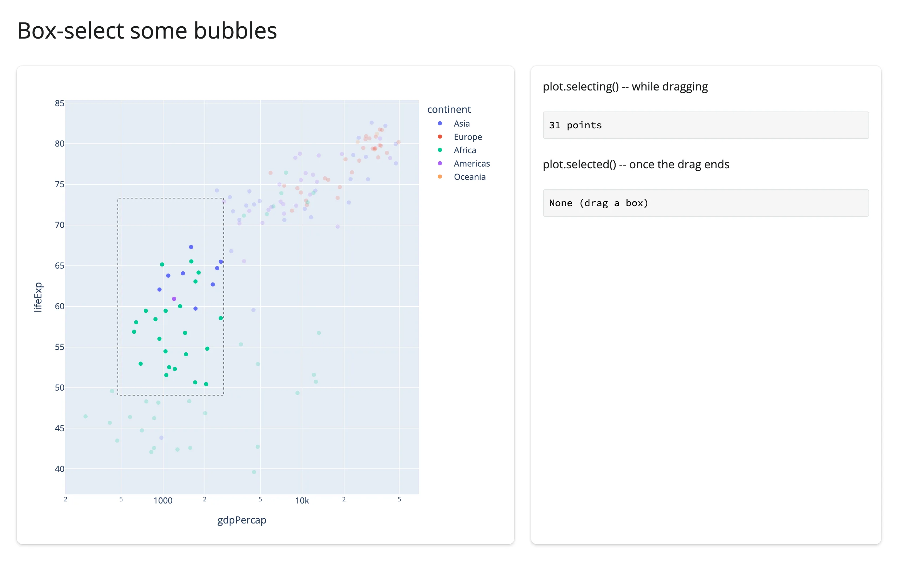
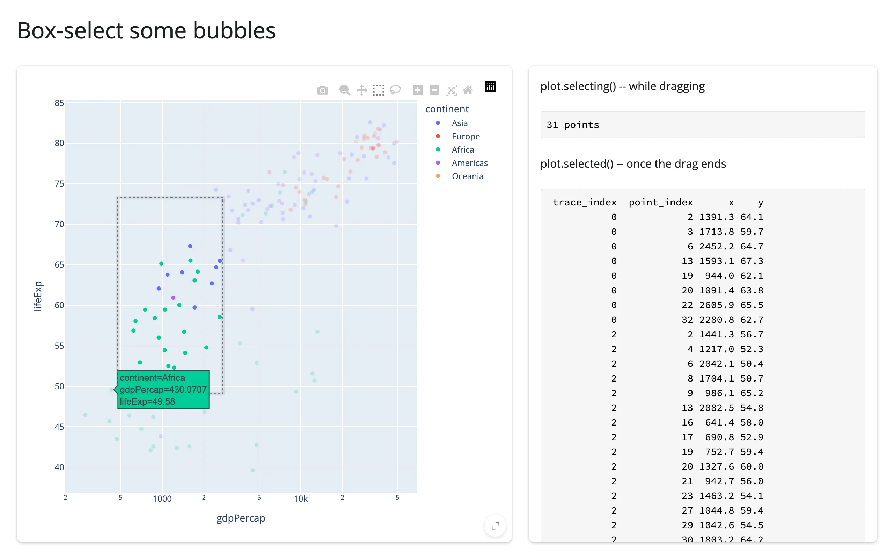

### `brushed()` and `brushing()`

Where `selected()`/`selecting()` report *points*, `brushed()`/`brushing()` report the selection *region itself*
-- a box as `{"range": {"x": [...], "y": [...]}}`, a lasso as `{"lassoPoints": {"x": [...], "y": [...]}}` -- in
plotly.js's native, **data-space** coordinates (verified: on a log-x axis, `lassoPoints["x"]` are the raw
`gdpPercap` values, not their log10). Reach for this when you need the shape (e.g., to draw it on another plot
or test arbitrary points against it) rather than the points plotly happened to catch.

```{.python file="examples/08_brushed.py"}
import plotly.express as px
from shiny.express import render, ui
from shinywidgets import render_plotly

df = px.data.gapminder().query("year == 2007").reset_index(drop=True)

ui.page_opts(title="Lasso some bubbles", fillable=True)

with ui.layout_columns(col_widths=[7, 5]):
    with ui.card(full_screen=True):

        @render_plotly
        def plot():
            fig = px.scatter(df, x="gdpPercap", y="lifeExp", color="continent", log_x=True)
            fig.update_layout(dragmode="lasso")
            return fig

    with ui.card():
        "plot.brushing() -- while dragging"

        @render.code
        def brushing_out():
            region = plot.brushing()
            return "None" if region is None else list(region.keys())[0]

        "plot.brushed() -- once the drag ends"

        @render.code
        def brushed_out():
            region = plot.brushed()
            if region is None:
                return "None (drag a lasso)"
            shape, coords = next(iter(region.items()))
            rounded = {axis: [round(v, 1) for v in vs] for axis, vs in coords.items()}
            return f"{shape}: {rounded}"
```

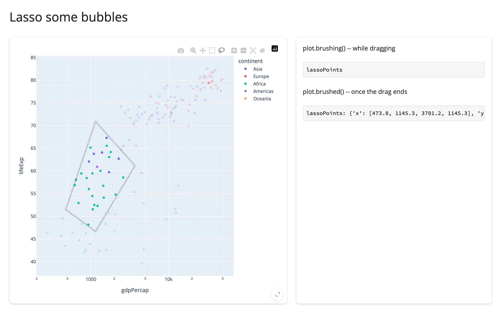

Like `selected()`, `brushed()` is re-seeded at every render (plotly.js's selection state, not an event
history), while `brushing()`'s drag stream is kept.

### `relayout()`

Reports the axis ranges after a zoom, pan, or autoscale (e.g. double-click-to-reset), filtered to just the
range/autorange keys -- the raw plotly.js `relayout` event also fires on every render (`autosize`) and every
modebar click (`dragmode`), which `relayout()` deliberately ignores.

```{.python file="examples/09_relayout.py"}
import plotly.express as px
from shiny.express import render, ui
from shinywidgets import render_plotly

df = px.data.gapminder().query("year == 2007").reset_index(drop=True)


def fmt(v: object) -> str:
    return f"{v:.1f}" if isinstance(v, float) else str(v)


ui.page_opts(title="Zoom in", fillable=True)

with ui.layout_columns(col_widths=[7, 5]):
    with ui.card(full_screen=True):

        @render_plotly
        def plot():
            return px.scatter(df, x="lifeExp", y="gdpPercap", color="continent")

    with ui.card():
        ui.card_header("plot.relayout()")

        @render.code
        def relayout_out():
            axes = plot.relayout()
            if axes is None:
                return "None (zoom or pan)"
            return "\n".join(f"{k}: {fmt(v)}" for k, v in axes.items())
```

After a zoom-drag, and after double-clicking to reset (autorange):

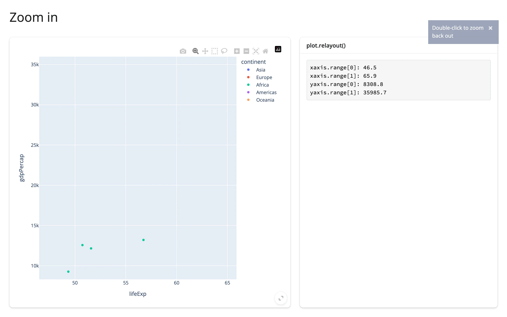

A double-click reset reports `{"xaxis.autorange": True, "yaxis.autorange": True}`, not the new numeric range --
treat `autorange: True` as "back to full extent" rather than reading stale `range` values.

**On a log axis**, `relayout()`'s range values are log10 of the data (e.g. `2.8` for `gdpPercap≈630`), because
that's what plotly.js reports natively -- unlike `brushed()`'s region, which is always in data units. If you
filter data with a `relayout()` range from a log axis, apply `10 ** value` first.

`relayout()` is kept across a re-render, not re-seeded -- R plotly's `event_data("plotly_relayout")` behaves
the same way. Its payload is a delta (only the keys the gesture changed), so after a re-render it may describe
axis ranges on a figure that no longer exists; read `plot.widget.layout` for the displayed figure's current
ranges (`relayout()` is a good trigger for that read, since plotly.py keeps `.widget.layout` synced to every
zoom and pan).

### `hover()`

Same columns as `clicked()`, but fires continuously as the mouse moves over points and clears to `None` when
it leaves them -- debounced 250 ms by default, so a reader updates once the mouse settles rather than on every
pixel of movement. A natural fit for a detail card that previews a point without requiring a click:

```{.python file="examples/19_hover_detail.py"}
import plotly.express as px
from shiny.express import render, ui
from shinywidgets import render_plotly

df = px.data.gapminder().query("year == 2007").reset_index(drop=True)

ui.page_opts(title="Hover for details", fillable=True)

with ui.layout_columns(col_widths=[8, 4]):
    with ui.card(full_screen=True):

        @render_plotly
        def plot():
            return px.scatter(
                df,
                x="gdpPercap",
                y="lifeExp",
                color="continent",
                log_x=True,
                size="pop",
                size_max=40,
                custom_data=[df.index],
            )

    with ui.card():

        @render.ui
        def detail():
            pts = plot.hover()
            if pts is None:
                return ui.p("Hover a bubble for details.", class_="text-muted")
            row = df.loc[pts["customdata"].iloc[0][0]]
            return ui.TagList(
                ui.h4(row["country"]),
                ui.p(f"Continent: {row['continent']}"),
                ui.p(f"Life expectancy: {row['lifeExp']:.1f} years"),
                ui.p(f"GDP per capita: ${row['gdpPercap']:,.0f}"),
            )
```

Before hovering, and hovering Afghanistan:

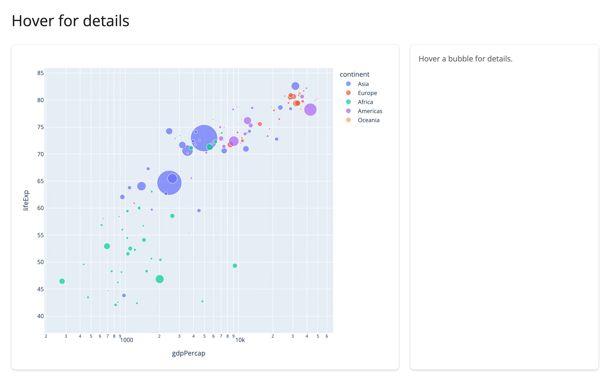
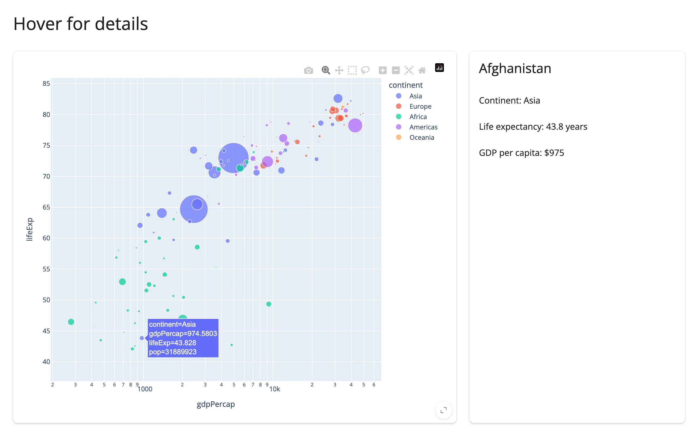

### `double_clicked()`

A pulse, not a state: `None` until the first double-click, then `True`, re-firing readers on every later
double-click even though the value itself stays `True`. It's the general "the user reset the view" signal --
useful because `clicked()` clearing to `None` on the same gesture only tells *that* accessor's own readers,
not a different widget that also needs to react.

```{.python file="examples/20_double_clicked_reset.py"}
import plotly.express as px
import plotly.graph_objects as go
from shiny import reactive, req
from shiny.express import ui
from shinywidgets import render_plotly

df = px.data.gapminder().query("year == 2007").reset_index(drop=True)
top15 = df.nlargest(15, "pop").sort_values("pop")

ui.page_opts(title="Click a bubble, double-click to reset", fillable=True)

with ui.layout_columns(col_widths=[7, 5]):
    with ui.card(full_screen=True):

        @render_plotly
        def scatter():
            return px.scatter(
                df,
                x="gdpPercap",
                y="lifeExp",
                color="continent",
                log_x=True,
                custom_data=[df.index],
            )

    with ui.card(full_screen=True):

        @render_plotly
        def bars():
            fig = go.Figure(go.Bar(x=top15["pop"], y=top15["country"], orientation="h"))
            fig.update_traces(marker_color="lightgray")
            return fig


@reactive.effect
def _highlight():
    pts = scatter.clicked()
    req(pts is not None)
    country = df.loc[pts["customdata"].iloc[0][0], "country"]
    with bars.widget.batch_update():
        for trace in bars.widget.data:
            trace.marker.color = [
                "#1f77b4" if c == country else "lightgray" for c in top15["country"]
            ]


# clicked() already clears itself on a background double-click, but that only
# resets scatter's own reader. double_clicked() is the general "the user
# reset the view" pulse -- reach for it when a *different* widget needs to
# react to a reset, including on subplot types (mapbox, ternary) where
# relayout()'s axis-range filter never reports one.
@reactive.effect
def _reset_bars():
    req(scatter.double_clicked())
    with reactive.isolate(), bars.widget.batch_update():
        for trace in bars.widget.data:
            trace.marker.color = "lightgray"
```

Click a bubble to highlight its bar, then double-click the background to reset it:

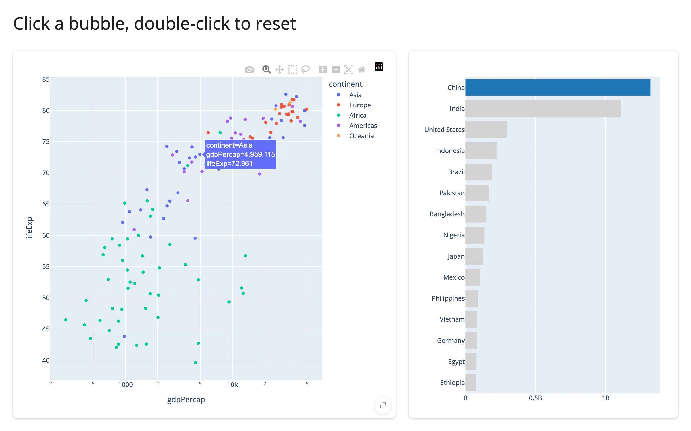
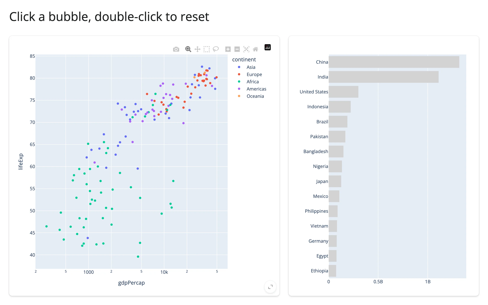

Verified on current main: double-clicking a cartesian plot's background (as above) fires `double_clicked()`,
as does double-clicking a `scattermap`/mapbox-family or ternary chart -- the subplot types the docstring calls
out as needing this accessor, since their view reset (map center/zoom, ternary axis extents) doesn't match
`relayout()`'s `xaxis`/`yaxis` filter. The exception, called out in the docstring, is 3D: on the plotly 6.9.0
bundled here, double-clicking a `scatter_3d` scene's background does **not** fire `plotly_doubleclick` at all
(confirmed with a direct JS listener; the gesture just registers as two tiny camera-orbit `relayout` events),
so a 3D view reset isn't observable this way.

### `legend_clicked()` and `visible_traces()`

`legend_clicked()` reports the trace(s) affected by the most recent legend click: the clicked trace first, then
its `legendgroup` mates if the click toggled the whole group. `visible_traces()` reports the *current*
visibility of every trace -- seeded from the figure as drawn, then updated after every legend click,
double-click-to-isolate, or `.widget` visibility change (`update_traces(visible=...)`, `add_trace`,
`delete_traces`). Reach for `visible_traces()` to answer "what's on screen right now," rather than trying to
derive it by replaying every `legend_clicked()` event yourself:

```{.python file="examples/21_legend_visible_traces.py"}
import plotly.express as px
from shiny import req
from shiny.express import render, ui
from shinywidgets import render_plotly

df = px.data.gapminder().query("year == 2007").reset_index(drop=True)

ui.page_opts(title="Toggle legend items to filter the summary", fillable=True)

with ui.layout_columns(col_widths=[8, 4]):
    with ui.card(full_screen=True):

        @render_plotly
        def plot():
            return px.scatter(df, x="gdpPercap", y="lifeExp", color="continent", log_x=True)

    with ui.card():
        ui.card_header("Mean life expectancy, visible continents only")

        @render.data_frame
        def summary():
            vis = plot.visible_traces()
            # None until the browser reports the seed just after first draw
            req(vis is not None)
            shown = set(vis.loc[vis["visible"], "name"])
            subset = df[df["continent"].isin(shown)]
            agg = subset.groupby("continent", as_index=False)["lifeExp"].mean().round(1)
            return render.DataGrid(agg)

        "plot.legend_clicked() -- the trace(s) the last click affected"

        @render.code
        def last_click():
            traces = plot.legend_clicked()
            if traces is None:
                return "None (click a legend item)"
            return ";".join(f"{r.trace_index},{r.name}" for r in traces.itertuples())
```

Click "Africa" in the legend to hide it: `legend_clicked()` reports `2,Africa` (its trace index and name) and
the summary table drops that row:

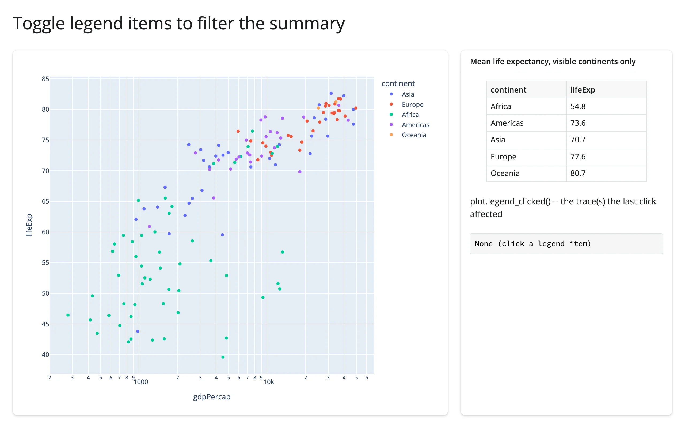
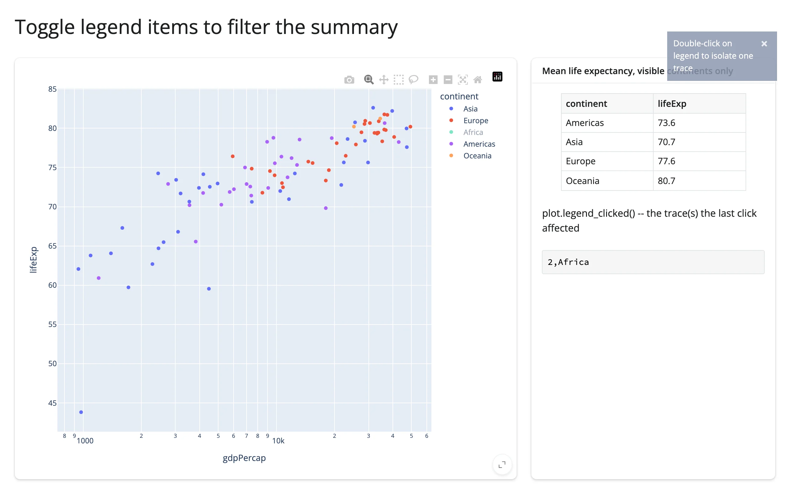

### `selected_rows(df, key=None)`

Plotly reports points of the *plot* (trace index + position within the trace); `selected_rows()` turns that into
rows of *your* data frame by matching each point's `customdata` -- so the figure must carry one:

- **pandas, no `key`**: `custom_data=[df.index]` carries each row's index label. Matches are done against
  `df.index`, so this is safe even if `df` is filtered or sorted relative to the frame the figure was built
  from.
- **Any frame (including polars), with `key`**: `custom_data=["some_column"]` plus `key="some_column"` matches
  that column's values. Pick an id column, or add one with `df.with_row_index("id")`.

Calling it without `customdata` on the figure raises a clear `ValueError` pointing at `custom_data=`. It returns
an empty frame (not `None`) while nothing is selected, so you can pass it straight to `@render.data_frame`.

Pandas, matched by index:

```{.python file="examples/10_selected_rows_pandas.py"}
import plotly.express as px
from shiny.express import render, ui
from shinywidgets import render_plotly

df = px.data.gapminder().query("year == 2007").reset_index(drop=True)

ui.page_opts(title="Lasso-select countries", fillable=True)

with ui.layout_columns(col_widths=[7, 5]):
    with ui.card(full_screen=True):

        @render_plotly
        def plot():
            fig = px.scatter(
                df,
                x="gdpPercap",
                y="lifeExp",
                color="continent",
                log_x=True,
                custom_data=[df.index],
            )
            fig.update_layout(dragmode="lasso")
            return fig

    with ui.card(full_screen=True):
        ui.card_header("plot.selected_rows(df)")

        @render.data_frame
        def rows():
            cols = ["country", "lifeExp", "gdpPercap"]
            return render.DataGrid(plot.selected_rows(df)[cols].round(1))
```

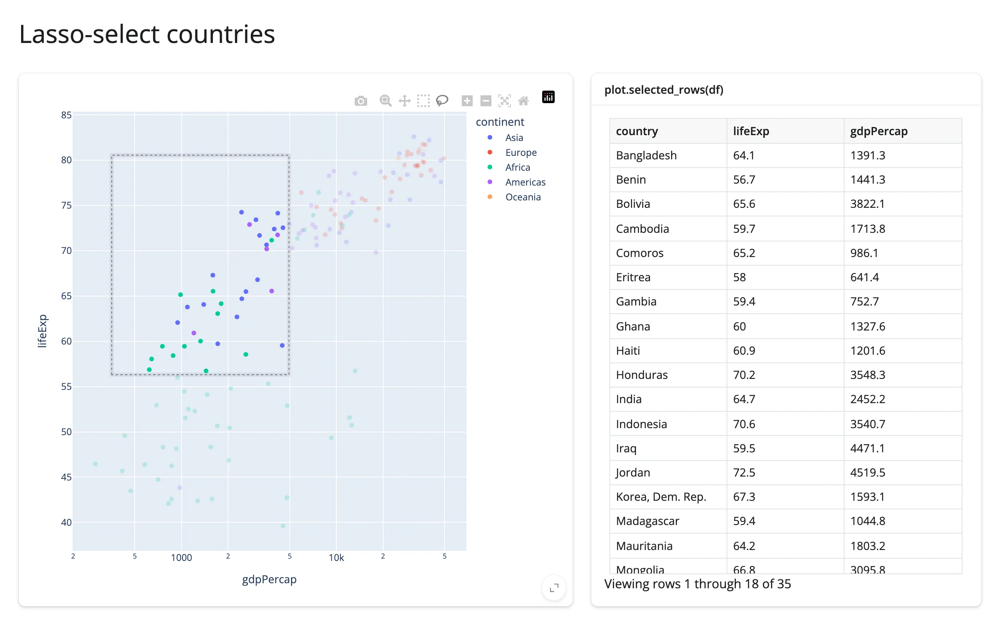

Polars, matched by a key column (here, `country` itself -- any column with unique, stable values works):

```{.python file="examples/11_selected_rows_polars.py"}
import plotly.express as px
import polars as pl
from shiny.express import render, ui
from shinywidgets import render_plotly

pdf = px.data.gapminder().query("year == 2007")
df = pl.from_pandas(pdf[["country", "continent", "gdpPercap", "lifeExp"]])

ui.page_opts(title="Lasso-select countries (polars)", fillable=True)

with ui.layout_columns(col_widths=[7, 5]):
    with ui.card(full_screen=True):

        @render_plotly
        def plot():
            fig = px.scatter(
                df,
                x="gdpPercap",
                y="lifeExp",
                color="continent",
                log_x=True,
                custom_data=["country"],
            )
            fig.update_layout(dragmode="lasso")
            return fig

    with ui.card(full_screen=True):
        ui.card_header("plot.selected_rows(df, key='country')")

        @render.data_frame
        def rows():
            rows = plot.selected_rows(df, key="country")
            rows = rows.with_columns(pl.col("gdpPercap", "lifeExp").round(1))
            return render.DataGrid(rows.to_pandas())
```

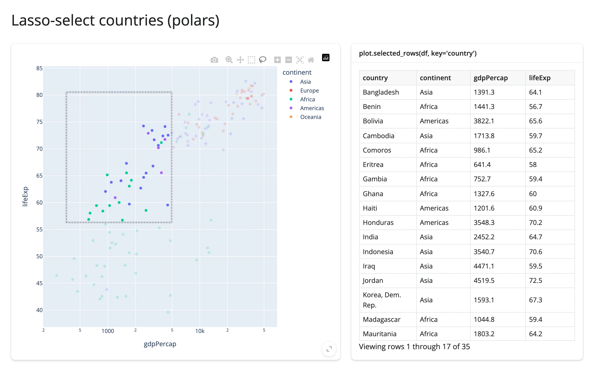

`plotly.express` works directly against a polars data frame (no `.to_pandas()` needed to build the figure) --
plotly 6's narwhals dependency handles that; `shinywidgets[plotly]` adds narwhals for plotly 5 users too.

**If you read `customdata` yourself** instead of using `selected_rows()`: px wraps each point's `custom_data` in
a list (one entry per point, even for a single column), so `pts["customdata"].iloc[0]` is `[value]`, not
`value` -- unwrap with `[0]` (see the detail-card pattern below). `selected_rows()` already does this for you.

### Reading on demand

Because every accessor attaches at render and records the interaction regardless of whether anything has read
it yet, it's safe to leave an accessor completely unread until some later event -- a button click, a download
handler, an LLM tool call -- asks for it. The lasso made before that first read isn't lost:

```{.python file="examples/22_read_on_demand.py"}
import plotly.express as px
from shiny.express import input, render, ui
from shinywidgets import render_plotly

df = px.data.gapminder().query("year == 2007").reset_index(drop=True)

ui.page_opts(title="Lasso now, read later", fillable=True)

with ui.layout_columns(col_widths=[8, 4]):
    with ui.card(full_screen=True):

        @render_plotly
        def plot():
            fig = px.scatter(
                df,
                x="gdpPercap",
                y="lifeExp",
                color="continent",
                log_x=True,
                custom_data=[df.index],
            )
            fig.update_layout(dragmode="lasso")
            return fig

    with ui.card():
        "Lasso some bubbles. Nothing reads the selection until you click Export."
        ui.input_action_button("export", "Export selection")

        @render.code
        def summary():
            if input.export() == 0:
                return "Nothing read yet."
            rows = plot.selected_rows(df)
            if rows.empty:
                return "No selection to export."
            return (
                f"{len(rows)} countries\n"
                f"mean life expectancy {rows['lifeExp'].mean():.1f} years"
            )
```

Lassoed, before the button is ever clicked (nothing has read `selected_rows()` yet), and after clicking
Export -- the earlier lasso is still there:

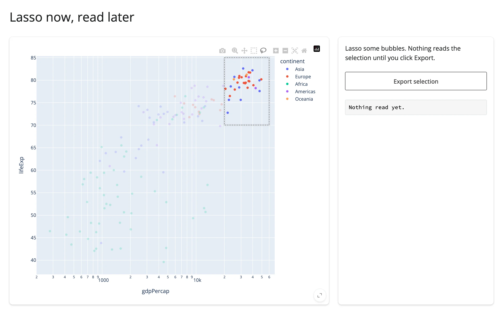
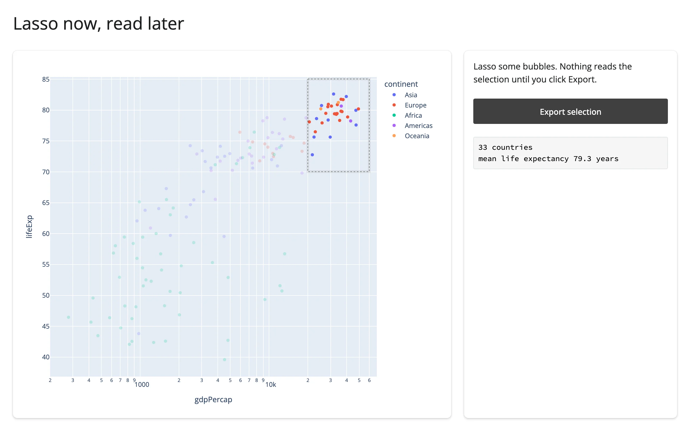

### Beyond the accessors: `.read()`

Every output also has `plot.read(name)`, which reads an accessor by name (`plot.read("selected")` is the same
value as `plot.selected()`) and falls through to `reactive_read()` on the widget for any name that isn't an
accessor. For plotly there isn't a non-accessor trait worth falling through to: verified on current main,
`reactive_read(fig.widget, "layout.xaxis.range")` raises `ValueError` ("not a widget trait") -- `layout` isn't
a synced trait, it's a plotly.py wrapper object. `_widget_data`/`_widget_layout` are synced traits, but they
don't change after the initial render, so reading them reactively never fires again. The private
`_js2py_relayout`/`_js2py_pointsCallback` traits do fire on interaction, but they're undocumented, fire twice
per event, and are exactly what the accessors above already decode for you. In short: for plotly, the named
accessor methods are the whole interaction surface -- prefer them over `.read()`, which exists mainly as a
generic primitive for code that reads outputs by name rather than by type (e.g. a table of every accessor on
every output in an app).

### Rate limiting

`hover()`, `selecting()`, and `brushing()` default to a 250ms debounce (they can fire dozens of times a second
while the mouse moves or drags); the rest are event-driven and already fire at most once per gesture, so they
aren't rate-limited by default. Pass `rate_delay=0` to `@render_plotly` to see every event as it happens --
useful for debugging, or for a very cheap per-event computation where the debounce's lag is more noticeable
than its benefit:

```{.python file="examples/12_rate_limiting.py"}
import plotly.express as px
from shiny import reactive
from shiny.express import render, ui
from shinywidgets import render_plotly

df = px.data.gapminder().query("year == 2007").reset_index(drop=True)

ui.page_opts(title="Debounced vs. unlimited selecting()", fillable=True)

count_debounced = reactive.value(0)
count_live = reactive.value(0)

with ui.layout_columns():
    with ui.card(full_screen=True):
        "Default: debounced 250ms"

        @render_plotly
        def debounced():
            fig = px.scatter(df, x="gdpPercap", y="lifeExp", log_x=True)
            fig.update_layout(dragmode="select")
            return fig

        @reactive.effect
        def _count_debounced():
            debounced.selecting()
            with reactive.isolate():
                count_debounced.set(count_debounced() + 1)

        @render.text
        def n_debounced():
            return f"selecting() fired {count_debounced()} times"

    with ui.card(full_screen=True):
        "rate_delay=0: fires on every drag event"

        @render_plotly(rate_delay=0)
        def live():
            fig = px.scatter(df, x="gdpPercap", y="lifeExp", log_x=True)
            fig.update_layout(dragmode="select")
            return fig

        @reactive.effect
        def _count_live():
            live.selecting()
            with reactive.isolate():
                count_live.set(count_live() + 1)

        @render.text
        def n_live():
            return f"selecting() fired {count_live()} times"
```

The same slow drag fires `selecting()` 2 times debounced vs. 12 times with `rate_delay=0`:

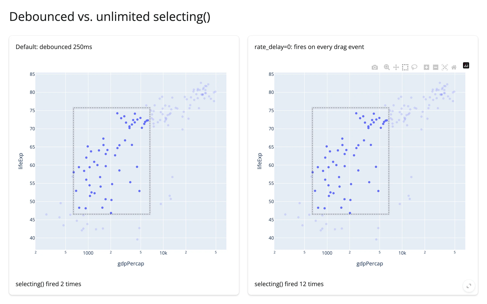

## Updating the widget from Python

Re-rendering (the render function reading a changed input) rebuilds the figure from scratch: zoom resets, and
`selected()`/`brushed()`/`visible_traces()` re-seed to the new, unselected figure (see "Reacting to user
interaction" above for which accessors keep their value instead). Verified on current main: the plot also
goes visibly blank for roughly a second while plotly.js reloads before the new figure paints (worse under
load). Prefer re-rendering when the shape of the data genuinely changes (new/removed traces, a
different chart type).

For everything else -- restyling existing traces, moving points, changing colors -- read inputs under
`reactive.isolate()` in the render function (so the render function itself never re-runs on that input) and
mutate `.widget` from a `@reactive.effect`. This is instant, preserves zoom/selection, and never re-sends
plotly's JS bundle:

```{.python file="examples/13_update_in_place.py"}
import plotly.express as px
from shiny import reactive
from shiny.express import input, ui
from shinywidgets import render_plotly

df = px.data.gapminder().query("year == 2007").reset_index(drop=True)

ui.page_opts(title="Resize markers without rebuilding the plot", fillable=True)

ui.input_slider("marker_size", "Marker size", min=4, max=24, value=8)


@render_plotly
def plot():
    # The render function never reads marker_size, so this never re-runs:
    # zoom and selection survive every slider move.
    return px.scatter(df, x="gdpPercap", y="lifeExp", color="continent", log_x=True)


@reactive.effect
def _resize():
    with plot.widget.batch_update():
        for trace in plot.widget.data:
            trace.marker.size = input.marker_size()
```

Zoomed in, then the marker-size slider moved to 20 -- the zoom range is untouched:

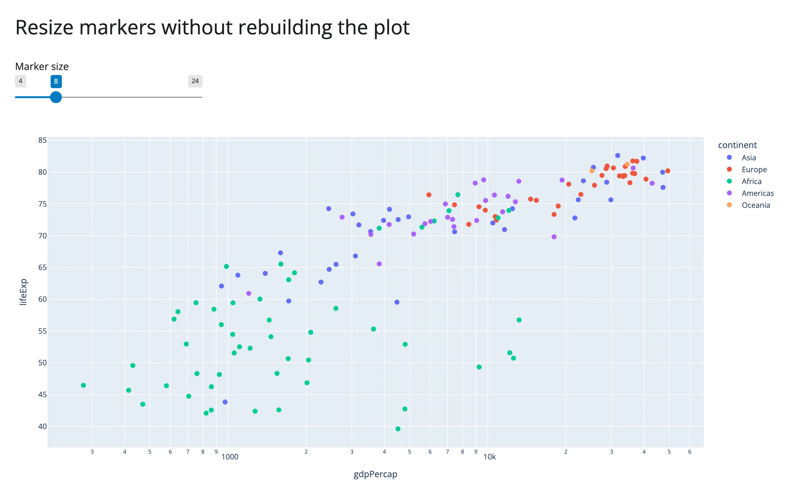
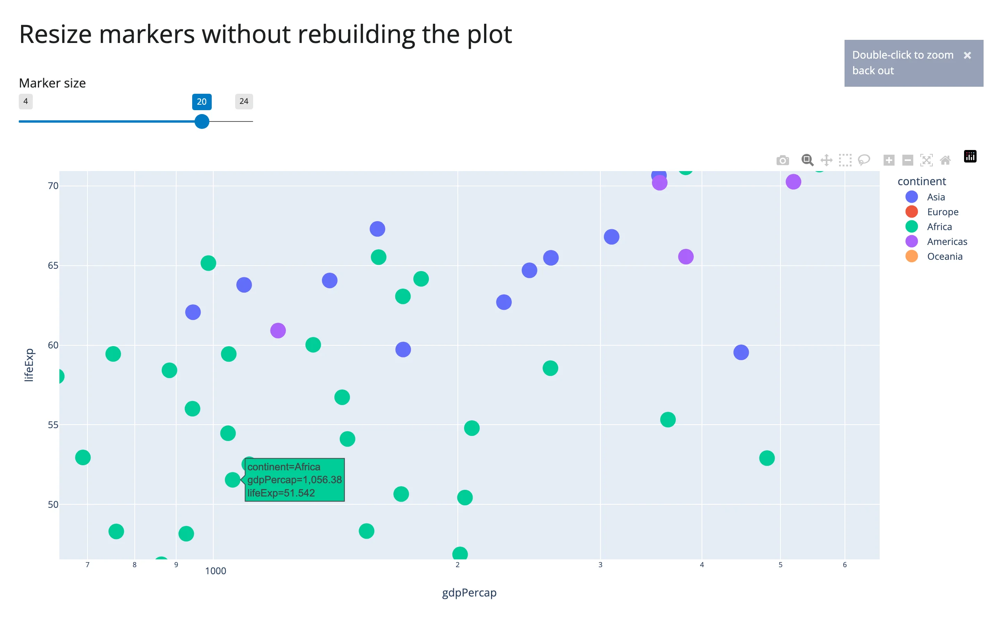

Use `with widget.batch_update():` to batch many property changes into one message (as above), or
`widget.batch_animate(duration=..., easing=...)` to tween `x`/`y`/`marker.size`/etc. changes smoothly -- see the
gallery showcase below for a slider-driven animation built entirely from `batch_animate`, with no plotly
"frames" involved.

## Coordinating multiple views

### Lasso a scatter plot, filter a table and a summary

Pairs with: itables. `selected_rows()` feeds a `render_itables` table and a one-line summary directly; no
manual row-matching needed beyond what `selected_rows()` already does.

```{.python file="examples/14_lasso_to_table.py"}
import plotly.express as px
from shiny.express import render, ui
from shinywidgets import render_itables, render_plotly

df = px.data.gapminder().query("year == 2007").reset_index(drop=True)

ui.page_opts(title="Lasso to table", fillable=True)

with ui.layout_columns(col_widths=[7, 5]):
    with ui.card(full_screen=True):

        @render_plotly
        def plot():
            fig = px.scatter(
                df,
                x="gdpPercap",
                y="lifeExp",
                color="continent",
                log_x=True,
                custom_data=[df.index],
            )
            fig.update_layout(dragmode="lasso")
            return fig

    with ui.card(full_screen=True):
        ui.card_header("Selected countries")

        @render_itables
        def table():
            cols = ["country", "continent", "lifeExp", "gdpPercap"]
            return plot.selected_rows(df)[cols]

        @render.text
        def summary():
            rows = plot.selected_rows(df)
            if rows.empty:
                return "Lasso some bubbles to see summary stats."
            return (
                f"{len(rows)} countries, mean life expectancy "
                f"{rows['lifeExp'].mean():.1f} years"
            )
```

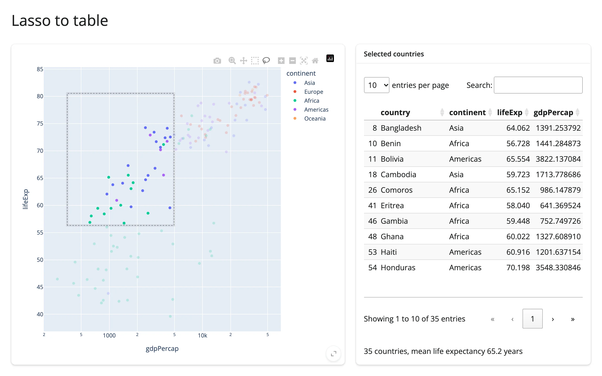

### Selection in one plot highlights another, in place

Lasso points in a scatter plot, and the matching bars in a second, unrelated figure light up -- restyled with
`batch_update()`, not rebuilt, so the bar chart's own state (and the scatter's selection) survives.

```{.python file="examples/15_linked_highlight.py"}
import plotly.express as px
import plotly.graph_objects as go
from shiny import reactive
from shiny.express import ui
from shinywidgets import render_plotly

df = px.data.gapminder().query("year == 2007").reset_index(drop=True)
top30 = df.nlargest(30, "pop").sort_values("pop")

ui.page_opts(title="Selection highlights a second plot", fillable=True)

with ui.layout_columns(col_widths=[7, 5]):
    with ui.card(full_screen=True):

        @render_plotly
        def scatter():
            fig = px.scatter(
                df,
                x="gdpPercap",
                y="lifeExp",
                color="continent",
                log_x=True,
                custom_data=[df.index],
            )
            fig.update_layout(dragmode="lasso")
            return fig

    with ui.card(full_screen=True):

        @render_plotly
        def bars():
            fig = go.Figure(go.Bar(x=top30["pop"], y=top30["country"], orientation="h"))
            fig.update_traces(marker_color="lightgray")
            return fig


@reactive.effect
def _highlight():
    selected = set(scatter.selected_rows(df)["country"])
    colors = ["#1f77b4" if c in selected else "lightgray" for c in top30["country"]]
    bars.widget.data[0].marker.color = colors
```

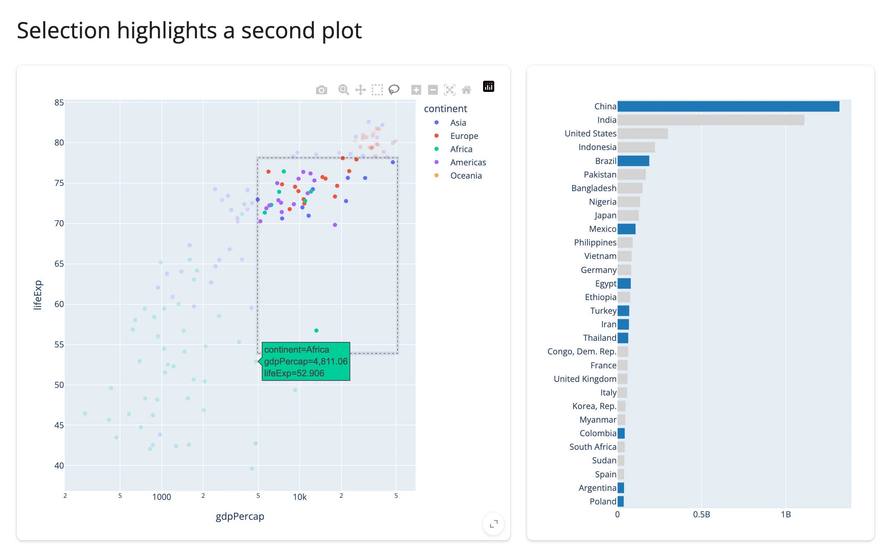

### Zoom one plot to filter a second view

`relayout()`'s filtered axis-range keys are exactly the signal to drive a second, derived view -- it stays
`None` through renders, modebar clicks, and selections, firing only on real zoom/pan/autoscale.

```{.python file="examples/16_relayout_filter.py"}
import plotly.express as px
from shiny.express import ui
from shinywidgets import render_plotly

df = px.data.gapminder().query("year == 2007").reset_index(drop=True)

ui.page_opts(title="Zoom to filter a second view", fillable=True)

with ui.layout_columns(col_widths=[7, 5]):
    with ui.card(full_screen=True):

        @render_plotly
        def scatter():
            return px.scatter(df, x="lifeExp", y="gdpPercap", color="continent")

    with ui.card(full_screen=True):
        ui.card_header("Mean GDP/capita in the visible life-expectancy range")

        @render_plotly
        def summary_bar():
            axes = scatter.relayout() or {}
            if "xaxis.range[0]" in axes:
                lo, hi = axes["xaxis.range[0]"], axes["xaxis.range[1]"]
                visible = df[df["lifeExp"].between(lo, hi)]
            else:
                visible = df
            means = visible.groupby("continent", as_index=False)["gdpPercap"].mean()
            return px.bar(means, x="continent", y="gdpPercap")
```

Full range, then zoomed to a high-life-expectancy band -- the bar chart recomputes its aggregate for just the
visible countries (this view is re-rendered on purpose: the aggregation changes which bars exist, so there's no
fixed set of traces to restyle in place):

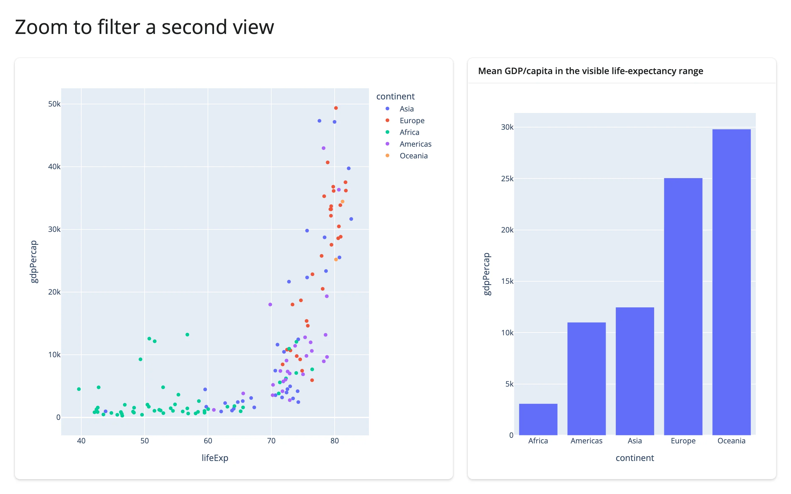
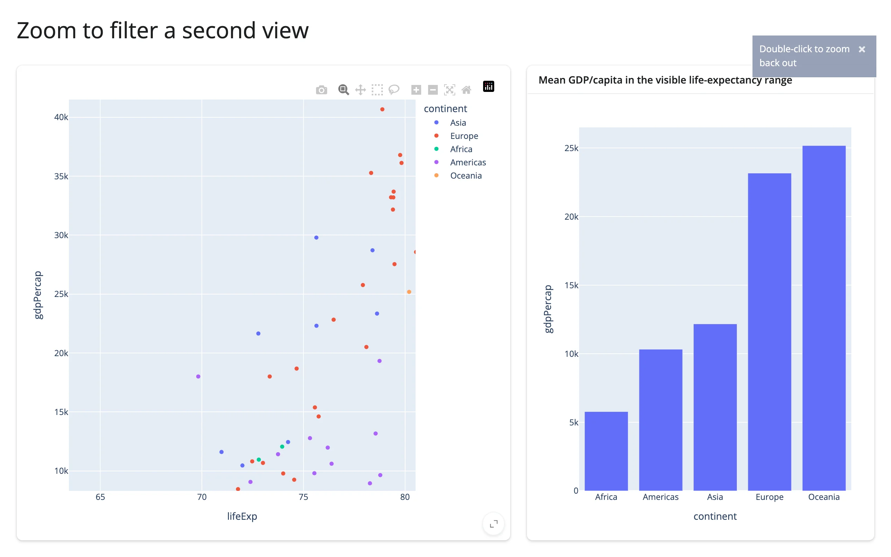

### Click a point, show a detail card

```{.python file="examples/17_click_detail_card.py"}
import plotly.express as px
from shiny.express import render, ui
from shinywidgets import render_plotly

df = px.data.gapminder().query("year == 2007").reset_index(drop=True)

ui.page_opts(title="Click for details", fillable=True)

with ui.layout_columns(col_widths=[8, 4]):
    with ui.card(full_screen=True):

        @render_plotly
        def plot():
            return px.scatter(
                df,
                x="gdpPercap",
                y="lifeExp",
                color="continent",
                log_x=True,
                size="pop",
                size_max=40,
                custom_data=[df.index],
            )

    with ui.card():

        @render.ui
        def detail():
            pts = plot.clicked()
            if pts is None:
                return ui.p("Click a bubble for details.", class_="text-muted")
            # px wraps each point's custom_data in a list; [0] is the row index.
            row = df.loc[pts["customdata"].iloc[0][0]]
            return ui.TagList(
                ui.h4(row["country"]),
                ui.p(f"Continent: {row['continent']}"),
                ui.p(f"Life expectancy: {row['lifeExp']:.1f} years"),
                ui.p(f"GDP per capita: ${row['gdpPercap']:,.0f}"),
                ui.p(f"Population: {row['pop']:,}"),
            )
```

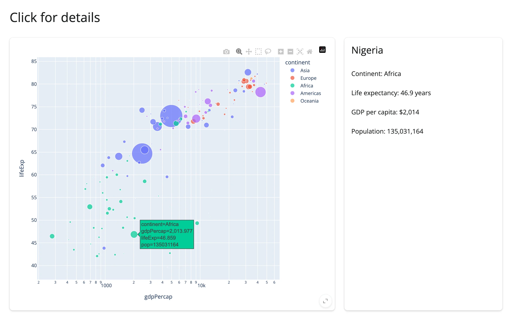

## Large data

**`go.Scattergl`/`render_mode="webgl"`** draws points on the GPU instead of SVG; above about 10,000 points, swap
`go.Scatter`/`px.scatter` for it. Return `(figure, config)` from the render function to pass Plotly.js
[config options](https://plotly.com/javascript/configuration-options/) (here, hiding the modebar) the same way
Dash's `dcc.Graph(figure=, config=)` does -- this is the "draw it with the GPU in the browser" approach from
[Large data & performance](../../guide/performance/index.md#three-approaches-to-large-data):

```{.python file="examples/05_large_data_config.py"}
import numpy as np
import plotly.graph_objects as go
from shiny.express import ui
from shinywidgets import render_plotly

rng = np.random.default_rng(0)
n = 200_000
x = rng.normal(size=n)
y = x * 0.6 + rng.normal(size=n)

ui.page_opts(title="200k points", fillable=True)


@render_plotly
def big_scatter():
    fig = go.Figure(
        go.Scattergl(x=x, y=y, mode="markers", marker=dict(size=3, opacity=0.3))
    )
    return fig, {"displayModeBar": False}
```

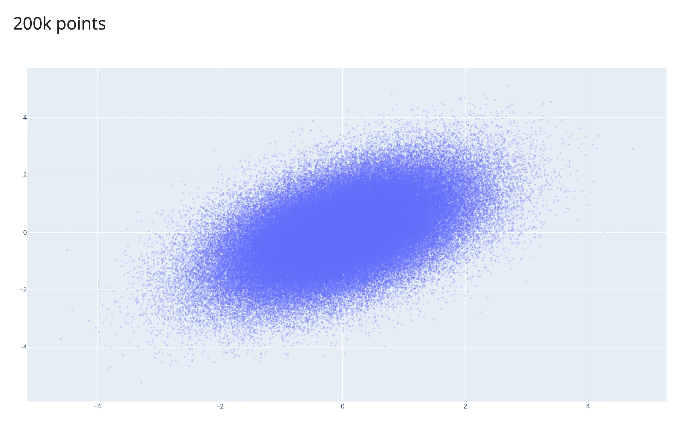

200k points render in well under a second. Numeric arrays travel to the browser as base64-encoded binary, so a
`float32` array (`x.astype("float32")`) roughly halves that payload for very large traces.

At real scale (millions of rows), a raw-point lasso selection is an anti-pattern -- its
payload and server-side work grow with the SELECTION, not a fixed output size. See
[Linking widgets, pattern 7: brushing large data](../../guide/linked-views/index.md#7-brushing-large-data-push-summaries-not-points)
for a measured comparison against pushing summaries (datashader raster, Mosaic
crossfilter) instead.

## Layout and sizing

A figure fills its output by default; shinywidgets also trims plotly's 80px default margins down to
`l=16, r=16, t=32, b=16` and sets `responsive: True` so the fill actually tracks the container (plotly 6
otherwise needs that config flag to resize on its own).

Giving the figure its own `layout.height` opts it out of filling -- it renders at that fixed height instead.
`@render_plotly(height="300px")` (or `output_widget(id, height="300px")`) also sizes the plot to that height
directly, whether or not `fillable` is set -- verified on current main (`fillable` defaults to `False` once
`height` is given, and either way the plot settles at exactly 300px, not plotly's own 360px fallback).

```{.python file="examples/18_layout_sizing.py"}
import plotly.express as px
from shiny.express import ui
from shinywidgets import render_plotly

df = px.data.iris()

ui.page_opts(title="Sizing", fillable=True)

with ui.card(full_screen=True):
    "Fills its card (no explicit height) -- try full_screen"

    @render_plotly
    def fills():
        return px.scatter(df, x="sepal_width", y="sepal_length", color="species")


with ui.card():
    "Fixed height: an explicit height= sizes the plot directly"

    @render_plotly(height="300px")
    def fixed():
        return px.scatter(df, x="sepal_width", y="sepal_length", color="species")
```

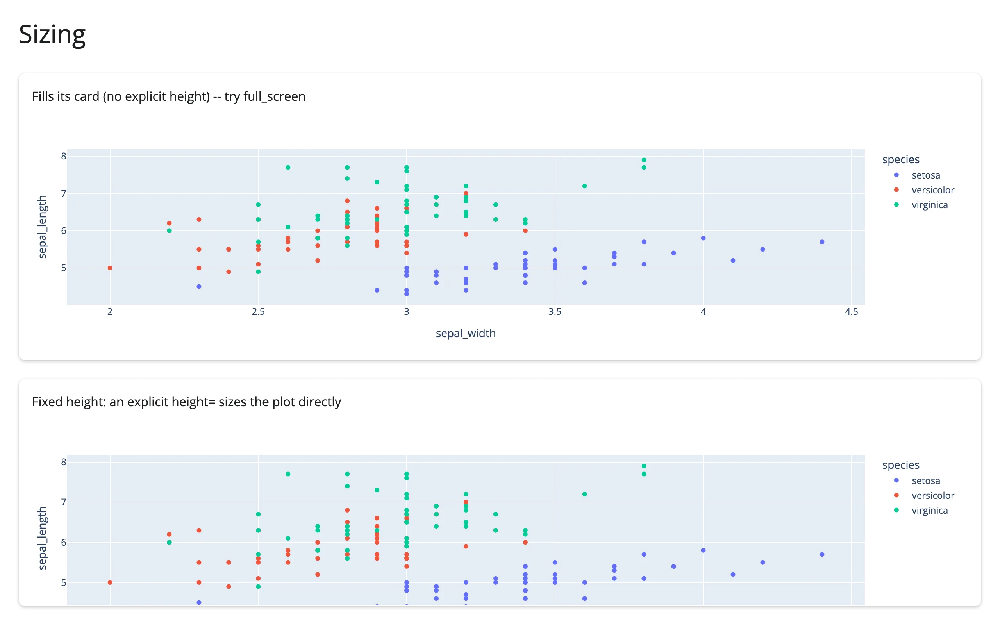

`ui.card(full_screen=True)` and sidebar collapse/expand all resize the figure correctly -- plotly listens for
container resizes once `responsive` is set.

## Gotchas and limitations

Verified on current `main` (plotly 6.9.0, shiny 1.9.0):

- **A double-click only clears `clicked()` if it lands on empty background.** Double-clicking a point leaves
  `clicked()` showing that point (the second click re-fires after the internal clear). This isn't mentioned in
  the docstring; see "Clearing semantics" above.
- **A plain click resets `selected()`/`brushed()` when `dragmode` is `"select"`/`"lasso"`.** This is plotly.js
  treating the click as a zero-area selection, not a shinywidgets bug, but it means click-to-inspect and
  lasso-to-filter interactions sharing one figure will clear each other -- see the gallery template, which
  documents this inline rather than fighting it.
- **`relayout()` ranges are log10 on a log axis**, but `brushed()`/`selected()` coordinates are always in data
  units, even on the same log axis. Mixing the two without converting will silently misfilter.
- **A re-render blanks the plot for roughly a second** (plotly.js reloading its ~5MB code bundle) before the
  rebuilt figure appears; worse on a loaded machine. In-place updates (`.widget` + `batch_update`/
  `batch_animate`) have no such gap -- see "Updating the widget from Python".
- **`double_clicked()` doesn't fire on a 3D scene.** Verified on current main: double-clicking a `scatter_3d`
  plot's background never dispatches `plotly_doubleclick` (confirmed with a direct JS listener; the gesture
  just registers as two tiny camera-orbit `relayout` events), so a 3D view reset isn't observable this way.
  It does fire as documented on cartesian, `scattermap`/mapbox, and ternary charts.
- **`customdata` is wrapped in a list per point** by `plotly.express` (even for a single `custom_data=[...]`
  column), so reading it directly (rather than through `selected_rows()`) needs an extra `[0]`:
  `pts["customdata"].iloc[0][0]`.
- **`.value` is not the live figure.** When the render function returns a `go.Figure`, `.value` is exactly that
  object; `@render_plotly` coerces a *copy* into `.widget`. Mutating `.value` after returning it does nothing
  visible -- always mutate `.widget`.

What we deliberately didn't chase: the old report's performance findings about plotly's ~5MB JS bundle being
resent on every re-render (a real, measurable cost, but a cross-cutting anywidget/shinywidgets architecture
question, not specific to this guide).

## Gallery candidates

### [`template_lasso_explorer.py`](gallery/template_lasso_explorer.py)

A small, adaptable starting point (bucket: template): lasso points in a scatter plot to filter a searchable
table and a one-line summary, with a click-through detail card for a single point. Swap in your own data frame
and column names.

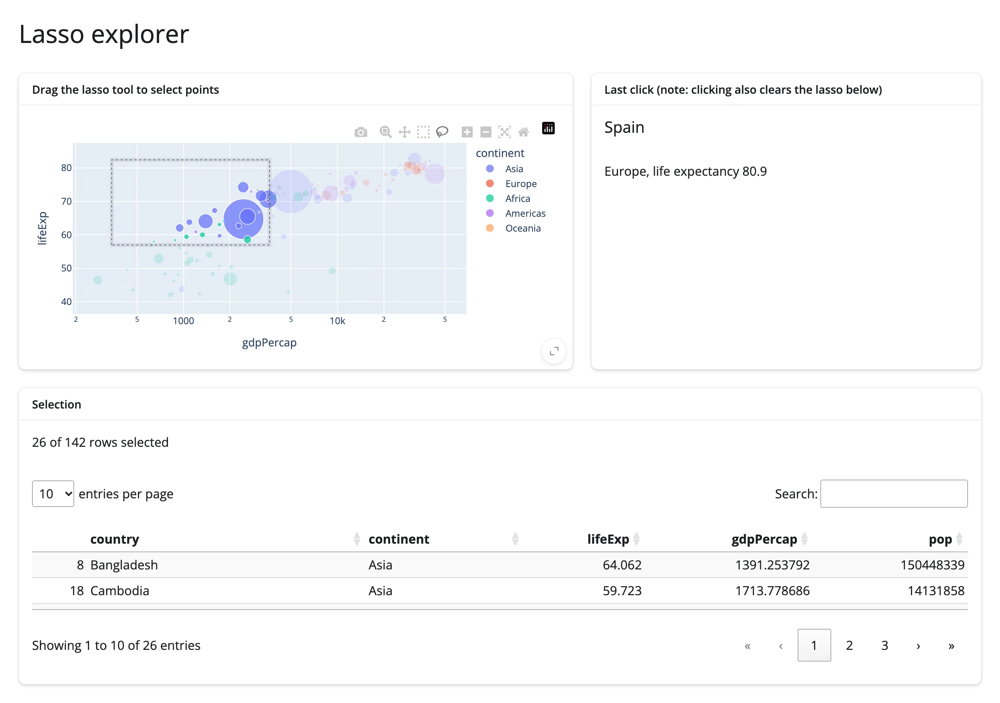

### [`showcase_gapminder_explorer.py`](gallery/showcase_gapminder_explorer.py)

A fuller demo (bucket: showcase) built from the patterns above: a year slider plays a bubble-chart animation
via `batch_animate` (no plotly "frames"), a click shows a detail card, lassoing bubbles highlights their full
1952-2007 history in a 142-country trend chart via in-place `batch_update`, and a dark-mode toggle swaps
templates on both figures while preserving the compact margins.


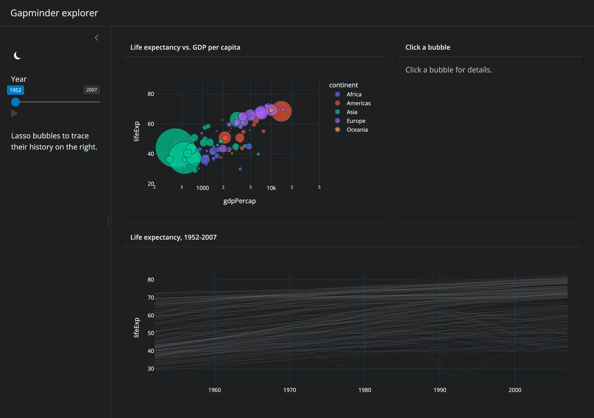

## Learn more

- [plotly.express API reference](https://plotly.com/python-api-reference/plotly.express.html)
- [plotly graph_objects reference](https://plotly.com/python/graph-objects/)
- [Plotly.js configuration options](https://plotly.com/javascript/configuration-options/) (for the
  `(figure, config)` return form)
- Related guides in this roster: [altair](../altair/index.md) (declarative selections), [bokeh](../bokeh/index.md),
  [itables](../itables/index.md) (used above for a linked table), [matplotlib](../matplotlib/index.md) for static
  charts.
