[plotnine](https://plotnine.org) is a Python implementation of the grammar of graphics, built by Hassan Kibirige
and a community of contributors to track R's ggplot2 as closely as the two languages allow. If you already think
in `ggplot() + geom_*() + facet_*() + theme_*()`, plotnine gives you that exact mental model in Python: layered
geoms, statistical transforms, scales, faceting, and a rich theming system, all composable with `+`. Since version
0.15 it also supports **compositions** -- arranging whole plots next to and above one another with `|` and `/`,
the same operators patchwork popularized in R.

Shiny for Python can already show a plotnine plot with the built-in `@render.plot`: it calls `.draw()` and sends
back a static PNG. `@render_plotnine` (`pip install 'shinywidgets[plotnine]'`) instead draws the plot once to a
live [ipympl](https://matplotlib.org/ipympl/) canvas that stays on the server for as long as the output is
displayed. That gets you a few things a static image can't: the matplotlib toolbar (zoom, pan, home, back/forward,
PNG download) for free, a `clicked()` accessor that turns a mouse press into a reactive value, a `limits()`
accessor that turns the current zoom window into a reactive value you can read anywhere, and the ability to
edit the rendered figure's artists in place without a full re-render. It also renders compositions, which
`@render.plot` rejects outright. The trade-off is cost and limits: every interaction redraws the figure in Python
and ships a new image over the websocket, so it doesn't scale to huge datasets or brush-to-select the way
`@render.plot`'s built-in `brush=True` does, and because `render_plotnine` reuses the generic ipympl canvas, there's
no click-to-facet or click-to-data-value translation built in -- you do that mapping yourself (shown below).

`render_plotnine` shares its rendering machinery and two of matplotlib's three accessors, `clicked()` and
`limits()`, with [`render_matplotlib`](../matplotlib/index.md) -- both coerce to the same
`ipympl.backend_nbagg.Canvas` widget. If your plot doesn't need plotnine's grammar (you're building a figure
directly with matplotlib, pandas' `.plot()`, or seaborn), use the matplotlib guide instead; the toolbar, in-place
update, and accessor material there applies unchanged. Reach for `render_plotnine` here when ggplot syntax is how
you already build the plot, and reach for `@render.plot` when the plot is just a picture: large data, a dashboard
with many small static plots, or brush selection (see the comparison in
[Gotchas and limitations](#gotchas-and-limitations)).

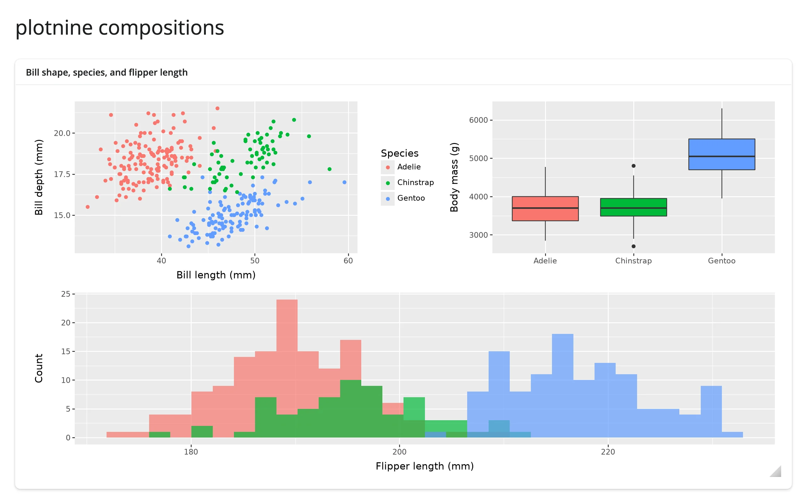

## Installation

```sh
pip install 'shinywidgets[plotnine]'
```

This installs `plotnine` and `ipympl` (the live-canvas backend `render_plotnine` draws to). No JavaScript bundle
to configure -- ipympl ships its own.

## Quick start

```{.python file="examples/01_quickstart.py"}
from plotnine import aes, geom_point, geom_smooth, ggplot, labs, theme_minimal
from plotnine.data import mpg
from shiny.express import ui
from shinywidgets import render_plotnine

ui.page_opts(title="plotnine quick start", fillable=True)

with ui.card(full_screen=True):
    ui.card_header("Engine displacement vs. highway MPG")

    @render_plotnine
    def plot():
        return (
            ggplot(mpg, aes("displ", "hwy", color="class"))
            + geom_point(size=2.5, alpha=0.8)
            + geom_smooth(method="lm", color="black", se=False)
            + labs(x="Displacement (L)", y="Highway MPG", color="Class")
            + theme_minimal()
        )
```

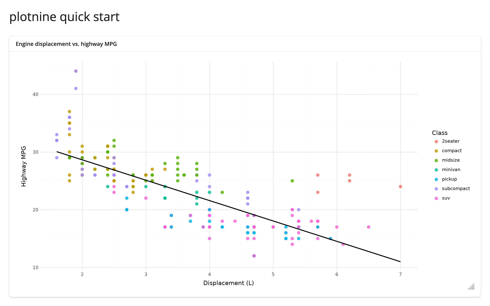

Return a `ggplot` from the decorated function the same as you would from a notebook cell. `render_plotnine` draws
it (a copy -- your `plot` object is never mutated), resizes the figure to fill the card, and plotnine re-runs its
own layout engine (legend, axis labels, facet strips) every time the card resizes. Hover the plot and a toolbar
fades in at the top-left with zoom, pan, home/back/forward, and PNG download -- see
[What you can build](#what-you-can-build).

## What you can build

### Plot compositions, not just single plots

```{.python file="examples/02_compositions.py"}
from plotnine import aes, geom_boxplot, geom_histogram, geom_point, ggplot, labs, theme
from plotnine.data import penguins
from shiny.express import ui
from shinywidgets import render_plotnine

penguins = penguins.dropna().reset_index(drop=True)

ui.page_opts(title="plotnine compositions", fillable=True)

no_legend = theme(legend_position="none")

with ui.card(full_screen=True):
    ui.card_header("Bill shape, species, and flipper length")

    @render_plotnine
    def composed():
        scatter = (
            ggplot(penguins, aes("bill_length_mm", "bill_depth_mm", color="species"))
            + geom_point()
            + labs(x="Bill length (mm)", y="Bill depth (mm)", color="Species")
        )
        box = (
            ggplot(penguins, aes("species", "body_mass_g", fill="species"))
            + geom_boxplot()
            + labs(x="", y="Body mass (g)")
            + no_legend
        )
        hist = (
            ggplot(penguins, aes("flipper_length_mm", fill="species"))
            + geom_histogram(bins=30, alpha=0.7, position="identity")
            + labs(x="Flipper length (mm)", y="Count")
            + no_legend
        )
        return (scatter | box) / hist
```


`(scatter | box) / hist` lays the three plots out as one figure -- a scatter and a box plot side by side, a
histogram underneath -- and `render_plotnine` treats the whole thing as a single widget: one toolbar, one resize
target, re-laid out as a unit. `@render.plot` can't display this at all: it raises `@render.plot doesn't know to
render objects of type '<class 'plotnine.composition._beside.Beside'>'` (verified). This is the most direct reason
to reach for `render_plotnine` over the static renderer when a dashboard panel needs more than one related plot.

### A toolbar for free: zoom, pan, home, download

```{.python file="examples/04_toolbar_zoom.py"}
from plotnine import aes, geom_line, ggplot, labs, theme_minimal
from plotnine.data import economics
from shiny.express import ui
from shinywidgets import render_plotnine

ui.page_opts(title="Zoom and pan, no extra code", fillable=True)

with ui.card(full_screen=True):
    ui.card_header("US unemployment, 1967-2015 -- hover to reveal the toolbar")

    @render_plotnine
    def plot():
        return (
            ggplot(economics, aes("date", "unemploy"))
            + geom_line()
            + labs(x="", y="Unemployed (thousands)")
            + theme_minimal()
        )
```

Before and after dragging the "zoom to rectangle" tool over the 1998-2008 stretch:

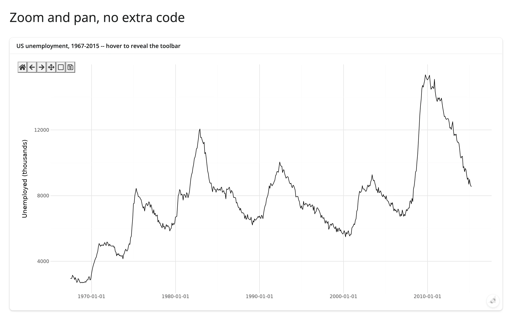
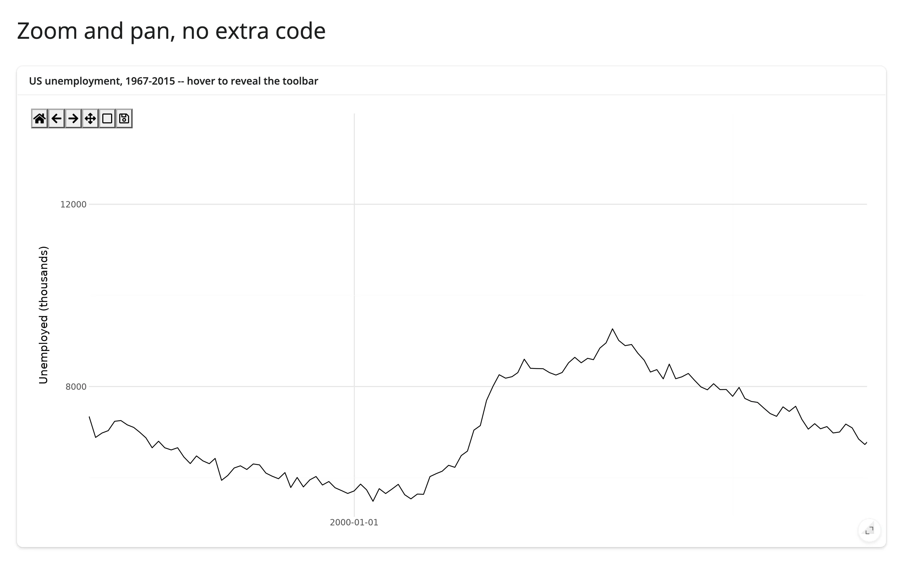

No code beyond the plot itself: `render_plotnine` always wires up ipympl's toolbar (box zoom, pan with left/right
mouse buttons, home, back/forward view history, and PNG download). You don't write any of this; you only need code
once you want Python to *react* to it (see [Reacting to user interaction](#reacting-to-user-interaction)). Notice
the zoomed-in x-axis in the second screenshot: it shows only one date tick. That's plotnine's axis breaks, computed
once at draw time -- see [Gotchas and limitations](#gotchas-and-limitations) for the fix.

### Facets and themes that relayout live

```{.python file="examples/03_facets_relayout.py"}
from plotnine import aes, facet_wrap, geom_point, ggplot, labs, theme_light
from plotnine.data import mpg
from shiny.express import ui
from shinywidgets import render_plotnine

ui.page_opts(title="Facets that relayout live", fillable=True)

with ui.card(full_screen=True):
    ui.card_header("Highway MPG by displacement, faceted by drivetrain")

    @render_plotnine
    def plot():
        return (
            ggplot(mpg, aes("displ", "hwy", color="class"))
            + geom_point(size=2)
            + facet_wrap("~drv", labeller="label_both")
            + labs(x="Displacement (L)", y="Highway MPG", color="Class")
            + theme_light()
        )
```

Wide and narrow (resized to a 650px-wide card):

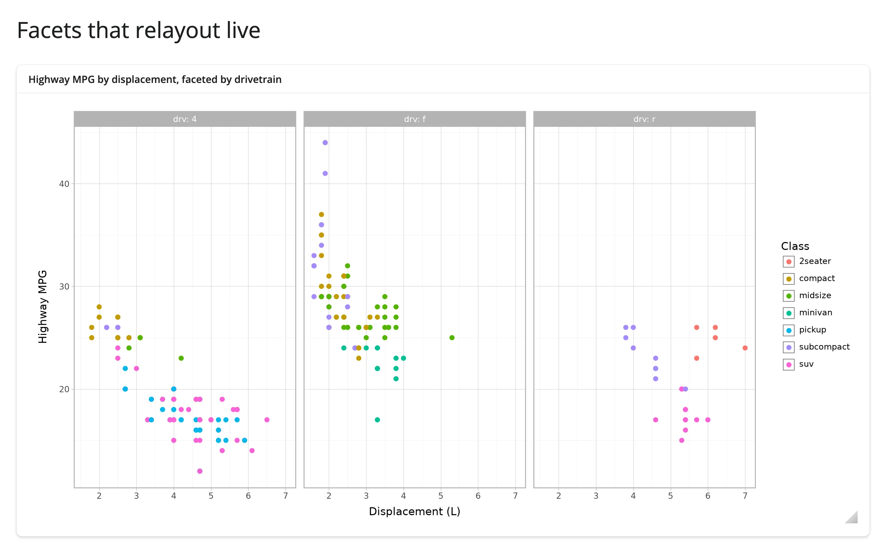
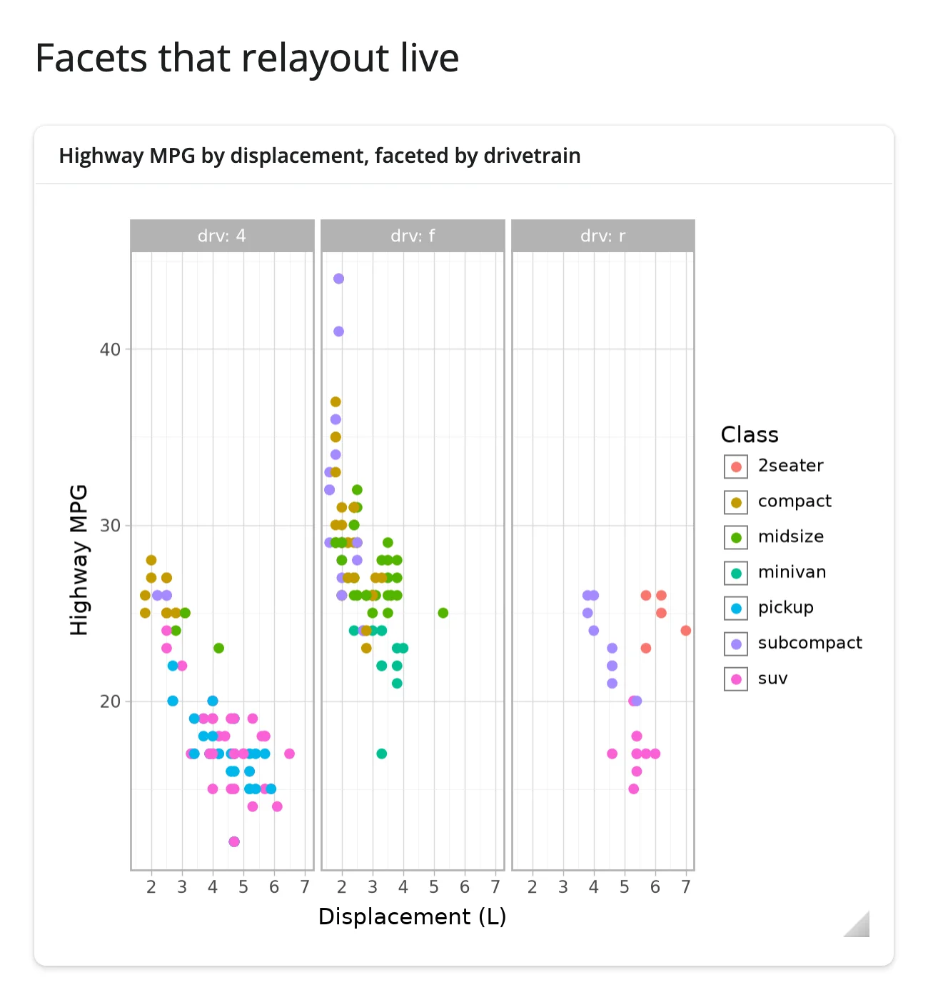

Every resize -- dragging the window, collapsing a sidebar, entering `full_screen` -- triggers a real plotnine
redraw, not a CSS rescale. Facet strips, legend placement, and axis label wrapping are recomputed at the new size,
the same as they would be if you called `.draw()` again at a different `figure_size`. This is what `theme(dpi=...)`
and `theme(figure_size=...)` would otherwise need you to pick in advance for a static image.

## Reacting to user interaction

### Accessor reference

| accessor | returns | before any interaction | across re-render | default rate policy |
|---|---|---|---|---|
| `clicked()` | `matplotlib.backend_bases.MouseEvent` | `None` | kept (payload describes the previous render's figure) | not rate-limited |
| `limits(ax=0)` | `((x0, x1), (y0, y1))` for panel `ax` | seeded value (the figure's rendered limits) | re-seeded from the new figure | debounced, 250 ms |

Both are the same underlying accessors as [`render_matplotlib`](../matplotlib/index.md#reacting-to-user-interaction)
(both renderers coerce to the same ipympl `Canvas`), documented separately here because the coordinate space is
plotnine's own: `.xdata`/`.ydata` and `limits()`'s bounds are in plotnine's *transformed* units, not necessarily
the values in your data frame (see below). `clicked()` attaches the moment the figure renders and **keeps its
value across a re-render** until the user clicks the new figure; `limits()` instead **re-seeds** from the new
figure's own limits on every render, since it describes the figure's current view rather than something the user
did. A press that starts a toolbar pan/zoom drag, or lands outside every axes (e.g., in the legend), doesn't
count toward `clicked()`. A double-click arrives as three separate presses -- `MouseEvent` has no equality, so
repeats are never deduplicated.

`render_matplotlib` also has `picked()`; plotnine doesn't get it. plotnine's geoms reject matplotlib's `picker=`
kwarg outright (`geom_point(picker=5)` raises `PlotnineError: Parameters {'picker'} ... are not understood`,
verified), so no plotnine artist can ever be made pickable -- `picked()` would just never fire.

### `clicked()`: the nearest point, as a reactive value

```{.python file="examples/05_accessor_clicked.py"}
import numpy as np
from plotnine import aes, geom_point, ggplot, labs, theme_minimal
from plotnine.data import mpg
from shiny import reactive, req
from shiny.express import render, ui
from shinywidgets import render_plotnine

ui.page_opts(title="plot.clicked(): nearest point", fillable=True)
nearest = reactive.value(None)

with ui.layout_columns():
    with ui.card(full_screen=True):

        @render_plotnine
        def plot():
            return (
                ggplot(mpg, aes("displ", "hwy"))
                + geom_point(size=2.5, alpha=0.7)
                + labs(x="Displacement (L)", y="Highway MPG")
                + theme_minimal()
            )

    with ui.card():
        ui.card_header("Clicked car")

        @render.ui
        def detail():
            # Compare to None explicitly: a row position of 0 is falsy, so
            # req(nearest()) would wrongly treat that valid click as "no click"
            i = nearest()
            if i is None:
                return ui.p("Click a point to see that car here.")
            row = mpg.iloc[i]
            return ui.p(
                f"{row.manufacturer.title()} {row.model}: {row.displ} L, {row.hwy} MPG hwy"
            )


@reactive.effect
def _mark_nearest():
    event = plot.clicked()
    canvas = plot.widget
    req(event, canvas)
    ax = canvas.figure.axes[0]
    xy = ax.transData.transform(mpg[["displ", "hwy"]].to_numpy())
    i = int(np.hypot(xy[:, 0] - event.x, xy[:, 1] - event.y).argmin())
    nearest.set(i)

    for artist in list(ax.lines):
        if artist.get_label() == "_clicked":
            artist.remove()
    row = mpg.iloc[i]
    ax.plot(
        [row.displ],
        [row.hwy],
        "o",
        ms=14,
        mfc="none",
        mec="black",
        mew=2,
        label="_clicked",
    )
    canvas.draw_idle()
```

Before any click, and after clicking near the middle of the cloud:

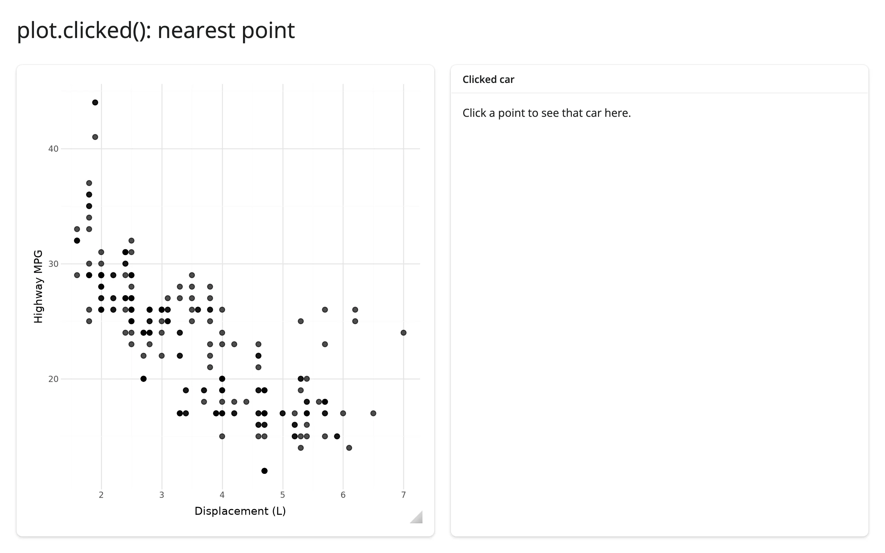
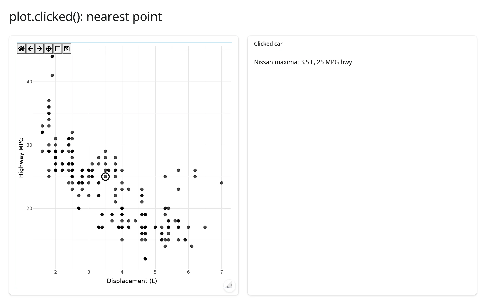

`clicked()` gives you a raw `MouseEvent`, not a row -- there's no "nearest point" built in, because plotnine
doesn't keep a mapping from pixels back to your data frame. The standard recipe is: transform your data's `x`/`y`
columns to **display (pixel) coordinates** with `ax.transData.transform(...)`, then compare against `event.x` /
`event.y` (also in display coordinates) with a plain nearest-neighbor search. Comparing in display space, rather
than data space, avoids unit mismatches when `x` and `y` have very different scales. The effect reads both
`plot.clicked()` (the dependency that makes it re-run on each press) and `plot.widget` (the current canvas) so it
can draw a circle around the match directly on the figure -- see
[Updating the widget from Python](#updating-the-widget-from-python) for why editing the canvas in place, instead of
returning a new plot, is what keeps the circle *and* the user's current zoom level both visible at once. `clicked()`
attaches at render and keeps its value across a re-render (the payload then refers to the previous render's
figure), so prefer an ID-keyed lookup over a positional row index if your underlying data can change shape between
renders.

### `limits()`: zoom is a query

```{.python file="examples/06_accessor_limits.py"}
import matplotlib.dates as mdates
from plotnine import aes, geom_line, ggplot, labs, theme_minimal
from plotnine.data import economics
from shiny.express import render, ui
from shinywidgets import render_plotnine

ui.page_opts(title="plot.limits(): zoom is a query", fillable=True)

with ui.layout_columns():
    with ui.card(full_screen=True):

        @render_plotnine
        def plot():
            return (
                ggplot(economics, aes("date", "unemploy"))
                + geom_line()
                + labs(x="", y="Unemployed (thousands)")
                + theme_minimal()
            )

    with ui.card():
        ui.card_header("Visible window")

        @render.text
        def window():
            (x0, x1), _ = plot.limits()
            # x0/x1 are plotnine's *transformed* x values -- here matplotlib's
            # date-number epoch, not a datetime -- convert to read them
            lo, hi = mdates.num2date(x0), mdates.num2date(x1)
            return f"{lo:%b %Y} to {hi:%b %Y}"
```

| Before zoom | After zoom |
|---|---|
| 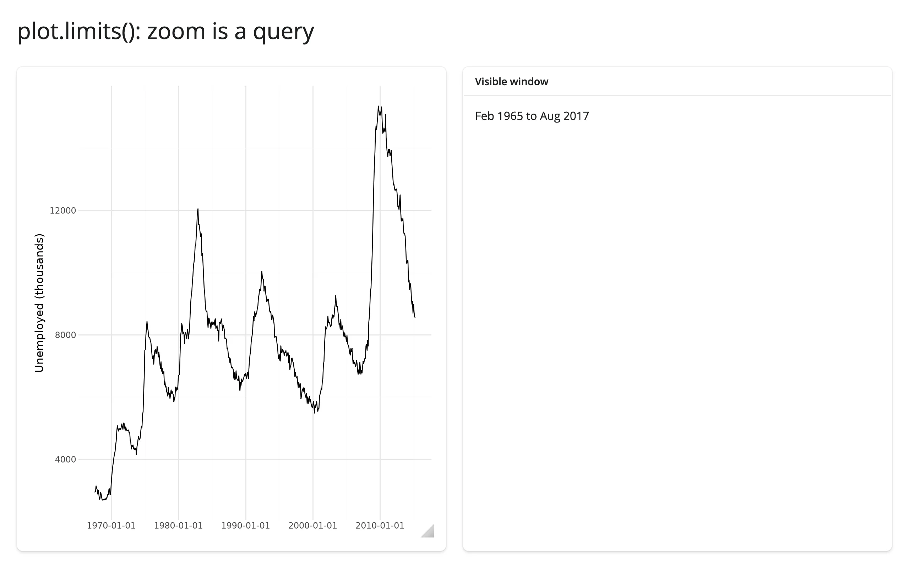 | 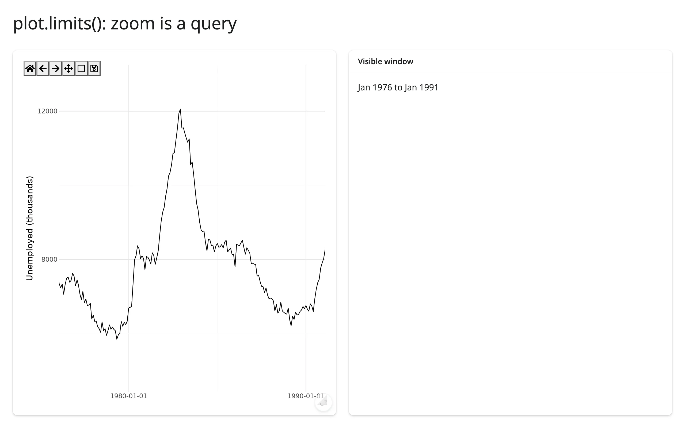 |

`limits()` is seeded from the figure's rendered limits, then updates (debounced 250 ms) after every zoom or pan
step. Like `clicked()`, the values are in plotnine's *transformed* coordinate space: here they're matplotlib's
date-number epoch, so reading them as a real date needs `matplotlib.dates.num2date()`, same as `clicked()`'s
`.xdata` would under a `scale_x_log10()` plot (`10 ** x` recovers the data value). It can't be read inside the
plot's own render function, which builds a new figure every run -- read it in another output or an effect
instead. Unlike `clicked()`, a re-render **re-seeds** `limits()` from the new figure's own view rather than
carrying over the old zoom window.

`ax` indexes panels: with `facet_wrap()`/`facet_grid()`, `limits(ax=1)` reads the second facet panel's own x/y
range, in the same order as `.widget.figure.axes`.

```{.python file="examples/11_accessor_limits_facets.py"}
from plotnine import aes, facet_wrap, geom_point, ggplot, labs, theme_minimal
from plotnine.data import mpg
from shiny.express import render, ui
from shinywidgets import render_plotnine

ui.page_opts(title="plot.limits(ax): which facet panel?", fillable=True)

with ui.layout_columns():
    with ui.card(full_screen=True):

        @render_plotnine
        def plot():
            return (
                ggplot(mpg, aes("displ", "hwy"))
                + geom_point(size=2, alpha=0.7)
                + facet_wrap("~drv", labeller="label_both")
                + labs(x="Displacement (L)", y="Highway MPG")
                + theme_minimal()
            )

    with ui.card():
        ui.card_header("Per-panel x ranges")

        @render.code
        def ranges():
            n = len(plot.widget.figure.axes)
            lines = []
            for i in range(n):
                x0, x1 = plot.limits(ax=i)[0]
                lines.append(f"ax={i}: {x0:.2f} to {x1:.2f}")
            return "\n".join(lines)
```

| Before zoom | After zooming into the `drv: 4` panel |
|---|---|
| 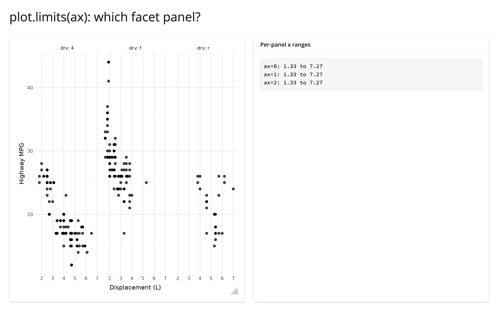 | 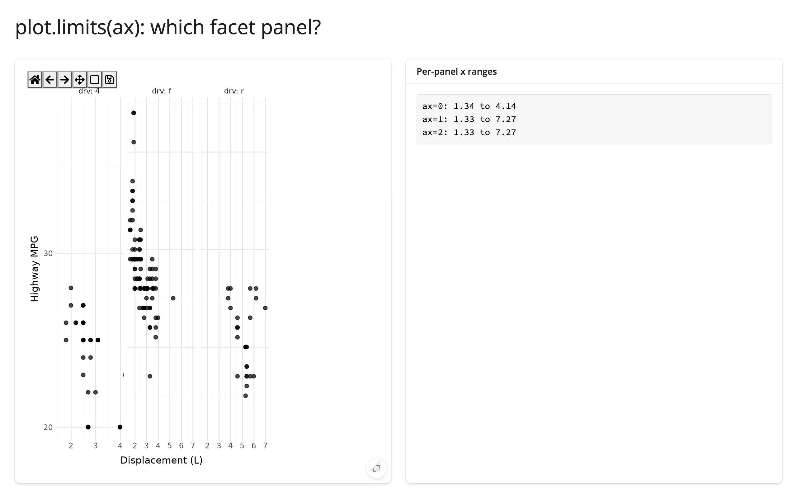 |

Zooming a single facet panel only changes that panel's own entry -- the other two stay at the full range,
confirming `ax` tracks panels independently and in `figure.axes` order.

### Reading an accessor on demand

Because every accessor is live from the moment the figure renders, it's safe to read one anywhere -- a button
handler, a download handler, a `@reactive.event` -- not just from an output that's always on screen. Here, a
"Save current view" button reads `plot.limits()` on click and appends it to a running list, with no warm-up
`@reactive.effect` needed to make the first read work:

```{.python file="examples/13_read_on_demand.py"}
from plotnine import aes, geom_point, ggplot, labs, theme_minimal
from plotnine.data import mpg
from shiny import reactive
from shiny.express import input, render, ui
from shinywidgets import render_plotnine

ui.page_opts(title="Save the current zoom window", fillable=True)
ui.input_action_button("save", "Save current view")

bookmarks = reactive.value([])


@render_plotnine
def plot():
    return (
        ggplot(mpg, aes("displ", "hwy", color="class"))
        + geom_point(size=2.5, alpha=0.8)
        + labs(x="Displacement (L)", y="Highway MPG", color="Class")
        + theme_minimal()
    )


@reactive.effect
@reactive.event(input.save)
def _save_view():
    (x0, x1), (y0, y1) = plot.limits()
    bookmarks.set([*bookmarks(), f"x: {x0:.1f}-{x1:.1f}, y: {y0:.1f}-{y1:.1f}"])


@render.code
def saved():
    views = bookmarks()
    if not views:
        return "No views saved yet -- zoom in, then click Save."
    return "\n".join(f"{i + 1}. {v}" for i, v in enumerate(views))
```

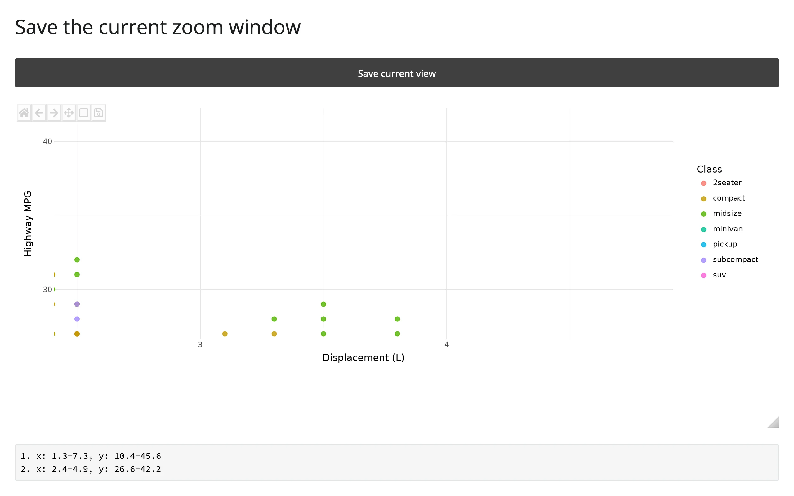

Verified: clicking **Save** before any zoom records the figure's full extent (`limits()` is already seeded, not
`None`); zooming in and clicking **Save** again appends the new window.

### Beyond the accessors: `.read()` and `reactive_read()`

plotnine's canvas has no synced trait for the plot's current view, so there's nothing to `plot.read(...)` (which
falls through to `reactive_read()` for names that aren't accessors) for "zoom level" the way jupyter-scatter or
ipyleaflet expose one -- use `limits()` for that, above. One toolbar trait on the underlying widget is worth
reading directly, though, since it's a child widget of the canvas rather than the output itself:

<!-- snippet: skip -->
```python
reactive_read(canvas.toolbar, "_current_action")  # '', 'pan', or 'zoom'
```

This tells you whether the user currently has the pan or zoom tool active, e.g., to suppress your own click
handling while a drag is in progress (`clicked()` already does this filtering for you) or to show a status badge.
It's a private ipympl trait (leading underscore), so treat it as liable to change in a future ipympl release.
For the view itself (what's currently visible after a zoom or pan), use `limits()` -- there's no longer a reason
to hand-roll `ax.callbacks.connect("xlim_changed", ...)` the way earlier versions of this guide did.

### Rate limiting

`clicked()` has no default rate policy: it reports every press immediately, because a click is a discrete event,
not a stream. `limits()` is debounced 250 ms by default -- a zoom-to-rectangle drag fires about a dozen
`xlim_changed` events, and only the settled value after the pause reaches Python. Pass `rate_delay=0` to react to
every event instead (e.g. to drive a second plot smoothly while panning), or `rate_policy="throttle"` to get
evenly-spaced updates during a long drag rather than waiting for it to stop:

```{.python file="examples/12_rate_limiting.py"}
from plotnine import aes, geom_line, ggplot, labs, theme_minimal
from plotnine.data import economics
from shiny.express import render, ui
from shinywidgets import render_plotnine

ui.page_opts(fillable=True)

counts = {"default": 0, "fast": 0}


def make_plot():
    return (
        ggplot(economics, aes("date", "unemploy"))
        + geom_line()
        + labs(x="", y="Unemployed (thousands)")
        + theme_minimal()
    )


with ui.layout_columns():
    with ui.card():
        ui.card_header("default: debounced 250ms")

        @render_plotnine
        def default_out():
            return make_plot()

        @render.code
        def default_count():
            default_out.limits()
            counts["default"] += 1
            return f"limits() recomputed {counts['default']} times"

    with ui.card():
        ui.card_header("rate_delay=0: every event")

        @render_plotnine(rate_delay=0)
        def fast_out():
            return make_plot()

        @render.code
        def fast_count():
            fast_out.limits()
            counts["fast"] += 1
            return f"limits() recomputed {counts['fast']} times"
```

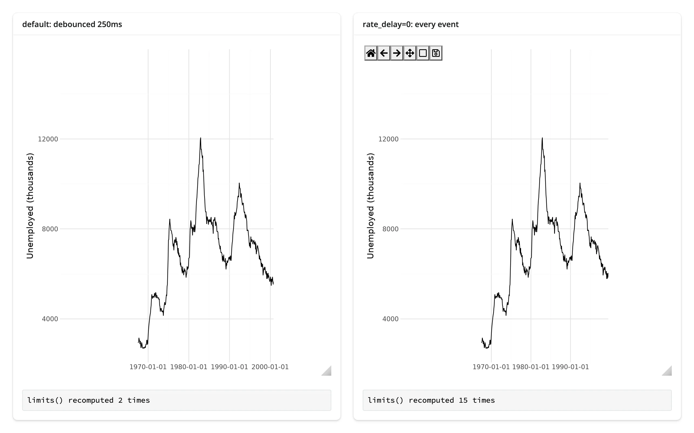

Panning the same distance on both plots (verified with a scripted drag): the debounced plot recomputed twice (the
initial seed, then the settled value), the `rate_delay=0` plot recomputed 15 times. `rate_policy`/`rate_delay`
also apply to `reactive_read()` on `.widget`, same as every renderer in this roster, but `limits()` is the only
accessor here a rate policy actually changes.

## Updating the widget from Python

Two ways to change a plot that's already on screen:

- **Re-render** (return a new `ggplot` from the decorated function): simplest, and the only option when the
  underlying data actually changes shape. plotnine draws an entirely new figure, so the user's zoom, pan position,
  and any artists you added (like the circle marker above) are all lost.
- **Update in place**, from a `@reactive.effect` that reads `.widget` and edits the matplotlib `Axes` directly
  (`ax.lines[i].set_ydata(...)`, add an artist, etc.), then calls `canvas.draw_idle()`: the figure keeps its
  current zoom and pan, and nothing is re-sent except the one redrawn frame.

plotnine itself has no "replace this layer's data" API the way plotly or bokeh do -- a `ggplot` object isn't
mutable in that sense. In-place updates to a plotnine-drawn figure mean reaching past plotnine into the matplotlib
artists it produced, the same technique [`render_matplotlib` documents](../matplotlib/index.md#updating-the-widget-from-python).
The one plotnine-specific wrinkle: which artist is "the line" depends on your geoms and draw order (`ax.lines[0]`
for a single `geom_line`, `ax.collections[0]` for a single `geom_point`), and that index isn't guaranteed stable
if you add or remove layers -- inspect `ax.lines`/`ax.collections` once on a drawn figure to find the index you
need.

[`examples/07_update_inplace.py`](examples/07_update_inplace.py) contrasts the two side by side: a frequency
slider redraws the left plot from scratch each time, while the right plot is built once and only has its line's
`y` data replaced.

```{.python file="examples/07_update_inplace.py"}
import numpy as np
import pandas as pd
from plotnine import aes, geom_line, ggplot, scale_y_continuous, theme_minimal
from shiny import reactive
from shiny.express import input, ui
from shinywidgets import render_plotnine

ui.page_opts(title="Re-render vs. in-place", fillable=True)
ui.input_slider("freq", "Frequency", 1, 10, 3)

x = np.linspace(0, 1, 400)


def wave(freq: int) -> pd.DataFrame:
    return pd.DataFrame({"x": x, "y": np.sin(2 * np.pi * freq * x)})


with ui.layout_columns():
    with ui.card(full_screen=True):
        ui.card_header("Re-render: zoom resets")

        @render_plotnine
        def rerendered():
            return (
                ggplot(wave(input.freq()), aes("x", "y"))
                + geom_line()
                + scale_y_continuous(limits=(-1.1, 1.1))
                + theme_minimal()
            )

    with ui.card(full_screen=True):
        ui.card_header("In-place: zoom survives")

        @render_plotnine
        def inplace():
            # Doesn't read input.freq(): built once, edited afterward
            return (
                ggplot(wave(3), aes("x", "y"))
                + geom_line()
                + scale_y_continuous(limits=(-1.1, 1.1))
                + theme_minimal()
            )


@reactive.effect
def _update_wave():
    freq = input.freq()
    with reactive.isolate():
        canvas = inplace.widget
    if canvas is None:
        return
    line = canvas.figure.axes[0].lines[0]
    line.set_ydata(np.sin(2 * np.pi * freq * x))
    canvas.draw_idle()
```

Both plots zoomed to the same window, then the frequency slider moved to 8:

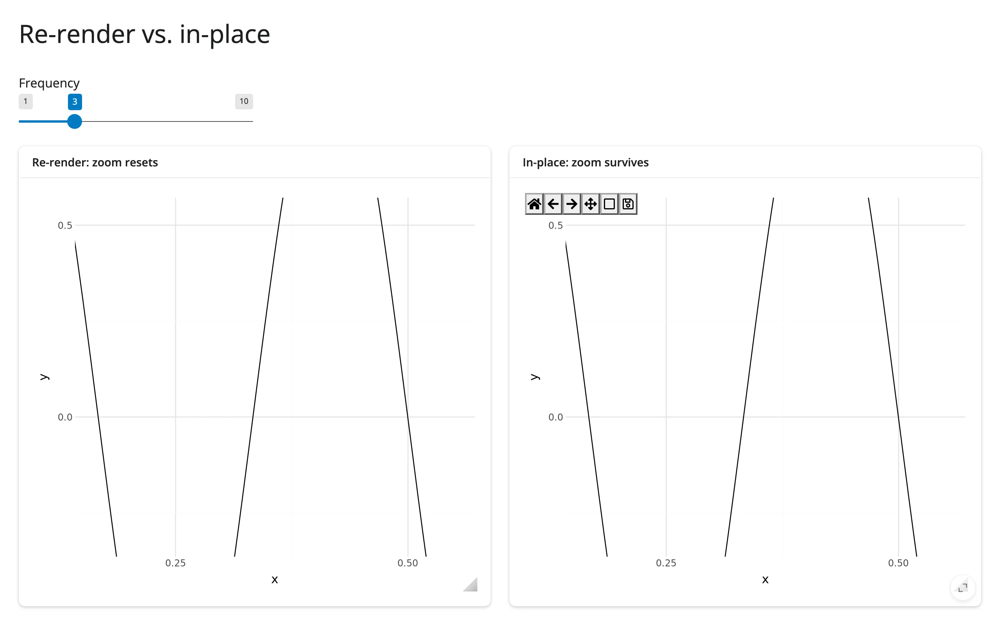
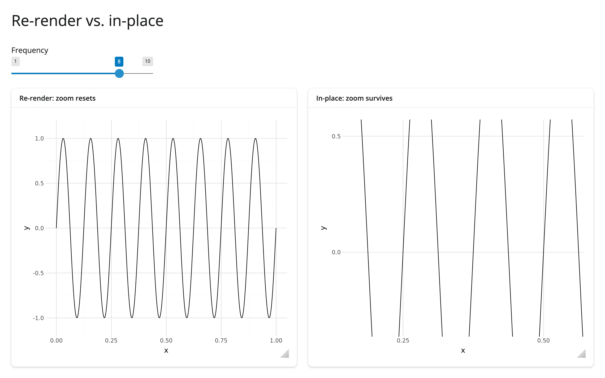

The re-rendered plot (left) snapped back to showing the full x-axis and lost the zoom; the in-place plot (right)
kept exactly the same window while the waveform inside it changed. `reactive.isolate()` around reading
`inplace.widget` keeps the effect from creating a dependency on the render itself -- it only needs to run when
`input.freq()` changes, not every time the (here, never re-rendered) widget changes.

## Coordinating multiple views

Three linked-view patterns. The first (click a point, update a detail panel) is the `clicked()` example above --
see [`examples/05_accessor_clicked.py`](examples/05_accessor_clicked.py). The two below cover the harder cases the
brief for this guide calls out explicitly: mapping a click back to *which facet panel* it landed in, and driving a
second, independently-scaled plot from the zoom.

### Click in a faceted plot: find the panel, then the nearest row

```{.python file="examples/08_pattern_click_facet.py"}
import numpy as np
from plotnine import aes, facet_wrap, geom_point, ggplot, labs, theme_minimal
from plotnine.data import mpg
from shiny import reactive, req
from shiny.express import render, ui
from shinywidgets import render_plotnine

ui.page_opts(title="Click a facet, know the panel", fillable=True)
found = reactive.value(None)

with ui.layout_columns():
    with ui.card(full_screen=True):

        @render_plotnine
        def plot():
            return (
                ggplot(mpg, aes("displ", "hwy"))
                + geom_point(size=2, alpha=0.7)
                + facet_wrap("~drv", labeller="label_both")
                + labs(x="Displacement (L)", y="Highway MPG")
                + theme_minimal()
            )

    with ui.card():
        ui.card_header("Clicked panel")

        @render.ui
        def detail():
            drv, row = req(found())
            return ui.p(
                f"drv = {drv}: {row.manufacturer.title()} {row.model} "
                f"({row.displ} L, {row.hwy} MPG)"
            )


@reactive.effect
def _locate_click():
    event = plot.clicked()
    canvas = plot.widget
    req(event, canvas)
    # Facets are separate matplotlib axes; plotnine's own layout table (built
    # while drawing) says which facet value each one holds, in `figure.axes`
    # order.
    panel = canvas.figure.get_layout_engine().plot.facet.layout.layout
    i = canvas.figure.axes.index(event.inaxes)
    drv = panel["drv"].iloc[i]

    subset = mpg[mpg["drv"] == drv].reset_index(drop=True)
    xy = event.inaxes.transData.transform(subset[["displ", "hwy"]].to_numpy())
    j = int(np.hypot(xy[:, 0] - event.x, xy[:, 1] - event.y).argmin())
    found.set((drv, subset.iloc[j]))
```

Before any click, and after clicking inside the `drv: f` (front-wheel-drive) panel:

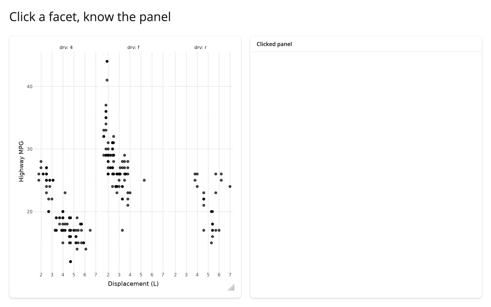
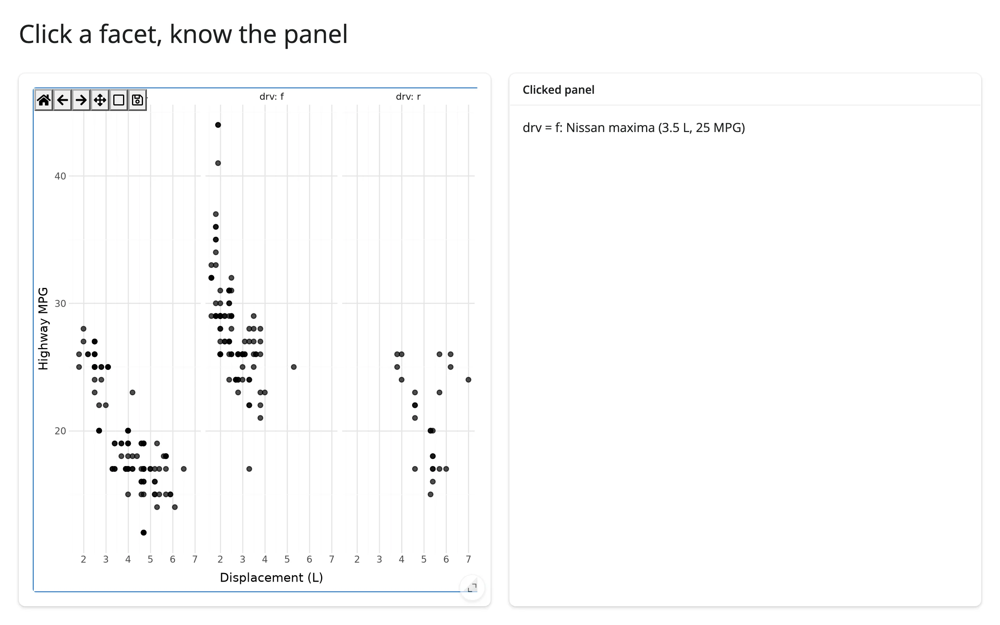

`event.inaxes` names which `Axes` the press landed on, but nothing in the event itself names that axes' facet
value -- facets are just a grid of ordinary matplotlib axes to the event system. The fix uses one piece of
plotnine internals: `figure.get_layout_engine().plot` is the actual drawn `ggplot` plotnine attaches to the
figure, and its `.facet.layout.layout` is the data frame that assigns each facet a `PANEL` number *in the same
order as `figure.axes`*. `figure.axes.index(event.inaxes)` gives you the row into that table, and from there
the facet's data value (here, `drv`). This relies on an undocumented plotnine attribute path (`_mpl.layout_manager`
in the module path), verified against plotnine 0.15.9 -- treat it as something to re-check against a plotnine
upgrade, not a stable public API.

### Zoom drives a second, independently-scaled plot

```{.python file="examples/09_pattern_zoom_linked.py"}
import matplotlib.dates as mdates
import pandas as pd
from plotnine import aes, geom_line, ggplot, labs, theme_minimal
from plotnine.data import economics
from shiny.express import render, ui
from shinywidgets import render_plotnine

ui.page_opts(title="Zoom drives a linked plot", fillable=True)


def visible_window():
    (x0, x1), _ = top.limits()
    lo = pd.Timestamp(mdates.num2date(x0).replace(tzinfo=None))
    hi = pd.Timestamp(mdates.num2date(x1).replace(tzinfo=None))
    return economics[(economics.date >= lo) & (economics.date <= hi)]


with ui.layout_columns():
    with ui.card(full_screen=True):
        ui.card_header("Unemployment -- zoom into a stretch")

        @render_plotnine
        def top():
            return (
                ggplot(economics, aes("date", "unemploy"))
                + geom_line()
                + labs(x="", y="Unemployed (thousands)")
                + theme_minimal()
            )

    with ui.card(full_screen=True):
        ui.card_header("Savings rate, same window")

        @render_plotnine
        def bottom():
            return (
                ggplot(visible_window(), aes("date", "psavert"))
                + geom_line(color="darkorange")
                + labs(x="", y="Personal savings rate (%)")
                + theme_minimal()
            )


with ui.card():
    ui.card_header("Summary of the visible window")

    @render.text
    def summary():
        visible = visible_window()
        return f"{len(visible)} months visible, average unemployment {visible.unemploy.mean():,.0f}k"
```

Before zooming, and after box-zooming the top plot into 1978-1991:

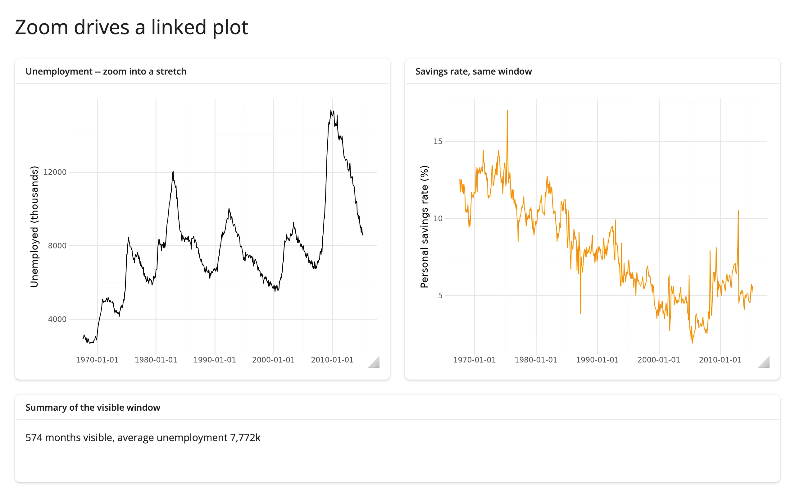
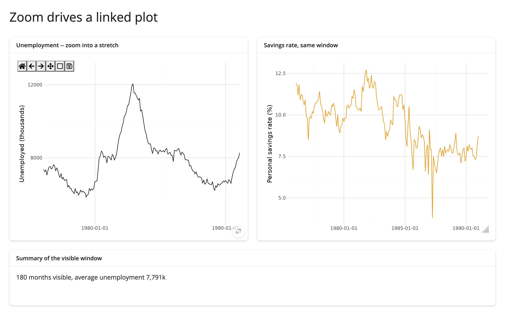

The bottom plot and the summary text both call `top.limits()` directly -- no `reactive.value`, no
`ax.callbacks.connect`, no separate tracking effect. This is the simplification `limits()` buys over the
hand-rolled recipe earlier versions of this guide taught: reading an accessor from a sibling output is just a
function call, and Shiny's normal reactive graph (`bottom`/`summary` depend on `top.limits()`, which depends on
the user's zoom) handles the rest. The two series have unrelated y-scales (thousands of people vs. a percentage),
which is exactly when a *second plot*, not a shared axis, is the right way to link them -- plotnine facets share
one scale per row/column, which wouldn't work here.

## Large data

plotnine shares matplotlib's ipympl engine (see [the matplotlib guide](../matplotlib/index.md#large-data)) and
has no large-data mode of its own: no WebGL, no server-side rasterization, and every pan/zoom redraws the whole
figure to a bitmap. See "When to use `@render.plot` instead" in
[Gotchas and limitations](#gotchas-and-limitations) below for when a static image is the better trade, and reach
for [bokeh](../bokeh/index.md#large-data), [plotly](../plotly/index.md#large-data), or
[datashader](../datashader/index.md) when the data itself needs to scale into the millions. This is the gap the
"draw it with the GPU" and "summarize on the server" approaches in
[Large data & performance](../../guide/performance/index.md#three-approaches-to-large-data) fill instead.

## Layout and sizing

```{.python file="examples/10_layout_sizing.py"}
from plotnine import aes, geom_point, ggplot, theme, theme_minimal
from plotnine.data import mpg
from shiny.express import ui
from shinywidgets import render_plotnine

ui.page_opts(fillable=True)


def scatter():
    return ggplot(mpg, aes("displ", "hwy")) + geom_point() + theme_minimal()


with ui.layout_columns():
    with ui.card(full_screen=True):
        ui.card_header("Fills its card (default)")

        @render_plotnine
        def fills():
            return scatter()

    with ui.card():
        ui.card_header("Explicit height: set a matching figure_size")

        @render_plotnine(height="220px")
        def fixed():
            return scatter() + theme(figure_size=(4, 2.2))
```

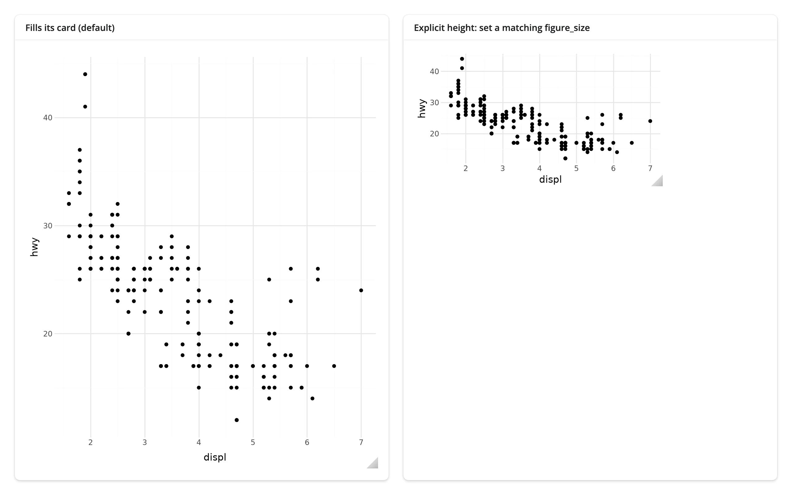

In a filling layout (the default: no `height` given), `render_plotnine` resizes the figure to its container on
every render and resize, overriding any `theme(figure_size=...)` you set -- that's the left card above. Give the
output an explicit `height` and the figure is drawn at its `figure_size` and *not* fitted to the output: a bigger
figure than the output is clipped, so set a matching `theme(figure_size=...)` yourself, as the right card does.
With `fill=False` and no `height`, the figure's width still tracks its container; only the height becomes fixed.
Leave `theme(dpi=...)` at its default (100) in either case -- a higher DPI acts like a zoom factor on top of the
CSS size rather than a HiDPI setting (HiDPI scaling is automatic: the canvas's backing store already matches the
browser's device pixel ratio).

You don't need to hide the canvas chrome yourself: `render_plotnine` sets `canvas.header_visible = False` (the
"Figure N" label is meaningless once plotnine closes its pyplot figure after drawing -- `render_matplotlib` now
defaults to this too) and, unlike `render_matplotlib`, also `canvas.footer_visible = False` (the cursor-coordinate
readout shows plotnine's transformed units, e.g., scientific notation under a log scale, which is more confusing
than useful).

## Gotchas and limitations

Verified on current `main` (plotnine 0.15.9, shinywidgets `main` @ `32ca7035`, shiny 1.9).

- **Zooming in close enough can leave an axis with no tick labels at all.** plotnine computes its axis breaks
  once, when it draws (a `FixedLocator`/`FixedFormatter` pair), so a toolbar zoom into a narrow enough window can
  show only one tick, or none. Verified: zooming a 50-year unemployment series down to a 5-month window left a
  single "1970-01-01" tick on screen. Fix it in an effect that reads `.widget`, after the render:
  <!-- snippet: skip -->
  ```python
  import matplotlib.dates as mdates
  loc = mdates.AutoDateLocator()
  ax.xaxis.set_major_locator(loc)
  ax.xaxis.set_major_formatter(mdates.ConciseDateFormatter(loc))
  ```
  For a numeric (non-date) axis, use `matplotlib.ticker.MaxNLocator` and `ScalarFormatter` the same way. This is
  an upstream plotnine design choice (interactive zooming isn't part of its use case), not a shinywidgets bug.
- **Facet panels zoom and pan independently.** Each facet is its own matplotlib `Axes`; the toolbar's zoom/pan
  tools only affect whichever panel the drag started in, even with `scales="fixed"` (the plotnine default). Link
  them yourself with matplotlib's `ax.sharex()`/`sharey()` if you want zooming one panel to zoom the rest --
  not verified here in a filling layout, so treat it as a starting point, not a guarantee.
- **Click coordinates are in plotnine's transformed space, not necessarily your data's units.** Under
  `scale_x_log10()`, `event.xdata` is `log10(x)` (confirmed: `10 ** event.xdata` recovers the original value, up
  to axis padding); dates are matplotlib's own `num2date` epoch (days since an internal reference date, not your
  original `datetime`); discrete (categorical) scales use integer positions `1..n` in the category's displayed
  order (confirmed against `ggplot(mpg, aes("class", "hwy"))`'s 7 classes, positions 1-7). `@render.plot`'s
  built-in coordmap converts clicks to data values and facet names for you; `render_plotnine` does not, which is
  the main reason the click-to-row recipes above exist.
- **A plotnine plot has no "update data" API**, unlike plotly's `FigureWidget` or bokeh's `ColumnDataSource`.
  In-place updates mean reaching into the matplotlib `Axes` plotnine drew (see
  [Updating the widget from Python](#updating-the-widget-from-python)), and the artist index you need
  (`ax.lines[0]`, `ax.collections[0]`, ...) depends on your specific geoms and isn't part of any stability
  contract.
- **Returning a non-plot object now raises a clear error.** Returning something that isn't a `ggplot` or a
  composition (e.g., `guide_legend()`, which merely has a `.draw()` method) used to fail deep inside plotnine's
  drawing code with a confusing `AttributeError`. It now raises a `TypeError` up front naming what you returned
  and what's expected: *"Don't know how to coerce `guide_legend(...)` into a plotnine plot: a guide_legend is not
  a plot. Return a plotnine.ggplot or a plot composition (e.g., p1 | p2)."* (verified).
- **`req(accessor())` can silently swallow a valid falsy result.** `clicked()` itself is immune (a `MouseEvent`
  is always truthy), but anything *you* derive from it and store in your own `reactive.value` -- a row position,
  an index, a coordinate of `0` -- is not. `req(my_value())` treats `0` the same as "nothing yet" and cancels. The
  accessor examples above all compare to `None` explicitly for this reason; see
  [`examples/05_accessor_clicked.py`](examples/05_accessor_clicked.py)'s `detail()` for the pattern. This isn't
  specific to plotnine -- it applies to any accessor-derived value across the roster -- but it's easy to hit here
  because "nearest point" naturally produces row position `0`.
- **When to use `@render.plot` instead:** large data (each pan/zoom frame is a fresh server-side Agg render sent
  as an image -- fine for a few thousand points, choppy well before a million), brush-to-select (Shiny's
  `@render.plot(..., brush=True)` ships a rectangular/lasso selection input that `render_plotnine` has no
  equivalent for), or a dashboard with many small static plots where the ipympl canvas's per-plot overhead isn't
  worth it. Use `render_plotnine` when the point is exploration: long time series where the story is in the zoom,
  scatter plots where clicking a point should explain it, or a composition that needs to be one widget.

## Gallery candidates

**`template_click_explorer.py`** (template) -- a Palmer penguins scatter plot with axis pickers and a linear-fit
toggle in the sidebar; clicking a point circles it in place and fills in a detail card. Minimal, adaptable
starting point for any "explore, then click to inspect" app.

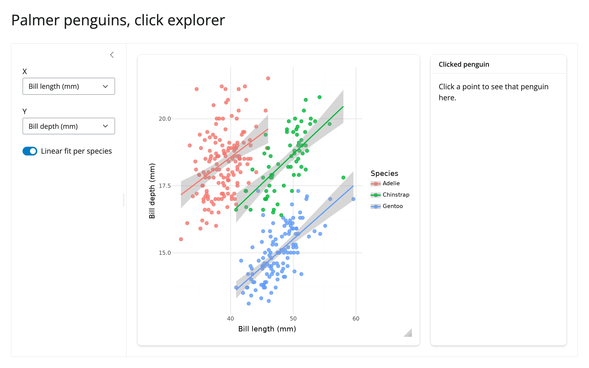
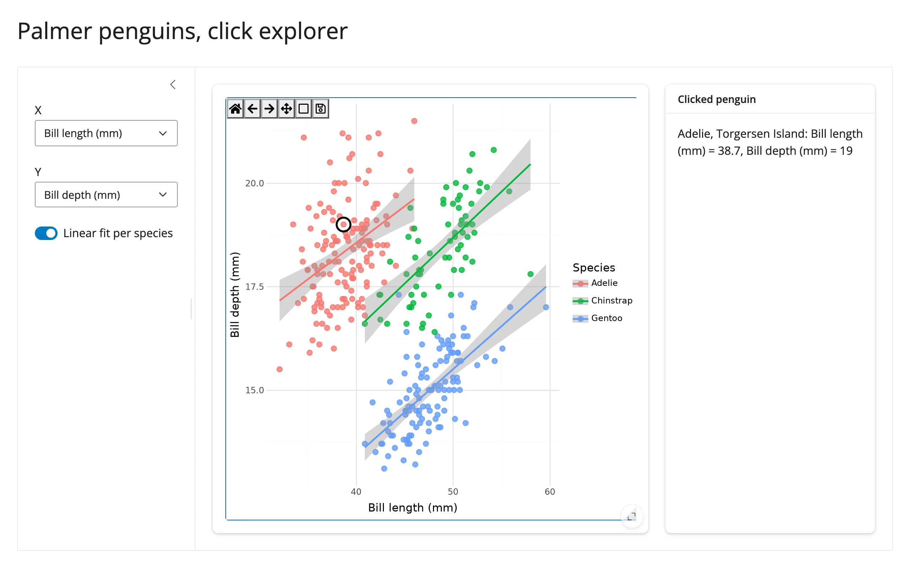

**`showcase_economics_dashboard.py`** (showcase) -- fifty years of the US economy in one dashboard: zoom the
unemployment series and a linked savings-rate plot and a value box follow the visible window (`limits()`); click
to mark a month with an ordinary `geom_vline()` layer (the click effect feeds the month back into the
render); switch the plotnine theme and both the zoom and the mark survive the re-render (the zoom re-applied
from an effect that reads `.widget`, the same technique as [Updating the widget from Python](#updating-the-widget-from-python)).

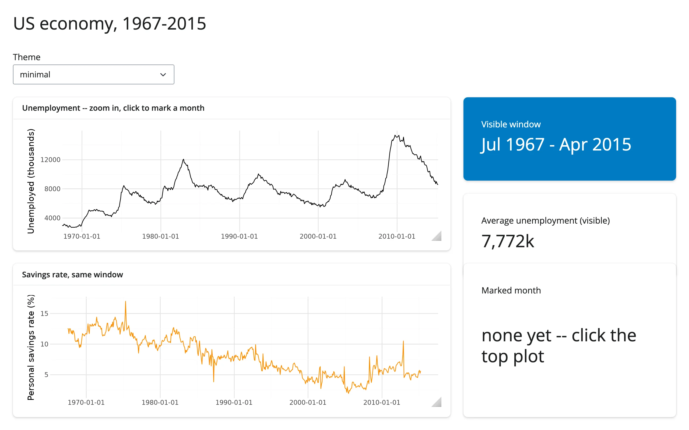
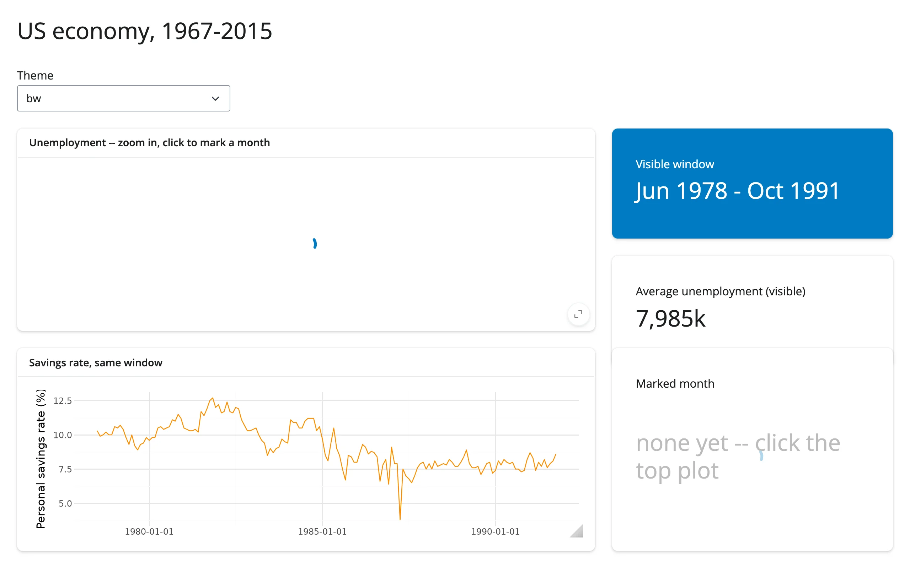

## Learn more

- [plotnine documentation](https://plotnine.org) -- the full geom/scale/theme/facet reference and gallery.
- [plotnine's composition guide](https://plotnine.org/guide/composing_plots.html) -- the `|`/`/` operators used
  above, plus `plot_spacer()` and sizing controls for compositions.
- [matplotlib guide](../matplotlib/index.md) -- the shared ipympl canvas, `clicked()`/`picked()`/`limits()`, and
  the general in-place-update technique this guide builds on.
- [render.plot (Shiny core docs)](https://shiny.posit.co/py/api/core/render.plot.html) -- the static alternative,
  including its built-in click/hover/brush inputs and plotnine-aware coordinate mapping.
