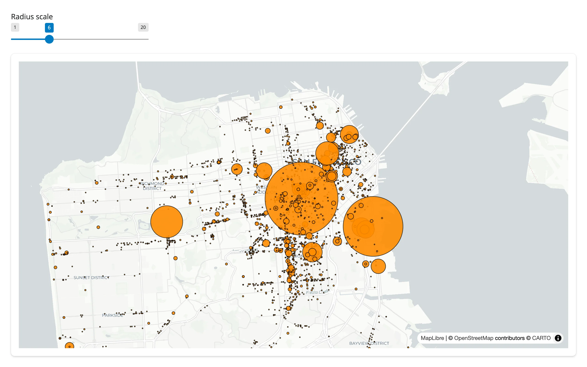
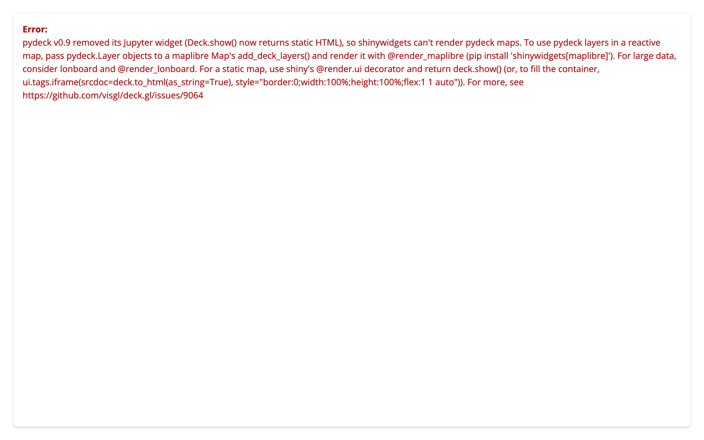
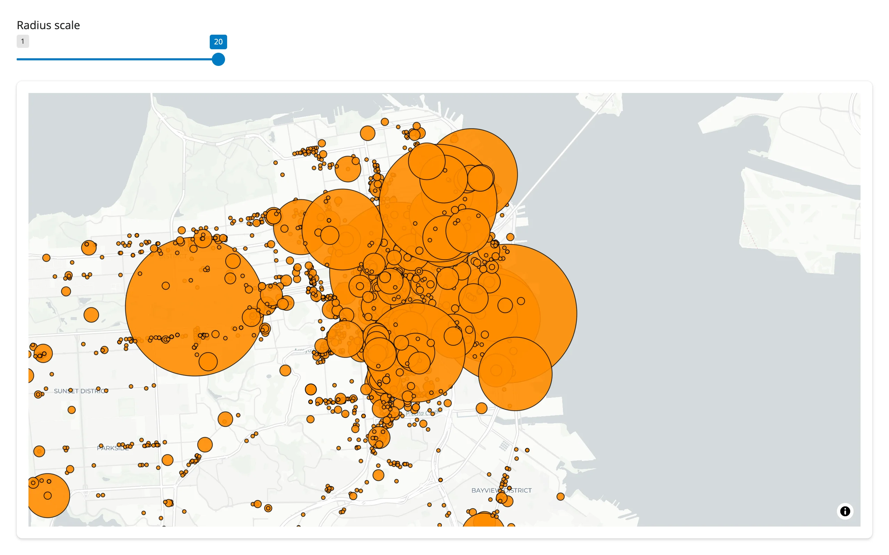
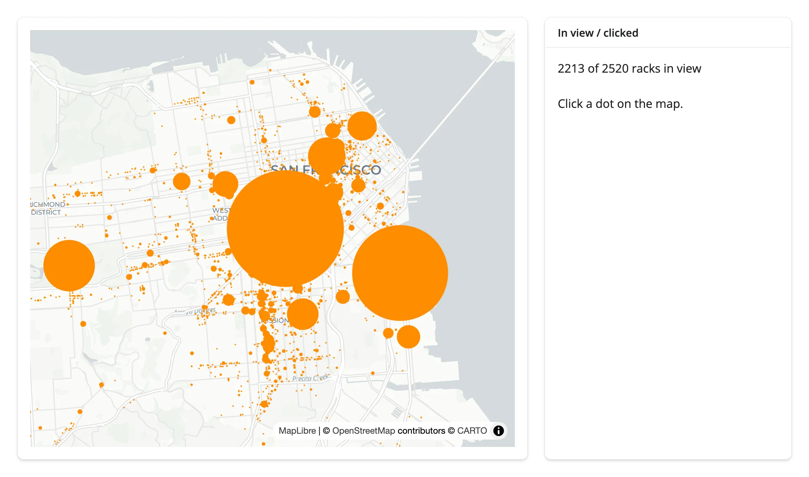
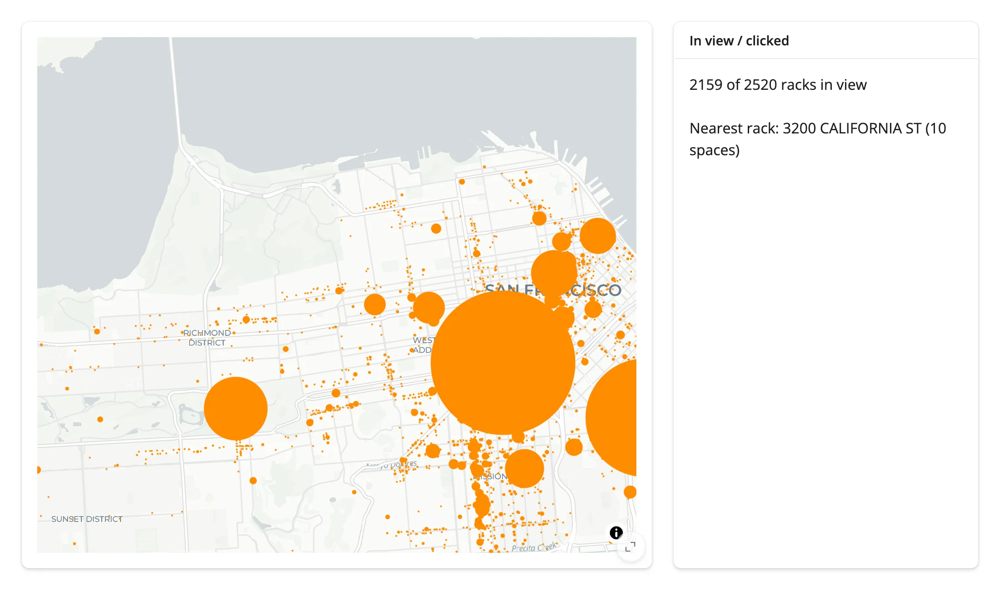
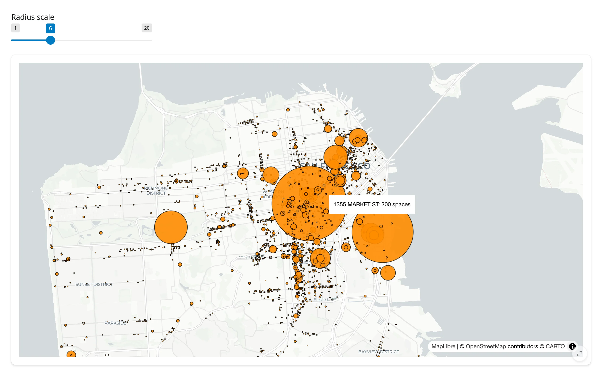
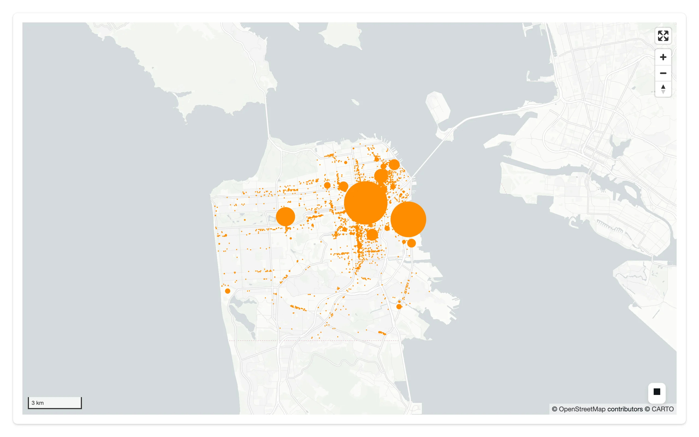
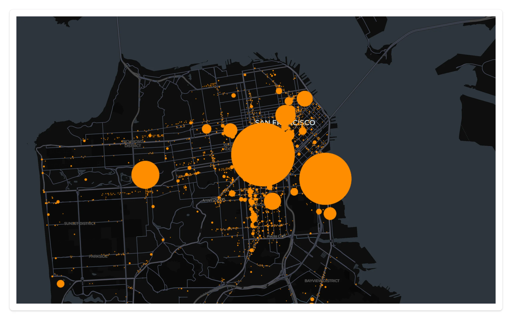
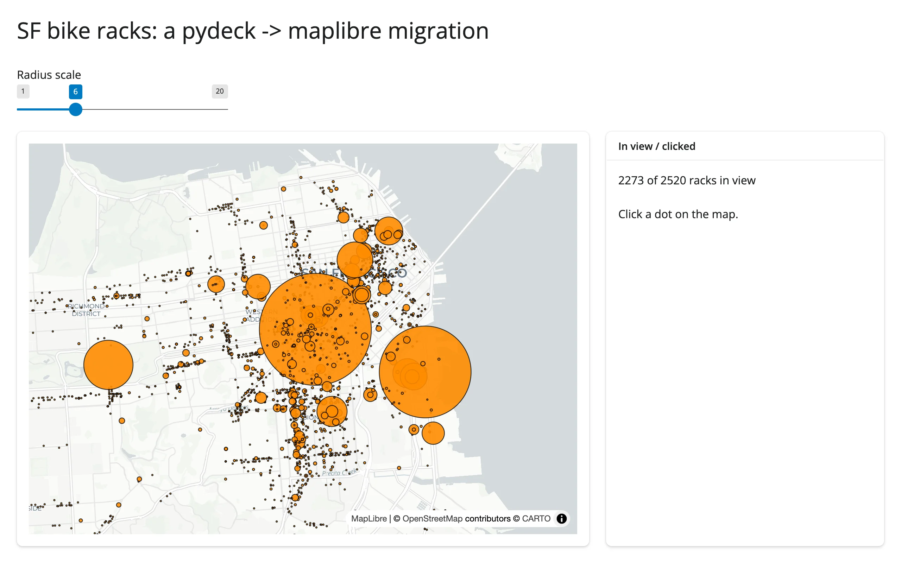
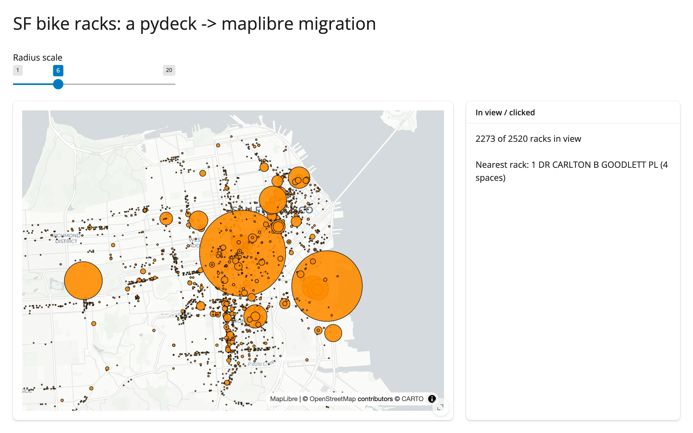

[pydeck](https://deckgl.readthedocs.io/en/latest/) is the Python binding for
[deck.gl](https://deck.gl), the WebGL layer catalog behind many striking data maps (hexagon bins,
arcs, heatmaps, 3D columns). For years, `pydeck.Deck` was a Jupyter widget you could render live, and
shinywidgets shipped `@render_pydeck` to bring that into Shiny.

That stopped working with pydeck 0.9 (2024): pydeck dropped its Jupyter widget entirely.
`Deck.show()` now returns static HTML instead of a widget, and `Deck.update()` raises. No ipywidgets
bridge -- shinywidgets included -- can render a live `pydeck.Deck` on pydeck >= 0.9, so
`render_pydeck` is deprecated and raises an explanatory error instead of a blank map.

The good news: pydeck's actual value -- the declarative `pydeck.Layer` API over deck.gl's layer
catalog -- still works great in Shiny. This guide is a migration guide, not a feature tour: it shows
the error you'll hit, then the two supported ways to bring your existing `pdk.Layer` objects into a
reactive Shiny app (a [maplibre](../maplibre/index.md) map, or [lonboard](../lonboard/index.md) for
very large data), plus a static fallback for one-off maps. For the full feature set of either
destination renderer, see their own guides; this page only covers the pydeck-specific migration path.



## Why it's deprecated, and what you'll see

pydeck's `has_jupyter_extra()` / `DeckGLWidget` machinery still exists in pydeck >= 0.9, but nothing
ever populates it -- it's a leftover from the ipywidgets-7 era. Calling `@render_pydeck` and returning
a `pydeck.Deck` raises a `TypeError` up front, rather than rendering a blank or broken map.

[`examples/01_deprecation_error.py`](examples/01_deprecation_error.py) is what porting a notebook cell
straight into Shiny looks like -- and what happens when you run it:

```{.python file="examples/01_deprecation_error.py"}
import pydeck as pdk
from shiny.express import ui
from shinywidgets import render_pydeck

ui.page_opts(fillable=True)

BIKE_RACKS = "https://raw.githubusercontent.com/visgl/deck.gl-data/master/website/sf-bike-parking.json"


with ui.card(full_screen=True):

    @render_pydeck
    def bike_racks():
        layer = pdk.Layer(
            "ScatterplotLayer",
            BIKE_RACKS,
            get_position="COORDINATES",
            get_radius="SPACES",
            get_fill_color=[255, 140, 0],
            pickable=True,
            radius_scale=6,
        )
        view_state = pdk.ViewState(
            latitude=37.7749, longitude=-122.4194, zoom=11
        )
        return pdk.Deck(layers=[layer], initial_view_state=view_state)
```



The card shows the error inline because Shiny's dev-mode default is `sanitize_errors=False` -- the app
shows the real exception, not just a generic message. The full text (also always in the server log):

> pydeck v0.9 removed its Jupyter widget (`Deck.show()` now returns static HTML), so shinywidgets
> can't render pydeck maps. To use pydeck layers in a reactive map, pass `pydeck.Layer` objects to a
> maplibre `Map`'s `add_deck_layers()` and render it with `@render_maplibre` (`pip install
> 'shinywidgets[maplibre]'`). For large data, consider lonboard and `@render_lonboard`. For a static
> map, use shiny's `@render.ui` decorator and return `deck.show()` (...). For more, see
> https://github.com/visgl/deck.gl/issues/9064

One thing to know if you instrument your own app: `render_pydeck(...)` also issues a `FutureWarning` at
decoration time -- when the `@render_pydeck` line itself runs, not when the output renders. Verified in a real
`shiny run`: it prints to the server log by default, pointing at the exact `@render_pydeck` line
(`stacklevel=2`), with no flags needed:

```
app.py:12: FutureWarning: render_pydeck is deprecated: pydeck v0.9 removed its Jupyter widget, so it
can't render maps. Pass pydeck.Layer objects to a maplibre Map's add_deck_layers() and use
@render_maplibre instead (see help(shinywidgets.render_pydeck) for other alternatives).
  @render_pydeck
```

It's a `FutureWarning`, not a `DeprecationWarning`, specifically so this shows up: Python's default warning
filters hide `DeprecationWarning` outside the `__main__` module, and a Shiny app's module is never
`__main__`. The `TypeError` above still fires when the output actually renders a `pydeck.Deck`; the warning is
the earlier, decoration-time signal, and current main makes sure you'll actually see both.

## Migration path A: maplibre (recommended default)

`pydeck.Layer` objects pass straight to a [maplibre](../maplibre/index.md) `Map`'s
`add_deck_layers()` / `set_deck_layers()` -- no layer rewriting needed, because maplibre's Python
package embeds the same deck.gl layer catalog under the hood. This is the supported replacement for
`render_pydeck`, and it's strictly more capable: you get an in-place restyle that keeps the camera, and
`.read()` access to the map's viewport and clicks, neither of which pydeck's own widget ever had.

```sh
pip install 'shinywidgets[maplibre]' pydeck
```

### Before / after

The same `ScatterplotLayer` over pydeck's own
["San Francisco bike parking"](https://raw.githubusercontent.com/visgl/deck.gl-data/master/website/sf-bike-parking.json)
tutorial dataset (2,520 bike racks, radius sized by `SPACES`), moved from a classic pydeck `Deck` to a
maplibre `Map`:

| Before: classic pydeck (no longer renders) | After: maplibre + `pdk.Layer` |
|---|---|
| `pdk.Deck(layers=[layer], initial_view_state=pdk.ViewState(latitude=37.7749, longitude=-122.4194, zoom=12))` | `Map(MapOptions(center=(-122.4194, 37.7749), zoom=12))` then `m.add_deck_layers([layer])` |
| `deck.update()` after changing a layer property | `map.widget.set_deck_layers([layer])` from a `@reactive.effect` |
| no events back to Python | `map.read("view_state")`, `map.read("clicked")` |

The example renders the overlay empty, then fills and restyles it from an effect so the slider's radius
change restyles **in place** -- the 2,520-row dataset isn't resent on every drag, only the layer's style
properties are, and the camera never moves on its own
([`examples/02_migrate_restyle.py`](examples/02_migrate_restyle.py)):

```{.python file="examples/02_migrate_restyle.py"}
import pydeck as pdk
import requests
from maplibre import Map, MapOptions
from maplibre.basemaps import Carto
from shiny import reactive
from shiny.express import input, ui
from shinywidgets import render_maplibre

BIKE_RACKS = requests.get(
    "https://raw.githubusercontent.com/visgl/deck.gl-data/master/website/sf-bike-parking.json"
).json()
TOOLTIP = {"bike-racks": "{{ADDRESS}}: {{SPACES}} spaces"}

ui.page_opts(fillable=True)
ui.input_slider("radius_scale", "Radius scale", 1, 20, 6)

with ui.card(full_screen=True):

    @render_maplibre
    def bike_racks():
        m = Map(MapOptions(style=Carto.POSITRON, center=(-122.4194, 37.7749), zoom=12))
        # An empty overlay: the effect below fills it, so the data crosses the
        # wire once (calls made before the map renders are queued), not twice.
        m.add_deck_layers([], tooltip=TOOLTIP)
        return m


@reactive.effect
def _restyle():
    # set_deck_layers() restyles in place: the camera stays put, and (unlike a
    # pydeck Deck.update(), which raises on pydeck >= 0.9) this actually works.
    bike_racks.widget.set_deck_layers([scatter_layer()], tooltip=TOOLTIP)


def scatter_layer() -> pdk.Layer:
    return pdk.Layer(
        "ScatterplotLayer",
        BIKE_RACKS,
        id="bike-racks",
        get_position="COORDINATES",
        get_radius="SPACES",
        get_fill_color=[255, 140, 0],
        pickable=True,
        opacity=0.8,
        stroked=True,
        filled=True,
        radius_scale=input.radius_scale(),
        radius_min_pixels=1,
        radius_max_pixels=100,
        line_width_min_pixels=1,
    )
```

The map was panned slightly off-center before either screenshot; dragging the radius slider from 6 to
20 grows every circle without moving the camera at all:

| Radius scale 6 | Radius scale 20 (same camera) |
|---|---|
|  |  |

### Reading `view_state` and `clicked`

pydeck's widget had no equivalent of this: pydeck only gave you Python callbacks
(`on_click`/`on_hover`/`on_view_state_change`) wired through ipywidgets 8's incompatible `tooltip`
trait, and that stopped working after 0.8. On a maplibre map, `.read()` turns the same information into
values you read like `input.x()` -- maplibre has no accessor for either trait, so this is a documented
shortcut for `reactive_read(map.widget, ...)`, not a behavior change -- see the [maplibre accessor
reference](../maplibre/index.md#accessor-reference) for the full trait list. The two most useful ones
for a migrated pydeck app:

- `view_state["bounds"]` -- the visible viewport, for an "N features in view" counter.
- `clicked` -- the clicked point's `{lng, lat}` (not the picked deck.gl object -- see
  [Gotchas](#gotchas-and-limitations)). Find the nearest row in Python to get a detail panel.

[`examples/03_view_state_clicked.py`](examples/03_view_state_clicked.py) links both to a single text
panel:

```{.python file="examples/03_view_state_clicked.py"}
import numpy as np
import pydeck as pdk
import requests
from maplibre import Map, MapOptions
from maplibre.basemaps import Carto
from shiny.express import render, ui
from shinywidgets import render_maplibre

BIKE_RACKS = requests.get(
    "https://raw.githubusercontent.com/visgl/deck.gl-data/master/website/sf-bike-parking.json"
).json()
LNG = np.array([r["COORDINATES"][0] for r in BIKE_RACKS])
LAT = np.array([r["COORDINATES"][1] for r in BIKE_RACKS])

ui.page_opts(fillable=True)

with ui.layout_columns(col_widths=[8, 4]):
    with ui.card(full_screen=True):

        @render_maplibre
        def bike_racks():
            m = Map(MapOptions(style=Carto.POSITRON, center=(-122.4194, 37.7749), zoom=12))
            m.add_deck_layers(
                [
                    pdk.Layer(
                        "ScatterplotLayer",
                        BIKE_RACKS,
                        id="bike-racks",
                        get_position="COORDINATES",
                        get_radius="SPACES",
                        get_fill_color=[255, 140, 0],
                        pickable=True,
                        radius_scale=6,
                        radius_min_pixels=1,
                    )
                ]
            )
            return m

    with ui.card():
        ui.card_header("In view / clicked")

        @render.ui
        def summary():
            vs = bike_racks.read("view_state")
            if vs:
                sw, ne = vs["bounds"]["_sw"], vs["bounds"]["_ne"]
                mask = (LNG >= sw["lng"]) & (LNG <= ne["lng"]) & (LAT >= sw["lat"]) & (LAT <= ne["lat"])
                in_view = f"{int(mask.sum())} of {len(BIKE_RACKS)} racks in view"
            else:
                in_view = f"{len(BIKE_RACKS)} racks (unzoomed)"

            # `clicked` is the map click's lng/lat, not the picked deck.gl
            # object -- find the nearest rack in Python, same workaround the
            # maplibre guide uses for its own `clicked` trait.
            ll = bike_racks.read("clicked")
            if not ll:
                detail = "Click a dot on the map."
            else:
                i = int(np.argmin((LNG - ll["lng"]) ** 2 + (LAT - ll["lat"]) ** 2))
                r = BIKE_RACKS[i]
                detail = f"Nearest rack: {r['ADDRESS']} ({r['SPACES']} spaces)"

            return ui.TagList(ui.tags.p(in_view), ui.tags.p(detail))
```

Zooming into downtown drops the in-view count from 2,351 to 1,942; clicking a dot then shows the
nearest rack's address:

| Before (unzoomed, unclicked) | After zooming + clicking |
|---|---|
|  |  |

### Deck.gl tooltips

`add_deck_layers()` / `set_deck_layers()` take the same `tooltip=` dict pydeck's own widget accepted --
a mustache template keyed by layer id, rendered entirely in the browser on hover (no Python round
trip). It's already in the restyle example above (`TOOLTIP = {"bike-racks": "{{ADDRESS}}: {{SPACES}}
spaces"}`); hovering a rack shows its address and capacity:



### What doesn't carry over

- **Multiple viewports (`pdk.Deck(views=[...])`).** pydeck's `OrbitView`/`OrthographicView`/multiple
  `MapView` support has no maplibre equivalent -- `add_deck_layers()` takes only `layers` and
  `tooltip`, and renders into the one MapLibre map. If your pydeck app used `views=` for a
  side-by-side or non-geospatial (orbit/orthographic) view, there's no drop-in replacement here.
- **`initial_view_state` -> `MapOptions`, and the field names don't match.** pydeck's `ViewState`
  takes separate `latitude=`/`longitude=` keywords (order doesn't matter, they're named); maplibre's
  `MapOptions` takes a single positional-order `center=(lng, lat)` tuple -- **longitude first**. Swap
  the order, not just the names, or your map centers on the wrong hemisphere.
- **`map_style` / `map_provider` -> `MapOptions(style=...)`.** pydeck defaults to `map_provider="carto"`
  (token-free) and only needs a key for Mapbox/Google styles or satellite imagery. maplibre's token-free
  defaults are `maplibre.basemaps.Carto` and `OpenFreeMap` (see the [maplibre basemap
  section](../maplibre/index.md#vector-tile-basemaps-no-api-key)) -- same idea, different names, and no
  satellite-imagery equivalent without your own vector/raster source.
- **GPU-side aggregation layers (Hexagon, Grid, Heatmap, CPU) still work identically** -- they're the
  same deck.gl layers, just hosted on a maplibre map instead of pydeck's own canvas. See the [maplibre
  guide's own deck.gl section](../maplibre/index.md#deckgl-layers-the-render_pydeck-migration-path) and
  its 140,000-point UK-accidents showcase (below) for a Hexagon example at scale.

## Migration path B: lonboard (large data)

If your pydeck map's bottleneck was data volume rather than deck.gl's layer catalog, convert to
[lonboard](../lonboard/index.md) instead of maplibre. lonboard sends your geometry once as binary
Arrow/GeoArrow data and restyles with no data re-transfer at all, whereas every
`set_deck_layers()` call on a maplibre map re-sends the full layer JSON (fine up to a few hundred
thousand rows; see the [maplibre guide's gallery
showcase](../maplibre/index.md#showcase_uk_accidentspy) for a 140k-point example of that trade-off).
lonboard also has real reactive **accessors** (`view_state()`, `clicked()`, `selected()`,
`selected_bounds()`), not just a `reactive_read()` tier, and a built-in box-select -- useful once an app
needs more than click/pan.

The trade-off: lonboard has no GPU-side aggregation layers (no Hexagon/Grid/Heatmap binning) --
aggregate in Python first (e.g. with H3) if you were relying on one of those.

```sh
pip install lonboard geopandas pyarrow
```

Converting the same `ScatterplotLayer` means building a `GeoDataFrame` (lonboard's
`ScatterplotLayer.from_geopandas()` wants real point geometry, not a `get_position=` column name) and
passing per-row styling as plain arrays instead of pydeck's string accessors:

```{.python file="examples/04_lonboard_scatter.py"}
import geopandas as gpd
import pandas as pd
import requests
from lonboard import Map, ScatterplotLayer
from shiny.express import ui
from shinywidgets import render_lonboard

BIKE_RACKS = requests.get(
    "https://raw.githubusercontent.com/visgl/deck.gl-data/master/website/sf-bike-parking.json"
).json()
df = pd.DataFrame(BIKE_RACKS)
LNG = df["COORDINATES"].str[0]
LAT = df["COORDINATES"].str[1]
RACKS = gpd.GeoDataFrame(df, geometry=gpd.points_from_xy(LNG, LAT), crs="EPSG:4326")

ui.page_opts(fillable=True)

with ui.card(full_screen=True):

    @render_lonboard
    def bike_racks():
        return Map(
            ScatterplotLayer.from_geopandas(
                RACKS,
                get_radius=RACKS["SPACES"],
                radius_scale=6,
                radius_min_pixels=1,
                get_fill_color=[255, 140, 0],
                pickable=True,
            )
        )
```



`get_position="COORDINATES"` (a pydeck string accessor into each row) became the GeoDataFrame's
geometry column; `get_radius="SPACES"` became a plain Series passed by value. `Map(...)` auto-fits the
view to the data, same as pydeck's `initial_view_state` would have needed you to compute by hand.

## Migration path C: static map (`@render.ui` + `to_html`)

If you don't need reactivity at all -- a one-off map that never updates after it's drawn -- you can
keep using pydeck's own HTML export, wrapped in an iframe:

```{.python file="examples/05_static_iframe.py"}
import pydeck as pdk
import requests
from shiny.express import render, ui

BIKE_RACKS = requests.get(
    "https://raw.githubusercontent.com/visgl/deck.gl-data/master/website/sf-bike-parking.json"
).json()

ui.page_opts(fillable=True)

with ui.card(full_screen=True):

    @render.ui
    def bike_racks():
        layer = pdk.Layer(
            "ScatterplotLayer",
            BIKE_RACKS,
            get_position="COORDINATES",
            get_radius="SPACES",
            get_fill_color=[255, 140, 0],
            radius_scale=6,
            radius_min_pixels=1,
        )
        view_state = pdk.ViewState(latitude=37.7749, longitude=-122.4194, zoom=12)
        deck = pdk.Deck(layers=[layer], initial_view_state=view_state)
        # deck.to_html() with no filename returns None -- only as_string=True
        # gives you the HTML to embed. There's no reactivity here: every input
        # change re-renders this whole function and re-sends the full page.
        return ui.tags.iframe(
            srcdoc=deck.to_html(as_string=True),
            style="border:0;width:100%;height:100%;flex:1 1 auto",
        )
```



**Limits, verified on this 2,520-row dataset:** the embedded page is 0.48 MB and gets re-sent on
*every* reactive invalidation of the render function, even ones that don't touch the map -- there's no
restyle-in-place here, no camera preservation, and no events back to Python. At pydeck's own
140,000-point UK-accidents scale that was 15.6 MB resent per change (see the old evaluation report);
use this path only for maps that render once and never react to anything.

## Mapping table: pydeck -> maplibre / lonboard

| pydeck concept | maplibre equivalent | lonboard equivalent |
|---|---|---|
| `pdk.Deck(layers=[...])` | `Map(...)` + `m.add_deck_layers(layers)` | `lonboard.Map(layers)` (native lonboard layers, not `pdk.Layer`) |
| `pdk.Layer("ScatterplotLayer"/"HexagonLayer"/..., data, get_*=...)` | passed through unchanged to `add_deck_layers()` | re-expressed as a native lonboard layer (`ScatterplotLayer.from_geopandas()`, etc.) + Arrow/GeoArrow data |
| `pdk.ViewState(latitude=, longitude=, zoom=, pitch=, bearing=)` | `MapOptions(center=(lng, lat), zoom=, pitch=, bearing=)` -- note the lng-first tuple | `Map(view_state=...)`, auto-fit by default |
| `deck.update()` | `map.widget.set_deck_layers([...])` from a `@reactive.effect` | set a layer trait directly (e.g. `map.widget.layers[0].get_fill_color = ...`) from a `@reactive.effect` |
| `on_click` / `on_hover` / `on_view_state_change` callbacks | `map.read("clicked" / "view_state")` (no accessor; a documented shortcut for `reactive_read(map.widget, ...)`) | `map.clicked()`, `map.view_state()`, `map.selected()`, `map.selected_bounds()` accessors |
| `tooltip={"html": ...}` | `add_deck_layers(layers, tooltip={...})` (same mustache-template dict) | no built-in tooltip; build one from `clicked()`/hover state yourself |
| `map_style` / `map_provider` | `MapOptions(style=...)`, `maplibre.basemaps.Carto` / `OpenFreeMap` | `Map(basemap=...)` |
| `views=[...]` (multiple/orbit/orthographic viewports) | not supported (one MapLibre map per output) | not supported |
| `deck.show()` / `deck.to_html()` | n/a (use `@render_maplibre` instead) | n/a (use `@render_lonboard` instead) |

## Gotchas and limitations

- **The `TypeError` only fires on render, not at decoration time.** `@render_pydeck` itself succeeds (it
  just emits the `FutureWarning` described above, which current main makes sure actually shows up in the
  server log); the error only appears once Shiny actually tries to render the output. A module-level
  `pdk.Deck()` built outside any render function does not raise.
- **`clicked` is a location, not a picked feature, on both migration targets.** Neither maplibre's
  `clicked` trait nor pydeck's old `on_click` callback (which did give you the picked object) are
  equivalent here -- maplibre only reports where you clicked. Find the nearest row in Python, as both
  `examples/03_view_state_clicked.py` and the [maplibre guide's click-to-detail
  pattern](../maplibre/index.md#click---detail-card) do. lonboard's `selected()` accessor, by
  contrast, *does* give you the picked row index directly -- one more reason to prefer it if per-feature
  picking matters more than deck.gl's aggregation layers.
- **`deck.to_html()` with no filename returns `None`, not a string.** Easy to copy from pydeck's own
  docs and get a blank output; you need `as_string=True`.
- **Every `set_deck_layers()` call re-sends the layer's data as JSON.** Fine at the 2,520-row scale in
  this guide's examples; keep an eye on payload size as your pydeck migration's row count grows, or
  switch to lonboard.
- **This renderer has no shinywidgets extra.** Unlike every other `render_*` decorator,
  `pip install 'shinywidgets[pydeck]'` doesn't exist -- there's nothing left to install for a renderer
  that only raises. Install `pydeck` (for the `Layer` API) plus `shinywidgets[maplibre]` or `lonboard`
  for wherever you're rendering it.

## Gallery candidates

### `template_bike_racks.py`

A small, adaptable starting point (about 75 lines) that is the complete migration in one file: the
restyle-in-place slider, the deck.gl tooltip, and the view_state/clicked summary panel from this guide,
combined.

| Before | After zooming + clicking |
|---|---|
|  |  |

For a larger, more involved deck.gl showcase (140,000 points, click-to-probe, pan-to-count, GPU-side
Hexagon aggregation), see the [maplibre guide's own gallery
showcase](../maplibre/index.md#showcase_uk_accidentspy) -- it's built from the same
`examples/pydeck/app.py` this deprecation replaced.

## Learn more

- [pydeck / deck.gl Python bindings documentation](https://deckgl.readthedocs.io/en/latest/) (the
  `pydeck.Layer` catalog and its per-layer keyword arguments are still the right reference once your
  layers live on a maplibre or lonboard map)
- [deck.gl/visgl#9064](https://github.com/visgl/deck.gl/issues/9064) -- the open upstream issue
  tracking a possible revival of pydeck's Jupyter/anywidget bindings
- Related guides in this roster: [maplibre](../maplibre/index.md) (the primary migration target, full
  feature tour and accessor reference), [lonboard](../lonboard/index.md) (large-scale data, native
  accessors)
