[PyGWalker](https://docs.kanaries.net/pygwalker) (from [Kanaries](https://kanaries.net)) turns a pandas
DataFrame into a Tableau-style exploration UI: drag fields onto shelves to build bar, line, scatter, and
other charts, switch to a searchable data table, and save or export whatever you build. It's the fastest way
to hand an analyst a "play with this dataset yourself" experience without writing any chart code.

`@render_pygwalker` accepts a pandas (or, on a current-enough `pygwalker`, polars) `DataFrame`, or a widget
built by `pygwalker.api.anywidget.walk()` (use `walk()` directly when you need options like `theme_key`,
`appearance`, or a starting `spec`). Every chart PyGWalker draws is computed by **DuckDB running in your
Python process** -- the browser sends SQL, Python runs it, and only the aggregated result comes back. That
means a one-row summary costs the same, whether the underlying frame has 500 rows or 5 million (see
"Any size dataset" below). It also means **the renderer won't render at all until you lock down DuckDB's
default connection** -- this is the first thing to understand before using it, and the rest of this guide
assumes you've done it.

There are no reactive accessors on `render_pygwalker`: PyGWalker's widget carries no traits that track the
explorer's live state, so there's nothing for `reactive_read()` to watch either (verified below). What you
get instead is `widget.on_msg()`, the same mechanism the accessors are built on in other renderers, exposed
directly: register a handler and PyGWalker tells you when a chart is saved (with its full spec) or exported
(with the computed DataFrame). This guide shows the verified patterns for using that.

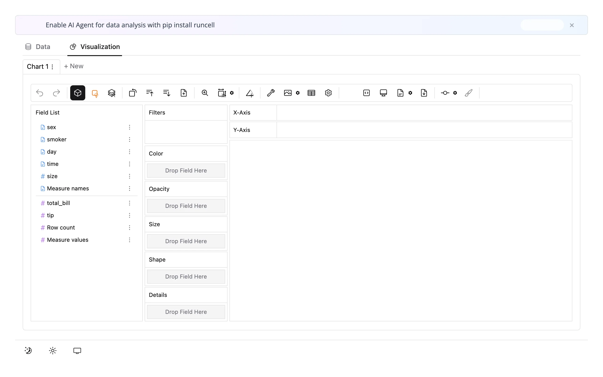

Reach for PyGWalker when you want users to build their *own* ad hoc charts over a DataFrame you don't know
the shape of in advance. If you already know what charts you want and just need the user to filter or drill
into them, a plotting library driven from Shiny inputs is simpler and cheaper. For a different "let the user
explore" model, see [perspective](../perspective/index.md) (pivot-table style, with live `filter()` and
`view_config()` accessors you can read back without saving), [quak](../quak/index.md) (a fast sortable/
filterable big-table browser, not a chart builder), and [mosaic](../mosaic/index.md) (you design a fixed set
of linked charts and let users cross-filter them, instead of letting them build arbitrary charts). See
"Pairing with other guides" below for more on when to pick which.

## Installation

```bash
pip install 'shinywidgets[pygwalker]'
```

This pulls in `pygwalker`, `duckdb`, and `sqlglot` (shinywidgets uses `sqlglot` to validate the SQL
PyGWalker's browser sends; see "Security and privacy" below).

## Security and privacy

**Read this before putting `render_pygwalker` in front of anyone you don't trust.** PyGWalker's charts are
computed by SQL that *the browser sends*, run on **DuckDB's process-wide default connection** in your Python
process. Unless that connection is locked down, any visitor can send arbitrary SQL -- including SQL that
reads or writes files on the server. Because of this, `render_pygwalker` refuses to render until the default
connection is locked down.

Do this once, before any `render_pygwalker` output renders. In **Shiny Express**, put it in a sibling
`globals.py` (not inline in the app file -- see the gotcha below for why that matters here specifically):

```{.python file="examples/globals.py"}
# Shiny Express can run a sibling globals.py more than once per process (once
# to build the page, again when a session connects) -- unlike plain `import`,
# which Python would cache. DuckDB's `lock_configuration` can only be set
# once per process; setting it again raises. So the lockdown below checks
# first and is a no-op the second time, which is what makes it safe to put
# here at all. Never do this lockdown inline in an Express app file: it would
# run on every execution with no way to check first, and crash the first
# session that connects after the page itself has already run it once. See
# "Security and privacy" in the guide for what this protects against.
import duckdb
import pygwalker

# PyGWalker otherwise phones home from both the Python process and every
# visitor's browser
pygwalker.GlobalVarManager.set_privacy("offline")

already_locked = duckdb.execute(
    "SELECT current_setting('lock_configuration')"
).fetchone()[0]
if not already_locked:
    # Set first: PyGWalker sets it per query, which a locked configuration refuses
    duckdb.execute("SET TimeZone = 'UTC'")
    duckdb.execute("SET enable_external_access = false")
    duckdb.execute("SET lock_configuration = true")
```

[`examples/globals.py`](examples/globals.py); every other example in this guide starts with
`import globals  # noqa: F401`. In **Shiny Core**, the equivalent code works fine directly at module scope
(Core doesn't re-run your file per session -- see the gotcha below for why Express needs the guard and Core
doesn't).

If you skip this, `render_pygwalker` raises before drawing anything:

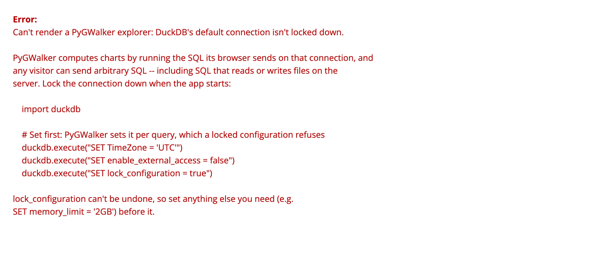

**What the lockdown does and doesn't protect.** Verified directly against `shinywidgets/_render_widget.py`
(`require_duckdb_lockdown`, `validate_visitor_sql`, `harden_walker_widget`) and the existing
`tests/playwright/render_pygwalker` suite (all pass on current `main`):

- `enable_external_access = false` + `lock_configuration = true` stops the browser's SQL from reading or
  writing server files, or from undoing the lockdown. Confirmed: a visitor-sent `read_csv('/etc/...')` and a
  `COPY ... TO` both fail, and so does `SET enable_external_access = true`.
- shinywidgets additionally restricts every query the browser sends to a single `SELECT` against the
  widget's own registered view (no `DDL`, no other tables or views) -- because every PyGWalker widget in the
  process shares **one** DuckDB connection and **one** fixed view name (`pygwalker_mid_table`). Without this,
  one visitor's query could read a table another widget registered.
- Two browser-triggered actions are rejected outright because there's no safe form of them: uploading a
  Kanaries API token (a visitor could overwrite the server's stored credentials) and "open in desktop"
  (it shells out to the server's `gw://` protocol handler).
- What it does **not** give you: per-user data isolation. Every widget shares the one connection and table
  name; each request re-registers its own data immediately before querying, which holds up under Shiny's
  single-threaded request handling but isn't a boundary to build on. A visitor can also send an expensive
  query that blocks the whole process (every session, not just theirs) while it runs. If different users must
  explore mutually private data, prefer a renderer that keeps data apart by design.
- Separately, call `pygwalker.GlobalVarManager.set_privacy("offline")` to stop PyGWalker's own telemetry
  (usage events and an update check) from both your Python process and every visitor's browser. This is
  about phoning home, not about the SQL security model above -- do both.

PyGWalker is best suited to trusted or internal users even with the lockdown in place. See "Gotchas" for more
nuance (the ad banner, the save/export toasts).

## Quick start

```{.python file="examples/01_quickstart.py" files="globals.py"}
import plotly.express as px
from shiny.express import ui

import globals  # noqa: F401 -- locks down DuckDB once per process; see globals.py
from shinywidgets import render_pygwalker

ui.page_opts(fillable=True)

tips = px.data.tips()


@render_pygwalker
def explorer():
    return tips
```

That's the whole app: a DataFrame in, a full drag-and-drop explorer out, filling its container.

## What you can build

### Drag-and-drop chart building

Drag a field onto an axis shelf and PyGWalker infers a sensible mark, aggregates numeric measures (`sum` by
default, changeable per field), and adds a legend for anything on Color. Dragging `total_bill` onto X, `tip`
onto Y, and `smoker` onto Color produces:

```{.python file="examples/02_build_a_chart.py" files="globals.py"}
import plotly.express as px
from shiny.express import ui

import globals  # noqa: F401 -- locks down DuckDB once per process; see globals.py
from shinywidgets import render_pygwalker

ui.page_opts(fillable=True)
ui.markdown(
    "Drag **total_bill** onto *X-Axis*, **tip** onto *Y-Axis*, and **smoker** onto "
    "*Color* -- PyGWalker aggregates, charts, and colors it, with no chart code."
)

tips = px.data.tips()


@render_pygwalker
def explorer():
    return tips
```

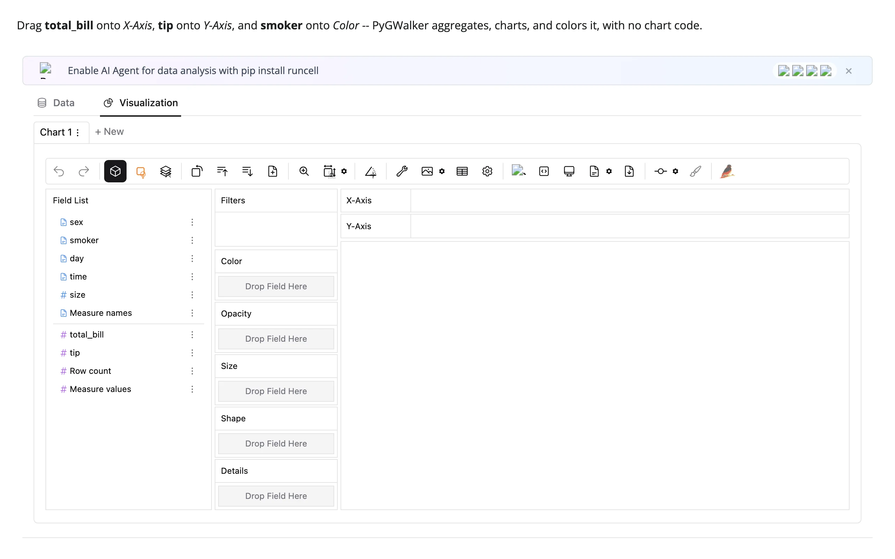
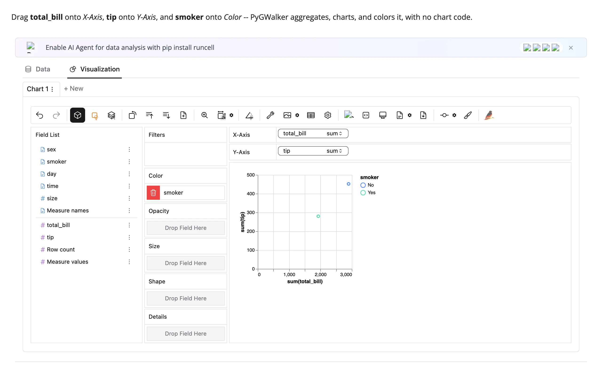

Verified via the saved chart spec (`Ctrl/Cmd+S`, read back in Python -- see below): the shelves hold exactly
`columns: [total_bill]`, `rows: [tip]`, `color: [smoker]`, matching what's on screen.

### The Data tab

Every explorer has a **Data** tab next to **Visualization** -- a searchable, paginated table over the same
data, with a per-column histogram or category breakdown in the header:

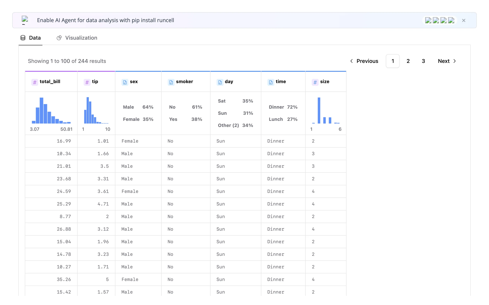

Rows are fetched from Python on demand (kernel computation, see next section), not shipped up front.

### Any size dataset, because DuckDB computes it

The browser never holds your data -- it sends SQL, and DuckDB runs it in your Python process, so only the
*query result* crosses the wire. This explores 1,000,000 synthetic taxi-fare rows and builds an aggregated
chart exactly as fast as the 244-row `tips` example:

```{.python file="examples/04_scale.py" files="globals.py"}
import numpy as np
import pandas as pd
from shiny.express import ui

import globals  # noqa: F401 -- locks down DuckDB once per process; see globals.py
from shinywidgets import render_pygwalker

ui.page_opts(fillable=True)
ui.markdown(
    "1,000,000 synthetic rows. PyGWalker aggregates with DuckDB in the Python "
    "process, so only the query *result* crosses the wire -- opening the explorer "
    "and building a chart here cost the same bytes and time as "
    "02_build_a_chart.py's 244 rows (measured in NOTES.md)."
)

rng = np.random.default_rng(0)
n = 1_000_000
trips = pd.DataFrame(
    {
        "fare": rng.gamma(4, 3, n).round(2),
        "distance_mi": rng.gamma(3, 1.5, n).round(2),
        "borough": rng.choice(
            ["Manhattan", "Brooklyn", "Queens", "Bronx", "Staten Island"],
            n,
            p=[0.45, 0.25, 0.2, 0.07, 0.03],
        ),
        "payment": rng.choice(["card", "cash"], n, p=[0.7, 0.3]),
    }
)


@render_pygwalker
def explorer():
    return trips
```

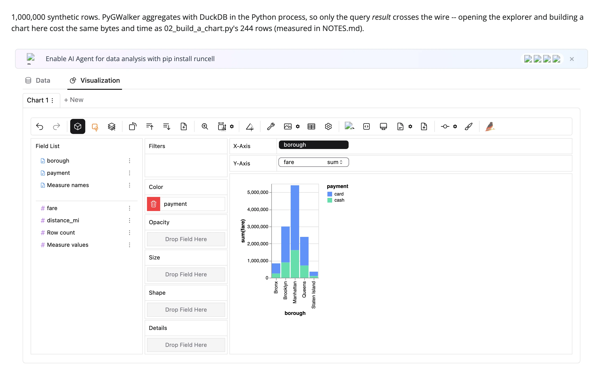

Measured with Playwright (see `NOTES.md` for methodology): opening the explorer and the first chart query
cost **identical** bytes and time for 500, 50,000, and 1,000,000 rows --

| | 500 / 50K / 1M rows (all identical) |
|---|---|
| Initial render (ESM bundle + schema) | ~10.16 MB over the websocket, ~3.3 s to an interactive Field List |
| One aggregated chart query (group by + sum) | ~1.2 KB sent, ~2 KB received, ~2.8 s wall time |

**One correction to a common assumption**: PyGWalker's own `walk()` (what `kernel_computation` vs.
client-side usually refers to) is pinned to `kernel_computation=True` inside
`pygwalker.api.anywidget.walk()` -- passing `kernel_computation=False` yourself raises
`TypeError: ... got multiple values for keyword argument 'kernel_computation'` (verified directly against
`pygwalker.api.anywidget.walk`). There's no client-side mode available through this renderer; "kernel
computation" here isn't a choice you make, it's simply how the anywidget integration always works, which is
exactly what makes the scale-invariance above possible. The ~10 MB figure above is PyGWalker's JavaScript
bundle, sent fresh on every render (re-renders aren't free -- see "Updating from Python" below).

## Reacting to user interaction

**There are no accessors on `render_pygwalker`** (confirmed: it declares no `_accessor_specs`, unlike
[quak](../quak/index.md)'s `sql()`/`data()` or [perspective](../perspective/index.md)'s `filter()`/
`view_config()`). There's also nothing worth reading with `reactive_read()`: the rendered widget's only
data-carrying trait is `props`, a one-way JSON blob sent once at construction. Confirmed directly
(`widget.trait_names()` on a freshly built walker lists only ipywidgets boilerplate --
`layout`, `tooltip`, `comm`, `_view_*`, etc. -- plus `props`; nothing tracks the explorer's live state).

What *is* available, and is the mechanism the accessors in other renderers are built on: PyGWalker's widget
accepts a `.on_msg()` handler, and every action the browser takes (building a chart, saving, exporting,
switching tabs) arrives there as a `pyg_request` message. Two are useful to applications:

| Message action | Fires when | Payload |
|---|---|---|
| `update_spec` | User presses **Ctrl/Cmd+S** (or the save icon) | `data["visSpec"]`: the full chart spec (shelves, field roles, layout) |
| `export_dataframe_by_sql` (or `export_dataframe`) | User clicks the export icon | Nothing useful in the message itself -- read `pygwalker.GlobalVarManager.last_exported_dataframe` immediately after (process-global, but it's already this session's result since PyGWalker's own handler runs first) |

This wires both up:

```{.python file="examples/03_save_and_export.py" files="globals.py"}
import json

import pandas as pd
import plotly.express as px
import pygwalker
from shiny import reactive
from shiny.express import render, ui

import globals  # noqa: F401 -- locks down DuckDB once per process; see globals.py
from shinywidgets import render_pygwalker

ui.page_opts(fillable=True)

tips = px.data.tips()

saved_spec = reactive.value(None)
exported = reactive.value(None)

with ui.layout_columns(col_widths=[8, 4]):
    with ui.card(full_screen=True):

        @render_pygwalker
        def explorer():
            return tips

    with ui.card():
        ui.card_header("What Python saw")

        @reactive.effect
        def _register_on_msg():
            def on_msg(widget, content, buffers):
                if content.get("type") != "pyg_request":
                    return
                msg = content["msg"]
                if msg["action"] == "update_spec":  # Ctrl/Cmd+S
                    saved_spec.set(msg["data"]["visSpec"])
                elif msg["action"].startswith("export_dataframe"):  # export icon
                    exported.set(pygwalker.GlobalVarManager.last_exported_dataframe)

            explorer.widget.on_msg(on_msg)

        ui.markdown("Press **Ctrl/Cmd+S** in the explorer: its saved encodings land here.")

        @render.code
        def spec_summary():
            spec = saved_spec.get()
            if spec is None:
                return "(not saved yet)"
            encodings = spec[0]["encodings"]
            used = {
                shelf: [f["name"] for f in fields]
                for shelf, fields in encodings.items()
                if fields and shelf in ("columns", "rows", "color")
            }
            return json.dumps(used, indent=2)

        ui.markdown("Click the export icon: the chart's computed rows land here.")

        @render.data_frame
        def exported_table():
            df = exported.get()
            if df is None:
                return render.DataGrid(pd.DataFrame({"status": ["(not exported yet)"]}))
            return render.DataGrid(df)
```

Register the `on_msg` handler in a separate `@reactive.effect`, not inside `explorer()`'s own body -- reading `.widget`
inside a renderer's own render function returns the *previous* render's widget (undocumented but true of
every renderer; see Gotchas), so a fresh effect that reads `.widget` after the render completes is the
reliable pattern (and matches the renderer's own test suite).

Saving a chart (left) immediately shows its parsed shelves in Python (right); clicking export fills a real
`render.data_frame` with the chart's own computed rows -- not the raw table, the aggregated rows behind the
chart on screen:

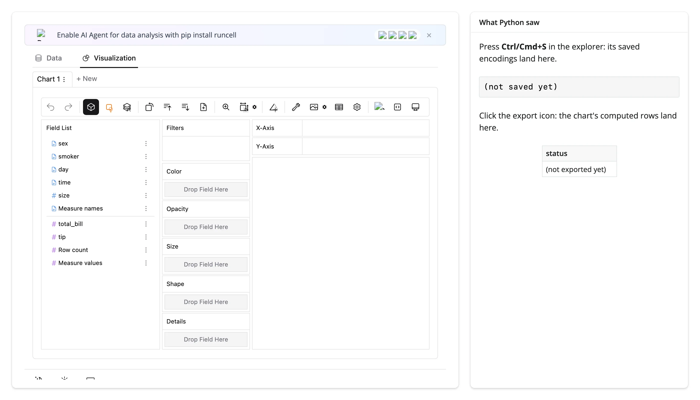
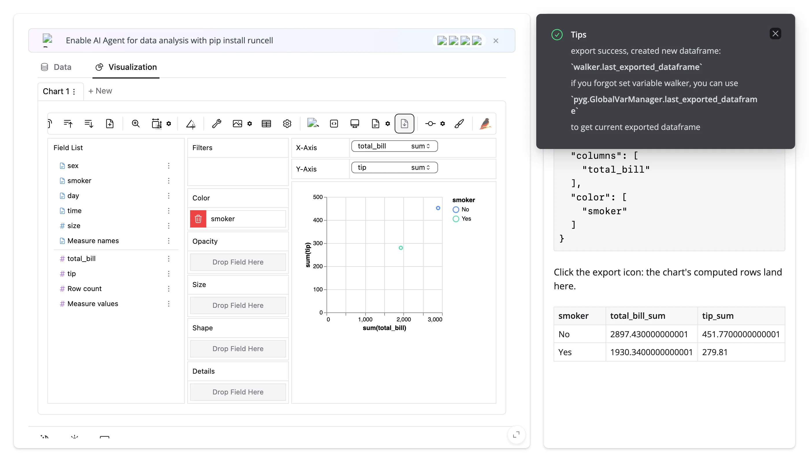

Verified: the exported table's `total_bill_sum`/`tip_sum` values (2897.43 / 451.77 for "No", 1930.34 / 279.81
for "Yes") match the two points plotted in the chart on the left, confirming export sends the chart's
*computed* data, not a dump of the input DataFrame.

### Beyond messages: nothing else to read

No subsection needed here beyond what's above -- `reactive_read()` has nothing to watch (verified above),
and the current selection, filter, or sort inside a chart (as opposed to its saved spec) isn't observable
from Python at all, only through the save/export round trip. If you need to react continuously as a user
drags fields around (not just at save/export), PyGWalker can't do it; consider
[perspective](../perspective/index.md) instead, whose `view_config()`/`filter()` accessors update live.

### Rate limiting

`rate_policy`/`rate_delay` have nothing to apply to here: there are no accessors, and `reactive_read()` has no
state-carrying trait to rate-limit. Not applicable to this renderer.

## Updating the widget from Python

PyGWalker's widget has no synced state trait, so there's no in-place update path (`.widget.<trait> = ...` does
nothing useful here, unlike widgets with real synced traits). **Every change means a re-render**, which
re-sends the ~10 MB JavaScript bundle. Keep that in mind when a render function depends on something that
changes often.

The one piece of explorer state you can carry across a re-render is a **saved chart spec**: capture it via
`update_spec` (above), then pass it back as `walk(df, spec=...)` next time. PyGWalker's own `get_spec_json`
accepts the raw captured `visSpec` list as a JSON string directly (verified: each chart object in it already
carries the `visId` key `get_spec_json` checks for, so no extra wrapping is needed).

```{.python file="examples/05_filter_and_persist_spec.py" files="globals.py"}
import json

import plotly.express as px
from pygwalker.api.anywidget import walk
from shiny import reactive
from shiny.express import input, ui

import globals  # noqa: F401 -- locks down DuckDB once per process; see globals.py
from shinywidgets import render_pygwalker

ui.page_opts(fillable=True)

tips = px.data.tips()
saved_spec = reactive.value(None)

ui.input_select(
    "day", "Day", choices=["All", *sorted(tips["day"].unique())], selected="All"
)
ui.markdown(
    "Build a chart, then press **Ctrl/Cmd+S**. Switching the day filter re-renders "
    "the explorer with the filtered data -- and replays the saved chart on it."
)


@render_pygwalker
def explorer():
    day = input.day()
    df = tips if day == "All" else tips[tips["day"] == day]
    with reactive.isolate():
        spec = saved_spec.get()
    return walk(df, spec=json.dumps(spec) if spec else "")


@reactive.effect
def _capture_spec():
    def on_msg(widget, content, buffers):
        if content.get("type") != "pyg_request":
            return
        if content["msg"]["action"] == "update_spec":
            saved_spec.set(content["msg"]["data"]["visSpec"])

    explorer.widget.on_msg(on_msg)
```

(`reactive.isolate()` keeps this render from re-running every time `saved_spec` itself changes -- it should
only react to `day`.) Build a chart, save it, then switch the day filter: the explorer re-renders against the
filtered data, but the same chart (same shelves, same color) reopens on it, now showing smaller totals:

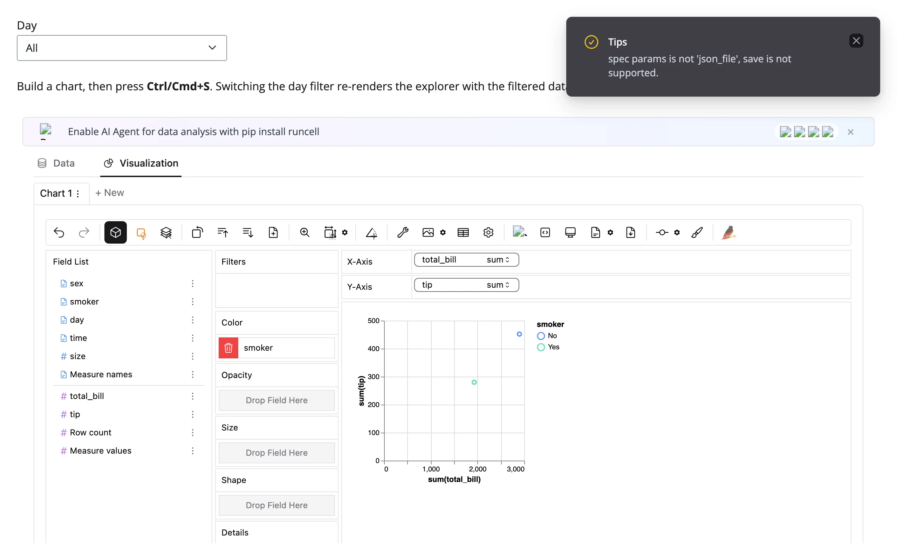
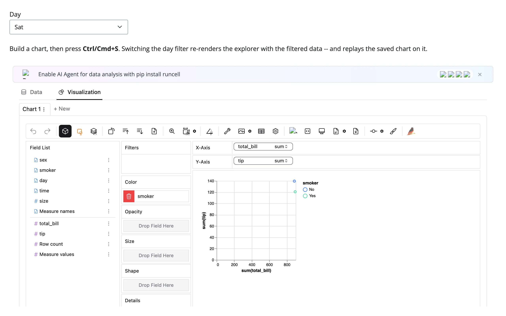

This is also the answer to "ship a pre-built exploration": call `walk(df, spec=...)` with a spec captured once
(e.g., written to a JSON file from a throwaway session) and every user opens on that chart, still free to
change it from there.

## Coordinating multiple views

PyGWalker has no live accessors to wire into other widgets, so every pattern here goes through the
save/export round trip -- honest, not automatic, but still useful:

1. **Filter drives the explorer; the user's chart survives the filter.** Shown above
   ([`05_filter_and_persist_spec.py`](examples/05_filter_and_persist_spec.py)): a Shiny input re-renders
   PyGWalker against different data, and a captured `update_spec` keeps the chart itself stable across that
   re-render.
2. **Export drives a second widget.** This captures `export_dataframe_by_sql` the same way, then feeds the
   exported rows into a simple `@render_plotly` bar chart -- "from chart to DataFrame to a second
   visualization":

   ```{.python file="examples/06_linked_export_to_plotly.py" files="globals.py"}
   import pandas as pd
   import plotly.express as px
   import pygwalker
   from shiny import reactive
   from shiny.express import ui

   import globals  # noqa: F401 -- locks down DuckDB once per process; see globals.py
   from shinywidgets import render_plotly, render_pygwalker

   ui.page_opts(fillable=True)

   tips = px.data.tips()
   exported = reactive.value(None)

   with ui.layout_columns(col_widths=[7, 5]):
       with ui.card(full_screen=True):
           ui.card_header("Build a chart, then click the export icon")

           @render_pygwalker
           def explorer():
               return tips

           @reactive.effect
           def _capture_export():
               def on_msg(widget, content, buffers):
                   if content.get("type") != "pyg_request":
                       return
                   if content["msg"]["action"].startswith("export_dataframe"):
                       exported.set(pygwalker.GlobalVarManager.last_exported_dataframe)

               explorer.widget.on_msg(on_msg)

       with ui.card(full_screen=True):
           ui.card_header("The same computed rows, as a plotly bar chart")

           @render_plotly
           def bar():
               df = exported.get()
               if df is None:
                   return px.bar(title="Export a chart to see it here")
               num_col = next(c for c in df.columns if pd.api.types.is_numeric_dtype(df[c]))
               cat_col = next(c for c in df.columns if c != num_col)
               return px.bar(df, x=cat_col, y=num_col, title=f"{num_col} by {cat_col}")
   ```

   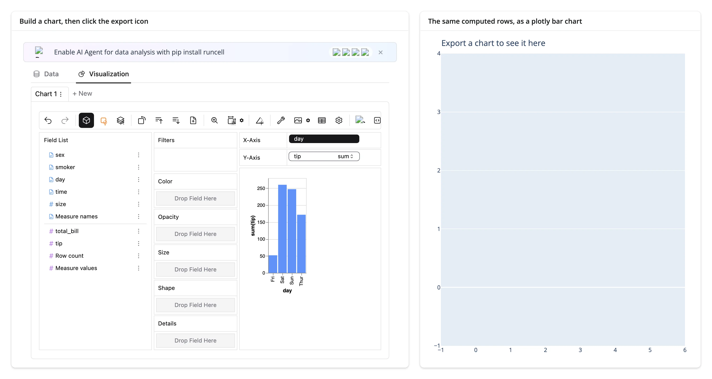
   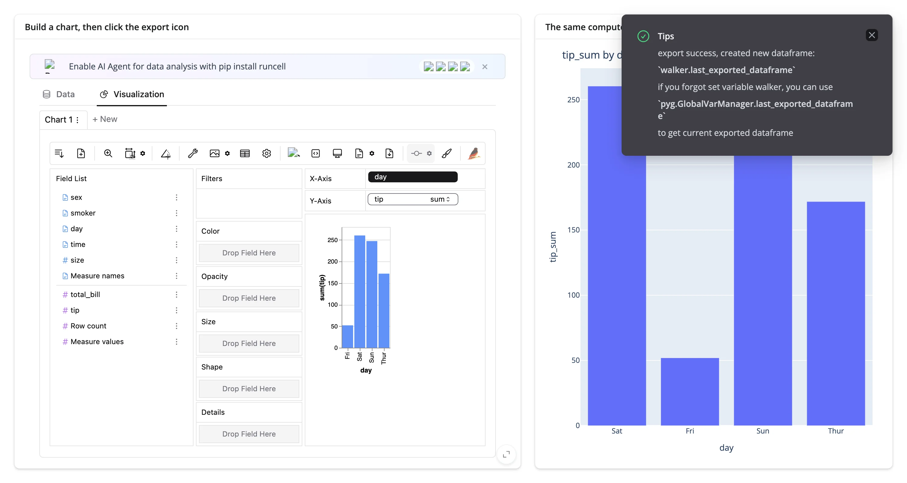

   Verified: `tip_sum by day` in the plotly chart (Sat ~260, Fri ~50, Sun ~250, Thur ~170) matches the
   PyGWalker chart it was exported from.
3. **Save a spec, show it as a shareable artifact.** Not demonstrated as a separate example (it's a one-line
   variant of pattern 1): write the captured `visSpec` to a file or database row from your `update_spec`
   handler, and you have a durable "this user's saved view" you can reopen for them next session, email as a
   link, or audit.

What you *can't* do: react to a selection or lasso the way accessor-based renderers do (plotly's `selected()`,
perspective's `filter()`). PyGWalker's only observable moments are save and export.

## Large data

See [Any size dataset, because DuckDB computes it](#any-size-dataset-because-duckdb-computes-it) above --
PyGWalker's whole large-data story is that DuckDB runs the query in your Python process, so only the aggregated
*result* crosses the wire. Measured directly, comparing 500/50,000/1,000,000-row versions of the same app: the
initial render (ESM bundle + schema, no data) is byte-for-byte identical at every size (10,163,162 bytes), and
building one aggregated chart costs about 1.2 KB sent / 2.0 KB received regardless of row count. This is the
"summarize on the server" approach from
[Large data & performance](../../guide/performance/index.md#three-approaches-to-large-data).

## Layout and sizing

In a filling layout (`fillable=True`, or a `full_screen=True` card), the explorer fills its container --
PyGWalker's own UI is tall (~750-800px) and scrolls internally if the container is shorter. Outside a
filling layout, the default height is a plain ipywidget default (400px), which is almost always too short;
give it an explicit height (`@render_pygwalker(height="420px")` or `output_widget("id", height="420px")` in
Core) sized to fit, and expect it to scroll:

```{.python file="examples/07_layout_sizing.py" files="globals.py"}
import plotly.express as px
from shiny.express import ui

import globals  # noqa: F401 -- locks down DuckDB once per process; see globals.py
from shinywidgets import render_pygwalker

ui.page_opts(fillable=True)
tips = px.data.tips()

with ui.layout_columns(col_widths=[6, 6]):
    with ui.card(full_screen=True):
        ui.card_header("Fills the card (full_screen enabled)")

        @render_pygwalker
        def fill_explorer():
            return tips

    with ui.card():
        ui.card_header('Explicit height="420px" (scrolls inside)')

        @render_pygwalker(height="420px")
        def fixed_explorer():
            return tips
```

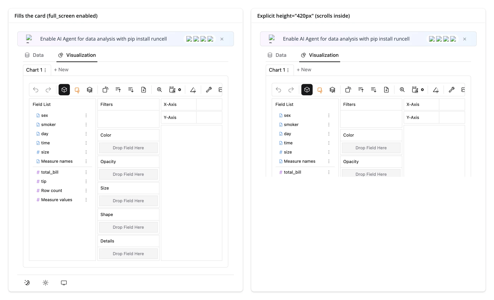

Both are confirmed by the existing Playwright suite (`tests/playwright/render_pygwalker`), which checks the
fill-card height matches exactly and the explicit-height case has `scrollHeight > clientHeight`.

## Gotchas and limitations

- **`globals.py` in Shiny Express is not guaranteed to run exactly once per process** -- confirmed directly:
  a plain `shiny run` on an Express app executes the whole app file (and any sibling `globals.py` it imports)
  **twice** before a single browser even connects, and once more per session after that. For most setup code
  (like the `shared_lifetime()` widgets in the [reacting-to-widgets article](../../guide/reacting-to-widgets/index.md))
  this is harmless, just wasteful -- rebuilding a `Map()` twice doesn't error. For DuckDB's lockdown it *does*
  error, because `SET lock_configuration = true` can only succeed once per connection; a second attempt
  raises `Invalid Input Error: Cannot change configuration option ... - the configuration has been locked`.
  That's why this guide's `globals.py` checks `current_setting('lock_configuration')` before setting anything
  -- make any one-shot, non-idempotent setup code like this tolerate being run more than once, rather than
  relying on `globals.py`'s filename alone. Shiny Core doesn't have this problem (module-level code outside
  `server()` really does run once).
- **PyGWalker's "AI Agent" ad banner** ("Enable AI Agent for data analysis with pip install runcell") shows
  regardless of `set_privacy("offline")` -- visible in every screenshot in this guide. It's dismissible per
  page load but reappears on the next render. Not something shinywidgets can suppress; it's baked into the
  shipped bundle.
- **The save and export toasts are written for Jupyter, not Shiny**, and are a little confusing: saving shows
  "spec params is not 'json_file', save is not supported" even though the spec *did* reach Python (the
  `update_spec` message fires regardless); exporting tells you to read `walker.last_exported_dataframe` --
  that variable doesn't exist in a Shiny app, use `pygwalker.GlobalVarManager.last_exported_dataframe` instead
  (as this guide's examples do). Both toasts are harmless to ignore.
- **The visualization tab's "Filters" shelf also displays every dimension used elsewhere in the chart** (with
  a trash icon), as a shortcut to add a filter condition or remove the field entirely. It's easy to mistake
  for an active filter; verified by reading the saved spec back (`"filters": []` even while, e.g., a Color
  field shows there too).
- **A polars DataFrame only works if the installed `pygwalker` supports polars >= 1.0's dtype API**; every
  release up to and including 0.5.0.1 doesn't, and `render_pygwalker` raises a clear `TypeError` telling you
  to pass `df.to_pandas()` instead (checked at render time via `polars_supported()`).
- **Never use the top-level `pygwalker.walk()` (or `import pygwalker as pyg; pyg.walk(df)`)** inside a Shiny
  render function. Outside Jupyter it starts a blocking HTTP server instead of returning a widget; use
  `pygwalker.api.anywidget.walk()` (what this renderer uses internally, and what you should call directly
  when you need `spec=`, `theme_key=`, etc.).
- **Reading `.widget` inside a renderer's own render function returns the *previous* render's widget**, with
  no error (true of every `render_*` output, not specific to PyGWalker). Register `on_msg` handlers in a
  separate `@reactive.effect`, as this guide's examples do.

## Gallery candidates

- [`gallery/template_explorer.py`](gallery/template_explorer.py): a minimal, self-contained starting point
  (lockdown + two Shiny-input filters + explorer), ~50 lines.

  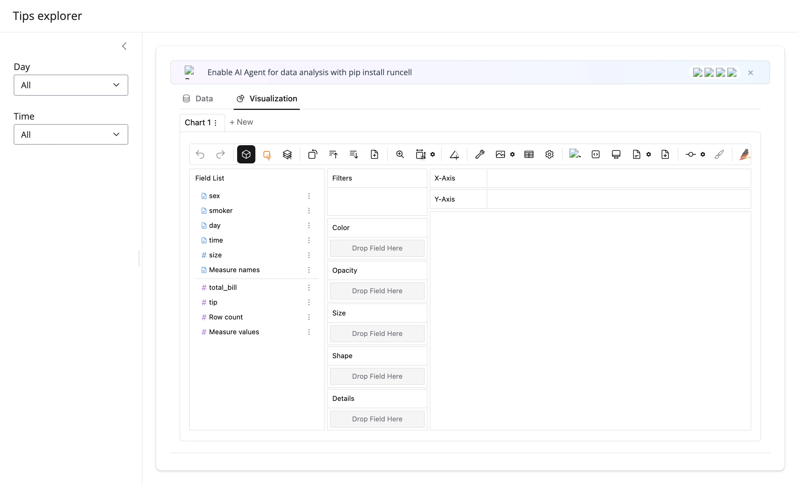

- [`gallery/showcase_tips_dashboard.py`](gallery/showcase_tips_dashboard.py): sidebar filters, a chart that
  keeps its saved spec across filter changes, and an export-driven summary/table panel, combining every
  pattern from "Coordinating multiple views."

  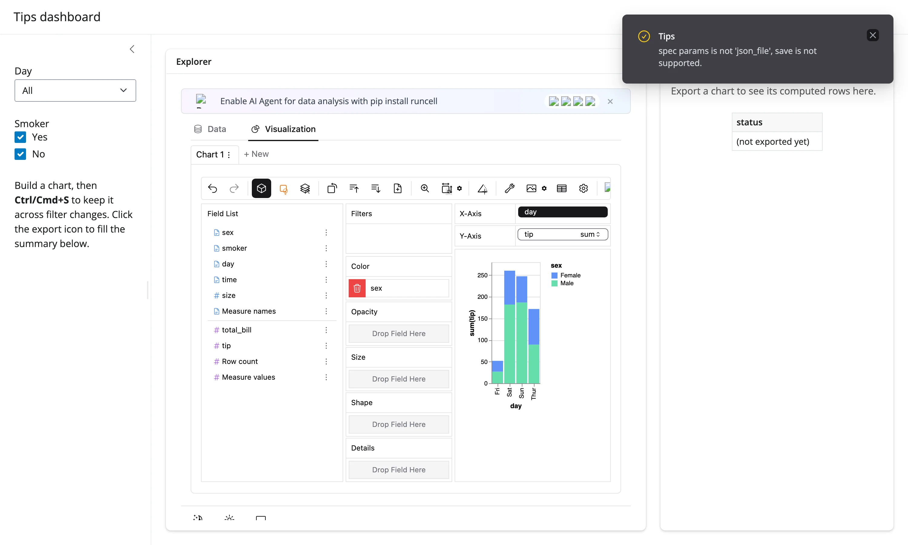

## Pairing with other guides

- **[perspective](../perspective/index.md)**: also a drag-and-drop, browser-rendered pivot/chart UI over a
  DataFrame, but lighter weight and with live `filter()`/`view_config()` accessors you can read continuously
  without an explicit save. Prefer perspective when you want to react to the user's pivot/filter as they work,
  not just at a save/export checkpoint, or when the ~10 MB per-render PyGWalker bundle is a problem.
- **[quak](../quak/index.md)**: a fast, DuckDB-backed sortable/filterable big-table browser with `sql()`/
  `data()` accessors, but no drag-and-drop chart building. Prefer quak when the point is browsing/filtering
  rows, not building charts. Both renderers lock their DuckDB connections down by default now, but the shape of
  that lockdown differs: quak's (like [mosaic](../mosaic/index.md)'s) is per-widget, so it also opts out per
  widget (`allow_unrestricted_connection=True`); PyGWalker's is forced, with no opt-out, because every
  PyGWalker widget in the process shares the one connection described above.
- **[mosaic](../mosaic/index.md)**: you design a fixed set of Vega-Lite charts up front and let users
  cross-filter them via a shared selection; PyGWalker instead lets users build whatever chart they want.
  Prefer mosaic when you know the views you want and need them linked; prefer PyGWalker when you don't know
  the views in advance and want to hand that decision to the user.

## Learn more

- [PyGWalker documentation](https://docs.kanaries.net/pygwalker)
- [PyGWalker on GitHub](https://github.com/Kanaries/pygwalker)
- `help(shinywidgets.render_pygwalker)` for the full parameter and security reference
- [perspective](../perspective/index.md), [quak](../quak/index.md), [mosaic](../mosaic/index.md) -- the
  closest siblings in the "Tables & data exploration" category
