[pythreejs](https://pythreejs.readthedocs.io), maintained by the Jupyter widgets team, is a full Python binding to
[three.js](https://threejs.org/), the WebGL scene-graph library. Where most 3D widgets in this roster (k3d,
ipyvolume, pyvista) give you a plotting-style function that builds a scene for you, pythreejs gives you the scene
graph itself: `Scene`, `Camera`, `Mesh`, `Geometry`, `Material`, and lights are all separate Python objects you
wire together yourself, exactly as you would in three.js's own JavaScript API. That's more code than calling
`k3d.points(...)`, but it's the only widget here that lets you build an arbitrary 3D scene -- custom geometry from
a numpy array, several independently animated objects, hand-placed lights and cameras -- with nothing hidden
behind a high-level API.

`@render_pythreejs` renders a `pythreejs.Renderer` (a scene plus a camera) as a Shiny output. By default the
canvas and the camera's aspect ratio fill their container and track it on resize; give the `Renderer` an explicit
`width`/`height` (or put it in a sized output) to use a fixed pixel size instead. The renderer's `.widget`
attribute is the live `Renderer`, so any trait on any object in the scene graph -- a mesh's material color, a
light's intensity, a camera's position -- can be read with `reactive_read()` or written from a `@reactive.effect`
without re-rendering. One accessor, `camera()`, reads the live camera the same way `input.x()` reads an input:
with `OrbitControls` attached, it reports the user's current position, orientation, and zoom every time they
finish an orbit drag, turning the viewport itself into reactive state.

Reach for pythreejs when you need a scene k3d, ipyvolume, or [pyvista](../pyvista/index.md)'s higher-level APIs
don't cover -- custom geometry, several independently moving parts, or raycasting against the exact meshes you
built. For point clouds, isosurfaces, or volumes, [k3d](../k3d/index.md) and
[ipyvolume](../ipyvolume/index.md) get you there with far less code (and share pythreejs's `camera()` accessor,
since their figures hold a pythreejs camera under the hood). For scientific mesh/volume visualization with a
ready-made UI, see [pyvista](../pyvista/index.md).

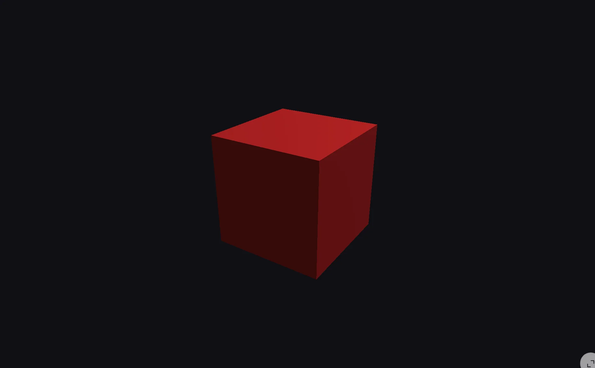

## Installation

```
pip install 'shinywidgets[pythreejs]'
```

## Quick start

A scene is a `Scene` (holding meshes and lights), a `Camera`, and the `Renderer` that draws them together. Two
upstream defaults are worth setting explicitly from the start: `Scene.background` is white, and a
`DirectionalLight` left without an explicit `target`/`shadow` has pythreejs create them in the browser instead,
which logs a harmless console error on every re-render (see [Gotchas and limitations](#gotchas-and-limitations)).

```{.python file="examples/01_quickstart.py"}
import pythreejs as p3
from shiny.express import ui
from shinywidgets import render_pythreejs

ui.page_opts(fillable=True)

with ui.card(full_screen=True):

    @render_pythreejs
    def scene():
        cube = p3.Mesh(p3.BoxGeometry(1, 1, 1), p3.MeshStandardMaterial(color="#d62728"))

        # Give the light an explicit target (added to the scene) and shadow
        # (with a camera): pythreejs creates both in the browser otherwise,
        # which logs a harmless console error on every re-render (see
        # Gotchas and limitations)
        light = p3.DirectionalLight(position=[3, 5, 2])
        light.target = p3.Object3D()
        light.shadow = p3.DirectionalLightShadow(camera=p3.OrthographicCamera())

        # Scene.background defaults to white and paints over the renderer's
        # clear color, so set it here for a dark viewport
        sc = p3.Scene(
            background="#101014",
            children=[cube, light, light.target, p3.AmbientLight(intensity=0.5)],
        )
        camera = p3.PerspectiveCamera(position=[0, 0, 3.5], fov=50)
        controls = p3.OrbitControls(controlling=camera)
        return p3.Renderer(scene=sc, camera=camera, controls=[controls])
```

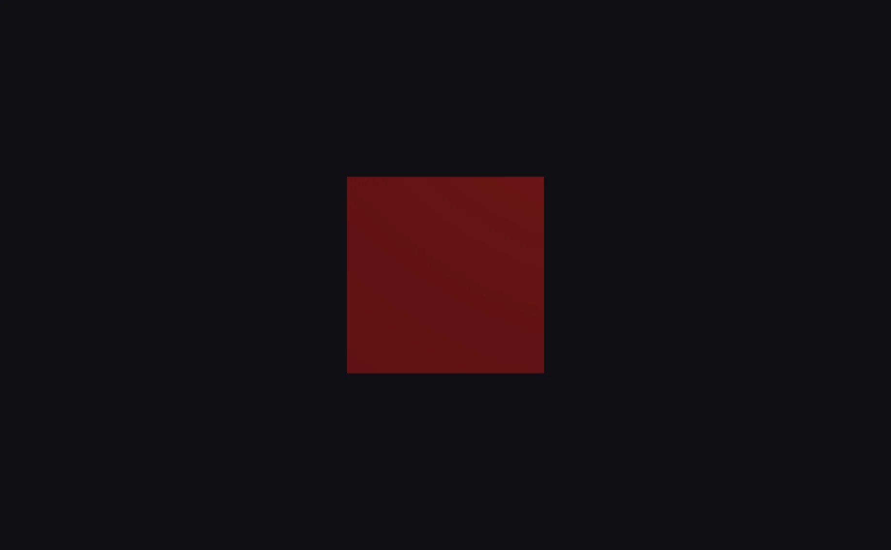

`OrbitControls` is what makes the canvas draggable and scrollable -- attach it to the camera and dragging/
scrolling just works, no event wiring required.

## What you can build

### The scene graph: build it like three.js

Every piece -- mesh, geometry, material, light, camera, controls -- is its own widget. Construct them inside the
render function (so each session gets its own instances), add meshes and lights to a `Scene`, and swap any of
them independently; a shape or color change here only touches the one mesh, not the whole graph.

```{.python file="examples/02_scene_graph.py"}
import pythreejs as p3
from shiny.express import input, render, ui
from shinywidgets import reactive_read, render_pythreejs

GEOMETRIES = {
    "Box": lambda: p3.BoxGeometry(1, 1, 1),
    "Sphere": lambda: p3.SphereGeometry(0.8, widthSegments=32, heightSegments=16),
    "Torus knot": lambda: p3.TorusKnotGeometry(0.6, 0.2, 128, 16),
}
COLORS = ["#d62728", "#1f77b4", "#2ca02c", "#9467bd"]

ui.page_opts(fillable=True)

with ui.layout_sidebar():
    with ui.sidebar():
        ui.input_select("shape", "Shape", list(GEOMETRIES))
        ui.input_select("color", "Color", COLORS)

        @render.text
        def camera_txt():
            pos = reactive_read(scene.widget.camera, "position")
            return f"Camera: ({pos[0]:.2f}, {pos[1]:.2f}, {pos[2]:.2f})"

    with ui.card(full_screen=True):
        ui.card_header("Drag to orbit, scroll to zoom")

        @render_pythreejs
        def scene():
            # Each piece of the scene graph -- mesh, geometry, material,
            # light, camera, controls -- is its own widget; build them inside
            # the render function so each session gets its own instances
            light = p3.DirectionalLight(position=[3, 5, 2])
            light.target = p3.Object3D()
            light.shadow = p3.DirectionalLightShadow(camera=p3.OrthographicCamera())

            mesh = p3.Mesh(
                GEOMETRIES[input.shape()](),
                p3.MeshStandardMaterial(color=input.color(), roughness=0.4),
            )
            sc = p3.Scene(
                background="#101014",
                children=[mesh, light, light.target, p3.AmbientLight(intensity=0.5)],
            )
            camera = p3.PerspectiveCamera(position=[0, 0, 3.5], fov=50)
            controls = p3.OrbitControls(controlling=camera)
            return p3.Renderer(scene=sc, camera=camera, controls=[controls])
```

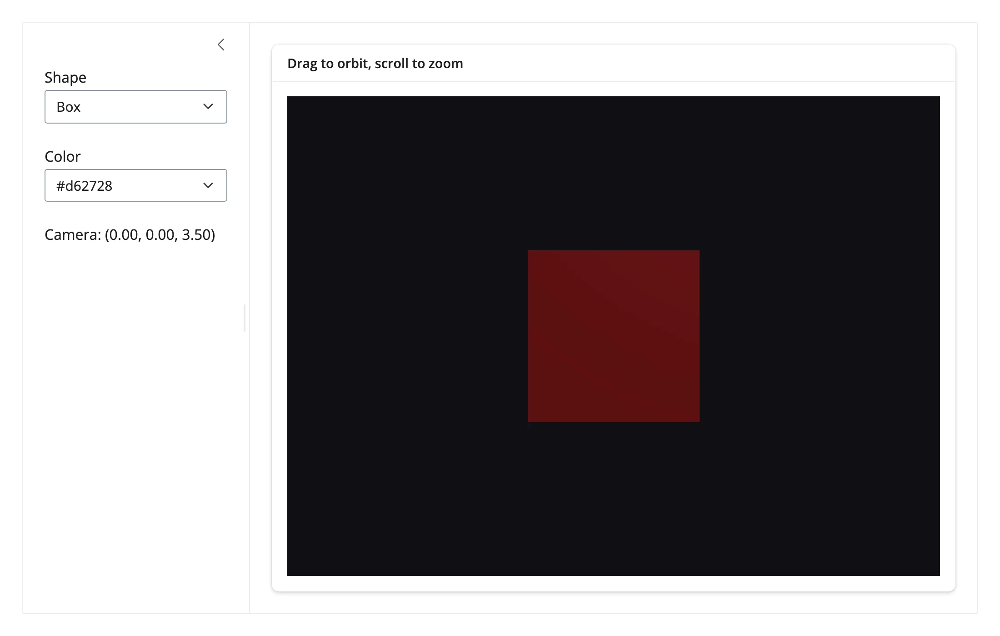 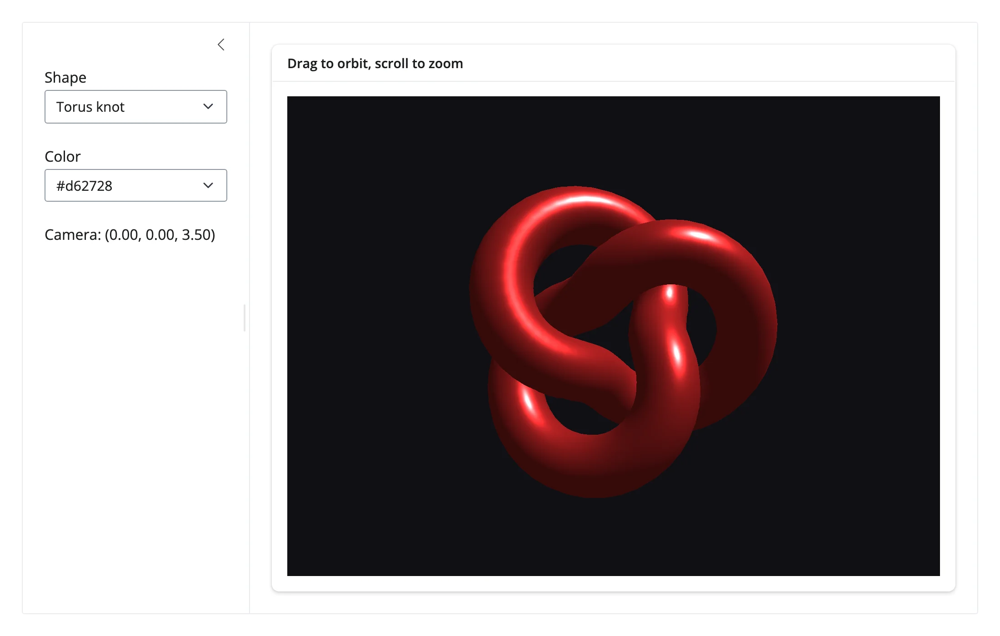

### Parametric surfaces and custom geometry from numpy

`BufferGeometry` takes raw vertex arrays -- build any surface a few lines of numpy can produce. This example
triangulates a ripple surface, computes one color per vertex from its height, and turns on `vertexColors` on the
material. No index buffer is needed: each grid cell contributes its own 6 vertices (2 triangles), so the position
and color arrays line up one-to-one.

```{.python file="examples/03_parametric_surface.py"}
import numpy as np
import pythreejs as p3
from shiny.express import input, ui
from shinywidgets import render_pythreejs

ui.page_opts(fillable=True)
ui.input_slider("freq", "Ripple frequency", 1, 6, 2, step=0.5)


def surface_geometry(freq: float, n: int = 60) -> p3.BufferGeometry:
    x, y = np.meshgrid(np.linspace(-3, 3, n), np.linspace(-3, 3, n))
    r = np.sqrt(x**2 + y**2)
    z = np.sin(freq * r) / (1 + r)
    zmin, zmax = z.min(), z.max()

    # One triangle pair (6 vertices) per grid cell -- a non-indexed
    # BufferGeometry, so there's no separate index buffer to build
    verts, colors = [], []
    for i in range(n - 1):
        for j in range(n - 1):
            for ii, jj in [(i, j), (i + 1, j), (i, j + 1), (i + 1, j), (i + 1, j + 1), (i, j + 1)]:
                verts.append([x[ii, jj], y[ii, jj], z[ii, jj]])
                t = (z[ii, jj] - zmin) / (zmax - zmin)
                colors.append([0.15 + 0.7 * t, 0.25 + 0.3 * (1 - t), 0.85 - 0.6 * t])

    geometry = p3.BufferGeometry(
        attributes={
            "position": p3.BufferAttribute(np.array(verts, dtype=np.float32)),
            "color": p3.BufferAttribute(np.array(colors, dtype=np.float32)),
        }
    )
    geometry.exec_three_obj_method("computeVertexNormals")
    return geometry


with ui.card(full_screen=True):

    @render_pythreejs
    def scene():
        mesh = p3.Mesh(
            surface_geometry(input.freq()),
            p3.MeshStandardMaterial(vertexColors="VertexColors", side="DoubleSide"),
        )
        sc = p3.Scene(background="#101014", children=[mesh, p3.AmbientLight(intensity=0.8)])
        camera = p3.PerspectiveCamera(position=[4, 4, 4], up=[0, 0, 1])
        controls = p3.OrbitControls(controlling=camera)
        return p3.Renderer(scene=sc, camera=camera, controls=[controls])
```

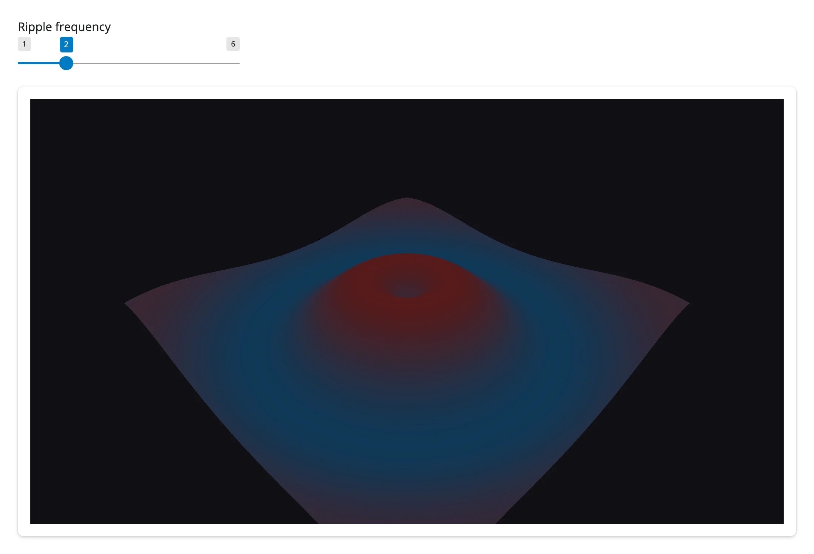

pythreejs also has a `ParametricGeometry`, but its surface function is a **JavaScript** source string evaluated
in the browser, not a Python callable -- for anything numpy can compute, `BufferGeometry` is the straightforward
path. `SurfaceGeometry`/`SurfaceGrid` (a height field with a `z` trait) are a lighter-weight option when your
surface is a regular grid of heights and you don't need per-vertex colors.

### Push live animation from Python

Because the scene graph is just widgets, a `@reactive.effect` with `reactive.invalidate_later()` can drive a
smooth animation over the same comm channel that `reactive_read()` uses to read it back -- no custom JavaScript,
no `requestAnimationFrame` loop to manage yourself.

```{.python file="examples/07_inplace_animation.py"}
import math

import pythreejs as p3
from shiny import reactive
from shiny.express import ui
from shinywidgets import render_pythreejs

ui.page_opts(fillable=True)


def quat_mul(a: tuple[float, ...], b: tuple[float, ...]) -> tuple[float, float, float, float]:
    ax, ay, az, aw = a
    bx, by, bz, bw = b
    return (
        aw * bx + ax * bw + ay * bz - az * by,
        aw * by - ax * bz + ay * bw + az * bx,
        aw * bz + ax * by - ay * bx + az * bw,
        aw * bw - ax * bx - ay * by - az * bz,
    )


with ui.card(full_screen=True):

    @render_pythreejs
    def scene():
        mesh = p3.Mesh(
            p3.TorusKnotGeometry(0.6, 0.2, 128, 16), p3.MeshStandardMaterial(color="#ff7f0e")
        )
        sc = p3.Scene(background="#101014", children=[mesh, p3.AmbientLight(intensity=0.9)])
        camera = p3.PerspectiveCamera(position=[0, 0, 3.5])
        controls = p3.OrbitControls(controlling=camera)
        return p3.Renderer(scene=sc, camera=camera, controls=[controls])

    # pythreejs's `rotation` (Euler) trait doesn't render (an upstream bug --
    # see Gotchas and limitations); animate the `quaternion` instead.
    # OrbitControls(autoRotate=True) is also inert upstream, so a Python timer
    # is the only way to get a continuous spin.
    @reactive.effect
    def _():
        reactive.invalidate_later(1 / 30)
        with reactive.isolate():
            mesh = scene.widget.scene.children[0]
        dq = (0.0, math.sin(0.01), 0.0, math.cos(0.01))
        mesh.quaternion = quat_mul(dq, mesh.quaternion)
```

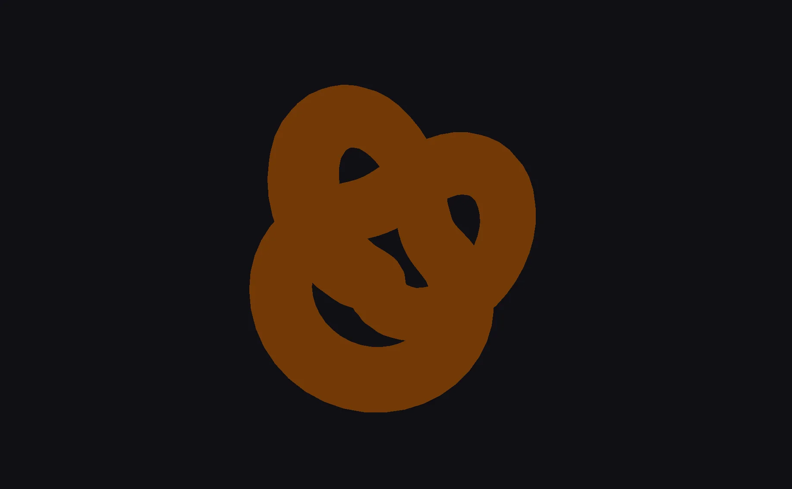 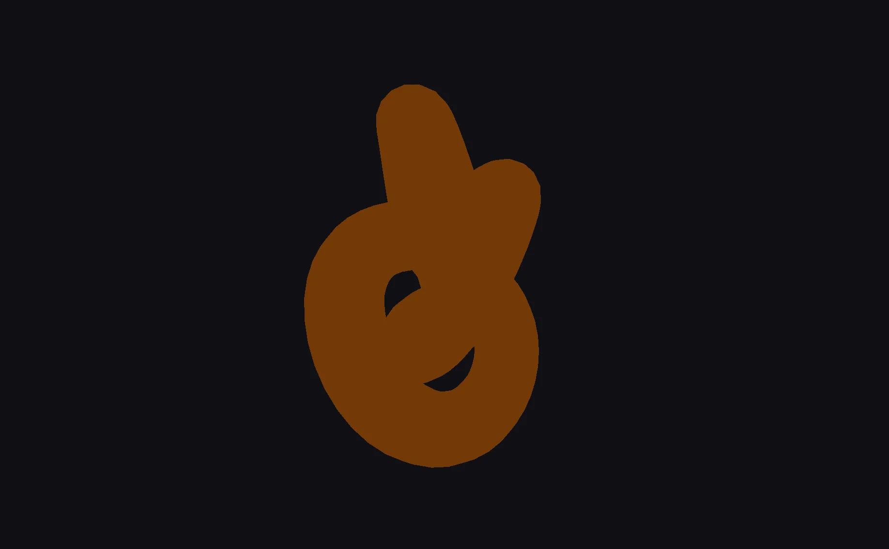

## Reacting to user interaction

### Accessor reference

| accessor | returns | before any interaction | across re-render | default rate policy |
|---|---|---|---|---|
| `camera()` | the live `pythreejs.Camera` (usually a `PerspectiveCamera`) | seeded value: the camera as constructed in Python (pythreejs doesn't sync it at mount; verified, never `None`) | re-seeded to the new scene's camera | not rate-limited |

`camera()` fires on `position`, `quaternion`, or `zoom` changes -- once per `OrbitControls` drag, on mouse-up.
Call it before any orbit and it reports the Python-constructed camera's starting pose, not an empty value (verified
on current main); after a re-render it re-seeds to the *new* scene's camera the same way, since the camera is
inherent widget state, not a one-off interaction to preserve. The object it returns is the same mutable `Camera`
instance across reads -- copy out the fields you want to keep, don't hold onto the object itself across a session.
(`scene.read("camera")` is *not* a plain substitute here: `camera()` post-processes the raw synced value into the
live `Camera` object, which `.read()` can't replicate generically -- use the named method.)

### `camera()`: read where the user is looking

```{.python file="examples/04_camera_accessor.py"}
import pythreejs as p3
from shiny.express import render, ui
from shinywidgets import render_pythreejs

ui.page_opts(fillable=True)

with ui.layout_columns(col_widths=[7, 5]):
    with ui.card(full_screen=True):
        ui.card_header("Drag to orbit")

        @render_pythreejs
        def scene():
            cube = p3.Mesh(p3.BoxGeometry(1, 1, 1), p3.MeshStandardMaterial(color="#1f77b4"))
            sc = p3.Scene(background="#101014", children=[cube, p3.AmbientLight(intensity=0.9)])
            camera = p3.PerspectiveCamera(position=[0, 0, 3.5], fov=50)
            controls = p3.OrbitControls(controlling=camera)
            return p3.Renderer(scene=sc, camera=camera, controls=[controls])

    with ui.card():
        ui.card_header("scene.camera()")

        @render.code
        def camera_state():
            # Re-runs every time the user finishes an orbit drag. Before the
            # first orbit this reports the camera as constructed in Python
            # (pythreejs doesn't sync it at mount).
            cam = scene.camera()
            pos = ", ".join(f"{v:.2f}" for v in cam.position)
            quat = ", ".join(f"{v:.2f}" for v in cam.quaternion)
            return f"position: ({pos})\nquaternion: ({quat})\nzoom: {cam.zoom:.2f}"
```

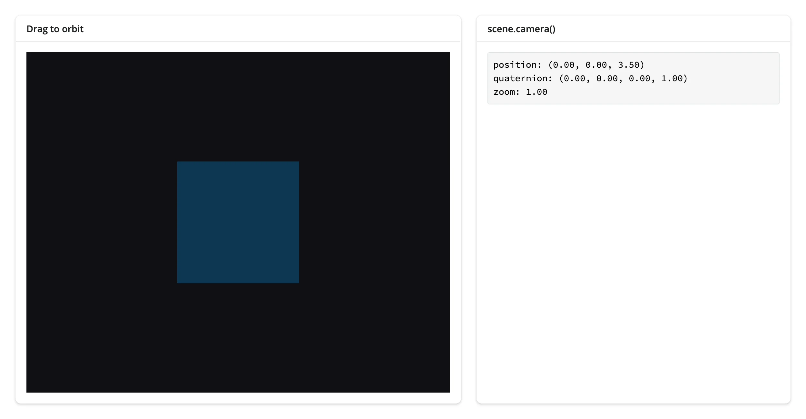 

### Beyond the accessor: `Picker` via `reactive_read`

pythreejs has no `clicked()` accessor, but its `Picker` control raycasts against whatever mesh you attach it to
and syncs the hit back to Python -- read it the same way you'd read any other widget trait, with
`reactive_read()`. This stays `reactive_read(picker, ...)` rather than `scene.read(...)`: a `Picker` is a *child*
widget added to the `Renderer`'s `controls` list, not the `Renderer` itself (which is what `scene.widget`/
`scene.read()` refer to) -- the same reason ipyleaflet layers and cytoscape nodes/edges are read with
`reactive_read()` instead of their map's or graph's own `.read()`. `Picker.picked` stays empty regardless of
clicks (an upstream quirk); use `distance` as the "has anything been clicked" sentinel, and `point`/`object` for
the hit location and the mesh that was hit. Because the mesh is a Python-built widget (not browser-created),
`picker.object` resolves to the exact live `Mesh` instance you constructed -- useful for identifying *which*
shape was clicked when a `Picker` covers several meshes (see
[Coordinating multiple views](#coordinating-multiple-views) below).

```{.python file="examples/05_picker_reactive_read.py"}
import pythreejs as p3
from shiny.express import render, ui
from shinywidgets import reactive_read, render_pythreejs

ui.page_opts(fillable=True)

mesh = p3.Mesh(p3.TorusKnotGeometry(0.6, 0.2, 128, 16), p3.MeshStandardMaterial(color="#2ca02c"))
# `Picker.object` resolves to the live Mesh widget it hit, since the mesh was
# built in Python (unlike a light's auto-created target/shadow, which only
# exist in the browser -- see Gotchas and limitations)
picker = p3.Picker(controlling=mesh, event="click")

with ui.layout_columns(col_widths=[8, 4]):
    with ui.card(full_screen=True):
        ui.card_header("Click the shape")

        @render_pythreejs
        def scene():
            sc = p3.Scene(background="#101014", children=[mesh, p3.AmbientLight(intensity=0.9)])
            camera = p3.PerspectiveCamera(position=[0, 0, 3.5], fov=50)
            controls = p3.OrbitControls(controlling=camera)
            return p3.Renderer(scene=sc, camera=camera, controls=[controls, picker])

    with ui.card():
        ui.card_header("Pick detail")

        @render.code
        def pick_detail():
            # pythreejs has no "clicked" accessor; reactive_read() on the
            # Picker's traits is the way to read interaction here. `distance`
            # is None until the first click (and again whenever the last
            # raycast misses, e.g. right after an orbit moves the shape away
            # from the cursor) -- use it as the readiness sentinel.
            distance = reactive_read(picker, "distance")
            if distance is None:
                return "click the shape"
            point = picker.point
            return f"distance: {distance:.3f}\npoint: ({point[0]:.2f}, {point[1]:.2f}, {point[2]:.2f})"
```

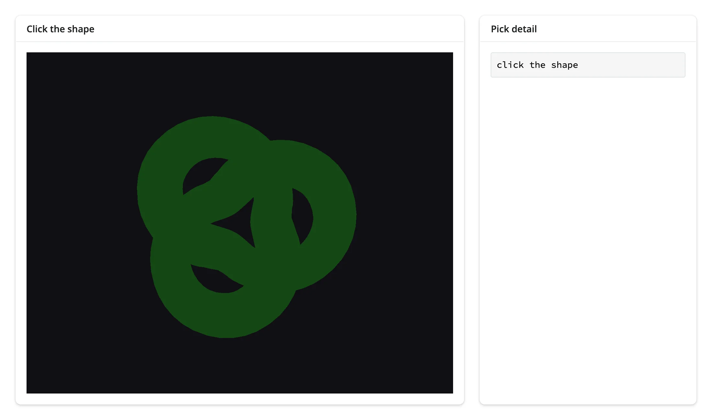 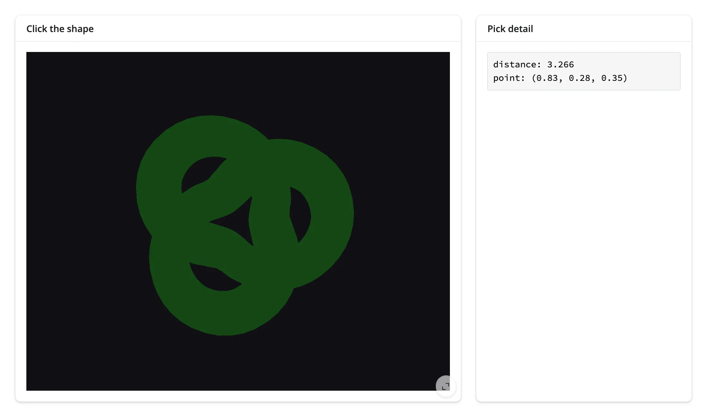

A `Picker`'s raycast re-fires on scene changes too (an orbit, a material swap), not just clicks -- if the cursor
has drifted off the mesh since the last click, `distance` resets to `None`. Treat it as "where the last raycast
landed," not a persistent "last clicked" flag; the click-history pattern below shows how to accumulate clicks
into state that *does* persist.

### Rate limiting

`camera()` has no default rate policy because it doesn't need one: `OrbitControls` only syncs `position`/
`quaternion`/`zoom` back to Python once per drag, on mouse-up, not continuously while dragging. A `Picker`'s
`distance`/`point` likewise only change on discrete events (clicks, or a scene update), not a continuous stream.
Neither case produces the rapid-fire updates that `rate_policy`/`rate_delay` exist to smooth out; pass them to
`@render_pythreejs` only if you add your own continuous `reactive_read()` source (e.g., polling a mesh's
`position` during a drag-to-move interaction you build yourself).

## Updating the widget from Python

Reading `scene.widget` gives you the live `Renderer`, and any trait on any object reachable from it can be
written directly -- the browser updates in place, with no re-render, no re-sent JS bundle, and the user's
camera/orbit position untouched. This is the normal way to restyle or animate a pythreejs scene; only reach for a
full re-render when the scene's *structure* changes (a different number of meshes, a swapped geometry type).

Material properties are the simplest case:

```{.python file="examples/06_inplace_material.py"}
import pythreejs as p3
from shiny import reactive
from shiny.express import input, ui
from shinywidgets import render_pythreejs

ui.page_opts(fillable=True)

with ui.layout_sidebar():
    with ui.sidebar():
        ui.input_select("color", "Color", ["#d62728", "#1f77b4", "#2ca02c", "#ff7f0e"])
        ui.input_slider("metalness", "Metalness", 0.0, 1.0, 0.2)
        ui.input_slider("roughness", "Roughness", 0.0, 1.0, 0.6)

    with ui.card(full_screen=True):

        @render_pythreejs
        def scene():
            mesh = p3.Mesh(p3.SphereGeometry(0.9, 48, 32), p3.MeshStandardMaterial())
            sc = p3.Scene(background="#101014", children=[mesh, p3.AmbientLight(intensity=0.9)])
            camera = p3.PerspectiveCamera(position=[0, 0, 3])
            controls = p3.OrbitControls(controlling=camera)
            return p3.Renderer(scene=sc, camera=camera, controls=[controls])

        # Material restyling, assigned straight onto the live widget: no
        # re-render, so the orbit/zoom the user left the camera at is kept.
        # reactive.isolate() reads .widget without tying this effect to the
        # render function above (which doesn't depend on these inputs anyway,
        # but isolating is the safe habit once a render function might).
        @reactive.effect
        def _():
            color = input.color()
            metalness = input.metalness()
            roughness = input.roughness()
            with reactive.isolate():
                material = scene.widget.scene.children[0].material
            material.color = color
            material.metalness = metalness
            material.roughness = roughness
```

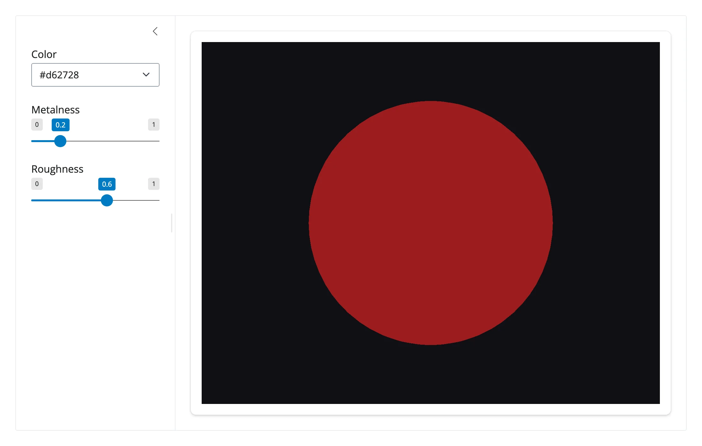 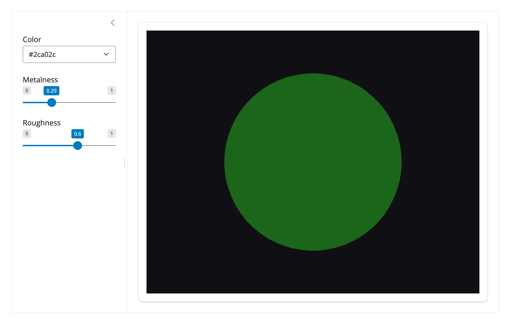

Geometry *data* can be updated in place too, not just re-sent: reassigning an existing `BufferAttribute`'s
`array` updates the mesh without rebuilding the `BufferGeometry` or losing the camera's position -- useful for a
live-updating surface (a streaming simulation, a per-frame deformation) where only the vertex positions change,
not the triangulation.

```{.python file="examples/12_inplace_geometry.py"}
import numpy as np
import pythreejs as p3
from shiny import reactive
from shiny.express import input, ui
from shinywidgets import render_pythreejs

ui.page_opts(fillable=True)
ui.input_action_button("bump", "Randomize amplitude")

N = 30
x, y = np.meshgrid(np.linspace(-3, 3, N), np.linspace(-3, 3, N))


def positions(amplitude: float) -> np.ndarray:
    r = np.sqrt(x**2 + y**2)
    z = amplitude * np.sin(r) / (1 + r)
    verts = []
    for i in range(N - 1):
        for j in range(N - 1):
            for ii, jj in [(i, j), (i + 1, j), (i, j + 1), (i + 1, j), (i + 1, j + 1), (i, j + 1)]:
                verts.append([x[ii, jj], y[ii, jj], z[ii, jj]])
    return np.array(verts, dtype=np.float32)


position_attr = p3.BufferAttribute(positions(1.0))

with ui.card(full_screen=True):

    @render_pythreejs
    def scene():
        geometry = p3.BufferGeometry(attributes={"position": position_attr})
        mesh = p3.Mesh(geometry, p3.MeshStandardMaterial(color="#2ca02c", side="DoubleSide"))
        sc = p3.Scene(background="#101014", children=[mesh, p3.AmbientLight(intensity=0.9)])
        camera = p3.PerspectiveCamera(position=[4, 4, 4], up=[0, 0, 1])
        controls = p3.OrbitControls(controlling=camera)
        return p3.Renderer(scene=sc, camera=camera, controls=[controls])


# Reassigning the existing BufferAttribute's array updates the mesh in place:
# no re-render, so the orbit position above is preserved
@reactive.effect
@reactive.event(input.bump)
def _():
    position_attr.array = positions(np.random.uniform(0.3, 2.5))
```

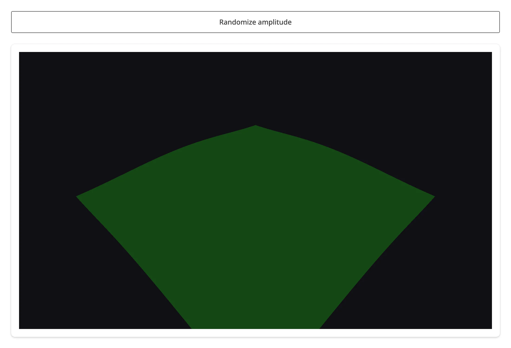 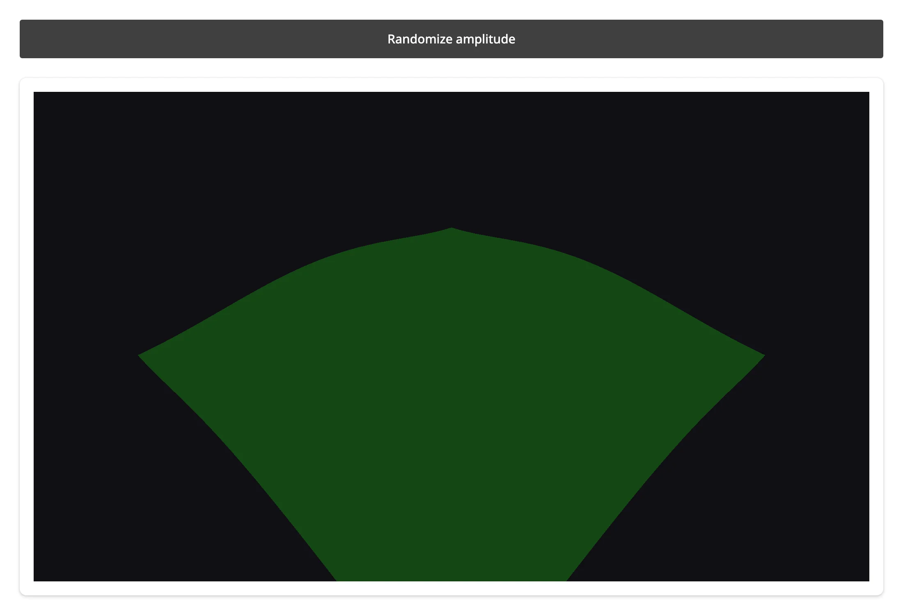

The live animation in [What you can build](#push-live-animation-from-python) above uses the same in-place
technique on `quaternion` instead of `material`/geometry data.

## Coordinating multiple views

### Click history: a table of every pick

A single `Picker` can cover a whole `Scene` -- `picker.object` tells you which mesh it hit on each click. Storing
hits in a `reactive.value` (rather than reading the `Picker` directly from the table's render function) keeps the
table's dependency on settled state, not on the same event the recording effect is reacting to.

```{.python file="examples/08_link_click_history.py"}
import pandas as pd
import pythreejs as p3
from shiny import reactive
from shiny.express import render, ui
from shinywidgets import reactive_read, render_pythreejs

ui.page_opts(fillable=True)

box = p3.Mesh(p3.BoxGeometry(1, 1, 1), p3.MeshStandardMaterial(color="#d62728"))
box.position = (-1.2, 0, 0)
sphere = p3.Mesh(p3.SphereGeometry(0.6, 32, 16), p3.MeshStandardMaterial(color="#1f77b4"))
sphere.position = (1.2, 0, 0)
names = {id(box): "box", id(sphere): "sphere"}

scene_group = p3.Scene(background="#101014", children=[box, sphere, p3.AmbientLight(intensity=0.9)])
picker = p3.Picker(controlling=scene_group, event="click")
rows = reactive.value(pd.DataFrame(columns=["object", "x", "y", "z"]))

with ui.layout_columns(col_widths=[7, 5]):
    with ui.card(full_screen=True):
        ui.card_header("Click either shape")

        @render_pythreejs
        def scene():
            camera = p3.PerspectiveCamera(position=[0, 0, 5], fov=50)
            controls = p3.OrbitControls(controlling=camera)
            return p3.Renderer(scene=scene_group, camera=camera, controls=[controls, picker])

    with ui.card():
        ui.card_header("Click history")

        @render.data_frame
        def history():
            return render.DataGrid(rows.get())


# Appends to `rows` whenever the Picker reports a new hit; `history()` above
# depends on `rows` (a reactive.value), not on the Picker directly, so the
# table always sees a settled list rather than racing the effect that builds it
@reactive.effect
def _record_pick():
    distance = reactive_read(picker, "distance")
    if distance is None:
        return
    point, obj = picker.point, picker.object
    row = {"object": names.get(id(obj), "?"), "x": round(point[0], 2), "y": round(point[1], 2), "z": round(point[2], 2)}
    with reactive.isolate():
        rows.set(pd.concat([rows.get(), pd.DataFrame([row])], ignore_index=True))
```

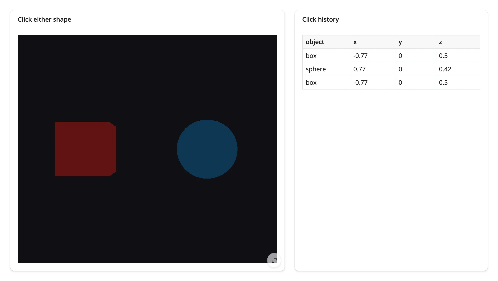

### `camera()` &rarr; save/restore viewpoint bookmarks

`camera()` makes "return to this exact view" a few lines: snapshot `position`/`quaternion`/`zoom` on demand, then
write them back onto the live camera later. Because the restore is an in-place assignment, `OrbitControls` keeps
working from the restored pose immediately.

```{.python file="examples/09_link_viewpoint_bookmarks.py"}
import pythreejs as p3
from shiny import reactive
from shiny.express import input, render, ui
from shinywidgets import render_pythreejs

ui.page_opts(fillable=True)

with ui.layout_columns(col_widths=[8, 4]):
    with ui.card(full_screen=True):
        ui.card_header("Orbit, then save a viewpoint")

        @render_pythreejs
        def scene():
            cube = p3.Mesh(p3.BoxGeometry(1, 1, 1), p3.MeshStandardMaterial(color="#9467bd"))
            sc = p3.Scene(background="#101014", children=[cube, p3.AmbientLight(intensity=0.9)])
            camera = p3.PerspectiveCamera(position=[0, 0, 3.5], fov=50)
            controls = p3.OrbitControls(controlling=camera)
            return p3.Renderer(scene=sc, camera=camera, controls=[controls])

    with ui.card():
        ui.input_action_button("save", "Save viewpoint")
        ui.input_action_button("restore", "Restore viewpoint")

        @render.code
        def saved_txt():
            snap = saved.get()
            if snap is None:
                return "no saved viewpoint yet"
            pos, _quat, _zoom = snap
            return f"saved position: ({pos[0]:.2f}, {pos[1]:.2f}, {pos[2]:.2f})"


saved = reactive.value(None)


@reactive.effect
@reactive.event(input.save)
def _save():
    # camera() returns the live Camera; snapshot the pieces we want to
    # restore later rather than keeping the object itself
    cam = scene.camera()
    saved.set((tuple(cam.position), tuple(cam.quaternion), cam.zoom))


@reactive.effect
@reactive.event(input.restore)
def _restore():
    snap = saved.get()
    if snap is None:
        return
    pos, quat, zoom = snap
    with reactive.isolate():
        camera = scene.widget.camera
    # In-place assignment, not a re-render: OrbitControls keeps working from
    # the restored pose
    camera.position = pos
    camera.quaternion = quat
    camera.zoom = zoom
```

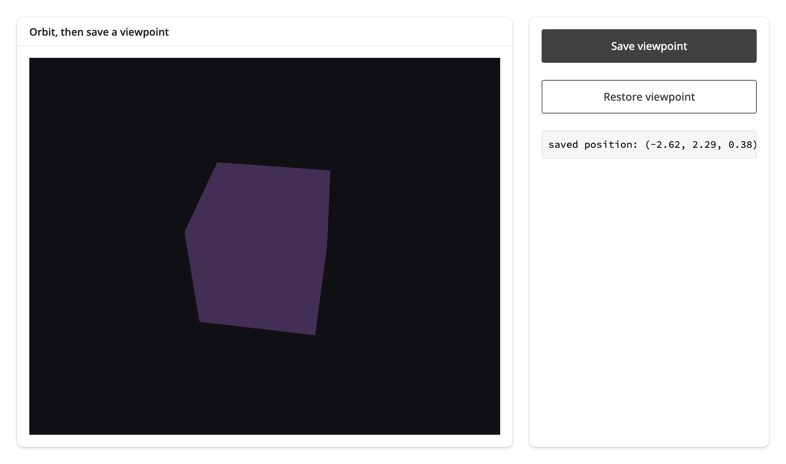 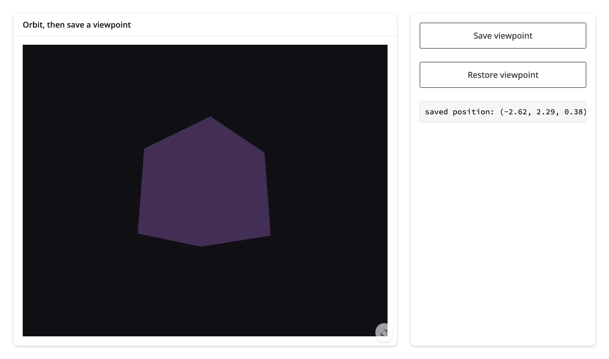 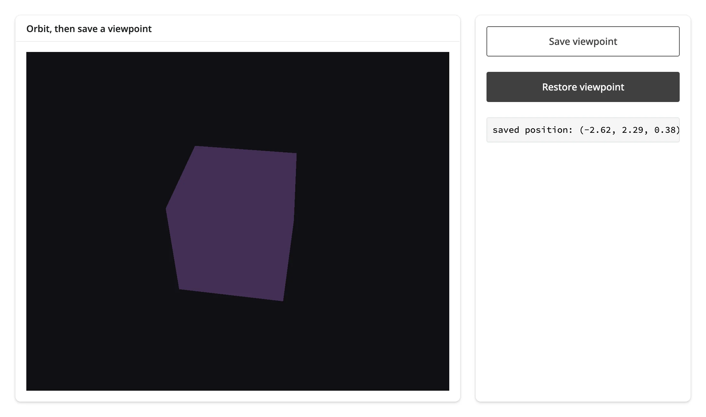

### Click &rarr; highlight a point in the same scene

A `Picker` reading into Python and an in-place update writing back out can target the same scene: clicking a
mesh drops a marker at the exact hit point, a 3D analog of "table row selection highlights a point in a plot."

```{.python file="examples/10_link_picked_marker.py"}
import pythreejs as p3
from shiny import reactive
from shiny.express import ui
from shinywidgets import reactive_read, render_pythreejs

ui.page_opts(fillable=True)

terrain = p3.Mesh(p3.SphereGeometry(1.2, 48, 32), p3.MeshStandardMaterial(color="#1f77b4", roughness=0.6))
marker = p3.Mesh(p3.SphereGeometry(0.06, 16, 16), p3.MeshBasicMaterial(color="#ffdd00"))
marker.visible = False
picker = p3.Picker(controlling=terrain, event="click")

with ui.card(full_screen=True):
    ui.card_header("Click the sphere to drop a marker")

    @render_pythreejs
    def scene():
        sc = p3.Scene(background="#101014", children=[terrain, marker, p3.AmbientLight(intensity=0.9)])
        camera = p3.PerspectiveCamera(position=[0, 0, 4], fov=50)
        controls = p3.OrbitControls(controlling=camera)
        return p3.Renderer(scene=sc, camera=camera, controls=[controls, picker])


# The Picker (an input into Python) and the marker (an in-place update back
# into the same scene) are two independent widgets -- this is the 3D
# equivalent of "table row selection highlights a point in a plot"
@reactive.effect
def _place_marker():
    distance = reactive_read(picker, "distance")
    if distance is None:
        return
    point = picker.point
    marker.position = point
    marker.visible = True
```

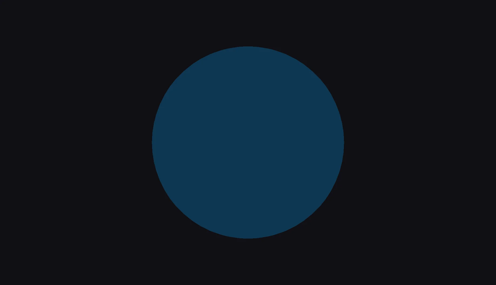 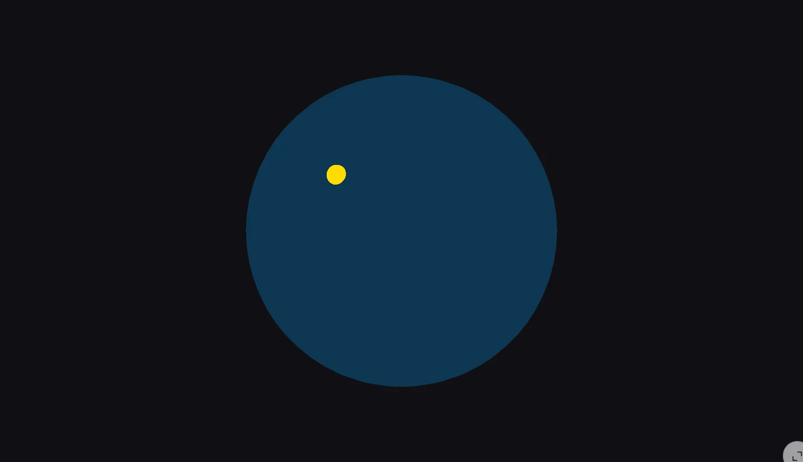

## Large data

pythreejs has no large-data mode of its own: every `Mesh`, `Geometry`, and `Material` is a separate synced
ipywidget, so a scene's cost scales with object *count*, not point count the way a single k3d or ipyvolume
figure's does. A handful of meshes with thousands of vertices each is no problem (every example in this guide is
that shape); thousands of *individual* objects gets expensive fast, because each one pays its own widget
overhead. For a point cloud, volume, or isosurface at real scale, reach for
[k3d](../k3d/index.md#large-data) or [ipyvolume](../ipyvolume/index.md#large-data) instead -- both build on
pythreejs's own three.js renderer underneath, so `camera()` still works the same way.

## Layout and sizing

By default, `@render_pythreejs` fills its container: the canvas and `camera.aspect` both track the output's size,
including on `full_screen` enter/exit and window resizes (every quick start above relies on this, inside a
`full_screen` card). A pythreejs `Renderer` defaults to a 200x200 pixel canvas, and shinywidgets can't tell that
apart from an explicit `Renderer(width=200, height=200)` -- so the untouched default is treated as "fill," and
any *other* explicit size is treated as a request to opt out of filling:

```{.python file="examples/11_fixed_size.py"}
import pythreejs as p3
from shiny.express import ui
from shinywidgets import render_pythreejs

ui.page_opts(fillable=True)

with ui.card(height="450px"):

    @render_pythreejs
    def scene():
        cube = p3.Mesh(p3.BoxGeometry(1, 1, 1), p3.MeshStandardMaterial(color="#ff7f0e"))
        sc = p3.Scene(background="#101014", children=[cube, p3.AmbientLight(intensity=0.9)])
        camera = p3.PerspectiveCamera(position=[0, 0, 3.5], aspect=1)
        controls = p3.OrbitControls(controlling=camera)
        # An explicit width/height opts out of fill: the canvas keeps this
        # pixel size regardless of the surrounding card
        return p3.Renderer(scene=sc, camera=camera, controls=[controls], width=300, height=300)
```

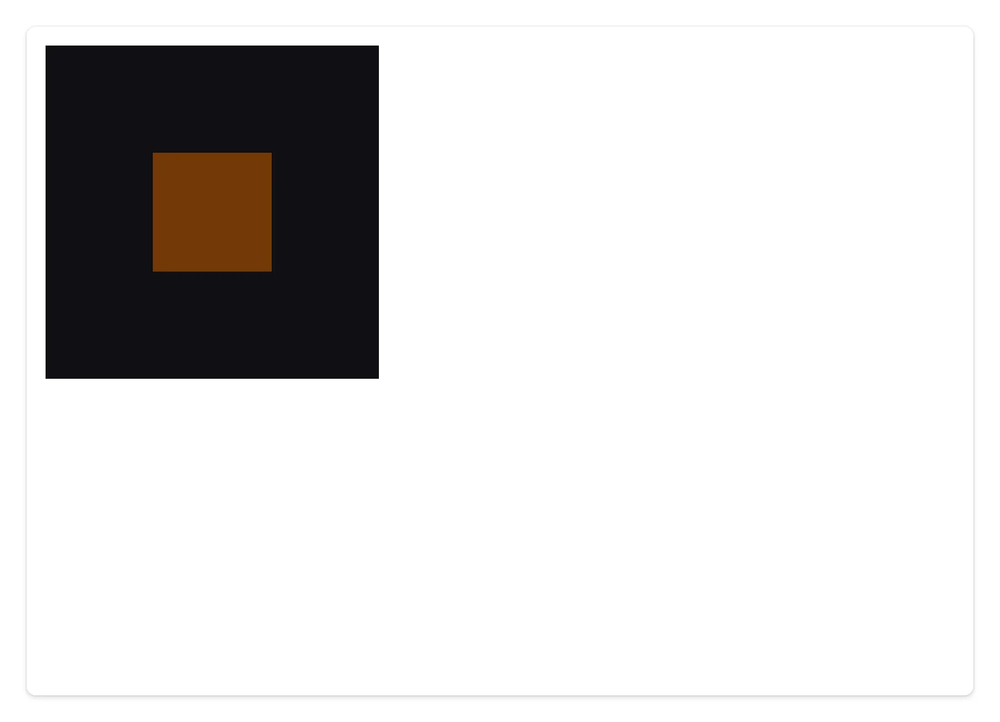

A `output_widget(..., height="250px")` with no explicit `Renderer` size also opts out, sizing the canvas to that
height instead of the 200px default. `OrthographicCamera` fills the canvas the same way, but fill only manages
`aspect` on cameras that have it -- an `OrthographicCamera`'s `left`/`right`/`top`/`bottom` frustum stays fixed,
so a non-square container stretches the image (set the frustum to the container's aspect yourself if that
matters).

## Gotchas and limitations

Verified against `shinywidgets` on current `main`; the project's earlier evaluation report
(`docs/widget-reports/pythreejs/`) predates the accessor system and flagged an infinite-resize-loop blocker in
unconstrained containers -- that's fixed on `main` (a content-derived-height card or plain `page_fluid` now
settles to a stable canvas size instead of growing without bound).

- **`mesh.rotation` doesn't render, and spams server tracebacks** -- an upstream bug. pythreejs's Euler-to-quaternion
  conversion lowercases the rotation order string (`'XYZ'` &rarr; `'xyz'`), which three.js's `Quaternion.setFromEuler`
  rejects: every `rotation` write echoes back a `TraitError` (`... expected any of ['XYZ', ...], not the str
  'xyz'`), and the mesh never visibly rotates. Confirmed at the pixel level: the canvas is byte-identical before
  and after a `rotation` change, while the trait value itself does advance. Animate `quaternion` instead (see
  [Push live animation from Python](#push-live-animation-from-python)).
- **`Scene.background` defaults to white, and `Renderer(background=...)` has no effect.** A fresh `Renderer` with
  no explicit background renders a white viewport regardless of `Renderer(background="black")` -- confirmed by
  comparing the two side by side. Set `pythreejs.Scene(background=...)` instead; it applies immediately.
- **`DirectionalLight`/`SpotLight` with default `target`/`shadow` log a harmless console error per re-render.**
  Their `target` and `shadow` traits are `Uninitialized` by default, so pythreejs's JS creates them *in the
  browser* rather than in Python. Browser-created widgets used to have no Python counterpart to close on
  re-render and leaked a few models every time; that's fixed (a browser-created model now closes with whatever
  named it, once nothing live still references it -- re-verified here: model count stays flat across re-renders
  of a light-bearing scene whether or not `target`/`shadow` are set explicitly). What's left, only when you don't
  set them explicitly, is one benign `Error setting state: e.on is not a function` logged to the browser console
  per re-render (closing a light's browser-created shadow trips an upstream pythreejs bug; shinywidgets treats it
  as expected teardown noise, not a failure). Give every `DirectionalLight`/`SpotLight` an explicit `target`
  (added to the scene) and `shadow` (with a camera), as the quick start does, to avoid the console noise -- it's a
  few extra lines, and arguably the more legible scene graph anyway since every object is one you built.
- **`OrbitControls(autoRotate=True)` (and damping momentum) are inert.** Nothing in the bundled three.js build
  pumps `controls.update()` per frame for `OrbitControls` -- confirmed byte-identical canvas pixels over several
  seconds with `autoRotate=True`. Drive a spin from Python instead (see
  [Push live animation from Python](#push-live-animation-from-python)).
- **`Picker.picked` never populates.** Use `distance`/`point`/`object` instead (see
  [Beyond the accessor](#beyond-the-accessor-picker-via-reactive_read)); this is upstream naming, not a bug to
  work around otherwise.
- **`OrthographicCamera`'s frustum isn't managed by fill.** The canvas still resizes to its container, but
  `left`/`right`/`top`/`bottom` stay fixed, so a non-square container visibly stretches the scene. Set the
  frustum to match your container's aspect ratio if you need an undistorted orthographic view.
- **No shadows are enabled by default.** The explicit `shadow`/`target` recipe above avoids the console noise but
  doesn't turn on shadow rendering; that also needs `Renderer(shadowMap=p3.WebGLShadowMap())` and
  `castShadow`/`receiveShadow` on the relevant meshes -- out of scope for this guide, see the
  [pythreejs docs](https://pythreejs.readthedocs.io).

## Gallery candidates

### `template_scene_explorer.py`

A ~65-line adaptable starting point: a shape/color/wireframe picker, a shared lighting and `OrbitControls` setup,
a `Picker` for click detection, and a sidebar readout that shows `camera()`'s state between picks. Swap in your
own geometry and keep the rest.

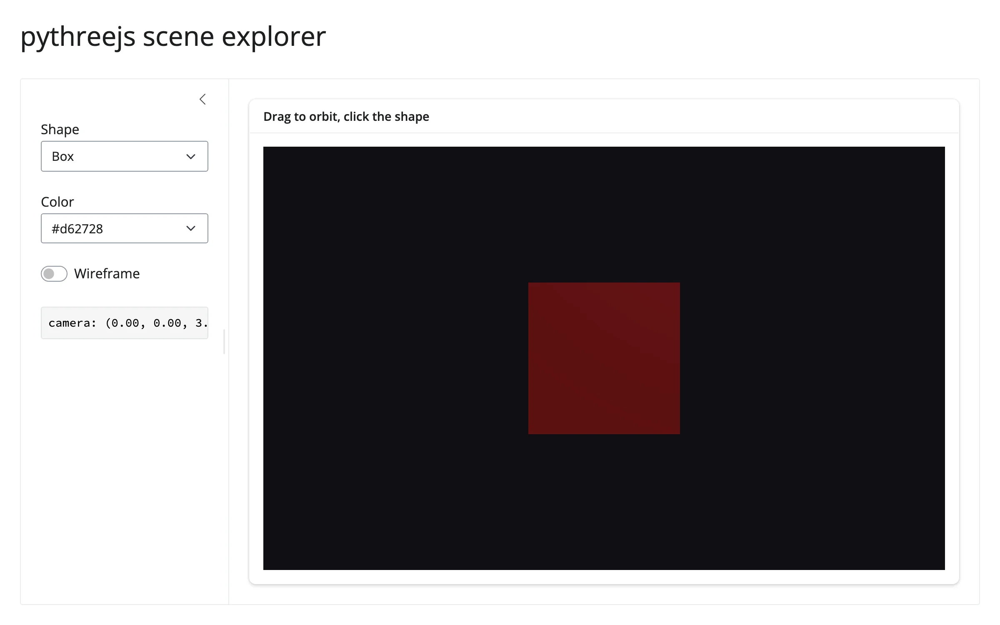

### `showcase_orrery.py`

An animated multi-body scene: four planets orbit a sun on a Python-driven timer (play/pause, adjustable speed), a
single `Picker` covering the whole scene identifies whichever body was clicked, and a "Reset view" button uses
`camera()`'s snapshot/restore pattern. Exercises the full interaction surface pythreejs offers -- in-place
position updates every frame, multi-object picking, and the camera accessor -- in one scene.

 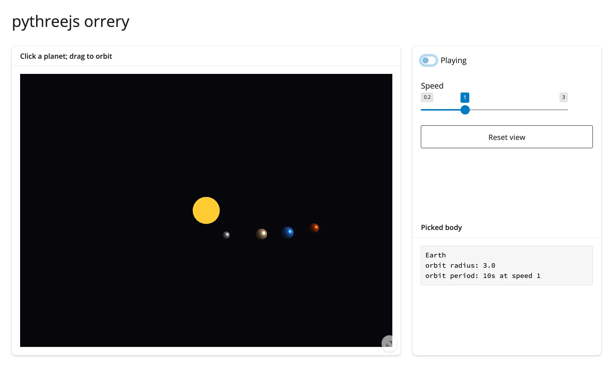

## Learn more

- [pythreejs documentation](https://pythreejs.readthedocs.io) and its
  [examples](https://github.com/jupyter-widgets/pythreejs/tree/master/examples) for the full Object3D/Geometry/
  Material API (it mirrors [three.js](https://threejs.org/docs/) closely -- the three.js docs are a good
  secondary reference for what each trait does)
- [three.js documentation](https://threejs.org/docs/) for the underlying scene graph concepts
- Related guides in this roster: [k3d](../k3d/index.md) and [ipyvolume](../ipyvolume/index.md) (both share
  pythreejs's `camera()` accessor), [pyvista](../pyvista/index.md) for ready-made scientific mesh/volume
  visualization
