[PyVista](https://pyvista.org) is a Pythonic front end for VTK, the toolkit behind most of scientific and medical
3D visualization. It's a NumFOCUS-affiliated project used across CFD post-processing, geoscience, and medical
imaging for one reason: meshes, volumes, and point clouds that would take pages of raw VTK code become a few
lines of `pv.Plotter()` calls.

`@render_pyvista` takes the `pyvista.Plotter` your function builds and exports it through PyVista's
`jupyter_backend="html"` path into a self-contained [vtk.js](https://kitware.github.io/vtk-js/) scene, embedded
as an iframe. shinywidgets fits that iframe to its container the same way it does for every other widget, and
raises clear errors for the two mistakes everyone makes first (calling `.show()`, reusing a closed `Plotter`).

The defining trade-off, and the reason this guide reads differently from its siblings: **the exported scene is a
snapshot.** Camera interaction -- drag to rotate, scroll to zoom -- happens entirely in the browser's WebGL
context, so it's free and fluid, but nothing about it is ever reported back to Python. There is no accessor here,
and no `reactive_read()` target either: the widget that lands in the browser has no synced state for Python to
read. Every other 3D renderer in this roster (`k3d`, `ipyvolume`, `pythreejs`) keeps a live ipywidgets connection
and can read the camera back; pyvista's html backend is the one that can't. What you *can* do -- and what this
guide spends most of its time on -- is drive the Plotter from ordinary Shiny inputs (a threshold, a clip plane, a
colormap) and pair the re-rendered view with statistics computed from the same mesh in Python.

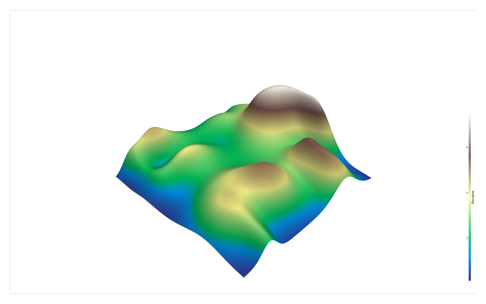

## Installation

```
pip install 'shinywidgets[pyvista]'
```

This installs PyVista with its `jupyter` extra (`trame`, `trame-vtk`, `trame-pyvista`, `anywidget`), which is what
`@render_pyvista` exports through. Requires Python 3.11-3.14: `trame-pyvista` >= 0.3 (the version this renderer
targets) needs 3.11+, and the underlying `vtk` wheels aren't published for 3.15+ at the time of writing;
shinywidgets' extra mirrors both constraints.

## Quick start

```{.python file="examples/01_quickstart.py"}
import pyvista as pv
from shiny.express import ui
from shinywidgets import render_pyvista

pv.OFF_SCREEN = True  # required on a headless server

ui.page_opts(fillable=True)


@render_pyvista
def plot():
    pl = pv.Plotter()
    pl.add_mesh(pv.Sphere(), color="orange", show_edges=True)
    pl.view_isometric()
    return pl  # return the Plotter itself -- never call pl.show()
```

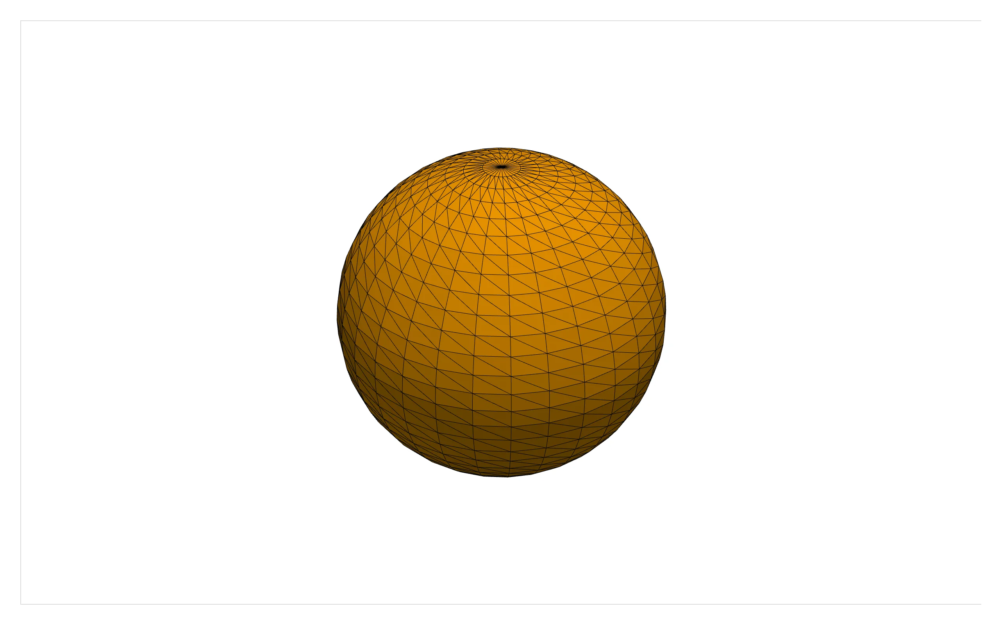

Drag inside the view to rotate it, scroll to zoom. That's genuine WebGL interaction with zero server traffic --
you could spin this sphere for an hour without a single message reaching Python.

## What you can build

**Color by any scalar field**, the way you would in any pyvista script. Here a synthetic rolling-hills terrain
(bundled with pyvista, no download) is colored by its `Elevation` point array:

```{.python file="examples/02_scalar_coloring.py"}
import pyvista as pv
from pyvista import examples
from shiny.express import ui
from shinywidgets import render_pyvista

pv.OFF_SCREEN = True

ui.page_opts(fillable=True)

# A synthetic rolling-hills terrain, bundled with pyvista -- no download
hills = examples.load_random_hills()


@render_pyvista
def plot():
    pl = pv.Plotter()
    pl.add_mesh(hills, scalars="Elevation", cmap="terrain", show_scalar_bar=True)
    pl.view_isometric()
    return pl
```


**Extract isosurfaces from volumetric data** -- the same `contour()` filter that works on a simulation's scalar
field works on a real CT scan. This downloads and downsamples a public-domain knee CT (`pyvista.examples`), then
extracts the surface at a bone-density threshold
([`examples/03_isosurface_contour.py`](examples/03_isosurface_contour.py)):

```{.python file="examples/03_isosurface_contour.py"}
import pyvista as pv
from pyvista import examples
from shiny.express import ui
from shinywidgets import render_pyvista

pv.OFF_SCREEN = True

ui.page_opts(fillable=True)

# A real CT scan (a knee), downsampled 3x per axis to keep the extracted
# surface (and the exported scene) a reasonable size
volume = examples.download_knee_full()
volume = volume.extract_subset(
    (0, volume.dimensions[0] - 1, 0, volume.dimensions[1] - 1, 0, volume.dimensions[2] - 1),
    (3, 3, 3),
)


@render_pyvista
def plot():
    pl = pv.Plotter()
    bone = volume.contour([80])  # marching cubes at a bone-density threshold
    pl.add_mesh(bone, color="ivory", smooth_shading=True)
    pl.view_isometric()
    return pl
```

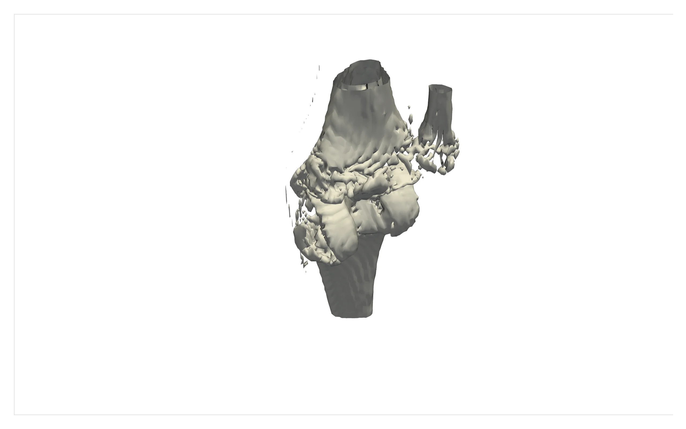

**Vector fields as arrow glyphs**, scaled and colored by magnitude -- here a synthetic vortex field:

```{.python file="examples/05_glyphs.py"}
import numpy as np
import pyvista as pv
from shiny.express import ui
from shinywidgets import render_pyvista

pv.OFF_SCREEN = True

ui.page_opts(fillable=True)

# A synthetic vortex field: direction and speed, sampled on a coarse grid
x, y = np.mgrid[-5:5:21j, -5:5:21j]
z = np.zeros_like(x)
points = pv.PolyData(np.c_[x.ravel(), y.ravel(), z.ravel()])
r = np.sqrt(x.ravel() ** 2 + y.ravel() ** 2)
r_safe = np.clip(r, 0.6, None)  # avoid a singularity at the core
speed = 3 / (r_safe + 1)  # fastest near the core, decaying outward
vectors = speed[:, None] * np.c_[-y.ravel() / r_safe, x.ravel() / r_safe, np.zeros_like(r)]
points["vectors"] = vectors
points["speed"] = speed


@render_pyvista
def plot():
    pl = pv.Plotter()
    arrows = points.glyph(orient="vectors", scale="speed", factor=1.0)
    pl.add_mesh(arrows, scalars="speed", cmap="viridis", show_scalar_bar=False)
    pl.view_isometric()
    return pl
```

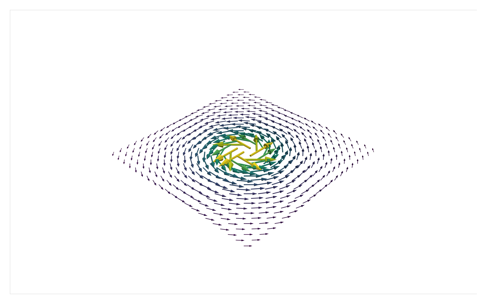

**Streamlines trace a flow field**, with the surrounding geometry rendered translucent for context -- a classic
CFD case (airflow in a kitchen), both the flow data and the room's geometry downloaded via `pyvista.examples`:

```{.python file="examples/04_glyphs_streamlines.py"}
import pyvista as pv
from pyvista import examples
from shiny.express import ui
from shinywidgets import render_pyvista

pv.OFF_SCREEN = True

ui.page_opts(fillable=True)

# A classic CFD dataset: airflow in a kitchen, plus the room's geometry
# (walls, cabinets, a door) as a separate multi-block for context
flow = examples.download_kitchen()
flow.set_active_vectors("velocity")
room = examples.download_kitchen(split=True).combine()

streamlines = flow.streamlines(
    "velocity", source_center=(0.08, 3, 0.7), source_radius=0.75, n_points=15, max_length=200.0
)


@render_pyvista
def plot():
    pl = pv.Plotter()
    pl.add_mesh(room, color="lightgray", opacity=0.25, show_edges=True, edge_color="gray")
    pl.add_mesh(
        streamlines.tube(radius=0.03), scalars="velocity", cmap="plasma", show_scalar_bar=False
    )
    pl.camera_position = [(13, -8, 9), (3.5, 2.5, 1), (0, 0, 1)]
    return pl
```

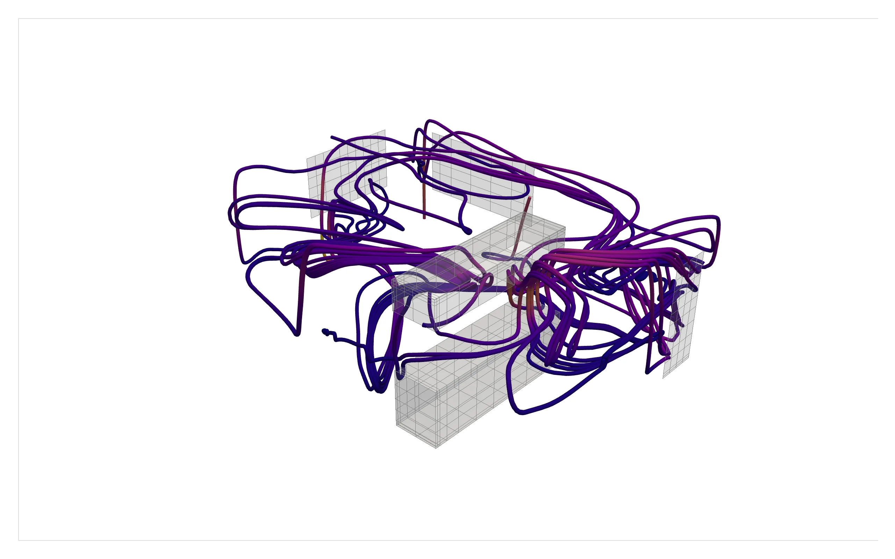

**Multi-block assemblies** keep each part separately addressable -- useful for mechanical parts, anatomical
structures, or any scene built from named pieces that need their own color or visibility:

```{.python file="examples/06_multiblock.py"}
import pyvista as pv
from shiny.express import ui
from shinywidgets import render_pyvista

pv.OFF_SCREEN = True

ui.page_opts(fillable=True)

# A MultiBlock keeps each part addressable by name -- useful for assemblies
# (mechanical parts, anatomical structures, ...) where each piece needs its
# own color, opacity, or visibility
assembly = pv.MultiBlock(
    {
        "base": pv.Cylinder(center=(0, 0, -0.6), direction=(0, 0, 1), radius=1.2, height=0.4),
        "column": pv.Cylinder(center=(0, 0, 0.3), direction=(0, 0, 1), radius=0.3, height=1.8),
        "head": pv.Sphere(center=(0, 0, 1.5), radius=0.6),
    }
)
colors = {"base": "tab:blue", "column": "tab:gray", "head": "tab:orange"}


@render_pyvista
def plot():
    pl = pv.Plotter()
    for name in assembly.keys():
        pl.add_mesh(assembly[name], color=colors[name], smooth_shading=True)
    pl.view_isometric()
    return pl
```

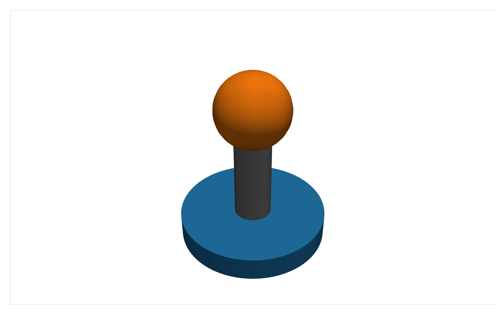

## Reacting to user interaction: there isn't any

Every other renderer in this roster ships at least one accessor, or a trait worth `reactive_read()`-ing.
`render_pyvista` has neither, by design: the exported widget is a static HTML blob with no synced state (verified
by inspecting the rendered widget -- its only trait is the raw HTML string itself). Camera moves, clicks, and
hovers happen entirely inside the iframe's own JavaScript and never reach the ipywidgets comm.

What that leaves you with is the other direction: **Shiny inputs drive a re-render**, and anything you want to
show about the result -- a count, a summary statistic, a second chart -- you compute yourself in Python from the
same mesh object the 3D view is built from. That's the pattern the rest of this guide shows: a slider or select
input changes what `add_mesh()` is called with, and a plain `@render.code`/`@render.plot` output reads the
identical mesh for its numbers. If you need picking, streaming updates, or server-side rendering instead, that's
pyvista's `jupyter_backend="trame"` with its own websocket server embedded via `ui.tags.iframe` -- outside what
this renderer does (see Gotchas).

### Performance: cache the mesh, gate expensive re-renders

Two things to get right before building the patterns below:

- **Cache anything expensive in `@reactive.calc`.** A dataset load or download (`pyvista.examples.download_*`,
  reading a file) should happen once, not on every input change. Each example below separates "build/load the
  base mesh" (cached) from "apply this render's filter" (cheap, re-run per input).
- **Decimate or downsample heavy volumes before contouring/exporting.** The CT scan in the isosurface example
  above is downsampled 3x per axis (`extract_subset`) before `contour()` -- the full-resolution volume produces
  an isosurface with ~20x more triangles for a visually similar result.
- **Every re-render re-exports the scene.** Measured fresh against current `main` (pyvista 0.49.2,
  trame-pyvista 0.3.x): a trivial unchanged mesh costs **~12 KB** to re-send (the scene data is small and the
  vtk.js runtime itself is sent once per browser session, not per render), while a 39k-triangle isosurface costs
  **~800 KB** per change -- roughly proportional to mesh size, same as before. There's no rate limiting of its
  own (unlike the accessors on other renderers), so a free-running slider ships one export per tick; gate heavy
  meshes behind `ui.input_action_button("update", ...)` instead of a continuous slider.

## Coordinating multiple views

With no browser-to-Python channel, "coordinating views" here means: one Shiny input drives both the 3D view and
a second, Python-computed output, from the same data.

### A threshold slider re-renders an isosurface and its stats

```{.python file="examples/07_coordinate_threshold_stats.py"}
import pyvista as pv
from pyvista import examples
from shiny import reactive
from shiny.express import input, render, ui
from shinywidgets import render_pyvista

pv.OFF_SCREEN = True

ui.page_opts(fillable=True)
ui.input_slider("threshold", "Bone-density threshold", 20, 200, 80, step=10)

with ui.layout_columns(col_widths=(8, 4)):
    with ui.card(full_screen=True):

        @reactive.calc
        def volume():
            # Downloaded and downsampled once per process, not per re-render
            v = examples.download_knee_full()
            dims = v.dimensions
            return v.extract_subset((0, dims[0] - 1, 0, dims[1] - 1, 0, dims[2] - 1), (3, 3, 3))

        @reactive.calc
        def isosurface():
            return volume().contour([input.threshold()])

        @render_pyvista
        def plot():
            pl = pv.Plotter()
            pl.add_mesh(isosurface(), color="ivory", smooth_shading=True)
            pl.view_isometric()
            return pl

    with ui.card():
        ui.card_header("Computed from the same mesh, in Python")

        @render.code
        def stats():
            mesh = isosurface()
            return f"{mesh.n_points:,} points\n{mesh.n_cells:,} triangles\n{mesh.area:,.0f} units^2 surface area"
```

Dragging the threshold from 80 to 150 shrinks the extracted surface from 38,748 to 5,340 triangles -- the stats
panel reads it straight off the mesh the plot just built:

| Before (threshold 80) | After (threshold 150) |
|---|---|
| 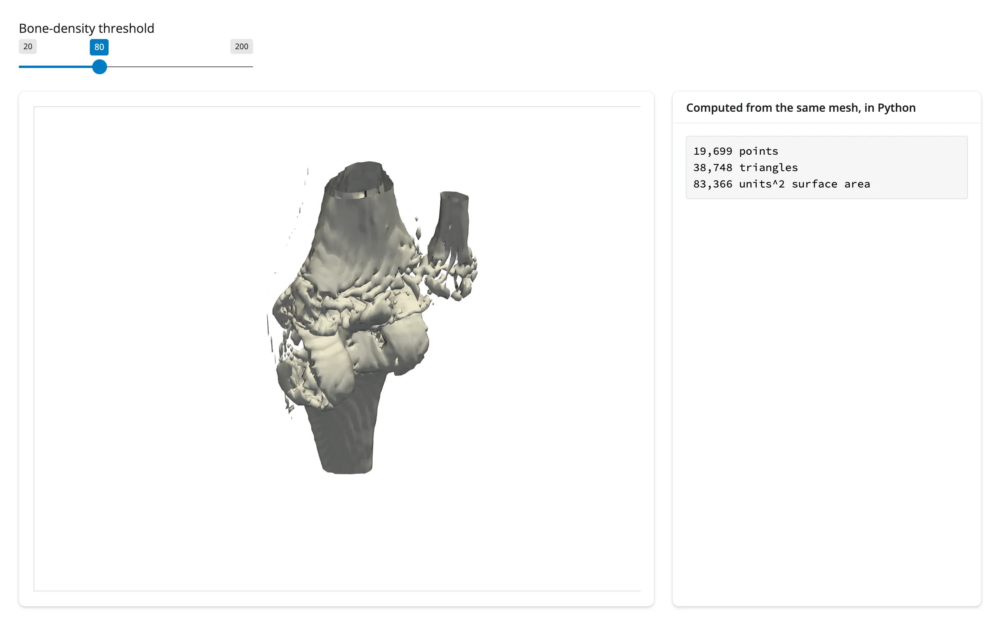 | 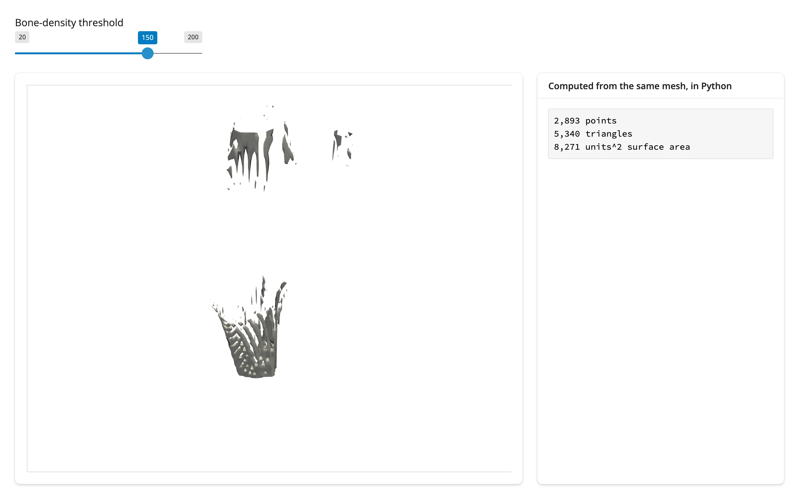 |

### A clip plane exposes a cross-section, paired with a stats readout

```{.python file="examples/08_coordinate_clip_stats.py"}
import pyvista as pv
from pyvista import examples
from shiny import reactive
from shiny.express import input, render, ui
from shinywidgets import render_pyvista

pv.OFF_SCREEN = True

ui.page_opts(fillable=True)
ui.input_slider("cut", "Clip position (fraction of width)", 0.0, 1.0, 0.5, step=0.05)


@reactive.calc
def terrain():
    # Mount St. Helens, downloaded once per process and cached across re-renders
    dem = examples.download_st_helens()
    return dem.warp_by_scalar()


@reactive.calc
def visible_terrain():
    x0, x1, *_ = terrain().bounds
    cut_x = x0 + input.cut() * (x1 - x0)
    return terrain().clip(normal="x", origin=(cut_x, 0, 0))


with ui.layout_columns(col_widths=(8, 4)):
    with ui.card(full_screen=True):

        @render_pyvista
        def plot():
            pl = pv.Plotter()
            pl.add_mesh(
                visible_terrain(), scalars="Elevation", cmap="terrain", show_scalar_bar=False
            )
            pl.view_isometric()
            return pl

    with ui.card():
        ui.card_header("Stats for the visible slab")

        @render.code
        def stats():
            mesh = visible_terrain()
            elev = mesh["Elevation"]
            return (
                f"{mesh.n_points:,} points visible\n"
                f"mean elevation: {elev.mean():,.0f} m\n"
                f"max elevation: {elev.max():,.0f} m"
            )
```

| Full mountain (cut = 0.5) | Clipped to the near slope (cut = 0.2) |
|---|---|
| 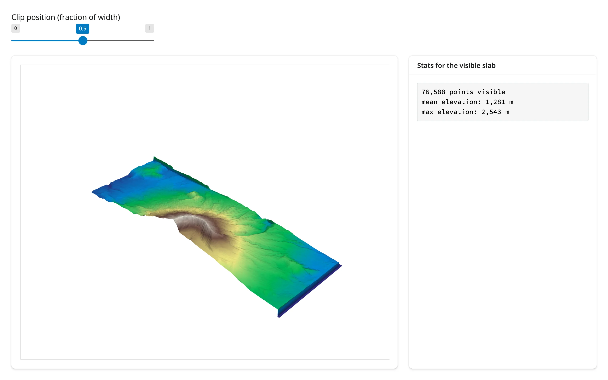 | 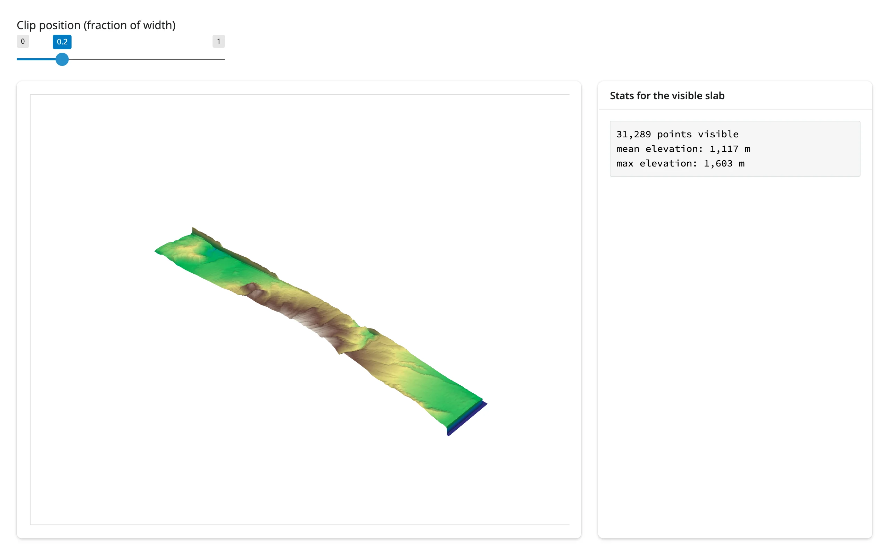 |

### A field selector recolors the mesh and updates a summary

```{.python file="examples/09_coordinate_scalar_choice.py"}
import pyvista as pv
from pyvista import examples
from shiny import reactive
from shiny.express import input, render, ui
from shinywidgets import render_pyvista

pv.OFF_SCREEN = True

ui.page_opts(fillable=True)
ui.input_select("field", "Color by", {"Elevation": "Elevation", "Curvature": "Mean curvature"})

CMAPS = {"Elevation": "terrain", "Curvature": "coolwarm"}


@reactive.calc
def hills():
    mesh = examples.load_random_hills()
    mesh["Curvature"] = mesh.curvature("mean")
    return mesh


with ui.layout_columns(col_widths=(8, 4)):
    with ui.card(full_screen=True):

        @render_pyvista
        def plot():
            pl = pv.Plotter()
            field = input.field()
            pl.add_mesh(hills(), scalars=field, cmap=CMAPS[field], show_scalar_bar=True)
            pl.view_isometric()
            return pl

    with ui.card():
        ui.card_header("Active field summary")

        @render.code
        def stats():
            values = hills()[input.field()]
            return f"min {values.min():.2f}\nmean {values.mean():.2f}\nmax {values.max():.2f}"
```

| Elevation | Mean curvature |
|---|---|
| 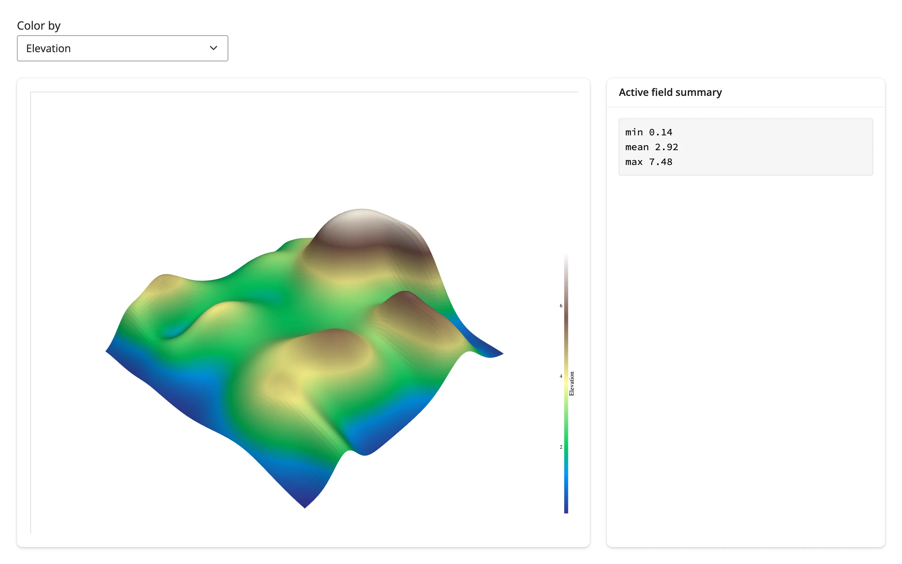 | 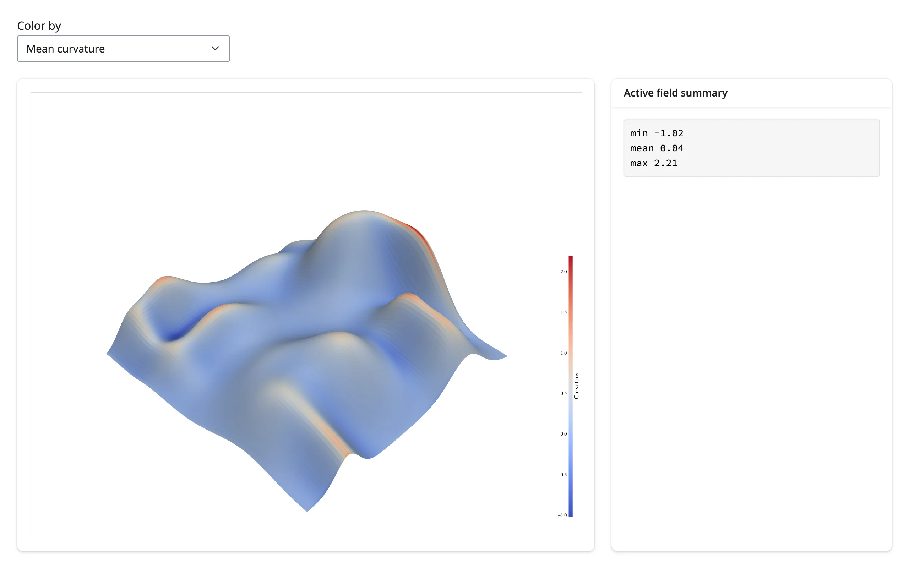 |

These three patterns compose: the [gallery showcase](#gallery-candidates) below combines clipping, a field
selector, and a `@render.plot` histogram on one dataset.

## Updating the widget from Python

There's only one option here: **re-render.** Every other `render_*` with no accessors (and most with) exposes a
`.widget` you can mutate in place via an effect, trading a cheaper update for losing the fresh-render guarantee.
pyvista's exported widget has nothing to mutate -- `.widget` exists (read-only, like every renderer) but it's a
dead HTML snapshot with no live connection, so the only way to change what's on screen is to have the render
function build a new `Plotter` and return it.

One consequence worth designing around: **the camera resets on every re-render**, to whatever `view_isometric()`
/ `camera_position` the render function sets (or pyvista's default framing if it sets none) -- never to wherever
the user last dragged it. Verified with a real drag:

```{.python file="examples/10_camera_presets.py"}
import pyvista as pv
from pyvista import examples
from shiny import reactive
from shiny.express import input, ui
from shinywidgets import render_pyvista

pv.OFF_SCREEN = True

ui.page_opts(fillable=True)
with ui.layout_columns(col_widths=12, fill=False):
    ui.input_action_button("iso", "Isometric")
    ui.input_action_button("top", "Top")
    ui.input_action_button("front", "Front")

view = reactive.value("iso")


@reactive.effect
@reactive.event(input.iso)
def _():
    view.set("iso")


@reactive.effect
@reactive.event(input.top)
def _():
    view.set("top")


@reactive.effect
@reactive.event(input.front)
def _():
    view.set("front")


@render_pyvista
def plot():
    pl = pv.Plotter()
    pl.add_mesh(examples.load_random_hills(), scalars="Elevation", cmap="terrain")
    {"iso": pl.view_isometric, "top": pl.view_xy, "front": pl.view_xz}[view()]()
    return pl
```

Dragging to rotate, then clicking a different preset button, jumps straight to that preset -- the drag is gone:

| Dragged to an arbitrary angle | After clicking "Top" |
|---|---|
| 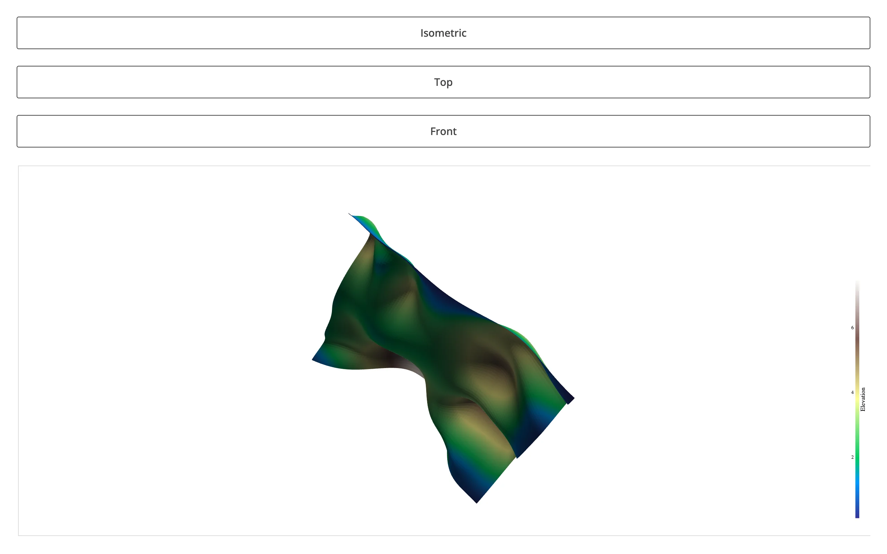 | 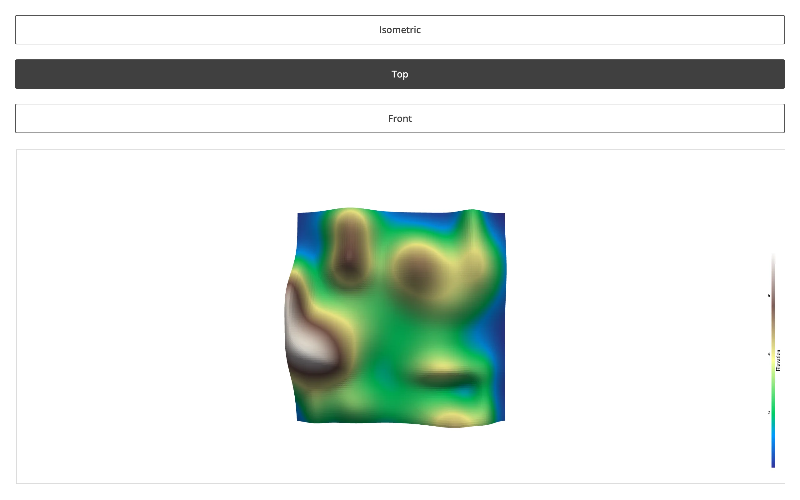 |

This is also why clicking the *same* preset button twice does nothing visible: `reactive.value.set()` is a no-op
when the new value equals the old one, so nothing re-renders and the dragged view stays exactly as it was --
ordinary Shiny semantics, but easy to misread as "the reset button is broken" while testing your own app.

## Large data

There's no GPU-in-the-browser option here -- see "Reacting to user interaction" above for why -- so pyvista's
large-data story is "summarize on the server," the same bucket as datashader and VegaFusion in
[Large data & performance's three approaches](../../guide/performance/index.md#three-approaches-to-large-data):
decimate or downsample the mesh in Python *before* it's exported, since every re-render re-sends the whole
scene. Measured fresh against current `main` (pyvista 0.49.2, trame-pyvista 0.3.x): a trivial unchanged mesh
costs ~12 KB per re-render, a 39k-triangle isosurface ~800 KB -- see
["Performance: cache the mesh, gate expensive re-renders"](#performance-cache-the-mesh-gate-expensive-re-renders)
above. If you need picking or genuinely streamed updates at scale instead, that's outside what this renderer
does (see Gotchas).

## Layout and sizing

```{.python file="examples/11_layout_sizing.py"}
import pyvista as pv
from pyvista import examples
from shiny.express import ui
from shinywidgets import render_pyvista

pv.OFF_SCREEN = True

ui.page_opts(fillable=True)


def make_plotter():
    pl = pv.Plotter()
    pl.add_mesh(examples.load_random_hills(), scalars="Elevation", cmap="terrain")
    pl.view_isometric()
    return pl


with ui.layout_columns():
    with ui.card(full_screen=True):
        ui.card_header("Fills its card (default)")

        @render_pyvista
        def fills():
            return make_plotter()

    with ui.card():
        ui.card_header("Explicit height")

        @render_pyvista(height="250px")
        def fixed_height():
            return make_plotter()
```

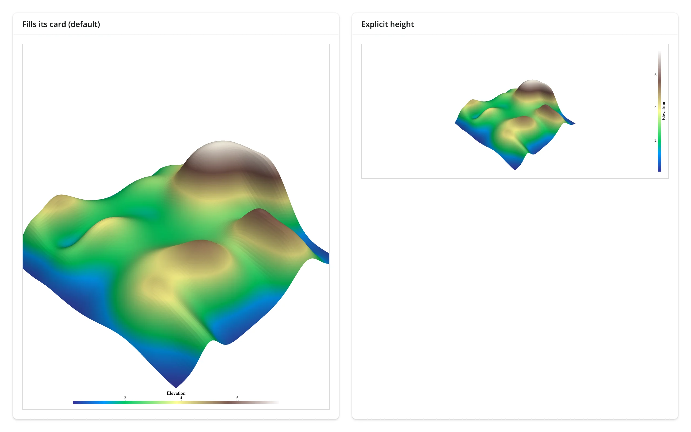

- With no `height` (the default), the view fills its container -- card, sidebar, `full_screen`, fillable page --
  and tracks resizes. This is what the quick start and every example above relies on.
- `render_pyvista(height="250px")` is respected exactly (verified: both the output container and the inner
  iframe measure 250px tall), independent of the surrounding card's own height.
- If you pre-build the widget yourself (`trame_pyvista.jupyter.show_trame(pl, mode="html")`) instead of returning
  the `Plotter`, pass `width="100%", height="100%"` explicitly -- without them it keeps the plotter's pixel
  `window_size` and sits small in the corner of a filling container instead of stretching to fit.
- Frame the camera yourself (`pl.view_isometric()`, or an explicit `camera_position`). Pyvista's default framing
  leaves wide margins around the mesh; every example above calls `view_isometric()` for exactly this reason.

## Gotchas and limitations

Everything below was verified on current `main` (pyvista 0.49.2, trame-pyvista 0.3.6, shiny 1.9.0, Python 3.13),
dated 2026-11-11.

- **`pl.show()` returns `None` outside Jupyter -- the #1 copy-paste trap.** Every pyvista tutorial ends with
  `pl.show(jupyter_backend=...)`. Outside Jupyter, `show()` ignores the backend argument entirely and returns
  `None` (only a `UserWarning` on the server console hints why), and shinywidgets treats a `None` return as
  "render nothing" -- a silent blank output. Return the `Plotter` itself instead.
- **A `Plotter` is single-use.** Coercion exports the scene and closes the plotter (mirroring `Plotter.show()`'s
  `auto_close`), so caching and reusing one across renders fails with a `ValueError` naming the problem
  explicitly (shinywidgets pre-checks `plotter._closed` and points at constructing a fresh `Plotter` per render,
  rather than surfacing trame-pyvista's more cryptic underlying error).
- **No in-place updates, ever.** Unlike every other 3D renderer here, `.widget` is a dead snapshot -- there's
  nothing to mutate. Re-render is the only lever (see "Updating the widget from Python").
- **The camera never survives a re-render.** Any re-render snaps back to whatever the render function sets (or
  pyvista's loose default framing if it sets nothing) -- the user's last drag/zoom is always discarded.
- **No debounce of its own.** A continuous slider ships one full scene export per tick; wrap heavy meshes behind
  an `ui.input_action_button` instead of a free-running slider (see the performance note above for what "heavy"
  costs).
- **`pv.OFF_SCREEN = True` is required on a headless server** (every example above sets it); on a machine with a
  display it isn't strictly necessary but doesn't hurt.

## Gallery candidates

**Template** -- [`gallery/template_isosurface_explorer.py`](gallery/template_isosurface_explorer.py): a small,
adaptable starting point. A threshold slider re-renders an isosurface extracted from a scalar volume
(`pyvista.examples.download_knee_full()`, a public-domain CT scan), paired with stats computed from the same
mesh. Swap `load_volume()` for your own `ImageData`/`RectilinearGrid` and keep the rest.

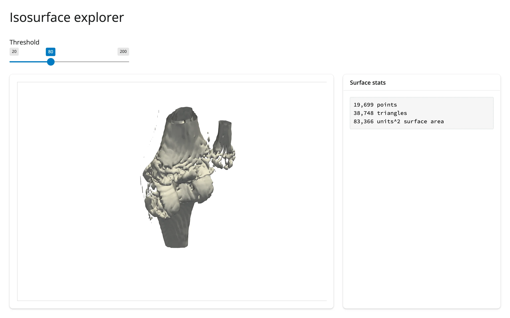

**Showcase** -- [`gallery/showcase_terrain_explorer.py`](gallery/showcase_terrain_explorer.py): a Mount St. Helens
terrain explorer (real USGS DEM) combining all three coordination patterns above on one dataset -- a clip slider
exposes a cross-section, a field selector switches between elevation and a computed slope field, a vertical-
exaggeration slider restyles relief, and a `@render.plot` histogram (matplotlib, computed server-side) tracks the
currently visible terrain's elevation distribution alongside a text stats panel.

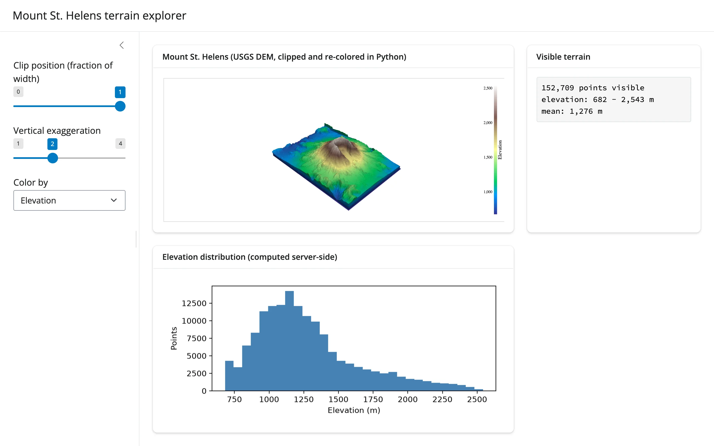

Clipped to 40% and recolored by slope:

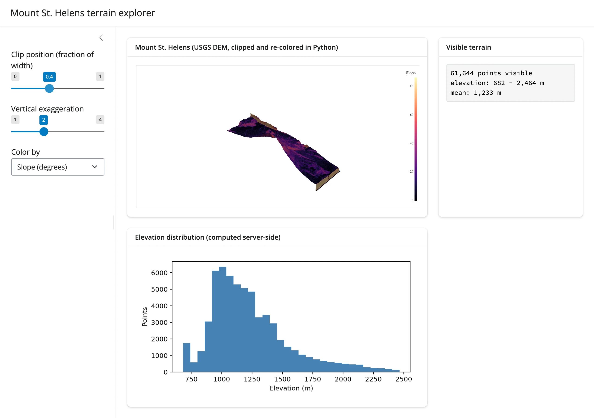

## Learn more

- [PyVista documentation](https://docs.pyvista.org) and its [example gallery](https://docs.pyvista.org/examples/)
  -- the long tail of filters, meshes, and datasets this guide only samples
- [trame-pyvista](https://github.com/Kitware-Resources/trame-pyvista) -- the html-export backend this renderer
  uses, and the `trame`/`jupyter_backend="trame"` path for server-side rendering this renderer deliberately
  doesn't cover
- [k3d guide](../k3d/index.md), [ipyvolume guide](../ipyvolume/index.md),
  [pythreejs guide](../pythreejs/index.md) -- the siblings with a live browser-to-Python connection (a `camera()`
  accessor, in two cases); reach for one of those instead when you need the camera, picks, or any other
  interaction state back in Python
