[quak](https://github.com/manzt/quak) is a data table widget by Trevor Manz (also the author of
[anywidget](https://anywidget.dev)), built on [DuckDB](https://duckdb.org) and the
[Mosaic](https://idl.uw.edu/mosaic/) visualization framework. Point it at a DataFrame and it renders a scrollable,
sortable table where every column header carries a small histogram -- a numeric column gets a distribution,
a categorical column gets a bar per category. Drag across a histogram, or click a category bar, and quak
crossfilters: every other column's histogram redraws to show the selection, and the table's rows narrow to match.

What makes quak different from a client-side table is where the data lives. Your DataFrame never leaves the
Python process -- quak registers it in a DuckDB connection and queries it there, sending only the rows on screen
and the histogram bin counts to the browser. That means a table of 5 million rows renders about as fast, and
costs about as much browser memory, as a table of 5 thousand.

`@render_quak` accepts a pandas or polars `DataFrame`, a pyarrow `Table`, a DuckDB relation, a DuckDB connection,
or a `quak.Widget` you built yourself, and fills its container by default (or respects an explicit height). It
also locks down the widget's DuckDB connection before display, so a visitor's browser can query the data but
can't reach the server's files -- see "Security" below. Two accessors, `table.sql()` and `table.data()`, read
back the query behind the user's current sort and filter as a string and as a lazy DuckDB relation -- the
mechanism behind every pattern in "Coordinating multiple views" below: a value box of filtered counts, a chart
of exactly the filtered rows, a CSV download read on demand of exactly the filtered subset.

Reach for quak when the point is exploring a large table by brushing summary histograms, especially past the
row counts where [itables](../itables/index.md) or [reactable](../reactable/index.md) start to struggle. If you
need cell editing, row selection, or a grid that looks like the rest of your app, those two (or
[ipydatagrid](../ipydatagrid/index.md)) are a better fit. If the user needs to pivot and re-aggregate the data
themselves, see [perspective](../perspective/index.md). If you want several linked, DuckDB-backed views (not just
one table) built from a declarative spec, see [mosaic](../mosaic/index.md) -- quak is, in fact, a single Mosaic
view under the hood.

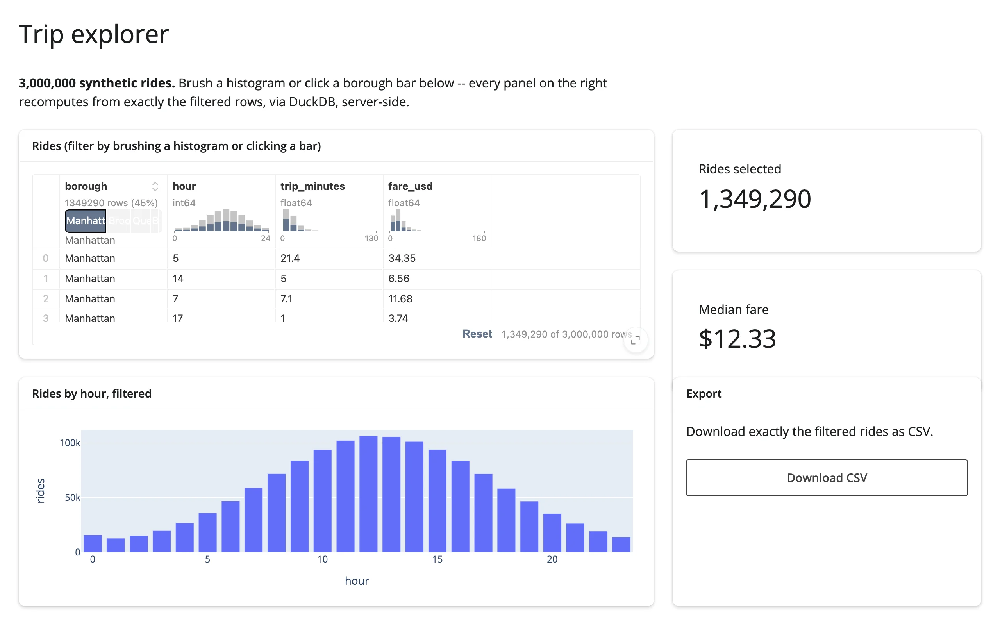

## Installation

```sh
pip install 'shinywidgets[quak]'
```

This installs `quak` and its dependencies (`duckdb`, `pyarrow`, `anywidget`). quak (via duckdb) has no wheels
for Python 3.15 yet; stay on 3.10-3.14 until duckdb catches up.

## Quick start

Return any DataFrame and you get a full table: per-column histograms, sorting, and crossfiltering, with no
other code.

```{.python file="examples/01_quickstart.py"}
from __future__ import annotations

import plotly.express as px
from shiny.express import ui
from shinywidgets import render_quak

ui.page_opts(title="quak quickstart", fillable=True)

gapminder = px.data.gapminder()

with ui.card(full_screen=True):

    @render_quak
    def table():
        return gapminder
```

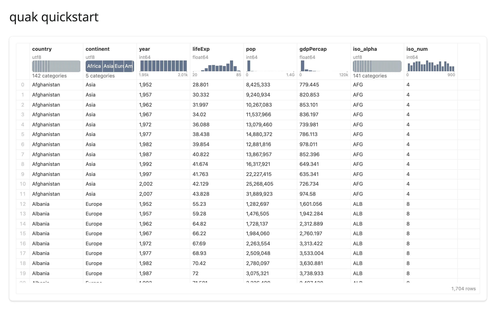

## What you can build

### Crossfiltering, with no application code

Drag across a numeric column's histogram, or click a bar in a categorical column's histogram, and quak filters
the table to the matching rows -- every other column's histogram redraws over the selection (the pale bars are
the full data; the dark overlay is the current selection), and a **Reset** link appears in the status bar. This
is the same app as the quick start; the behavior is built into quak itself.


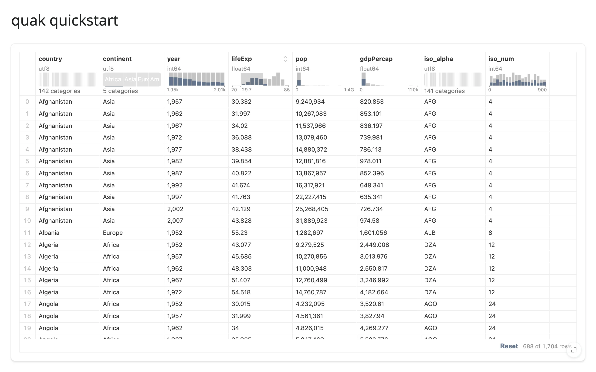

Sorting is also free: hover a column header and three sort states cycle through its header's sort button
(ascending, descending, unsorted).

### Any DataFrame-like object, including a DuckDB relation or connection

Besides pandas/polars DataFrames and pyarrow Tables, `render_quak` accepts a DuckDB relation or connection
directly -- useful when your data already lives in DuckDB and you don't want to materialize a DataFrame copy of
it first.

```{.python file="examples/02_duckdb_relation.py"}
from __future__ import annotations

import duckdb
import plotly.express as px
from shiny.express import ui
from shinywidgets import render_quak

ui.page_opts(title="quak from a DuckDB relation", fillable=True)

# Register once; render_quak() also accepts pandas/polars DataFrames and
# pyarrow Tables directly, with no conversion step. DuckDBPyConnection.register()
# returns the connection (for chaining) -- discard it, or Shiny Express's
# auto-display will try to render that return value as page content.
con = duckdb.connect(":memory:")
_ = con.register("gapminder", px.data.gapminder())
by_country_year = con.sql("""
    select country, continent, year, lifeExp, pop, gdpPercap
    from gapminder
    where pop > 2_000_000
""")

with ui.card(full_screen=True):

    @render_quak
    def table():
        return by_country_year
```

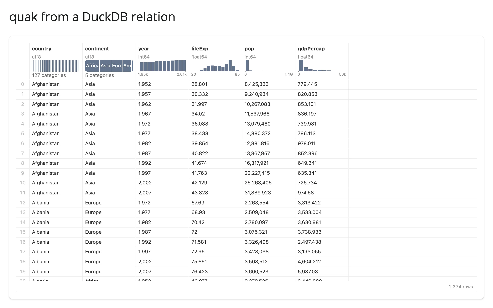

If you pass a bare `duckdb.DuckDBPyConnection` instead of a relation, quak queries a table named `df` on it by
default -- construct `quak.Widget(con, table="your_table")` yourself if your table has a different name (see
Gotchas).

### Scale: millions of rows at roughly constant cost

Because quak only ever sends the rows on screen and each histogram's bin counts over the wire, a table of 5
million rows renders about as fast as one of 5 thousand -- the cost moved to DuckDB running in your Python
process, which is built for exactly this.

```{.python file="examples/03_scale.py"}
from __future__ import annotations

import numpy as np
import pandas as pd
from shiny.express import ui
from shinywidgets import render_quak

ui.page_opts(title="quak at scale", fillable=True)

# Synthetic "ride" data, sized for scale rather than realism: quak only ever
# sends the rows on screen and each histogram's bin counts over the wire, so
# the browser payload is about the same at 5k rows or 5M.
n = 5_000_000
rng = np.random.default_rng(0)
rides = pd.DataFrame(
    {
        "borough": rng.choice(
            ["Manhattan", "Brooklyn", "Queens", "Bronx", "Staten Island"],
            n,
            p=[0.45, 0.25, 0.2, 0.07, 0.03],
        ),
        "hour": rng.integers(0, 24, n),
        "trip_minutes": np.clip(rng.gamma(2.0, 6.0, n), 1, 120).round(1),
        "fare_usd": np.clip(rng.gamma(3.0, 5.0, n), 2.5, 200).round(2),
    }
)

with ui.card(full_screen=True):
    ui.card_header(f"{n:,} synthetic rides")

    @render_quak
    def table():
        return rides
```

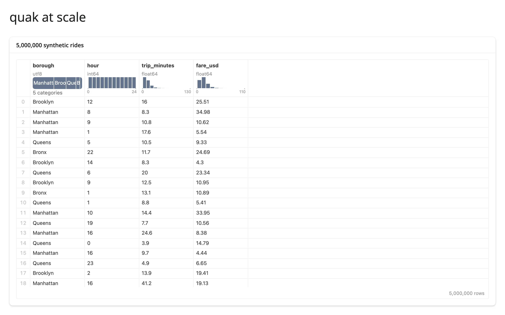

## Reacting to user interaction

### Accessor reference

| accessor | returns | before any interaction | across re-render | default rate policy |
|---|---|---|---|---|
| `table.sql()` | `str` | cancels (like an unrendered output) during the brief window before the table's first report | re-seeded from the new table | debounce, 250 ms |
| `table.data()` | `duckdb.DuckDBPyRelation` (lazy) | cancels alongside `sql()` | re-seeded, following `sql()` | inherits `sql()`'s |

Both read naturally in a `@render.*` function, a `@reactive.calc`, or a `@reactive.effect` -- they behave like
`input.my_slider()`, re-running whatever reads them each time the user interacts. Neither can be read inside the
`@render_quak` function itself, which builds a brand-new table on every call. Both describe the table's current
state, not a memory of past interaction: a re-render always starts them over from the new table's own query, so
there's no stale value to worry about carrying across renders.

### `sql()`: the query behind the current view

`table.sql()` is the exact `SELECT` statement for the table's current sort and filter -- read it to show users
what's currently selected, or to replay the same filter against a different query.

```{.python file="examples/04_accessor_sql.py"}
from __future__ import annotations

import plotly.express as px
from shiny.express import render, ui
from shinywidgets import render_quak

ui.page_opts(title="quak sql() accessor", fillable=True)
ui.tags.style("pre { white-space: pre-wrap; overflow-wrap: anywhere; }")

gapminder = px.data.gapminder()

with ui.layout_columns(col_widths=[8, 4]):
    with ui.card(full_screen=True):

        @render_quak
        def table():
            return gapminder

    with ui.card():
        ui.card_header("table.sql()")

        @render.code
        def sql():
            # No req() needed: this cancels on its own while quak's query is
            # still the empty string it syncs during initialization.
            return table.sql()
```

Sorting by life expectancy, then brushing a range of the `lifeExp` histogram, updates the published query with an
`ORDER BY` and a `WHERE ... BETWEEN ...`:

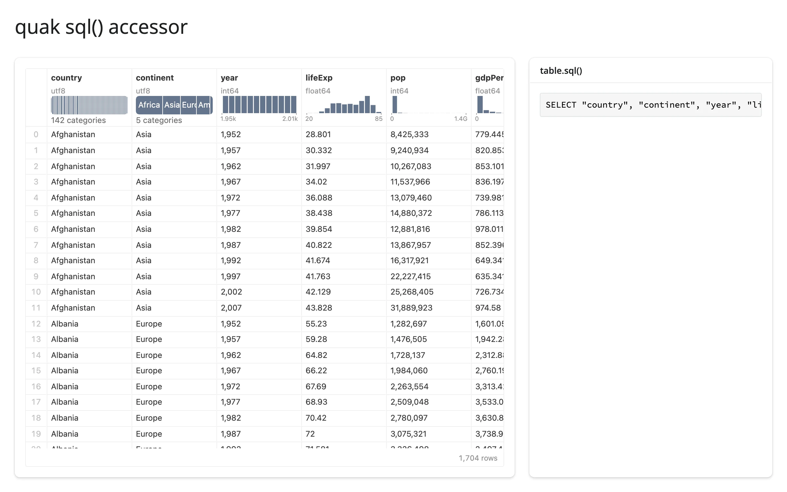
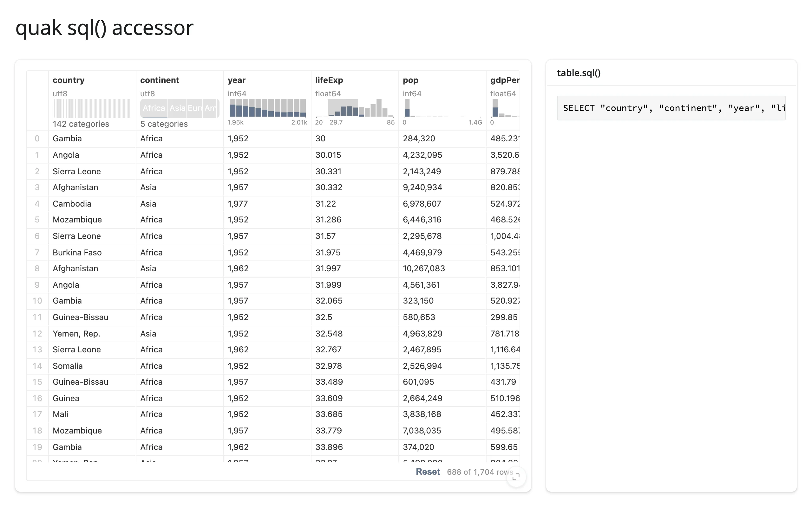

### `data()`: the matching rows, as a DuckDB relation

`table.data()` runs the published query and hands back a lazy `duckdb.DuckDBPyRelation` -- call `.df()`/`.pl()`
to materialize it, or `.aggregate(...)` to compute a summary without pulling every row into Python. It takes a
dependency on `sql()`, so it re-runs on the same schedule.

```{.python file="examples/05_accessor_data_summary.py"}
from __future__ import annotations

import plotly.express as px
from shiny.express import render, ui
from shinywidgets import render_quak

ui.page_opts(title="quak data() accessor", fillable=True)

gapminder = px.data.gapminder()

with ui.layout_columns(col_widths=[8, 4]):
    with ui.card(full_screen=True):

        @render_quak
        def table():
            return gapminder

    with ui.layout_columns(col_widths=12):
        with ui.value_box():
            "Countries x years selected"

            @render.text
            def n_rows():
                return f"{table.data().aggregate('count(*)').fetchall()[0][0]:,}"

        with ui.value_box():
            "Median life expectancy"

            @render.text
            def median_life_exp():
                value = table.data().aggregate("median(lifeExp)").fetchall()[0][0]
                return f"{value:.1f} years"
```

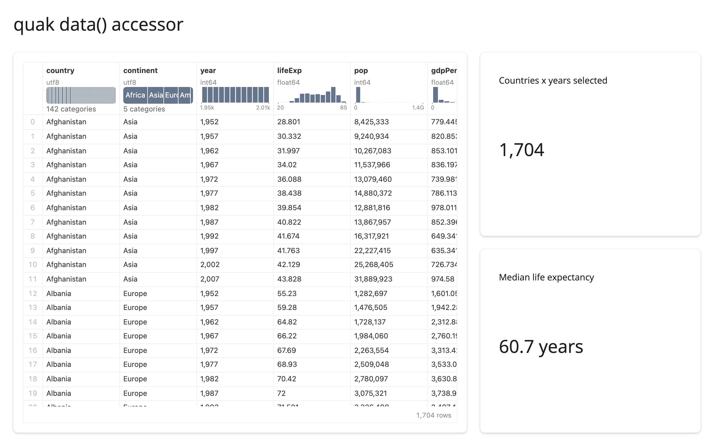
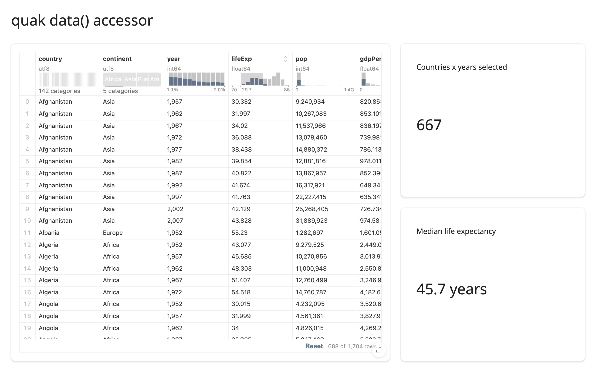

Notice the value box reads **667** selected rows after the same brush that made quak's own status bar say
**688 of 1,704**. That's not a bug in this example -- it's quak's status-bar count disagreeing with the exact
row count of its own published query (see Gotchas). Treat `table.data()`, not the status bar text, as the source
of truth.

### Beyond the accessors: `table.read(name)`

There isn't much else worth reading. quak's only other traits are internal (`_table_name`, `_columns`, leading
underscore and all) and not meant to be read from outside the widget; `sql()` and `data()` already cover the
table's entire interactive surface. If a future quak release adds a public trait worth watching, `table.read("that_trait")`
reads it reactively (falling through to `reactive_read()` on the rendered widget) without an import beyond
`shinywidgets` -- prefer it over calling `reactive_read(table.widget, "trait")` directly.

### Rate limiting

A brush drag can fire quak's `sql` trait around 20 times before the mouse comes up, and each change to
`table.sql()` potentially re-runs a DuckDB query in `table.data()`. The accessors debounce at 250 ms by default
to collapse that into one update per settled gesture, which is enough for almost every use -- the value box and
chart examples above both got away with no DuckDB work beyond the final filter. Pass `rate_policy="throttle"` to
`render_quak` (and/or a smaller `rate_delay`) if you need periodic snapshots while the user is still dragging,
for example to drive a progress indicator; pass `rate_delay=0` to disable rate limiting entirely and see every
raw update (useful for debugging, not for production, since several of those raw updates carry the no-filter
query quak syncs mid-gesture -- see Gotchas).

## Updating the widget from Python

quak's `sql` trait is read-only: setting `table.widget.sql = "..."` from Python changes nothing in the browser.
The only thing worth mutating in place is layout -- typically `.layout.height`, inherited from ipywidgets. Doing
that on the already-rendered widget keeps the same quak instance, and so keeps whatever filter or sort the user
had in progress; re-running the `@render_quak` function instead always builds a fresh `quak.Widget`, which loses
it (quak has no way to hand a filter back in on construction).

```{.python file="examples/06_update_in_place.py"}
from __future__ import annotations

import plotly.express as px
import quak
from shiny import reactive
from shiny.express import input, render, ui
from shinywidgets import render_quak

ui.page_opts(title="quak: resize in place vs. re-render")

gapminder = px.data.gapminder()

ui.input_action_button("grow", "Grow the table (in place)")
ui.input_action_button("rerender", "Re-render the table")


@render.code
def sql():
    return table.sql()


with ui.card():
    # A roomy fixed height on the output itself, so toggling the widget's own
    # (smaller) layout.height below is never clipped by the output container.
    @render_quak(height="700px")
    def table():
        # Brush or sort, then click "Re-render": this function re-runs and
        # builds a brand-new quak.Widget, so the filter/sort is gone -- quak
        # has no way to hand a filter back in on construction.
        input.rerender()
        widget = quak.Widget(gapminder)
        widget.layout.height = "250px"
        return widget


@reactive.effect
@reactive.event(input.grow)
def _():
    # Mutating the already-rendered widget keeps the same quak instance, and
    # so keeps whatever the user had brushed or sorted, unlike re-rendering.
    current = table.widget.layout.height
    table.widget.layout.height = "650px" if current != "650px" else "250px"
```

Brush a filter, then click "Grow the table": the table grows from 250px to 650px and the filter (visible in the
query text and the "688 of 1,704" count) is untouched.

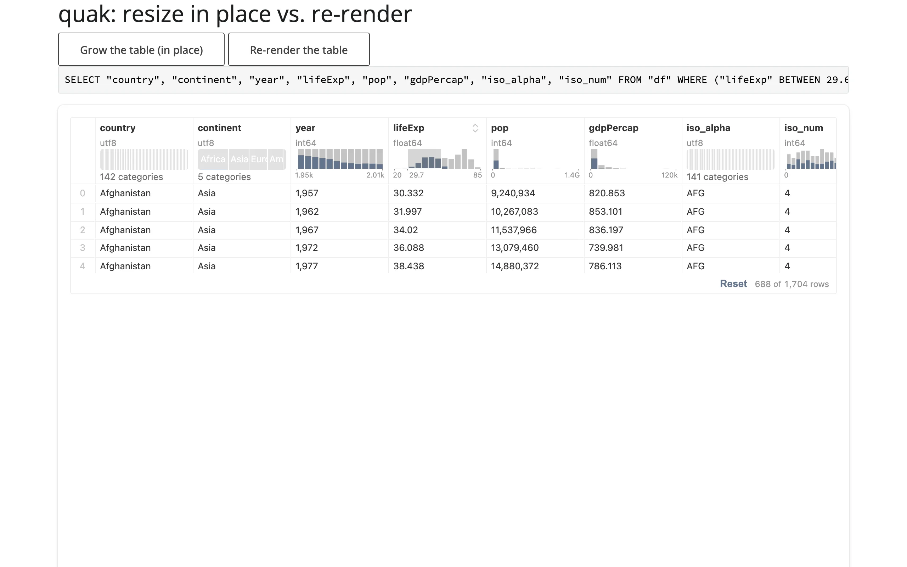
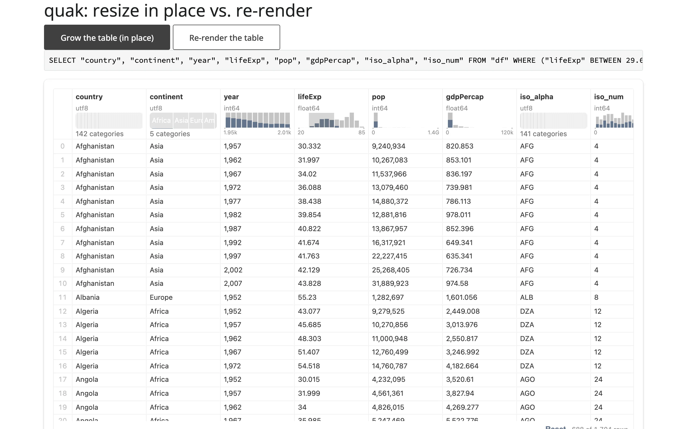

One sizing note this example relies on: when an output *fills* its container (the default, and what every other
example in this guide uses), that fill behavior wins over a manually-set `layout.height` -- the table stretches
to the container regardless. Give the output an explicit, roomy `height=` (as above) when you want
`layout.height` itself to be the thing that visibly changes.

## Coordinating multiple views

These three patterns all follow the same shape: read `table.data()` once, then drive something else from it.
Share one `@reactive.calc` if more than one output needs it, since each `.data()` call re-runs its query.

### Filtered rows -> summary stats

Already shown above in the `data()` section: two value boxes recomputed from `table.data().aggregate(...)`,
reading exactly the filtered rows. See [`examples/05_accessor_data_summary.py`](examples/05_accessor_data_summary.py)
and the screenshots there.

### Filtered rows -> a plot of exactly those rows

A chart in a neighboring card, built from `table.data().df()`, always matches what the table shows -- useful when
a user wants a different view (here, a distribution) of the same selection, not just a row count.

```{.python file="examples/07_linked_plot.py"}
from __future__ import annotations

import plotly.express as px
from shiny.express import render, ui
from shinywidgets import render_plotly, render_quak

ui.page_opts(title="quak filter -> plotly chart", fillable=True)

gapminder = px.data.gapminder()

with ui.layout_columns(col_widths=[7, 5]):
    with ui.card(full_screen=True):
        ui.card_header("Brush a histogram or click a continent bar")

        @render_quak
        def table():
            return gapminder

    with ui.card(full_screen=True):
        ui.card_header("Life expectancy by continent, filtered rows only")

        @render_plotly
        def chart():
            # Re-runs (debounced) whenever table.sql() changes, so the bars
            # always describe exactly the rows quak is showing.
            filtered = table.data().df()
            return px.box(filtered, x="continent", y="lifeExp", color="continent")
```

Clicking the "Europe" bar in the `continent` column filters the table to European country-years, and the box
plot redraws from exactly those rows:

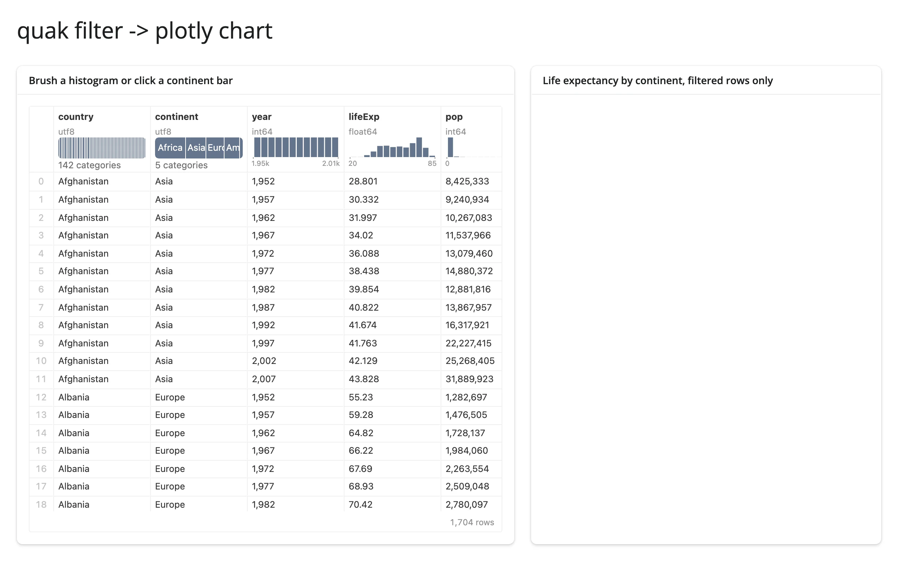
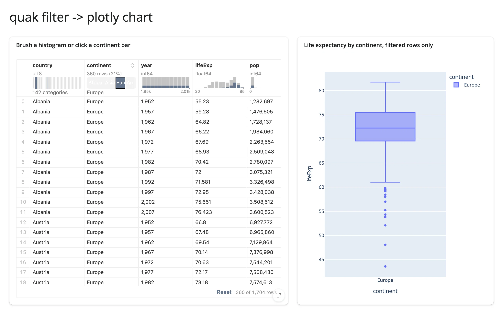

(Pairs with: [plotly](../plotly/index.md).)

### Filtered rows -> CSV download

`table.data()` powers an export just as easily as a chart -- the download always matches what's on screen, not
the full dataset. This is also a good example of **reading on demand**: the accessor is live from the moment
the table renders, so the download handler below can read `table.data()` the instant the user clicks Download,
with no warm-up and no earlier read required to "arm" it.

```{.python file="examples/08_linked_download.py"}
from __future__ import annotations

import plotly.express as px
from shiny import render
from shiny.express import ui
from shinywidgets import render_quak

ui.page_opts(title="quak filter -> CSV download", fillable=True)

gapminder = px.data.gapminder()

with ui.layout_columns(col_widths=[9, 3]):
    with ui.card(full_screen=True):

        @render_quak
        def table():
            return gapminder

    with ui.card():
        ui.card_header("Export")
        "Download exactly the rows currently shown (after sorting/filtering)."

        @render.download_button(filename="gapminder_filtered.csv", label="Download CSV")
        def download():
            # table.data() cancels (like an unrendered output) while quak's
            # query is still settling, so the button is simply unusable until
            # a query exists -- no error handling needed here.
            yield table.data().df().to_csv(index=False)
```

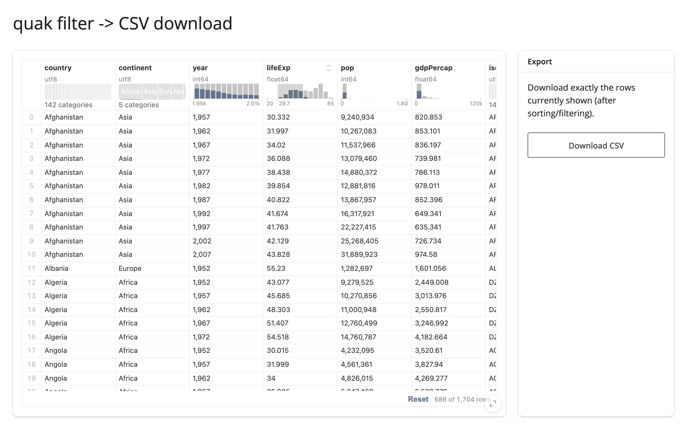

Verified end to end: with the same `lifeExp` filter as above, the downloaded CSV has exactly 667 data rows --
matching `table.data()`'s count, not quak's own "688" status-bar text.

## Large data

quak's whole premise is this: your DataFrame never leaves Python. It's registered in a DuckDB connection quak
queries directly, sending only the rows on screen and the per-column histogram bin counts -- not the
underlying table. [`examples/03_scale.py`](examples/03_scale.py) renders and crossfilters a 5-million-row
table; we didn't tabulate exact bytes for it this pass (the
architecture guarantees cost scales with what's on screen, not row count, which is why a table of 5 million
rows renders about as fast as a table of 5 thousand). This is the "only send what's visible" approach from
[Large data & performance](../../guide/performance/index.md#three-approaches-to-large-data).

## Layout and sizing

`render_quak` fills its container by default, same as every other `@render_*` output -- put it in a
`ui.card(full_screen=True)` inside a fillable page and it grows and shrinks with the card. Pass an explicit
`height=` (to `render_quak` or `output_widget`) to opt out and get a fixed size instead.

```{.python file="examples/09_layout_sizing.py"}
from __future__ import annotations

import plotly.express as px
from shiny.express import ui
from shinywidgets import render_quak

ui.page_opts(title="quak layout and sizing", fillable=True)

gapminder = px.data.gapminder()

with ui.layout_columns(col_widths=[6, 6]):
    with ui.card(full_screen=True):
        ui.card_header("Fills its card (default)")

        @render_quak
        def fills():
            return gapminder

    with ui.card():
        ui.card_header('height="250px"')

        @render_quak(height="250px")
        def fixed():
            return gapminder
```

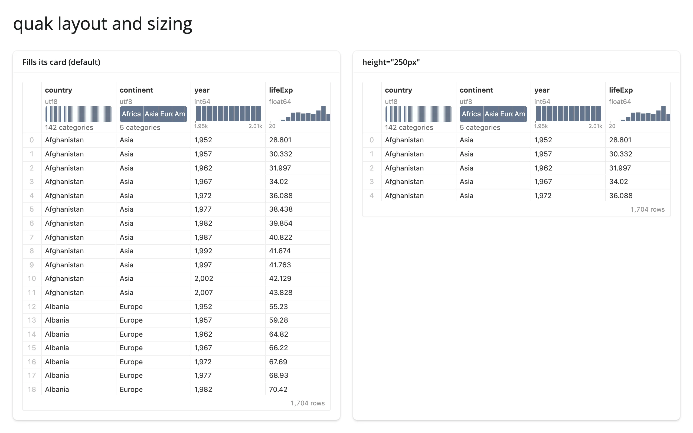

Scrolling to load more rows works at any height -- quak's own scroll listener only loads rows within about
380px of the bottom, which a tall filling container would never reach; shinywidgets patches around that so
scrolling keeps loading rows regardless of how tall the table is.

## Gotchas and limitations

### Security: the DuckDB connection is locked down by default

quak's browser code sends raw SQL strings to the server over the widget's comm, and the server runs them
against the connection's `.query()`. Without restrictions, that lets any visitor send a query like
`select * from read_csv('/etc/hosts')` and read arbitrary files the server process can reach. `render_quak`
locks the widget's connection down before display (`SET enable_external_access = false`; `SET
lock_configuration = true`), verified below to block exactly that query while leaving normal `SELECT`s against
the registered data untouched -- so, by default, nothing in this guide's examples needs to change to be safe to
deploy.

Pass `allow_unrestricted_connection=True` to opt out, for a local, single-user app where you'd rather quak's
SQL reach the filesystem (or you've already locked the connection's configuration yourself -- a connection
whose configuration is already locked is left untouched, since locking it is what the renderer would have
done anyway):

```{.python file="examples/10_security_lockdown.py"}
from __future__ import annotations

import plotly.express as px
from shiny.express import ui
from shinywidgets import render_quak

ui.page_opts(title="quak with an unrestricted connection (local use only)", fillable=True)

gapminder = px.data.gapminder()

with ui.card(full_screen=True):

    @render_quak(allow_unrestricted_connection=True)
    def table():
        # render_quak() locks down the table's DuckDB connection by default
        # (see Gotchas): a visitor's browser can query the data but can't
        # read server files or change the connection's settings. Opting out
        # here leaves the connection exactly as quak builds it -- only do
        # this for a local, single-user app, never one you deploy.
        return gapminder
```

The lockdown is permanent for the connection it's applied to (DuckDB can't undo it) and reaches every cursor on
the same database, not just the one it was set on. That matters if you pass `quak.Widget(con)` with a
connection built from your own code (rather than letting `render_quak` build one for you from a DataFrame, as
every other example in this guide does): if that connection is shared with other code in your app, do any
server-side file reads (`read_parquet()`, etc.) on it before the first render, or pass
`allow_unrestricted_connection=True` for it.

Even locked down, a visitor can still send expensive queries, which block the Python process while they run --
there's no statement timeout.

### Other gotchas

- **`sql` is read-only and briefly empty at startup.** Setting `table.widget.sql = ...` from Python has no
  effect; use the accessor to read, and change what's displayed by re-rendering. The accessor cancels (no
  `req()` needed) during the brief window before the browser's first report.
- **quak's own status-bar row count can disagree with the exact count of its published query.** Brushing a
  numeric histogram in this guide's examples consistently produced a status bar reading "688 of 1,704 rows" while
  the exact `count(*)` of the same published `sql()` was 667 -- reproduced every time, independent of
  shinywidgets. Trust `table.data()`, not the status-bar text, for anything that needs to be exactly right (an
  upstream quak quirk, matching a finding from an earlier evaluation of this widget).
- **Several column types crash or render oddly, upstream.** A `timedelta`/duration column throws `Unsupported
  type: INTERVAL` and blanks the whole table; an `int64` column with values above 2^53 throws `BigInt exceeds
  integer number representation` and also blanks the table (both reproduced directly on current quak 0.3.5).
  Cast durations to seconds and oversized integers to strings or floats before rendering.
- **A bare `duckdb.DuckDBPyConnection` queries a table named `df` by default.** Passing a connection whose data
  lives under a different table name renders a blank table with a DuckDB `Catalog Error` on the Python side (no
  error surfaces in the UI). Construct `quak.Widget(con, table="your_table_name")` yourself instead of returning
  the bare connection.
- **A manually-set `layout.height` is overridden while the output is filling its container.** See "Updating the
  widget from Python" above -- give the output a fixed `height=` if you want to resize the widget itself from
  Python.
- **Shiny Express auto-displays non-`None` top-level expressions**, which bites `DuckDBPyConnection.register()`
  (it returns the connection, for chaining) -- discard its return value, or Express tries to render the
  connection object as page content and the app fails to start. Not a quak issue, but easy to hit while wiring
  one up (see `examples/02_duckdb_relation.py`).
- **No Python 3.15 wheels yet.** quak depends on duckdb, which hasn't published `cp315` wheels; stick to Python
  3.10-3.14.

## Gallery candidates

### `template_explorer.py`

A clean starting point: a table plus a live row count and query text, both reading from the accessors. Adapt by
swapping in your own DataFrame.

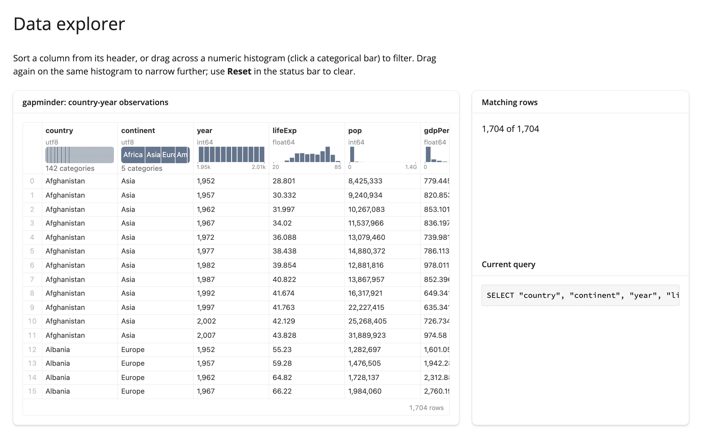
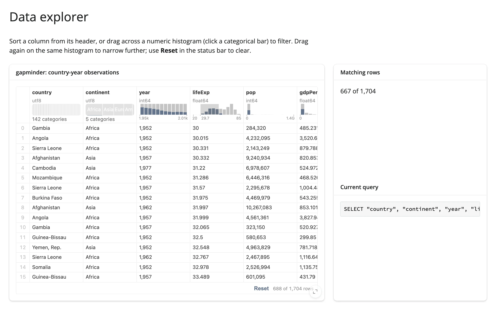

### `showcase_trip_explorer.py`

Three million synthetic rides, with value boxes, a plotly chart of ride volume by hour, and a CSV download, all
recomputed from `table.data()` as the user brushes or clicks. Demonstrates every pattern in "Coordinating
multiple views" together, at scale.

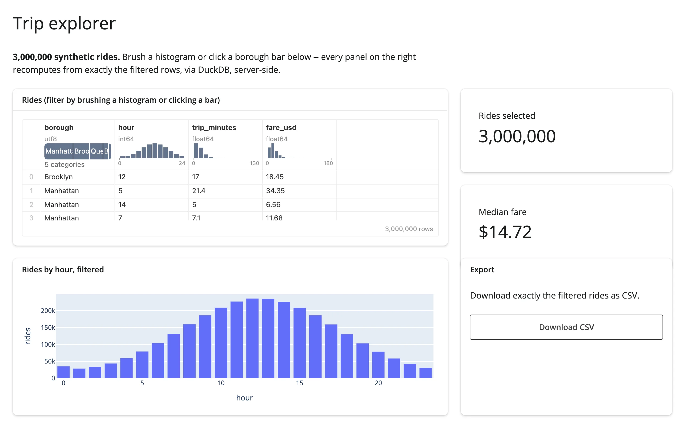


## Learn more

- [quak on GitHub](https://github.com/manzt/quak) -- source, and the README's own demos
- [Mosaic](https://idl.uw.edu/mosaic/) -- the linked-views framework quak's crossfiltering is built on; see the
  [mosaic guide](../mosaic/index.md) for building a multi-view dashboard the same way
- Related guides in this roster: [mosaic](../mosaic/index.md), [perspective](../perspective/index.md),
  [itables](../itables/index.md), [reactable](../reactable/index.md), [ipydatagrid](../ipydatagrid/index.md)
