[reactable](https://machow.github.io/reactable-py/) (reactable-py) is the Python port of R's
[reactable](https://glin.github.io/reactable/) package, maintained by Michael Chow. It wraps a mature,
widely-used React table component (via [ipyreact](https://github.com/widgetti/ipyreact)) with a declarative
Python API: you describe columns, formatting, grouping, and styling as plain dataclasses, and the table handles
sorting, per-column and global filtering, searching, pagination, row selection, grouping with aggregation,
expandable detail rows, column groups, footers, and themes -- all client-side, so interacting with the table never
round-trips to the server.

`render_reactable` accepts either a `reactable.Reactable` (a props dataclass; the usual choice) or the
`reactable.widgets.ReactableWidget` it builds. The decorator ships the reactable stylesheet automatically (the
table is unstyled without it), sanitizes NaN/inf values in your data to nulls (reactable-py otherwise hits a hard
serialization error), and treats a `height=` you set on `Reactable(...)` as an explicit height that opts out of
Shiny's fill layout.

The headline addition in this release is a set of reactive accessors -- `.selected_rows()`, `.page()`,
`.sorted()`, `.filtered()`, and `.search()` -- that read the table's live state back into Python, bridged from
the same state API R's reactable uses for `Shiny.onInputChange`. Nothing is sent to the server until you call
one of them.

Reach for reactable when you want a fast, good-looking, feature-complete table with the least code: grouping and
aggregation, expandable rows, and themeable styling are first-class here in a way they aren't in
[itables](../itables/index.md). If you need spreadsheet-style cell-block selection, in-cell bars with no custom
JS, or editable cells, see [ipydatagrid](../ipydatagrid/index.md) instead; for aggregation-first exploration of
large (hundreds of thousands of rows) datasets, see [perspective](../perspective/index.md).

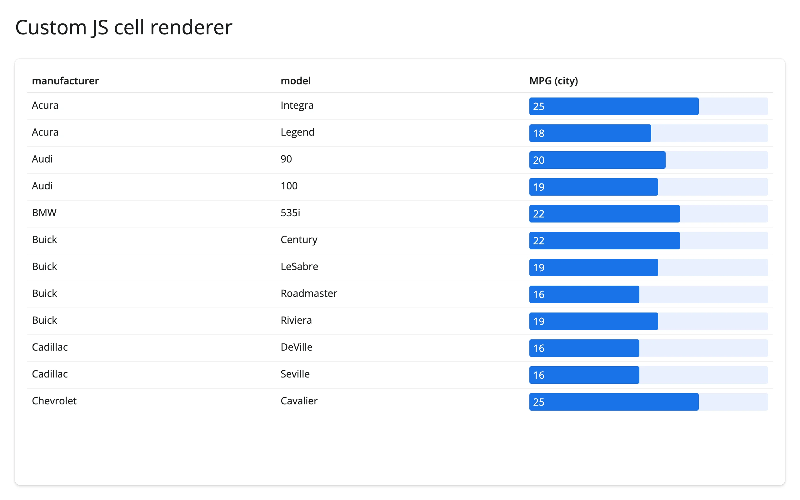

## Installation

```sh
pip install 'shinywidgets[reactable]'
```

## Quick start

A searchable, filterable table in a handful of lines. [`01_quickstart.py`](examples/01_quickstart.py):

```{.python file="examples/01_quickstart.py"}
from reactable import ColFormat, Column, Reactable
from reactable.data import cars_93
from shiny.express import ui
from shinywidgets import render_reactable

ui.page_opts(title="reactable + shinywidgets", fillable=True)

cars = cars_93.to_pandas()[["manufacturer", "model", "type", "price", "mpg_city"]]

with ui.card(full_screen=True):

    @render_reactable
    def tbl():
        return Reactable(
            cars,
            columns={"price": Column(format=ColFormat(prefix="$", digits=1))},
            searchable=True,
            filterable=True,
            highlight=True,
            striped=True,
        )
```

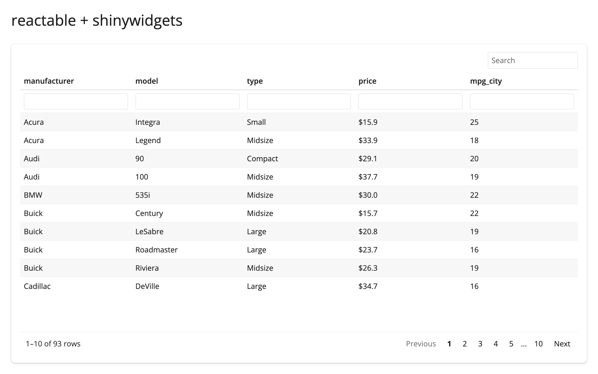

`reactable.data.cars_93` ships with the package (a copy of R's `MASS::Cars93`); any pandas or polars DataFrame
works the same way.

## What you can build

### Formatting and conditional styling

`ColFormat` handles currency, percent, dates, and digit rounding declaratively. A `Column(style=...)` callback
gets a `CellInfo(value, row_index, column_name)` per cell and returns a CSS dict, which is the usual way to
highlight values without writing a custom cell renderer. [`02_formatting_styling.py`](examples/02_formatting_styling.py):

```{.python file="examples/02_formatting_styling.py"}
from reactable import CellInfo, ColFormat, Column, Reactable
from reactable.data import cars_93
from shiny.express import ui
from shinywidgets import render_reactable

ui.page_opts(title="Formatting and conditional styling", fillable=True)

cars = cars_93.to_pandas()[["manufacturer", "model", "price", "mpg_city"]]


def mpg_style(info: CellInfo) -> dict[str, str]:
    if info.value >= 25:
        return {"color": "#1a7f37", "fontWeight": "600"}
    if info.value <= 18:
        return {"color": "#cf222e", "fontWeight": "600"}
    return {}


with ui.card(full_screen=True):

    @render_reactable
    def tbl():
        return Reactable(
            cars,
            columns={
                "price": Column(name="Price", format=ColFormat(prefix="$", digits=1)),
                "mpg_city": Column(name="MPG (city)", style=mpg_style),
            },
            highlight=True,
        )
```

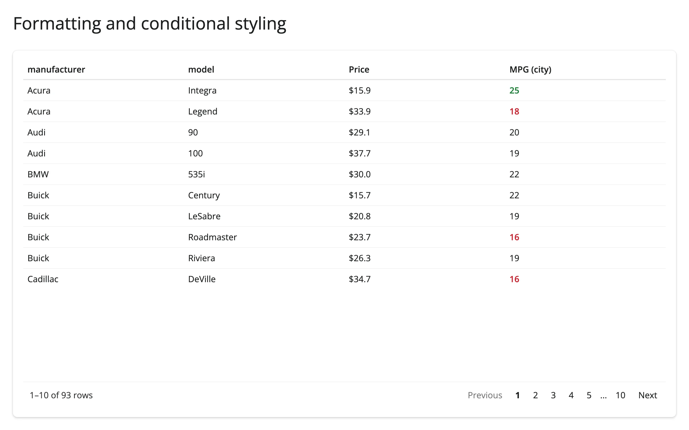

### Grouping and aggregation

Set `group_by` on the table and `aggregate=` on each column you want summarized; groups collapse to one row with
an expander. This is R reactable's hallmark feature. [`03_grouping.py`](examples/03_grouping.py):

```{.python file="examples/03_grouping.py"}
from reactable import JS, ColFormat, Column, Reactable
from reactable.data import cars_93
from shiny.express import ui
from shinywidgets import render_reactable

ui.page_opts(title="Grouping and aggregation", fillable=True)

cars = cars_93.to_pandas()[["manufacturer", "model", "type", "price", "mpg_city"]]

# aggregate="mean" (and "sum"/"median") silently renders blank cells with a
# pandas DataFrame -- reactable-py's pandas column-type detection always
# reports "UNKNOWN" instead of "numeric", and those three aggregators only
# run for numeric-typed columns. A JS aggregate function sidesteps it.
mean_js = JS("values => values.reduce((a, b) => a + b, 0) / values.length")

with ui.card(full_screen=True):

    @render_reactable
    def tbl():
        return Reactable(
            cars,
            columns={
                "price": Column(
                    name="Avg. price",
                    aggregate=mean_js,
                    format=ColFormat(prefix="$", digits=1),
                ),
                "mpg_city": Column(name="Avg. MPG", aggregate=mean_js, format=ColFormat(digits=1)),
                "model": Column(name="# models", aggregate="count"),
            },
            group_by=["manufacturer"],
            default_expanded=False,
        )
```

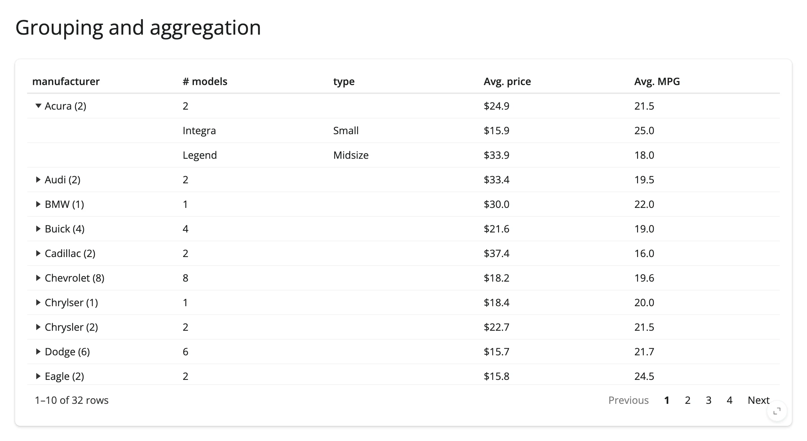

See [Gotchas and limitations](#gotchas-and-limitations) for why `mean`/`sum`/`median` need the `JS()` form with
pandas data, and when the plain string works.

### Expandable row details

A `details=Column(details=fn, html=True)` adds an expander column; `fn` receives a `RowInfo` and returns an HTML
string rendered into the expanded panel. [`04_expandable_details.py`](examples/04_expandable_details.py):

```{.python file="examples/04_expandable_details.py"}
from reactable import Column, Reactable, RowInfo
from reactable.data import cars_93
from shiny.express import ui
from shinywidgets import render_reactable

ui.page_opts(title="Expandable row details", fillable=True)

cars = cars_93.to_pandas()[
    ["manufacturer", "model", "price", "horsepower", "passengers", "origin"]
]


def row_detail(row: RowInfo) -> str:
    car = cars.iloc[row.row_index]
    return (
        "<div style='padding:8px 16px'>"
        f"<b>{car.manufacturer} {car.model}</b> &mdash; "
        f"{car.horsepower} hp, seats {car.passengers}, built in {car.origin}."
        "</div>"
    )


with ui.card(full_screen=True):

    @render_reactable
    def tbl():
        return Reactable(
            cars[["manufacturer", "model", "price"]],
            # The details column needs its own `html=True` to render markup
            # instead of escaping it as text.
            details=Column(details=row_detail, html=True),
            highlight=True,
        )
```

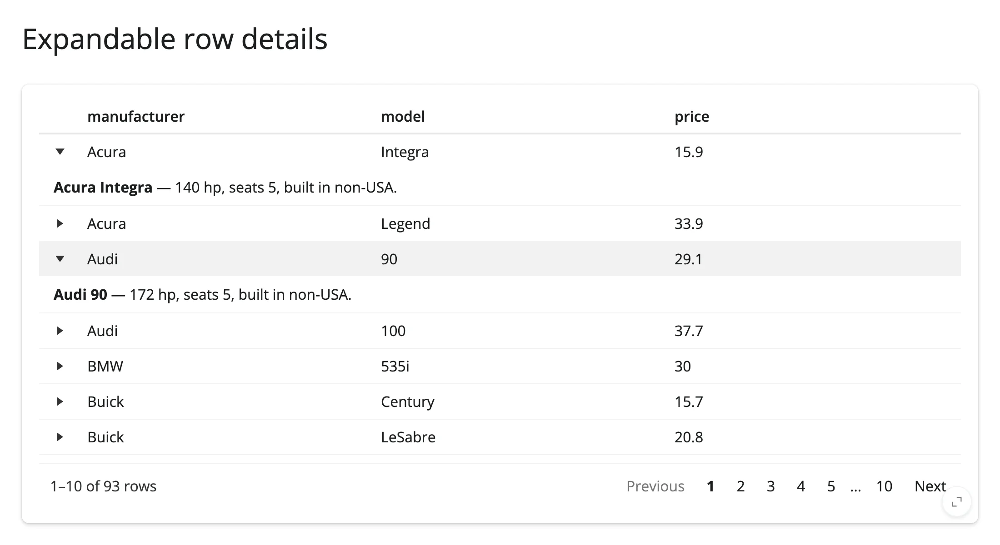

Without `html=True` on the details column, the markup renders as literal escaped text (see
[Gotchas and limitations](#gotchas-and-limitations)).

### Custom cell renderers

A `JS()` cell function gets a `cellInfo` with `.value`, `.row_index`, and `.column_name`, and returns an HTML
string -- enough for an in-cell bar chart with no extra library. [`05_custom_cells.py`](examples/05_custom_cells.py):

```{.python file="examples/05_custom_cells.py"}
from reactable import JS, Column, Reactable
from reactable.data import cars_93
from shiny.express import ui
from shinywidgets import render_reactable

ui.page_opts(title="Custom JS cell renderer", fillable=True)

cars = cars_93.to_pandas()[["manufacturer", "model", "mpg_city"]].head(12)

bar_cell = JS(
    "function(cellInfo) {"
    "  const pct = Math.round((cellInfo.value / 35) * 100);"
    "  return ("
    "    '<div style=\"background:#e8f0fe;border-radius:3px\">' +"
    "    '<div style=\"background:#1a73e8;color:white;padding:2px 6px;'"
    "    + 'border-radius:3px;width:' + pct + '%;white-space:nowrap\">' +"
    "    cellInfo.value + '</div></div>'"
    "  );"
    "}"
)

with ui.card(full_screen=True):

    @render_reactable
    def tbl():
        return Reactable(
            cars,
            columns={"mpg_city": Column(name="MPG (city)", cell=bar_cell, html=True)},
            pagination=False,
        )
```


A `cell=` can also be a plain Python function (receiving a `CellInfo` and returning an HTML string), computed
once server-side when the table renders -- useful when the logic needs data that isn't in the row itself.

### Theming

`Theme(...)` sets colors, borders, and per-part CSS (header, striping, pagination) without touching a stylesheet.
[`06_theming.py`](examples/06_theming.py):

```{.python file="examples/06_theming.py"}
from reactable import ColFormat, Column, Reactable, Theme
from reactable.data import cars_93
from shiny.express import ui
from shinywidgets import render_reactable

ui.page_opts(title="Theming", fillable=True)

cars = cars_93.to_pandas()[["manufacturer", "model", "price", "mpg_city"]]

theme = Theme(
    color="#1b1f23",
    background_color="#ffffff",
    border_color="#d0d7de",
    striped_color="#f6f8fa",
    highlight_color="#eef3ff",
    header_style={"background": "#24292f", "color": "white"},
)

with ui.card(full_screen=True):

    @render_reactable
    def tbl():
        return Reactable(
            cars,
            columns={"price": Column(format=ColFormat(prefix="$", digits=1))},
            theme=theme,
            striped=True,
            highlight=True,
            bordered=True,
        )
```

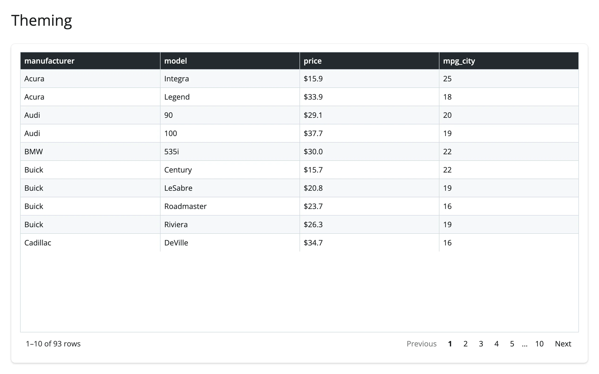

### Column groups and footers

`column_groups=[ColGroup(...)]` spans a header over several columns; `Column(footer=...)` computes a summary row
from a `ColInfo(values, name)`. [`07_column_groups_footers.py`](examples/07_column_groups_footers.py):

```{.python file="examples/07_column_groups_footers.py"}
from reactable import ColFormat, ColGroup, Column, Reactable
from reactable.data import cars_93
from shiny.express import ui
from shinywidgets import render_reactable

ui.page_opts(title="Column groups and footers", fillable=True)

cars = cars_93.to_pandas()[
    ["manufacturer", "model", "min_price", "price", "max_price", "mpg_city"]
]


def avg_footer(info) -> str:
    return f"${sum(info.values) / len(info.values):.1f}"


with ui.card(full_screen=True):

    @render_reactable
    def tbl():
        return Reactable(
            cars,
            columns={
                "min_price": Column(name="Min", format=ColFormat(prefix="$", digits=1)),
                "price": Column(
                    name="Avg",
                    format=ColFormat(prefix="$", digits=1),
                    footer=avg_footer,
                ),
                "max_price": Column(name="Max", format=ColFormat(prefix="$", digits=1)),
            },
            column_groups=[ColGroup(name="Price ($1000s)", columns=["min_price", "price", "max_price"])],
            pagination=False,
        )
```

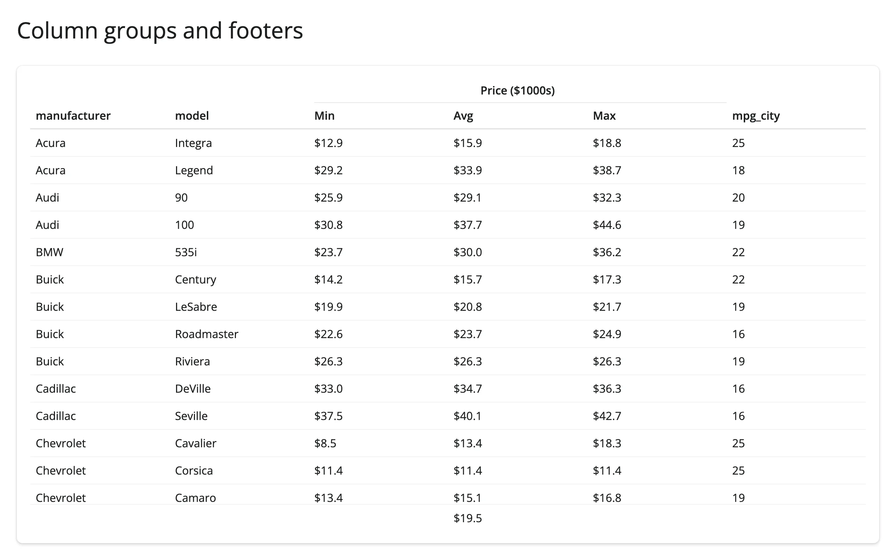

(`avg_footer` uses `info.values` -- the column's full, unfiltered data -- rather than `aggregate=`, which is
group-row-only and hits the same numeric-type gotcha noted above.)

## Reacting to user interaction

reactable-py's own JavaScript never calls `model.send()`, but its bundle includes R reactable's full state API
(`getState`/`onStateChange`), which shinywidgets subscribes to internally the first time you read an accessor.
Nothing is sent to the server, and nothing is computed client-side beyond what the table already tracks, until
then.

### Accessor reference

| Accessor | Returns | Before any interaction | Across re-render | Default rate policy |
|---|---|---|---|---|
| `selected_rows()` | `list[int]` (0-based, data-space positions, like `df.iloc`) | cancels until the browser's first state report | re-seeded from the new table (starts `[]`) | none |
| `page()` | `int` (0-based) | cancels until the browser's first state report | re-seeded from the new table (starts `0`) | none |
| `sorted()` | `list[{"id": str, "desc": bool}]` | cancels until the browser's first state report | re-seeded from the new table (starts `[]`) | none |
| `filtered()` | `list[{"id": str, "value": str}]` | cancels until the browser's first state report | re-seeded from the new table (starts `[]`) | debounce, 250ms |
| `search()` | `str` | cancels until the browser's first state report | re-seeded from the new table (starts `""`) | debounce, 250ms |

Every accessor silently cancels (like `req(False)`) until the browser reports the table's state, which happens
once, shortly after the table first renders -- read them with `req()` semantics in mind, or let a dependent
output simply not render until then. All five describe the table's *own* state (not a record of a past click),
so a re-render re-seeds every one of them from the new table rather than carrying over the old table's values.
Sort/page/selection are click-driven and unthrottled; filter/search are per-keystroke streams and debounced by
default. Positions from `selected_rows()` stay in data coordinates: sorting or paging the table doesn't change
them.

### Selection: `selected_rows()`

Requires `selection="multiple"` (or `"single"`) on the table. Position indices are stable across sort and page.
[`08_selected_rows.py`](examples/08_selected_rows.py):

```{.python file="examples/08_selected_rows.py"}
from reactable import Reactable
from reactable.data import cars_93
from shiny.express import render, ui
from shinywidgets import render_reactable

ui.page_opts(title="selected_rows()", fillable=True)

cars = cars_93.to_pandas()[["manufacturer", "model", "price"]].head(8)

with ui.layout_columns(col_widths=[8, 4]):
    with ui.card(full_screen=True):

        @render_reactable
        def tbl():
            return Reactable(cars, selection="multiple", default_page_size=8)

    with ui.card():
        ui.card_header("tbl.selected_rows()")

        @render.code
        def selected():
            return str(tbl.selected_rows())
```

Before selecting any rows, after checking the 1st and 3rd:

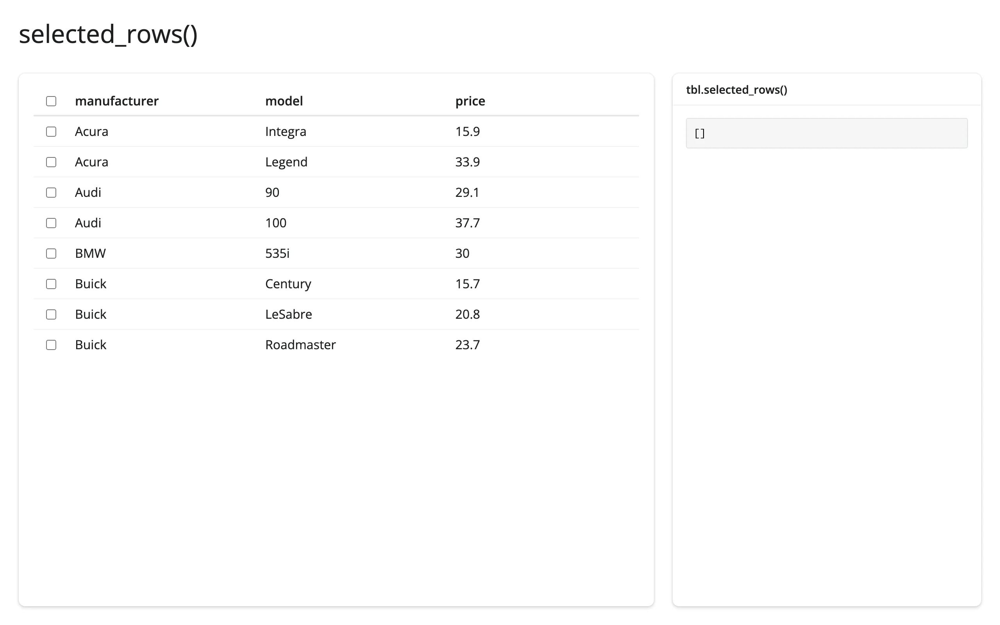
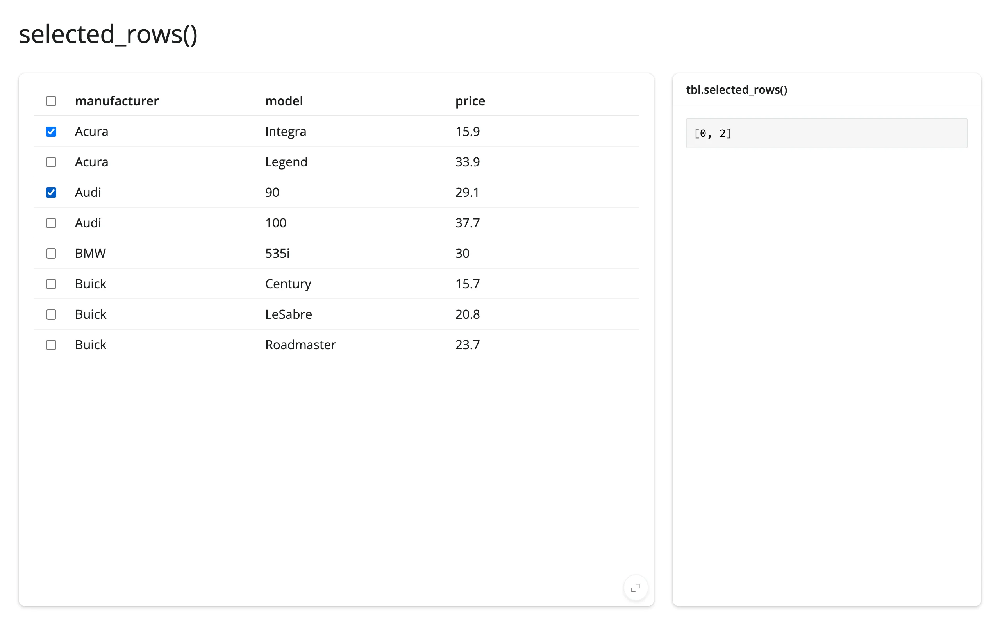

### Where the user is: `page()` and `sorted()`

```{.python file="examples/09_page_sorted.py"}
from reactable import Reactable
from reactable.data import cars_93
from shiny.express import render, ui
from shinywidgets import render_reactable

ui.page_opts(title="page() and sorted()", fillable=True)

cars = cars_93.to_pandas()[["manufacturer", "model", "price", "mpg_city"]]

with ui.layout_columns(col_widths=[8, 4]):
    with ui.card(full_screen=True):

        @render_reactable
        def tbl():
            return Reactable(cars, sortable=True, default_page_size=10)

    with ui.card():
        ui.card_header("Where the user is")

        @render.code
        def state():
            page_1based = tbl.page() + 1
            return f"page {page_1based}\nsorted {tbl.sorted()}"
```

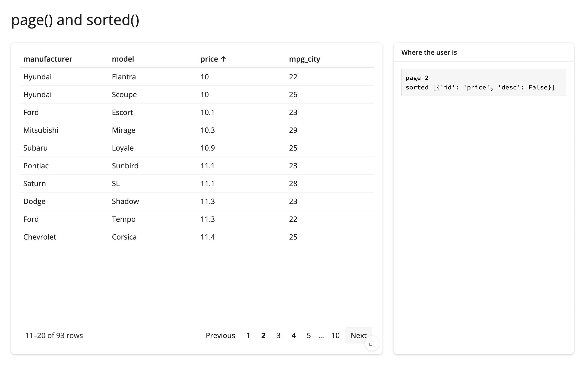

### What's visible: `filtered()` and `search()`

Both report the *query*, not the matching rows -- see [Coordinating multiple views](#coordinating-multiple-views)
for turning a search string into an actual filtered dataset. [`10_filter_search.py`](examples/10_filter_search.py):

```{.python file="examples/10_filter_search.py"}
from reactable import Reactable
from reactable.data import cars_93
from shiny.express import render, ui
from shinywidgets import render_reactable

ui.page_opts(title="filtered() and search()", fillable=True)

cars = cars_93.to_pandas()[["manufacturer", "model", "type", "price"]]

with ui.layout_columns(col_widths=[8, 4]):
    with ui.card(full_screen=True):

        @render_reactable
        def tbl():
            return Reactable(cars, filterable=True, searchable=True, default_page_size=8)

    with ui.card():
        ui.card_header("What's visible (debounced 250ms)")

        @render.code
        def state():
            return f"filtered {tbl.filtered()}\nsearch {tbl.search()!r}"
```

Filtering the `manufacturer` column to "acur" and searching "midsize":

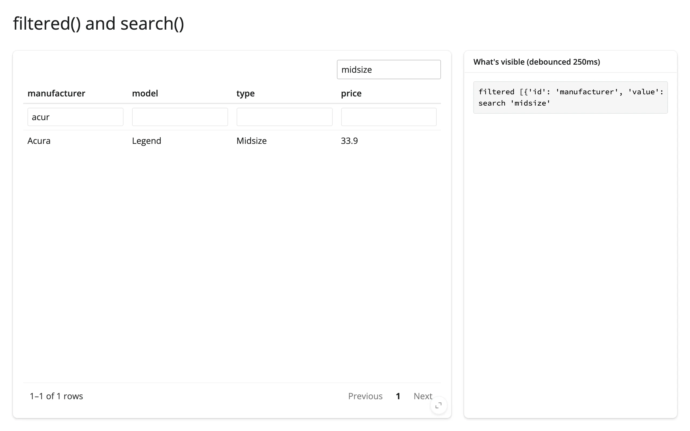

### Read on demand: export selected rows

Because an accessor is live from the moment the table renders, you can read it the instant you need the
value -- in a download handler, a button click, a chat tool call -- with no reader warming it up beforehand.
[`17_export_selected.py`](examples/17_export_selected.py):

```{.python file="examples/17_export_selected.py"}
import io

from reactable import ColFormat, Column, Reactable
from reactable.data import cars_93
from shiny.express import render, ui
from shinywidgets import render_reactable

ui.page_opts(title="Read on demand: export selected rows", fillable=True)

cars = cars_93.to_pandas()[["manufacturer", "model", "price", "mpg_city"]]

with ui.layout_columns(col_widths=[8, 4]):
    with ui.card(full_screen=True):

        @render_reactable
        def tbl():
            return Reactable(
                cars,
                selection="multiple",
                columns={"price": Column(format=ColFormat(prefix="$", digits=1))},
                default_page_size=8,
            )

    with ui.card():
        ui.card_header("Export")
        ui.p("Check some rows, then download -- no need to read selected_rows() anywhere else first.")

        # selected_rows() is live from the moment the table renders, whether
        # or not anything has read it yet, so this handler can read it cold,
        # the instant the user clicks download: no warm-up reader required.
        @render.download_button(filename="selected_cars.csv", label="Download selected as CSV")
        def download_csv():
            rows = tbl.selected_rows()
            buf = io.StringIO()
            cars.iloc[rows].to_csv(buf, index=False)
            yield buf.getvalue()
```

Checking two rows, then downloading -- the exported CSV contains exactly those two rows, read cold at click
time:

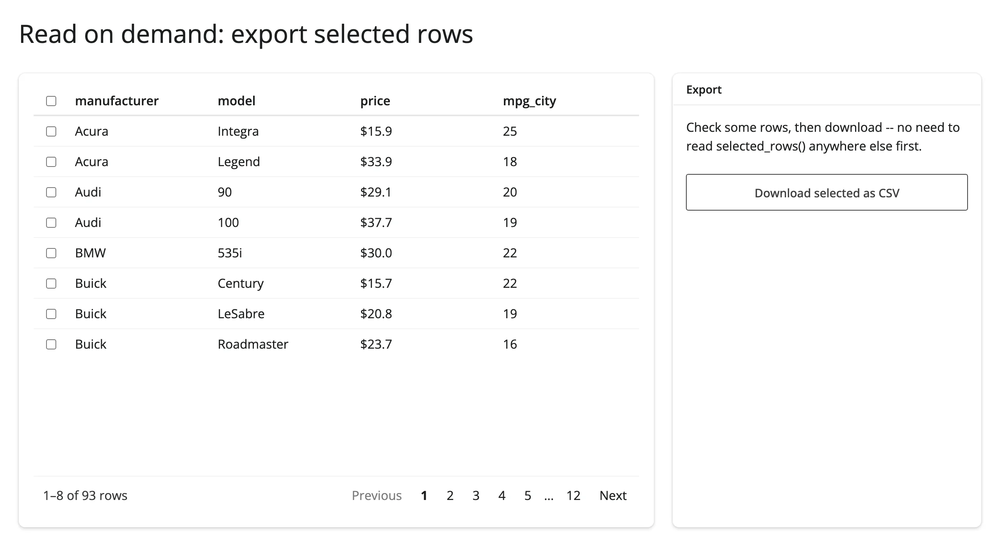
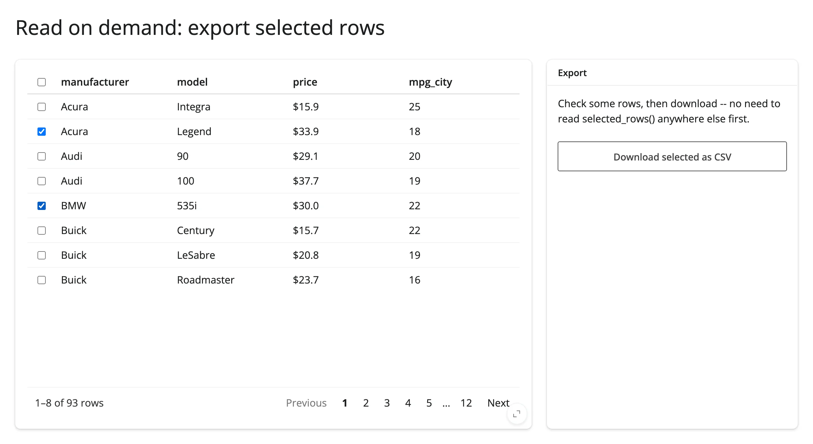

### Row clicks: the `on_click` escape hatch

Clicks aren't part of reactable's reported state, so no accessor sees them. reactable's own `on_click=JS(...)`
prop can forward a click as an ordinary Shiny input instead. [`16_row_click.py`](examples/16_row_click.py):

```{.python file="examples/16_row_click.py"}
from reactable import JS, Reactable
from reactable.data import cars_93
from shiny import req
from shiny.express import input, render, ui
from shinywidgets import render_reactable

ui.page_opts(title="Row clicks via on_click", fillable=True)

cars = cars_93.to_pandas()[["manufacturer", "model", "price"]]

# Clicks aren't part of reactable's reported state, so no accessor sees them.
# reactable's own `on_click=JS(...)` prop can forward a click as an ordinary
# Shiny input instead.
on_click = JS(
    "function(rowInfo, colInfo) {"
    "  Shiny.setInputValue('row_clicked', "
    "    {row: rowInfo.index, col: colInfo.id}, {priority: 'event'});"
    "}"
)

with ui.layout_columns(col_widths=[8, 4]):
    with ui.card(full_screen=True):

        @render_reactable
        def tbl():
            return Reactable(cars, on_click=on_click, default_page_size=8)

    with ui.card():
        ui.card_header("input.row_clicked()")

        @render.code
        def clicked():
            req(input.row_clicked())
            return str(input.row_clicked())
```

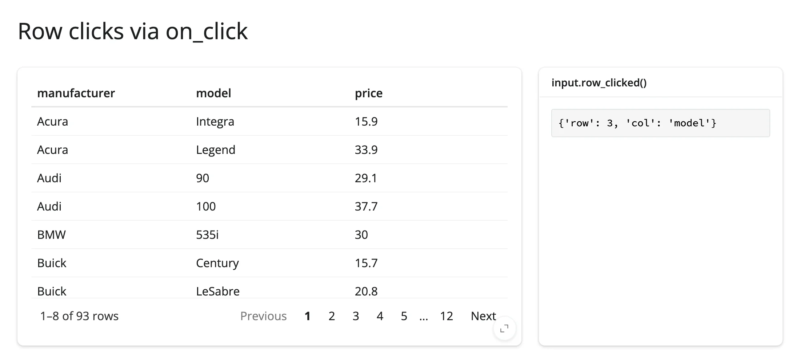

### Beyond the accessors: reactive_read

There isn't much to add here: `ReactableWidget` has exactly one meaningful ipywidgets trait, `.props` (the whole
table configuration as one dict), and it changes on every prop update -- including ones you make yourself (see
[Updating the widget from Python](#updating-the-widget-from-python)). `reactive_read(tbl.widget, "props")` would
fire on your own writes as well as the user's, so it isn't a useful substitute for the accessors above. The
accessors already cover reactable's entire user-facing state surface.

### Rate limiting

`filtered()` and `search()` debounce at 250ms by default, since both stream on every keystroke; `selected_rows()`,
`page()`, and `sorted()` are click-driven and unthrottled. Override with `rate_policy`/`rate_delay` on the
decorator -- this changes the policy only for accessors that already debounce (it doesn't add a limit to
click-driven ones). [`11_rate_limiting.py`](examples/11_rate_limiting.py):

```{.python file="examples/11_rate_limiting.py"}
from reactable import Reactable
from reactable.data import cars_93
from shiny.express import render, ui
from shinywidgets import render_reactable

ui.page_opts(title="Rate limiting", fillable=True)

cars = cars_93.to_pandas()[["manufacturer", "model", "type", "price"]]

with ui.layout_columns(col_widths=[8, 4]):
    with ui.card(full_screen=True):
        # A longer debounce (1s) than the 250ms default: useful if reading
        # search()/filtered() triggers expensive downstream work (a database
        # query, a heavy re-plot) you don't want firing on every keystroke.
        @render_reactable(rate_policy="debounce", rate_delay=1.0)
        def tbl():
            return Reactable(cars, searchable=True, default_page_size=8)

    with ui.card():
        ui.card_header("search() (1s debounce)")

        @render.code
        def state():
            return repr(tbl.search())
```

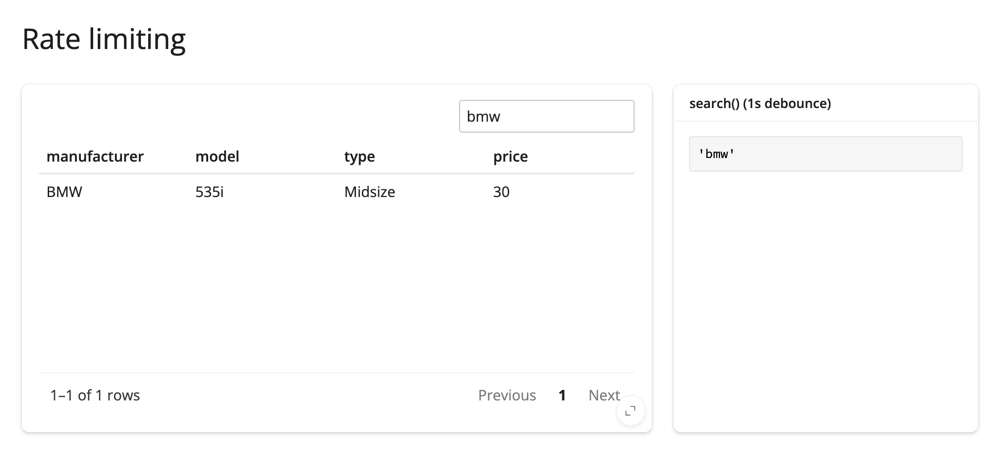

## Updating the widget from Python

Two ways to change a rendered table: **re-render** (have the render function depend on a reactive and return a
new `Reactable`) or **update `.widget.props` in place** inside a `@reactive.effect`. Re-rendering is simplest and
always correct -- it creates a fresh widget, so the user's sort, filter, page, and selection reset to the
table's defaults, matching ordinary Shiny semantics.

Updating `.widget.props` in place is cheaper (no new widget, no re-sent dependencies) and, for non-data props
like `defaultPageSize`, is the documented pattern:

```{.python file="examples/12_inplace_props.py"}
@reactive.effect
def _():
    # A non-data prop updates the mounted widget directly: no re-render,
    # no re-sent JS bundle, and any sort/filter/selection stays intact.
    w = tbl.widget
    if w is not None:
        w.props = {**w.props, "defaultPageSize": input.page_size()}
```

[`12_inplace_props.py`](examples/12_inplace_props.py) -- before and after dragging the slider to 15:

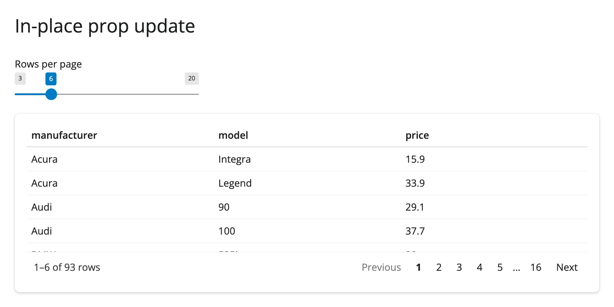
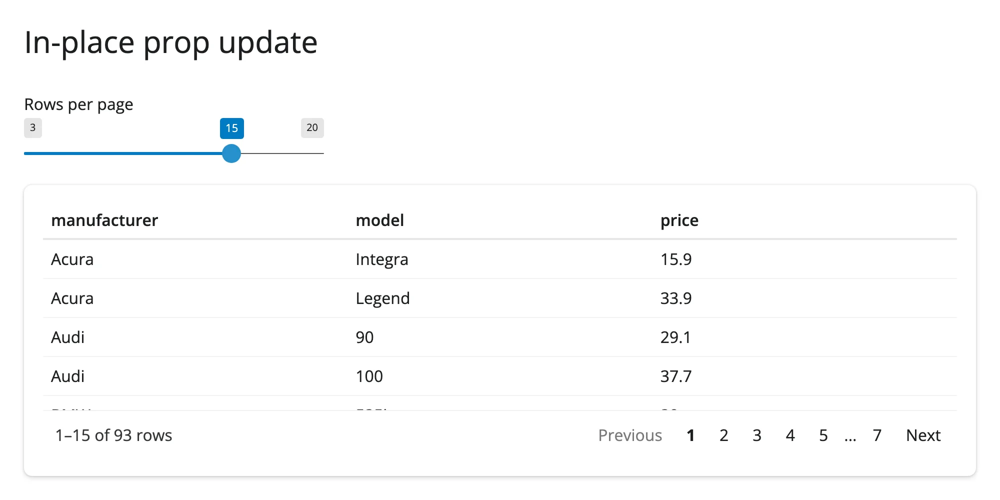

The same pattern updates the table's **data**, not just its non-data props. Reassign `.widget.props` with a new
`"data"` entry (mutating `.widget.props["data"]` in place without reassigning the dict never syncs, since `props`
is a traitlets trait) and the table refreshes while the user's current sort, filter, page, and selection stay put,
because it's still the same widget instance:

```{.python file="examples/13_update_data.py"}
@reactive.effect
@reactive.event(input.inplace)
def _():
    w = tbl.widget
    if w is None:
        return
    prices = [round(p, 1) for p in cars["price"] * random.uniform(0.8, 1.2)]
    # Reassigning `props["data"]` (not mutating the dict in place)
    # refreshes the table and keeps the current sort, filters, page, and
    # selection as the user left them.
    w.props = {**w.props, "data": {**w.props["data"], "price": prices}}
```

[`13_update_data.py`](examples/13_update_data.py) -- sorted by price ascending, then updated in place (values
change, order is preserved) vs. re-rendered (order resets):

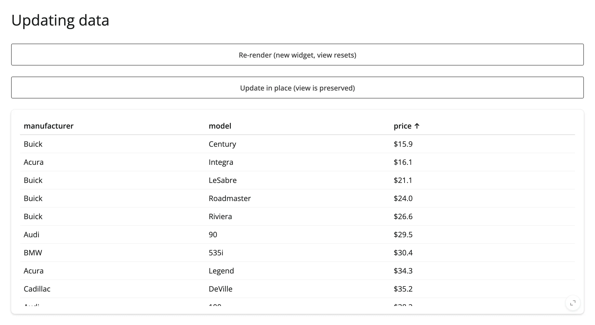
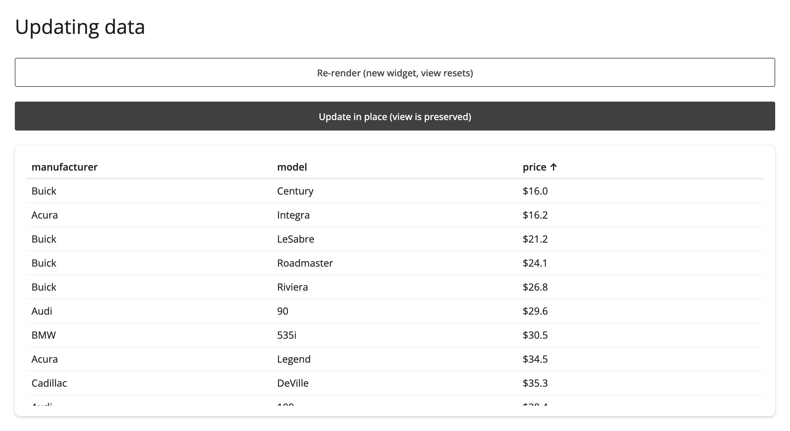

Use re-render when the data genuinely changes shape (different columns, a totally different query) or when you
want the clean-slate reset. Use the in-place form when you're refreshing values the user is already looking at
and want to preserve their sort/filter/page/selection -- a live-updating price column, for example.

There's also a middle ground: the `dataKey` prop. The browser uses it as the table's React key, so *changing*
it forces a full remount -- sort, filters, page, selection, and expanded rows all reset to defaults -- while
every other prop stays as it was. That's the clean way to reset table state after an in-place data swap,
without paying for a re-render: put a counter or a hash of the dataset in `dataKey` and bump it when the new
data should be treated as a different table.

## Coordinating multiple views

### Selection drives a detail card

`selected_rows()` gives positions in the currently-rendered data, so `df.iloc[rows]` gets you the selected
records. `on_click="select"` lets a row click toggle selection (in addition to the checkbox).
[`14_selection_to_detail.py`](examples/14_selection_to_detail.py):

```{.python file="examples/14_selection_to_detail.py"}
from reactable import ColFormat, Column, Reactable
from reactable.data import cars_93
from shiny import req
from shiny.express import render, ui
from shinywidgets import render_reactable

ui.page_opts(title="Selection drives a detail card", fillable=True)

cars = cars_93.to_pandas()[
    ["manufacturer", "model", "price", "horsepower", "mpg_city", "passengers"]
]

with ui.layout_columns(col_widths=[8, 4]):
    with ui.card(full_screen=True):

        @render_reactable
        def tbl():
            return Reactable(
                cars,
                selection="single",
                on_click="select",
                columns={"price": Column(format=ColFormat(prefix="$", digits=1))},
                default_page_size=8,
            )

    with ui.card():
        ui.card_header("Selected car")

        @render.ui
        def detail():
            rows = tbl.selected_rows()
            req(len(rows) > 0)
            car = cars.iloc[rows[0]]
            return ui.TagList(
                ui.h5(f"{car.manufacturer} {car.model}"),
                ui.p(f"${car.price}k, {car.horsepower} hp, {car.mpg_city} mpg city"),
                ui.p(f"Seats {car.passengers}"),
            )
```

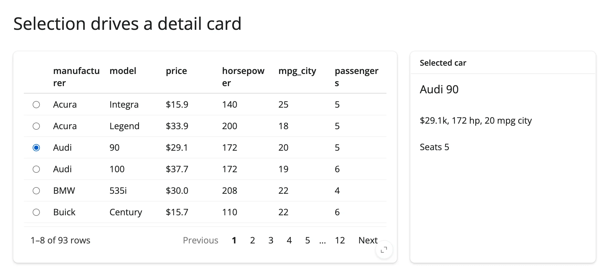

### Search drives a chart of what's visible

`search()` and `filtered()` report the *query*, not the result set, so showing "what's visible" elsewhere means
reproducing reactable's matching (case-insensitive substring, across every column's stringified value) in
pandas. [`15_search_to_chart.py`](examples/15_search_to_chart.py):

```{.python file="examples/15_search_to_chart.py"}
import matplotlib.pyplot as plt
from reactable import Reactable
from reactable.data import cars_93
from shiny.express import render, ui
from shinywidgets import render_reactable

ui.page_opts(title="search() drives a chart", fillable=True)

cars = cars_93.to_pandas()[["manufacturer", "model", "type", "price"]]


def visible_rows():
    # search()/filtered() report the *query*, not the matching rows, so
    # showing "what's visible" elsewhere means reproducing reactable's
    # search (case-insensitive substring, any column) in pandas.
    query = tbl.search().lower()
    if not query:
        return cars
    hit = cars.astype(str).apply(lambda col: col.str.lower().str.contains(query))
    return cars[hit.any(axis=1)]


with ui.layout_columns(col_widths=[7, 5]):
    with ui.card(full_screen=True):

        @render_reactable
        def tbl():
            return Reactable(cars, searchable=True, default_page_size=8)

    with ui.card():
        ui.card_header("Visible rows, by type")

        @render.plot
        def chart():
            counts = visible_rows()["type"].value_counts()
            fig, ax = plt.subplots()
            counts.plot.barh(ax=ax)
            ax.set_xlabel("rows")
            return fig
```

Before searching, and after searching "chevrolet":

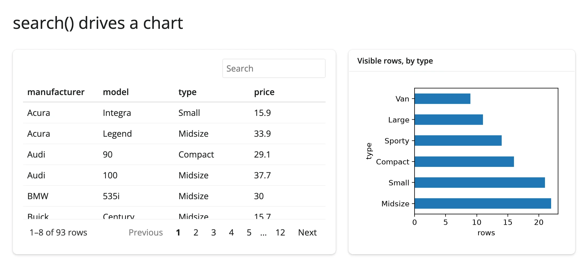
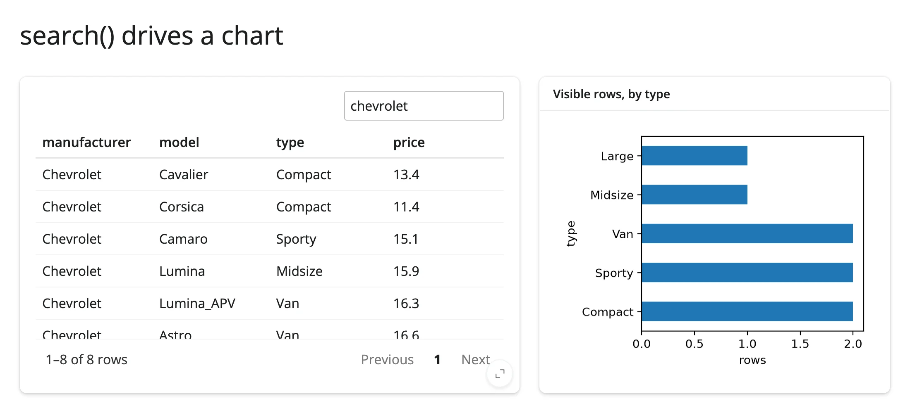

## Large data

reactable is client-side, like itables: the whole data frame is serialized to the browser up front, and
pagination only limits what's rendered in the DOM at once, not what's sent over the wire. Unlike
[itables](../itables/index.md#large-data), reactable has no built-in downsampling (no `maxBytes` equivalent). No
practical row limit was measured this pass. For tables beyond the low hundreds of thousands of rows, prefer
[ipydatagrid](../ipydatagrid/index.md#large-data)'s `StreamingDataGrid` (sends only the visible window) or a
DuckDB-backed view ([quak](../quak/index.md#large-data), [mosaic](../mosaic/index.md#large-data)) where only
aggregates and the visible rows cross the wire. See
[Large data & performance](../../guide/performance/index.md#three-approaches-to-large-data) for how those
compare.

## Layout and sizing

In a filling layout (`ui.page_opts(fillable=True)`, `ui.card(full_screen=True)`), the table grows to fill its
container and pagination stays pinned at the bottom. Setting reactable's own `height=` prop (e.g.
`Reactable(df, height=250)`) opts out of filling -- it's treated like an explicit ipywidgets `Layout(height=...)`,
matching how other shinywidgets renderers handle a widget-level height. There's nothing else reactable-specific
to configure: `width`/`height`/`fill`/`fillable` on `@render_reactable` behave like every other renderer in the
package.

## Gotchas and limitations

- **`aggregate="mean"`/`"sum"`/`"median"` silently produce blank cells with a pandas DataFrame** (verified on
  current main, reactable 0.1.6). reactable-py's pandas column-type detection (`_tbl_data.py`, the `PdSeries`
  branch of `col_type()`) always returns `"UNKNOWN"` instead of inspecting the dtype -- unlike its polars branch,
  which correctly detects `"numeric"`. The three gated aggregators (`mean`, `sum`, `median`) only run when a
  column's type is `"numeric"`; the type-agnostic ones (`count`, `max`, `min`, `unique`, `frequency`) work
  regardless. A JS aggregate function (`aggregate=JS("values => values.reduce((a,b)=>a+b,0)/values.length")`)
  sidesteps it entirely, shown in [What you can build](#what-you-can-build) above. Switching to a polars
  DataFrame also fixes it, since polars columns are typed correctly.
- **A details column needs `html=True` of its own.** `Reactable(df, details=my_fn)` (a bare function) renders
  the returned markup as escaped literal text, not HTML. Wrap it: `details=Column(details=my_fn, html=True)`.
- **`default_sorted={"col": "desc"}` ignores the direction** (long-standing upstream limitation, unrelated to
  shinywidgets): the dict form of `default_sorted` always sorts ascending. Use `default_sorted=["col"]` together
  with the table-wide `default_sort_order="desc"` instead.
- **`reactable.data` `SimpleFrame` objects don't support boolean-mask indexing** (`df[mask, :]` silently returns
  all rows; long-standing upstream quirk). Convert to pandas or polars first (`cars_93.to_pandas()`), or use
  positional indices.
- **A module-level docstring in a Shiny Express app renders as visible page text** (not reactable-specific --
  this is general Express behavior, documented here because it's easy to hit while adapting these examples:
  Express treats every top-level bare expression, including a plain string, as something to display). Use `#`
  comments for a file's metadata header instead.
- **Row clicks aren't reported state.** No accessor sees a plain click; use the `on_click=JS(...)` +
  `Shiny.setInputValue()` pattern shown above.
- **Changing `dataKey` remounts the table.** Useful, not a footgun: it's the clean way to reset
  sort/filter/selection/expanded state after an in-place data swap -- see [Updating the widget from
  Python](#updating-the-widget-from-python).

## Gallery candidates

### Filterable table with a selection summary (template)

A searchable, filterable table whose selection drives a small summary card -- a clean ~60-line starting point for
"pick some rows, see a number" dashboards. [`gallery/template_filterable_table.py`](gallery/template_filterable_table.py)

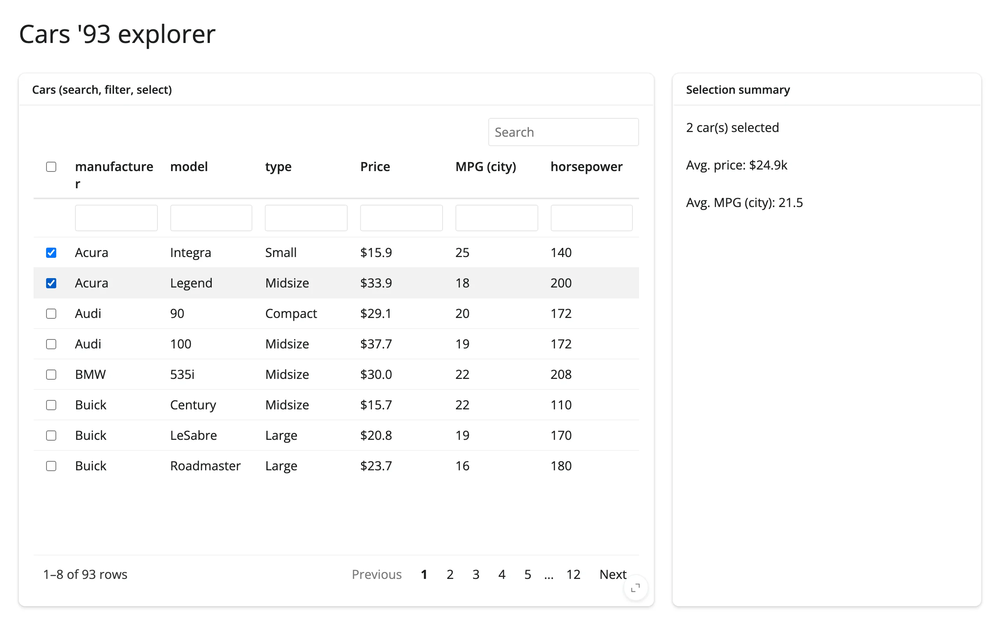

### Cars '93 dashboard (showcase)

A fuller dashboard: a vehicle-type filter and a grouping toggle re-render the table; page size updates in place;
row selection drives a comparison card; the search box drives a chart of what's currently visible. Exercises
`selected_rows()`, `search()`, an in-place prop update, grouping/aggregation (with the `mean` workaround above), a
JS cell renderer, and theming together. [`gallery/showcase_cars_dashboard.py`](gallery/showcase_cars_dashboard.py)

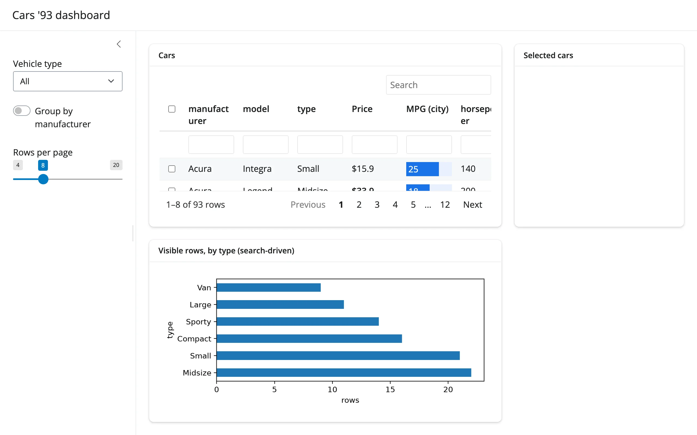
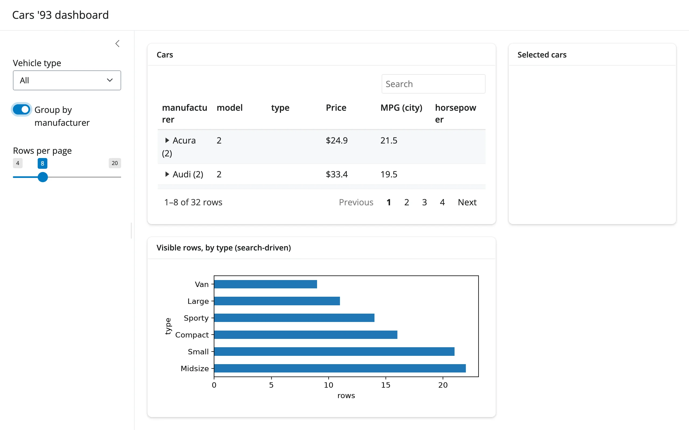

## Learn more

- [reactable-py documentation](https://machow.github.io/reactable-py/)
- [R reactable documentation](https://glin.github.io/reactable/) (the state API shinywidgets bridges from; most
  R reactable recipes for formatting, themes, and custom renderers translate directly)
- Related guides in this roster: [itables](../itables/index.md) (zero-config DataTables.net tables),
  [ipydatagrid](../ipydatagrid/index.md) (canvas grid, cell-block selection, in-cell bars/heatmaps, editing),
  [perspective](../perspective/index.md) (aggregation-first exploration of very large tables)
