[Rerun](https://rerun.io) is a visualization engine for multimodal, time-indexed data, built by Rerun.io for
robotics, computer vision, and other domains where "what happened, and when" spans more than one kind of
signal. You log 3D points, boxes, meshes, images, tensors, scalars, and text logs from Python under **entity
paths** (a filesystem-like namespace, e.g. `world/robot/camera`), and the viewer -- a Rust/Wasm application
running in the browser -- lets you scrub a shared timeline to see everything evolve together: a 3D scene, a
camera feed, and a telemetry plot, all pinned to the same moment. It's the same engine behind Rerun's own
robotics and ML tooling, now usable as a notebook widget via the separate `rerun-notebook` package.

`@render_rerun` takes either a `rerun.notebook.Viewer` (the high-level, recommended API) or the lower-level
`rerun_notebook.Viewer` anywidget it wraps. It fixes the one thing that differs from Jupyter: rerun's usual
`rr.init()` + `rr.log()` pattern writes to a single process-global recording, which in a Shiny process would leak
one user's data into every other session's viewer. Construct a `rerun.RecordingStream` inside the render function
instead, and shinywidgets' layout defaults take care of the rest -- the viewer fills its container unless you give
it an explicit size. The `selected()` accessor reads what the user has clicked in the viewer (an entity, a view,
or a container) reactively, like a Shiny input.

Reach for rerun when your data is inherently temporal and multimodal -- a robot's sensor log, an ML training run
with images and metrics, a simulation trace. For a single static 3D mesh or point cloud with no time axis, see
[pyvista](../pyvista/index.md) or [k3d](../k3d/index.md) instead; for 2D plots alone, [plotly](../plotly/index.md)
or [altair](../altair/index.md) are lighter weight.

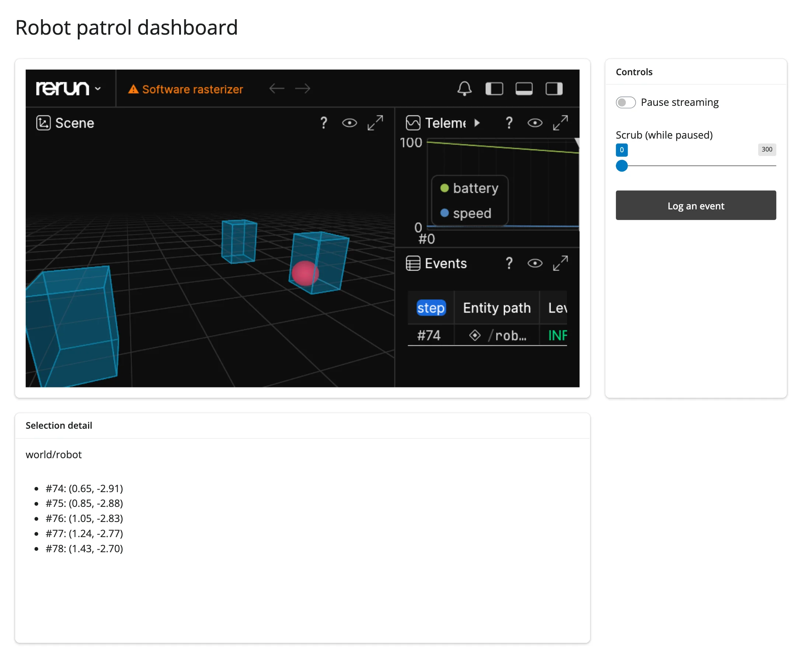

## Installation

```sh
pip install 'shinywidgets[rerun]'
```

This installs `rerun-sdk[notebook]` (rerun-sdk plus the `rerun-notebook` anywidget). **Requires Python 3.11+**
-- rerun-sdk dropped 3.10.

The viewer's JavaScript/Wasm bundle (~55 MB) loads from rerun's CDN by default. Set the `RERUN_NOTEBOOK_ASSET`
environment variable to `serve-local` (serves it from the Shiny process over a loopback thread server -- local
development only, since the browser must reach the same host) or `inline` (embeds it in the comm-open message;
works for remote deployments too) to avoid the CDN. Every example below sets `serve-local` for that reason.

## Quick start

A recording built from a looping path, a moving point, and a scalar series. Note the recording is created
*inside* the render function (one per session) and the viewer is left at its default size, which shinywidgets
expands to fill the card:

```{.python file="examples/01_quickstart.py"}
from __future__ import annotations

import os

# Serve the viewer's JS/Wasm bundle from the Shiny process instead of rerun's
# CDN (see "Installation" in the guide for why). Shiny Express auto-displays
# any top-level expression's value, so this is an `if`, not `.setdefault()`
# (whose return value would otherwise render as page text).
if "RERUN_NOTEBOOK_ASSET" not in os.environ:
    os.environ["RERUN_NOTEBOOK_ASSET"] = "serve-local"

import numpy as np
import rerun as rr
from rerun.notebook import Viewer
from shiny.express import ui

from shinywidgets import render_rerun

ui.page_opts(title="rerun quickstart", fillable=True)

with ui.card(full_screen=True):

    @render_rerun
    def viewer():
        # Create the recording inside the render function so each session
        # gets its own -- never the global rr.init()/rr.log() pattern, which
        # would mix every session's data into one recording.
        rec = rr.RecordingStream(application_id="quickstart")

        rng = np.random.default_rng(0)
        t = np.linspace(0, 4 * np.pi, 120)
        path = np.column_stack([np.cos(t) * t, np.sin(t) * t, t * 0.1])
        rec.log("world/path", rr.LineStrips3D([path]), static=True)

        for i in range(0, len(path), 4):
            rec.set_time("step", sequence=i)
            rec.log("world/robot", rr.Points3D([path[i]], radii=0.3, colors=[(239, 71, 111)]))
            rec.log("robot/speed", rr.Scalars(1.0 + 0.4 * np.sin(i / 8) + rng.normal(0, 0.05)))

        return Viewer(width="auto", height="auto", recording=rec)
```

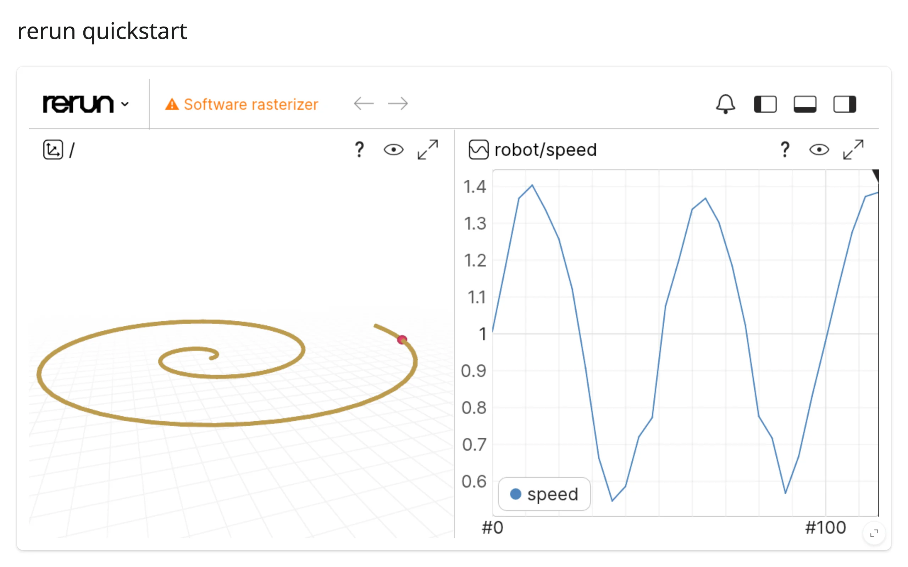

Rerun auto-picks a layout from what you logged -- here, a 3D view next to a timeseries plot, with no blueprint
specified at all. `rec.set_time("step", sequence=i)` stamps each subsequent `log()` call on a timeline named
`step`; the viewer's bottom panel turns that into the scrubber shown under "What you can build" below.

A plain `@render_widget` also renders a `rerun.notebook.Viewer` -- use `@render_rerun` for the typed `.selected()`
accessor and a narrower `ImportError` message when the extra isn't installed.

## What you can build

### A multimodal scene: 3D, images, scalars, and text together, one timeline

The same recording can hold a 3D scene (points, a camera frustum via `Pinhole` + `Transform3D`, obstacle boxes), a
synthetic camera feed logged as a child of the camera entity (rerun renders it as a textured plane inside the
frustum automatically), scalar telemetry, and text log events -- all addressable by the same timeline:

```{.python file="examples/02_multimodal_scene.py"}
rec.log("world/path", rr.LineStrips3D([path]), static=True)
rec.log(
    "world/obstacles",
    rr.Boxes3D(centers=OBSTACLES, half_sizes=[(0.4, 0.4, 0.6)] * 3, colors=[(239, 71, 111)]),
    static=True,
)
# The pinhole's intrinsics don't change over time, so log them once;
# the frustum then rides whatever transform its parent entity has at
# each timeline step.
rec.log(
    "world/robot/camera",
    rr.Pinhole(width=32, height=24, focal_length=28, image_plane_distance=0.6),
    static=True,
)

for i in range(N_STEPS):
    rec.set_time("step", sequence=i)
    dx, dy, _ = path[min(i + 1, N_STEPS - 1)] - path[i]
    heading = np.arctan2(dy, dx)
    rec.log(
        "world/robot",
        rr.Transform3D(
            translation=path[i],
            rotation=rr.RotationAxisAngle(axis=[0, 0, 1], radians=heading),
        ),
    )
    rec.log("world/robot/camera/image", rr.Image(camera_frame(i)))
    rec.log("robot/speed", rr.Scalars(1.0 + 0.3 * np.sin(i / 5)))
    rec.log("robot/battery", rr.Scalars(100 - i * 0.6))
    if i == N_STEPS // 3:
        rec.log("robot/log", rr.TextLog("obstacle sighted", level="INFO"))
    if i == 2 * N_STEPS // 3:
        rec.log("robot/log", rr.TextLog("waypoint reached", level="INFO"))

return Viewer(width="auto", height="auto", recording=rec)
```

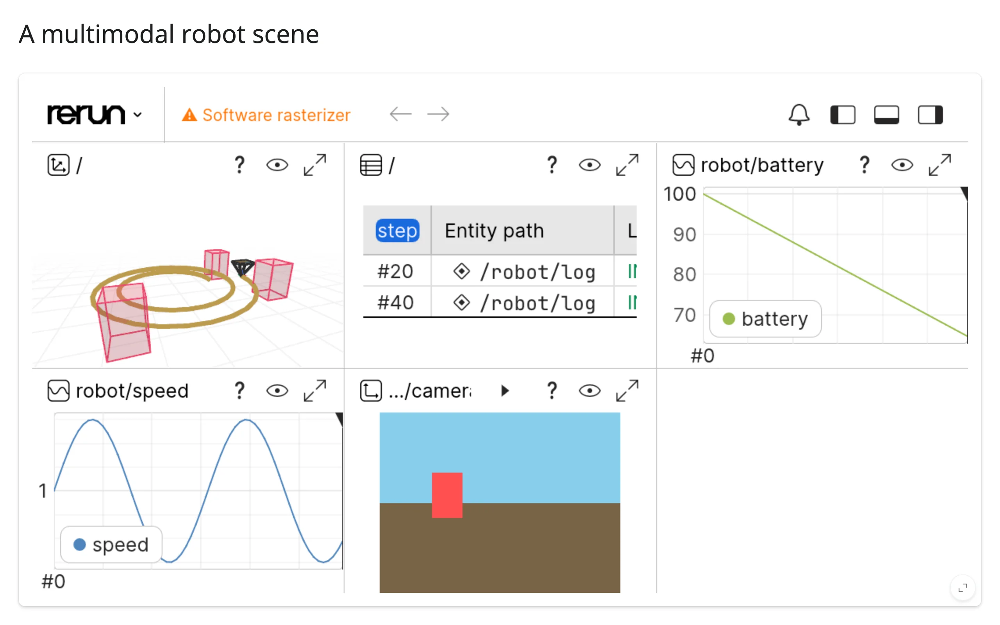

`static=True` means "true at every point on the timeline" (used here for the path and obstacles, which don't
move); everything else is stamped per step. One output widget is now a robotics/ML dashboard that would otherwise
need a 3D view, an image viewer, and a plotting library wired together by hand.

### The timeline scrubber

Every logged value rides the timeline set by the most recent `rec.set_time(...)` call. The viewer's own bottom
panel lets a user drag the playhead to any point and see every view -- 3D scene, charts, image, text log -- jump
to that moment together, with no extra code:

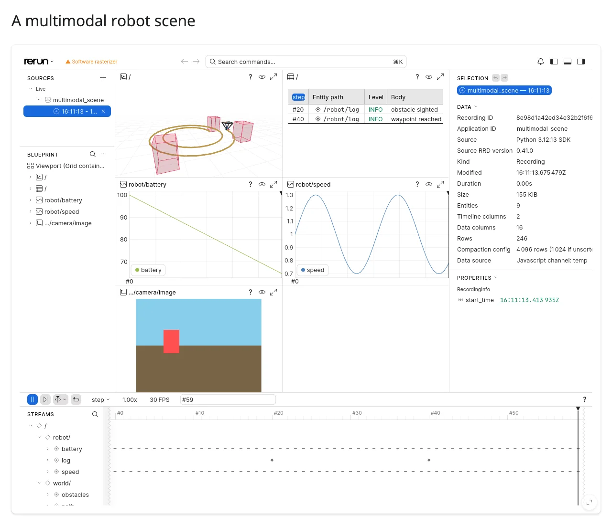
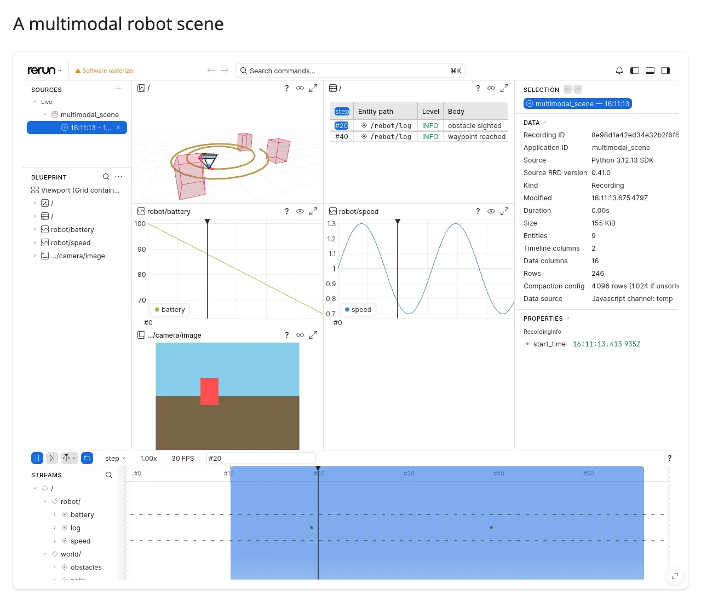

Dragging the playhead back to step 20 moves the robot to an earlier point on its spiral, rewinds both scalar
plots, and highlights the matching row in the text log table (`#20 obstacle sighted`) -- confirmed by dragging the
playhead in a real browser session. For *Python*-driven time control -- a Shiny slider, or a "rewind and play"
button -- see [`set_time_ctrl()`](#updating-the-widget-from-python) below; it's more reliable to automate than a
canvas drag and composes with the rest of the app's reactivity.

### Blueprints: deliberate layout instead of auto-layout

A `rerun.blueprint.Blueprint` arranges views by entity path (`origin`) instead of leaving rerun to decide. Combined
with `theme="dark"` and `collapse_panels=True` (hides the blueprint/selection side panels), one object turns the
same kind of data into an end-user dashboard rather than a debugging view:

```{.python file="examples/03_blueprint_layout.py"}
BLUEPRINT = rrb.Blueprint(
    rrb.Horizontal(
        rrb.Spatial3DView(origin="world", name="Scene"),
        rrb.Vertical(
            rrb.TimeSeriesView(origin="robot", name="Telemetry"),
            rrb.TextLogView(origin="robot/log", name="Events"),
        ),
        column_shares=[2, 1],
    ),
    collapse_panels=True,
)

ui.page_opts(title="Blueprint layout", fillable=True)

with ui.card(full_screen=True):

    @render_rerun
    def viewer():
        rec = rr.RecordingStream(application_id="blueprint_layout")
        path = make_path()
        rec.log("world/path", rr.LineStrips3D([path]), static=True)

        for i in range(N_STEPS):
            rec.set_time("step", sequence=i)
            rec.log("world/robot", rr.Points3D([path[i]], radii=0.3, colors=[(239, 71, 111)]))
            rec.log("robot/speed", rr.Scalars(1.0 + 0.3 * np.sin(i / 5)))
            rec.log("robot/battery", rr.Scalars(100 - i * 0.6))
            if i == N_STEPS // 2:
                rec.log("robot/log", rr.TextLog("waypoint reached", level="INFO"))

        return Viewer(width="auto", height="auto", blueprint=BLUEPRINT, theme="dark", recording=rec)
```

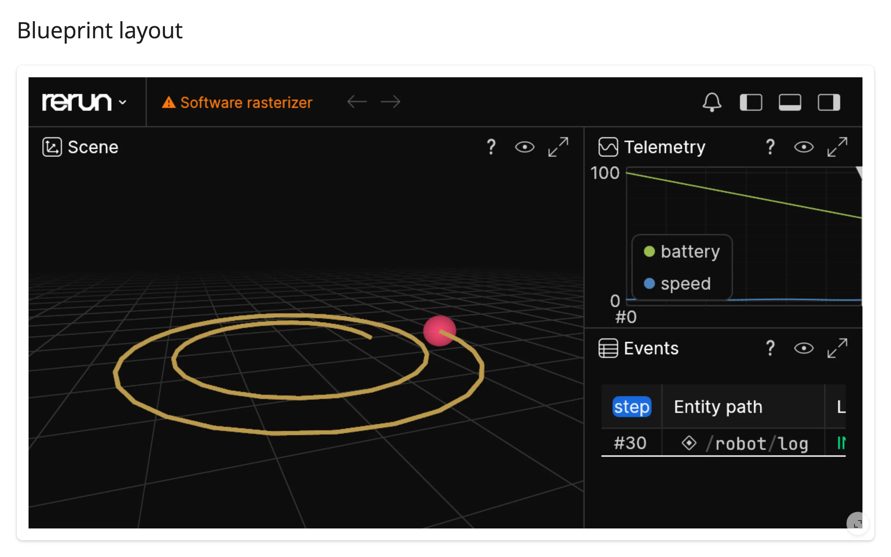

### Live streaming: the robot keeps moving after the viewer is open

Logging more data to an already-rendered recording streams straight to the open viewer -- no re-render, no
polling, no message-serialization code. Use a plain Python counter (not a `reactive.Value`) for the tick count: an
effect that reads and writes the same `reactive.Value` re-invalidates itself every tick, which starved one test
session's event loop badly enough that *no output ever rendered* (see "Gotchas and limitations"):

```{.python file="examples/04_streaming.py"}
# Holds the session's RecordingStream so the periodic effect below can log
# to the same recording the viewer is attached to (the render function
# itself runs once; new data streams in without a re-render).
recording_box: list[rr.RecordingStream] = []

@render_rerun
def viewer():
    rec = rr.RecordingStream(application_id="streaming")
    recording_box[:] = [rec]
    rec.log("world/path", rr.LineStrips3D([PATH]), static=True)
    return Viewer(width="auto", height="auto", recording=rec)

# A plain Python counter, not a reactive.Value: an effect that both reads
# and writes the same reactive.Value re-invalidates itself every tick,
# which can stall the session badly enough that no output ever flushes
# (see "Gotchas and limitations"). This effect depends on nothing
# reactive besides the timer, so a closure variable is simpler anyway.
step = [0]

@reactive.effect
def _stream() -> None:
    reactive.invalidate_later(0.1)
    if not recording_box:
        return
    rec = recording_box[0]
    i = step[0] % len(PATH)
    rec.set_time("step", sequence=step[0])
    rec.log("world/robot", rr.Points3D([PATH[i]], radii=0.3, colors=[(239, 71, 111)]))
    rec.log("robot/battery", rr.Scalars(100 - (step[0] % 200) * 0.5))
    step[0] += 1
```

Right after mount (just the path, battery at 100) and four seconds later (robot further along, battery drained,
~100 more points logged, all in the same viewer instance):

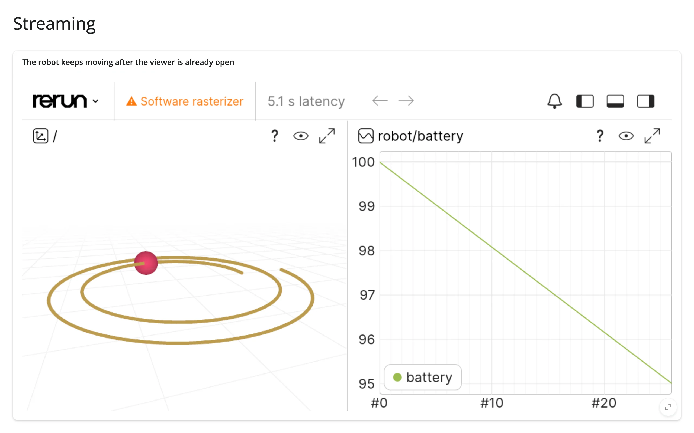
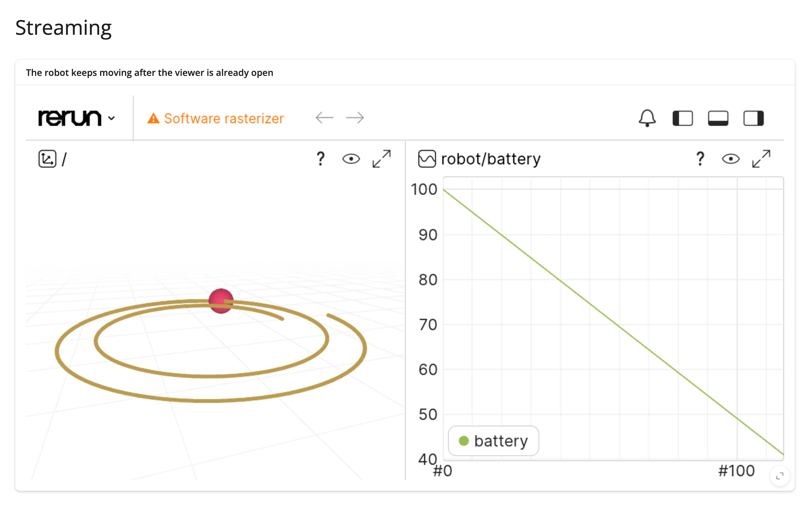

## Reacting to user interaction

### Accessor reference

| accessor | returns | before any interaction | across re-render | default rate policy |
|---|---|---|---|---|
| `selected()` | `rerun.notebook.SelectionChangeEvent` (`.items`: a list of `EntitySelectionItem`, `ViewSelectionItem`, `ContainerSelectionItem`) | `None` until the user first selects something | kept (the new viewer's load-time empty selection is ignored, so it can't overwrite the carried-over value) | not rate-limited -- every selection change publishes |

### `selected()`: click an entity, read it back in Python

The viewer reports *which* entity, view, or container is selected -- not what was logged there. Keep your own
history (keyed by entity path) if you want a detail panel showing the data behind the click:

```{.python file="examples/05_selection.py"}
@render_rerun
def viewer():
    rec = rr.RecordingStream(application_id="selection_demo")
    t = np.linspace(0, 4 * np.pi, N_STEPS)
    r = 1.5 + 0.12 * t
    path = np.column_stack([r * np.cos(t), r * np.sin(t), np.zeros(N_STEPS)])

    HISTORY["world/robot"] = []
    for i, p in enumerate(path):
        rec.set_time("step", sequence=i)
        rec.log("world/robot", rr.Points3D([p], radii=0.3, colors=[(239, 71, 111)]))
        HISTORY["world/robot"].append((i, *p))

    rec.log(
        "world/obstacles",
        rr.Boxes3D(centers=OBSTACLES, half_sizes=[(0.4, 0.4, 0.6)] * 2, colors=[(17, 138, 178)]),
        static=True,
    )
    HISTORY["world/obstacles"] = [
        (i, *center) for i, center in enumerate(OBSTACLES)
    ]

    return Viewer(width="auto", height="auto", recording=rec)
```

The detail card looks the clicked entity path up in that history
([`examples/05_selection.py`](examples/05_selection.py)):

```{.python file="examples/05_selection.py"}
@render.ui
def detail():
    evt = viewer.selected()
    if evt is None:
        return ui.p("(nothing selected yet -- click an entity in the 3D view or the stream tree)")
    if not evt.items:
        return ui.p("Nothing selected -- click an entity in the 3D view or the stream tree.")

    item = evt.items[0]
    if not isinstance(item, EntitySelectionItem):
        return ui.p(f"Selected a {type(item).__name__}, not an entity.")

    rows = HISTORY.get(item.entity_path, [])
    return ui.TagList(
        ui.h5(item.entity_path),
        ui.p(f"{len(rows)} logged value(s)"),
        ui.tags.table(
            ui.tags.thead(ui.tags.tr(ui.tags.th("#"), ui.tags.th("x"), ui.tags.th("y"), ui.tags.th("z"))),
            ui.tags.tbody(
                *[
                    ui.tags.tr(
                        ui.tags.td(str(i)),
                        ui.tags.td(f"{x:.2f}"),
                        ui.tags.td(f"{y:.2f}"),
                        ui.tags.td(f"{z:.2f}"),
                    )
                    for i, x, y, z in (rows[:3] + rows[-3:] if len(rows) > 6 else rows)
                ]
            ),
            class_="table table-sm",
        ),
    )
```

Before any interaction, `selected()` is still `None` (the viewer's empty load-time report is ignored -- an
empty selection carries no information), and after simulating a real click message on `world/robot`:

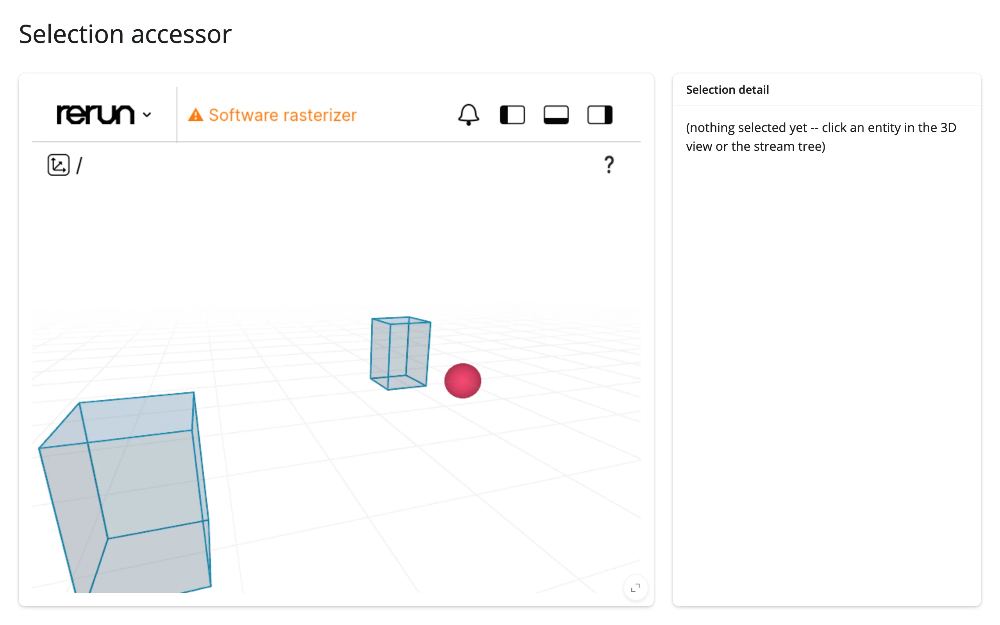
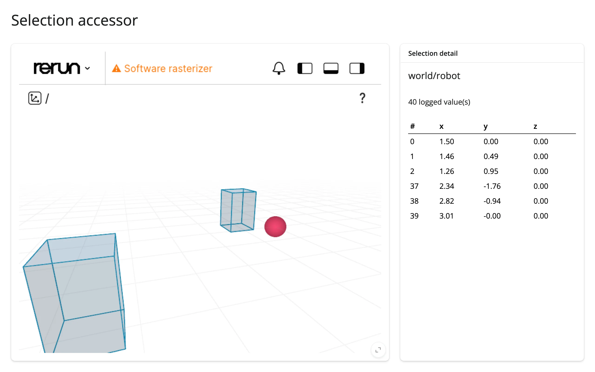

Three things worth knowing about `None` and re-renders here: `selected()` returns `None` until the user
selects something for the first time (the viewer's empty load-time report is ignored, so `evt.items == []`
always means the user *cleared* a selection) -- `req(viewer.selected())` guards exactly that window. A
re-render keeps the previous selection: the carried-over value isn't overwritten by the new viewer's load-time
report either (verified: `selected()` still returned the old selection several seconds after a forced
re-render, well past the point the new viewer finished loading). Clicking the *same* thing twice doesn't
re-fire (`selected()` only publishes on a change).

**Verification note:** clicking an entity in the 3D viewport or stream tree is drawn by rerun's own egui/Wasm
canvas, not the DOM, so Playwright can't hit-test a specific entity by screen coordinates reliably (confirmed:
clicks landed on the view background or the wrong box repeatedly; this matches a skipped test already in
shinywidgets' own Playwright suite for this exact reason). The `after` screenshot above was produced by sending
the *same JSON message* a real click sends (`{"type": "selection_change", "items": [...]}`) directly to the
widget's model via `window.widgetManager`, which exercises the identical code path (`_on_raw_event` ->
`_viewer_event_from_json_str` -> `selected()`) as a real click -- only the pixel-perfect click gesture itself is
substituted for a reliable, equivalent one. The kept-across-re-render behavior is covered by shinywidgets' own
Playwright suite (`tests/playwright/rerun_accessors`), which forces a re-render with a selection in place and
checks that the new viewer's load-time report doesn't overwrite it.

### Beyond the accessor: reactive_read

The underlying `rerun_notebook.Viewer` widget's synced traits are `_width`, `_height`, `_panel_states`,
`_fallback_token`, and `_theme` -- all Python-set display state, not things a user interaction changes. There's
nothing else worth reading with `reactive_read()`; viewer interactions other than selection (play, pause, time
scrubbing, opening a new recording) arrive as one-off event messages, not synced traits, so `reactive_read()`
can't see them regardless. Use `Viewer.on_event()` for those (see "Beyond the accessors" in the docstring example
and [Updating the widget from Python](#updating-the-widget-from-python) for `set_time_ctrl()`, its programmatic
counterpart).

### Rate limiting

`selected()` is not rate-limited and has no default `rate_policy`/`rate_delay` -- a user can only select so fast,
and every selection change is cheap to react to. The renderer's `rate_policy`/`rate_delay` kwargs still apply to
`reactive_read()` on the widget's traits (e.g., debouncing a trait you set from a fast-moving effect), just not to
`selected()`.

## Updating the widget from Python

`.widget` (what `render_rerun` exposes on the decorated function) is the *low-level* `rerun_notebook.Viewer` --
`update_panels()` and `set_time_ctrl()` live on the high-level `rerun.notebook.Viewer` wrapper instead. Keep a
reference to the wrapper (and the `RecordingStream`) from inside the render function to call them later:

```{.python file="examples/06_update_in_place.py"}
# `.widget` (what render_rerun exposes) is the low-level viewer; the
# high-level rerun.notebook.Viewer wrapper's update_panels() and
# set_time_ctrl() aren't on it. Keep the wrapper itself (and the
# RecordingStream) to call them later without re-rendering.
wrapper_box: list[Viewer] = []
recording_box: list[rr.RecordingStream] = []

@render_rerun
def viewer():
    rec = rr.RecordingStream(application_id="update_in_place")
    recording_box[:] = [rec]
    path = make_path()
    rec.log("world/path", rr.LineStrips3D([path]), static=True)
    for i, p in enumerate(path):
        rec.set_time("step", sequence=i)
        rec.log("world/robot", rr.Points3D([p], radii=0.3, colors=[(239, 71, 111)]))
    v = Viewer(width="auto", height="auto", recording=rec)
    wrapper_box[:] = [v]
    return v
```

The three buttons drive three effects -- append to the live recording, toggle a panel, rewind and play
([`examples/06_update_in_place.py`](examples/06_update_in_place.py)):

```{.python file="examples/06_update_in_place.py"}
extra_logged = [0]


@reactive.effect
@reactive.event(input.log_more)
def _log_more() -> None:
    # Appends to the live recording -- no re-render, so the viewer's camera
    # angle and selection are untouched.
    if not recording_box:
        return
    extra_logged[0] += 1
    rec = recording_box[0]
    rec.set_time("step", sequence=N_STEPS + extra_logged[0])
    rng = np.random.default_rng(extra_logged[0])
    point = rng.uniform(-4, 4, size=3) * [1, 1, 0]
    rec.log("world/detections", rr.Points3D([point], radii=0.25, colors=[(6, 214, 160)]))


panel_state = ["expanded"]


@reactive.effect
@reactive.event(input.toggle_panel)
def _toggle_panel() -> None:
    if not wrapper_box:
        return
    panel_state[0] = "collapsed" if panel_state[0] == "expanded" else "expanded"
    wrapper_box[0].update_panels(blueprint=panel_state[0])


@reactive.effect
@reactive.event(input.replay)
def _replay() -> None:
    if wrapper_box:
        wrapper_box[0].set_time_ctrl(sequence=0, play=True)
```

Logging a new detection point (a Shiny button click -> a `rec.log()` call -- "what gets logged" driven by a
Shiny input) leaves the existing scene and camera angle untouched:

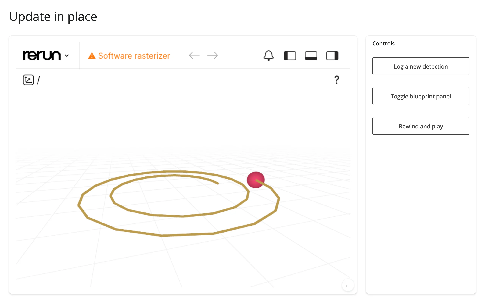
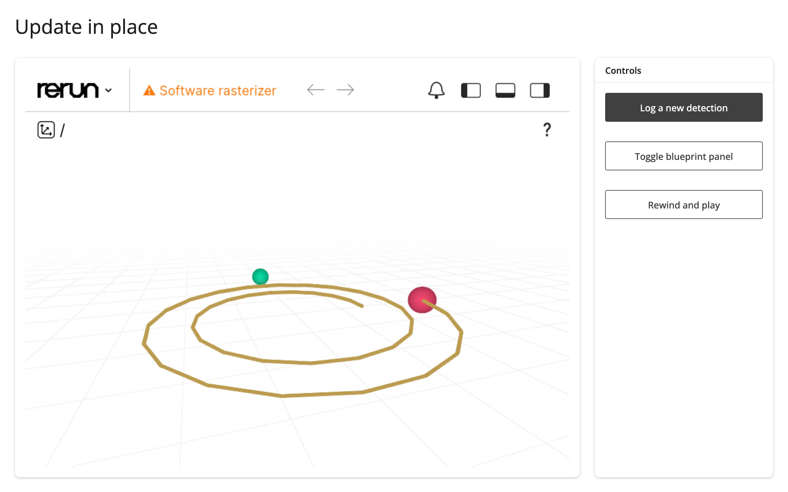

`update_panels()` toggles a panel's visibility from Python without touching the recording at all (here there's no
custom blueprint, so the only visible change is the panel icon's state in the top bar -- see "Blueprints" above
for a layout where a toggled panel has visible content to show or hide):

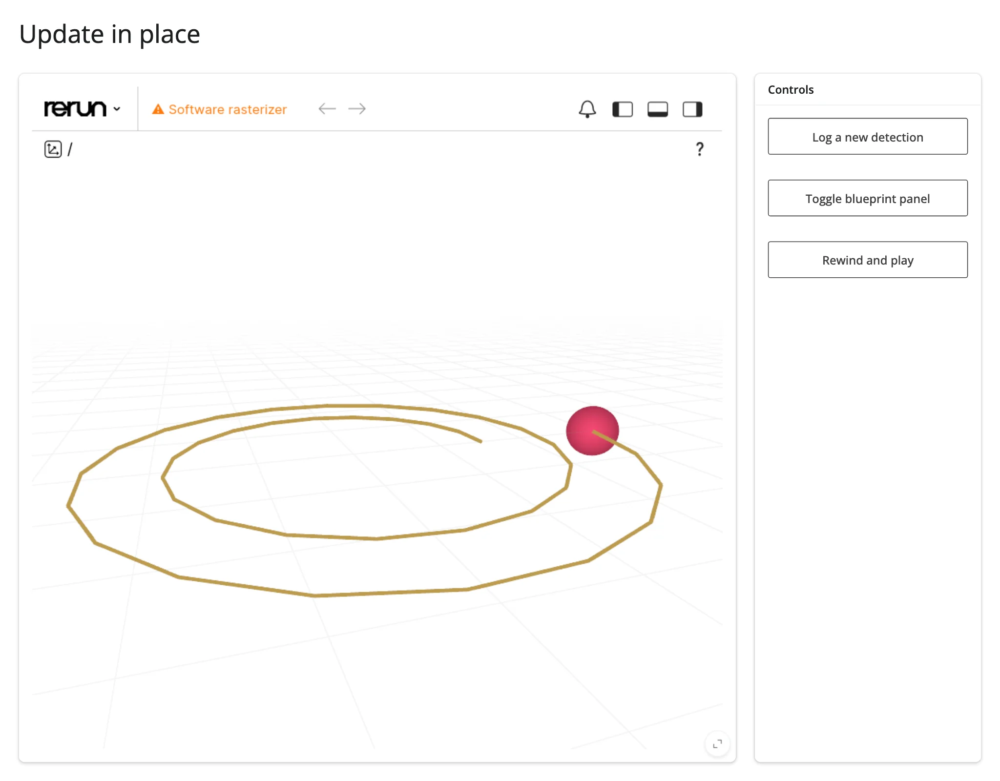
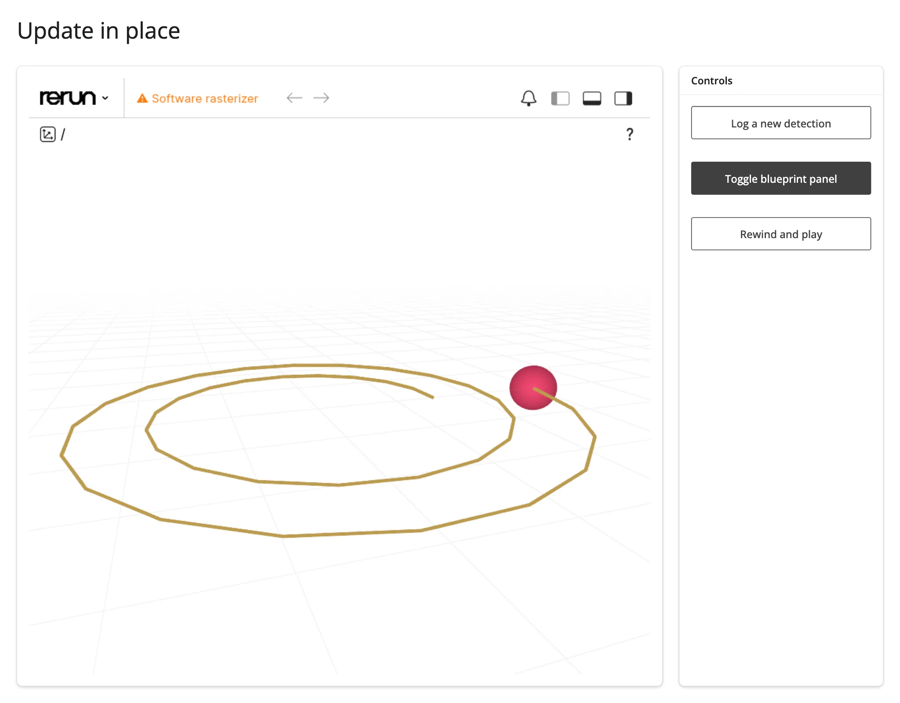

`set_time_ctrl(sequence=0, play=True)` rewinds to the start and starts playback -- a "replay" button driving the
viewer's own timeline instead of a user dragging it:

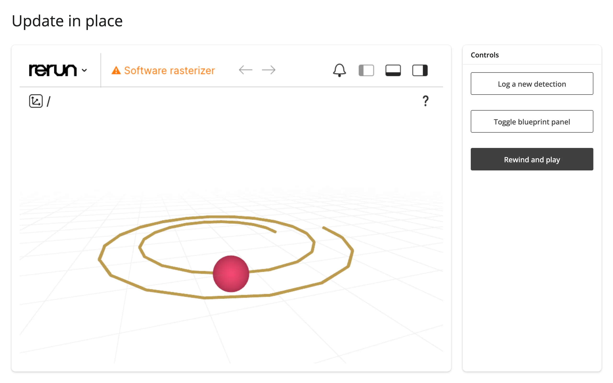

Prefer logging more data (or these targeted trait/method calls) over re-rendering whenever the scene's identity
hasn't changed: re-rendering tears down and reconstructs the viewer, replaying the whole recording from scratch
and resetting the user's camera angle and selection; in-place updates don't.

## Coordinating multiple views

### A Shiny slider scrubs the timeline

`Viewer.set_time_ctrl()` accepts a `sequence` (or `duration`/`timestamp`) directly, so any Shiny input can drive
"what point in time is the viewer showing" -- handy when the rest of the page, not the viewer's own scrubber,
should own that state:

```{.python file="examples/07_slider_scrub.py"}
ui.input_slider("step", "Step", min=0, max=N_STEPS - 1, value=0)
```

and the effect that applies it, kept outside the render function so dragging the slider never rebuilds
the viewer ([`examples/07_slider_scrub.py`](examples/07_slider_scrub.py)):

```{.python file="examples/07_slider_scrub.py"}
@reactive.effect
def _scrub() -> None:
    # A Shiny slider stands in for the viewer's own timeline scrubber -- handy
    # when the rest of the page (other inputs, a linked table) should drive
    # "what point in time am I looking at" instead of the viewer's own UI.
    if wrapper_box:
        wrapper_box[0].set_time_ctrl(sequence=input.step())
```

Dragging the slider from 0 to 30 moves the robot and both chart cursors together, exactly as if the viewer's own
timeline had been scrubbed:

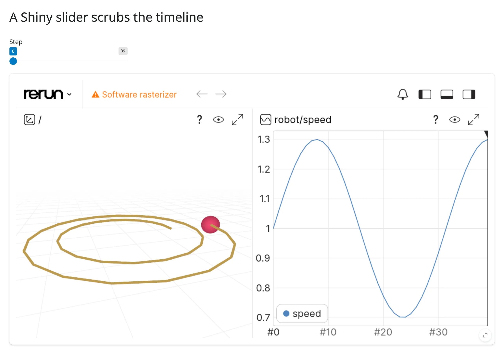
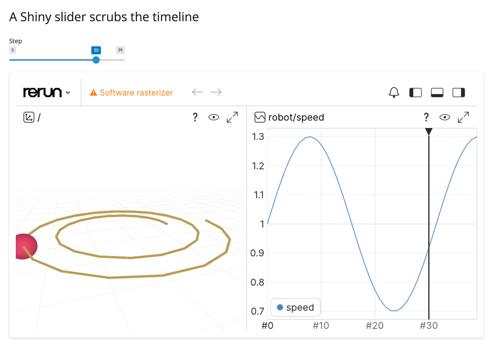

### Selection highlights a plotly chart

`viewer.selected()` naming a specific obstacle (one entity path per obstacle) drives an in-place color update on
a separate `go.FigureWidget` -- a 3D viewer and a 2D plot, kept in sync, with the plot's zoom/pan state untouched
by the update:

```{.python file="examples/08_selection_to_plotly.py"}
def _highlight_selected_obstacle() -> None:
    evt = viewer.selected()
    if evt is None or not evt.items:
        return
    item = evt.items[0]
    if not isinstance(item, EntitySelectionItem):
        return
    prefix = "world/obstacles/"
    if not item.entity_path.startswith(prefix):
        return
    selected = int(item.entity_path[len(prefix) :])

    with reactive.isolate():
        # In place: the scatter keeps its zoom/pan state, instead of
        # rebuilding the whole figure for a single color change.
        scatter.widget.data[0].marker.color = [
            SELECTED_COLOR if i == selected else DEFAULT_COLOR for i in range(len(OBSTACLES))
        ]
```


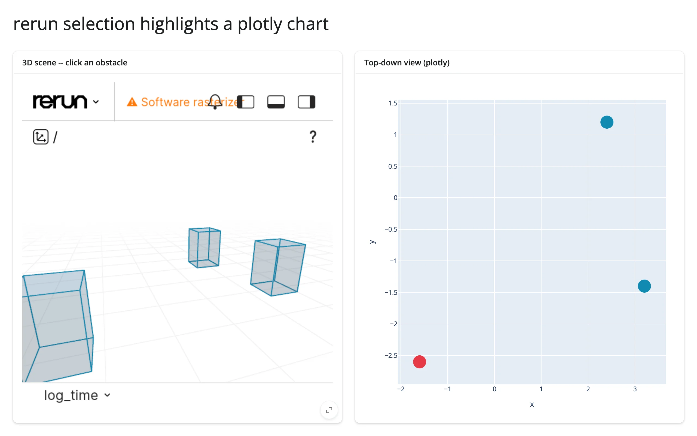

*(Pairs well with [plotly](../plotly/index.md); the same in-place-update pattern works with any renderer whose
widget exposes a settable trait, e.g. [ipyleaflet](../ipyleaflet/index.md) or [itables](../itables/index.md).)*

### Click an entity for a detail card

See [`selected()`](#selected-click-an-entity-read-it-back-in-python) above -- a `@render.ui` reading
`viewer.selected()` and looking up a Python-side `HISTORY` dict by entity path is a complete master-detail
pattern on its own, no second widget required.

## Large data

Rerun is built around "only send what's visible" over time: you log a continuous stream and the viewer scrubs a
timeline rather than re-rendering a static scene -- see
[Large data & performance's three approaches](../../guide/performance/index.md#three-approaches-to-large-data)
and the [Live streaming](#live-streaming-the-robot-keeps-moving-after-the-viewer-is-open) example above. No
throughput ceiling was measured here; Rerun's web viewer (what `rerun.notebook.Viewer` embeds) caps recording
memory at **2.5 GB by default** (4 GiB addressable) and drops the oldest data once it's full, per
[Rerun's own memory-limit docs](https://rerun.io/docs/howto/visualization/limit-ram). That page's
`memory_limit` knob belongs to `RecordingStream.spawn()` (the separate native-viewer-process path); no equivalent
was found on the notebook `Viewer`/`RecordingStream` used here, so budget a long-running stream's data rate
against that 2.5 GB ceiling rather than assuming it's configurable from this integration.

## Layout and sizing

In a filling layout, leave `width`/`height` at their Python defaults (both `640`) or pass `"auto"` explicitly --
shinywidgets treats the 640x480 default as unset (the same tradeoff as maplibre's 400px default, since a real
`640` can't be told apart from "untouched") and converts it to `"auto"`, which fills the output's card. An
explicit integer height (e.g. `Viewer(height=300, ...)`) opts out of filling. `output_widget(height=...)` on the
Shiny side also sizes a default-sized viewer to the output's height, independent of the viewer's own `height=`
trait.

`full_screen=True` on the containing card works as expected -- the viewer re-measures and refills on resize or
maximize, independent of the viewer's own maximize button (bottom-right corner of the viewport, inside rerun's
own chrome).

## Gotchas and limitations

Verified on current main (shinywidgets, rerun-sdk 0.41.0):

- **Always construct a per-session `RecordingStream`.** rerun's familiar `rr.init()` + `rr.log()` pattern writes
  to one process-global recording; every `Viewer()` with the default `use_global_recording=True` attaches to it.
  In Shiny, that recording is shared by every browser session on the process, so one user's data would appear
  live in every other user's viewer. `rec = rr.RecordingStream(application_id=...)` plus `Viewer(recording=rec)`
  (as in every example above) isolates sessions completely. This is the single biggest footgun carried over from
  the pre-accessors evaluation report, still true on main, and the `render_rerun` docstring leads with it.
- **`rr.notebook_show()` does nothing in Shiny.** It renders through Jupyter's display machinery (a no-op outside
  Jupyter) and *drains* the recording in the process, so the data is gone too. Construct and return a
  `rerun.notebook.Viewer` instead (every example here does).
- **An effect that reads and writes the same `reactive.Value`** (`n.set(n.get() + 1)`, no `reactive.isolate()`)
  re-invalidates itself on every flush. In an early draft of the streaming example this didn't just spin that one
  effect -- it stalled the session badly enough that the rerun output never rendered at all, with no error
  anywhere. Not rerun-specific (any widget's periodic-update effect can hit this), but worth calling out because
  the failure mode looks exactly like a broken render, not a hot loop. Use a plain Python counter (closure
  variable or module-level list) when the effect's state doesn't need to be reactive to anything but the timer.
- **Canvas-drawn UI can't be hit-tested reliably by Playwright.** Every pixel of the viewer -- 3D/2D viewport,
  stream tree, blueprint tree, timeline track -- is egui drawn into one canvas, not DOM. Coordinate-based clicks
  on a specific entity landed on the wrong target or the view background in testing (matching an already-skipped
  test in shinywidgets' own suite for this reason); dragging the timeline's playhead by its approximate pixel
  position did work, but required several calibration attempts. Prefer `set_time_ctrl()`/`update_panels()` from
  Python, or the widget-model-message simulation shown in "Reacting to user interaction", over automating viewer
  clicks.
- **An empty `rerun_notebook.Viewer` shows rerun's marketing welcome screen** ("The data layer for physical AI"),
  even though the front end sets `hide_welcome_screen: true`. Harmless -- no one ships a viewer with nothing
  logged -- and upstream, not a shinywidgets issue.
- **Sizing traits accept only `"auto"` or an integer pixel count.** Any other string (`"100%"`, `"50vh"`) silently
  falls back to the 640x480 default. Not something shinywidgets' layout defaults can work around at the trait
  level; use `"auto"` for filling, an int for fixed.
- **The top bar's warning badge (e.g. "Software rasterizer" in a GPU-less headless browser) can overlap its own
  icons in a narrow container** (observed under ~650px). Cosmetic, upstream rerun chrome; wider containers aren't
  affected.

## Gallery candidates

- [`gallery/template_live_tracker.py`](gallery/template_live_tracker.py) -- **template** (~70 lines). A point
  that moves every tick via `reactive.invalidate_later`, already attached to an open viewer, plus a
  `selected()`-driven detail panel keyed off a Python-side history dict. Adapt by swapping what gets logged each
  tick (a real sensor feed, a queue drained from a background thread) and what the history tracks.

  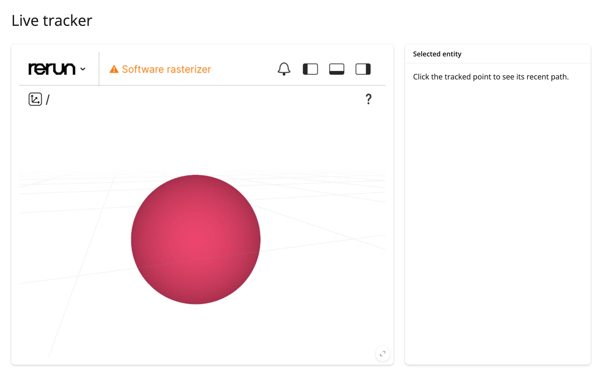
  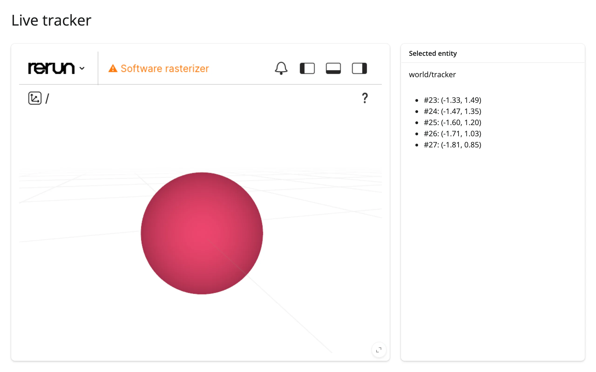

- [`gallery/showcase_robot_patrol.py`](gallery/showcase_robot_patrol.py) -- **showcase** (~150 lines). A dark,
  custom-blueprint dashboard (3D scene + telemetry + event log) streaming a patrol route live, with a
  pause/scrub control pair (Shiny drives `set_time_ctrl()` once streaming is paused), a "log an event" button
  (Shiny input -> what gets logged), and the same `selected()`-driven detail panel as the template. Combines
  every pattern in this guide into one app.

  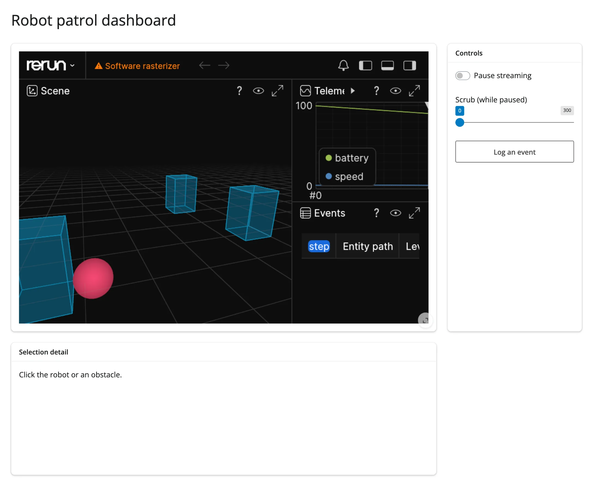
  
  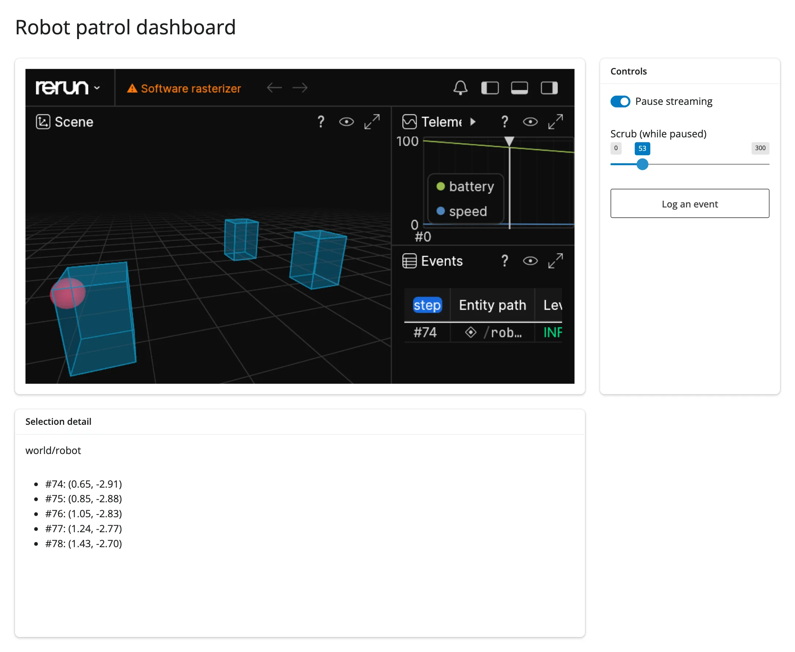

## Learn more

- [rerun.io/docs](https://rerun.io/docs) -- concepts (entities, timelines, archetypes), the full archetype
  reference, and the blueprint API.
- [rerun-notebook on PyPI](https://pypi.org/project/rerun-notebook/) -- the notebook widget package, asset modes,
  and `rerun.notebook.Viewer`'s API (`on_event`, `set_time_ctrl`, `update_panels`, `send_table`).
- Related guides in this roster: [pyvista](../pyvista/index.md) and [k3d](../k3d/index.md) for static 3D without
  a time axis; [plotly](../plotly/index.md) for the cross-widget selection-highlight pattern used above.
