> **This guide documents `render_vitessce`, an unmerged renderer proposed in [PR #374](https://github.com/posit-dev/py-shinywidgets/pull/374). It is not on `main` and not part of a release yet.**

[Vitessce](https://vitessce.io) is the standard coordinated multi-view viewer for single-cell and spatial-omics
data, built and maintained by the [HIDIVE Lab](https://hidivelab.org/) (Harvard Medical School) for the HuBMAP and
HCA data portals. Where most plotting libraries draw one chart, Vitessce composes a dashboard of linked views --
spatial scatter/segmentation plots, embeddings (UMAP/PCA/t-SNE), heatmaps, gene lists, and cell-set legends -- that
all stay in sync: zoom a spatial view and its embedding counterpart zooms too; select a cluster in the legend and
every view highlights it. Nothing else in the shinywidgets roster ships this much coordinated UI from one call.

`@render_vitessce` brings this into Shiny for Python via
[vitessce-python](https://github.com/vitessce/vitessce-python). Return a `VitessceConfig` -- the idiomatic builder
for datasets, views, and layout -- and it's coerced to a widget for you; return `config.widget(...)` yourself to
control `theme`, `height`, `proxy`, or `custom_js_url`. All three of vitessce-python's data modes work unmodified:
remote URLs (the browser fetches directly), local files (served by an embedded server in the Python process -- no
Jupyter server needed), and in-memory zarr stores (chunks travel over the widget comm).

The headline feature isn't a curated accessor -- `render_vitessce` has none. It's that the viewer is *already* a
Shiny input for free: every pan, zoom, lasso, and gene/cell-set selection syncs the *entire* view-config state back
to one synced trait, so `reactive_read(widget, "_config")` turns any interaction into a reactive value. Updating the
viewer from Python is a config edit plus a `uid` bump (below); there's no fine-grained "just move the camera" API
yet, so Python-driven updates are best for deliberate choices (a gene picker), not continuous ones.

Choose Vitessce when you need several coordinated views over one single-cell or spatial dataset (AnnData/zarr) in
one widget; reach for [lonboard](../lonboard/index.md) or [ipyleaflet](../ipyleaflet/index.md) for general
geospatial maps, or [jscatter](../jscatter/index.md)/[embedding-atlas](../embedding-atlas/index.md) for a single
large embedding scatterplot.

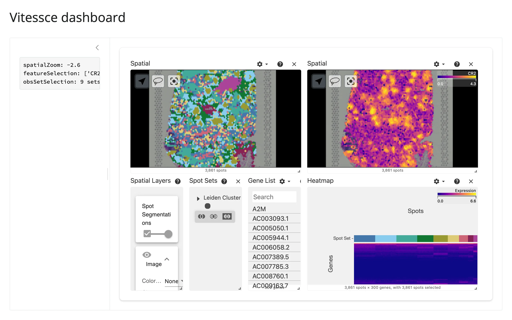

## Installation

```sh
pip install 'shinywidgets[vitessce]'
```

This pulls in `vitessce`, `starlette`, and `uvicorn` (for the embedded local-file server) and `jupyter-server-proxy`
(for deployed local-file serving). Because vitessce-python requires `zarr>=3`, it can't be installed alongside the
`vizarr` extra, which pins `zarr<3` -- pick one per project.

## Quick start

A minimal config: one dataset, one spatial view of 10x Genomics Visium spots, and the cell-sets legend that gives
the spots their default coloring. The data is a small, public, Vitessce-hosted zarr store, so this needs an
internet connection.

```{.python file="examples/01_quickstart.py"}
# Vitessce quick start: one remote AnnData-Zarr store, a spatial view, and
# its cell-sets legend. Requires an internet connection (zarr data + viewer
# JS are remote).
from shiny.express import ui
from vitessce import ViewType as vt, VitessceConfig

from shinywidgets import render_vitessce

ui.page_opts(title="Vitessce quick start", fillable=True)

DATA_URL = (
    "https://data-1.vitessce.io/0.0.33/main/human-lymph-node-10x-visium/"
    "human_lymph_node_10x_visium.h5ad.zarr"
)


@render_vitessce
def vit():
    vc = VitessceConfig(schema_version="1.0.15", name="Human lymph node (10x Visium)")
    dataset = vc.add_dataset(name="Lymph node").add_file(
        url=DATA_URL,
        file_type="anndata.zarr",
        # Tell Vitessce which zarr arrays hold spot coordinates, spot shapes,
        # and cluster labels (the latter is also what colors the spots by
        # default). Visium spots render from obsSegmentations, not just
        # obsLocations -- without it, the view mounts but draws nothing.
        options={
            "obsLocations": {"path": "obsm/spatial"},
            "obsSegmentations": {"path": "obsm/segmentations"},
            "obsSets": [{"name": "Leiden Cluster", "path": "obs/clusters"}],
        },
    )
    spatial = vc.add_view(vt.SPATIAL, dataset=dataset)
    sets = vc.add_view(vt.OBS_SETS, dataset=dataset)
    vc.layout(spatial | sets)
    return vc
```

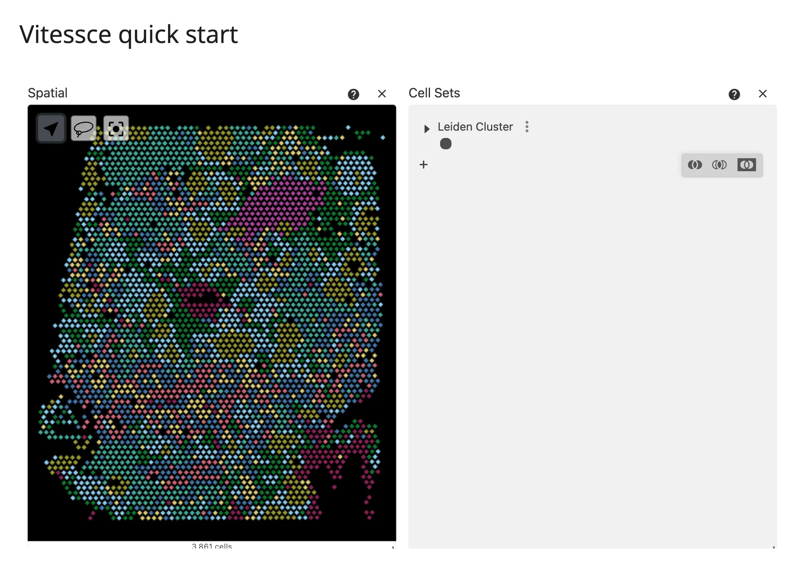

## What you can build

### Build a config in Python

`VitessceConfig` is a small, chainable builder: `add_dataset().add_file(url=..., file_type=..., options={...})`
describes your data and where to find each piece inside it (which zarr array holds coordinates, embeddings, cell
labels, expression values); `add_view(ViewType, dataset=...)` adds a panel; `.layout()` arranges panels with the
`|` (horizontal) and `/` (vertical) operators. Two views of one dataset that both read from the shared
`obsSets`/color-encoding scope -- a spatial view and a UMAP embedding -- stay color-linked with no extra code,
covered in detail under "Vitessce's own coordination" below:

```{.python file="examples/02_build_config.py"}
# Build a config from the Vitessce Python API: one dataset, two linked views.
# Requires an internet connection (zarr data + viewer JS are remote).
from shiny.express import ui
from vitessce import ViewType as vt, VitessceConfig

from shinywidgets import render_vitessce

ui.page_opts(title="Vitessce: build a linked config", fillable=True)

DATA_URL = (
    "https://data-1.vitessce.io/0.0.33/main/human-lymph-node-10x-visium/"
    "human_lymph_node_10x_visium.h5ad.zarr"
)
# The file's internal zarr layout (which obs/var arrays hold what).
FILE_OPTIONS = {
    "obsFeatureMatrix": {"path": "obsm/X_hvg", "featureFilterPath": "var/highly_variable"},
    "obsLocations": {"path": "obsm/spatial"},
    "obsEmbedding": [{"path": "obsm/X_umap", "embeddingType": "UMAP"}],
    "obsSets": [{"name": "Leiden Cluster", "path": "obs/clusters"}],
}


@render_vitessce
def vit():
    vc = VitessceConfig(schema_version="1.0.15", name="Lymph node: spatial + UMAP, linked")
    dataset = vc.add_dataset(name="Lymph node").add_file(
        url=DATA_URL, file_type="anndata.zarr", options=FILE_OPTIONS
    )
    spatial = vc.add_view(vt.SPATIAL, dataset=dataset)
    umap = vc.add_view(vt.SCATTERPLOT, dataset=dataset, mapping="UMAP")
    sets = vc.add_view(vt.OBS_SETS, dataset=dataset)
    # Both views draw from one obsSets coordination scope by default: clicking
    # a cluster in the legend highlights the same cells in the spatial view
    # *and* the UMAP view. That's Vitessce's own coordination -- no Shiny
    # code involved (see "Vitessce's own coordination" below). link_views()
    # (not used here) would let you tie additional types, e.g. ct.SPATIAL_ZOOM,
    # across views that don't share one (e.g. the matching ct.SPATIAL_ZOOM
    # coordination type) by default.
    vc.layout((spatial | umap) / sets)
    return vc
```

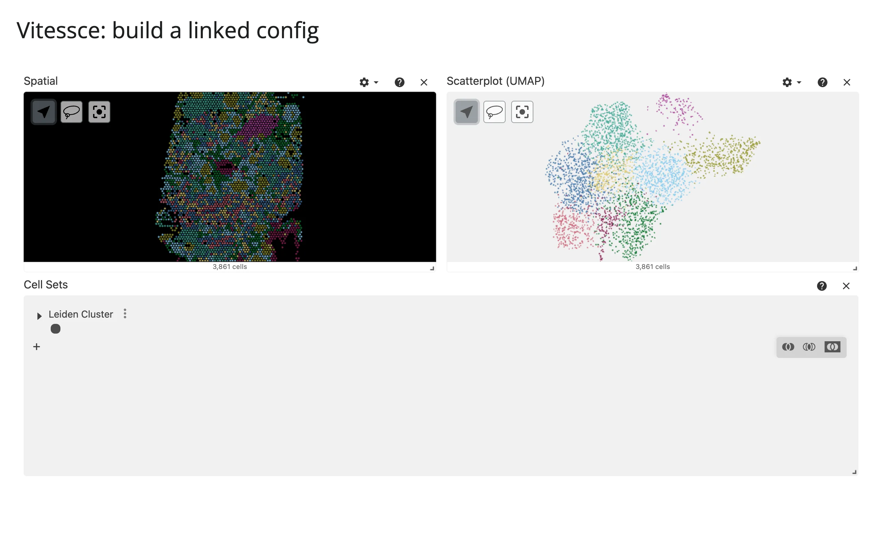

### A full multi-view portal in one output

Point `VitessceConfig.from_dict()` at a complete config -- hand-written, exported from the
[Vitessce web app](http://vitessce.io/), or (as below) one of the project's own public demo configs -- and you get
everything it describes: here, two linked spatial views (cluster colors and gene expression side by side), a
heatmap, a searchable gene list, and the cell-sets legend, all from one `@render_vitessce` call over one public
zarr store, plus a Python readout of what the user is doing. The full, runnable version is in "Reacting to user
interaction" below.


## Reacting to user interaction

`render_vitessce` has no curated accessors (`accessors: []` above) -- vitessce-python's interaction channel is a
single synced trait, and shinywidgets exposes it directly rather than wrapping it in named methods.

### The `_config` trait

| Reads via | Returns | Fires when | `None` means | Rate policy |
|---|---|---|---|---|
| `reactive_read(widget, "_config")` | The full view-config `dict`, including `coordinationSpace` | Every interaction frame: pan, zoom, lasso, gene/cell-set selection, layer toggle -- *anything* the user does in the viewer | Never (seeded at mount) | None by default; pass `rate_policy`/`rate_delay` to the renderer to debounce/throttle |

Despite the underscore, `_config` is upstream's designed sync channel (verified against vitessce-python 4.1.2's
wrapper source): the public `.config` attribute on the widget is the *originating* `VitessceConfig` you returned,
and it goes stale the moment the user interacts -- read `_config` instead. Pull out the coordination values you
care about:

```{.python file="examples/03_dashboard_with_readout.py"}
# A full coordinated dashboard from one public config: two linked spatial
# views (cluster colors + gene expression), a heatmap, gene list, and cell
# sets -- plus a live readout of what the user is looking at.
#
# Data: 10x Genomics Visium human lymph node, served by the Vitessce project
# (https://data-1.vitessce.io). Config adapted from the official vitessce
# demo (examples/configs human_lymph_node_10x_visium, MIT). Requires an
# internet connection (config + zarr data + viewer JS are all remote).
import re
import urllib.request

from shiny.express import render, ui
from vitessce import VitessceConfig

from shinywidgets import reactive_read, render_vitessce

ui.page_opts(title="Vitessce dashboard", fillable=True)

CONFIG_URL = (
    "https://raw.githubusercontent.com/vitessce/vitessce/main/examples/configs/"
    "src/view-configs/human_lymph_node_10x_visium.js"
)


def load_demo_config() -> dict:
    """Fetch the public demo view config (a JS module) and parse it as a dict."""
    import json5

    src = urllib.request.urlopen(CONFIG_URL, timeout=30).read().decode()
    src = re.sub(r"^export const \w+ = ", "", src).rstrip().rstrip(";")
    cfg = json5.loads(src)
    for d in cfg["datasets"]:
        d.setdefault("name", d["uid"])  # VitessceConfig.from_dict() needs it
    return cfg


CFG = load_demo_config()

with ui.layout_sidebar():
    with ui.sidebar():

        @render.code
        def view_state():
            cs = reactive_read(vit.widget, "_config").get("coordinationSpace", {})

            def first(name):
                values = list(cs.get(name, {}).values())
                return values[0] if values else None

            zoom = first("spatialZoom")
            return (
                f"spatialZoom: {zoom if zoom is None else round(zoom, 2)}\n"
                f"featureSelection: {first('featureSelection')}\n"
                f"obsSetSelection: {len(first('obsSetSelection') or [])} sets selected"
            )

    with ui.card(full_screen=True):

        @render_vitessce
        def vit():
            return VitessceConfig.from_dict(CFG)
```

[`examples/03_dashboard_with_readout.py`](examples/03_dashboard_with_readout.py) -- scroll-zoom a spatial view and
the readout follows (verified: a wheel-zoom gesture moved `spatialZoom` from the config's default `-2.6` to a
measured `0.35`, with the sidebar text updating in the same render):


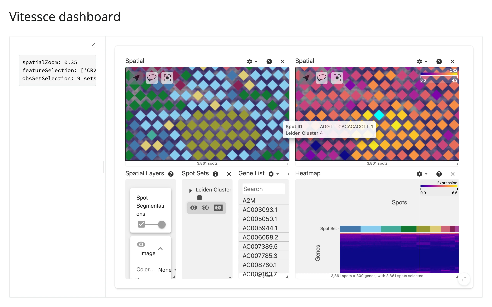

Useful `coordinationSpace` keys, beyond `spatialZoom`/`spatialTargetX`/`spatialTargetY`: `featureSelection` (genes
picked in the gene list or your own UI), `obsSetSelection` (checked cell sets, as `[group, set-name]` pairs --
see "Coordinating multiple views" below), `obsColorEncoding`. The whole config round-trips on *every* interaction
frame, pan/zoom included -- keep anything downstream of `reactive_read` cheap, and gate expensive recomputation
behind an explicit input (a button, a debounce) rather than running it on every tick.

### Rate limiting

`render_vitessce(rate_policy=..., rate_delay=...)` applies to `reactive_read(widget, "_config")` like it does for
any renderer's root-widget trait reads. Because `_config` is the *only* synced trait and it changes on every
interaction frame, a continuous drag (pan, zoom, lasso) can invalidate downstream calcs dozens of times per
second with no rate limit -- set `rate_policy="debounce"` (the shinywidgets default when unset is no limiting) if
your readout drives anything heavier than text.

## Updating the widget from Python

Vitessce has no per-trait setters (no `widget.zoom = ...`) -- the viewer applies Python-side changes by adopting a
new `_config`. Three ways to produce that new state, in order of measured cost (one gene change, on the demo
dataset, counting requests to the public data server):

1. **Re-render** -- return a different `VitessceConfig` from the `@render_vitessce` function itself (e.g. because
   a different reactive input changed). This builds an entirely new `VitessceWidget`: a new comm, a full remount,
   and (measured) **132 data-server requests**, because nothing is reused. Use this only when the shape of the
   config itself needs to change (different views, different dataset).
2. **In-place config edit, default remount** -- deep-copy the *live* `vit.widget._config`, edit the piece you want
   changed, bump the top-level `uid`, and reassign `vit.widget._config`. The viewer applies a new `_config` prop by
   remounting, keyed on that `uid` (it assigns one on mount and echoes it back, so the bump is required -- without
   it the write is a no-op). Because the new config is a deep copy of the already-synced state, pan/zoom/selections
   are preserved across the remount -- but the remount itself still tears down and recreates every `<canvas>` and
   re-fetches data: measured **82 data-server requests**, canvases replaced (verified by DOM-identity check).
3. **In-place config edit, no remount** -- the same deep-copy-and-bump recipe, on a widget built with
   `config.widget(remount_on_uid_change=False)`. The viewer adopts the new config without remounting at all:
   measured **23-27 data-server requests** (roughly a third), and the same `<canvas>` elements survive the
   update. This is the cheapest option and the one the gallery template below uses.

```{.python file="examples/04_gene_picker_inplace.py"}
# Drive the viewer from a Shiny input: pick a gene, the right-hand spatial
# view recolors in place. Requires an internet connection.
import copy
import re
import urllib.request
import uuid

from shiny import reactive
from shiny.express import input, ui
from vitessce import VitessceConfig

from shinywidgets import render_vitessce

ui.page_opts(title="Vitessce: gene picker", fillable=True)

CONFIG_URL = (
    "https://raw.githubusercontent.com/vitessce/vitessce/main/examples/configs/"
    "src/view-configs/human_lymph_node_10x_visium.js"
)
GENES = ["CR2", "CD3E", "CD3D", "MS4A1", "GNLY", "LYZ", "KRT14", "PECAM1"]


def load_demo_config() -> dict:
    import json5

    src = urllib.request.urlopen(CONFIG_URL, timeout=30).read().decode()
    src = re.sub(r"^export const \w+ = ", "", src).rstrip().rstrip(";")
    cfg = json5.loads(src)
    for d in cfg["datasets"]:
        d.setdefault("name", d["uid"])
    return cfg


CFG = load_demo_config()

with ui.sidebar():
    ui.input_select("gene", "Color right view by gene", GENES)

with ui.card(full_screen=True):

    @render_vitessce
    def vit():
        return VitessceConfig.from_dict(CFG)


# The Vitessce viewer applies a new `_config` by remounting, keyed on the
# config's top-level `uid` -- the viewer assigns one on mount and echoes it
# back, so the bump below is required (without it, the write is a no-op).
# Because the new config is a deep copy of the *live*, already-synced
# `_config`, the current pan/zoom/selections are preserved even though the
# viewer remounts to apply the edit.
@reactive.effect
@reactive.event(input.gene)
def _():
    new_config = copy.deepcopy(vit.widget._config)
    new_config["coordinationSpace"]["featureSelection"]["A"] = [input.gene()]
    new_config["uid"] = str(uuid.uuid4())[:8]
    vit.widget._config = new_config
```

That was [`examples/04_gene_picker_inplace.py`](examples/04_gene_picker_inplace.py) (option 2 above).
Option 3 is the same recipe with one line changed
([`examples/05_gene_picker_noremount.py`](examples/05_gene_picker_noremount.py)):

```{.python file="examples/05_gene_picker_noremount.py"}
# Same gene-picker recipe as 04_gene_picker_inplace.py, but with
# remount_on_uid_change=False: the viewer adopts the new config without
# tearing down and recreating its canvases. Verified: identical zoom
# preservation, but about 1/3 the data-server requests on each edit (23-27
# vs 82 in a measured run) and no DOM teardown (same <canvas> elements
# survive the update). Requires an internet connection.
#
# Caveat (upstream, vitessce/vitessce#2684): this in-place adoption path
# stores the raw config prop, skipping schema upgrade/initialization. Only
# write configs derived from the live, already-synced `_config` (as below) --
# never a freshly built or pristine VitessceConfig -- or the viewer can
# silently fail to render.
import copy
import re
import urllib.request
import uuid

from shiny import reactive
from shiny.express import input, ui
from vitessce import VitessceConfig

from shinywidgets import render_vitessce

ui.page_opts(title="Vitessce: gene picker (no remount)", fillable=True)

CONFIG_URL = (
    "https://raw.githubusercontent.com/vitessce/vitessce/main/examples/configs/"
    "src/view-configs/human_lymph_node_10x_visium.js"
)
GENES = ["CR2", "CD3E", "CD3D", "MS4A1", "GNLY", "LYZ", "KRT14", "PECAM1"]


def load_demo_config() -> dict:
    import json5

    src = urllib.request.urlopen(CONFIG_URL, timeout=30).read().decode()
    src = re.sub(r"^export const \w+ = ", "", src).rstrip().rstrip(";")
    cfg = json5.loads(src)
    for d in cfg["datasets"]:
        d.setdefault("name", d["uid"])
    return cfg


CFG = load_demo_config()

with ui.sidebar():
    ui.input_select("gene", "Color right view by gene", GENES)

with ui.card(full_screen=True):

    @render_vitessce
    def vit():
        return VitessceConfig.from_dict(CFG).widget(remount_on_uid_change=False)


@reactive.effect
@reactive.event(input.gene)
def _():
    new_config = copy.deepcopy(vit.widget._config)
    new_config["coordinationSpace"]["featureSelection"]["A"] = [input.gene()]
    new_config["uid"] = str(uuid.uuid4())[:8]
    vit.widget._config = new_config
```

[`examples/05_gene_picker_noremount.py`](examples/05_gene_picker_noremount.py) (option 3):

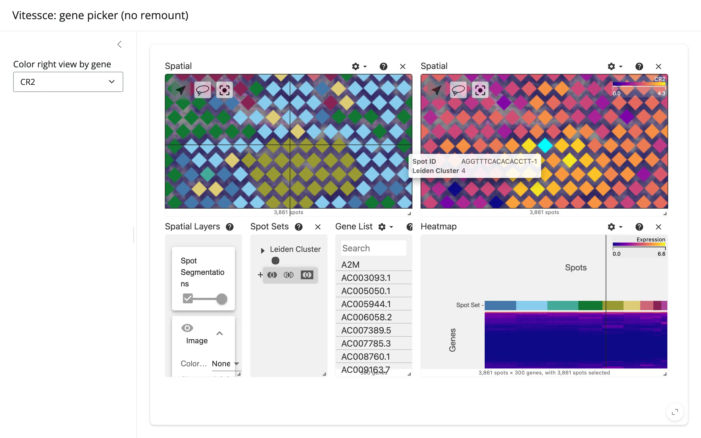
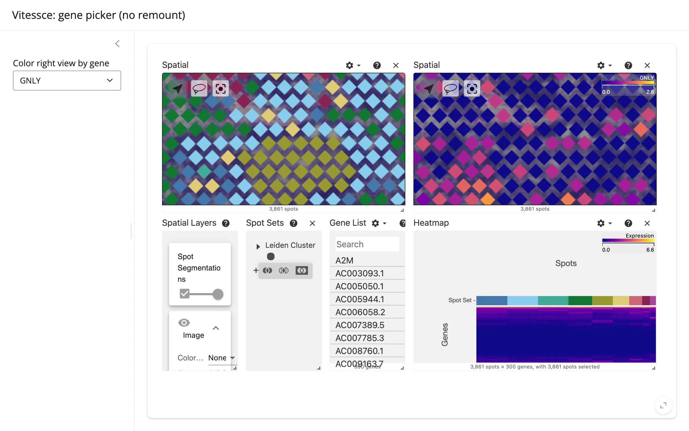

For comparison, option 2 (default remount) applied to the same zoomed-in state recolors correctly too, but costs
the 82 requests noted above and swaps in new `<canvas>` elements to do it:

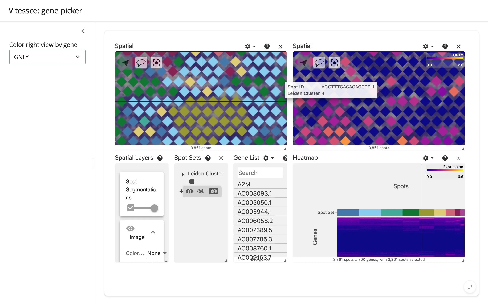

**Caveat on option 3** (upstream, [vitessce/vitessce#2684](https://github.com/vitessce/vitessce/issues/2684)):
the no-remount adoption path stores the raw config you assign, skipping the schema upgrade and initialization the
default path runs. Only write configs derived from the live, already-synced `_config` (as above) -- never a fresh
or pristine `VitessceConfig` -- or the viewer can silently fail to render. Don't write `_config` from an
unconditional effect at render time either way: the viewer's own async config-upgrade echoes back on mount and can
clobber an early write; write on user input instead.

**What's preserved**: pan, zoom, and selections survive both in-place options as long as the new config is built
from the live one (the caveat above only affects whether *structural* edits are safe with option 3, not
interaction state). What's never preserved across any of the three: data already in flight re-fetches on a
remount (warm from HTTP/zarr cache, so it's fast but not free), and the `uid` bump always recreates vitessce's
internal query-cache client, so even previously-visited gene selections refetch.

## Coordinating multiple views

### Vitessce's own coordination

The "build a config" example above already demonstrates this: with no Shiny code at all, clicking a cluster in
the "Cell Sets" legend highlights the same cells in *both* the spatial view and the UMAP scatterplot, because
they share one `obsSets`/color-encoding scope by default. Linked zoom works the same way when two spatial views
share a dataset (see the hero screenshot above: both panels pan and zoom together). Use `link_views()` to tie
coordination types across views that don't already share a scope. This is the layer to reach for when two views
of *the same* Vitessce config should move together -- no `reactive_read`/effect pair needed.


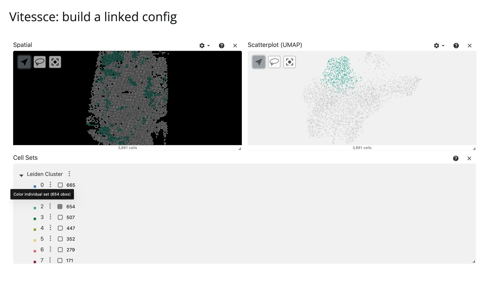

### Shiny-driven: gene picker

A `ui.input_select` recoloring a spatial view in place -- shown above under "Updating the widget from Python".
That's the pattern for *Shiny* inputs (sliders, selects, buttons) driving the viewer; Vitessce's own coordination
(previous section) is for linking views *within* one config, with no Shiny code at all.

### Reading state back: selected cell sets to a table

Checking/unchecking sets in the "Cell Sets" legend updates `obsSetSelection` in `_config` -- read it back into a
`render.data_frame`:

```{.python file="examples/06_cellset_to_table.py"}
# Read interaction state back into Python: check/uncheck cell sets in the
# "Cell Sets" legend and the selection shows up as a table. Requires an
# internet connection.
import pandas as pd
from shiny.express import render, ui
from vitessce import ViewType as vt, VitessceConfig

from shinywidgets import reactive_read, render_vitessce

ui.page_opts(title="Vitessce: selection to table", fillable=True)

DATA_URL = (
    "https://data-1.vitessce.io/0.0.33/main/human-lymph-node-10x-visium/"
    "human_lymph_node_10x_visium.h5ad.zarr"
)
FILE_OPTIONS = {
    "obsFeatureMatrix": {"path": "obsm/X_hvg", "featureFilterPath": "var/highly_variable"},
    "obsLocations": {"path": "obsm/spatial"},
    "obsEmbedding": [{"path": "obsm/X_umap", "embeddingType": "UMAP"}],
    "obsSets": [{"name": "Leiden Cluster", "path": "obs/clusters"}],
}

with ui.layout_columns(col_widths=[8, 4]):
    with ui.card(full_screen=True):

        @render_vitessce
        def vit():
            vc = VitessceConfig(schema_version="1.0.15", name="Lymph node")
            dataset = vc.add_dataset(name="Lymph node").add_file(
                url=DATA_URL, file_type="anndata.zarr", options=FILE_OPTIONS
            )
            spatial = vc.add_view(vt.SPATIAL, dataset=dataset)
            umap = vc.add_view(vt.SCATTERPLOT, dataset=dataset, mapping="UMAP")
            sets = vc.add_view(vt.OBS_SETS, dataset=dataset)
            vc.layout((spatial | umap) / sets)
            return vc

    with ui.card():
        ui.card_header("Selected cell sets")

        @render.data_frame
        def selection_table():
            cs = reactive_read(vit.widget, "_config").get("coordinationSpace", {})
            # obsSetSelection is a dict of scope -> list of [group, set-name]
            # paths; every path shares one list in this config (scope "A").
            paths = next(iter(cs.get("obsSetSelection", {}).values()), None) or []
            return pd.DataFrame(paths, columns=["Group", "Set"])
```

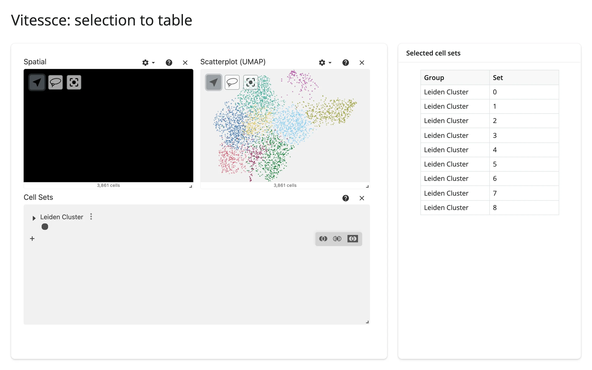
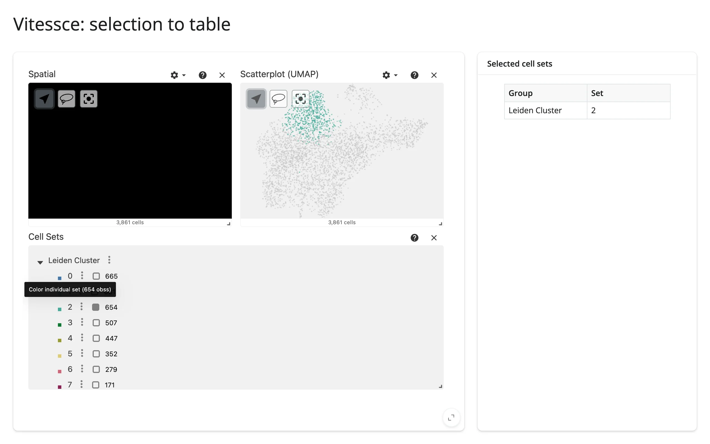

This reads the *names* of selected sets, not per-cell expression values -- the underlying AnnData lives in the
browser's zarr fetch, not in the Python process, so a true "marker genes for this selection" table would need the
server to load the same zarr itself (fine for small, local data; a real HTTP round-trip for the remote demo data
used here, so it's left out of this guide to keep the snippet honest about what ships with the config alone).

**Pairs with**: any table/plot renderer that accepts a small pandas `DataFrame` (itables, reactable, plotly).

## Large data

Vitessce is built for "only send what's visible": its views read AnnData/zarr stores in chunks, not as one
in-memory blob, which is the whole reason datasets that don't fit in RAM work at all (see
[Large data & performance's three approaches](../../guide/performance/index.md#three-approaches-to-large-data)
for the other two). How those chunks reach the browser depends on the data mode from "What you can build"
above: remote URLs are fetched directly by the browser (no server round trip, so dataset size is bounded by the
remote store, not shinywidgets); local files are served by an embedded server in the Python process; in-memory
zarr stores send chunks over the widget comm as you interact. No practical scale ceiling was measured this pass
-- the real limit is whatever your own AnnData/zarr store and deployment can serve.

## Layout and sizing

`height` is pixels and is **read once at mount** -- the ESM renders a fixed-height `<div>` and never subscribes to
further changes; setting `.widget.height` after mount does nothing (verified). Width *is* responsive (the
underlying grid measures its container). Pick `config.widget(height=...)` up front to match
`output_widget(height=...)`; shinywidgets' defaults for `render_vitessce` (`height=None`, `fill`/`fillable` default
`True`) only govern the *outer* Shiny output container, not Vitessce's internal pixel height. There's no vertical
fill: plan for a fixed-height card (`ui.card(full_screen=True)` lets users expand past it) rather than relying on
the page to size it.

## Gotchas and limitations

Verified on PR #374 (commit `99c41ca7`), current as of this guide.

- **A single `add_view()` needs a `.layout()` call, even alone.** Without one, the view keeps its default `w=1`
  grid unit (out of 12) and renders as a sliver a few percent of the panel's width -- no error. `vc.layout(view)`
  normalizes it to fill.
- **Visium-style spot views need `obsSegmentations`, not just `obsLocations`.** A config with only
  `obsLocations` (point coordinates) mounts a spatial view with working pan/zoom/tooltips but draws *zero* visible
  spots -- confirmed by inspecting the mounted view config in the browser console; no error or warning anywhere.
  Provide both options together (see the quick start). Likely applies to any `obsSegmentations`-shaped dataset,
  not just this one.
- **A default-colored view needs an `OBS_SETS` view in the layout.** `obsColorEncoding` defaults to
  `"cellSetSelection"`; without an `OBS_SETS` view present, `obsSetSelection` stays `None` and there's nothing to
  color the spatial/embedding views by -- again, no error.
- **The PR's own `render_vitessce` docstring example has both of the above gaps**: it calls `add_view("spatial",
  dataset=dataset)` with no `.layout()` and no `options=`, so as written it renders a near-invisible, uncolored
  sliver. Worth fixing in the docstring (or linking to this guide's quick start) before release.
- **`_config` writes need a `uid` bump to take effect** (see "Updating the widget from Python"). This is upstream
  behavior, not a shinywidgets limitation, but it's easy to miss once and get a silent no-op.
- **Hard CDN dependency.** The viewer's JavaScript (~12 MB) loads from unpkg/esm.sh at render time; pass
  `custom_js_url=` to `config.widget()` to self-host instead. No internet at render time means a blank widget, not
  an error.
- **Local-file data needs its own uvicorn server per widget** (`*_path=` options) -- don't pass an explicit
  `port=` in a multi-session app; the default auto-allocates from 8000 up per widget, and an explicit shared port
  across sessions can conflict. `*_store=` (in-memory zarr) needs no server at all; chunks travel over the widget
  comm.
- **403/404 noise on zarr metadata is expected**, not a bug: `.zattrs`/`.zarray`/`.zgroup` probing across the v2/v3
  zarr spec produces harmless errors in the browser console and network panel; vitessce's own JS logs this as
  informational.

## Gallery candidates

### `template_dashboard.py` (template)

A public-data dashboard with a gene picker that recolors in place (`remount_on_uid_change=False`, no viewport
reset) and a live pan/zoom/selection readout -- a reasonable starting point for a single-config Vitessce app.
Swap `CONFIG_URL` for your own `VitessceConfig` and `GENES` for your own feature list.

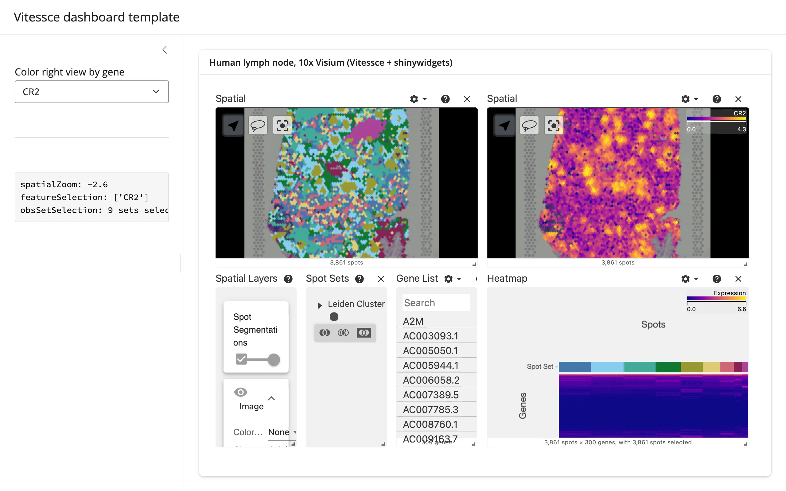
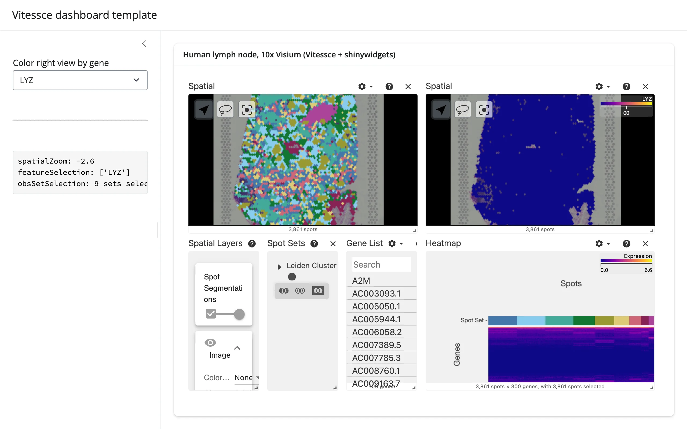

[`gallery/template_dashboard.py`](gallery/template_dashboard.py)

## Learn more

- [Vitessce documentation](http://vitessce.io/docs/) -- concepts, view types, coordination types
- [vitessce-python on GitHub](https://github.com/vitessce/vitessce-python) -- the Python API this guide builds on
- [Vitessce web app](http://vitessce.io/) -- build/export configs visually, or browse the demo gallery this
  guide's examples pull from
- Related guides in this roster: [lonboard](../lonboard/index.md), [ipyleaflet](../ipyleaflet/index.md) for
  general maps; [itables](../itables/index.md)/[reactable](../reactable/index.md) for the selected-sets table
  pattern
