[vizarr](https://github.com/hms-dbmi/vizarr) is a minimal, purely client-side viewer for multiscale
[Zarr](https://zarr.dev)-based bioimages, built by HMS DBMI. It renders with
[Viv](https://github.com/hms-dbmi/viv) (GPU-accelerated, deck.gl-based) and reads Zarr stores directly in the
browser with [zarrita.js](https://github.com/manzt/zarrita.js) -- no tile server, no image pyramid pre-baked
into PNGs, just the raw chunked array. It understands the [OME-NGFF](https://ngff.openmicroscopy.org/) convention:
point it at a store with `multiscales` and `omero` metadata and it reconstructs the resolution pyramid, channel
names, colors, contrast limits, and Z-stacks automatically.

`@render_vizarr` wraps a `vizarr.Viewer` the way the other renderers in this roster wrap their widgets: it applies
filling-layout defaults, and gives the decorated function `.widget` (the live `Viewer`, for programmatic updates)
and `.value` (your return value). vizarr has no reactive accessors -- the browser's layer controls (channel
colors, contrast, visibility) are local UI state that never syncs back to Python -- but the camera (`view_state`)
does sync, debounced to the browser's frame rate, so `viewer.read("view_state")` is enough to drive a second
view off panning and zooming.

Choose vizarr when your data is a 2D/3D/4D pixel array -- fluorescence microscopy, histology, EM, anything
OME-Zarr -- rather than a 3D mesh or point cloud (see `../pyvista/guide.md`, `../k3d/guide.md`) or a geospatial
raster (see `../lonboard/guide.md`, `../maplibre/guide.md`). For molecule-level structural biology, see
`../ipyaladin/guide.md` (sky surveys) or `../nglview/guide.md` (molecular structures).


## Installation

```sh
pip install 'shinywidgets[vizarr]'
```

vizarr pins `zarr<3`, which is why it's a separate extra rather than bundled with the rest of shinywidgets' test
matrix: if your project also needs `zarr>=3` for something else, it can't share an environment with vizarr. The
viewer's own JavaScript (vizarr + Viv) loads from a CDN at render time, so the app needs internet access.

## Quick start

A public OME-NGFF sample from the [Image Data Resource](https://idr.openmicroscopy.org/) (IDR) -- a confocal
z-stack of cell nuclei, two channels (LaminB1, DAPI). `add_image()` takes the URL directly; the browser fetches
the store itself, so shinywidgets never touches the pixel data.

```{.python file="examples/01_quickstart.py"}
# A public OME-NGFF (OME-Zarr) sample from the Image Data Resource (IDR): a
# spinning-disk confocal z-stack of nuclei (LaminB1 in blue, DAPI in yellow).
# vizarr's browser code fetches this URL directly -- shinywidgets never sees
# the pixel data.
import vizarr
from shiny.express import ui

from shinywidgets import render_vizarr

IDR_SAMPLE = "https://minio-dev.openmicroscopy.org/idr/v0.3/idr0062-blin-nuclearsegmentation/6001240.zarr"

ui.page_opts(title="vizarr quick start", fillable=True)

with ui.card(full_screen=True):

    @render_vizarr
    def viewer():
        v = vizarr.Viewer()
        v.add_image(source=IDR_SAMPLE)
        return v
```

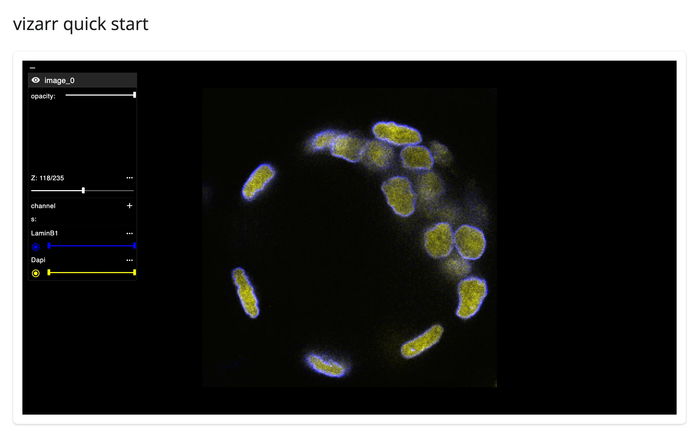

vizarr built its own layer-control panel (channel toggles, a Z slider for the stack, an opacity slider) and read
the channel names and colors straight from the store's `omero` metadata -- none of that came from Python.

## What you can build

### A plain numpy array, zero setup

No zarr store, no file, no server round trip beyond the Shiny comm: `add_image()` accepts a numpy array
directly, wrapping it in a single-chunk in-memory zarr store for you.

```{.python file="examples/02_numpy_array.py"}
# Any in-memory numpy array can be viewed directly -- no zarr store, no file,
# no server. vizarr wraps the array in a single-chunk in-memory zarr store and
# streams it to the browser over the Shiny websocket. `scipy.datasets.face()`
# downloads a small sample photo the first time it's called (cached after).
import numpy as np
import vizarr
from scipy.datasets import face
from shiny.express import ui

from shinywidgets import render_vizarr

gray = np.mean(face(), axis=-1).astype(np.uint8)  # (768, 1024) grayscale

ui.page_opts(title="vizarr: a plain numpy array", fillable=True)

with ui.card(full_screen=True):

    @render_vizarr
    def viewer():
        v = vizarr.Viewer()
        v.add_image(source=gray, name="raccoon")
        return v
```

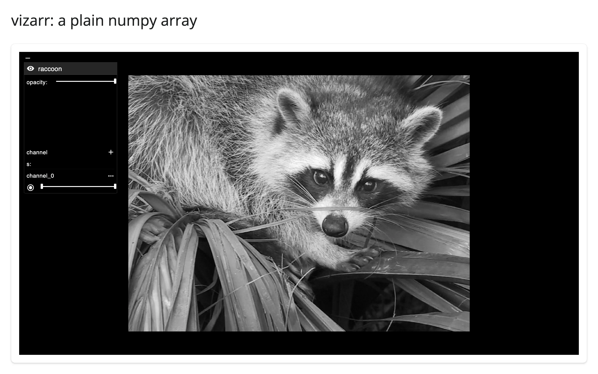

This is the fastest way to eyeball an array mid-analysis -- a segmentation mask, a denoised frame, anything your
pipeline already has in memory. For anything bigger than a quick look, write proper OME-Zarr (next section) so
you get a resolution pyramid instead of one full-resolution chunk.

### Multichannel composites, with contrast and color from the store itself

The recommended way to control per-channel color and contrast is the OME-NGFF `omero` metadata convention --
write it once into the store's attributes, and both vizarr's standalone viewer and this Shiny integration read
it identically. Here's a synthetic 3-channel tissue image (nuclei, cytoplasm, vessels) written as a local OME-Zarr
store; shinywidgets streams its chunks to the browser over the Shiny comm as you pan and zoom.

```{.python file="examples/03_multichannel_contrast.py"}
# A local, synthetic 3-channel OME-Zarr store. The colors and contrast limits
# come entirely from the store's own OME-NGFF "omero" metadata -- vizarr reads
# that convention automatically, the same way it would for a real microscope's
# export. shinywidgets serves this store's chunks to the browser on demand
# over the Shiny comm (base64-encoded; prefer a remote URL for large images).
import tempfile

import numpy as np
import vizarr
import zarr
from shiny.express import ui

from shinywidgets import render_vizarr

rng = np.random.default_rng(42)
n = 512
yy, xx = np.mgrid[0:n, 0:n]
nuclei = np.zeros((n, n), np.float32)
for _ in range(250):
    cy, cx, r = rng.integers(15, n - 15, 3)
    nuclei += rng.uniform(140, 240) * np.exp(-((yy - cy) ** 2 + (xx - cx) ** 2) / (2 * max(3, r % 8) ** 2))
cytoplasm = 25 + 18 * np.sin(xx / 65) * np.cos(yy / 55) + 0.35 * nuclei
vessels = 200 * np.abs(np.sin((xx + 2 * yy) / 75)) ** 64 * 255
image = np.stack([nuclei, cytoplasm, vessels]).clip(0, 255).astype(np.uint8)

grp = zarr.open_group(f"{tempfile.mkdtemp()}/tissue.zarr", mode="w")
_ = grp.create_dataset("0", data=image[None, :, None, :, :], chunks=(1, 1, 1, 256, 256))
grp.attrs["multiscales"] = [{"version": "0.1", "datasets": [{"path": "0"}]}]
grp.attrs["omero"] = {
    "channels": [
        {"color": "4488FF", "window": {"start": 0, "end": 255}, "label": "DAPI", "active": True},
        {"color": "44FF44", "window": {"start": 0, "end": 255}, "label": "Cytoplasm", "active": True},
        {"color": "FF4444", "window": {"start": 0, "end": 255}, "label": "Vessels", "active": True},
    ],
    "rdefs": {"model": "color"},
}

ui.page_opts(title="vizarr: multichannel contrast and colors", fillable=True)

with ui.card(full_screen=True):

    @render_vizarr
    def viewer():
        v = vizarr.Viewer()
        v.add_image(source=grp, name="synthetic tissue")
        return v
```

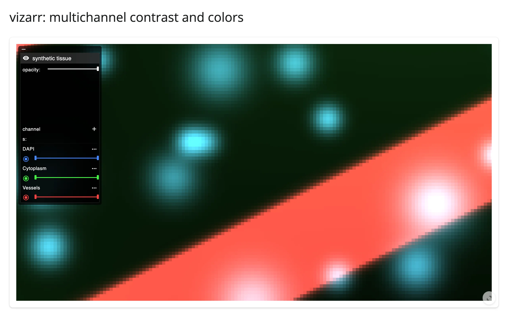

`add_image()` also accepts low-level per-call overrides (`channel_axis`, `colors`, `contrast_limits`,
`visibilities`, `opacity`) for arrays that don't carry their own OME metadata, but the exact keys and shapes it
expects are inconsistent and undocumented upstream -- see "Gotchas and limitations" before reaching for them.

### Z-stacks and resolution pyramids, for free

Any OME-NGFF store with a `z` axis or multiple `multiscales` levels gets a Z slider and pyramid-aware tiling
automatically -- that's where the quick start's `Z: 118/235` slider came from. There's nothing Shiny- or
Python-side to configure; it's a property of the store's metadata, read once at mount.

## Reacting to user interaction

vizarr defines no reactive accessors: there's no selection, click, or brush concept, and the browser's own layer
controls (channel color, contrast, visibility, opacity) are local UI state that's never sent back to Python --
only the camera is. That makes the `.read()` fallback tier the whole story here.

### Beyond accessors: `.read()`

| Trait | Returns | Fires when | Default rate policy |
|---|---|---|---|
| `view_state` | `{"target": [x, y], "zoom": z}` (image-pixel coordinates; `zoom` follows deck.gl's convention, screen pixels per image pixel = `2 ** zoom`) | The user pans or zooms the viewer | Debounced ~200ms, hardcoded in vizarr's own JavaScript (`just-debounce-it`) |

`view_state` starts at `{}` before the viewer's first paint, then settles to vizarr's own "fit the whole image"
default a moment after mount (not something Python chooses). Setting `.widget.view_state = {...}` moves the
camera in place; `viewer.read("view_state")` is the only way to know what the user is looking at. Prefer it over
`reactive_read(viewer.widget, "view_state")` -- same underlying read, but it also cancels on its own before the
viewer has rendered at all, so there's no separate `viewer.widget is None` check to write.

```{.python file="examples/04_camera_view_state.py"}
# vizarr has no accessors (see "Reacting to user interaction" below), but its
# `view_state` trait -- the pan/zoom camera, as {"target": [x, y], "zoom": z}
# -- syncs from the browser whenever you pan or zoom, debounced ~200ms.
# `viewer.read("view_state")` turns that into a reactive input (it falls
# through to reactive_read() on the rendered widget, and cancels on its own
# before the first render -- no manual `viewer.widget is None` check needed).
# Setting `.view_state` from Python flies the camera to a region of interest,
# in place (no re-render).
import tempfile

import numpy as np
import vizarr
import zarr
from shiny import reactive
from shiny.express import input, render, ui

from shinywidgets import render_vizarr

rng = np.random.default_rng(42)
n = 512
yy, xx = np.mgrid[0:n, 0:n]
nuclei = np.zeros((n, n), np.float32)
for _ in range(250):
    cy, cx, r = rng.integers(15, n - 15, 3)
    nuclei += rng.uniform(140, 240) * np.exp(-((yy - cy) ** 2 + (xx - cx) ** 2) / (2 * max(3, r % 8) ** 2))
image = nuclei.clip(0, 255).astype(np.uint8)[None, None, None, :, :]

grp = zarr.open_group(f"{tempfile.mkdtemp()}/nuclei.zarr", mode="w")
_ = grp.create_dataset("0", data=image, chunks=(1, 1, 1, 256, 256))
grp.attrs["multiscales"] = [{"version": "0.1", "datasets": [{"path": "0"}]}]

ui.page_opts(title="vizarr: reading the camera", fillable=True)

with ui.layout_sidebar():
    with ui.sidebar():
        ui.input_action_button("fly", "Fly to center")

        @render.code
        def camera():
            vs = viewer.read("view_state")
            if not vs:
                return "loading..."
            target = vs.get("target", [0, 0])
            return f"zoom:   {vs.get('zoom', 0):.2f}\ntarget: ({target[0]:.0f}, {target[1]:.0f})"

    with ui.card(full_screen=True):

        @render_vizarr
        def viewer():
            v = vizarr.Viewer()
            v.add_image(source=grp, name="nuclei")
            return v

    @reactive.effect
    @reactive.event(input.fly)
    def _():
        if viewer.widget is not None:
            viewer.widget.view_state = {"target": [256, 256], "zoom": 2.0}
```

Before interacting, then after a scroll-zoom + drag pan, then after clicking "Fly to center" (which sets the
camera from Python, in place):

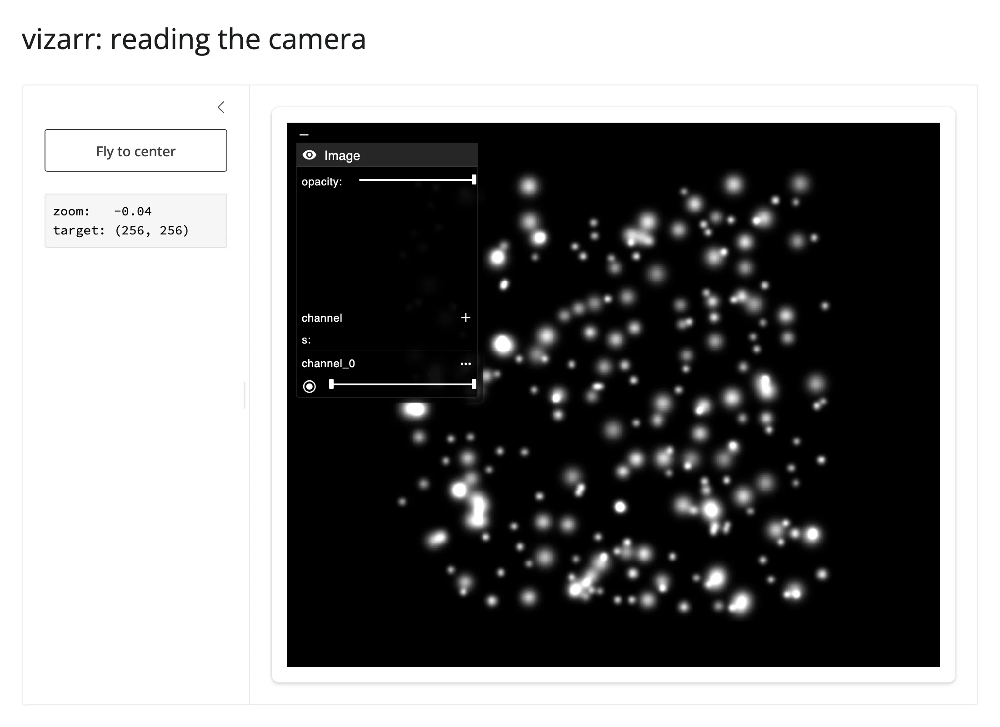
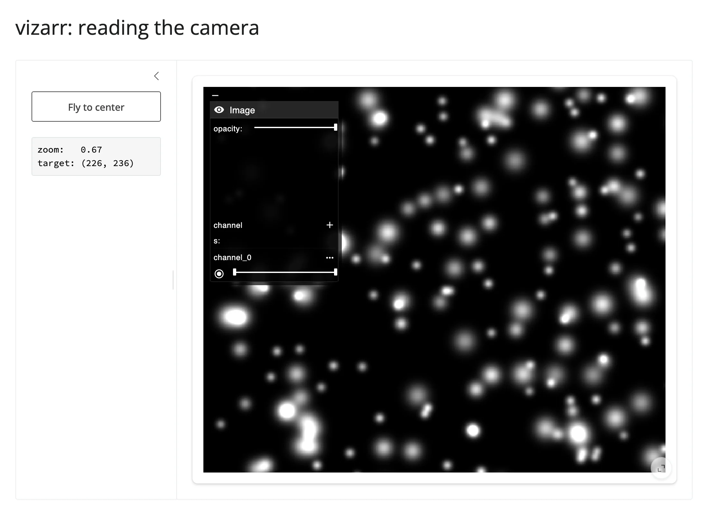
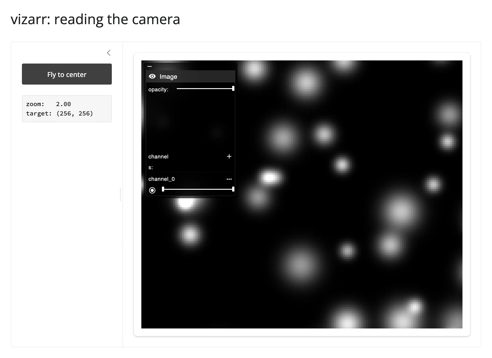

The readout tracks every gesture: `zoom: 2.17, target: (280, 268)` after the drag, then snapping to exactly
`zoom: 2.00, target: (256, 256)` after the button click -- a real round trip from a Python-set trait, to the
browser's camera, and back out through `.read()`.

### Rate limiting

There's no `rate_policy`/`rate_delay` parameter on `render_vizarr` -- those exist on renderers whose accessors
route through shinywidgets' own rate-limiting layer, and vizarr has no accessors. The ~200ms debounce on
`view_state` is baked into vizarr's bundled JavaScript and isn't configurable from Python.

## Updating the widget from Python

### In place: adding a layer

`.widget.add_image()` appends a new layer to the running viewer. vizarr's browser code only ever *adds* layers --
there's no "remove" or "replace" -- so this never rebuilds the viewer or re-sends its JS bundle, and the camera
you already set stays exactly where it was.

```{.python file="examples/05_add_layer_in_place.py"}
# `.widget.add_image()` appends a new layer to the running viewer: vizarr's
# browser code only ever *adds* layers (there's no "remove" or "replace"), so
# this never rebuilds the viewer or re-sends its JS bundle -- the camera you
# already set stays put. Compare this to a full re-render (next example),
# which always resets the camera unless you restore it yourself.
import tempfile

import numpy as np
import vizarr
import zarr
from shiny import reactive
from shiny.express import input, ui

from shinywidgets import render_vizarr


def single_channel_zarr(data, color):
    grp = zarr.open_group(f"{tempfile.mkdtemp()}/img.zarr", mode="w")
    _ = grp.create_dataset("0", data=data[None, None, None, :, :], chunks=(1, 1, 1, 256, 256))
    grp.attrs["multiscales"] = [{"version": "0.1", "datasets": [{"path": "0"}]}]
    grp.attrs["omero"] = {
        "channels": [{"color": color, "window": {"start": 0, "end": 255}, "active": True}]
    }
    return grp


rng = np.random.default_rng(0)
base = (rng.random((512, 512)) * 180 + 40).astype(np.uint8)
wedge = (np.triu(np.ones((512, 512))) * 220).astype(np.uint8)  # bright triangle

base_store = single_channel_zarr(base, "FFFFFF")
overlay_store = single_channel_zarr(wedge, "FF2222")

ui.page_opts(title="vizarr: add a layer in place", fillable=True)

ui.input_action_button("add", "Add overlay layer (in place)")

with ui.card(full_screen=True):

    @render_vizarr
    def viewer():
        v = vizarr.Viewer()
        v.add_image(source=base_store, name="base")
        return v


@reactive.effect
@reactive.event(input.add)
def _():
    if viewer.widget is not None:
        viewer.widget.add_image(source=overlay_store, name="overlay", opacity=0.5)
```

Before and after clicking the button -- same zoomed-in crop in both, new layer appears in the side panel:

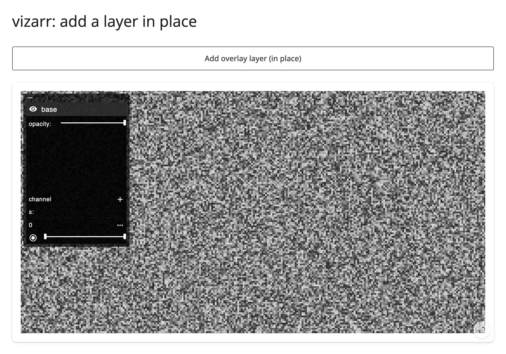
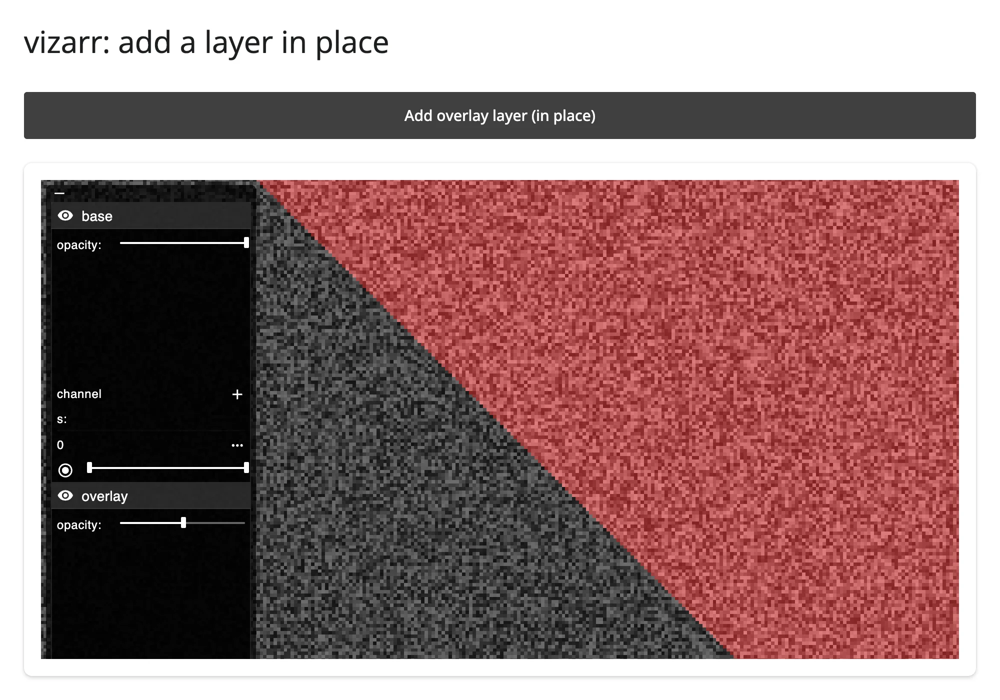

### Re-rendering: changing an existing layer

A channel's contrast, color, and visibility are fixed when its layer is added -- there's no Python-side call that
updates one already on screen. So a Shiny input that controls an *existing* channel (a contrast slider, say) has
to rebuild the viewer: the render function reruns and returns a brand new `vizarr.Viewer()`, with the channel's
`window` taken from the current input value.

```{.python file="examples/06_channel_toggle_rerender.py"}
# A channel's contrast/color/visibility is fixed when its layer is added --
# vizarr's browser code never updates an already-added layer, only appends new
# ones (see the previous example). So a Shiny input that controls an
# *existing* channel (here, a contrast slider) has to rebuild the viewer: the
# render function reruns and returns a fresh `vizarr.Viewer()`, with the
# channel's `window` taken from the current slider value.
#
# Unlike the add-a-layer case, the camera can't be reliably carried across
# this kind of re-render: vizarr's deck.gl view always re-fits itself to the
# whole image on mount and reports that back to Python a moment later,
# racing (and often beating) any `view_state` you restore. See "Gotchas and
# limitations" for details -- a contrast/channel control like this one is
# simplest to accept as a full reset of the camera.
import tempfile

import numpy as np
import vizarr
import zarr
from shiny.express import input, ui

from shinywidgets import render_vizarr

rng = np.random.default_rng(1)
n = 512
yy, xx = np.mgrid[0:n, 0:n]
nuclei = np.zeros((n, n), np.float32)
for _ in range(250):
    cy, cx, r = rng.integers(15, n - 15, 3)
    nuclei += rng.uniform(140, 240) * np.exp(-((yy - cy) ** 2 + (xx - cx) ** 2) / (2 * max(3, r % 8) ** 2))
image = nuclei.clip(0, 255).astype(np.uint8)

grp = zarr.open_group(f"{tempfile.mkdtemp()}/nuclei.zarr", mode="w")
_ = grp.create_dataset("0", data=image[None, None, None, :, :], chunks=(1, 1, 1, 256, 256))
grp.attrs["multiscales"] = [{"version": "0.1", "datasets": [{"path": "0"}]}]

ui.page_opts(title="vizarr: contrast slider (re-render)", fillable=True)

ui.input_slider("max_contrast", "Contrast ceiling", min=40, max=255, value=255, step=5)

with ui.card(full_screen=True):

    @render_vizarr
    def viewer():
        grp.attrs["omero"] = {
            "channels": [
                {
                    "color": "44FF88",
                    "label": "nuclei",
                    "active": True,
                    "window": {"start": 0, "end": input.max_contrast()},
                }
            ]
        }
        v = vizarr.Viewer()
        v.add_image(source=grp, name="nuclei")
        return v
```

Before (zoomed in, ceiling 255) and after dragging the slider down to 150 -- the contrast changes, but so does
the camera, back to vizarr's default fit view:

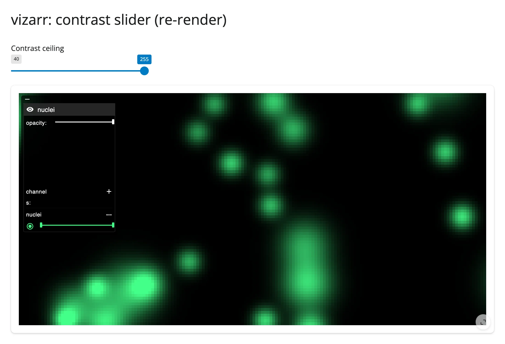
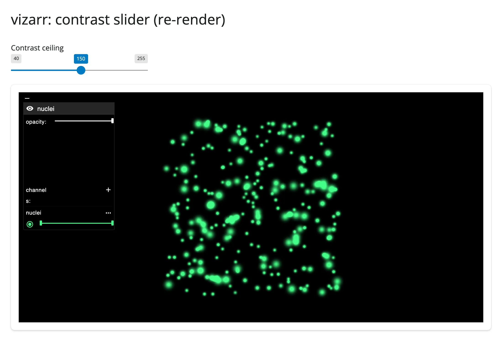

That camera reset is not a bug to work around: see "Gotchas and limitations" for why a naive restore doesn't
hold up, and accept the reset for controls that must change an existing layer.

## Coordinating multiple views

vizarr exposes exactly one piece of interaction state -- the camera -- but that's enough to drive real
Python-side analysis, since Python already holds whatever array built the store. Both patterns below read
`viewer.read("view_state")` and convert `zoom`/`target` into an image-space crop using deck.gl's zoom convention
(screen pixels per image pixel is `2 ** zoom`); treat the conversion as approximate, since it depends on the
viewer's on-screen pixel size, which Python doesn't know exactly.

### Viewport on a minimap

```{.python file="examples/07_linked_minimap.py"}
# The viewport you're looking at, drawn on a minimap of the whole image.
# `viewer.read("view_state")` is the only interaction state vizarr exposes
# (no accessors; it falls through to reactive_read() on the rendered
# widget), but it's enough to keep a second view in sync: `zoom` follows
# deck.gl's convention (screen pixels per image pixel is 2 ** zoom), so the
# viewport's image-space half-width is derived from the card's pixel size
# and the current zoom.
import tempfile

import matplotlib.pyplot as plt
import numpy as np
import vizarr
import zarr
from matplotlib.patches import Rectangle
from shiny import req
from shiny.express import render, ui

from shinywidgets import render_vizarr

rng = np.random.default_rng(1)
n = 512
yy, xx = np.mgrid[0:n, 0:n]
nuclei = np.zeros((n, n), np.float32)
for _ in range(250):
    cy, cx, r = rng.integers(15, n - 15, 3)
    nuclei += rng.uniform(140, 240) * np.exp(-((yy - cy) ** 2 + (xx - cx) ** 2) / (2 * max(3, r % 8) ** 2))
image = nuclei.clip(0, 255).astype(np.uint8)

grp = zarr.open_group(f"{tempfile.mkdtemp()}/nuclei.zarr", mode="w")
_ = grp.create_dataset("0", data=image[None, None, None, :, :], chunks=(1, 1, 1, 256, 256))
grp.attrs["multiscales"] = [{"version": "0.1", "datasets": [{"path": "0"}]}]

ui.page_opts(title="vizarr: viewport minimap", fillable=True)
CANVAS_PX = 700  # approximate on-screen width of the viewer card, in pixels

with ui.layout_columns(col_widths=(8, 4)):

    with ui.card(full_screen=True):

        @render_vizarr
        def viewer():
            v = vizarr.Viewer()
            v.add_image(source=grp, name="nuclei")
            return v

    with ui.card():
        ui.card_header("Minimap")

        @render.plot
        def minimap():
            vs = viewer.read("view_state")
            req(vs)
            target = vs.get("target", [n / 2, n / 2])
            half_width = (CANVAS_PX / 2) / (2 ** vs.get("zoom", 0))

            fig, ax = plt.subplots(figsize=(3, 3))
            ax.imshow(image, cmap="gray", vmin=0, vmax=255)
            ax.add_patch(
                Rectangle(
                    (target[0] - half_width, target[1] - half_width),
                    2 * half_width,
                    2 * half_width,
                    fill=False,
                    edgecolor="red",
                    linewidth=2,
                )
            )
            ax.set_xticks([])
            ax.set_yticks([])
            return fig
```

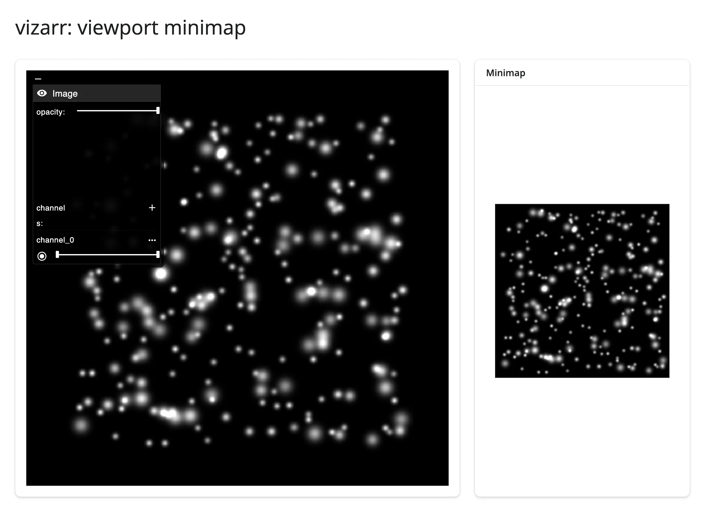
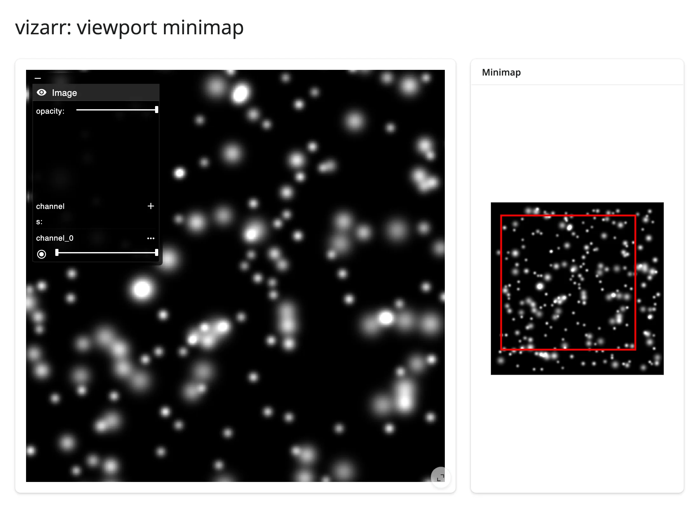

### Viewport to a live histogram

The same crop, summarized with `numpy` and `matplotlib` instead of drawn as a rectangle -- a real "Shiny-side
analysis" pairing: the pixels under the camera, recomputed every time it settles.

```{.python file="examples/08_linked_histogram.py"}
# A live histogram of the pixels currently in view. vizarr only ever shows
# you pixels -- it has no notion of "the data under the viewport" -- but
# Python already holds the source array, so cropping it to the current
# `view_state` and summarizing it is just numpy, recomputed every time the
# camera settles (vizarr debounces `view_state` to ~200ms).
import tempfile

import matplotlib.pyplot as plt
import numpy as np
import vizarr
import zarr
from shiny import req
from shiny.express import render, ui

from shinywidgets import render_vizarr

rng = np.random.default_rng(1)
n = 512
yy, xx = np.mgrid[0:n, 0:n]
nuclei = np.zeros((n, n), np.float32)
for _ in range(250):
    cy, cx, r = rng.integers(15, n - 15, 3)
    nuclei += rng.uniform(140, 240) * np.exp(-((yy - cy) ** 2 + (xx - cx) ** 2) / (2 * max(3, r % 8) ** 2))
image = nuclei.clip(0, 255).astype(np.uint8)

grp = zarr.open_group(f"{tempfile.mkdtemp()}/nuclei.zarr", mode="w")
_ = grp.create_dataset("0", data=image[None, None, None, :, :], chunks=(1, 1, 1, 256, 256))
grp.attrs["multiscales"] = [{"version": "0.1", "datasets": [{"path": "0"}]}]

ui.page_opts(title="vizarr: viewport histogram", fillable=True)
CANVAS_PX = 700  # approximate on-screen width of the viewer card, in pixels

with ui.layout_columns(col_widths=(8, 4)):

    with ui.card(full_screen=True):

        @render_vizarr
        def viewer():
            v = vizarr.Viewer()
            v.add_image(source=grp, name="nuclei")
            return v

    with ui.card():
        ui.card_header("Intensity histogram (pixels in view)")

        @render.plot
        def histogram():
            vs = viewer.read("view_state")
            req(vs)
            target = vs.get("target", [n / 2, n / 2])
            half_width = (CANVAS_PX / 2) / (2 ** vs.get("zoom", 0))

            x0, x1 = np.clip([target[0] - half_width, target[0] + half_width], 0, n).astype(int)
            y0, y1 = np.clip([target[1] - half_width, target[1] + half_width], 0, n).astype(int)
            crop = image[y0:y1, x0:x1]

            fig, ax = plt.subplots(figsize=(3.3, 2.6))
            if crop.size:
                ax.hist(crop.ravel(), bins=32, range=(0, 255), color="#2ca02c")
            ax.set_xlabel("pixel intensity")
            ax.set_ylabel("count")
            fig.tight_layout()
            return fig
```

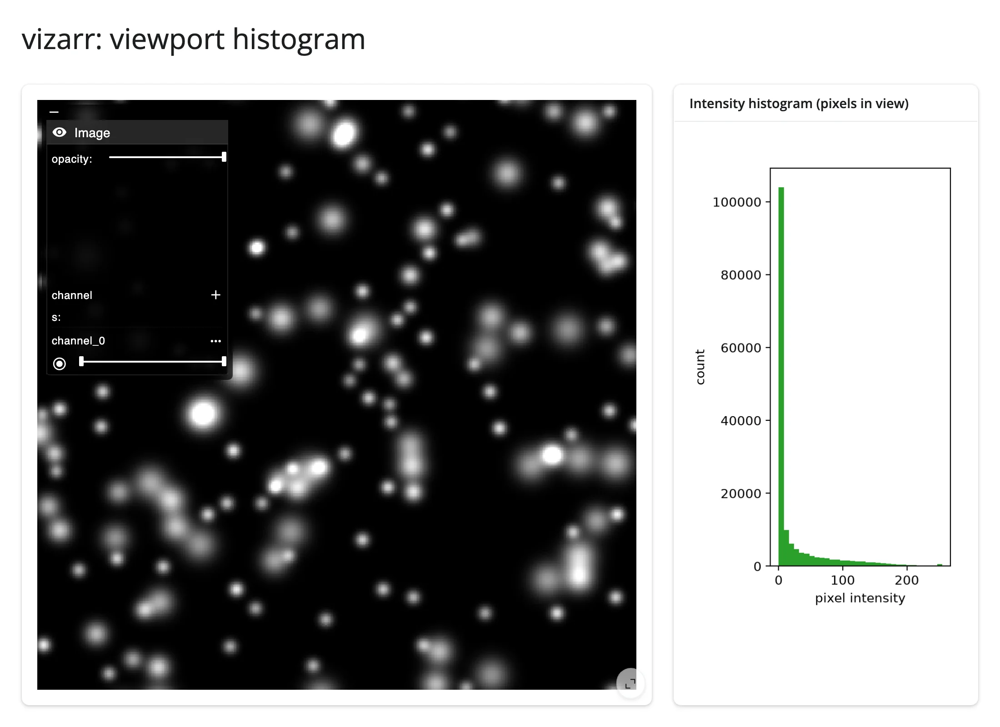

Pairs well with `../plotly/guide.md` or `../matplotlib/guide.md` for a dashboard-style layout; see the showcase
gallery app for both patterns side by side with a channel selector.

## Large data

vizarr is the clearest "only send what's visible" example in this roster -- see
[Large data & performance's three approaches](../../guide/performance/index.md#three-approaches-to-large-data):
it reads a multiscale OME-Zarr pyramid and fetches only the chunks the current pan/zoom level needs, GPU-composited
by Viv. The practical limit is how those chunks reach the browser, not image size itself: a remote URL is fetched
by the browser directly and scales to gigapixel stores; a local array served over the Shiny comm (base64-encoded,
since Shiny has no binary message channel) costs about 33% more in transit bytes and rides the websocket, so it's
the slower path for anything large -- see ["Gotchas and limitations"](#gotchas-and-limitations) for the measured
figure. Prefer a remote Zarr store over `add_image()` on a big local array when the image is large.

## Layout and sizing

In a filling layout, the viewer grows or shrinks to fit its container; an explicit `output_widget(height=...)`
sizes it to that height instead. Otherwise vizarr's own `height` trait applies (default `"500px"`) -- setting it
yourself (`vizarr.Viewer(height="300px")`) opts out of filling, and an explicit output height still wins over it.
`render_vizarr` marks the widget with a `shinywidgets-vizarr` CSS class so the stylesheet can fit the viewer's
(unstyled) root `<div>` to an explicit output height, which vizarr's own inline styles don't do on their own.

## Gotchas and limitations

- **No accessors, and the layer panel doesn't sync back.** Channel color, contrast, visibility, and opacity set
  through vizarr's own side panel are local browser state; nothing reads them back into Python. Only `view_state`
  (the camera) is synced.
- **Layers are append-only.** `add_image()` always adds a new layer; there's no Python-side call to remove or
  update one already shown. Changing an existing channel's look requires rebuilding the `Viewer` (a re-render).
- **A re-render resets the camera, and a naive restore is racy.** We verified this directly: vizarr's deck.gl
  view always re-fits itself to the whole image on mount and reports that *default* camera back to Python a
  moment later -- racing (and often beating) a `view_state` you set either before or immediately after
  construction. A correct fix requires waiting for that one-time default report per widget and then overriding it
  exactly once, which is enough undocumented, order-dependent machinery that we recommend accepting the reset for
  controls that must change an existing layer, rather than shipping a timing-dependent workaround.
- **`add_image()`'s per-call config kwargs are inconsistent for raw arrays.** For a true OME-NGFF store (channel
  axis + `omero` metadata), colors/contrast/visibility are plural lists (`colors`, `contrast_limits`,
  `visibilities`) keyed by channel. For a plain array with no channel axis, the same concepts are *singular*
  keys (`color`, `contrast_limits` as a flat `[min, max]`, `visibility`, `opacity`) -- passing the plural forms to
  a plain array is silently ignored, not an error. We verified this by inspecting vizarr's minified JS; it isn't
  documented upstream. Prefer writing real `omero` metadata on the store over guessing at these kwargs.
- **Local arrays cost ~33% in transit size and ride the Shiny websocket.** `add_image()` on a non-URL source
  serves chunks over the widget comm, base64-encoded (Shiny has no binary message channel). A remote URL is
  fetched by the browser directly and scales far better for large images.
- **Requires internet access.** The viewer's JavaScript (vizarr + Viv) loads from a CDN at render time.
- **`zarr<3` pin.** vizarr can't share a virtual environment with anything that needs `zarr>=3`.

## Gallery candidates

**`template_ome_zarr_viewer.py`** -- a clean starting point: full-screen viewer on a public IDR sample, a "reset
view" button, and a live camera readout. Swap the URL for your own store.

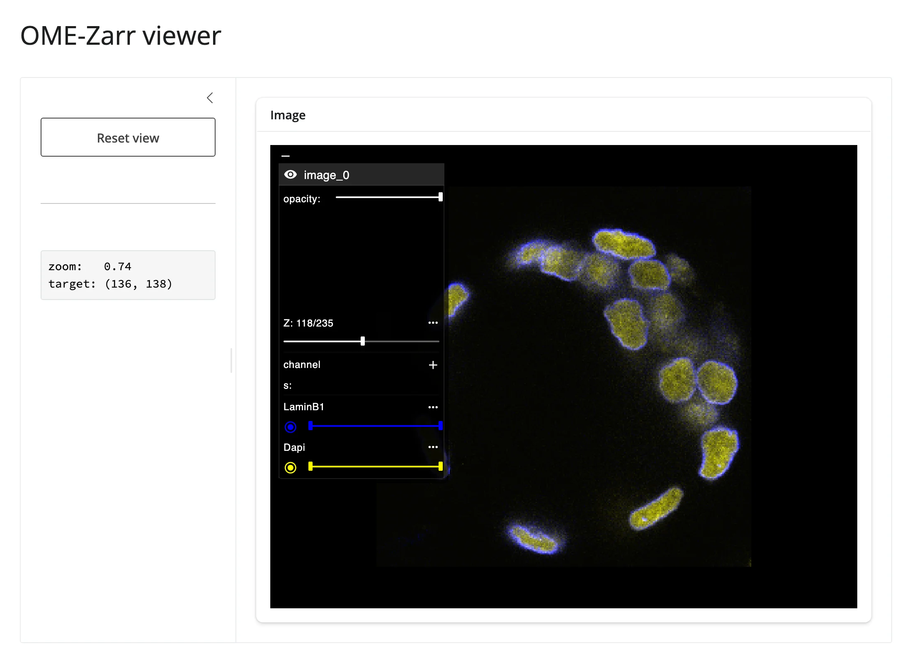

**`showcase_tissue_explorer.py`** -- the two linked-view patterns above (minimap + histogram) combined with a
channel selector, against a synthetic 3-channel tissue image.

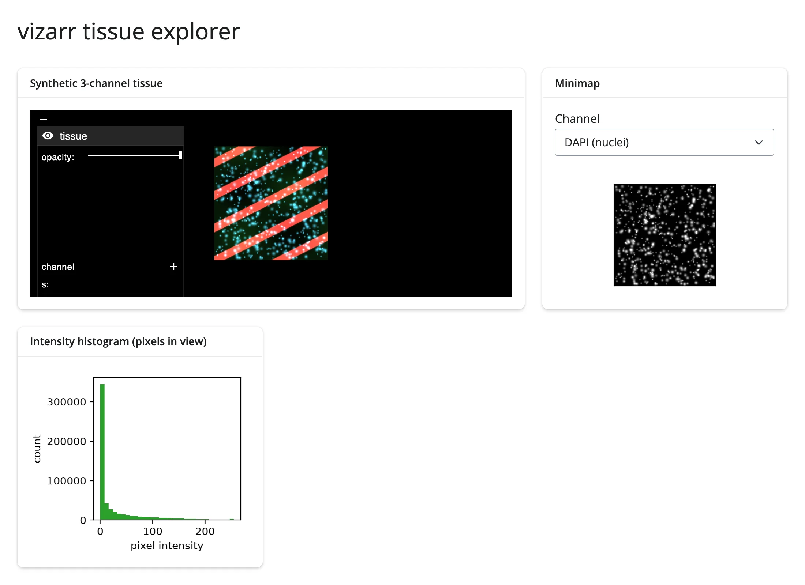
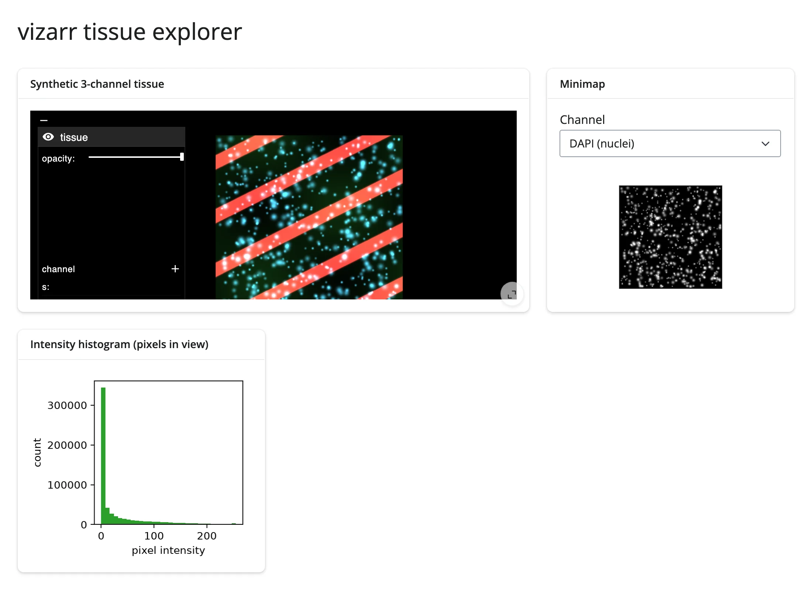

## Learn more

- [vizarr on GitHub](https://github.com/hms-dbmi/vizarr)
- [Viv](https://github.com/hms-dbmi/viv) (the GPU rendering layer vizarr builds on)
- [OME-NGFF specification](https://ngff.openmicroscopy.org/) (the `multiscales`/`omero` metadata convention)
- [Image Data Resource](https://idr.openmicroscopy.org/) (public OME-Zarr datasets for testing)
- Related guides in this roster: `../pyvista/guide.md`, `../k3d/guide.md` (3D meshes/volumes),
  `../lonboard/guide.md`, `../maplibre/guide.md` (geospatial raster/vector)
